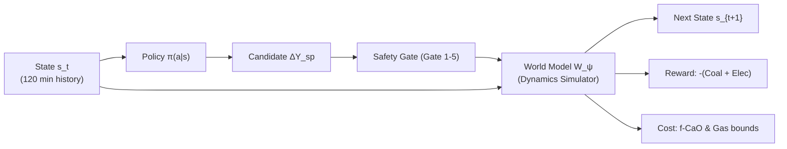

# Model-Based Reinforcement Learning Guidelines

> Guidelines for training RL policies using learned dynamics / world models (e.g., $W_\psi$ CSC-MTWaveSME) as an environment simulator.

---

## 1. Role of the World Model in Process Industry

In complex thermal processes like cement clinker calcination:
- Online trial-and-error on the real kiln is strictly prohibited.
- Offline logs have limited state-action coverage.
- **Solution**: Use the sequence-to-sequence dynamics model ($W_\psi$) as a world model to generate synthetic rollouts for policy improvement.

### Architectural Mapping
- **World Model ($W_\psi$)**: CSC-MTWaveSME model predicting 9 action-dependent channels (6 MV responses, coal consumption, electricity consumption, and clinker f-CaO).
- **Exogenous Predictor ($M_\phi$)**: QC-MTWaveSME predicting slow baseline variables and raw material conditions.
- **Policy ($\pi_\theta$)**: Generates incremental setpoints $a_t = \Delta Y^{sp}_t$ conditioned on state history.



---

## 2. Compounding Error & Short Rollout Protocol (MBPO / MOPO)

A fundamental risk of model-based RL is that model errors accumulate over time, creating "imaginary" trajectories where the policy exploits model flaws (reward hacking).

### Standards:
1. **Branching Rollouts**: Always start rollouts from real states sampled from the historical replay buffer $\mathcal{D}_{\text{env}}$, not from long recurrent imaginary trajectories.
2. **Short Rollout Horizon ($H$)**:
   - Initial stage: $H = 12$ steps ($12 \times 5\text{ min} = 60\text{ min}$).
   - Maximum allowable: $H = 72$ steps ($6\text{ hours}$).
   - Do NOT run open-loop rollouts beyond $H = 72$ without resetting or anchoring to real states.
3. **Uncertainty-Penalized Reward (MOPO)**:
   $$\tilde{r}(s, a) = \hat{r}(s, a) - \lambda \cdot u(s, a)$$
   where $u(s, a)$ is the epistemic uncertainty (e.g., ensemble variance or distance to coverage domain $d_{\text{sup}}$). When the agent steps into unfamiliar dynamics, the reward drops sharply.

---

## 3. Transition Dynamics Specification

The simulated environment interface (`WPsiKilnEnv` / `SimpleKilnEnv`) must conform to the following contract:

```python
class ModelBasedKilnEnv(gym.Env):
    """World-model based simulation wrapper."""
    def step(self, action: np.ndarray):
        # 1. Enforce bounded tracking hypothesis (A_trk)
        # CV setpoint clipped to safe rate and absolute range
        delta = np.clip(action, -1.0, 1.0) * RATE
        self.sp = np.clip(self.sp + delta, SP_LOW, SP_HIGH)
        
        # 2. Predict next state and metrics via world model W_psi
        # outputs: 6 MV responses, coal, electricity, f-CaO, O2
        next_obs, energy_metrics, uncertainty = self.world_model.predict(
            history=self.history_buffer,
            candidate_sp=self.sp
        )
        
        # 3. Compute penalized reward
        penalty = self.lambda_u * uncertainty
        reward = self.compute_reward(energy_metrics) - penalty
        
        # 4. Compute CMDP cost signals
        cost = self.compute_cost(energy_metrics)
        
        return next_obs, reward, False, self.t >= self.horizon, {"cost": cost}
```

---

## 4. Anti-Patterns & Pitfalls

- **Neglecting Model Discrepancy**: Never assume the world model is ground truth. A policy achieving high synthetic reward inside $W_\psi$ might exploit high-frequency prediction ripples.
- **Ignoring Tracking Dynamics**: DCS control loops do not track setpoints instantaneously. The simulator must incorporate inner-loop first-order lag or use $W_\psi$'s predicted MV tracking response.
