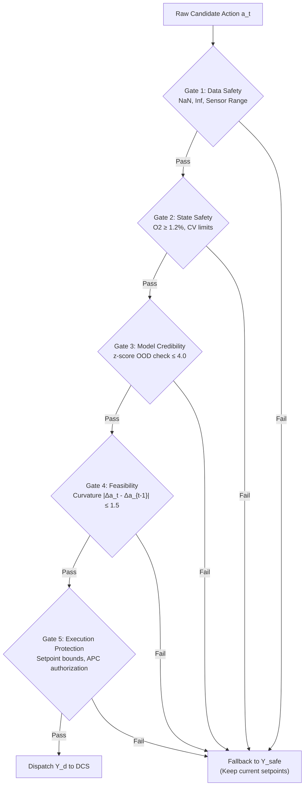

# Safe & Constrained Reinforcement Learning Guidelines

> Standards for safety constraints, CMDP formulation, Lagrangian relaxation, and the 5-layer Safety Gate.

---

## 1. CMDP Formulation vs. Ad-Hoc Reward Penalties

In industrial kiln operation, product quality (f-CaO within $[0.5, 1.5]\%$) and combustion safety ($O_2 \ge 1.2\%$) are hard operating boundaries. 

### Why Not Pure Reward Penalty ($r - \lambda c$)?
- If $\lambda$ is set too small: The policy sacrifices quality to lower coal consumption (reward hacking).
- If $\lambda$ is set too large: The policy becomes excessively conservative and refuses to make adjustments.

### CMDP Specification
$$\max_\pi \; \mathbb{E}_\pi \left[ \sum_{t=0}^\infty \gamma^t r(s_t, a_t) \right] \quad \text{s.t.} \quad \mathbb{E}_\pi \left[ \sum_{t=0}^\infty \gamma^t c_k(s_t, a_t) \right] \le d_k, \quad k \in \{q, \text{gas}, mv, \text{ood}\}$$

| Cost Category ($c_k$) | Definition | Threshold ($d_k$) | Corresponding Paper Constraint |
|---|---|---|---|
| $c_q$ (Quality) | $\max(0, 0.5 - q_t) + \max(0, q_t - 1.5)$ | $\le$ historical baseline cost | $J_q, v_q$ |
| $c_{\text{gas}}$ (Gas Safety) | $\max(0, 1.2 - O_2) + \max(0, CO - CO^{\max})$ | $\approx 0$ | Gate 2 |
| $c_{mv}$ (Actuator Bounds) | $W_\psi$ predicted MV rate / amplitude violations | $\approx 0$ | $v_{mv}$ |
| $c_{\text{ood}}$ (Distribution Coverage) | $\max(0, d_{\text{sup}}(s, a) - \eta)$ | $\approx 0$ | $v_{\text{sup}}$, Gate 3 |

---

## 2. Lagrangian Multiplier Optimization

Train actor and dual multiplier $\lambda_k$ alternately:
$$L(\theta, \lambda) = -J_r(\pi_\theta) + \sum_{k} \lambda_k \cdot (J_{c_k}(\pi_\theta) - d_k)$$
$$\lambda_k \leftarrow \max\left(0, \lambda_k + \eta_\lambda \cdot (\hat{J}_{c_k} - d_k)\right)$$

### Standard Implementation Rules:
- Clamp $\lambda_k$ with a maximum upper bound to prevent optimization divergence.
- Use a dedicated critic network $Q_c(s, a)$ to estimate the expected discounted cost.

---

## 3. The Five-Layer Safety Gate (Production Defense)

Even when an RL policy satisfies CMDP constraints during training, its real-time candidate actions must pass through the **Five-Layer Safety Gate** before being dispatched to DCS / APC.



### Safety Gate Implementation (`ref/RL运行指标决策/code/safety_gate.py`):
```python
class SafetyGate:
    def __call__(self, obs, sp_now, delta_norm):
        y_safe = np.zeros_like(delta_norm)
        
        # Gate 1: Data Safety
        if not np.all(np.isfinite(obs)):
            return y_safe, False, "Gate1"
            
        # Gate 2: State Safety (O2, critical temperatures/pressures)
        if obs[8] < 1.2 or np.any(obs[:3] < SP_LOW - 20) or np.any(obs[:3] > SP_HIGH + 20):
            return y_safe, False, "Gate2"
            
        # Gate 3: Model Credibility (OOD distance)
        z = np.abs((obs - self.mu) / self.sd)
        if np.max(z) > self.ood_thr:
            return y_safe, False, "Gate3"
            
        # Gate 4: Optimization Feasibility (Curvature / delta acceleration)
        d = np.clip(delta_norm, -1.0, 1.0)
        if np.max(np.abs(d - self.prev_delta)) > self.curv_thr:
            return y_safe, False, "Gate4"
            
        # Gate 5: Execution Protection (Absolute SP limits & APC enable)
        target = sp_now + d * RATE
        if (not self.apc) or np.any(target < SP_LOW) or np.any(target > SP_HIGH):
            return y_safe, False, "Gate5"
            
        self.prev_delta = d
        return d, True, None
```

---

## 4. Operational Modes
1. **Operator Advisory Mode (Shadow Mode)**:
   - Policy recommendations and gate status are displayed to operators.
   - Zero physical DCS writes.
2. **Supervised Closed-Loop Mode**:
   - Only enabled after explicit APC authorization.
   - Any single gate failure triggers an immediate fallback to $Y_{\text{safe}}$ (maintaining the existing operating setpoint).
