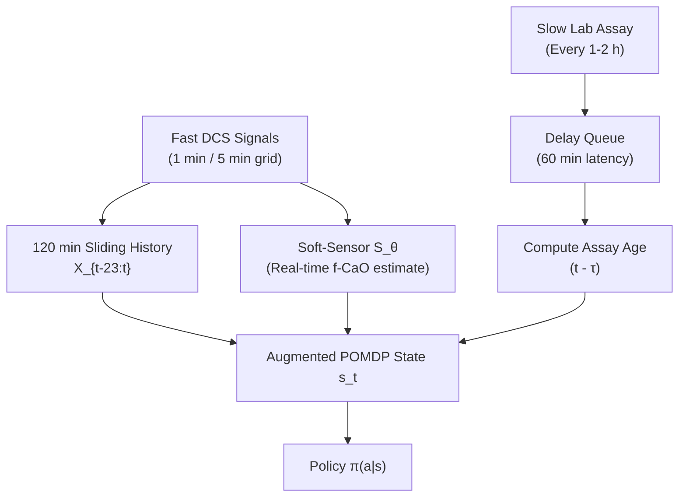

# Delays & POMDP Modeling Guidelines

> Strategies for handling long process time delays, laboratory latency, and partial observability.

---

## 1. The Physical Reality: Transport & Assay Delays

In a cement clinker rotary kiln:
- **Material Residence Time**: Material travels from the preheater C1 to the clinker discharge over approximately 40 to 60 minutes.
- **Laboratory Assay Latency**: Clinker samples are physically drawn every 1 to 2 hours, analyzed by wet chemistry or X-ray fluorescence, and published to DCS with a 30 to 60 minute delay.
- **Total Feedback Delay**: The true effect of a current setpoint change on free lime (f-CaO) is only measured 60 to 120 minutes later ($12 - 24$ steps at $\Delta t = 5\text{ min}$).

---

## 2. POMDP Mitigation via State Augmentation

Standard MDP algorithms assume current observation $o_t$ fulfills the Markov property ($P(s_{t+1}|s_t, a_t) = P(s_{t+1}|s_t, \dots, s_0)$). Because true f-CaO is delayed, $o_t$ alone is non-Markovian.

### Required State Augmentation Techniques:
1. **History Window Buffer ($X_{t-K:t}$)**:
   Include a sliding history window (e.g., past 120 minutes sampled at 5-minute intervals, length 24) to capture the thermal inertia gradient.
2. **Lab Assay Age ($t - \tau$)**:
   Explicitly feed the age (time elapsed since last chemical test) as an observation feature. This informs the value network how much uncertainty exists in the last reported laboratory metric.
3. **Soft-Sensor Integration ($S_\theta$)**:
   Use the high-frequency neural soft-sensor ($S_\theta$ OAM-Net) as a proxy observation feature for real-time unmeasured f-CaO.

---

## 3. Continuing Task Protocol: `truncated` vs `terminated`

Cement kilns run non-stop for months between scheduled refractory overhauls.
- **`terminated`**: Represents natural task termination (e.g., reaching a terminal goal or fatal failure state). Future value $V(s_{t+1})$ is zeroed out by $(1 - \text{done})$. In kiln environments, `terminated` should **always be `False`**.
- **`truncated`**: Represents artificial episodic cutoff (e.g., reaching the maximum training step horizon $H=72$). Future value bootstrapping must be preserved:
  $$y_t = r_t + \gamma \cdot (1 - \text{terminated}) \cdot Q(s_{t+1}, a_{t+1}) = r_t + \gamma \cdot Q(s_{t+1}, a_{t+1})$$

### Discount Factor Selection
Given $\Delta t = 5\text{ min}$:
- $\gamma = 0.98$ gives an effective time horizon of $\frac{1}{1 - \gamma} = 50\text{ steps} \approx 4.16\text{ hours}$.
- This horizon comfortably spans the 60–120 minute thermal lag and assay feedback delay.
