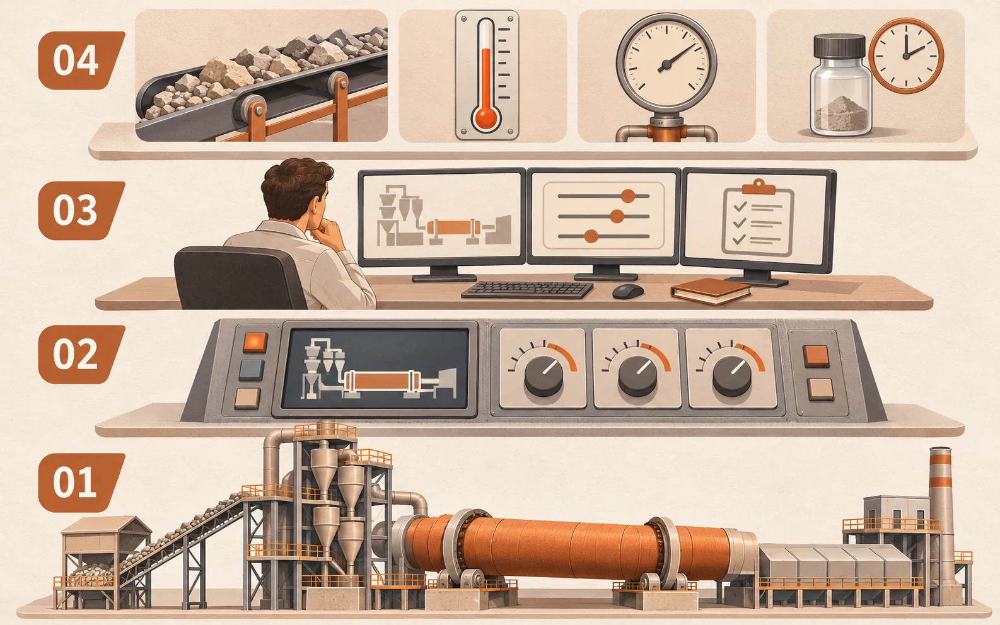

# RL Atlas · Reinforcement learning through cement calcination

[中文 README](README.md) · [Localization maintenance guide](docs/i18n.md)

RL Atlas is a complete Chinese and English learning site for researchers working on industrial process decisions. It assumes no systematic background in reinforcement learning or probability. Numerical examples introduce probability, expectation and gradients before applying Bellman equations, DQN, PPO, SAC, offline learning and constrained decisions to a cement kiln.

Both editions contain the complete chapters, derivations, code explanations, exercises, answers and research articles. The interface combines a warm orange light/dark theme with mathematical calculators, algorithm experiments and a delayed-process workbench.

**7 modules · 24 chapters · 154 derivation steps · 8 mathematical primer units · 14 experiments · 1 kiln workbench · 36 glossary entries**

**9 research articles · 27 figures: 20 Mermaid diagrams and 7 original concept illustrations · 59 deduplicated resources retaining 77 citation IDs**



The teaching sequence follows the motivating article's progression from a problem through mathematics, algorithms, implementation and experiments. The explanations, examples, exercises and illustrations were created for this project. The original promotional material, paid content and images are not redistributed.

## Run locally

Install **Node.js 22.12.0 or later**, npm and [just](https://just.systems/). From the repository root:

```bash
cd rl-learning-web
just dev
```

The setup step checks the Node version and installs the locked dependencies with `npm ci` when needed. A matching installation is reused. Open the address printed by Vite, normally **http://127.0.0.1:5173/**. Vite may select another port if that one is occupied.

See the [official just installation instructions](https://just.systems/man/en/packages.html). The justfile uses `cmd.exe` on Windows and does not require Bash or Python. The dependency preparation script handles platform differences; this design is distinct from a claim that every Windows environment has been tested. Without just, run `npm ci` followed by `npm run dev`.

The frontend needs no API key, account, database, Python environment or remote translation service. Development and preview servers listen on the local machine by default.

| Command | Purpose |
|---|---|
| `just` | List available recipes |
| `just dev` | Prepare dependencies and run Vite |
| `just book` | Export both complete textbooks and research reviews |
| `just test` | Run numerical and content checks |
| `just build` | Refresh exports and build the static site |
| `just check` | Refresh exports, run tests, check types and build |
| `just preview` | Build and preview the production files |

Production files appear in `dist/`. The preview normally runs at **http://127.0.0.1:4173/**. It is a local build check; production hosting should serve the generated static files.

## How to learn with the site

Start with the mathematical primer. Predict a calculator's result, change one input and explain the difference. Then open the kiln workbench and make a setpoint proposal: distinguish a requested action from the action that passes the gates, the changing physical process, an immediate soft-sensor estimate and a laboratory result released later.

Each chapter starts with a kiln scenario, a decision question, a symbol table and a sequence of derivation steps. Every step explains the equality or update, substitutes numbers and states why it is useful. Checkpoints give feedback for every option; answering one does not automatically mark a chapter complete. The full chapter follows with definitions, algorithms, examples, exercises and sources.

| Module | Chapters | Main outcome |
|---|---|---|
| Interaction, returns and exploration | 01–03 | Define a decision problem and calculate returns and expectations |
| MDPs, values and tabular control | 04–08 | Build small environments and understand Bellman, DP, MC/TD and SARSA/Q-learning |
| Deep value learning | 09–11 | Explain approximation, replay, target networks and maximization bias |
| Policy gradients, advantages and PPO | 12–15 | Derive policy updates and interpret clipping with either advantage sign |
| Continuous actions and SAC | 16–18 | Track Gaussian/tanh densities, entropy and algorithm assumptions |
| Modeling and credible experiments | 19–21 | Specify environment contracts, baselines, gates and evaluation |
| Offline, model-based and constrained decisions | 22–24 | Design a narrow reproducible research question |

The eight primer units cover notation and units, conditional probability, expectation, variance, discounting, gradients, log probabilities and continuous densities. The roadmap offers six-week and eight-week schedules with downloadable checklists. These schedules and reading times are planning estimates.

## Research, figures and resources

The research section has nine independently addressable articles under `#/research/<id>`:

| ID | Topic |
|---|---|
| `history` | Plantwide control and the role of supervisory operational decisions |
| `indicators` | Operational indicators, trade-offs and causal confounding |
| `objectives` | Units, aggregation, preferences, Pareto order and constraints |
| `evolution` | Evolutionary search, trajectory encoding and rolling execution |
| `sequential` | MDP, POMDP and CMDP formulations |
| `architecture` | History encoders, actors, critics, data paths and independent execution gates |
| `evidence` | What theory, simulation and first-party operational reports establish |
| `open-problems` | Model error, distribution shift, accumulated risk and statistical evidence |
| `agenda` | Six falsifiable experiments connecting the existing research modules |

The articles connect OAM-Net, QC-MTWaveSME, NURBS trajectories and PG-MOEA/D-IEpsilon with explicit assumptions, required logs, baselines, ablations and failure criteria. They do not present a proposed combination as a demonstrated industrial result. See the [source review](docs/research-review-v2.md) and [independent mathematics review](docs/review-mathematics-v2.md).

The figure library at `#/gallery` provides topic, format and keyword filters. Its 20 Mermaid diagrams retain editable source and SVG downloads. Seven image-generated illustrations comprise four research concepts and three original course guides. The separate identity icon is not counted among these 27 entries. Illustrative curves, network nodes and process layouts are not measured performance, exact network architecture or engineering drawings; accompanying equations, text and diagrams carry the precise claims. See [new illustration and identity provenance](docs/illustrations-v2.md) for the complete generation prompts; the [original three illustrations' provenance](docs/illustrations.md) remains available.

The resource catalogue at `#/references` supports topic, evidence-type and keyword filters. Resources are merged by URL while retaining all 77 citation IDs and links to relevant chapters and research articles. Global search covers the current edition's chapters, derivations, primer, research and glossary; resource and figure filters have their own indexes.

## Language switching and local preferences

The language selector switches between `zh-CN` and `en`. Both editions include the full learning and research content plus interactive explanations. English content loads from a local build chunk, without a translation API. See the [localization guide](docs/i18n.md) before adding another language: complete content bundles and UI text are both required.

Switching keeps the current route and attempts to restore scroll position, but **remounts the current page**. Temporary calculator inputs, experiment parameters, simulation histories and the workbench clock may reset. Record seeds and parameters before switching if you want to repeat a comparison.

Only chapter completion, theme, text size and locale are saved in the browser under `rl-atlas-preferences-v2`. When that key is absent, supported preferences can be read from `rl-atlas-learning-v1`. The old key is not deleted; old notes, bookmarks and last-read fields are ignored and are neither displayed nor written into the new state. Notes, bookmarks, resume-learning widgets and study-data JSON import/export are removed. Chapter, textbook, roadmap and figure downloads remain available.

Storage belongs to the current origin. Preferences do not automatically synchronize across domains, ports, browsers or devices. Clearing site data removes the saved preferences and completion records. If storage is blocked, current-session use does not imply successful persistence.

## What the interactive models calculate

The 14 experiments calculate discounted returns, bandit exploration, Bellman backups, gridworld values, MC/TD/n-step targets, tabular cliff control, replay and target copies, maximization bias, REINFORCE updates, GAE, PPO clipping, continuous densities and entropy, seed-level uncertainty, and gate decisions. Random demonstrations use seeded local generators. The browser is not running a hidden deep-RL training service.

The replay example is a scalar model, and the continuous-policy experiment evaluates a fixed policy rather than training SAC. The one-dimensional gate experiment is a pedagogical abstraction. See [experiment scope](docs/labs.md) for the precise boundaries.

The kiln workbench uses three normalized setpoint increments for calciner temperature, secondary-air temperature and hood pressure, scaled by `[2°C, 5°C, 5Pa]` per five-minute step. These are a teaching subset of the full project's six CVs. With seed 42 in the stable scenario, `[1,0,0]` changes the first SP from 880°C to 882°C while its PV moves only to about 880.468°C. The response is delayed rather than instantaneous.

Assay sample and release times are distinct. Policies cannot read unreleased assays or hidden teaching truth. A rejected action holds SP while time and dynamics continue. Reward components and quality/oxygen costs remain separate. At the 72-step window boundary, `truncated=true` and `terminated=false`. Formulas, assumptions and reproduction examples are in the [English workbench model specification](docs/kiln-workbench.en.md).

### Optional Python examples

These scripts are independent of the frontend:

```bash
python public/code/tabular_foundations.py --method q_learning --seed 42
python public/code/tabular_foundations.py --method sarsa --seed 42
python public/code/advanced_math_checks.py
```

The first two files use only the Python standard library. The Gymnasium example additionally needs its listed dependencies:

```bash
python -m pip install -r public/code/requirements.txt
python public/code/advanced_toy_env.py
```

The toy environment has no industrial quality or energy model and no equipment connection. Its results are not kiln energy-saving evidence.

## Complete Markdown exports

Run `just book` or `npm run export:book`. One invocation generates six files:

| Output | Chinese | English |
|---|---|---|
| Repository textbook | [docs/rl-atlas-tutorial.md](docs/rl-atlas-tutorial.md) | [docs/rl-atlas-tutorial.en.md](docs/rl-atlas-tutorial.en.md) |
| Site-download textbook | [public/rl-atlas-tutorial.md](public/rl-atlas-tutorial.md) | [public/rl-atlas-tutorial.en.md](public/rl-atlas-tutorial.en.md) |
| Standalone research review | [public/code/research-review.md](public/code/research-review.md) | [public/code/research-review.en.md](public/code/research-review.en.md) |

Each textbook includes all chapters, primer units, derivation steps, checkpoint feedback, exercise answers, research articles, glossary entries and the corresponding workbench appendix. Equations, code, Mermaid source, concept-figure explanations and source-ID mappings are retained. The review contains all nine research articles. Keep referenced image/code directories when relocating the files, and use a Markdown reader with mathematics and Mermaid support.

Edit the canonical content, not these generated files. `npm run build` only checks types and bundles the application; `just build` and `just check` refresh exports first.

## Structure and maintenance

| Location | Responsibility |
|---|---|
| `src/content/` and `src/content/en/` | Complete Chinese and English learning content |
| `src/i18n.ts`, `src/content/localized.ts` | Locale contracts, messages and active content bundles |
| `src/research/` | Bilingual articles, sources and research pages |
| `src/figures.ts`, `src/source-catalogue.ts`, `src/catalogue.ts` | Figure/resource records, classifications and search views |
| `src/learning.ts`, `src/primer-calculators.ts` | Derivation readers and primer interactions |
| `src/labs/`, `src/kiln/` | Numerical experiments and the teaching workbench |
| `src/render.ts` | Sanitized Markdown, KaTeX, Mermaid and code tools |
| `src/storage.ts` | Versioned local preferences and completion |
| `src/main.ts`, `src/style.css`, `src/atlas.css` | Routing, shell, themes and responsive layout |
| `scripts/export-book.ts` | Complete bilingual exports |
| `justfile`, `scripts/ensure-deps.mjs` | Cross-platform startup and dependency preparation |

The site uses Vite, TypeScript, Marked, DOMPurify, KaTeX, Mermaid and Lucide. Mathematical and illustration assets are provided locally by the build. Keep chapter, lab, research and source IDs stable. Changes to meaning, numbers or exercises must be reflected in both editions.

`just check` refreshes exports, runs numerical/content checks and builds with strict type checking. Tests do not launch a browser. Use a real browser to verify locale switching, feedback, cleanup, search, diagrams, narrow layouts and both themes; consult [v2 verification records](docs/verification-v2.md) for their recorded scope. Translation records cover [foundations](docs/translation-foundations.md) and [advanced material](docs/translation-advanced.md).

## Static hosting

The app uses hash routing and Vite `base: './'`, so it can be served at a domain root or repository subpath without route-rewrite rules. Access built files through HTTP(S).

Set the hosting project root to `rl-learning-web`, install with `npm ci`, run `npm run export:book && npm run build`, and publish `dist/`. No backend command, environment variables or API keys are required. For CI validation, run export before `npm test`, then build. GitHub Pages can use its [official custom-workflow guide](https://docs.github.com/en/pages/getting-started-with-github-pages/using-custom-workflows-with-github-pages), uploading `rl-learning-web/dist`. These instructions do not imply that a public deployment has already been enabled.

## Industrial boundaries

The agent proposes bounded CV setpoint increments; DCS/PID/APC retains regulatory control. Candidate proposals pass the five-layer safety gate, and reward remains separate from constrained quality/oxygen costs. Thresholds are project-specific, as documented in the [repository contract](../AGENTS.md), rather than universal engineering standards.

The site contains no production logs, trained world-model weights, complete industrial training pipeline, or original PG-MOEA/D-IEpsilon implementation. It does not claim a trained policy is ready for a live kiln or that simulations establish field energy savings. Experimental interaction belongs in simulation; the next industrial research step requires traceable data, formal environments, original baselines and a fixed evaluation protocol.
