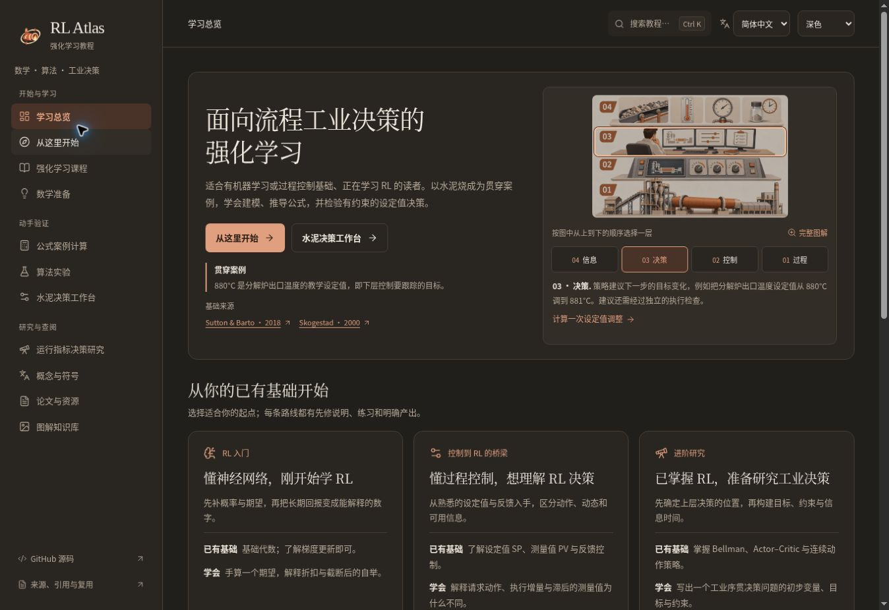
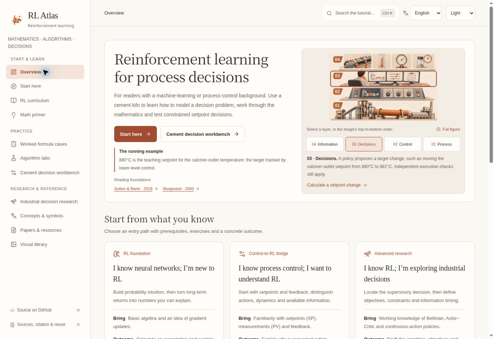
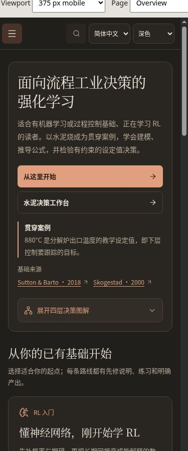

# RL Atlas：学习体验优化验证记录

日期：2026-11-14（项目会话日期；执行环境 UTC 时间为 2026-11-15）。基线：`ca36ca3`。范围和逐项评审判断见[优化规划](experience-review-plan.md)。

## 结论

本轮完成首页定位、分组导航、三种学习入口、按当前选择导出的学习计划、系统主题与可读性改进。最终代码通过 75 项测试、完整双语导出、严格 TypeScript 检查及生产构建。浏览器实际检查覆盖中英文首页、浅色/深色/跟随系统选择、窄屏布局、图解键盘操作、搜索、计划下载、PPO 算例与工作台状态。

本次检查没有变更正式课程正文或数值内核，不构成全站无障碍认证、跨浏览器认证或工业策略验证。

## 自动检查

从 `rl-learning-web/` 执行以下命令，等价于项目 `just check` 的核心检查步骤：

```bash
npm run export:book
npm test
npm run build
```

最终运行环境为 Linux、Node 24.22.1、Vite 8.3.8。临时响应式验收页面已在最终构建前删除。

| 检查 | 实际结果 |
|---|---|
| 双语导出 | 六份教材与研究综述重新生成成功；生成文件相对基线无内容变更 |
| 完整测试 | 75 项通过，0 失败、0 跳过 |
| 公式渲染 | 225 份作者文档中的 2279 条公式通过检查 |
| 内容保留 | 67 份非图片正文指纹与 3 个数值内核保持一致 |
| 图解资源 | 中英文共 50 个不同的实际图片资产通过检查 |
| 学习入口 | 两种语言的入口资源有效，推荐章节与先修链接存在；未知入口安全回退 |
| 完成记录 | 仅统计已知章节的去重手动标记，不因访问入口产生完成记录 |
| 六周/八周计划 | 两种安排各包含全部 24 章一次；导出匹配周数、语言、入口、完成状态 |
| 偏好兼容 | 旧显式主题保留；system 正确解析；不回写已移除的笔记、收藏或最近阅读字段；存储不可用时返回失败并保留可用默认值 |
| TypeScript 与生产构建 | `tsc --noEmit` 与 Vite 构建通过 |

新增回归集中在 `tests/learning-paths.test.ts` 和 `tests/preferences.test.ts`。路线视图从 `main.ts` 提取后，`tests/figures.test.ts` 同时确认主路由调用新视图，以及新视图仍引用原来的路线图，保留图片覆盖约束。

## 浏览器交互检查

使用 Chrome 的受支持预览环境加载本地应用。桌面实际视口为 1363 × 936；响应式检查使用同源测试框架调节页面宽度，没有把这些结果称为实体手机测试。

| 场景 | 实际观察 |
|---|---|
| 中文/英文首页 | 主标题明确 RL 与流程工业决策，只有一个 H1、一个语言选择器；温度测点、来源链接、三条路径与工具用途均呈现 |
| 图解层级 | 标签按 04 信息→03 决策→02 控制→01 过程排列；点击和方向键改变说明与选中态，键盘焦点同步移动 |
| 手机图解 | 初始折叠；原生 summary 可用 Enter 展开；跨到桌面断点后恢复展开 |
| 手机导航 | 可打开侧栏并以 Escape 关闭，关闭后 `aria-expanded=false`；原有隐藏侧栏 inert 行为保留 |
| 背景路径 | `ml`、`control`、`rl` 页面正常展示；控制背景路径包含先修、约 50 分钟首轮活动及当前浏览器的手动完成统计 |
| 学习清单下载 | 在英文控制背景路径选择六周后，实际下载成功；读取到 `6-week study checklist`，包含控制背景、50 分钟估计、六个周次与 24 章 |
| 全局搜索 | Ctrl+K 打开搜索；输入 PPO 后首项为第 15 章，同时出现对应算例和研究结果；Escape 关闭 |
| PPO 算例 | 输入 old=0.2、new=0.3、advantage=-2、epsilon=0.2，显示 ratio=1.5、maximized surrogate=-3；清空 advantage 后隐藏旧结果并提示输入无效 |
| 主题与公式输入 | 同一算例切换深色和跟随系统后 advantage 仍为 -2；系统模式显示当时系统的浅色外观及对应提示 |
| 主题与工作台状态 | 初始种子 42、T꜀ 候选 +1，执行一步后为 5 min / Step 1，SP=882.00°C、PV=880.47°C；切换深色后这些值和候选动作保留 |
| 中文图资产 | PPO 图解详情切换到中文时使用 `images/diagrams/zh-CN/chapter-15-diagram-1.webp` |
| 应用错误 | 本次检查捕获的应用来源控制台日志中没有 error；浏览器扩展自身的消息错误不归因于应用 |

## 布局与颜色检查

375px 测试框架中的正文可用宽度为 360px（剩余宽度为滚动条）。首页、`roadmap/ml`、`roadmap/rl`、课程目录、PPO 算例、工作台和 PPO 图解页的 `scrollWidth` 与 `clientWidth` 相等，未观察到页面横向溢出。首页还检查了 768、1280、1440px 框架宽度，扣除滚动条后的内容宽度分别为 753、1265、1425px。

首页布局在本轮迭代中继续压缩了非必要占位：1280px 框架内，英文首页主体介绍区约 448px 高，学习路径标题约在 579px 处；375px 框架内，折叠图解后中文路径标题约在 653px，英文约在 766px。它们是本次环境中的布局测量，不是所有字体、浏览器或缩放比例下的固定承诺。

浅色主题调整 `--muted` 为 `#6d6359`、`--brand` 为 `#a14b30`。对 `--bg`、`--surface`、`--surface-soft`、`--brand-soft` 四个常用背景计算相对亮度后，最低对比度分别约为 **4.69:1** 和 **4.71:1**。深色主题已有对应文本色保留。导航条目字号提高到 13px，组标题 11px，侧栏底部链接 12px；导航条目最小高度 44px，主要顶部控件 40px，手机图解 summary 48px，并保留可见焦点样式。

目标依据为 [W3C Contrast (Minimum)](https://www.w3.org/WAI/WCAG22/Understanding/contrast-minimum.html) 与 [W3C Target Size (Minimum)](https://www.w3.org/WAI/WCAG22/Understanding/target-size-minimum.html)。这里只报告实际修改的颜色组合和控件，不推定整站所有历史组件都已满足全部 WCAG 条件。

## 截图

中文深色桌面首页：



英文浅色桌面首页：



375px 响应式测试框架中的中文首页（顶部可见测试框架控件，不属于产品）：



## 验证边界与后续范围

- 系统深色/浅色解析由纯函数测试覆盖；浏览器验证了 system 选择及当时系统外观。没有直接修改宿主操作系统外观，因此不把 OS 动态切换描述为已经现场操作验证。
- 检查使用 Chrome 桌面浏览器和窄框架，未执行实体 iOS/Android、Safari、屏幕阅读器或高缩放比例矩阵。后续无障碍专项可补齐这些检查。
- 语言切换仍重新挂载当前页面，临时算例、工作台和六周/八周选择可能重置；主题切换不重新挂载。这两个行为已经在 README 中分别说明。
- 手动完成记录表示用户自己的学习记录，不代表知识测评或跨设备同步。笔记、收藏、继续学习和阅读历史仍按此前决定移除。
- 新增第三语言、课程扩展、部署站点以及决定项目许可证均不是本轮范围。引用与复用说明如实记录仓库尚无明确 LICENSE。
