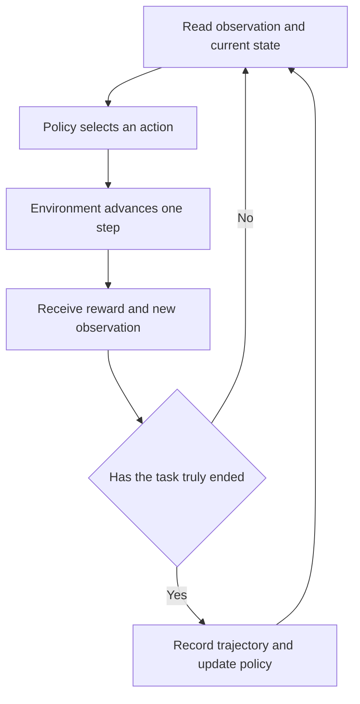
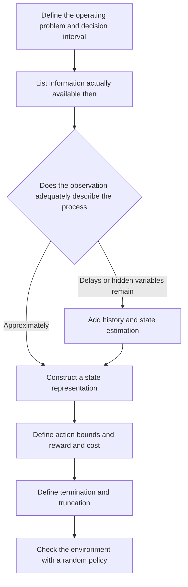
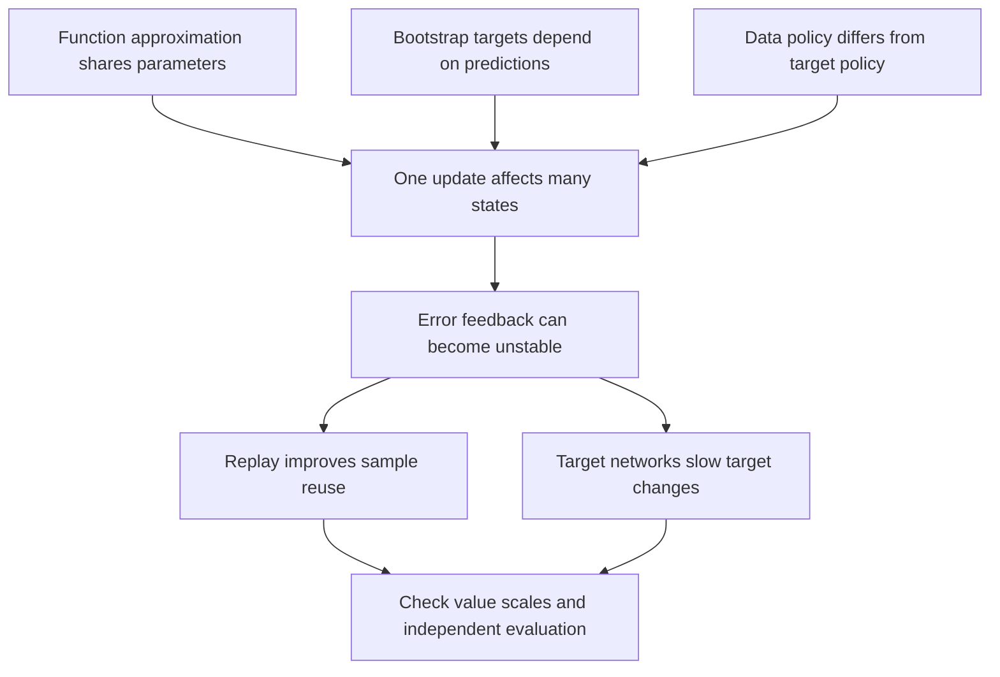
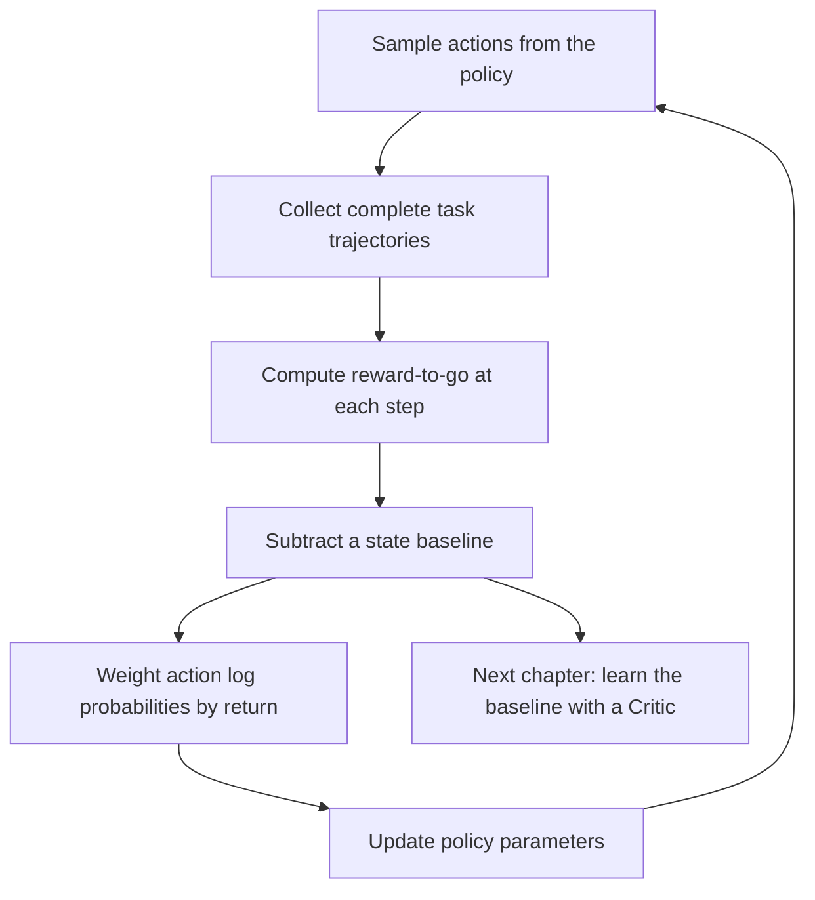
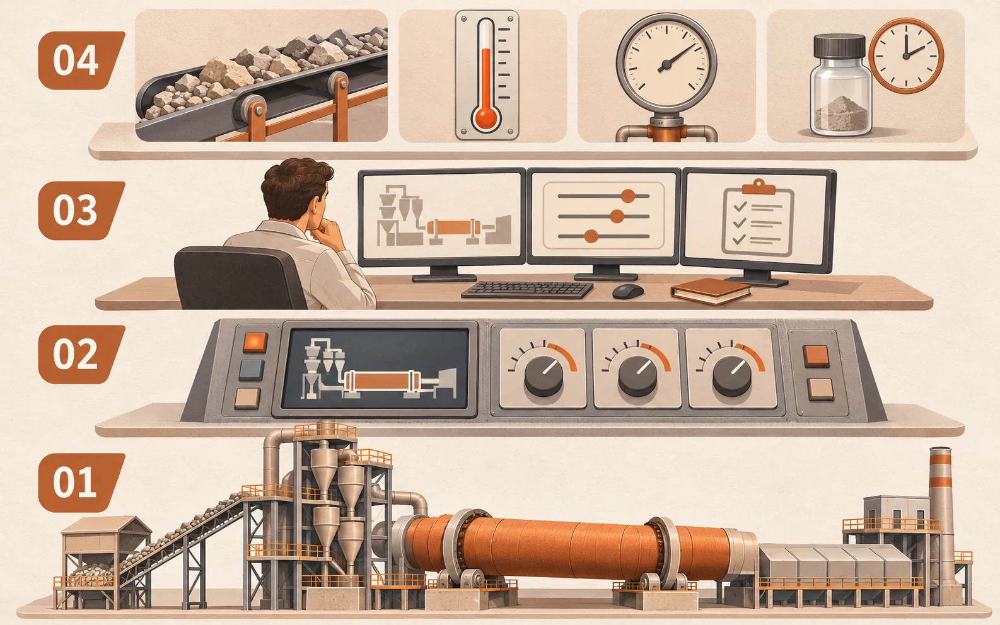
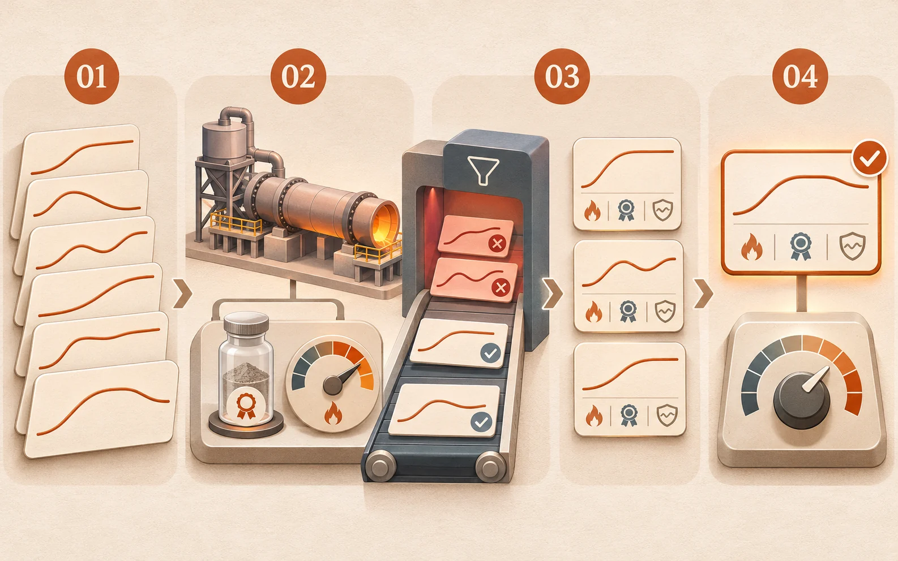
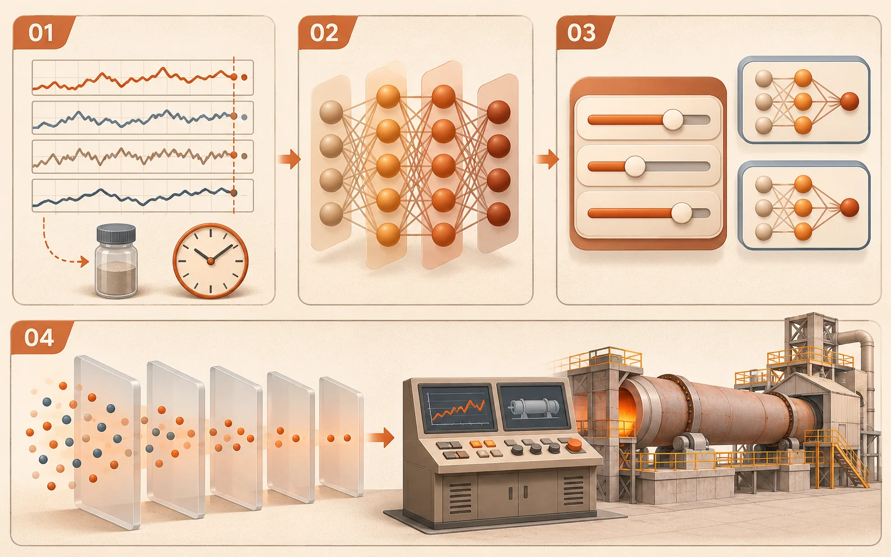
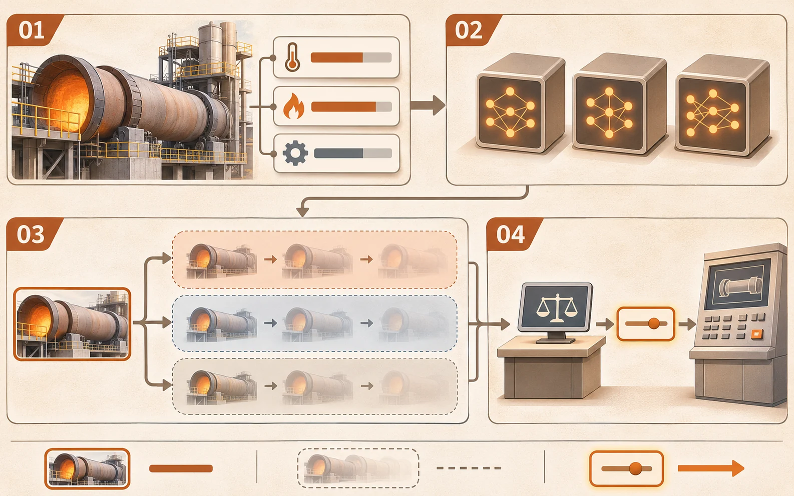

# RL Atlas | Reinforcement Learning: From Intuition to Decisions

> Complete English edition · 8 mathematics units · 24 guided cement-case derivations · 7 modules / 24 chapters · 9 complete research studies · Glossary, workbench model, equations, Mermaid, code, exercises, and answers.

The learning path is problem → mathematics → algorithm → code → experiment → credible conclusion. First explain the decision problem, then understand why each algorithm exists, what it addresses, and which limitations remain.

The structure was inspired by the user-provided public article [“Reinforcement-learning pitfalls that 90% of beginners misunderstand”](https://mp.weixin.qq.com/s/x3Jb7imrQtbavvU1vH8Tww). The text, worked examples, exercises, and code were independently authored, with references in each chapter and at the end. This file contains the complete textbook and requires no purchase of the article’s advertised course.

## How to use this tutorial

- **Predict, then verify.** Calculate each example and explain the update direction before opening its interactive web experiment.
- **Follow the dependencies.** Readers familiar with neural networks may skim that introduction, but should retain conditional expectation, Bellman equations, and termination semantics.
- **Separate mechanisms from evidence.** Browser experiments explain numerical behavior. Small simulations do not establish industrial energy savings.
- **Preserve units and timing.** Industrial examples use operational setpoint increments, retain inner control and execution gates, and have no connection to real equipment.
- **Inspect primary sources.** Mathematical and interface references are traceable; retain theorem assumptions and experimental limits.

A suggested first pass takes six to eight weeks, adjusted to your schedule: interaction, probability, and tabular methods in weeks one and two; DQN in week three; actor–critic, PPO, and SAC in weeks four and five; environment and evaluation design in week six; then one or two weeks connecting offline, model-based, and constrained methods to your research. This is a planning suggestion, not a learning-outcome or completion-time guarantee.

Mathematics remains in LaTeX and flowcharts in Mermaid source for compatible Markdown readers. Illustrations use relative paths: preserve the accompanying images and code directory structure when moving files. The complete text and derivations require no online translation.

## Contents

- [Mathematics: from symbols to calculable examples](#math-primer)
- [Module 1 · Interaction, returns and exploration](#module-1)
  - [01 · From one action to long-term return](#chapter-01)
  - [02 · Multi-armed bandits: what does exploration cost?](#chapter-02)
  - [03 · Enough probability: from samples to expectations](#chapter-03)
- [Module 2 · MDPs, values and tabular control](#module-2)
  - [04 · MDPs and POMDPs: define the problem first](#chapter-04)
  - [05 · Bellman equations: reduce the future to one step](#chapter-05)
  - [06 · Dynamic programming: planning with a known model](#chapter-06)
  - [07 · MC, TD and n-step: which target are we learning toward?](#chapter-07)
  - [08 · SARSA and Q-learning: whose behavior is being learned?](#chapter-08)
- [Module 3 · From Q tables to deep value learning](#module-3)
  - [09 · Function approximation: from Q tables to shared parameters](#chapter-09)
  - [10 · DQN: separate an unstable learning loop](#chapter-10)
  - [11 · Double DQN: do not let the same noise select and evaluate](#chapter-11)
- [Module 4 · Policy gradients, advantages and PPO](#module-4)
  - [12 · REINFORCE: learn action probabilities directly](#chapter-12)
  - [13 · Actor–Critic and GAE](#chapter-13)
  - [14 · Importance Sampling and Trust Regions](#chapter-14)
  - [15 · Unpacking the PPO Clipped Objective](#chapter-15)
- [Module 5 · Continuous actions and SAC](#module-5)
  - [16 · Continuous Actions and Tanh-Gaussian Policies](#chapter-16)
  - [17 · Maximum Entropy and SAC](#chapter-17)
  - [18 · Choose an Algorithm for the Problem](#chapter-18)
- [Module 6 · Independent modelling and credible experiments](#module-6)
  - [19 · Turn a Real Problem into a Verifiable Environment](#chapter-19)
  - [20 · Build a Credible Reinforcement Learning Experiment](#chapter-20)
  - [21 · Capstone: Setpoint Decisions for a Kiln System](#chapter-21)
- [Module 7 · Offline, model-based and constrained decisions](#module-7)
  - [22 · Offline Reinforcement Learning: From Logs to Policies](#chapter-22)
  - [23 · Model Learning, Dyna, and Short Rollouts](#chapter-23)
  - [24 · Constrained RL and a Complete Research Cycle](#chapter-24)
- [Cement workbench: model, timing, and experiments](#kiln-workbench)
- [Operational decision research](#research)
  - [01 · From plantwide control to operational decisions](#research-history)
  - [02 · Operational indicators, trade-offs and confounding](#research-indicators)
  - [03 · From indicators to objectives, Pareto order and constraints](#research-objectives)
  - [04 · Evolutionary optimization: Pareto search and rolling trajectories](#research-evolution)
  - [05 · From operational optimization to MDPs, POMDPs and CMDPs](#research-sequential)
  - [06 · Neural and data paths for an auditable supervisory agent](#research-architecture)
  - [07 · Evidence map: theory, simulation, field operation and open claims](#research-evidence)
  - [08 · Open problems: from accurate prediction to credible decisions](#research-open-problems)
  - [09 · Research agenda: six falsifiable questions connecting existing modules](#research-agenda)
- [Concept and symbol glossary](#glossary)
- [Complete references](#references)
- [Source-ID index](#source-index)

---

<a id="math-primer"></a>

## Mathematics: from symbols to calculable examples

Treat mathematics as a language for describing decisions. Start each time with a small cement-kiln problem, identify the symbols, substitute numbers, and adjust the parameters. Explain why the numbers change before moving on to the main chapters. The probabilities, rewards, and response coefficients here are teaching assumptions, not plant statistics or operating advice.

<a id="math-language"></a>

### Math 1 · Read the symbols, units, and timeline first

Read a transition as one complete setpoint decision.

#### Begin with a scene you can picture

It is 10:00, and the calciner outlet temperature setpoint is 880°C. You can see temperature, pressure, oxygen content, changes over the last two hours, and quality assays that have already been released. Your task is to propose the next setpoint adjustment. The lower APC/PID layer then determines how to track that setpoint.

Suppose the maximum allowed adjustment is 2°C every 5 minutes. The policy outputs a dimensionless number $a_t=0.5$. This does not mean that the temperature is 0.5°C, or that coal feed increases by 50%. It means half of the allowed adjustment range:

$$\Delta T_t^{sp}=2a_t=2\times0.5=1\;^\circ\mathrm C.$$

The candidate setpoint is therefore $880+1=881^\circ\mathrm C$. The setpoint becomes 881°C only after the gates approve it; the measured temperature does not become 881°C at that same instant. The setpoint is a target, while the process variable is the actual response.

#### What subscripts and superscripts mean

| Notation | How to read it | In this example |
|---|---|---|
| $t$ | The current decision step | The instant 10:00 |
| $t+1$ | The next decision step | The instant 10:05 |
| $T_t$ | The temperature measurement at step $t$ | The actual current temperature |
| $T_t^{sp}$ | The temperature setpoint at step $t$ | The superscript sp labels a setpoint; it is **not a power** |
| $a_t$ | The normalized action chosen now | Here, 0.5 |
| $r_{t+1}$ | Immediate feedback received after this action | The energy-use and action-smoothness score for 10:00–10:05 |
| $G_t$ | Cumulative return from now onward | Immediate feedback and more distant consequences considered together |
| $\pi_\theta$ | A policy with parameters $\theta$ | A rule or network that chooses actions from observations |

$\Delta$ means a change. The hat on $\hat q$ means an estimate. The bar in $\bar F$ denotes a reference mean. $\|\mathbf a\|^2$ means squaring each action component and adding the results. These symbols are not a code you must memorize first. Whenever you meet one, ask what quantity it represents, what its units are, and when it becomes available.

#### Why an experience sample has this form

$$\bigl(o_t,\;a_t,\;r_{t+1},\;o_{t+1}\bigr).$$

Read it in causal time order: first observe $o_t$, then choose $a_t$. The environment evolves over these 5 minutes, after which you receive $r_{t+1}$ and the new observation $o_{t+1}$. These four items form one transition. Policy learning needs to know what was done under which circumstances and what happened afterward. A temperature table with no action records is therefore insufficient.

When safety gates are present, log the requested action and the action actually executed separately. If a gate rejects a request to increase temperature and the setpoint is held, the subsequent outcome cannot be treated as experience from a successfully executed increase. Store the requested SP, executed SP, MV, gate reason, and takeover flag together.

#### Why the latest assay may not describe current quality

A sample is collected at 09:00 and released at 09:40. At 10:00, the policy may already use it, but it describes the quality of earlier material. A sample collected at 10:00 whose result is released at 10:40 cannot appear in the decision input at 10:00.

When something happened and when it became known are two different times. The later discussions of POMDPs, soft sensors, data splitting, and world models all use this distinction.

**Applied in chapters:** [Chapter 01](#chapter-01); [Chapter 04](#chapter-04); [Chapter 19](#chapter-19)

**Interactive web component:** The corresponding math unit provides a parameter calculator for the same problem. Its written derivation and initial values are preserved here.

---

<a id="math-probability"></a>

### Math 2 · Probability and conditional probability

Why can the same temperature increase have different consequences?

#### Start with counts

Suppose a teaching dataset contains 100 small temperature increases under similar kiln conditions. In 70 cases, the temperature returns to a stable range at the next step; in 30, it remains low. We use the frequency 70/100=0.7 to estimate the probability of recovery. This number describes uncertainty across repeated situations. It does not guarantee that the next attempt will recover.

Let $A$ denote recovery at the next step, so $P(A)=0.7$. Remaining low is another, mutually exclusive outcome, with probability $1-0.7=0.3$. If these two outcomes cover all possibilities, their probabilities must sum to 1.

#### The vertical bar is not a division sign

$$P(A\mid B)=\frac{P(A\cap B)}{P(B)},\qquad P(B)>0.$$

Read $P(A\mid B)$ as the probability that $A$ occurs given that we already know $B$. The notation $A\cap B$ means that both events occur.

Suppose 40 of the 100 records involve raw meal that is harder to burn, and 20 of those recover. We now consider only those 40 records, so the denominator changes from 100 to 40:

$$P(\text{recovery}\mid\text{hard to burn})=\frac{20}{40}=0.5.$$

The other 60 records involve normal raw meal, and 50 recover, giving a conditional probability of $50/60\approx0.8333$. There are still 70 recoveries overall, but knowing the raw-meal condition changes the prediction for the next step. That is the value of conditioning information.

#### Why transition probabilities include both state and action

$$P(s_{t+1}=s'\mid s_t=s,a_t=a).$$

This is the probability of reaching $s'$ at the next step, given the current kiln condition $s$ and the executed action $a$. The same action may behave differently under different conditions; different actions may also behave differently under the same condition. One fixed success rate for increasing temperature cannot describe the entire operating range.

In real historical data, operators often make large adjustments precisely when conditions are poor. Directly comparing the averages of adjusted and unadjusted records mixes in differences in the original conditions. The conditional probabilities above belong to a teaching model; they do not automatically establish an action's causal effect. Practical modeling requires action information, state coverage, and analysis of confounding factors.

#### Where joint probability and Bayes' rule come from

The definition of conditional probability gives $P(A\cap B)=P(A\mid B)P(B)$. Reversing the events, the same joint probability also equals $P(B\mid A)P(A)$, so:

$$P(B\mid A)=\frac{P(A\mid B)P(B)}{P(A)},\qquad P(A)>0.$$

Suppose you know only that recovery did not occur and want to infer how likely hard-to-burn raw meal was. In the teaching data, 20 cases involve both hard-to-burn meal and no recovery, out of 30 cases without recovery in total. The probability is therefore $20/30=2/3$. This revises a judgment after observing an outcome. It does not mean that one failed recovery establishes a raw-meal fault.

**Applied in chapters:** [Chapter 02](#chapter-02); [Chapter 03](#chapter-03); [Chapter 04](#chapter-04)

**Interactive web component:** The corresponding math unit provides a parameter calculator for the same problem. Its written derivation and initial values are preserved here.

---

<a id="math-expectation"></a>

### Math 3 · Expectation and total expectation

Weight possible consequences by how likely they are.

#### An action's value is more than its best outcome

In the teaching environment, a small temperature increase can have two outcomes: a return of 3 with probability 0.7, or a return of −2 with probability 0.3. These returns are dimensionless scores we define, not 3 kWh or −2°C. Over 100 repetitions, if observed frequencies are close to the model, roughly 70 trials score 3 and 30 score −2. Their average is:

$$\frac{70\times3+30\times(-2)}{100}=1.5.$$

Replacing each count divided by the total count with its probability gives the expectation:

$$\mathbb E[R]=\sum_i p_i r_i=0.7\times3+0.3\times(-2)=1.5.$$

$\mathbb E$ denotes expectation, and $\sum_i$ means adding the terms for outcomes 1, 2, and so on. An expectation of 1.5 does not require any individual trial to produce exactly 1.5. In this example, an individual trial can produce only 3 or −2.

#### Why not simply average the two outcomes?

$(3+(-2))/2=0.5$ silently assumes that the two outcomes each have probability one half. That contradicts the stated probabilities 0.7 and 0.3. To compute an expectation, list all outcomes first, list their probabilities, check that the probabilities sum to 1, and then multiply and add term by term.

For two random quantities, even without independence:

$$\mathbb E[X+\gamma Y]=\mathbb E[X]+\gamma\mathbb E[Y].$$

This is linearity of expectation. It holds because the same weighted sum can be split into two parts. It does not claim that the future and the present have no influence on each other. In contrast, $\mathbb E[XY]=\mathbb E[X]\mathbb E[Y]$ does not hold in general; it requires additional conditions.

#### Total expectation: average within regimes, then across regimes

Suppose normal raw meal accounts for 60% of cases and hard-to-burn raw meal for 40%. An action's conditional expected returns in the two regimes are 2 and −1, respectively. Its overall expectation is:

$$\mathbb E[R]=0.6\times2+0.4\times(-1)=0.8.$$

This is the law of total expectation:

$$\mathbb E[R]=\sum_s P(S=s)\mathbb E[R\mid S=s].$$

The outer average weights operating regimes; the inner average weights the possible outcomes within a regime. The Bellman equation repeatedly does the same thing: average the consequences of different branches, first over actions and then over next states.

#### How does a sample mean relate to a mathematical expectation?

In a real system, the full probabilities are usually unknown. Instead, we observe $N$ return samples and use:

$$\widehat{\mathbb E[R]}=\frac1N\sum_{i=1}^{N}r_i.$$

The hat reminds us that this is an estimate. Too few samples, correlation in sequential data, and changes in the distribution of operating conditions can all make the estimate unstable. Replay buffers, batch updates, evaluation across multiple seeds, and confidence intervals all take seriously the fact that we have observed only a finite sample.

Energy reward and quality cost can each have an expectation, but they remain different quantities. An attractive average reward cannot replace checking the probability of a quality-limit violation.

**Applied in chapters:** [Chapter 03](#chapter-03); [Chapter 05](#chapter-05)

**Interactive web component:** The corresponding math unit provides a parameter calculator for the same problem. Its written derivation and initial values are preserved here.

---

<a id="math-variance"></a>

### Math 4 · Variance, samples, and uncertainty

The same average can hide very different fluctuations.

#### Why the mean alone is not enough

Policy A obtains $[2,2,2,2]$ in four teaching rollouts, while policy B obtains $[-4,8,-4,8]$. Both have a mean return of 2, but B's individual outcomes vary substantially. Showing only its best score of 8 would conceal its failures.

First compute the mean $\mu$, then each outcome's deviation from that mean, square each deviation, and finally average using the probabilities:

$$\mathrm{Var}(R)=\mathbb E[(R-\mu)^2].$$

For B, the two possible outcomes each have probability one half:

$$\mathrm{Var}(R)=0.5(-4-2)^2+0.5(8-2)^2=36.$$

The standard deviation is the square root of the variance: $\sigma=\sqrt{36}=6$. It therefore has the same units as the return again. Squaring prevents positive and negative deviations from canceling and gives greater weight to large deviations.

#### Two denominators that are easy to confuse

If these four outcomes constitute the entire discrete distribution we have defined, each with probability 1/4, dividing by 4 gives that distribution's variance. If they are only four independent and identically distributed samples from an unknown population, a common choice is the unbiased sample variance:

$$s^2=\frac{1}{N-1}\sum_{i=1}^{N}(r_i-\bar r)^2.$$

Why $N-1$? We first estimated the mean from the same data, so the distances of the samples from their own mean tend to be too small. For independent and identically distributed samples with an existing second moment, this correction exactly removes that bias. Dividing an arbitrary industrial time-series segment by $N-1$ does not automatically solve its correlation problem.

#### Why averaging more samples usually improves stability

For independent and identically distributed samples with finite variance:

$$\mathrm{Var}(\bar R)=\frac{\sigma^2}{N},\qquad
\mathrm{SE}(\bar R)\approx\frac{s}{\sqrt N}.$$

Under independence, cross-covariances are zero. The variance of the sum is $N\sigma^2$; dividing by $N^2$ then gives $\sigma^2/N$. Strongly correlated samples require the covariances to be considered as well. Adjacent 5-minute kiln records are usually not independent experiments. All points in one long trajectory cannot be treated as independent seeds.

#### Bias, variance, and model uncertainty

Bias is a systematic estimation error; variance is the variation of an estimate across repeated samples. A quality model that consistently reports values 0.2% too low can have little variance but substantial bias. More data with the same bias will not automatically repair instrument bias or temporal leakage.

In RL, a full return contains many random future influences and may have high variance. TD uses an estimated future value and may introduce bias. GAE's $\lambda$ is a tradeoff between these sources, rather than a knob for which larger is always better. Industrial evaluation must also report constraint violations, worst operating regimes, and takeover rates. Variance cannot stand in for safety metrics.

**Applied in chapters:** [Chapter 07](#chapter-07); [Chapter 13](#chapter-13); [Chapter 20](#chapter-20)

**Interactive web component:** The corresponding math unit provides a parameter calculator for the same problem. Its written derivation and initial values are preserved here.

---

<a id="math-discount"></a>

### Math 5 · Sums, discounting, and recursion

Why multiply the future by γ, and how can an infinite future become a one-step relation?

#### Start with a finite trajectory

Suppose a three-step teaching rollout produces rewards $[-1,2,3]$. The first step incurs a small adjustment cost, and the next two produce benefits. With discount factor $\gamma=0.9$:

$$G_0=-1+0.9\times2+0.9^2\times3=-1+1.8+2.43=3.23.$$

The first term is not discounted: immediate feedback after the current action has weight 1. The second term is one step farther away, so it receives one factor of $\gamma$; the third is two steps farther away, so it receives two factors. The plus one in the subscript of $r_{t+1}$ does not mean that it should receive one factor of $\gamma$.

#### A summation sign abbreviates a pattern

$$G_t=\sum_{k=0}^{T-t-1}\gamma^k r_{t+k+1}.$$

Setting $k=0$ gives $r_{t+1}$; setting $k=1$ gives $\gamma r_{t+2}$, and so on. If a summation is hard to read, write out its first three terms. The structure usually becomes clear.

#### Derive the recurrence one step at a time

$$G_t=r_{t+1}+\gamma r_{t+2}+\gamma^2r_{t+3}+\cdots.$$

Keep the first term and factor out $\gamma$ from all the others:

$$G_t=r_{t+1}+\gamma\bigl(r_{t+2}+\gamma r_{t+3}+\cdots\bigr).$$

The expression in parentheses is exactly the return starting at the next step, $G_{t+1}$, so:

$$G_t=r_{t+1}+\gamma G_{t+1}.$$

This is only an algebraic rearrangement. It does not yet involve estimation, optimization, or neural networks. Taking its conditional expectation in the later value-function discussion gives the Bellman relationship.

#### Why discount, and how does it relate to 5-minute decisions?

Discounting can express decreasing weight on more distant outcomes. With bounded rewards and $0\le\gamma<1$, it also helps the infinite sum converge. Suppose every reward is always 1. Multiplying the finite sum by $\gamma$ and subtracting gives:

$$1+\gamma+\cdots+\gamma^{n-1}=\frac{1-\gamma^n}{1-\gamma}
\longrightarrow\frac1{1-\gamma}.$$

$1/(1-\gamma)$ is a rough effective number of steps corresponding to the total weight. It is not a point beyond which the agent can no longer see. Separating the first $H$ rewards from the remaining tail return gives:

$$G_t=\sum_{k=0}^{H-1}\gamma^kR_{t+k+1}+\gamma^H G_{t+H}.$$

With 5-minute steps and $\gamma=0.98$, 60 minutes corresponds to $H=12$. The coefficient on the **tail value** after that instant is $0.98^{12}\approx0.785$; after 120 minutes, the tail coefficient is approximately 0.616. If the question instead concerns the single reward received at 60 minutes, $R_{t+12}$, that is the twelfth term in the sum and its coefficient is $\gamma^{11}$. The first reward $R_{t+1}$ is undiscounted, which explains the difference of one power. Discounting affects how strongly delayed quality consequences propagate backward. Real delays still require the right states, models, and data.

If preference is expressed through a half-life of $H$ minutes, require $\gamma^{H/5}=1/2$, giving $\gamma=2^{-5/H}$. Choose the discount factor in relation to the evaluation objective and delay analysis, rather than automatically reusing a constant.

**Applied in chapters:** [Chapter 01](#chapter-01); [Chapter 05](#chapter-05); [Chapter 07](#chapter-07)

**Interactive web component:** The corresponding math unit provides a parameter calculator for the same problem. Its written derivation and initial values are preserved here.

---

<a id="math-gradient"></a>

### Math 6 · Derivatives, the chain rule, and gradient updates

Turn “reduce prediction error” into an update you can calculate by hand.

#### A derivative asks which way an output moves when a parameter changes

Consider a tiny value network with only one parameter: $\hat V_\theta(x)=\theta x$. The input $x$ is a normalized operating-condition feature, $\theta$ is a learnable weight, and the target is $y=3$. Measure the distance between the prediction and target using squared error:

$$L(\theta)=\frac12\bigl(\theta x-y\bigr)^2.$$

Why a square? Positive and negative errors both become nonnegative, large errors receive a stronger penalty, and the derivative is simple. The factor 1/2 merely cancels the factor 2 produced when differentiating the square.

#### Split a complicated expression into two simple functions

First let $z=\theta x-y$, so $L=z^2/2$. The rate at which the inner quantity $z$ changes with $\theta$ is $x$; the rate at which the outer quantity $L$ changes with $z$ is $z$. The chain rule multiplies the rates along this path:

$$\frac{\partial L}{\partial\theta}
=\frac{\partial L}{\partial z}\frac{\partial z}{\partial\theta}
=z\,x=(\theta x-y)x.$$

$\partial$ denotes a partial derivative: when there is more than one parameter, first ask what happens when only one changes. Putting the partial derivatives of all parameters into a vector gives the gradient $\nabla_\theta L$.

#### Substitute a complete set of numbers

For $x=2,\theta=0.5,y=3$, the prediction is $0.5\times2=1$, the error is $1-3=-2$, the loss is $(-2)^2/2=2$, and the gradient is $-2\times2=-4$.

Gradient descent moves in the direction opposite to the gradient:

$$\theta_{\mathrm{new}}=\theta-\eta\nabla_\theta L.$$

With learning rate $\eta=0.1$, the new parameter is $0.5-0.1(-4)=0.9$, the new prediction is 1.8, and the new loss is $(1.8-3)^2/2=0.72$. This update reduced the loss. A step that is too large can overshoot the minimum or even increase the loss; the calculator below makes that visible.

#### Why the Critic descends while the Actor often ascends

The Critic usually minimizes error, so its update uses a minus sign. The policy aims to maximize expected return $J(\theta)$ and can use $\theta\leftarrow\theta+\eta\nabla_\theta J$. Alternatively, define the loss as $L_\pi=-J$ and use descent throughout. Read the sign in code together with its objective; the word gradient alone does not determine the direction.

A TD target contains an estimate of the next state's value. Treating that target as a differentiable function of the same current parameters changes the update into a different problem. DQN commonly freezes a target network or stops gradients through the target, differentiating only the current prediction. This is the idea behind a semi-gradient update. It has conditions of applicability and does not guarantee stability for every combination of function approximation and off-policy data.

**Applied in chapters:** [Chapter 09](#chapter-09); [Chapter 12](#chapter-12); [Chapter 17](#chapter-17)

**Interactive web component:** The corresponding math unit provides a parameter calculator for the same problem. Its written derivation and initial values are preserved here.

---

<a id="math-log"></a>

### Math 7 · Logarithms, products of probabilities, and policy gradients

Why does log_prob appear so often in RL code?

#### Why a trajectory probability is a product

Consider a teaching policy that chooses a small increase twice in succession, with conditional probabilities 0.6 and 0.7. Each probability already conditions on the observation at its own time step. Looking only at policy choices, the action-probability factor along this given state sequence is $0.6\times0.7=0.42$.

A complete trajectory also includes the initial-state probability and environment transition probabilities. This is not arbitrary multiplication of two marginal probabilities; it repeatedly applies the probability chain rule:

$$P_\theta(\tau)=p(s_0)\prod_{t=0}^{T-1}\pi_\theta(a_t\mid s_t)\,p(s_{t+1}\mid s_t,a_t).$$

$\prod$ means multiply the terms together. $\tau$ denotes an entire trajectory, not one time instant.

#### Logarithms turn products into sums

$$\log(xy)=\log x+\log y,\qquad x,y>0.$$

Here log usually means the natural logarithm. Taking the logarithm of a trajectory probability lets us add the log probabilities at each step. If the environment transition itself does not contain the policy parameters $\theta$, the direct derivatives of those environment terms with respect to $\theta$ are zero:

$$\nabla_\theta\log P_\theta(\tau)
=\sum_t\nabla_\theta\log\pi_\theta(a_t\mid s_t).$$

This does not mean that actions have no effect on the environment. They still change the distribution of subsequent states. It means that, for a given trajectory, the environment probability function does not contain the policy weights we are training.

#### The log-derivative trick is an algebraic identity

For a positive, differentiable probability $p_\theta$:

$$\nabla_\theta\log p_\theta=\frac{\nabla_\theta p_\theta}{p_\theta}
\quad\Longrightarrow\quad
\nabla_\theta p_\theta=p_\theta\nabla_\theta\log p_\theta.$$

Why rewrite it this way? The derivative of expected return originally contains $\nabla P_\theta(\tau)$. After replacing it with the right-hand side, we can put $P_\theta(\tau)$ back into an expectation weighted by trajectory probability, then estimate the gradient from sampled trajectories:

$$\nabla_\theta J(\theta)
=\mathbb E_{\tau\sim P_\theta}\left[G(\tau)\nabla_\theta\log P_\theta(\tau)\right].$$

The derivation assumes conditions under which differentiation can be interchanged with integration or summation. It does not differentiate the reward itself, so the environment need not supply an analytical derivative of temperature with respect to its setpoint.

#### Why PPO also needs a new-to-old probability ratio

If the same action has probability 0.2 under the old policy and 0.3 under the new policy, the ratio is $0.3/0.2=1.5$. We can also subtract log probabilities and exponentiate:

$$\rho=\exp\bigl(\log\pi_{\mathrm{new}}-\log\pi_{\mathrm{old}}\bigr).$$

The ratio measures how much more common this sampled action becomes relative to the old policy. It does not multiply temperature by 1.5. If the old probability is zero while the new probability is positive, the old data cannot cover this term at all, and a ratio correction cannot be computed. This connects to the action-support problem in offline RL.

**Applied in chapters:** [Chapter 12](#chapter-12); [Chapter 14](#chapter-14); [Chapter 15](#chapter-15)

**Interactive web component:** The corresponding math unit provides a parameter calculator for the same problem. Its written derivation and initial values are preserved here.

---

<a id="math-density"></a>

### Math 8 · Continuous actions, densities, and change of variables

Why can a density exceed 1, and why must tanh change the log probability?

#### Move from three buttons to a slider

A discrete policy can assign probabilities to three actions: decrease, hold, and increase. A continuous policy allows any action value between −1 and 1. We cannot give every point a positive probability and then add them all. Instead, a probability density $p(a)$ represents probability through area over an interval:

$$P(l\le A\le u)=\int_l^u p(a)\,da.$$

An initial intuition for an integral is to add the areas of many very narrow rectangles. A uniform distribution on $[0,0.5]$ has density 2, but its total area is $2\times0.5=1$. Density 2 is therefore valid; it is not an event probability of 200%.

#### Three quantities in a Gaussian policy

$$U=\mu+\sigma\epsilon,\qquad \epsilon\sim\mathcal N(0,1),\quad\sigma>0.$$

$\mu$ determines the center, $\sigma$ the spread, and $\epsilon$ is standard normal noise. Given $\epsilon$, $U$ is a differentiable function of $\mu,\sigma$. This is reparameterization: randomness lives in a noise source separate from the parameters being learned.

A Gaussian has no upper or lower bound. Many continuous-control policies therefore generate $U$ first, then map it into $(-1,1)$ using $A=\tanh U$. Only afterward do they multiply by a physical rate limit, such as $\Delta T^{sp}=2A$.

#### Compress coordinates while preserving probability mass

The probability mass of the same small interval must agree before and after transformation:

$$p_A(a)\,da=p_U(u)\,du.$$

Therefore:

$$p_A(a)=p_U(u)\left|\frac{du}{da}\right|
=\frac{p_U(u)}{\left|da/du\right|}.$$

Since $\frac{d}{du}\tanh u=1-\tanh^2u=1-a^2$, we obtain:

$$\log p_A(a)=\log p_U(u)-\log(1-a^2).$$

Near a boundary, tanh compresses a longer interval of $u$ into a shorter interval of $a$. Relative to **the original Gaussian density at that same $u$**, the density must increase by the interval-compression factor. Its absolute value still depends on the Gaussian tail. This does not imply that density must rise as the action approaches $\pm1$; for a Gaussian with finite mean and positive finite variance, the transformed density eventually tends to zero at the boundaries. Without the Jacobian correction, entropy and policy gradients use a distribution other than that of the candidate action after tanh. If a later gate replaces the candidate with a hold action, it changes the distribution of actions actually executed again.

#### What changes when the action is expressed in °C?

If $\Delta T=2A$, then $\log p_{\Delta T}(\Delta T)=\log p_A(A)-\log2$. This constant does not change some parameter gradients under a fixed scale, but it affects reported densities and entropies, as well as the units used for the temperature objective.

tanh bounds only the magnitude of the current proposal. Repeated proposals can still move the cumulative setpoint beyond mechanical limits; even small individual actions can lead to unsafe operating conditions. State, data support, execution boundaries, and quality costs therefore require separate checks.

**Applied in chapters:** [Chapter 16](#chapter-16); [Chapter 17](#chapter-17)

**Interactive web component:** The corresponding math unit provides a parameter calculator for the same problem. Its written derivation and initial values are preserved here.

---

<a id="module-1"></a>

## Module 1 · Interaction, returns and exploration

Start with a choice, then understand delayed returns and the value of exploration.

**After this module:** Describe a real decision problem and calculate its return.

<a id="chapter-01"></a>

### 01 · From one action to long-term return

*Connect the agent, environment and feedback before discussing algorithms.*

**Level:** Foundation · **Reading and calculation estimate:** 30 minutes (adjust to your background)

**Learning objectives**

- Distinguish supervised prediction from sequential decision-making
- Write a trajectory with consistent time indices
- Calculate discounted return and explain the discount factor

**Companion web experiment:** return (open in the website’s Interactive Labs)

#### Derive it step by step with the cement case

##### Current scenario

Start at one concrete decision point: the calciner outlet temperature setpoint is 880°C, while its measured temperature is 878°C. Every 5 minutes, the supervisory policy may propose a normalized increment a between −1 and 1, scaled by 2°C. We expand only this channel for hand calculations; the formal system retains its other channels, history, soft measurements, latest released assay and assay age. Every trial takes place in a teaching simulator.

**The question: ** When measured temperature is slightly low, why are predicting the next temperature and deciding whether to propose an 881°C setpoint different tasks?

**Build the intuition: ** Prediction asks what may happen given a specified action. Decision-making must also compare the long-term consequences of alternatives. Reinforcement learning uses feedback to improve that comparison. In this project it operates at the operational-decision layer; DCS/APC control loops still track setpoints below it. Identify who observes, proposes and executes before studying an algorithm.

##### Symbols and process meaning

| Symbol | Name | Meaning in the kiln case |
|---|---|---|
| $T_{c,t}^{\mathrm{sp}}$ | Current temperature setpoint | Unit: °C. The target the calciner outlet temperature should track, not necessarily the temperature measured at this instant. |
| $a_t$ | Normalized candidate action | Dimensionless, in [−1,1]. Multiplying by 2°C gives the setpoint increment proposed for this 5-minute decision. |
| $o_t$ | Currently available information | A collection of sensor history, setpoints, soft measurements and released assays with their respective units; it does not directly observe every physical state inside the kiln. |
| $r_{t+1}$ | Reward after the action | A normalized teaching score summarizing the following interval’s fuel, electricity and action smoothness; quality constraint cost is excluded. |
| $c_{q,t+1}$ | Quality constraint cost | Measured here as percentage-point deviation of f-CaO outside its bounds, recorded separately. Quality comes from simulator truth or correctly aligned assays. |
| $G_t$ | Return from the current decision | The sum of discounted reward scores, comparing an action’s effect across subsequent 5-minute intervals. |

##### Step 1: Separate the measured value, setpoint and action

The superscript sp means setpoint; temperature without that superscript is the measured quantity. Subscript t identifies decision number t, not degrees Celsius. Normalization places physical channels on a common −1 to 1 scale, while each channel’s rate limit determines the actual allowed change.

$$
T_{c,t}=878^\circ\mathrm C,\quad T_{c,t}^{\mathrm{sp}}=880^\circ\mathrm C,\quad \Delta T_{c,t}^{\mathrm{sp}}=(2^\circ\mathrm C)a_t
$$

**Substitute numbers:**

a=0 holds 880°C; a=0.5 adds 2×0.5=1°C; a=−1 subtracts 2°C. An action of 0.5 means neither a 0.5°C increase nor opening a fuel valve to 50%.

**Why this step matters:**

Early implementations often confuse actions with actuator openings or setpoints with instantly achievable measurements. Checking units and control layers eliminates both modeling errors before writing a learning algorithm.

##### Step 2: A prediction model describes consequences; a policy chooses

f is a predictor: given available information and a specified action, it predicts temperature. π is a policy: given information, it outputs an action or action probabilities. The ∼ symbol means sampling from a distribution, and the vertical bar means “conditional on.” A predictor alone supplies no criterion for choosing among actions.

$$
\widehat T_{c,t+1}=f(o_t,a_t),\qquad a_t\sim\pi(\cdot\mid o_t)
$$

**Substitute numbers:**

A teaching model might predict 878.5°C next if the setpoint is held and 878.8°C if a 1°C increase is proposed. These predictions alone do not identify the lower long-term fuel use or establish whether future f-CaO stays within bounds. The policy must compare long-term reward while respecting constraints.

**Why this step matters:**

Supervised learning usually fits predictive relationships between historical inputs and labels. RL learns action rules that affect subsequent data and return. They can cooperate: soft sensors enrich observations, a world model predicts consequences, and a policy chooses a candidate.

##### Step 3: Gate a candidate before passing it to lower-level control

cand means proposed, not executed. The project checks data, current state, model credibility, action feasibility and execution authorization through five gates. Only after all pass may the simulated DCS/APC receive the candidate. Lower-level loops adjust manipulated variables, and temperature responds gradually through process dynamics.

$$
T_{c,t+1}^{\mathrm{sp,cand}}=880+2(0.5)=881,\qquad Y_d=\begin{cases}Y_{\mathrm{cand}},&\text{all gates pass},\\Y_{\mathrm{safe}},&\text{otherwise}.\end{cases}
$$

**Substitute numbers:**

Even though 881°C lies within the project’s 860–900°C setpoint range, an out-of-distribution model input or missing APC authorization requires maintaining the safe setpoint. A range check is only one condition; clipping an action does not prove it safe.

**Why this step matters:**

Hierarchical control preserves the responsibility of existing regulation loops. These calculations concern supervisory proposals, neither bypassing lower-level control nor authorizing exploration on a physical kiln. Every later action comparison retains this boundary.

##### Step 4: Record a transition in its actual temporal order

A transition records one step: observe current information, propose an action, then collect the following interval’s feedback and next available information. The t+1 subscript emphasizes that reward follows action. Costs may occupy extra fields; the four-tuple shorthand does not remove them.

$$
(o_t,a_t)\longrightarrow(r_{t+1},c_{t+1},o_{t+1}),\qquad \mathcal D\ni(o_t,a_t,r_{t+1},o_{t+1})
$$

**Substitute numbers:**

At 10:00, observe setpoint 880°C and temperature 878°C and propose an increase of 1°C. At 10:05, collect that interval’s energy score and updated sensor history. An assay newly released at 10:05 may describe an earlier sample; it is not automatically the immediate quality consequence of the 10:00 action.

**Why this step matters:**

Thermal inertia, material transport and assay publication all introduce delays. Recording sample times, release times and action history supports learning delayed effects. Assigning a newly published assay directly to the latest action corrupts the feedback timeline.

##### Step 5: Reward and cost are separate channels

z standardizes fuel and electricity by subtracting reference means and dividing by reference scales. The squared smoothness terms use the executed increment, marked exec: it equals the proposal if gates pass and is zero when fallback holds the setpoint. q uses percentage values, so 1.8 means 1.8% f-CaO. Quality cost is separate; energy reward must not cancel a violation.

$$
r_{t+1}=-(w_f z_{F,t+1}+w_e z_{E,t+1})-w_s\!\left((a_t^{\mathrm{exec}})^2+(a_t^{\mathrm{exec}}-a_{t-1}^{\mathrm{exec}})^2\right),\quad c_{q,t+1}=\max(0,0.5-q_{t+1})+\max(0,q_{t+1}-1.5)
$$

**Substitute numbers:**

Suppose energy contributes +0.8 points and smoothness subtracts 0.2: reward is 0.6. If simulator truth is q=1.8%, quality cost is max(0,−1.3)+max(0,0.3)=0.3 percentage points. Positive reward does not establish constraint satisfaction.

**Why this step matters:**

“Recorded independently” means separate data and objective channels, not statistical independence. Energy use and quality can be correlated and require joint study in constrained decisions. The 0.5–1.5% range is this project’s contract, not a universal standard for every cement process.

##### Step 6: Discount rewards at different times back to the present

Uppercase R is an unrealized random reward; lowercase r is an observed value. Summation adds the term for each k. k=0 refers to the next interval, so the first weight is 1. γ is the discount factor; 0.9 is chosen for easy arithmetic, with another factor applied per decision interval.

$$
G_t=\sum_{k=0}^{\infty}\gamma^kR_{t+k+1},\qquad 1+0.9(-0.5)+0.9^2(2)=2.17
$$

**Substitute numbers:**

For rewards 1, −0.5 and 2, the first three contributions sum to 1−0.45+1.62=2.17. A continuously operating kiln still has a future after those intervals, so this is a finite prefix. Complete return includes later terms or an explicitly identified tail-value estimate.

**Why this step matters:**

An adjustment that uses slightly more energy now may create a more stable future. Optimizing only the next reward can miss it. Return and agent–environment interaction follow [Sutton and Barto’s textbook](https://mitpress.mit.edu/9780262039246/reinforcement-learning/).

##### Check your understanding

The current setpoint is 880°C and the policy outputs a=0.5. Which interpretation is correct?

1. Instantly make the measured outlet temperature 881°C and attribute the latest assay to this action.
2. Propose 881°C, pass the five gates, then let lower-level loops track it while aligning quality feedback in time.
3. Directly set the fuel actuator to 50%, because the action is normalized.

**Correct option: 2.**

- Option 1: A setpoint is not a measurement, and a thermal process does not track instantly. A newly released assay can concern an old sample and does not establish an immediate causal effect.
- Option 2: Correct. 2°C×0.5=1°C gives a supervisory candidate setpoint. Gates, lower-level dynamics and feedback delays remain.
- Option 3: Normalization scales a setpoint increment using that channel’s rate limit. The project forbids bypassing DCS/APC to manipulate actuators directly.

**Take it into your research:** RL learns which candidate action to propose from available information for long-term benefit under constraints. Temperature prediction, setpoint proposals, lower-level regulation and delayed quality observations have distinct roles. A correctly timed transition connects them.

#### From the case to the full explanation

#### First ask: what are we trying to learn?

Suppose you have an accurate temperature predictor. It answers, “If the current conditions continue, how hot might it be in ten minutes?” An operator needs a different answer: “How should I adjust the setpoint now to keep energy consumption low and quality stable over the next hour?” Prediction describes what may happen; decision-making also compares the consequences of actions. Reinforcement learning studies this loop: **actions change the future, and feedback changes subsequent actions**.

Before turning the problem into an algorithm, separate five roles. The agent is the rule or program making choices; the environment is the process outside those choices; the state is information used for decisions; an action is something the program is permitted to change; and a reward is a numerical assessment of an outcome. A policy $\pi(a\mid s)$ gives the probability of choosing action $a$ in state $s$. A policy need not be a neural network: a table or a rule can also be a policy. See [Sutton and Barto’s textbook](https://mitpress.mit.edu/9780262039246/reinforcement-learning/) for the terminology.

In this tutorial’s industrial case, the agent proposes **bounded increments to operational setpoints** every five minutes, and lower-level control loops track them. It does not directly drive fans or valves. For now, consider an example requiring no industrial background: a warehouse robot can immediately collect a low-value item or take a detour for a more valuable one. It must compare the reward along the entire route.

#### A consistent timeline: reward follows action

We use $S_t,A_t,R_{t+1},S_{t+1}$ throughout: observe $S_t$, choose $A_t$, then receive $R_{t+1}$ and $S_{t+1}$ from the environment. Some papers call the same reward $r_t$. That is a different indexing convention, so align the entire convention when transferring equations.



A policy update can happen at every step or after collecting a batch. Interaction and learning have different clocks: sampling the environment once does not restrict a neural network to one update.

#### Why not consider only the immediate reward?

Discounted return from time $t$ is defined as:

$$G_t=\sum_{k=0}^{T-t-1}\gamma^kR_{t+k+1},\qquad 0\leq\gamma\leq1.$$

For three rewards $[2,-1,5]$ with $\gamma=0.9$, $G_0=2-0.9+0.81\times5=5.15$. A route that earns 4 immediately and ends has return 4. The first route starts with a smaller reward but is preferable under this objective. With $\gamma=0.2$, its return is only 2, and the preference reverses. **Changing the discount factor changes the objective, not merely the speed of training.**

For a continuing task, bounded rewards and $\gamma<1$ allow the infinite sum to converge. $1/(1-\gamma)$ provides a rough effective step scale, not a strict planning endpoint. Using the same $\gamma$ for five-minute and one-minute steps implies different preferences over physical time; recalibrate when comparing sampling intervals.

Here is a complete return-calculation function. Accumulating backward avoids recomputing the entire suffix for every starting point:

```python
def discounted_returns(rewards, gamma):
    result = [0.0] * len(rewards)
    running = 0.0
    for t in range(len(rewards) - 1, -1, -1):
        running = rewards[t] + gamma * running
        result[t] = running
    return result

assert abs(discounted_returns([2, -1, 5], 0.9)[0] - 5.15) < 1e-9
```

#### Return, value and objective are different quantities

The $G_t$ from one realized trajectory is a random sample. A value function takes an expectation of such samples under specified conditions. A learning objective usually also averages over an initial-state distribution. One unusually high exploration return does not establish that a policy improved. Independent evaluation, multiple environment seeds and baseline comparisons are needed.

Reward is not a naturally given “correct answer.” Rewarding only throughput can sacrifice quality; rewarding only steadiness can encourage never adjusting anything. Industrial quality and environmental boundaries should be explicit constraints, reported separately rather than hidden by an aggregate score. The warehouse example has no safety constraints and is not an industrial deployment design.

#### Separate termination from interruption

Reaching a goal that ends the task is termination. Cutting a continuing process into one hundred steps to limit computation is truncation. Both require resetting the sampler, but the state after truncation can still have future value. [Gymnasium’s official explanation](https://gymnasium.farama.org/tutorials/gymnasium_basics/handling_time_limits/) distinguishes these signals. TD, DQN and GAE will all depend on this distinction.

Open the return experiment. Predict how increasing $\gamma$ changes the contribution of distant rewards, then move the slider. Recording the difference between your prediction and the outcome is more useful than simply watching an animation.

#### Treat the decision interval as part of the model

“Increase once” every five seconds and every five minutes produces very different cumulative changes. First decide how long an action is held, then define the interval covered by its reward. If action durations vary, revisit the temporal meaning of an ordinary fixed-step MDP; do not casually concatenate log segments of different lengths into adjacent transitions.

For a first project, make a timing table: when the observation formed, when the action was issued, when the lower-level loop executed it, which interval the reward belongs to, and when the quality result became available. Every row should use only information available then. You will know which five minutes $r_{t+1}$ describes and which material batch an assay belongs to, rather than maintaining consistency only in mathematical subscripts.

#### Exercises and answers

One route gives rewards $[0,0,10]$, another $[6]$. For which discount factors is the first preferable? Should future value be set to zero if the process merely reaches a sampling limit?

<details><summary>View the worked answer</summary>

The first return is $10\gamma^2$, so it is preferable when $\gamma>\sqrt{0.6}\approx0.7746$; equality gives a tie. An external sampling limit is truncation, so normally retain a bootstrap value for the final observation. If the task itself declares that the last instant is the endpoint, it is a finite-horizon task: include remaining time in the state and set subsequent return to zero at the true endpoint.

</details>

#### Chapter references

- [R1](#reference-1) · [Reinforcement Learning: An Introduction, 2nd edition](https://mitpress.mit.edu/9780262039246/reinforcement-learning/) — Richard S. Sutton · Andrew G. Barto; 2018. Source ID: f-sutton.
- [R6](#reference-6) · [Handling Time Limits](https://gymnasium.farama.org/tutorials/gymnasium_basics/handling_time_limits/) — Farama Foundation; Maintained resource. Source ID: f-gym.

---

<a id="chapter-02"></a>

### 02 · Multi-armed bandits: what does exploration cost?

*Understand why information matters in the simplest decision problem.*

**Level:** Foundation · **Reading and calculation estimate:** 35 minutes (adjust to your background)

**Prerequisites:** [01 · From one action to long-term return](#chapter-01)

**Learning objectives**

- Implement an incremental mean and ε-greedy
- Explain the uncertainty bonus in UCB
- Distinguish realized reward from pseudo-regret

**Companion web experiment:** bandit (open in the website’s Interactive Labs)

#### Derive it step by step with the cement case

##### Current scenario

Reset the teaching simulator to the same 880°C setpoint and history before each trial. Compare two gated candidates: H has a=0 and holds 880°C; U has a=0.5 and proposes 881°C for this 5-minute decision. Temporarily study only one-step reward, leaving real kiln inertia and delayed quality for later chapters. Costs are still recorded separately.

**The question: ** If one action currently has a higher average score, why might trying the other again be worthwhile?

**Build the intuition: ** Set aside changing states and long-term return for a moment. A bandit asks how to learn unknown mean rewards while making choices. Resetting and a stationary distribution are explicit assumptions; a real continuous kiln lacks this independent repetition. Bandits are an initial building block for understanding exploration.

##### Symbols and process meaning

| Symbol | Name | Meaning in the kiln case |
|---|---|---|
| $a\in\{H,U\}$ | Two candidate actions | H maps to normalized 0 and U to 0.5: hold 880°C or propose 881°C, with 5 minutes per decision. |
| $N_t(a)$ | Number of trials | A dimensionless count of how often the candidate has been selected in the reset simulator so far. |
| $Q_t(a)$ | Estimated mean reward | Teaching score: the average observed energy/smoothness feedback, not a probability of acceptable quality. |
| $\mu_a$ | True mean reward | Teaching score: the population mean under indefinitely repeated trials of the specified simulator, usually unknown to the learner. |
| $\epsilon$ | Random-exploration proportion | Dimensionless, between 0 and 1: the probability of triggering uniform random selection, not the final probability of each nongreedy action. |
| $c_q$ | Quality cost | Percentage points of f-CaO violation, stored separately. Exploration remains inside the teaching simulator and the gate-permitted action set. |

##### Step 1: Specify what an action’s mean is conditional on

E denotes expectation, a population average weighted by probabilities. Q is the arithmetic mean of n available samples; i counts trials of this action alone. The population mean is the target of estimation, while the sample mean fluctuates with chance.

$$
\mu_a=\mathbb E[R\mid A=a],\qquad Q_n(a)=\frac{1}{n}\sum_{i=1}^{n}R_i(a)
$$

**Substitute numbers:**

Four U trials from the same starting condition score 1, 0, 1 and 1, so Q(U)=3/4=0.75. One zero does not prove U ineffective, and a four-sample mean of 0.75 does not prove the true mean is exactly 0.75.

**Why this step matters:**

Without resetting thermal state, one result depends on earlier actions. Mixing raw-material conditions also mixes contextual effects into an action mean. We deliberately freeze these factors to isolate estimation error.

##### Step 2: Derive the incremental mean from the total

The sum of the first n−1 values equals their mean times their count, giving (n−1)Q. Add and subtract the same Q to rewrite the numerator as nQ plus an error. Dividing into two terms yields the old estimate plus a scaled difference.

$$
Q_n=\frac{(n-1)Q_{n-1}+R_n}{n}=\frac{nQ_{n-1}+R_n-Q_{n-1}}{n}=Q_{n-1}+\frac{R_n-Q_{n-1}}{n}
$$

**Substitute numbers:**

The fifth U reward is 0. Its new mean is 0.75+(0−0.75)/5=0.60, matching the direct total 3/5. The stepsize is 1/5 rather than one divided by all interactions because only U’s own mean is being updated.

**Why this step matters:**

The identity explains how an exact running mean can be maintained without retaining every sample. Replacing 1/n with a constant stepsize emphasizes recent evidence, but no longer gives an equal-weight mean of the entire history.

##### Step 3: A greedy average can lock in early luck

argmax returns the action label with the highest estimate, not the value itself. Repeatedly choosing H can prevent any further evidence about U, so an underestimate of U never gets corrected. Means are useful but remain uncertain.

$$
a_t^{\mathrm{greedy}}\in\arg\max_a Q_t(a),\qquad Q_t(H)=0.70,\quad Q_t(U)=0.60
$$

**Substitute numbers:**

H has 95 trials and U only 5, totaling 100 observations. The gap between 0.70 and 0.60 may reflect a true difference or chance in U’s five outcomes. Equal decimal precision does not mean equally strong evidence.

**Why this step matters:**

Exploration trades current reward against information that may improve later decisions. If there are no later decisions, the reason to explore differs from that in a repeated long-term task.

##### Step 4: Add the two paths through ε-greedy selection

Assume H is the unique greedy action. It is selected directly 80% of the time. The other 20% is uniformly split, contributing 10% to both H and U. H can be selected through two mutually exclusive paths, so add their probabilities; the total remains 1.

$$
\pi(H)=(1-\epsilon)+\frac{\epsilon}{2}=0.8+0.1=0.9,\qquad \pi(U)=\frac{\epsilon}{2}=0.1\quad(\epsilon=0.2)
$$

**Substitute numbers:**

About 20 random-branch entries in a hundred decisions does not imply about 20 choices of U. That branch can also choose H, so U’s expected count is 10. A particular hundred trials can differ from the expectation.

**Why this step matters:**

The probability of triggering exploration differs from the final action probability. Expected SARSA, behavior-policy probabilities and importance weights later require the latter.

##### Step 5: UCB adds an uncertainty bonus to scarce evidence

Here t counts completed trials and the index selects the next action. An action’s root term shrinks as its own count increases: less evidence receives a larger optimistic bonus. ln is the natural logarithm. An untried action has a zero denominator, so try each allowed action first or handle untried actions separately.

$$
U_t(a)=Q_t(a)+c\sqrt{\frac{\ln t}{N_t(a)}},\qquad U_{100}(H)\approx0.744,\quad U_{100}(U)\approx0.792\quad(c=0.2)
$$

**Substitute numbers:**

H’s bonus is 0.2×sqrt(ln100/95)≈0.044; U’s is 0.2×sqrt(ln100/5)≈0.192. UCB therefore selects U next despite its lower sample mean.

**Why this step matters:**

This coefficient demonstrates a mechanism, not an industrial confidence interval. UCB’s theory has distributional assumptions; see [Auer and colleagues’ original paper](https://doi.org/10.1023/A:1013689704352). Thermal state changes and correlated data can violate the simple setting.

##### Step 6: Regret compares mean opportunities, not one lucky outcome

This pseudo-regret uses true means. Each H selection forgoes 0.1 expected points relative to always selecting U. It does not subtract one realized reward from an unobserved counterfactual reward, nor imply these population means are known in real logs.

$$
\operatorname{Regret}(T)=\sum_{t=1}^{T}(\mu_*-\mu_{A_t}),\qquad \mu_H=0.6,\ \mu_U=0.7\Rightarrow \mu_* - \mu_H=0.1
$$

**Substitute numbers:**

An H trial scoring 1 does not change its stipulated mean of 0.6; the mean opportunity gap for selecting it remains 0.1. A simulator may reveal true means for teaching curves, whereas actual operations generally provide no such omniscient reference.

**Why this step matters:**

Bandits explain exploration but omit changing thermal states, assay delays and constraint costs. Introducing state transitions next addresses precisely what treating continuous kiln decisions as independent bandit trials would miss.

##### Check your understanding

H is uniquely greedy in a two-action ε-greedy policy with ε=0.2. What is U’s final selection probability?

1. 0.2, because all exploration must select the currently worse action.
2. 0.1, because the random branch has probability 0.2 and splits equally between both actions.
3. 0, because U has a lower average reward than H.

**Correct option: 2.**

- Option 1: Standard ε-greedy randomizes over all allowed actions, including the greedy one. Treating exploration as forced nongreedy selection gives the wrong behavior probability.
- Option 2: Correct: 0.2×1/2=0.1. H also receives the greedy branch, so its probability is 0.8+0.1=0.9.
- Option 3: That describes pure greediness. Positive ε exists to give lower-estimated allowed actions opportunities to gather new evidence.

**Take it into your research:** A mean records what has been observed, while a count indicates how much evidence supports it. Exploration determines where the next evidence comes from. Interpret its value within the repeat-trial assumptions and the permitted action set.

#### From the case to the full explanation

#### Remove state transitions and keep the central tension

There are four machines, and you may select one each round. Each produces a reward of 1 or 0 with an unknown probability. You want both to earn rewards and to discover which machine is better. Unlike a full MDP, the current action does not change the next round’s state. The remaining question is how to allocate a limited number of trials. This is a multi-armed bandit.

Let the true mean of action $a$ be $\mu_a$, its observation count be $N(a)$, and its empirical estimate be $\hat\mu(a)$. “Highest mean so far” does not mean “highest true mean.” A machine tried once that happened to win provides far weaker evidence than one tried a hundred times.

#### Record experience with a one-line update

You do not need to revisit the entire history to update the mean. After reward number $n$ arrives:

$$Q_n=Q_{n-1}+\frac{1}{n}(R_n-Q_{n-1}).$$

Suppose an arm has four trials with mean 0.5, and its fifth reward is 1. The new mean is $0.5+(1-0.5)/5=0.6$. The bracket measures how much better this outcome was than the estimate. The pattern “estimate plus learning rate times error” will recur in TD and Q-learning.

For a nonstationary environment, a constant $\alpha$ can replace $1/n$ to give recent evidence more weight. The cost is that the result is no longer the ordinary mean of all historical samples. Whether to forget older evidence depends on whether the process actually drifts.

#### ε-greedy: spend an explicit exploration budget

With probability $1-\epsilon$, choose an action with the highest current estimate; with probability $\epsilon$, choose uniformly from all actions. With four actions, a unique estimated best action and $\epsilon=0.2$, the best action is selected with probability $0.8+0.2/4=0.85$, not 0.8.

```python
import random

def epsilon_greedy(q, epsilon, rng):
    if rng.random() < epsilon:
        return rng.randrange(len(q))
    best = max(q)
    ties = [a for a, value in enumerate(q) if value == best]
    return rng.choice(ties)

rng = random.Random(42)
q, counts = [0.0] * 4, [0] * 4
# Run this update after actually observing a reward:
a, reward = 2, 1.0
counts[a] += 1
q[a] += (reward - q[a]) / counts[a]
```

Random tie-breaking matters. If all initial values are zero and the program always takes the first maximum, a purely greedy policy is biased toward the first array entry. An implementation detail can be mistaken for evidence.

#### UCB: explore actions that remain uncertain

A common UCB form chooses:

$$A_{t+1}=\arg\max_a\left[Q_t(a)+c\sqrt{\frac{\ln t}{N_t(a)}}\right].$$

Try every previously untried arm once to avoid division by zero. The first term represents observed return; the second represents uncertainty. Fewer visits $N_t(a)$ give a larger exploration bonus. If an arm remains unselected, growing $\ln t$ can eventually bring it back into consideration. [Auer and colleagues’ original study](https://doi.org/10.1023/A:1013689704352) analyzes bounded-reward problems under stated assumptions. Its guarantee cannot be directly transferred to industrial processes with major drift, delayed feedback or actions that change operating conditions.

A hand calculation: let $t$ count completed trials. At $t=100$, two machines have means 0.7 and 0.6 and counts 95 and 5, totaling exactly 100. With $c=0.2$, their upper-confidence indices are approximately 0.744 and 0.792. UCB selects the second next, temporarily trading some estimated reward for information.

Thompson sampling instead samples parameters from a posterior and selects the action that is best under that sample. A Bernoulli arm can use a Beta posterior: prior $\mathrm{Beta}(1,1)$ becomes $\mathrm{Beta}(4,2)$ after three successes and one failure. Posterior probabilities evolve with evidence rather than prescribing a fixed exploration rate.

#### How can policies be compared fairly?

Cumulative realized reward depends on luck. When a simulator’s true means are known, compute pseudo-regret:

$$\bar R_T=\sum_{t=1}^{T}(\mu_* - \mu_{A_t}),\qquad \mu_*=\max_a\mu_a.$$

It measures expected opportunities lost by selecting a less valuable arm. It is not the difference between one random reward curve for the best machine and the current curve. The web experiment explicitly uses synthetic arms, so this quantity is available. Real applications usually do not know $\mu_*$ and cannot pretend regret is directly observed.

Keep the machines’ true parameters fixed, repeat across seeds and give policies equal budgets. Inspect short-term reward, long-term regret and arm counts. A greedy policy winning once does not prove exploration is useless; excessive exploration can also waste the budget.

#### Put exploration back into its actual conditions

The constant in the UCB bonus depends on reward scale. Changing rewards from 0–1 to 0–100 while retaining the coefficient changes the balance of exploitation and exploration. Use consistent units or explain rescaling rather than copying a familiar parameter.

A fixed $\epsilon$ has a lasting cost: with a unique optimal arm and ongoing uniform exploration, inferior arms continue to be sampled, so cumulative pseudo-regret generally keeps growing. Decaying exploration can reduce that cost, but decaying too soon can miss the correct action. Neither “explore more” nor “exploit immediately” is an answer independent of task conditions.

Industrial plants cannot simply cycle through four operating plans experimentally. Equipment inertia often breaks the bandit assumption of no state transitions, and safety constraints restrict the action set. Here the bandit teaches information value; it does not replace process modeling.

#### Exercises and answers

There are five actions, $\epsilon=0.1$, and two tied maxima with uniform tie-breaking. What is the selection probability of each maximum? Why can setting $ε$ to zero immediately cause problems?

<details><summary>View the worked answer</summary>

Each maximal action has probability $(1-0.1)/2+0.1/5=0.47$; each of the other three has probability 0.02. Ending exploration too soon can turn early noise into a lasting bias, while fixed ongoing exploration incurs an ongoing cost. A sensible schedule depends on budget, drift and theoretical assumptions, not merely a memorized decay equation.

</details>

#### Chapter references

- [R1](#reference-1) · [Reinforcement Learning: An Introduction, 2nd edition](https://mitpress.mit.edu/9780262039246/reinforcement-learning/) — Richard S. Sutton · Andrew G. Barto; 2018. Source ID: f-sutton.
- [R5](#reference-5) · [Finite-time Analysis of the Multiarmed Bandit Problem](https://doi.org/10.1023/A:1013689704352) — Peter Auer · Nicolò Cesa-Bianchi · Paul Fischer; 2002. Source ID: f-ucb.

---

<a id="chapter-03"></a>

### 03 · Enough probability: from samples to expectations

*Turn expectation, conditional probability and variance into calculations.*

**Level:** Foundation · **Reading and calculation estimate:** 40 minutes (adjust to your background)

**Prerequisites:** [01 · From one action to long-term return](#chapter-01); [02 · Multi-armed bandits: what does exploration cost?](#chapter-02)

**Learning objectives**

- Calculate discrete and conditional expectations
- Connect policy and environment through total expectation
- Understand sample means, variance and bias

#### Derive it step by step with the cement case

##### Current scenario

Continue with reset kiln simulations: starting setpoint 880°C, H holds it, and U has a=0.5, proposing a 1°C increase for 5 minutes. Observations contain prior history, soft measurements and released assays. Call entry into the next teaching “stable” state event B. This simplified label does not automatically establish quality-constraint satisfaction.

**The question: ** Why are the probability of increasing, the probability of stability after increasing, and the probability of stability after any decision three different numbers?

**Build the intuition: ** Start by viewing probability as a proportion over many repetitions under the same conditions, and expectation as an average weighted by those proportions. Conditioning changes the population being counted. Count denominators in a hundred simulated records first; the conditional expectations in Bellman equations will then have a concrete meaning.

##### Symbols and process meaning

| Symbol | Name | Meaning in the kiln case |
|---|---|---|
| $A=U$ | The event of choosing an increase | Normalized action 0.5 proposes an 881°C setpoint from 880°C. The event itself is dimensionless. |
| $B$ | The next-state stability event | A classification in the teaching model, defined by its simulated state rather than an actual assay value. |
| $P(B\mid A=U)$ | Conditional probability | Dimensionless proportion of B occurring among records in which U was selected. |
| $R$ | Random reward | Teaching score for energy and smoothness feedback not yet realized after the action; separately stored quality cost is excluded. |
| $\mathbb E[R]$ | Expected reward | Still measured in teaching points: the population average of possible outcomes weighted by their probabilities. |
| $\operatorname{Var}(R)$ | Reward variance | Units of points squared, measuring dispersion around the mean; it is not a quality-violation cost. |

##### Step 1: Joint probability counts simultaneous events in all records

Construct an artificial hundred-record table with exactly these proportions: 40 records chose U, and 32 of those subsequently stabilized. The intersection symbol means “and,” so the second event requires both choosing U and observing B. It occupies 32% of all hundred records.

$$
P(A=U)=\frac{40}{100}=0.4,\qquad P(B\cap\{A=U\})=\frac{32}{100}=0.32
$$

**Substitute numbers:**

“Does a randomly selected record use the increase?” has numerator 40. “Does it increase and then stabilize?” has numerator 32. Both denominators are 100, so these are different events in the full population.

**Why this step matters:**

Counts in real data normally estimate probabilities. Here the specified table defines the teaching distribution for exact arithmetic; an empirical proportion is not automatically a known law of nature.

##### Step 2: Conditioning restricts the denominator to the known group

The condition is written to the right of the vertical bar. Knowing that U was chosen restricts the question to its 40 records. Of these, 32 stabilize: 80%. The conditioning event must have positive probability. If U never occurs, 0/0 cannot define its conditional probability.

$$
P(B\mid A=U)=\frac{P(B\cap\{A=U\})}{P(A=U)}=\frac{0.32}{0.4}=\frac{32}{40}=0.8
$$

**Substitute numbers:**

“80% stabilize after an increase” does not mean 80% of all decisions both increase and stabilize. The latter also includes the 40% chance of choosing U: 0.4×0.8=0.32.

**Why this step matters:**

This gives the multiplication rule: joint probability equals a conditional probability times the probability of its condition. Independence is not required. The dependence between actions and subsequent states is exactly why conditioning matters.

##### Step 3: List reward outcomes and weight each by probability

Suppose U produces only two rewards: 2 points with 80% probability and −1 with 20%. Expectation multiplies each outcome by its frequency and adds them; it is not the midpoint of the two numbers. The answer 1.4 need never occur on an individual run.

$$
P(R=2\mid U)=0.8,\quad P(R=-1\mid U)=0.2,\qquad \mathbb E[R\mid U]=0.8(2)+0.2(-1)=1.4
$$

**Substitute numbers:**

In a hundred trials with exactly the specified proportions, the total is 80×2+20×(−1)=140, or 1.4 each. If both probabilities were 0.5, the mean would instead be 0.5. The same outcomes can have different expectations when their weights change.

**Why this step matters:**

An RL value is typically expected future return, not a promise about the next realization. Quality cost may have its own expectation, but remains a separate constraint channel.

##### Step 4: Total expectation averages within actions, then across them

Suppose the policy chooses H with probability 0.6 and U with 0.4, and H’s conditional mean reward is 1. H and U partition all records into mutually exclusive, exhaustive groups. Their group means, weighted by group proportions, give the overall mean. The sum over a traverses actions, not time.

$$
\mathbb E[R]=\sum_aP(A=a)\mathbb E[R\mid A=a]=0.6(1.0)+0.4(1.4)=1.16
$$

**Substitute numbers:**

Expand U’s group further: its 2-point branch has overall weight 0.4×0.8=0.32, and its −1-point branch has weight 0.4×0.2=0.08. Add H’s contribution 0.6×1 to get 0.64−0.08+0.60=1.16, identical to averaging the groups first.

**Why this step matters:**

Bellman equations repeat this operation: average next-state outcomes, then average over policy choices. Total expectation is a different grouping order for the same outcomes, not an unrelated mathematical rule.

##### Step 5: A finite sample mean may differ from its expectation

Population expectation requires true outcome probabilities; a sample mean requires only observed records. Under independence, identical distribution and appropriate integrability, more samples lead the mean toward the expectation. Neither exact equality for every finite sample nor improvement after every new observation follows.

$$
\overline R_n=\frac{1}{n}\sum_{i=1}^nR_i,\qquad \overline R_4=\frac{2+2-1+2}{4}=1.25\ne1.4
$$

**Substitute numbers:**

Four U outcomes 2, 2, −1 and 2 average 1.25, differing from 1.4 by 0.15. A fifth outcome of −1 changes the mean to 0.8, farther from 1.4. This does not contradict long-run convergence or, by itself, prove a code bug.

**Why this step matters:**

Adjacent five-minute kiln records are correlated and raw-material conditions may drift. Establish the sample source before deciding whether IID results justify a mean or its uncertainty estimate.

##### Step 6: Distinguish outcome variation from uncertainty in the mean

Subtract the mean from each outcome, square to prevent opposite signs canceling, and average by probability: the variance is 1.44 points squared. Its square root is a standard deviation of 1.2 points. Only for a hundred IID trials is the mean’s standard error this deviation divided by the square root of sample count.

$$
\operatorname{Var}(R\mid U)=0.8(2-1.4)^2+0.2(-1-1.4)^2=1.44,\quad \sigma_R=1.2,\quad \operatorname{SE}(\overline R_{100})=\frac{1.2}{\sqrt{100}}=0.12
$$

**Substitute numbers:**

Individual rewards remain 2 or −1; collecting a hundred records does not make them cluster at 1.4. Their average becomes more stable. A hundred highly correlated neighboring sensor segments do not automatically provide a hundred independent trials.

**Why this step matters:**

Confusing individual variation with uncertainty of a mean distorts training curves and comparisons. See the [official Harvard Stat 110 course](https://stat110.hsites.harvard.edu/) for conditioning, total expectation and variance; the numerical examples here are original.

##### Check your understanding

The policy chooses U 40% of the time. Conditional on U, the next state is stable with probability 80%. What is the probability of both choosing U and subsequently stabilizing in a random decision?

1. 80%, because the stability probability was already given.
2. 32%, because the joint probability is 40%×80%.
3. 120%, by adding the probabilities of the two events.

**Correct option: 2.**

- Option 1: 80% uses only U records as its denominator. The question concerns all decisions, of which U accounts for only 40%.
- Option 2: Correct: P(U and stable)=P(U)P(stable|U)=0.4×0.8=0.32. Independence of the action and outcome is unnecessary.
- Option 3: Simultaneous occurrence does not use that addition, and 120% exceeds the probability bound of 100%. Addition concerns appropriately handled unions, not this conditional path.

**Take it into your research:** For each probability, identify the population being counted. For each expectation, list outcomes, conditions and weights. Value functions, TD targets and policy gradients all build on these operations.

#### From the case to the full explanation

#### You need four tools, not all of probability theory at once

RL equations often feel inaccessible because three levels are mixed together: a random variable, one realization, and the average over possible realizations. Use uppercase $R$ for a random reward, lowercase $r$ for an observed reward, and $\mathbb E[R]$ for its probability-weighted mean. A neural network’s estimate approximates this expectation; it is not another actual reward.

This chapter supplies four tools: conditional probability, expectation, total expectation and variance. For a systematic treatment, follow those topics in [Harvard Stat110](https://stat110.hsites.harvard.edu/). You need not memorize every probability distribution before beginning MDPs.

#### An expectation is a weighted sum, not the most likely outcome

Suppose an action earns 2 with probability 80% and -3 with probability 20%:

$$\mathbb E[R]=0.8\times2+0.2\times(-3)=1.$$

A reward of 1 never occurs, yet 1 is the correct expectation. A value of 1 does not promise that the next reward will be 1; a bad outcome does not automatically prove the model wrong.

In general, nonlinear functions and expectation cannot be interchanged. If $X$ is equally likely to be -1 or 1, then $\mathbb E[X]=0$, but $\mathbb E[X^2]=1\ne0$. Maximization bias later arises from a related nonlinear operation: maximizing noisy estimates is not the same as maximizing true means.

#### Conditional expectation: first specify what is known

$\mathbb E[R\mid S=s,A=a]$ does not average all trajectories indiscriminately. It concerns rewards given a particular state and action. Looking only at temperature can mix raw-material batches with very different mean responses. Stating the conditions is a first defense against treating confounded data as one process.

In state $s$, suppose the policy selects $a_1$ with probability 0.6 and $a_2$ with probability 0.4. Their conditional mean rewards are 3 and -1:

$$\mathbb E[R\mid S=s]=\sum_a\pi(a\mid s)\mathbb E[R\mid s,a]=0.6\times3+0.4\times(-1)=1.4.$$

This is the law of total expectation. Bellman equations add another layer: after choosing an action, the environment can transition randomly to different states. One expectation can therefore contain both policy and environment randomness.

#### Variance describes how unstable a single conclusion can be

For the reward taking values 2 or -3 with mean 1:

$$\operatorname{Var}(R)=0.8(2-1)^2+0.2(-3-1)^2=4.$$

Its standard deviation is 2, in reward units. For $n$ independent, identically distributed samples, the sample mean has variance $4/n$. Quadrupling the sample count only halves its standard error. “Running a little longer” does not improve precision linearly. Consecutive industrial measurements are often strongly correlated; ten thousand adjacent records are not ten thousand independent experiments.

```python
import random
import math

rng = random.Random(42)
rewards = [2.0 if rng.random() < 0.8 else -3.0 for _ in range(1000)]
mean = sum(rewards) / len(rewards)
sample_variance = sum((r - mean) ** 2 for r in rewards) / (len(rewards) - 1)
standard_error = math.sqrt(sample_variance / len(rewards))
print(mean, sample_variance, standard_error)
# These finite-sample estimates need not equal 1, 4 and 0.0632 exactly.
```

A random seed makes an experiment reproducible; it does not turn a finite-sample mean into ground truth. Training seeds represent different learning histories, and evaluation seeds represent different test-environment histories. Record both when comparing algorithms.

#### What questions do bias and variance answer?

Bias asks how far an estimator’s average over repeated sampling lies from the truth. Variance asks how far estimates from different samples lie from one another. A constant estimator can have zero variance and still be badly wrong. MC targets full returns and can fluctuate substantially. TD uses a current value estimate to obtain a target sooner but inherits estimation error. Such comparisons are meaningful only after specifying the target, sampling process and assumptions.

Mean return is not the only relevant risk metric. Two policies can have the same mean while one occasionally causes severe violations. Industrial experiments should also report violation frequency, maximum violation magnitude, tail behavior and fallback counts. We establish the statistical language here before introducing CMDPs.

#### Read an implementation from the notation

For $\mathbb E_{a\sim\pi,\,s'\sim P}[f(s,a,s')]$, there are two routes: enumerate all $a,s'$ using known discrete probabilities, or sample through interaction and average $f$ when probabilities are unknown. Dynamic programming favors the former; MC and TD rely on the latter. This is a central bridge between notation and algorithms. [Algorithms for Decision Making](https://algorithmsbook.com/decisionmaking/) develops both approaches.

#### Distinguish probability from probability density early

For discrete actions, $\pi(a\mid s)$ is a probability and all action probabilities sum to 1. A continuous-action policy usually provides a density: any exact real-valued point has probability zero, while an interval’s probability is the density integrated over that interval. A density can exceed 1, so that alone is not an implementation error.

PPO’s new-to-old policy ratio is a probability ratio for discrete actions and a density ratio at the same action for continuous actions. Both require the same measure and action transformation. After scaling or applying tanh to actions, the original density cannot be reused without considering the transformation.

Also, being uncorrelated is weaker than being independent. A small correlation coefficient does not automatically make time-series records independent trials. Independent training repetitions generally reveal learning stability more directly than splitting a single trajectory into many small pieces.

#### Exercises and answers

Action A always earns 1. Action B earns -1 or 3 with equal probability. What are their expectations and variances? Can maximizing mean one-step reward distinguish them?

<details><summary>View the worked answer</summary>

Both expectations are 1. A has variance 0; B has variance $0.5(-1-1)^2+0.5(3-1)^2=4$. A mean-reward objective cannot distinguish them; a risk constraint or different utility objective may create a preference. Without changing the objective, it is not fair to fault an expectation-optimal algorithm for “not understanding risk.”

</details>

#### Chapter references

- [R3](#reference-3) · [Statistics 110: Probability](https://stat110.hsites.harvard.edu/) — Joe Blitzstein · Harvard University; Maintained resource. Source ID: f-probability.
- [R4](#reference-4) · [Algorithms for Decision Making](https://algorithmsbook.com/decisionmaking/) — Mykel J. Kochenderfer · Tim A. Wheeler · Kyle H. Wray; 2022. Source ID: f-decision.

---

<a id="module-2"></a>

## Module 2 · MDPs, values and tabular control

Use the Bellman equation to bring future consequences into the present.

**After this module:** Calculate value updates and implement a tabular controller.

<a id="chapter-04"></a>

### 04 · MDPs and POMDPs: define the problem first

*A state is sufficient information about the future, not a sensor inventory.*

**Level:** Foundation · **Reading and calculation estimate:** 40 minutes (adjust to your background)

**Prerequisites:** [01 · From one action to long-term return](#chapter-01); [03 · Enough probability: from samples to expectations](#chapter-03)

**Learning objectives**

- Specify an MDP tuple and initial distribution
- Diagnose missing state information and partial observability
- Distinguish termination, time truncation and finite horizons

#### Derive it step by step with the cement case

##### Current scenario

The setpoint is still 880°C, and a=0.5 proposes 881°C for this 5-minute decision. Remove the bandit resets: actions now change future thermal states. Two observations of 878°C may be heating and cooling respectively. Assays arrive late and soft sensors are imperfect, so the policy observes only part of a continuing process.

**The question: ** Why is the single input “current temperature 878°C” insufficient for a reliable decision state?

**Build the intuition: ** A state retains the information needed to predict decision consequences. The physical state includes hidden heat distribution and material dynamics, whereas a policy receives observations. Adding history, known setpoints and delay information supplies evidence; it does not claim every hidden quantity has been measured.

##### Symbols and process meaning

| Symbol | Name | Meaning in the kiln case |
|---|---|---|
| $s_t$ | Environment state | A physical or teaching description of the kiln, potentially combining °C, flow and composition, or explicitly declared discrete teaching labels. |
| $o_t$ | Policy observation | Information available at decision time, including the project’s 24-step history and delays; future assay releases are excluded. |
| $p(s',r\mid s,a)$ | Joint next-state and reward distribution | Dimensionless probabilities or a density describing what next state and reward follow a given current state and candidate action. |
| $\widehat q_t$ | Current quality soft measurement | Unit: %. Estimated f-CaO based on inputs available then, not a newly completed laboratory test or a guaranteed error-free value. |
| $\tau(t)$ | Sample time of the available assay | A 5-minute-step index selected only among assays already released by t, retaining their original sampling times. |
| $\gamma$ | Discount factor | Dimensionless: another factor per future 5-minute interval. Illustrative values do not replace project-specific tuning evidence. |

##### Step 1: Specify an MDP before choosing a network

S is the state set, A the action set, p the stochastic transition law, r the reward rule, γ the temporal weighting and ρ₀ the start distribution. We project one temperature-setpoint channel for arithmetic without changing the formal state or action dimensions. Constraint costs must be specified separately.

$$
\mathcal M=(\mathcal S,\mathcal A,p,r,\gamma,\rho_0),\qquad a_t\in[-1,1],\quad T_{c,t+1}^{\mathrm{sp,cand}}=880+2a_t
$$

**Substitute numbers:**

a=−0.5 proposes 879°C. Only if it passes the gates does the simulator apply it and calculate the next state, energy reward and quality cost. A function called “network outputs action” has not yet defined the environment response or how to assess it.

**Why this step matters:**

Model definitions determine the problem an algorithm solves. Incorrect rewards, constraints, units or timing can produce falling training loss while carefully optimizing the wrong objective.

##### Step 2: The Markov condition states which information is sufficient

The left side conditions on the entire past; the right uses only current state and action. Equality says that if the state already retains relevant information, earlier history does not change the next-step distribution. It does not eliminate randomness or imply that a current sensor reading alone determines the future.

$$
P(S_{t+1},R_{t+1}\mid S_t,A_t,S_{t-1},A_{t-1},\ldots)=P(S_{t+1},R_{t+1}\mid S_t,A_t)
$$

**Substitute numbers:**

Both records show temperature 878°C and setpoint 880°C. One rose from 874°C in the last 15 minutes; the other fell from 882°C. Retaining only the latest temperature merges different trends. Historical slopes and prior actions help distinguish them.

**Why this step matters:**

The Markov property concerns sufficient representation. Finite history can mitigate omissions, but no general theorem turns “concatenate 24 points” into a complete state. Process knowledge and validation remain necessary.

##### Step 3: A POMDP separates physical state from visible evidence

Capital letters denote random quantities. The environment advances its state, and an observation mechanism supplies noisy or incomplete evidence. A policy can theoretically use the whole observation/action history; finite windows or recurrent networks compress it in practice. Such compression is approximate, and a soft measurement is not the true state.

$$
S_{t+1}\sim p(\cdot\mid S_t,A_t),\quad O_t\sim\mathcal O(\cdot\mid S_t),\quad A_t\sim\pi(\cdot\mid O_{0:t},A_{0:t-1})
$$

**Substitute numbers:**

The current soft estimate is f-CaO 1.1%; the latest released assay is 1.0% from a sample 60 minutes old. Both provide evidence under different times and measurement mechanisms. Treating either as certainly correct current quality understates uncertainty.

**Why this step matters:**

See [Algorithms for Decision Making](https://algorithmsbook.com/decisionmaking/) for partial observability and state estimation. The kiln makes the abstraction concrete through inertia, hidden process variables and delayed assays.

##### Step 4: Include assay age and information availability in the observation

X is the specified history of 24 sampling or aggregation windows; Y contains the complete current setpoints; m contains raw-meal moduli. Age is explicitly in minutes here because indices are 5 minutes apart. Filter by release availability before selecting τ, then retain the assay’s sample time rather than retrospectively filling from the final complete database.

$$
o_t=\left[X_{t-23:t},Y_t^{\mathrm{sp}},\widehat q_t,q_{\tau(t)}^{\mathrm{lab}},5\bigl(t-\tau(t)\bigr),m_t\right]
$$

**Substitute numbers:**

At t=20, an assay for sample index 8 is newly released, so its age is 5×(20−8)=60 minutes. An index-18 assay may eventually enter the database but is not yet available and cannot enter o₂₀. Training must reconstruct what was actually visible then.

**Why this step matters:**

Future labels can support retrospective evaluation or predictor training, but cannot become past policy inputs. Distinguishing sample and release times prevents excellent offline results from depending on information unavailable during use.

##### Step 5: Output reward and costs separately along the same transition

Reward assesses energy and smoothness; costs assess quality and oxygen boundaries. They share a physical process but have different roles. O₂ uses percentage values, so 1.1% is entered as 1.1. A simulator can use hidden truth for diagnostic costs; late quality in real logs requires correct provenance and alignment.

$$
(s_t,a_t)\mapsto(s_{t+1},r_{t+1},c_{q,t+1},c_{\mathrm{gas},t+1}),\qquad c_{\mathrm{gas},t+1}=\max(0,1.2-O_{2,t+1})
$$

**Substitute numbers:**

If energy reward is 0.6 and O₂=1.1%, gas cost is 0.1 percentage points. Positive reward does not erase that cost or authorize a candidate that failed a gate. This is only a demonstration of the project definition.

**Why this step matters:**

Folding all risks into reward using an arbitrary coefficient can let an algorithm exchange violations for energy points. This project retains cost channels explicitly; constrained RL later addresses their optimization.

##### Step 6: Ending a recording window does not remove the kiln’s future

H is a window length chosen for sampling or training. Reaching H ends the current record, not the physical process at a state whose future reward is always zero. Retain next-state value. A separate genuinely finite-horizon mathematical task should include remaining time in its state and explicitly define termination.

$$
\texttt{terminated}=\mathrm{False},\quad \texttt{truncated}=(t\ge H),\qquad y_t=r_{t+1}+\gamma V(o_{t+1})
$$

**Substitute numbers:**

At the 72nd five-minute interval the file is split. With reward 1, next-state value 5 and γ=0.9, the target remains 1+0.9×5=5.5, rather than becoming 1 because the file ended.

**Why this step matters:**

This follows [Gymnasium’s time-limit guidance](https://gymnasium.farama.org/tutorials/gymnasium_basics/handling_time_limits/) and the repository’s continuing-task contract. A two-state teaching model is only an abstract calculation, not a replacement for the formal environment.

##### Check your understanding

An assay was unavailable at the 10:00 decision and released at 11:00. May offline preprocessing insert it into the policy observation for 10:00?

1. Yes: the more accurate assay makes the policy smarter.
2. Not as an input available then; retain sample/release times for retrospective labels or aligned evaluation.
3. Yes, provided it is not directly used in the reward.

**Correct option: 2.**

- Option 1: Accuracy does not replace availability. A 10:00 policy cannot access 11:00 information; backfilling gives training inputs future evidence unavailable in operation.
- Option 2: Correct. Inputs must reconstruct the decision-time information set. Late data can support suitable retrospective supervision and evaluation with explicit temporal roles.
- Option 3: Leakage also occurs through observations, regardless of reward use. Future features already invalidate the intended offline decision evaluation.

**Take it into your research:** Define state, observation, action, transition, reward, cost and timing before selecting an algorithm. History and soft sensors manage hidden-state uncertainty; neither truncation nor delayed assays permits changing causal order.

#### From the case to the full explanation

#### An algorithm optimizes the problem you actually define

“Lower energy consumption” is not yet an RL environment. Specify when decisions occur, what is observable, what may change, how actions affect the next step, when rewards arrive, and whether the task ends. These definitions matter more initially than choosing PPO or SAC.

A common discounted MDP is $\mathcal M=(\mathcal S,\mathcal A,P,R,\gamma)$; experiments also need an initial-state distribution $\rho_0$. $P(s'\mid s,a)$ describes transition probabilities, while $R(s,a)$ often denotes conditional expected reward. When reward and next state are jointly random, use $p(s',r\mid s,a)$ directly. Both notations are valid, but use one consistent definition within a project. See the [authors’ decision-making textbook](https://algorithmsbook.com/decisionmaking/) for details.

#### The Markov property does not mean the world has no memory

The condition says that, given the current state and action, additional history does not improve the predicted next-step distribution:

$$P(S_{t+1}\mid S_0,A_0,\ldots,S_t,A_t)=P(S_{t+1}\mid S_t,A_t).$$

The world certainly has inertia. The question is whether the relevant memory is included in the state. A cart at the same position can be moving left or right; position alone is insufficient, whereas including velocity makes the description more complete. Current temperature alone often cannot distinguish heating from cooling; consider history, rates of change and actuator states.

Adding more variables does not automatically establish the Markov property. Omitted raw-material characteristics, internal stored heat and unmeasured disturbances may still affect the future. Distinguish an approximate state representation from the complete physical state.

#### Incomplete information calls for POMDP language

When the true state $S_t$ is unavailable, the agent receives observation $O_t$. In principle it can maintain a belief state $b_t(s)=P(S_t=s\mid O_{0:t},A_{0:t-1})$. In practice, history windows, recurrent networks and state estimators often approximate this information. A history window addresses representation; it cannot conjure unmeasured facts.

The repository’s industrial observation contract retains 120 minutes of history, current setpoints, soft-sensor estimates, the latest assay and its age, and raw-material moduli. If an assay has not been released at time $t$, using its retrospectively backfilled value to improve prediction introduces temporal leakage. Excellent training performance under that input cannot be reproduced online.



#### A complete small modeling example

Consider a teaching inventory environment with daily restocking decisions. The state includes current stock and quantities ordered but not yet delivered; actions choose an order quantity from a finite set; the environment generates random demand and advances deliveries. Reward is sales profit minus holding and shortage costs, and the initial distribution specifies starting stock. Omitting outstanding orders creates a clear state deficiency: equal current inventories can receive different deliveries tomorrow.

For the industrial mapping, state information comes from the available past. Actions are normalized setpoint increments $a_t\in[-1,1]^K$, with physical proposals $Y^{sp}_{t+1}=Y^{sp}_t+\mathrm{RATE}\odot a_t$. Reward expresses energy and smoothness preferences; quality and environmental boundaries are separate constraint costs. This website runs teaching simulations and does not connect to equipment.

#### How do the two ending signals enter code?

The [official Gymnasium interface](https://gymnasium.farama.org/tutorials/gymnasium_basics/handling_time_limits/) returns five objects per step. A sampling skeleton for a continuing task is:

```python
obs, info = env.reset(seed=42)
for t in range(horizon):
    action = policy(obs)
    next_obs, reward, terminated, truncated, info = env.step(action)
    # Store the actual final observation, not an automatic reset observation.
    replay.add(obs, action, reward, next_obs, terminated)
    obs = next_obs
    if terminated or truncated:
        obs, info = env.reset()
```

Use $terminated\lor truncated$ to **reset sampling**, but generally only $terminated$ to **stop bootstrapping future value**. A fixed evaluation window ending in this repository’s continuing industrial process is truncation. If the task itself is “complete delivery within the next ten steps,” the deadline belongs to the task definition: include remaining steps in the state and truly terminate at the deadline.

#### Check the environment before the learner

Write down the expected response for a fixed initial state and action. Verify action bounds, reward units, observation shapes, seeds and ending conditions. Run zero-action, random and simple-rule policies. If even a zero action makes a physical variable jump instantaneously, investigate the environment before blaming learning. Passing an interface checker establishes format compatibility, not realistic dynamics or a sensible reward.

#### A practical state audit

Find two log segments with similar current observations but different past trends. Compare subsequent responses under the same action. Systematic differences suggest that the representation omits relevant history. This does not prove a full Markov property, but it can directly expose obvious state aliasing.

Perform a similar audit for execution lag: has the lower-level loop received the new setpoint, is the controller saturated, and is the previous action still taking effect? If these influence the future, recording only the new target number may be insufficient. These are audit questions, not changes to the repository’s existing state dimension. Changes to the formal observation contract require separate checks of availability and interface compatibility.

#### Exercises and answers

A temperature-control state contains only current temperature and setpoint. Why might identical states still produce different next temperatures? Does adding the last three temperature measurements establish a strict MDP?

<details><summary>View the worked answer</summary>

Stored heat, different heating or cooling rates, actuator lag and raw-material disturbances can cause different responses. History can reduce aliasing but cannot guarantee coverage of all hidden variables. Call it an approximate representation and evaluate prediction residuals, transition differences across histories and task performance. Do not present a modeling assumption as a proved fact.

</details>

#### Chapter references

- [R4](#reference-4) · [Algorithms for Decision Making](https://algorithmsbook.com/decisionmaking/) — Mykel J. Kochenderfer · Tim A. Wheeler · Kyle H. Wray; 2022. Source ID: f-decision.
- [R2](#reference-2) · [UCL Reinforcement Learning Lectures](https://www.davidsilver.uk/teaching/) — David Silver; 2015. Source ID: f-silver.
- [R6](#reference-6) · [Handling Time Limits](https://gymnasium.farama.org/tutorials/gymnasium_basics/handling_time_limits/) — Farama Foundation; Maintained resource. Source ID: f-gym.

---

<a id="chapter-05"></a>

### 05 · Bellman equations: reduce the future to one step

*Learn to evaluate consequences recursively instead of memorizing a formula.*

**Level:** Foundation · **Reading and calculation estimate:** 40 minutes (adjust to your background)

**Prerequisites:** [03 · Enough probability: from samples to expectations](#chapter-03); [04 · MDPs and POMDPs: define the problem first](#chapter-04)

**Learning objectives**

- Derive the Bellman expectation equation from return recursion
- Distinguish V, Q and advantage
- Separate policy evaluation from finding an optimal policy

**Companion web experiment:** bellman (open in the website’s Interactive Labs)

#### Derive it step by step with the cement case

##### Current scenario

The current kiln decision starts at setpoint 880°C: H holds it, while U has a=0.5 and proposes a 1°C increase over 5 minutes. To put every probability on paper, separately define a fictional two-state MDP: S means stable and W disturbed. It does not track cumulative absolute setpoints and is not a physical kiln model. The full system still needs history, soft measurements, released assays, gates and separate costs.

**The question: ** If infinitely many intervals remain, why does “one reward plus next-state value” still include the entire future?

**Build the intuition: ** Cut a long account after its first entry. The remainder is another account with the same structure. A Bellman equation performs that algebraic split, then averages over actions and next states. The difficult part is usually stating the conditions, probabilities and quantities being averaged clearly.

##### Symbols and process meaning

| Symbol | Name | Meaning in the kiln case |
|---|---|---|
| $G_t$ | Random return | Teaching points: all rewards after decision t, discounted at the 5-minute decision interval. |
| $V^\pi(s)$ | State value | Teaching points: expected return starting in s and continuing with policy π. |
| $Q^\pi(s,a)$ | Action value | Teaching points: expected return when the first candidate action is fixed to a and subsequent actions follow π. |
| $\pi(a\mid s)$ | Policy probability | Dimensionless probability of proposing an action given a state; probabilities over allowed actions sum to 1. |
| $p(s',r\mid s,a)$ | One-step outcome probability | Dimensionless joint probability of next state s′ and reward r given current state and action. |
| $\gamma$ | Discount factor | Dimensionless, set to 0.9 for hand calculations of relative weights across future 5-minute intervals. |

##### Step 1: Remove the first term from the full return

The first equality expands the sum. The second factors out the common γ from every later term. Inside the parentheses, the next decision’s first reward again has weight 1, so the expression is precisely G with index t+1. No reward is deleted or counted twice.

$$
G_t=R_{t+1}+\gamma R_{t+2}+\gamma^2R_{t+3}+\cdots=R_{t+1}+\gamma\bigl(R_{t+2}+\gamma R_{t+3}+\cdots\bigr)=R_{t+1}+\gamma G_{t+1}
$$

**Substitute numbers:**

For first rewards 1, 2 and 3 with γ=0.9, their contribution is 1+0.9×2+0.81×3=5.23. Rewriting it as 1+0.9×(2+0.9×3) gives the same result. A continuous kiln’s remaining tail is retained identically.

**Why this step matters:**

This recursive identity precedes any learning algorithm. It reduces the entire future to a subproblem of the same kind, supplying the reusable one-step relationship behind dynamic programming and TD.

##### Step 2: Value averages from a fixed starting state under a fixed policy

The condition fixes the starting state; the π subscript says future actions follow π. The first equality defines value and the second substitutes the return decomposition. Average over both policy and environment randomness, not merely one trajectory’s realized score.

$$
V^\pi(s)=\mathbb E_\pi[G_t\mid S_t=s]=\mathbb E_\pi[R_{t+1}+\gamma G_{t+1}\mid S_t=s]
$$

**Substitute numbers:**

In teaching state S, the policy chooses H 60% of the time and U 40%. Starting in exactly the same state can still lead to different actions and next states, so V must account for all of them.

**Why this step matters:**

A fixed present does not imply a deterministic future. Treating one lucky trajectory as the value confuses a sample with a population expectation; value estimation combines evidence to approximate the latter.

##### Step 3: First group by action: the first total expectation

With the state fixed, actions partition the possible futures. Average within each action group and multiply by the chance π of entering it. This is total expectation. The expected return with its first action fixed is named Q, so the final equality simply introduces that abbreviation.

$$
V^\pi(s)=\sum_a\pi(a\mid s)\,\mathbb E_\pi[R_{t+1}+\gamma G_{t+1}\mid S_t=s,A_t=a]=\sum_a\pi(a\mid s)Q^\pi(s,a)
$$

**Substitute numbers:**

If selecting H first has mean return 4 and U has 2, the 60/40 policy has value 0.6×4+0.4×2=3.2. Taking max to obtain 4 would answer a different question: we are evaluating the existing mixture.

**Why this step matters:**

V and Q differ in whether the first action is fixed. This conditioning distinction explains why evaluation averages actions whereas greedy improvement compares them.

##### Step 4: Then group by next state and reward: the second total expectation

s′ means next state, not a derivative. For every one-step outcome, calculate immediate reward plus discounted tail and weight it by branch probability. Replacing the tail expectation by V assumes a Markov state and the same future policy; a single POMDP observation does not permit that substitution without qualification.

$$
Q^\pi(s,a)=\sum_{s',r}p(s',r\mid s,a)\left[r+\gamma\mathbb E_\pi[G_{t+1}\mid S_{t+1}=s']\right]=\sum_{s',r}p(s',r\mid s,a)[r+\gamma V^\pi(s')]
$$

**Substitute numbers:**

In the fictional model, choosing H in S reaches S with probability 80% and reward 2, or W with probability 20% and reward −1. The probabilities sum to 1. Reward and next state are related, so use their joint outcome table rather than inventing independence.

**Why this step matters:**

Replacing the future with V does not discard it: it summarizes its conditional mean. Whether an approximate history representation is sufficient for a real kiln remains a validation question.

##### Step 5: Back up both actions using a provisional value table

Also stipulate that U in S reaches S with probability 90% and reward 1, or W with probability 10% and reward −2. All scores and probabilities are assumptions. Use provisional V_k(S)=4 and V_k(W)=1 for the tail. k counts computation iterations, not plant time, and this table is not yet established as correct.

$$
V_k(S)=4,\ V_k(W)=1:\quad Q_k(S,H)=0.8(2+0.9\cdot4)+0.2(-1+0.9\cdot1)=4.46,\quad Q_k(S,U)=0.9(1+0.9\cdot4)+0.1(-2+0.9\cdot1)=4.03
$$

**Substitute numbers:**

H’s favorable branch is 2+3.6=5.6 and its unfavorable branch −1+0.9=−0.1, giving 4.48−0.02=4.46. U’s branches are 4.6 and −1.1, giving 4.14−0.11=4.03.

**Why this step matters:**

Listing branches checks normalized probabilities, reward timing and whether discount applies only to the tail. These are one-backup results, not a solution already proved equal to Vπ.

##### Step 6: Policy averaging and maximization answer different questions

Tπ denotes one Bellman backup for a given policy. T* chooses the first action greedily under the present estimates. 4.288 is the new estimate for the 60/40 mixture; 4.46 is the greedy backup using the same tail table. Neither number is a temperature.

$$
(T^\pi V_k)(S)=0.6(4.46)+0.4(4.03)=4.288,\qquad (T^*V_k)(S)=\max(4.46,4.03)=4.46
$$

**Substitute numbers:**

Immediate rewards alone average to H: 0.8×2+0.2×(−1)=1.4, U: 0.9×1+0.1×(−2)=0.7, and mixture: 1.12. Including the future produces 4.288, showing explicitly the immediate and tail contributions.

**Why this step matters:**

Evaluation versus improvement runs through dynamic programming, SARSA, Q-learning and Actor–Critic; see [Sutton and Barto](https://mitpress.mit.edu/9780262039246/reinforcement-learning/). Quality cost can have its own Bellman relation, but has not been mixed into this energy reward.

##### Check your understanding

Using V_k(S)=4, V_k(W)=1 and the 60% H / 40% U policy, what is one policy-evaluation backup at S?

1. 4.288: calculate action branches, then weight them by 0.6 and 0.4.
2. 4.46: every value function must choose the largest action.
3. 1.12: expectation can average immediate rewards but not the future.

**Correct option: 1.**

- Option 1: Correct: 0.6×4.46+0.4×4.03=4.288. This is one backup, not the converged fixed-point value.
- Option 2: 4.46 is a greedy backup under the same tail table. Evaluating the specified mixture does not permit silently replacing it with always choosing H.
- Option 3: 1.12 includes only immediate reward. Conditional expectation applies to future returns too; Bellman adds their discounted tail to each branch.

**Take it into your research:** Each Bellman equality has a specific justification: algebraic return splitting, the value definition, total expectation over actions, total expectation over transitions, and a Markov state’s sufficient summary of the future. With those reasons clear, updates can be derived.

#### From the case to the full explanation

#### Why introduce a value function?

Looking only at the next reward misses long-term effects, while simulating every possible future anew for each action is expensive. A value function compresses “what happens from here if a particular policy is followed” into one number. It is a reusable account of the future, but every entry depends on the policy, reward and discount conventions.

$$V^\pi(s)=\mathbb E_\pi[G_t\mid S_t=s],\qquad Q^\pi(s,a)=\mathbb E_\pi[G_t\mid S_t=s,A_t=a].$$

$V$ starts at a state and lets the policy choose the first action. $Q$ fixes that first action before following the policy. Consequently:

$$V^\pi(s)=\sum_a\pi(a\mid s)Q^\pi(s,a).$$

$Q^\pi(s,a)$ is not an action’s fixed intrinsic goodness. The same detour has very different value under a policy that returns promptly to the main route and one that remains lost.

#### Derive the method from a single identity

Separate the first reward:

$$G_t=R_{t+1}+\gamma G_{t+1}.$$

Given the current state, take a conditional expectation over actions, transitions and the future policy:

$$V^\pi(s)=\sum_a\pi(a\mid s)\sum_{s',r}p(s',r\mid s,a)\left[r+\gamma V^\pi(s')\right].$$

This is the Bellman expectation equation. It does not claim only one future step remains; $V^\pi(s')$ contains everything beyond that step. See [Silver’s lectures on MDPs and dynamic programming](https://www.davidsilver.uk/teaching/) for the nested-expectation expansion. We work through an original numerical example below.

There is one nonterminal state A. A fixed policy receives reward 1 each step, stays in A with probability 0.5 and terminates with probability 0.5. Value after termination is zero, and $\gamma=0.9$:

$$V(A)=1+0.9\times[0.5V(A)+0.5\times0],\qquad V(A)=\frac{1}{0.55}\approx1.8182.$$

Starting from zero and repeatedly substituting gives $1,1.45,1.6525,\ldots$, approaching the same value. The immediate reward alone gives 1 and omits rewards that may follow.

#### Evaluation and optimality differ by a max—and by the question

Evaluation asks what a given policy obtains. Control asks how much is possible when the policy can be chosen. The latter uses the Bellman optimality equation:

$$Q^*(s,a)=\sum_{s',r}p(s',r\mid s,a)\left[r+\gamma\max_{a'}Q^*(s',a')\right].$$

Evaluation averages using $\pi$; optimality selects the largest action value. Replacing an expectation with a maximum silently changes “the value of the current exploratory policy” into “the value assuming greedy future actions.” This is the crucial distinction between SARSA and Q-learning later.

For example, let $Q(s,\text{left})=3$ and $Q(s,\text{right})=5$, with the policy going left with probability 0.75. Its state value is $0.75\times3+0.25\times5=3.5$, whereas choosing the best action gives 5. Both answers can be correct because they answer different questions.

#### Advantage: how much better than the current habit?

$$A^\pi(s,a)=Q^\pi(s,a)-V^\pi(s).$$

In that example, the left advantage is -0.5 and the right advantage is 1.5. Advantage measures how much an action improves on the current policy’s average at that state. Its average under the same policy is zero: $0.75(-0.5)+0.25(1.5)=0$. Actor–Critic will use it to tell the Actor which action probabilities to increase or decrease.

#### Write a backup you can check by hand

```python
def expected_backup(transitions, values, gamma):
    # Each item is (probability, next state, reward, true termination).
    total = 0.0
    for probability, next_state, reward, terminal in transitions:
        future = 0.0 if terminal else values[next_state]
        total += probability * (reward + gamma * future)
    return total

v = {"A": 0.0, "end": 0.0}
model = [(0.5, "A", 1.0, False), (0.5, "end", 1.0, True)]
for _ in range(30):
    v["A"] = expected_backup(model, v, 0.9)
print(v["A"])
```

Branch probabilities must sum to 1, and terminal reward must be counted once. A common mistake awards 10 on entering the terminal state and also sets its value to 10, counting the reward twice. “Reward on entry, zero value after the endpoint” is usually easier to audit.

#### Why can repeated substitution converge?

For finite states and actions, bounded rewards and $\gamma<1$, the discounted Bellman operator is a contraction in the maximum norm: the difference between two estimates shrinks to at most $\gamma$ times its previous size. This supports tabular dynamic programming. Arbitrary neural networks, changing data distributions and approximate optimization do not automatically inherit that guarantee. See [Algorithms for Decision Making](https://algorithmsbook.com/decisionmaking/) for the theoretical background.

In the Bellman experiment, watch values propagate backward from rewards. One backup does not discover the complete optimal route; it propagates currently available next-state information backward one layer.

Check units too. If reward measures an energy difference per five minutes, value is the discounted accumulation of those rewards, not an instantaneous temperature or coal consumption per tonne. Label value plots with their units or normalization convention so a mathematical score is not mistaken for a direct physical prediction.

#### Split a backup into three checkable operations

First enumerate candidate actions. Second enumerate each action’s possible next states and their probabilities. Third calculate reward plus future value. For evaluation, average action scores using policy probabilities; for control, maximize them. Separating the two random layers and the choice layer turns complicated notation into a small table.

An action having a 70% success rate does not mean the policy selects it with probability 0.7. Policy probability describes whether the agent chooses it; success probability describes the environment’s response after that choice. If the agent selects it only 20% of the time, the joint probability of this successful branch is $0.2\times0.7=0.14$. Confusing the two can yield plausible-looking but systematically incorrect results.

#### Exercises and answers

An action earns 2 immediately, then enters a state valued at 4 with probability 0.7 or terminates with probability 0.3. What is its value at $\gamma=0.9$? How much is overcounted if the second branch incorrectly receives a future value of 4 too?

<details><summary>View the worked answer</summary>

The correct result is $2+0.9\times(0.7\times4+0.3\times0)=4.52$. The incorrect result is 5.6, an excess of 1.08. The immediate reward 2 occurs in both branches, so writing it outside the weighted sum is valid. If reward varies by branch, put it inside that sum as well.

</details>

#### Chapter references

- [R1](#reference-1) · [Reinforcement Learning: An Introduction, 2nd edition](https://mitpress.mit.edu/9780262039246/reinforcement-learning/) — Richard S. Sutton · Andrew G. Barto; 2018. Source ID: f-sutton.
- [R4](#reference-4) · [Algorithms for Decision Making](https://algorithmsbook.com/decisionmaking/) — Mykel J. Kochenderfer · Tim A. Wheeler · Kyle H. Wray; 2022. Source ID: f-decision.
- [R2](#reference-2) · [UCL Reinforcement Learning Lectures](https://www.davidsilver.uk/teaching/) — David Silver; 2015. Source ID: f-silver.

---

<a id="chapter-06"></a>

### 06 · Dynamic programming: planning with a known model

*Build the first algorithmic thread through evaluation, improvement and value iteration.*

**Level:** Foundation · **Reading and calculation estimate:** 40 minutes (adjust to your background)

**Prerequisites:** [05 · Bellman equations: reduce the future to one step](#chapter-05)

**Learning objectives**

- Implement a synchronous value-iteration sweep
- Distinguish policy iteration from value iteration
- Explain the limits imposed by model error and computational cost

**Companion web experiment:** gridworld (open in the website’s Interactive Labs)

#### Derive it step by step with the cement case

##### Current scenario

Keep the previous chapter’s explicitly fictional S/W model. H and U originate as labels for holding an 880°C starting setpoint or proposing a=0.5, a 1°C increase per 5 minutes. This model neither accumulates absolute setpoints nor replaces the complete kiln environment. Assume its transition table is known and fix the 60% H / 40% U policy at S to calculate its long-term value.

**The question: ** If the value equation contains unknown values on both sides, why can repeated substitution from zero solve it—and under what conditions?

**Build the intuition: ** Mutually dependent unknowns are still computable. Guess a table, then use the model to calculate a better-supported one. A discount below 1 lets a backup retain at most γ times the largest previous discrepancy, progressively suppressing initialization. This is a conditional mathematical guarantee, not a universal promise about neural training.

##### Symbols and process meaning

| Symbol | Name | Meaning in the kiln case |
|---|---|---|
| $V_k(s)$ | Value table at iteration k | Teaching points. k counts computation rounds, not additional 5-minute kiln interactions. |
| $r^\pi(s)$ | Policy’s mean one-step reward | Teaching points: average over actions from the fixed policy and their possible one-step outcomes at state s. |
| $P^\pi(s,s')$ | Policy-induced transition probability | Dimensionless state-transition matrix after averaging over actions; every row sums to 1. |
| $T^\pi$ | Policy-evaluation backup operator | A rule transforming one value table into another, not a physical temperature or an extra device. |
| $\Vert v\Vert _\infty$ | Maximum absolute-value norm | Teaching points here: the largest \|v(s)\| across states, used to bound the worst estimation error. |
| $\delta_k$ | Current backup residual | Teaching points: maximum difference between the current table and one further backup; it is not directly the true error. |

##### Step 1: Fold the fixed policy into the transition table

Rows are current S/W; columns are next S/W. At S, H transitions with probabilities 0.8/0.2 and U with 0.9/0.1, so reaching S has probability 0.6×0.8+0.4×0.9=0.84. Complete the teaching model by making both actions identical at W: 40% reach S for reward 0 and 60% remain W for −1.

$$
P^\pi=\begin{pmatrix}0.84&0.16\\0.40&0.60\end{pmatrix},\qquad r^\pi=\begin{pmatrix}1.12\\-0.60\end{pmatrix}
$$

**Substitute numbers:**

Mean immediate reward is 0.6×1.4+0.4×0.7=1.12 at S and 0.4×0+0.6×(−1)=−0.60 at W. Check row totals first: 0.84+0.16=1 and 0.4+0.6=1.

**Why this step matters:**

Fixing a policy reduces the state–action–state process to a state process. This simplification avoids repeating action sums during evaluation and prevents accidentally replacing evaluation with improvement.

##### Step 2: Turn the Bellman relation into a repeated assignment

Read only the old table V_k on the right and write V_(k+1) on the left: synchronous evaluation. Immediate rewards come from the fixed model; tails come from the previous guess. These equations specify computation, not a claim that every intermediate table already solves the fixed point.

$$
V_{k+1}(S)=1.12+0.9[0.84V_k(S)+0.16V_k(W)],\quad V_{k+1}(W)=-0.60+0.9[0.40V_k(S)+0.60V_k(W)]
$$

**Substitute numbers:**

V₀(S)=V₀(W)=0 is an initial guess for the tail. The first sweep gives V₁(S)=1.12 and V₁(W)=−0.60 because all tail terms are initially zero. This does not mean the actual kiln stops after the next interval.

**Why this step matters:**

Initialization is an internal algorithm choice, distinct from task termination. The real industrial process remains continuing with history, soft measurements, delayed assays and costs; the two-state table is a calculation exercise.

##### Step 3: A second sweep propagates another layer of future reward

Multiply by transition probabilities, add next-state contributions, discount that mean, then add current reward. For S the bracket is 0.9408−0.096=0.8448; for W it is 0.448−0.36=0.088. The arithmetic follows one transition followed by its tail.

$$
V_2(S)=1.12+0.9[0.84(1.12)+0.16(-0.60)]=1.88032,\quad V_2(W)=-0.60+0.9[0.40(1.12)+0.60(-0.60)]=-0.5208
$$

**Substitute numbers:**

S rises from 1.12 to 1.88032; W rises from −0.60 to −0.5208. Although W’s immediate mean reward is negative, it can reach the favorable S state, so its long-term value need not remain negative.

**Why this step matters:**

Dynamic programming propagates neighboring values through probabilities rather than requiring fresh equipment trials. Accurate models better answer questions within the model; model errors also propagate into the answer.

##### Step 4: Use the largest discrepancy to prove contraction

u and v are different guessed tables. Subtracting their backups cancels immediate reward. The absolute weighted difference is at most the weighted absolute differences, each bounded by the table-wide maximum. A transition row sums to 1, leaving γ times that maximum as the upper bound.

$$
|(T^\pi u)(s)-(T^\pi v)(s)|=\gamma\left|\sum_{s'}P^\pi(s,s')[u(s')-v(s')]\right|\le\gamma\|u-v\|_\infty
$$

**Substitute numbers:**

If tables differ by at most 2 points anywhere, γ=0.9 bounds the next discrepancy by 1.8. After ten backups the bound is 2×0.9¹⁰≈0.6974. It may be loose, but demonstrates shrinking initial disagreement.

**Why this step matters:**

Finite states, bounded rewards, 0≤γ<1, an exact model and the relevant backup conditions yield contraction and a unique fixed point. At γ=1 this proof is no longer a strict contraction. Neural projections and shifting data distributions do not automatically retain it.

##### Step 5: Cross-check the fixed point with linear equations

At convergence, the old and new tables coincide, so replace iteration subscripts by π. Move unknown-value terms from right to left to obtain two ordinary linear equations. Their solution must agree with the limit of repeated evaluation, providing an independent check on arithmetic or code.

$$
\begin{aligned}V^\pi(S)&=1.12+0.9[0.84V^\pi(S)+0.16V^\pi(W)],\\V^\pi(W)&=-0.60+0.9[0.40V^\pi(S)+0.60V^\pi(W)]\end{aligned}\quad\Longrightarrow\quad\begin{cases}0.244V^\pi(S)-0.144V^\pi(W)=1.12,\\-0.36V^\pi(S)+0.46V^\pi(W)=-0.60.\end{cases}
$$

**Substitute numbers:**

The solution is Vπ(S)≈7.09934 and Vπ(W)≈4.25166. Substituting into the first row gives 1.12+0.9×(0.84×7.09934+0.16×4.25166)≈7.09934. W’s positive long-term value comes from the possibility of entering S and collecting later positive rewards.

**Why this step matters:**

Immediate reward’s sign does not determine long-term value. Linear solving suits this tiny model; large state spaces introduce storage and solver costs, motivating iteration and later sample-based learning.

##### Step 6: Translate a stopping residual into an interpretable error bound

Residual asks how much another backup changes the table. True error asks how far it is from the unknown answer. Triangle inequality and contraction give error ≤ residual + γ×error; moving terms gives the denominator 1−γ.

$$
\delta_k=\|T^\pi V_k-V_k\|_\infty,\qquad \|V_k-V^\pi\|_\infty\le\frac{\delta_k}{1-\gamma}
$$

**Substitute numbers:**

With γ=0.9 and maximum backup change 0.02, the stated exact tabular conditions imply value error at most 0.02/0.1=0.2. A residual of 0.02 alone does not establish a true-error bound of 0.02.

**Why this step matters:**

As discount approaches 1, the same residual permits a larger worst-case error. This relation supports a meaningful evaluation tolerance rather than an arbitrary attractive decimal.

##### Step 7: After evaluation, ask whether to improve the policy

Substitute the computed Vπ into the previous chapter’s two action branches to obtain the action values. Comparing them makes the new policy choose H at S. To know the new policy’s full value, evaluate again: the old Vπ evaluated the 60/40 policy.

$$
Q^\pi(S,H)\approx7.27682,\quad Q^\pi(S,U)\approx6.83311,\qquad \pi_{\mathrm{new}}(S)\in\arg\max_aQ^\pi(S,a)=H
$$

**Substitute numbers:**

The old mixture still gives 0.6×7.27682+0.4×6.83311≈7.09934. The one-step improvement to H uses the same old tail, but after future policy choices change too, the whole value table continues changing.

**Why this step matters:**

Alternating evaluation and improvement is policy iteration; see [David Silver’s official course](https://www.davidsilver.uk/teaching/). Choosing H here is only a fictional reward-model conclusion, not a recommendation to hold a real kiln setpoint or omit quality constraints and gates.

##### Check your understanding

Under this model’s contraction assumptions, γ=0.9 and current residual δ=0.02. What maximum value-error bound follows?

1. 0.02, because the residual already equals error from the truth.
2. 0.2, from 0.02/(1−0.9).
3. 0, because two repeated sweeps always reach the fixed point.

**Correct option: 2.**

- Option 1: Residual compares successive calculations. Error from the unknown true value also includes later changes and needs the contraction bound.
- Option 2: Correct: δ/(1−γ)=0.2 under the exact finite discounted-model conditions. It does not directly apply to arbitrary neural training.
- Option 3: Two sweeps propagate only finitely many layers of future reward and usually do not solve the fixed point exactly. Required iterations depend on the model and discount.

**Take it into your research:** Dynamic programming repeatedly recalculates values using a known model. Convergence follows because probability-weighted averages do not amplify the maximum discrepancy and discounting shrinks it further. This reason also identifies where the guarantee can fail in more complex settings.

#### From the case to the full explanation

#### Give the algorithm an advantage: a known environment model

Suppose transition probabilities and rewards are known for every action in every state. We can enumerate outcomes on paper instead of estimating them through actual action. This computation is planning. Dynamic programming shares subproblem values, breaking sequential decisions into Bellman updates. [Silver’s dynamic-programming lectures](https://www.davidsilver.uk/teaching/) provide the theoretical background.

Start with a gridworld: cells are states, the four directions are actions, hitting a wall leaves the agent in place, ordinary moves earn -1, and entering the goal ends the task. Maximizing return then favors shorter paths to the goal. With slipping, an action can reach several cells; the backup must weight every transition branch rather than considering only the most likely one.

#### Policy iteration: understand the current policy, then improve it

Policy iteration alternates two operations. Evaluation fixes $\pi$ and computes $V^\pi$. Improvement selects better actions using that value:

$$\pi_{\mathrm{new}}(s)\in\arg\max_a\sum_{s',r}p(s',r\mid s,a)[r+\gamma V^\pi(s')].$$

The first operation does not change the policy; the second does not treat the old value as the final answer. If actions can improve, evaluate the new policy again. Sufficiently accurate evaluation supports policy-improvement results in standard finite discounted MDPs. These are statements under explicit modeling conditions, not a promise that all approximate neural optimization improves monotonically.

#### Value iteration: a little evaluation, then greedy improvement

Value iteration directly applies the optimality backup:

$$V_{k+1}(s)=\max_a\sum_{s',r}p(s',r\mid s,a)[r+\gamma V_k(s')].$$

It tightly interleaves evaluation and improvement. Here $k$ counts computation rounds, not actual environment time. A thousand value-iteration sweeps are not a thousand agent–environment interactions: consulting a known model does not consume new real samples.

```python
def value_iteration(model, states, actions, gamma=0.95, tolerance=1e-8):
    v = {state: 0.0 for state in states}
    while True:
        new_v = {}
        for state in states:
            scores = []
            for action in actions[state]:
                score = sum(
                    p * (r + gamma * (0.0 if terminal else v[next_state]))
                    for p, next_state, r, terminal in model[state, action]
                )
                scores.append(score)
            new_v[state] = max(scores) if scores else 0.0
        change = max(abs(new_v[s] - v[s]) for s in states)
        v = new_v
        if change < tolerance:
            return v
```

The function assumes valid probabilities, finite action sets and $\gamma<1$. It updates synchronously: every state reads the old $v$ during a sweep. Overwriting values while computing instead gives an asynchronous or in-place update with different propagation speed. Both may be valid, but identify the scheme when comparing iteration counts.

#### Work by hand and watch value propagate

Consider a three-cell line A → B → G with only a rightward action. Entering G earns 10; other rewards are 0; $\gamma=0.9$; value after the goal is zero. Start all values at zero. In sweep one, B becomes 10 while A remains 0. In sweep two, A becomes 9. Nothing changes afterward. Distant information must propagate along the graph.

If A also has an “exit immediately for 8” action, early greedy choices favor exiting. Only after B’s value propagates back does A prefer moving right. **A greedy policy extracted during intermediate iterations may be temporarily wrong** because values have not finished propagating, not because the algorithm contradicts itself.

#### What should the stopping rule inspect?

$\Delta_k=\max_s|V_{k+1}(s)-V_k(s)|$ measures change between successive calculations, not directly observed error from the true answer. Contraction assumptions give error bounds, but with $\gamma$ near 1, a small change can still correspond to substantial remaining error. Record tolerance, discount factor, iteration count and the extracted policy’s performance together.

A practical check is to recompute every action backup using the final value and verify that selected actions agree. Simulate from all reachable starting states and look for nonterminating loops. Under a poorly designed reward, looping can actually be optimal for the defined environment. Fix that problem definition rather than demanding that the algorithm “use common sense.”

#### Why cannot dynamic programming solve the entire industrial task?

First, a complete transition model is usually unknown. Second, multidimensional continuous states are difficult to tabulate. Discretizing ten variables into ten bins each creates $10^{10}$ combinations; a larger array does not solve the curse of dimensionality. Third, planning repeatedly reuses model error: a policy can specifically seek regions where the model is optimistic.

Dynamic programming remains an excellent teaching and debugging baseline. In a small environment it supplies checkable optimal values against which MC, TD and Q-learning can be compared.

Download the tutorial’s [complete tabular experiment](../public/code/tabular_foundations.py) and run **python tabular_foundations.py --method q_learning --seed 42**. Using only the Python standard library, the script first solves a 4×4 grid by dynamic programming, then trains and independently evaluates a learned policy. All outputs are teaching simulations. Model-based RL later reuses the idea of learning a model and planning with it, while confronting model error and out-of-distribution behavior. See [Algorithms for Decision Making](https://algorithmsbook.com/decisionmaking/) for extensions.

#### Separate planning budget from model credibility

Ten more backups on the same transition table add computation, not real-world evidence. If that table was estimated from a small historical sample, planning convergence means the table has been solved more accurately, not that the table became a better description of reality. Report model-estimation error separately from planning-solution error.

With many states, a sweep need not visit every state. Updating relevant or high-error states selectively is possible, provided you track which states remain insufficiently processed. Actual backup counts, runtime and model queries make fairer efficiency comparisons than iteration counts with different meanings.

#### Exercises and answers

Modify the line example so entering G earns 10 and every nonterminal move earns -1. A can exit immediately for 8. What will A eventually choose when $\gamma=0.9$?

<details><summary>View the worked answer</summary>

Moving from B into G earns 10, so $V(B)=10$. The return from A through B is $-1+0.9\times10=8$, tying the exit. Both actions can be optimal, so specify tie-breaking. An implementation that always takes the first maximum may always display exit; that does not make the other route suboptimal.

</details>

#### Chapter references

- [R2](#reference-2) · [UCL Reinforcement Learning Lectures](https://www.davidsilver.uk/teaching/) — David Silver; 2015. Source ID: f-silver.
- [R4](#reference-4) · [Algorithms for Decision Making](https://algorithmsbook.com/decisionmaking/) — Mykel J. Kochenderfer · Tim A. Wheeler · Kyle H. Wray; 2022. Source ID: f-decision.

---

<a id="chapter-07"></a>

### 07 · MC, TD and n-step: which target are we learning toward?

*Complete outcomes, one-step estimates and the choices between them solve the same estimation problem.*

**Level:** Advanced · **Reading and calculation estimate:** 45 minutes (adjust to your background)

**Prerequisites:** [05 · Bellman equations: reduce the future to one step](#chapter-05); [06 · Dynamic programming: planning with a known model](#chapter-06)

**Learning objectives**

- Write the targets of MC and TD(0)
- Calculate TD errors and n-step returns
- Bootstrap correctly at trajectory truncation

**Companion web experiment:** td (open in the website’s Interactive Labs)

#### Derive it step by step with the cement case

##### Current scenario

Now the full transition table is unavailable. We receive simulated trajectories starting from setpoint 880°C, with a=0.5 proposing a 1°C increase. After gating, record rewards, historical observations, soft measurements and released assays every 5 minutes. Reward excludes separately recorded quality cost. The continuous kiln has no natural endpoint, but training records are split into windows.

**The question: ** With only one transition and no distant rewards or assay outcomes yet, how can value learning begin? Where does the update come from?

**Build the intuition: ** MC waits for a well-defined return sample. TD combines an observed one-step reward with the current estimate of what follows. Their targets have different sources. Construct the target, subtract the current prediction, then choose how far to move toward it; this separates every part of the update.

##### Symbols and process meaning

| Symbol | Name | Meaning in the kiln case |
|---|---|---|
| $G_t$ | Return | Reward points: discounted rewards following the current candidate-setpoint decision, including the future beyond a recording window in a continuing process. |
| $V(o_t)$ | Current value estimate | Reward points; an augmented observation approximates state using history, setpoints, soft measurements and available assays. |
| $y_t$ | Learning target | Reward points: the number the current prediction should approach, constructed from a full return or a bootstrapped segment. |
| $\delta_t$ | Temporal-difference error | Reward points: target minus current prediction. Positive error means the prediction is below this sample target. |
| $\alpha$ | Learning rate | Dimensionless fraction of the current error absorbed by the update; distinct from γ, which discounts future rewards. |
| $n$ | Number of steps in a multistep target | A dimensionless integer: n observed rewards cover n five-minute intervals before the value tail is appended. |

##### Step 1: Distinguish a complete return from a truncated record

Suppose only the next rewards 1 and 2 are observed. Their discounted sum 2.8 is a prefix, not the continuous kiln’s full G. MC can end the sum at a true endpoint with zero subsequent return, but reaching a file boundary or sampling limit does not establish one.

$$
G_t=R_{t+1}+\gamma R_{t+2}+\gamma^2G_{t+2},\qquad 1+0.9(2)=2.8
$$

**Substitute numbers:**

Splitting a 30-minute record into 10-minute segments should not erase the same process’s future. Zeroing every segment tail makes value depend on file slicing rather than only on the policy and environment.

**Why this step matters:**

Waiting for an MC return requires defining when that return is complete. Continuing industrial tasks often use multistep targets with estimated tails; a truncated trajectory is not a naturally completed episode.

##### Step 2: Replace the unknown tail with an existing estimate

The left side is an exact return identity. The arrow is a method choice, not another identity: use observed r for the first reward and current V for the unknown subsequent mean. Using one estimate to construct another estimate’s target is bootstrapping.

$$
G_t=R_{t+1}+\gamma G_{t+1}\quad\leadsto\quad y_t^{\mathrm{TD}}=r_{t+1}+\gamma V(o_{t+1})
$$

**Substitute numbers:**

Observed reward is 1, next-observation value is estimated as 5, and γ=0.9. The target is 1+0.9×5=5.5. Since 5 may be wrong, 5.5 is a supervision target, not proof of the current true value.

**Why this step matters:**

TD updates after each step instead of waiting for a long complete return, at the cost of inheriting tail-estimation error. See [Sutton’s 1988 paper](https://jmvidal.cse.sc.edu/library/sutton88a.pdf) for the original idea.

##### Step 3: The error identifies both distance and direction

With current value 2, subtract it from target 5.5 to obtain positive error 3.5: this evidence pushes the prediction upward. δ is a value discrepancy, not temperature error or a quality-bound violation.

$$
\delta_t=y_t^{\mathrm{TD}}-V(o_t)=1+0.9(5)-2=3.5
$$

**Substitute numbers:**

If next-state value were 0 instead, the target would be 1 and error −1, pushing downward. Positive immediate reward alone cannot determine update direction; current prediction and tail matter too.

**Why this step matters:**

Separate names for target and error aid diagnosis. Wrong reward indexing corrupts the target, reversing subtraction reverses the update, and introducing temperature units changes the quantity being predicted.

##### Step 4: Absorb only part of the sample error

α=0.1 moves one tenth of the way to the current target. Expanding gives a weighted average of old value and target with weights summing to 1. A target contains random reward and an estimated tail, so there is no need to accept it completely at once.

$$
V_{\mathrm{new}}(o_t)=V_{\mathrm{old}}(o_t)+\alpha\delta_t=2+0.1(3.5)=2.35=(1-0.1)2+0.1(5.5)
$$

**Substitute numbers:**

The new 2.35 is still below 5.5 but closer. The next sample may provide another target; repeated updates combine evidence. α=1 replaces the prediction with its target, while α=0 learns nothing.

**Why this step matters:**

Learning rate controls evidence absorption; discount controls the relative weight of the future. They have different positions and roles. Using γ outside the error as though it were a learning rate changes the problem.

##### Step 5: Expand several observed rewards before attaching the tail

For n=2, use two observed rewards: the second receives γ and the tail two steps later receives γ². The summation ends at n−1 because indexing starts at 0. A multistep target is not an arbitrary sum of one-step targets.

$$
y_t^{(n)}=\sum_{k=0}^{n-1}\gamma^kr_{t+k+1}+\gamma^nV(o_{t+n}),\qquad y_t^{(2)}=1+0.9(2)+0.9^2(4)=6.04
$$

**Substitute numbers:**

Observed reward contributes 2.8 and the tail contributes 0.81×4=3.24, totaling 6.04. With current estimate 2 and α=0.1, the update gives 2+0.1×(6.04−2)=2.404. It differs from one-step TD because it uses different evidence.

**Why this step matters:**

Increasing n reduces dependence on nearby estimates but adds longer random paths and waiting. Bias and variance also depend on the task and estimation errors; no n is mechanically best everywhere.

##### Step 6: Disable bootstrapping only at true termination

An indicator is 1 if its condition holds and 0 otherwise. At true termination d=1 erases the tail. An external limit sets truncated without changing d. The project’s kiln keeps terminated=False, so sampling-window tails still require bootstrapping.

$$
y_t=r_{t+1}+\gamma(1-d_t)V(o_{t+1}),\qquad d_t=\mathbf 1\{\texttt{terminated}\},\quad \texttt{truncated}\not\Rightarrow d_t=1
$$

**Substitute numbers:**

With r=1, γ=0.9 and next value 5, a window ending still gives 5.5. Only a separate task explicitly defined to terminate here would reduce the target to 1.

**Why this step matters:**

See [Gymnasium’s official semantics](https://gymnasium.farama.org/tutorials/gymnasium_basics/handling_time_limits/). With automatic resets, also bootstrap from the correct final observation rather than the new starting observation.

##### Step 7: Separate late quality labels from decision-time inputs

I_t denotes information available at t. Policy inputs must belong to that information set; a retrospective learning target may use rewards collected later, which is how future consequences are learned. That does not authorize inserting a future assay into a past policy observation.

$$
o_t\in\mathcal I_t,\qquad y_t^{(n)}\ \text{may use later collected rewards},\qquad c_{q,t+1}\ \text{is recorded separately}
$$

**Substitute numbers:**

A 10:00 action uses only then-released assays and the current soft measurement. At 11:00, new evidence may improve estimates of its long-term consequences. Quality cost is aligned and recorded separately, neither fabricated as a known 10:00 input nor ignored because reward is positive.

**Why this step matters:**

Training on future outcomes differs from seeing the future when deciding. Explicit temporal roles for inputs, targets and costs keep offline learning consistent with available information.

##### Check your understanding

r=1, γ=0.9 and next value is 5. The sampling window ends with truncated=True and terminated=False. What is the one-step TD target?

1. 1, because every ending flag must erase the future.
2. 5.5, because external truncation retains next-state value.
3. 4.5, because truncation removes the final observed reward.

**Correct option: 2.**

- Option 1: Treating truncation as termination systematically undervalues window tails. The kiln continues; a record ending does not imply zero future return.
- Option 2: Correct: 1+0.9×5=5.5. The project’s continuing-process contract retains bootstrapping.
- Option 3: The last reward already occurred and remains part of the target. Truncation deletes neither observed reward nor a future that still exists.

**Take it into your research:** An update asks four questions: which evidence constructs the target, what error separates target and prediction, what fraction to absorb, and whether the task truly ended. MC, TD and n-step differ first in their targets.

#### From the case to the full explanation

#### Estimate values without knowing transition probabilities

Dynamic programming requires a model, whereas practice often supplies only sampled trajectories. First hold the policy fixed and postpone improvement: the goal is to estimate $V^\pi$ from experience. The most direct approach averages complete realized returns from a state. This is Monte Carlo, or MC:

$$V(S_t)\leftarrow V(S_t)+\alpha[G_t-V(S_t)].$$

With $\alpha=1/N(S_t)$ at each visit, this is a sample mean. A state can occur several times within one episode: first-visit MC uses only its first visit per episode, whereas every-visit MC uses all visits. State which variant an experiment uses rather than mixing them unknowingly.

#### TD: correct a prediction using the next prediction before the ending arrives

If an industrial trajectory runs for months, waiting for its ending before updating once is unattractive. TD(0) uses immediate reward plus a next-state estimate:

$$\delta_t=R_{t+1}+\gamma(1-d_t)V(S_{t+1})-V(S_t),$$

$$V(S_t)\leftarrow V(S_t)+\alpha\delta_t.$$

$d_t$ indicates true termination only. Updating one estimate using another is **bootstrapping**. [Sutton’s original TD paper](https://jmvidal.cse.sc.edu/library/sutton88a.pdf) studies learning from differences between successive predictions. Neither a differentiable environment nor known transition probabilities are required.

Work it out: current $V(s)=2$, next $V(s')=5$, reward 1, $\gamma=0.9$ and $\alpha=0.1$. The target is 5.5, the TD error is 3.5, and the new value is 2.35. If this is a terminal transition, the target becomes 1 and the new value 1.9. One incorrect Boolean can systematically alter the learning objective.

#### Compare MC and TD on the same trajectory

Consider A → B → terminal, with rewards 0 then 4, $\gamma=0.9$, and initial $V(A)=V(B)=0$. After the ending, MC knows A’s return is 3.6 and B’s is 4. Sequential TD sees a zero target at A → B and can initially update only B. A must be revisited, or updated through extra replay, before benefiting from B’s new value.

This explains their different information propagation. MC sends a realized final outcome back to distant states immediately after the episode, but that outcome may be unusually lucky or unlucky. TD updates earlier and reuses statistical information in next-state estimates, but their temporary inaccuracies propagate too. **“MC is unbiased; TD is biased” is shorthand for particular targets and assumptions, not a complete theorem for every setting.**

#### n-step: a few observed facts followed by an estimate

If no true termination occurs within the next $n$ steps:

$$G_t^{(n)}=\sum_{k=0}^{n-1}\gamma^kR_{t+k+1}+\gamma^nV(S_{t+n}).$$

$n=1$ gives TD(0); reaching a true endpoint without further bootstrapping gives a full return. With rewards 1 and 2, $V(S_{t+2})=4$ and $\gamma=0.9$, the two-step target is $1+0.9\times2+0.81\times4=6.04$. If step two truly terminates, remove the last term and obtain 2.8.

```python
def n_step_target(rewards, gamma, final_value, terminated):
    target = 0.0
    weight = 1.0
    for reward in rewards:
        target += weight * reward
        weight *= gamma
    if not terminated:
        target += weight * final_value
    return target

assert abs(n_step_target([1, 2], 0.9, 4, False) - 6.04) < 1e-9
assert abs(n_step_target([1, 2], 0.9, 4, True) - 2.8) < 1e-9
```

The final state must follow the reward sequence. An initial observation returned after a vector environment automatically resets a new episode cannot supply the old episode’s final value.

#### Truncation does not give MC a complete outcome

After collecting only twenty steps, the remaining return is unknown. Setting its tail to zero changes what is being estimated. You can explicitly define a twenty-step finite-horizon task or append a value estimate for the final observation. The latter is a bootstrap target, no longer full-trajectory MC. [Gymnasium’s time-limit explanation](https://gymnasium.farama.org/tutorials/gymnasium_basics/handling_time_limits/) shows why truncation should not automatically erase future value.

Data provenance also matters in online evaluation. Here both MC and TD assume trajectories generated by the policy being evaluated. Old-policy trajectories change the estimation problem and call for off-policy corrections or dedicated methods. “We have many logs” does not imply “we can evaluate any new policy,” a frequent unsupported leap in industrial offline research.

#### What should the experiment measure?

Use a small environment with known true values to compare estimation error, learning steps and variation across seeds. Equalize sampling budgets and tune learning rates separately. TD improving faster in one experiment does not make it universally better. Longer n-step targets also depend on reward delay, estimation error and how quickly the policy changes.

Reporting errors separately for visited and unvisited states is helpful. Many unvisited states can dominate average error and hide progress in common states; reporting only common states can conceal coverage gaps. Explain both groups because they answer different questions.

#### The learning rate controls how memory accumulates

A larger $\alpha$ lets the current target overwrite more of the old estimate; it is not an animation-speed control. A small fixed rate may be smoother but adapt slowly. A larger fixed rate may track drift but amplify noise. Asymptotic convergence with decreasing stepsizes in a stationary environment usually also requires conditions such as infinitely many visits. It does not mean “one thousand training steps must be correct.”

Run the same prediction experiment with three different initial-value settings. Gradual correction of optimistic and pessimistic starts shows that evidence is acting on the estimates. An unvisited state retaining its initial value indicates missing evidence, not necessarily algorithmic failure. Diagnose “unvisited,” “inaccurately estimated” and “incorrect target definition” separately to avoid blind tuning.

#### Exercises and answers

Let $V(s)=3$, reward be 2, $V(s')=8$, $\gamma=0.5$ and $\alpha=0.2$. Calculate the TD update for an ordinary transition, true termination and an external time truncation.

<details><summary>View the worked answer</summary>

Ordinary transitions and external truncations both retain bootstrapping: the target is 6 and the new value $3+0.2(6-3)=3.6$. True termination gives target 2 and new value 2.8. At truncation, use the actual final observation’s value, not the observation after reset.

</details>

#### Chapter references

- [R7](#reference-7) · [Learning to Predict by the Methods of Temporal Differences](https://jmvidal.cse.sc.edu/library/sutton88a.pdf) — Richard S. Sutton; 1988. Source ID: f-td.
- [R1](#reference-1) · [Reinforcement Learning: An Introduction, 2nd edition](https://mitpress.mit.edu/9780262039246/reinforcement-learning/) — Richard S. Sutton · Andrew G. Barto; 2018. Source ID: f-sutton.
- [R6](#reference-6) · [Handling Time Limits](https://gymnasium.farama.org/tutorials/gymnasium_basics/handling_time_limits/) — Farama Foundation; Maintained resource. Source ID: f-gym.

---

<a id="chapter-08"></a>

### 08 · SARSA and Q-learning: whose behavior is being learned?

*Behavior and target policies matter more than memorizing the update.*

**Level:** Advanced · **Reading and calculation estimate:** 45 minutes (adjust to your background)

**Prerequisites:** [02 · Multi-armed bandits: what does exploration cost?](#chapter-02); [07 · MC, TD and n-step: which target are we learning toward?](#chapter-07)

**Learning objectives**

- Explain on-policy learning through the SARSA tuple
- Explain off-policy learning through the max target
- Interpret cliff walking and convergence conditions correctly

**Companion web experiment:** cliff (open in the website’s Interactive Labs)

#### Derive it step by step with the cement case

##### Current scenario

Begin at setpoint 880°C; a=0.5 proposes a 1°C increase over the current 5-minute interval. At the next simulated state, compare allowed H and U candidates with observations containing history, soft measurements and released assays. Quality cost is separate. Both candidates pass the gates in this example, and the behavior policy still explores.

**The question: ** If exploration actually chooses the lower-valued next action, should today’s update follow that action or assume the next action will be greedy?

**Build the intuition: ** SARSA and Q-learning differ in which future behavior their target describes, not whether they run in real time. SARSA evaluates the policy generating the trajectory; Q-learning’s one-step target assumes a greedy next choice under current estimates. Separate who generates data from whose behavior is evaluated to understand on-policy and off-policy.

##### Symbols and process meaning

| Symbol | Name | Meaning in the kiln case |
|---|---|---|
| $\mu(a\mid s)$ | Behavior policy | Dimensionless probabilities of the policy generating candidate setpoints and training records in the simulator. |
| $\pi(a\mid s)$ | Target policy | Dimensionless probabilities for the future behavior being evaluated or improved; it may differ from behavior. |
| $Q(s,a)$ | Estimated action value | Teaching points: expected return after choosing candidate a in s and following the specified future behavior. |
| $\epsilon$ | Exploration mixture | Dimensionless, 0.2 here. With two actions, the unique greedy action has final probability 0.9. |
| $y_t$ | Action-value target | Teaching points; the next-action rule determines which future behavior it evaluates. |
| $\alpha$ | Tabular learning rate | Dimensionless, 0.1 here: move the visited action entry one tenth of the way to its target. |

##### Step 1: The next action in a sample is an actual selected action

SARSA abbreviates State, Action, Reward, State, Action. The current action produces a next state, where the behavior policy selects a next action. Suppose H is estimated at 4 and U at 1 there. These are long-term reward estimates, not setpoints or temperatures.

$$
(S_t,A_t,R_{t+1},S_{t+1},A_{t+1}),\qquad Q(S_{t+1},H)=4,\quad Q(S_{t+1},U)=1
$$

**Substitute numbers:**

With ε=0.2, behavior chooses H with probability 0.9 and U with 0.1. This trajectory happens to choose U. Its estimate is lower, but it is the candidate the behavior policy actually plans to execute next and must remain in the record.

**Why this step matters:**

SARSA’s target should use the same sampled next action subsequently used by the behavior. Sampling again after constructing the target no longer strictly follows that five-tuple.

##### Step 2: SARSA uses the value of the actual next action

This trajectory’s next action is U, so its tail uses Q(S′,U)=1. The sampled target includes continuing to follow exploratory behavior. Individual targets fluctuate, but repeated conditional samples reflect that behavior distribution.

$$
y_t^{\mathrm{SARSA}}=r_{t+1}+\gamma Q(S_{t+1},A_{t+1})=1+0.9(1)=1.9
$$

**Substitute numbers:**

For current Q(S_t,A_t)=2 and α=0.1, the new value is 2+0.1×(1.9−2)=1.99. Positive immediate reward still leads to a slight downward update because the total target is below 2.

**Why this step matters:**

This concretely defines on-policy: the behavior supplying data is also the behavior evaluated. It does not mean inherently conservative or always safe; that behavior can itself incur substantial cost.

##### Step 3: Q-learning uses the largest next-state estimate

a′ enumerates next-state candidates; it is not the particular sampled next action. The maximum picks H’s 4. Even when the recorded behavior continues with U, Q-learning uses a greedy tail, separating behavior and target policies.

$$
y_t^{Q}=r_{t+1}+\gamma\max_{a'}Q(S_{t+1},a')=1+0.9\max(4,1)=4.6
$$

**Substitute numbers:**

The same current entry 2 with α=0.1 becomes 2+0.1×(4.6−2)=2.26. The difference from SARSA’s 1.99 is not an arithmetic error; they evaluate different continuation rules.

**Why this step matters:**

Classical tabular Q-learning results require conditions on coverage, stepsizes and finite environments; see [Watkins and Dayan](https://www.gatsby.ucl.ac.uk/~dayan/papers/wd92.html). They do not transfer without qualification to arbitrary neural networks or fixed logs.

##### Step 4: Expected SARSA explicitly averages the behavior distribution

Use neither the single sampled U nor always H. Average next-action values with the behavior probabilities. The bracket is 3.6+0.1=3.7. This evaluates the same ε-greedy behavior while removing the next-action sampling component of randomness.

$$
y_t^{\mathrm{ExpSARSA}}=r_{t+1}+\gamma\sum_{a'}\mu(a'\mid S_{t+1})Q(S_{t+1},a')=1+0.9[0.9(4)+0.1(1)]=4.33
$$

**Substitute numbers:**

If H is sampled, SARSA targets 4.6; if U, it targets 1.9. Their 0.9/0.1 weighted average is 0.9×4.6+0.1×1.9=4.33, exactly the explicit expected target. The updated current value is 2.233.

**Why this step matters:**

An expected target is not noiseless truth: reward and next state remain stochastic, and Q remains estimated. It averages one enumerable random choice, showing how probability tools change algorithm design.

##### Step 5: One update skeleton, different tail rules

All three construct a target, subtract the current prediction and update the currently visited entry by a learning rate. SARSA uses the actual next action, Expected SARSA a policy average, and Q-learning a maximum. Other unvisited tabular entries are not directly changed by this assignment.

$$
Q_{\mathrm{new}}(S_t,A_t)=Q_{\mathrm{old}}(S_t,A_t)+\alpha[y_t-Q_{\mathrm{old}}(S_t,A_t)]
$$

**Substitute numbers:**

Putting the three targets into the same update code gives 1.99, 2.233 and 2.26. Check this single transition before a complete simulation to expose incorrect next-action selection or a misplaced max.

**Why this step matters:**

Once the common structure is clear, replacing the table with a neural network adds parameter sharing, gradients and stability concerns rather than a new unrelated formula to memorize for every algorithm.

##### Step 6: A policy-evaluation difference is not a quality-safety guarantee

In some cliff-walking tasks, SARSA accounts for future exploratory falls and learns a route farther from the edge. That depends on the reward, action noise and layout. It does not establish that SARSA is necessarily safer than Q-learning on a cement kiln.

$$
\max_a Q(s,a)\ \not\Rightarrow\ c_q=0,\qquad \text{on-policy}\ \not\Rightarrow\ \text{safe}
$$

**Substitute numbers:**

Even if one candidate has energy Q=4 and another Q=1, a quality prediction, oxygen boundary or execution gate may reject the first. Energy ranking cannot force execution. Define objectives together with permitted actions and independent cost constraints.

**Why this step matters:**

Algorithm comparisons need an explicit environment and behavior policy. There is no industrial performance claim here and no reward penalty masquerading as a constraint. Later safety material treats feasibility and conservative decisions separately.

##### Check your understanding

Next-state Q(H)=4 and Q(U)=1. ε-greedy behavior selects them with probabilities 0.9/0.1, and this sample chose U. With r=1 and γ=0.9, what is the SARSA target?

1. 4.6, because every control algorithm takes the maximum Q.
2. 4.33, because SARSA always enumerates all actions.
3. 1.9, because this SARSA sample uses the actual next action U.

**Correct option: 3.**

- Option 1: 4.6 is the greedy Q-learning target here, replacing the actual exploratory continuation with the highest estimate.
- Option 2: 4.33 is Expected SARSA’s action-averaged target. Ordinary sampled SARSA uses this trial’s selected action.
- Option 3: Correct: 1+0.9×Q(U)=1.9. The conditional average across many such samples reflects the full 0.9/0.1 behavior distribution.

**Take it into your research:** Name the behavior policy, then the target policy, then inspect whether the tail uses an actual action, a policy average or a maximum. That comparison explains outcomes more directly than memorized on-policy/off-policy labels.

#### From the case to the full explanation

#### From evaluation to control

The previous chapter estimated state values for a fixed policy. Now we collect data while improving the policy. Without an environment model, $V(s)$ alone does not readily compare actions because we still do not know where they lead. Directly estimating $Q(s,a)$ and selecting actions from Q values is more natural.

The behavior policy $\mu$ generates data; the target policy $\pi$ is the policy we intend to evaluate or improve. They coincide in on-policy learning and may differ in off-policy learning. Off-policy does not mean fully offline: Q-learning can learn while interacting, but its update target need not follow its exploratory behavior.

#### SARSA: what action will actually happen next?

SARSA uses $S_t,A_t,R_{t+1},S_{t+1},A_{t+1}$, with the next action actually selected by the current behavior policy:

$$Q(S_t,A_t)\leftarrow Q(S_t,A_t)+\alpha\left[R_{t+1}+\gamma(1-d_t)Q(S_{t+1},A_{t+1})-Q(S_t,A_t)\right].$$

For an $\epsilon$-greedy policy, SARSA learns the consequences of behavior including exploration. It accounts for the possibility of a random unfavorable next action instead of assuming optimal choices forever after.

#### Q-learning: what if future choices are greedy?

$$Q(S_t,A_t)\leftarrow Q(S_t,A_t)+\alpha\left[R_{t+1}+\gamma(1-d_t)\max_{a'}Q(S_{t+1},a')-Q(S_t,A_t)\right].$$

Data may still come from an $\epsilon$-greedy behavior policy, but the target uses the largest next-state value. Suppose next-state Q values are 4 and 1, exploration happens to choose the latter, reward is 0 and $\gamma=0.9$. SARSA targets 0.9; Q-learning targets 3.6. Neither has made an arithmetic mistake: they assume different future behavior.

[Watkins and Dayan’s original paper](https://www.gatsby.ucl.ac.uk/~dayan/papers/wd92.html) discusses tabular Q-learning convergence. Retain assumptions including sufficient visits, suitable stepsizes and a stationary MDP. Fixed learning rates, finite data, deep networks and changing industrial conditions do not automatically inherit the result.

#### Keep one update skeleton and make the target explicit

```python
def td_control_update(q, s, a, reward, next_s, next_a,
                      alpha, gamma, terminated, method):
    if terminated:
        future = 0.0
    elif method == "sarsa":
        future = q[next_s][next_a]
    elif method == "q_learning":
        future = max(q[next_s])
    else:
        raise ValueError("unknown control method")
    target = reward + gamma * future
    q[s][a] += alpha * (target - q[s][a])
```

For SARSA, select the next action before the update and then actually execute that action. Sampling again after the update makes the recorded and executed actions inconsistent and silently changes the algorithm. Q-learning’s update does not require the actual next action, though its sampler must still select one to continue gathering experience.

#### Why does SARSA often take a detour in cliff walking?

A cliff borders the bottom of a grid. Falling gives a large negative reward and returns the agent to the start; the goal is across the other side. With a fixed exploration rate, the short path along the edge is quick under greedy execution, but one random action can cause a fall. SARSA evaluates the exploratory policy and often learns a route farther from the edge. Q-learning’s target assumes greedy continuation and may value the short route more highly, while exploration during training can make realized training returns worse.

**This is not a general conclusion that SARSA is inherently safe and Q-learning inherently aggressive.** Different exploration rates, rewards, slip probabilities, evaluation rules or state representations can change the outcome. Choosing SARSA does not automatically satisfy safety constraints. Strict industrial constraints need separate modeling and execution protection.

Whether returning to the start after a fall is true termination must be specified by the environment. The classic task can treat it as a nonterminal relocation. A variant can terminate on falling, but these are different MDPs with different values and objectives; do not mix their results.

#### Expected SARSA replaces the sampled target with an average

$$y_t=R_{t+1}+\gamma(1-d_t)\sum_{a'}\pi(a'\mid S_{t+1})Q(S_{t+1},a').$$

It explicitly averages next-action values under the exploratory policy, removing randomness from which next action happened to be sampled while retaining exploration’s effect. It requires policy probabilities, which are cheap for tabular discrete actions but not necessarily easy in more complex action spaces.

#### Separate training curves from evaluation curves

Alongside the browser cliff experiment, download the [complete tabular script](../public/code/tabular_foundations.py) and run **--method sarsa** and **--method q_learning** on the same ordinary grid. That script’s grid has no cliff and tests basic learning of short paths. Do not combine returns from these two different environments into one comparison table.

Inspect training reward with exploration separately from evaluation reward with exploration disabled. Fix environment, total steps, seeds and starts; record falls, completion rate and path length. Fewer training falls do not establish deployment safety under all disturbances, and a shorter mean path does not imply lower tail risk. If policies have different exploration budgets, not all differences can be attributed to their update equations.

#### Network architecture does not determine on-policy or off-policy

A table can learn off-policy, a neural network can learn on-policy, and the Actor–Critic structure alone determines neither. Ask who generated the samples, whose behavior the update evaluates, and what handles any mismatch. This diagnostic will carry through PPO, SAC and offline RL.

With fixed exploration, SARSA continuously evaluates exploratory behavior. Claims about approaching a greedy optimal policy also need suitable exploration decay, visitation and stepsizes. Q-learning targets greedy optimal behavior but still needs sufficient state–action coverage from its behavior policy. An untried action does not gain a reliable value merely because max appears in the equation.

Display visit counts in experiments. An unusually high Q entry may be an uncorrected initial value. Showing only greedy arrows can make unsupported estimates look like learned knowledge.

#### Exercises and answers

Next-state Q values are $[5,1]$, $\epsilon=0.2$, and the first action is uniquely greedy. With reward 2 and $\gamma=0.9$, calculate the Q-learning and Expected SARSA targets.

<details><summary>View the worked answer</summary>

The greedy action has probability 0.9 and the other 0.1. Q-learning targets $2+0.9\times5=6.5$. Expected SARSA’s next-state average is $0.9\times5+0.1\times1=4.6$, giving target $2+0.9\times4.6=6.14$. Ordinary SARSA produces 6.5 or 2.9 on one sample; its mean agrees with Expected SARSA.

</details>

#### Chapter references

- [R8](#reference-8) · [Q-learning](https://www.gatsby.ucl.ac.uk/~dayan/papers/wd92.html) — Christopher J. C. H. Watkins · Peter Dayan; 1992. Source ID: f-qlearning.
- [R1](#reference-1) · [Reinforcement Learning: An Introduction, 2nd edition](https://mitpress.mit.edu/9780262039246/reinforcement-learning/) — Richard S. Sutton · Andrew G. Barto; 2018. Source ID: f-sutton.
- [R2](#reference-2) · [UCL Reinforcement Learning Lectures](https://www.davidsilver.uk/teaching/) — David Silver; 2015. Source ID: f-silver.

---

<a id="module-3"></a>

## Module 3 · From Q tables to deep value learning

Understand the DQN training loop and why it can become unstable.

**After this module:** Explain replay, target networks and Double DQN.

<a id="chapter-09"></a>

### 09 · Function approximation: from Q tables to shared parameters

*Neural networks let experience generalize—and errors amplify one another.*

**Level:** Advanced · **Reading and calculation estimate:** 40 minutes (adjust to your background)

**Prerequisites:** [08 · SARSA and Q-learning: whose behavior is being learned?](#chapter-08)

**Learning objectives**

- Explain why tables do not scale to large state spaces
- Distinguish function approximation from learning a model
- Explain the deadly triad and semi-gradient updates

#### Derive it step by step with the cement case

##### Current scenario

The calciner outlet setpoint is 880°C and actual temperature 878°C. a=0.5 still only proposes a 1°C increase for the next 5-minute decision. The real input includes multivariable history, soft measurements and available assays, too many combinations for separate table entries. We project to one normalized temperature-error feature to expose differentiation before discussing a full network. Quality cost remains separately modeled.

**The question: ** Once a TD target is known, why should parameters move in a particular direction? Which derivative path does a semi-gradient omit?

**Build the intuition: ** A table changes one cell; a network shares parameters across many predictions. Hold the target fixed, measure prediction error, then ask how a small parameter change affects the prediction. Multiplying the local rates of change gives the parameter’s effect on loss: a concrete use of the chain rule.

##### Symbols and process meaning

| Symbol | Name | Meaning in the kiln case |
|---|---|---|
| $x$ | Normalized temperature-error feature | Dimensionless: (880°C−measured Tc)/2°C. One feature illustrates arithmetic without changing the formal observation dimension. |
| $Q_\theta(o,a)$ | Parameterized action value | Teaching points: predicted long-term return from historical observations and a candidate setpoint action, not an action probability. |
| $y$ | Fixed target for this update | Teaching points from reward and an estimated tail, treated as gradient-stopped according to this update rule. |
| $L$ | Prediction loss | Points squared in this example, measuring prediction–target discrepancy rather than direct industrial operating cost. |
| $\nabla_\theta L$ | Parameter gradient | One local loss-change rate per parameter; units depend on the parameter scale. |
| $\overline\theta$ | Target parameters | A parameter collection with the online network’s shape, providing a relatively stable tail estimate rather than a true future state. |

##### Step 1: Identify the input scale and the predicted quantity

Both numerator and denominator are in °C, so their ratio is dimensionless. Replace a large network with the linear head θx for the selected action. A full network may output several discrete-action Q values, but they are reward scores, need not be positive and need not sum to 1.

$$
x=\frac{880-878}{2}=1,\qquad Q_\theta(o,a)=\theta x,\qquad \theta=2\Rightarrow Q_\theta=2
$$

**Substitute numbers:**

A 2°C error gives x=1. A 1°C error gives x=0.5, and the same θ=2 predicts Q=1. Updating θ affects both states because they share it—the central difference from independent table entries.

**Why this step matters:**

Normalization makes mixed physical scales more numerically manageable, but its statistics must use permitted training data. It cannot legitimize future assays as inputs or restore hidden physical state by itself.

##### Step 2: Calculate the target and explicitly hold it constant

This teaching transition gives reward 0.5, tail estimate 5 and discount 0.9, so y=5. The current prediction is 2, a discrepancy of 3. a′ is already specified for this differentiation example; whether it is sampled or greedy is a separate question.

$$
y=r_{t+1}+\gamma Q_{\overline\theta}(o_{t+1},a')=0.5+0.9(5)=5
$$

**Substitute numbers:**

Compute y without recording its gradient, then obtain Q from the online network. The target of 5 is this update’s supervision, not proven truth; it can change with new data, parameter updates and soft-sensor errors.

**Why this step matters:**

Separating target construction from target fitting identifies the allowed gradient paths. DQN next uses a separate target network to make the temporarily fixed reference more stable.

##### Step 3: Squared loss turns prediction error into an objective

Error is −3; squaring removes sign, and the factor 1/2 cancels the derivative’s factor 2. A derivative is a local slope: a small increase in Q currently reduces loss, so its slope with respect to Q is negative.

$$
L(\theta)=\frac12[Q_\theta-y]^2=\frac12(2-5)^2=4.5,\qquad \frac{\partial L}{\partial Q}=Q-y=-3
$$

**Substitute numbers:**

Increasing Q from 2 to 2.01 changes loss from 4.5 to (−2.99)²/2=4.47005. The change is approximately −3×0.01=−0.03; the small remainder reflects curvature rather than a perfectly straight line.

**Why this step matters:**

This translates “raise the prediction” into a numerical direction. A beginner can verify derivative signs using small perturbations before relying on automatic differentiation for many parameters.

##### Step 4: The chain rule sends the output slope to a parameter

θ affects Q first, then Q affects L. A small unit increase in θ changes Q by approximately x units, and each unit of Q changes L by approximately Q−y units. Their product is the total local rate, rather than an arbitrary error added to a parameter.

$$
\frac{\partial L}{\partial\theta}=\frac{\partial L}{\partial Q}\frac{\partial Q}{\partial\theta}=(Q-y)x=(-3)(1)=-3
$$

**Substitute numbers:**

With error −3 but x=0.5, the parameter gradient is −1.5. With x=−1 it becomes +3, since increasing θ now lowers Q. Identical errors need not produce identical parameter directions or magnitudes.

**Why this step matters:**

Training must account for how inputs and intermediate layers transmit parameter changes. Adding the TD error directly to every weight generally does not follow a valid loss-descent direction.

##### Step 5: Gradient descent moves opposite the local slope

The gradient points toward local loss increase, so minimization subtracts it. A negative gradient is subtracted as a positive update. At x=1 this raises both θ and Q, moving prediction from 2 toward target 5.

$$
\theta_{\mathrm{new}}=\theta-\alpha\nabla_\theta L=2-0.1(-3)=2.3,\qquad L_{\mathrm{new}}=\frac12(2.3-5)^2=3.645
$$

**Substitute numbers:**

With learning rate 0.1, loss falls from 4.5 to 3.645, exactly checkable for this quadratic. A large step in a complex network can cross a minimum or raise loss: a correct gradient direction does not justify every stepsize.

**Why this step matters:**

Distinguish this descent sign from later policy-gradient reward ascent. Implementations often negate a reward objective so an ordinary minimizing optimizer can perform the equivalent ascent.

##### Step 6: Two layers add another local derivative to the chain

h is a hidden output. w₂ affects Q directly and contributes h; w₁ changes h before w₂ changes Q, adding the factor w₂. Nonlinear networks multiply by each activation’s local derivative and sum contributions where paths branch.

$$
h=w_1x,\quad Q=w_2h,\quad \frac{\partial L}{\partial w_2}=(Q-y)h,\quad \frac{\partial L}{\partial w_1}=(Q-y)w_2x
$$

**Substitute numbers:**

Let x=1, w₁=1 and w₂=2: h=1 and Q=2. With y=5, the w₂ gradient is −3×1=−3, while the w₁ gradient is −3×2×1=−6. Their different positions in the computation produce different gradients.

**Why this step matters:**

Backpropagation systematically repeats this chain rule. Shared-layer updates may change other action outputs not directly selected by the current loss, unlike changing a single independent table cell.

##### Step 7: A semi-gradient stops parameter dependence through the bootstrap target

The second expression assumes yθ=r+γQθ(o′,a′), a fixed next action and no termination. Full differentiation follows the shared parameters through the target too. A semi-gradient omits that path and treats the target as a label. It is a correct gradient of the fixed-label surrogate, not the full gradient of a moving-target residual.

$$
g_{\mathrm{semi}}=[Q_\theta(o,a)-y]\nabla_\theta Q_\theta(o,a),\quad \nabla_\theta\frac12[Q_\theta(o,a)-y_\theta]^2=[Q_\theta-y_\theta]\left[\nabla_\theta Q_\theta(o,a)-\gamma\nabla_\theta Q_\theta(o',a')\right]
$$

**Substitute numbers:**

detach or stop-gradient declares that the target is not differentiated in this update. Forgetting it lets optimization reduce the residual by changing both the current and next prediction, which is no longer the intended TD semi-gradient rule.

**Why this step matters:**

“Semi” does not mean divide the gradient by two; it means omit the target-dependence path. Retaining the full path does not automatically solve RL stability either: the rules have different assumptions and analyses.

##### Step 8: Shared parameters, bootstrapping and off-policy data create a new risk

Sharing lets one state’s correction affect others; bootstrapping feeds those predictions into new targets; off-policy data changes which states are updated relative to target behavior. Their feedback can amplify errors—the deadly triad—but the combination does not inevitably diverge.

$$
\text{function approximation}+\text{bootstrapping}+\text{off-policy data}\ \leadsto\ \text{possible instability}
$$

**Substitute numbers:**

Old operating logs densely cover some kiln conditions but barely cover others. Fitting dense regions changes shared weights and may raise Q in sparse regions; bootstrapping feeds that unsupported increase back into other predictions. Values can grow without corresponding real evidence.

**Why this step matters:**

This explains why replacing a Q table with a network does not preserve every guarantee. See [Sutton and Barto](https://mitpress.mit.edu/9780262039246/reinforcement-learning/) and [Fellows and colleagues’ target-network analysis](https://proceedings.mlr.press/v202/fellows23a.html) for the boundaries.

##### Check your understanding

x=1, θ=2, fixed target y=5, loss (Q−y)²/2 and learning rate 0.1. What is θ after one gradient-descent step?

1. 1.7, because the error is −3 and the parameter must decrease.
2. 2.3, because gradient −3 gives 2−0.1×(−3).
3. 5, because a supervision target must immediately replace all parameters.

**Correct option: 2.**

- Option 1: Error sign must be combined with the chain rule and optimization direction. Here the negative gradient calls for an increase under descent.
- Option 2: Correct: Q=θx and x=1 give gradient (2−5)×1=−3. θ=2.3 moves prediction toward the fixed target.
- Option 3: A parameter is not the target. Only this special x=1 example allows direct numerical comparison, and learning rate 0.1 does not replace the parameter with 5.

**Take it into your research:** Weight updates require the loss derivative, network-local derivatives and the optimization direction. Semi-gradients deliberately stop a target path. Understanding that choice clarifies target networks and the extra stability risks of function approximation.

#### From the case to the full explanation

#### Can states too numerous to tabulate share experience?

A small grid needs only one number per state–action pair. Continuous temperatures, pressures and time-series windows produce enormous or infinite state spaces. Even forced discretization does not automatically let neighboring bins benefit from one another’s samples. Function approximation represents $Q_\theta(s,a)$ with parameters $\theta$, aiming to share learning across similar inputs.

The simplest linear form is $Q_\theta(s,a)=\phi(s,a)^\top\theta$; neural networks provide a more flexible function class. A discrete-action DQN commonly takes one state and outputs a Q value for every action. A continuous-action Critic commonly takes both state and action. These are architecture choices, not new reward definitions.

**A value network is not an environment model.** $Q_\theta$ predicts long-term return, while a dynamics model predicts the next state or reward. Both may coexist, but having a neural network alone does not make an algorithm model-based RL.

#### Shared parameters are both a strength and a new risk

Suppose two states have features 1 and 2, with $V_\theta(s)=\theta\phi(s)$. At $\theta=1$, their estimates are 1 and 2. Increasing $\theta$ to fit the first state to 3 also raises the second estimate without new evidence for it. A tabular update usually changes one entry; function approximation can change many state values simultaneously.

Useful generalization depends on whether the representation captures task structure. Concatenating temperature, pressure and assay age does not guarantee that a network identifies lags and missing information. Audit input scales, missing-value indicators, availability times and training/evaluation distributions.

#### Why is this less stable than ordinary supervised learning?

Supervised learning usually treats labels as fixed data, whereas a TD target contains a model prediction:

$$y_t=R_{t+1}+\gamma(1-d_t)\max_{a'}Q_{\bar\theta}(S_{t+1},a').$$

Changing parameters changes targets, while changing the policy changes the sampling distribution. Distribution, predictions and targets form a feedback system. Placing a supervised network directly in a Q-learning loop can produce decreasing local loss without an improving policy.



The combination of function approximation, bootstrapping and off-policy learning is the **deadly triad**. It identifies an instability risk, not inevitable divergence whenever all three occur. [Jiang and colleagues’ research](https://proceedings.mlr.press/v139/jiang21j.html) and [target-network theory](https://proceedings.mlr.press/v202/fellows23a.html) offer more precise discussion.

#### Semi-gradients: treat the target as constant for this update

A squared loss is $L(\theta)=\frac12(y-Q_\theta(s,a))^2$. Common TD implementations differentiate the current prediction but do not backpropagate through the next-state estimate inside the target: hence semi-gradient updates. This is not full Bellman-residual minimization. Using gradient descent does not import every property of ordinary supervised regression.

```python
# Batched discrete-action Q values in PyTorch: shape [batch, n_actions].
q_values = online_network(states)
chosen_q = q_values.gather(1, actions.long().unsqueeze(1)).squeeze(1)

with torch.no_grad():
    next_q = target_network(next_states).max(dim=1).values
    target = rewards + gamma * (1.0 - terminated.float()) * next_q

loss = torch.nn.functional.smooth_l1_loss(chosen_q, target)
optimizer.zero_grad()
loss.backward()
optimizer.step()
```

This is an update fragment requiring defined networks, optimizer and batch. Check shapes: accidental broadcasting between $[B]$ and $[B,1]$ can create an incorrect $[B,B]$ loss without an error message. Also detach the target; its network parameters should not be optimized through this loss.

#### How can we tell whether the network learns the right quantity?

First compare network estimates with dynamic-programming values in a solvable small environment, then enlarge the state space. Track mean Q, maximum absolute Q, TD error, gradient norm and independent evaluation return. With rewards bounded in magnitude by $R_{\max}$ and $\gamma<1$, true discounted values are bounded by $R_{\max}/(1-\gamma)$. Predictions far beyond this scale are a debugging signal, not proof of one specific bug.

Eliminate causes systematically: is the environment correct, was normalization fitted only on training data, are termination flags correct, and do action indices consistently identify the same actions? Only then enlarge the network or modify a complex algorithm. A small network can faithfully solve the wrong problem; a large one cannot repair temporal leakage.

#### The output layer is not a classification distribution

A discrete Q network outputs values. They may be negative and need not sum to 1. Do not add softmax out of habit merely because several actions exist. Exploration may construct a behavior policy from Q values, but that is an action-selection rule, not the definition of the value function.

Likewise, fit normalization using statistics available during training, then freeze them or explicitly manage subsequent updates. Using mean temperatures from the entire test period to normalize training examples leaks future distribution information. Changing normalization changes the coordinate system seen by an existing network, so record it alongside model versions.

#### Exercises and answers

If online and target networks currently have identical parameters, are they equivalent to having only one network? If parameters are fully copied after every gradient update, how much lag does the target network provide?

<details><summary>View the worked answer</summary>

Identical initialization does not imply identical training behavior: freezing target parameters for a while lets the two networks diverge. Copying fully after every update leaves only a very short lag and removes most of the slow-target effect. Whether the target calculation stops gradients remains a separate question. Explain copy periods and soft-update coefficients together with optimization and sampling frequencies.

</details>

#### Chapter references

- [R9](#reference-9) · [Emphatic Algorithms for Deep Reinforcement Learning](https://proceedings.mlr.press/v139/jiang21j.html) — Ray Jiang et al.; 2021. Source ID: f-triad.
- [R10](#reference-10) · [Why Target Networks Stabilise Temporal Difference Methods](https://proceedings.mlr.press/v202/fellows23a.html) — Mattie Fellows · Matthew J. A. Smith · Shimon Whiteson; 2023. Source ID: f-target.
- [R2](#reference-2) · [UCL Reinforcement Learning Lectures](https://www.davidsilver.uk/teaching/) — David Silver; 2015. Source ID: f-silver.

---

<a id="chapter-10"></a>

### 10 · DQN: separate an unstable learning loop

*What do experience replay and target networks solve, and what remains?*

**Level:** Advanced · **Reading and calculation estimate:** 45 minutes (adjust to your background)

**Prerequisites:** [08 · SARSA and Q-learning: whose behavior is being learned?](#chapter-08); [09 · Function approximation: from Q tables to shared parameters](#chapter-09)

**Learning objectives**

- Describe DQN’s complete flow of data and parameters
- Construct minibatch TD targets correctly
- Distinguish environment steps, optimization steps and target synchronization

**Companion web experiment:** replay (open in the website’s Interactive Labs)

#### Derive it step by step with the cement case

##### Current scenario

Temporarily discretize candidates at setpoint 880°C: H has a=0 and holds, U has a=0.5 and proposes a 1°C increase each 5-minute decision. DQN learns these two discrete Q values. The formal kiln retains continuous increments and multiple channels; this is an introductory projection. Data come from gated simulations, observations retain history, soft measurements and then-available assays, and quality costs are stored separately.

**The question: ** With a neural network and Q-learning equation already available, why add replay and another network? Which instability does each address?

**Build the intuition: ** Adjacent recent segments are often similar. Training along them while immediately changing the same network that supplies targets chases correlated, moving supervision. Replay changes which samples appear together; a target network slows the reference. They address different problems.

##### Symbols and process meaning

| Symbol | Name | Meaning in the kiln case |
|---|---|---|
| $\mathcal D$ | Experience replay buffer | Past simulated transitions: observation, candidate index, reward, next observation and termination semantics, with costs in separate fields. |
| $Q_\theta$ | Online value network | Outputs reward points, fits targets and supplies values for current discrete-candidate behavior choices. |
| $Q_{\overline\theta}$ | Target value network | Outputs reward points using slower-changing parameters to construct next-state bootstrap tails. |
| $B$ | Minibatch | A group sampled from replay. Its size counts training records, not physical 5-minute intervals. |
| $y_i$ | Target for sample i | Reward points combining that transition’s observed reward and discounted target-network tail. |
| $d_i$ | True-termination indicator | Dimensionless 0 or 1. It is 0 in the project’s continuous kiln; external truncation must not turn it into 1. |

##### Step 1: Store each transition with unambiguous data roles

A DQN action index identifies a candidate-list entry, whose normalized value is scaled by 2°C. Store which candidate actually entered the simulator and the gate outcome; both candidates pass in this example. Costs can accompany the record without becoming Q reward labels.

$$
\mathcal D\leftarrow\mathcal D\cup\{(o_t,a_t,r_{t+1},o_{t+1},d_t)\},\qquad \Delta T_{c,t}^{\mathrm{sp}}=2a_t
$$

**Substitute numbers:**

Index 1 identifies U, meaning a=0.5 and candidate 881°C, not a temperature of 1. o_t contains only assays released then. A later assay cannot be backfilled as the past input’s “current truth.”

**Why this step matters:**

Stabilization mechanisms cannot repair wrong action encoding or future-information leakage. Replay is meaningful only if each record consistently describes one actual simulated event.

##### Step 2: Random replay weakens the coupling of adjacent samples

Replay mixes older and newer transitions. Random minibatches avoid following only the most recent similar kiln conditions in consecutive updates. Dividing by m forms a batch mean rather than scaling loss mechanically with batch size. Random selection does not prove independence or remove all distribution shift from policy changes.

$$
B=\{i_1,\ldots,i_m\}\sim\operatorname{Sample}(\mathcal D),\qquad L_B=\frac1m\sum_{i\in B}\ell_i
$$

**Substitute numbers:**

Six consecutive five-minute segments may all belong to one heating event. Replay can combine two of them with stable segments from other independent simulated episodes, rather than letting that event dominate a whole batch.

**Why this step matters:**

Replay also increases reuse, but preserves old policies and distributions. If industrial logs omit some actions, replay cannot invent their actual consequences.

##### Step 3: A target network provides a more slowly moving next-state reference

The sample reward is 1; target-network next-state outputs are H=2 and U=4. Without true termination, select tail 4 and discount by 0.9. Stop gradients while computing this target so this update does not optimize the target network through its own supervision.

$$
y_i=r_{i+1}+\gamma(1-d_i)\max_{a'}Q_{\overline\theta}(o_{i+1},a'),\qquad y=1+0.9\max(2,4)=4.6
$$

**Substitute numbers:**

Even if the online network has different next-state estimates, ordinary DQN uses the target network for both next-action selection and valuation. At truncated=True, d remains 0; only true termination erases the entire tail.

**Why this step matters:**

Temporarily freezing target parameters prevents one online update from instantly changing its own label. See [Mnih and colleagues’ original DQN paper](https://doi.org/10.1038/nature14236).

##### Step 4: Supervise the output for the action actually recorded

The online network emits Q for every candidate, but this transition observes only the chosen action’s consequence. Gather that output by index. Do not copy the same target to all actions or take a current-state maximum and pretend it was the sampled action.

$$
q_i=Q_\theta(o_i,a_i),\qquad e_i=q_i-y_i=3-4.6=-1.6
$$

**Substitute numbers:**

If the record chose U and current online outputs are H=7 and U=3, compare 3 against target 4.6. H’s larger 7 has no corresponding transition evidence in this sample and cannot replace the current action.

**Why this step matters:**

Selecting the wrong output mixes causal evidence across actions. Shared parameters can indirectly change other outputs after an update, but that differs from directly labeling every action with one target.

##### Step 5: Huber loss caps the local output slope for large errors

Small errors use a quadratic; large errors use a straight line. Here |e|=1.6 exceeds 1, giving loss 1.6−0.5=1.1 and slope −1 in the negative-error region. This limits the slope with respect to the output; parameter gradients still multiply network derivatives.

$$
\ell(e)=\begin{cases}\frac12e^2,&|e|\le1,\\|e|-\frac12,&|e|>1,\end{cases}\qquad e=-1.6\Rightarrow\ell=1.1,\quad\frac{\partial\ell}{\partial q}=-1
$$

**Substitute numbers:**

For a single linear output with feature x=1, current q=3 and learning rate 0.1, the weight rises by 0.1 and prediction becomes 3.1. A complex network need not change every Q by precisely 0.1 because inputs and shared layers intervene.

**Why this step matters:**

Huber can reduce the influence of outlying TD errors but proves neither stability nor constraint satisfaction. The [official PyTorch DQN tutorial](https://docs.pytorch.org/tutorials/intermediate/reinforcement_q_learning.html) provides an implementation example.

##### Step 6: Update target parameters, not an arbitrary average of outputs

This is the common soft-update variant; original DQN periodically copied all parameters. Soft updates average each matching parameter, with smaller τ producing slower movement. Here τ is an update coefficient, not the assay sample-time notation used earlier.

$$
\overline\theta\leftarrow(1-\tau)\overline\theta+\tau\theta,\qquad \overline\theta=4,\ \theta=6,\ \tau=0.1\Rightarrow\overline\theta_{\mathrm{new}}=4.2
$$

**Substitute numbers:**

The scalar parameter calculation is 0.9×4+0.1×6=4.2. In a nonlinear network, averaging parameters generally does not equal averaging their outputs, so an average of Q outputs is not a substitute for the parameter update.

**Why this step matters:**

Distinguish training steps from physical steps. Several optimizer updates can follow one five-minute interaction; “copy every C steps” must identify which clock or the reproducible setting changes.

##### Step 7: These mechanisms do not solve every problem

Replay moderates sample correlation and target networks moderate target motion. Ordinary DQN still lets one set of next-state estimates choose and score its maximum, motivating the next chapter’s selection-bias treatment. Continuous actions, multichannel constraints and partial observability also remain.

$$
\text{replay}\rightarrow\text{sample mixing},\qquad \text{target network}\rightarrow\text{slower targets},\qquad \max Q\rightarrow\text{possible selection bias}
$$

**Substitute numbers:**

High target values may reflect estimation noise, sparse coverage or bugs, not fuel savings. Even stable numbers require separate quality costs, gates and suitable baseline comparisons. This page checks the algorithm’s internal calculations.

**Why this step matters:**

Each component addresses a specific feedback path. Knowing what has been addressed and what remains is more useful than assuming that adding deep learning to RL makes the whole system effective.

##### Check your understanding

This sample chose U. Current online outputs are H=7, U=3; next-state target outputs are H=2, U=4. With r=1, γ=0.9 and no termination, which numbers should be compared?

1. Current maximum 7 and target 4.6: maximize in both states.
2. Current actual-action output 3 and target 4.6, giving error −1.6.
3. Current actual-action output 3 and target 1: replay prevents bootstrapping.

**Correct option: 2.**

- Option 1: The next-state maximum belongs in the Q-learning target. The current output must correspond to the recorded action, or U’s experience incorrectly supervises H.
- Option 2: Correct. Gather U’s value 3; next-state target is 1+0.9×4=4.6, so q−y=−1.6.
- Option 3: Replay changes sampling, not the use of bootstrapping. Since the transition did not truly terminate, retain the discounted next-state value.

**Take it into your research:** DQN stores correct transitions, mixes samples, fixes targets, indexes actual-action outputs, updates online parameters through a loss and updates target parameters more slowly. Every link has a specific data role and purpose.

#### From the case to the full explanation

#### Why are two simple changes so important?

Updating a value network immediately on each new experience exposes it to strongly correlated neighboring samples. A policy change alters the data distribution, and a network update changes later targets. DQN retains Q-learning’s Bellman target, uses replay to disrupt recent temporal correlation and reuse experience, and uses a target network to slow target drift. [Mnih and colleagues’ original paper](https://doi.org/10.1038/nature14236) is an important source for this combination.

Separate four objects: online network $Q_\theta$ selects actions and is trained; target network $Q_{\bar\theta}$ supplies relatively slow-changing estimates; replay buffer $\mathcal D$ stores transitions; and the environment generates experience. Each has an update clock. “Train DQN” is not a sufficiently precise specification of those clocks.

#### How does experience become a batch of learning targets?

Store $(s,a,r,s',d)$ per transition, where $d$ indicates true termination. Sample a random batch and construct:

$$y_i=r_i+\gamma(1-d_i)\max_{a'}Q_{\bar\theta}(s_i',a'),$$

$$L(\theta)=\frac1B\sum_{i=1}^{B}\operatorname{Huber}(Q_\theta(s_i,a_i)-y_i).$$

Huber loss behaves like squared loss near zero and moderates gradient growth for larger errors. It is not a patch for an incorrect reward design. The loss compares the target with the Q value of **the action actually taken in this transition**; do not copy one target blindly to every action output.

With $r=1$, $\gamma=0.9$ and target-network next-action values $[2,4,3]$, the nonterminal target is 4.6. If the online prediction for the actual current action is 3, the TD error is 1.6. True termination gives target 1. An external time truncation still uses future value estimated from the final observation.

#### Replay does not magically manufacture IID data

Random sampling reduces adjacency in trajectories, but the buffer still reflects historical policies and environment distributions. Strict independence and identical distribution do not follow. A small buffer may retain strong short-term correlation; a large one may let stale experiences dominate updates. Record capacity, warm-up steps, batch size and updates per environment interaction.

Warm-up means collecting some experience before optimizing, not acting without rewards. Correct rewards and termination flags must be stored from the first transition. A larger offline buffer cannot create trustworthy consequences for actions absent from its coverage.

#### How is the target network updated?

A hard update copies every $C$ optimization steps: $\bar\theta\leftarrow\theta$. A soft update uses:

$$\bar\theta\leftarrow(1-\tau)\bar\theta+\tau\theta.$$

Smaller $\tau$ means slower tracking, but implementations may name coefficients in the opposite way, so inspect the equation. Updating too quickly leaves substantial target drift; too slowly can leave stale targets. No universal number is independent of environment, update ratio and learning rate.

```python
# One minibatch update; the official PyTorch tutorial supplies full networks.
def dqn_update(online, target_net, optimizer, batch, gamma=0.99):
    states, actions, rewards, next_states, terminated = batch
    prediction = online(states).gather(1, actions[:, None]).squeeze(1)
    with torch.no_grad():
        future = target_net(next_states).max(dim=1).values
        expected = rewards + gamma * (~terminated).float() * future
    assert prediction.shape == expected.shape
    loss = torch.nn.functional.smooth_l1_loss(prediction, expected)
    optimizer.zero_grad(set_to_none=True)
    loss.backward()
    optimizer.step()
    return float(loss.detach())
```

This fragment assumes integer actions, a Boolean terminated tensor and all tensors on the same device. For runnable training, follow the [official PyTorch DQN tutorial](https://docs.pytorch.org/tutorials/intermediate/reinforcement_q_learning.html), retaining a CPU fallback in device selection.

#### Keep training records that support diagnosis

At minimum record environment steps, optimization steps, exploration rate, buffer size, TD loss, Q scale and independent evaluation return. Label curve axes as interaction steps or gradient steps. Comparing an algorithm updating ten times per interaction with one updating once can otherwise mislead.

During evaluation, fix the policy rule, turn off training exploration and use seeds not involved in training selection. Low training return with high evaluation return may simply reflect exploration. Low loss with low evaluation return can indicate poor coverage or bootstrap bias. Target networks moderate some instability sources but do not guarantee convergence for arbitrary architectures and parameters; see [the relevant theoretical study](https://proceedings.mlr.press/v202/fellows23a.html).

The browser replay/target-network experiment demonstrates sampled indices and numerical target tracking. It does not train a full Atari DQN in the browser. Distinguish a mechanism demonstration from end-to-end training to draw valid conclusions.

#### Do not transplant game preprocessing unchanged into an energy objective

Some benchmark implementations clip rewards to control scale, but clipping changes relative benefits and costs. Turning both -1 and -100 into -1 erases severity. Compressing distinct energy-per-tonne differences to the same value can similarly change the optimized objective. Define physical metrics, normalization references and constraints before deciding on numerical scaling.

Separate evaluation mode from learning mode: do not update replay or parameters during evaluation and thereby feed validation experience back into training decisions. Diagnostic logging can continue, but “just testing” must not silently become additional training budget. Environment steps, optimization steps and configuration should refer to the same checkpoint record.

#### Exercises and answers

A replay transition ended by external timeout has $r=0$, $\gamma=0.9$ and maximum next-state Q of 6. What is the correct target? What happens if an automatic-reset observation valued at 2 was stored instead?

<details><summary>View the worked answer</summary>

The correct target is 5.4. Using the reset observation gives 1.8; mistaking truncated for terminated gives 0. All three numbers can look plausible. Only a clear environment interface and timeline reveal the mistakes.

</details>

#### Chapter references

- [R11](#reference-11) · [Human-level control through deep reinforcement learning](https://doi.org/10.1038/nature14236) — Volodymyr Mnih et al.; 2015. Source ID: f-dqn.
- [R12](#reference-12) · [Reinforcement Learning (DQN) Tutorial](https://docs.pytorch.org/tutorials/intermediate/reinforcement_q_learning.html) — PyTorch contributors; Maintained resource. Source ID: f-pytorch.
- [R10](#reference-10) · [Why Target Networks Stabilise Temporal Difference Methods](https://proceedings.mlr.press/v202/fellows23a.html) — Mattie Fellows · Matthew J. A. Smith · Shimon Whiteson; 2023. Source ID: f-target.

---

<a id="chapter-11"></a>

### 11 · Double DQN: do not let the same noise select and evaluate

*Use a hand-computable bias to understand separate selection and valuation.*

**Level:** Advanced · **Reading and calculation estimate:** 35 minutes (adjust to your background)

**Prerequisites:** [03 · Enough probability: from samples to expectations](#chapter-03); [10 · DQN: separate an unstable learning loop](#chapter-10)

**Learning objectives**

- Explain the source of maximization bias
- Distinguish DQN and Double DQN targets
- Describe double-estimator limitations and ablations

**Companion web experiment:** overestimation (open in the website’s Interactive Labs)

#### Derive it step by step with the cement case

##### Current scenario

At setpoint 880°C, compare H holding and U with a=0.5 proposing 881°C for this 5-minute decision. Both simulated candidates pass the gates. Inputs retain history, soft measurements and released assays. We now isolate an estimation question: if each action’s Q error has mean zero, why can their maximum still be too high? Quality cost remains separate.

**The question: ** What bias results when the larger of two noisy estimates both wins the selection and becomes the reported value of that winner?

**Build the intuition: ** Maximization favors actions with positive estimation noise. Using the same noise to choose a winner and assign its score propagates selection bias into a bootstrap target. Double methods separate selection and evaluation, but real networks are correlated, making this a mitigation rather than an unconditional unbiasedness proof.

##### Symbols and process meaning

| Symbol | Name | Meaning in the kiln case |
|---|---|---|
| $q(a)$ | True action value | Teaching points: the long-term mean defined by the mathematical simulator, generally not a label directly visible in logs. |
| $\xi_a$ | Estimation noise | Reward points: an accidental upward or downward difference between a candidate estimate and its true value. |
| $Q_\theta$ | Online estimate | Reward points; Double DQN uses these to choose a next-state action index. |
| $Q_{\overline\theta}$ | Target estimate | Reward points; Double DQN uses it to evaluate the action already selected by the online network. |
| $I=\arg\max_a Q(a)$ | Selected action index | An action label, with neither temperature nor reward units; another lookup supplies its estimated value. |
| $y^{\mathrm{DDQN}}$ | Double DQN target | Reward points: immediate reward plus the target network’s evaluation of the chosen next action. |

##### Step 1: Construct a minimal example with unbiased individual estimates

Both true action values are zero. Independently for each action, estimation error adds 1 or subtracts 1 with equal probability, so its mean is zero. Independent errors are an explicit teaching assumption, not a claim about real neural-network errors.

$$
q(H)=q(U)=0,\quad \widehat q(a)=q(a)+\xi_a,\quad P(\xi_a=1)=P(\xi_a=-1)=\tfrac12
$$

**Substitute numbers:**

H’s expected estimate is 0.5×1+0.5×(−1)=0; the same holds for U. Auditing each action individually would find no bias. Next inspect whether the maximum retains that property.

**Why this step matters:**

Adding positive bias to the original estimates would obscure whether the problem arose before or during selection. Making each estimate unbiased isolates max itself.

##### Step 2: Enumerate four cases to see how max filters noise

Independent equiprobable noises give (−1,−1), (−1,+1), (+1,−1) and (+1,+1), each with probability one quarter. Only the double underestimate has maximum −1; the other three give +1, producing mean 0.5.

$$
\mathbb E[\max(\widehat q(H),\widehat q(U))]=\tfrac14[-1+1+1+1]=0.5>\max(q(H),q(U))=0
$$

**Substitute numbers:**

One estimate is +1 with probability 50%, whereas the maximum is +1 with probability 75%. The noise mechanism stayed the same, but selection prefers positive noise. Unbiased individual Q estimates therefore do not imply an unbiased maximum.

**Why this step matters:**

More generally, max is convex, giving the corresponding inequality when expectation and maximization exchange order. The enumeration already reveals the mechanism without requiring prior convex analysis.

##### Step 3: Evaluate A’s selected action using an independent estimate B

Let A’s noise choose index I, then query B at that same index. If B is independent of selection and unbiased for every action, its positive and negative errors still cancel conditional on I. With equal zero true values, the final expectation returns to zero.

$$
I=\arg\max_a\widehat q_A(a),\qquad \mathbb E[\widehat q_B(I)\mid I]=q(I),\qquad \mathbb E[\widehat q_B(I)]=0
$$

**Substitute numbers:**

A may select H because its noise is +1. B’s estimate of H remains equally likely +1 or −1, averaging zero. Taking another maximum within B would select B’s own lucky noise again.

**Why this step matters:**

With unequal true values, A can select the wrong action. Independent evaluation averages the selected true values and need not equal the optimal true value. See the [original Double Q paper](https://proceedings.neurips.cc/paper_files/paper/2010/hash/091d584fced301b442654dd8c23b3fc9-Abstract.html) for the idea and its limits.

##### Step 4: Apply separate selection and evaluation to a DQN target

The online network supplies only the action index in the first expression. The target network then evaluates that index. d still denotes true termination and remains zero at a continuous kiln’s window truncation. This changes how the existing two networks are used without adding a third.

$$
a^*=\arg\max_{a'}Q_\theta(o_{t+1},a'),\qquad y_t^{\mathrm{DDQN}}=r_{t+1}+\gamma(1-d_t)Q_{\overline\theta}(o_{t+1},a^*)
$$

**Substitute numbers:**

Online next-state outputs H=4 and U=3 select H. Target outputs H=2 and U=5 must then be queried at H, returning 2. U’s higher target estimate does not authorize selecting again.

**Why this step matters:**

argmax returns an action and max a value. An implementation can name both networks correctly yet remain wrong by maximizing again inside the target network.

##### Step 5: Compare the two targets on exactly the same transition

Reward is 1, discount 0.9 and the step is nonterminal. Ordinary DQN takes the target-network maximum 5; Double DQN selects H online and queries target value 2. With the same transition and target estimates, any selected entry is at most their maximum, so the Double target cannot exceed the ordinary target, though they may tie.

$$
y^{\mathrm{DQN}}=1+0.9\max(2,5)=5.5,\qquad y^{\mathrm{DDQN}}=1+0.9Q_{\overline\theta}(o',H)=1+0.9(2)=2.8
$$

**Substitute numbers:**

1+0.9×4=4.6 is not the Double DQN target either: 4 is the online evaluation of H. The online network chooses H; the second network must still supply its score.

**Why this step matters:**

Comparing the same transition isolates the changed next-action selection/evaluation relation. The current-action output, replay, loss and target-parameter updates otherwise follow the previous chapter.

##### Step 6: Acknowledge correlated networks and avoid stronger guarantees

Target parameters are old copies or soft updates of online parameters, and their training data overlap. They do not satisfy the ideal independent-noise example. Double DQN aims to reduce maximization bias but does not guarantee unbiased values everywhere, higher returns or industrial feasibility.

$$
\overline\theta\approx\text{an older copy of }\theta\quad\Longrightarrow\quad Q_\theta\ \text{and}\ Q_{\overline\theta}\ \text{are generally correlated}
$$

**Substitute numbers:**

If both networks overestimate a raw-material regime absent from training, both selection and evaluation can remain optimistic. A target below ordinary DQN’s is not automatically closer to truth; simulation evaluation and coverage analysis are needed.

**Why this step matters:**

See the [Double DQN paper](https://arxiv.org/abs/1509.06461) for the method and experimental scope. Quality costs, delayed observations and gates remain in the kiln task. Correcting estimates is not evidence of demonstrated energy savings.

##### Check your understanding

Next-state online Q=[4,3] and target Q=[2,5], ordered [H,U]. With r=1, γ=0.9 and no termination, what is the Double DQN target?

1. 2.8: select H online and look up its target value 2.
2. 5.5: select the target-network maximum 5 again.
3. 4.6: select H online and also use its online value 4.

**Correct option: 1.**

- Option 1: Correct. argmax[4,3] selects H; target lookup gives 2; the target is 1+0.9×2.
- Option 2: That is ordinary DQN. Maximizing a second time selects the second estimate’s own favorable noise.
- Option 3: This lets the same online estimate both select and evaluate instead of using the target network for evaluation.

**Take it into your research:** Maximization selects not only larger numbers but favorable noise in uncertain estimates. Double DQN chooses actions online and evaluates them with a target network to reduce that coupling. Assess the effect under actual error correlation and coverage.

#### From the case to the full explanation

#### If each estimate is unbiased, why is their maximum biased?

Two actions both have true value zero. Each estimate independently equals -1 or +1 with equal probability. Each estimate has mean zero. Among their four equally likely pairs, however, only $(-1,-1)$ has maximum -1; the other three have maximum +1:

$$\mathbb E[\max(\hat Q_1,\hat Q_2)]=\tfrac14(-1)+\tfrac34(1)=0.5.$$

The environment has not improved. Maximization preferentially selects positive noise. More generally, max is convex, so $\mathbb E[\max_a\hat Q_a]\geq\max_a\mathbb E[\hat Q_a]$. This establishes a direction; the actual gap depends on error magnitude, correlation, action count and true action values.

In Q-learning this maximum enters the TD target and propagates backward to earlier states. A network need not overestimate everywhere, but repeated use of such targets can create substantial bias. The [original Double Q-learning paper](https://proceedings.neurips.cc/paper_files/paper/2010/hash/091d584fced301b442654dd8c23b3fc9-Abstract.html) studies this problem and the double-estimator approach.

#### Separate choosing an action from evaluating it

In the idealized version, estimator A selects an action and independent estimator B evaluates that action. If both true values are zero and B’s zero-mean errors are independent of A’s selection, the selected action’s expected estimate under B remains zero. It no longer directly rewards the particular noise A happened to overestimate.

Tabular Double Q-learning typically maintains two tables and alternates updates. Double DQN reuses the online and target networks already present; no third network is needed. [Van Hasselt and colleagues’ Double DQN paper](https://arxiv.org/abs/1509.06461) gives the deep version.

DQN uses:

$$y^{\mathrm{DQN}}=r+\gamma(1-d)\max_{a'}Q_{\bar\theta}(s',a').$$

Double DQN selects with the online network, then evaluates with the target network:

$$a^*=\arg\max_{a'}Q_\theta(s',a'),$$

$$y^{\mathrm{DDQN}}=r+\gamma(1-d)Q_{\bar\theta}(s',a^*).$$

Both use a target network, so “there are two networks” does not identify Double DQN. Ask **which network supplies argmax and which supplies the evaluation**.

#### Check an implementation using two arrays

Online next-state Q values are $[4,3]$, target values are $[2,5]$, $r=1$ and $\gamma=0.9$. DQN uses the target maximum 5 and obtains 5.5. Double DQN selects the first action online, then reads its target value 2 and obtains 2.8.

This does not prove 2.8 is closer to truth, which has not been supplied. The change aims to reduce systematic selection bias, not to make every sample target more accurate. If the true value is higher, this Double DQN target may underestimate it.

```python
with torch.no_grad():
    # Select with the online network. Shape: [batch, 1].
    best_actions = online(next_states).argmax(dim=1, keepdim=True)
    # Evaluate the selected action with the target network. Shape: [batch].
    next_values = target_net(next_states).gather(1, best_actions).squeeze(1)
    td_target = rewards + gamma * (~terminated).float() * next_values

# Current-state Q(s,a) and the loss remain the same as in DQN.
```

A common mistake uses the online network in both places, losing the stable target, or the target network in both places, reverting to ordinary DQN. Also ensure argmax operates over actions, not over the batch dimension.

#### The two networks are not actually independent

Target parameters come from past online parameters, so their errors are generally correlated. The ideal independent-estimator analysis is not an unbiasedness guarantee for Double DQN. Synchronizing every step makes the networks almost identical and weakens their selection/evaluation separation. Synchronizing too rarely can make estimates stale.

Double DQN can underestimate and cannot remove coverage gaps, function-approximation error, termination mistakes or reward-design problems. It addresses a specific bias source, not every DQN problem. A Dueling Network instead decomposes the architecture into state value and action advantage. That is a different idea, compatible with Double DQN but not interchangeable with it.

#### Design a credible comparison

Keep network size, replay, exploration schedule, learning rate, interaction budget and target-update rule fixed; replace only the TD target. Verify estimation bias on a small task with known values, then inspect independent evaluation returns and distributions across seeds. A lower maximum Q alone does not establish improved accuracy because the true value might also be high.

The browser experiment first isolates the synthetic estimation problem with zero true values and independent noise. It demonstrates maximization bias, not complete DQN training or industrial energy savings. Predict how action count and noise amplitude affect it before running the experiment.

#### Less bias does not mean less of every kind of error

When actions have different true values, a noisy selection estimator can choose the genuinely worse action. An independent evaluation estimator then accurately assigns that worse action a lower value, so the double estimate can lie below the optimal true value. Avoiding positive selection bias and accurately identifying the optimal action are related but distinct goals.

In synthetic experiments, first keep true values equal to isolate maximization of noise. Next separate true values to inspect wrong selections. Finally increase correlation between estimator noises to see debiasing weaken. Change one factor at a time to explain the curves. Simultaneously increasing action count, noise and correlation may yield an attractive chart without identifying the cause.

This method of isolating factors is more useful than memorizing a curve’s shape. Reuse it later for GAE parameters, PPO clipping and SAC temperature.

#### Exercises and answers

If the estimators have identical errors, can separate selection and evaluation eliminate the 0.5 overestimate above? With only one action, is there additional selection bias from action maximization?

<details><summary>View the worked answer</summary>

Identical errors reuse the selected positive noise, so the independent-estimator debiasing effect is lost. With one action, max does not choose the larger of multiple estimates, so this source of extra bias disappears. The estimator can still have fitting bias or bootstrap error.

</details>

#### Chapter references

- [R13](#reference-13) · [Double Q-learning](https://proceedings.neurips.cc/paper_files/paper/2010/hash/091d584fced301b442654dd8c23b3fc9-Abstract.html) — Hado van Hasselt; 2010. Source ID: f-doubleq.
- [R14](#reference-14) · [Deep Reinforcement Learning with Double Q-learning](https://arxiv.org/abs/1509.06461) — Hado van Hasselt · Arthur Guez · David Silver; 2015 / AAAI 2016. Source ID: f-double-dqn.

---

<a id="module-4"></a>

## Module 4 · Policy gradients, advantages and PPO

Derive REINFORCE, then unpack each term in the PPO objective.

**After this module:** Explain likelihood ratios, GAE and clipping for both advantage signs.

<a id="chapter-12"></a>

### 12 · REINFORCE: learn action probabilities directly

*Find a policy-improvement direction without backpropagating through the environment.*

**Level:** Advanced · **Reading and calculation estimate:** 45 minutes (adjust to your background)

**Prerequisites:** [03 · Enough probability: from samples to expectations](#chapter-03); [05 · Bellman equations: reduce the future to one step](#chapter-05); [09 · Function approximation: from Q tables to shared parameters](#chapter-09)

**Learning objectives**

- Understand the log-derivative trick through trajectory probabilities
- Explain reward-to-go and state baselines
- Distinguish gradient-ascent objectives from gradient-descent losses

**Companion web experiment:** policy-gradient (open in the website’s Interactive Labs)

#### Derive it step by step with the cement case

##### Current scenario

Start at setpoint 880°C with H: a=0 and U: a=0.5, a proposed 1°C increase for this 5-minute decision. Learn their probabilities directly. The derivation uses an explicitly finite T-step mathematical task whose state includes remaining time, current setpoints and visible history. This does not alter the actual continuous kiln’s terminated=False contract. Gates remain, delayed future assays cannot enter inputs, and quality cost is separate.

**The question: ** If the environment and assay process cannot be differentiated, how can differentiating action probabilities improve expected return? Why can a baseline be subtracted without changing the theoretical expectation?

**Build the intuition: ** Do not backpropagate through realized temperatures, fuel consumption or assays. Change the probability of sampling similar action trajectories again: increase selected-action probabilities for samples above a reference and decrease them below it. Trajectory probability, logarithmic derivatives and baselines make this intuition an estimable gradient.

##### Symbols and process meaning

| Symbol | Name | Meaning in the kiln case |
|---|---|---|
| $\tau$ | Complete teaching trajectory | A sequence of states, candidate actions, rewards for each 5-minute interval and next states. Here τ is not an assay sample-time symbol. |
| $p_\theta(\tau)$ | Trajectory probability | Dimensionless probability that policy parameters θ and the fixed environment jointly generate a particular discrete teaching trajectory. |
| $\pi_\theta(a\mid s)$ | Parameterized action probability | Dimensionless chance of selecting an allowed candidate from a given historical kiln state. H and U probabilities sum to 1. |
| $J(\theta)$ | Policy objective | Teaching points: expected discounted return in the finite teaching task. Quality costs are not hidden in this reward definition. |
| $\nabla_\theta$ | Gradient with respect to policy parameters | A vector of local rates of change. Only policy parameters vary here; environment, reward rule and data processing are fixed. |
| $b(s)$ | State baseline | Teaching points: a reference for a given state that does not vary with the action currently sampled. |

##### Step 1: Turn arbitrary real scores into valid action probabilities

z is a logit, a real-valued network output rather than a Q value or a number restricted to [0,1]. Exponentiation makes weights positive; division by their sum normalizes probabilities. j enumerates actions and θ determines these logits.

$$
\pi_\theta(i\mid s)=\frac{e^{z_i}}{\sum_j e^{z_j}},\qquad z_U=0,\ z_H=\ln3\Rightarrow \pi(U)=\frac1{1+3}=0.25,\ \pi(H)=0.75
$$

**Substitute numbers:**

e⁰=1 and exp(ln3)=3, so U/H weights 1/3 normalize to probabilities 0.25/0.75. U still proposes a=0.5 and candidate 881°C. The 25% is the probability of choosing that proposal, not a percentage of the temperature increment.

**Why this step matters:**

Learning probabilities directly makes a stochastic policy the parameterized object. Finite logits give positive probabilities, providing support for the later log-probability derivation.

##### Step 2: Multiply conditional probabilities along the trajectory

ρ₀ is the starting-state probability and the product multiplies across t. At each step choose an action, then receive next state and reward from the environment. The probability chain rule gives this product; the Markov assumption reduces the environment condition to current state and action. Multiplication does not assume independent steps.

$$
p_\theta(\tau)=\rho_0(s_0)\prod_{t=0}^{T-1}\pi_\theta(a_t\mid s_t)\,p(s_{t+1},r_{t+1}\mid s_t,a_t)
$$

**Substitute numbers:**

A two-step trajectory has start probability 1, first-action probability 0.25, first-transition probability 0.8, second-action probability 0.6 in the new state and second-transition probability 0.5. Its probability is 1×0.25×0.8×0.6×0.5=0.06.

**Why this step matters:**

The policy controls only the π factors. Unknown environment probabilities still belong to the data-generation mechanism. This factorization explains why differentiating kiln dynamics is unnecessary.

##### Step 3: Expected return weights all possible trajectories

R(τ) is the total score of one specified trajectory; J averages all possible trajectories by their probabilities. Once a discrete trajectory is fixed, its recorded rewards are fixed. Changing policy parameters changes how likely it is to be sampled later rather than rewriting those rewards.

$$
R(\tau)=\sum_{t=0}^{T-1}\gamma^tr_{t+1},\qquad J(\theta)=\sum_\tau p_\theta(\tau)R(\tau)
$$

**Substitute numbers:**

Rewards 1 and 4 with γ=0.9 give trajectory score 1+0.9×4=4.6. Optimizing J favors probability mass on higher-scoring trajectories, but all trajectory probabilities must remain normalized together.

**Why this step matters:**

A finite discrete teaching space makes sums and derivatives straightforward. Continuous states require integrals and suitable regularity conditions; a continuous kiln’s sample window cannot silently become this task’s true endpoint.

##### Step 4: The gradient first acts on trajectory probability

Environment, reward rule and initial distribution are fixed, and θ belongs only to the policy. R(τ) is therefore constant when differentiating a specified trajectory. A finite sum differentiates term by term; the resulting direction describes local changes that improve average total reward.

$$
\nabla_\theta J(\theta)=\sum_\tau R(\tau)\nabla_\theta p_\theta(\tau)
$$

**Substitute numbers:**

Increasing the probability of a 4.6-point trajectory contributes positively, but other probabilities must change too. We cannot reinforce one trajectory while ignoring normalization. Log-probability gradients will express that competition automatically.

**Why this step matters:**

No derivative of a realized temperature or delayed assay is needed. If the reward function itself also contained optimized θ, extra derivative terms would be required; the present assumptions exclude that parameter sharing.

##### Step 5: The log-derivative trick turns enumeration into a sampleable mean

The local derivative of log p is 1/p; applying the chain rule gives the first identity. Multiplying by p replaces ∇p with p∇log p. Substitution produces a probability-weighted sum, recognizable as an expectation. Apply this on positive-probability support.

$$
\nabla_\theta\log p_\theta(\tau)=\frac{\nabla_\theta p_\theta(\tau)}{p_\theta(\tau)}\quad\Rightarrow\quad\nabla_\theta J=\sum_\tau p_\theta(\tau)R(\tau)\nabla_\theta\log p_\theta(\tau)=\mathbb E_{\tau\sim p_\theta}[R(\tau)\nabla_\theta\log p_\theta(\tau)]
$$

**Substitute numbers:**

Instead of enumerating every possible kiln trajectory, sample trajectories from the current policy in the simulator. Compute total score times log-probability gradient for each and average to estimate the expectation.

**Why this step matters:**

This reformulation enables sample-based REINFORCE. It does not ignore environment randomness; sampling averages over it. See [Williams’s original REINFORCE paper](https://doi.org/10.1007/BF00992696).

##### Step 6: Logs turn the trajectory product into a sum of policy terms

The log of a product is the sum of logs. Initial-state and environment terms contain no policy parameter θ, so their derivatives are zero. Only per-step policy log-probability gradients remain. Sampled states and actions are held fixed here rather than differentiated along the environment path.

$$
\log p_\theta(\tau)=\log\rho_0(s_0)+\sum_t\left[\log\pi_\theta(a_t\mid s_t)+\log p(s_{t+1},r_{t+1}\mid s_t,a_t)\right],\qquad \nabla_\theta\log p_\theta(\tau)=\sum_t\nabla_\theta\log\pi_\theta(a_t\mid s_t)
$$

**Substitute numbers:**

For the trajectory with probability 0.06, no derivative of the environment probabilities 0.8 and 0.5 is needed. Use the actual actions’ policy probabilities 0.25 and 0.6 in their respective states, obtained as log probabilities from the policy network.

**Why this step matters:**

A nondifferentiable simulator can still provide samples. If gates transform a proposal, record the sampled action and resulting response consistently; an executed replacement must not be mislabeled as though directly sampled from the original policy.

##### Step 7: Past rewards cannot depend on the current action: use reward-to-go

Originally every step’s gradient is weighted by total trajectory reward. Given the history at that step, past rewards cannot depend on the new action. The conditional mean score is zero, so past-reward contributions have zero expected gradient and can be removed to reduce noise. The remaining rewards begin after this action.

$$
G_t=\sum_{k=t}^{T-1}\gamma^{k-t}R_{k+1},\qquad \nabla_\theta J=\mathbb E\left[\sum_{t=0}^{T-1}\gamma^tG_t\nabla_\theta\log\pi_\theta(A_t\mid S_t)\right]
$$

**Substitute numbers:**

For rewards 1 and 4 at γ=0.9, time 0 uses G₀=4.6. At time 1, G₁=4, but the start-relative objective still multiplies by γ¹, giving weight 3.6. Using 4 instead is not the exact discounted start-objective gradient defined here.

**Why this step matters:**

The outer γ^t is easily lost. Some implementations use different sampling conventions or approximate objectives; omission requires an explanation. Retaining it here keeps the objective and per-step weights aligned.

##### Step 8: Derive why a state baseline contributes exactly zero in expectation

Fix s. b(s) is the same for every candidate, so it can leave the action sum. π cancels its denominator; action probabilities sum to 1, whose derivative is zero. Replacing G_t by G_t−b(S_t) therefore leaves this conditional expected gradient unchanged.

$$
\mathbb E_{A\sim\pi(\cdot\mid s)}[b(s)\nabla_\theta\log\pi_\theta(A\mid s)]=b(s)\sum_a\pi_\theta(a\mid s)\frac{\nabla_\theta\pi_\theta(a\mid s)}{\pi_\theta(a\mid s)}=b(s)\nabla_\theta\sum_a\pi_\theta(a\mid s)=b(s)\nabla_\theta1=0
$$

**Substitute numbers:**

If U’s probability changes locally at rate +v, H’s changes at −v. A fixed baseline contributes bv−bv=0. Different action-specific baselines do not generally cancel and cannot be subtracted arbitrarily.

**Why this step matters:**

The proof concerns a state function fixed before the current action sample; arbitrary baselines do not necessarily reduce variance. Stop its gradient in the Actor update, but detach does not remove statistical dependence on the same action or return. Learning a Critic is a separate objective.

##### Step 9: Derive “selected-action indicator minus probability” from softmax

The derivative of z_i with respect to z_j is 1 when i=j and 0 otherwise. Differentiating the log-normalizer using logarithm and exponential derivatives gives π(j). Subtracting yields competing directions for selected and other actions. The indicator is not an additional probability.

$$
\log\pi(i)=z_i-\log\sum_k e^{z_k},\qquad \frac{\partial\log\pi(i)}{\partial z_j}=\mathbf1\{i=j\}-\frac{e^{z_j}}{\sum_k e^{z_k}}=\mathbf1\{i=j\}-\pi(j)
$$

**Substitute numbers:**

If U is selected with π(U)=0.25 and π(H)=0.75, its log-probability derivative with respect to z_U is 1−0.25=0.75 and with respect to z_H is 0−0.75=−0.75. Raising U’s relative score and lowering H’s increases U’s probability.

**Why this step matters:**

“Increase a good action’s probability” now has a checkable derivative. A larger network sends these logit gradients backward by the same chain rule studied earlier.

##### Step 10: Calculate a complete probability update from one sample

A₀ here denotes the advantage sample G₀−b, not an action random variable. At t=0 the outer discount is 1. Use learning rate 0.1 and treat the two logits themselves as parameters for ascent. U’s probability rises from 0.25 to approximately 0.279.

$$
G_0=2,\ b(s_0)=1\Rightarrow A_0=1,\quad z_U'=0+0.1(1)(0.75)=0.075,\quad z_H'=\ln3-0.075,\quad\pi'(U)=\frac1{1+3e^{-0.15}}\approx0.27916
$$

**Substitute numbers:**

If return remains 2 but baseline becomes 3, advantage is −1 and both update directions reverse, reducing U’s probability. Positive return does not imply performance above the reference: the advantage weight determines this update.

**Why this step matters:**

Returns are noisy, so one increased probability is not proof of a better action. Average many permitted simulated samples and monitor reward, independent costs and estimation error.

##### Step 11: Write reward maximization as a loss an optimizer minimizes

The leading minus sign converts ascent into descent. N counts sampled trajectories, and the inner sum runs through each trajectory’s times. Dividing instead by all time steps can alter weighting and requires explanation. stopgrad treats return and baseline as fixed Actor weights rather than changing them through this loss.

$$
L_{\mathrm{actor}}=-\frac1N\sum_{n=1}^{N}\sum_{t=0}^{T_n-1}\gamma^t\log\pi_\theta(a_t^{(n)}\mid s_t^{(n)})\operatorname{stopgrad}\left(G_t^{(n)}-b(s_t^{(n)})\right)
$$

**Substitute numbers:**

For the initial U sample with advantage 1, loss is −log0.25. Gradient descent produces exactly the logit movement calculated through ascent above. Advantage −1 reverses the loss gradient.

**Why this step matters:**

See [Spinning Up’s official policy-gradient explanation](https://spinningup.openai.com/en/latest/spinningup/rl_intro3.html). The sign, discount, baseline gradient and sampling normalization jointly determine the objective actually optimized.

##### Step 12: The wait for full returns motivates a Critic

REINFORCE’s left-hand weight usually requires a complete return and can have high variance. The right-hand expression estimates the future with a value network and forms a TD advantage, introducing Actor–Critic. The arrow changes methods; the sample expressions are not identical. Keep Critic parameters φ and Actor parameters θ conceptually distinct.

$$
G_t-b(S_t)\quad\leadsto\quad r_{t+1}+\gamma V_\phi(S_{t+1})-V_\phi(S_t)
$$

**Substitute numbers:**

A real kiln continues after the sample window, unlike the finite teaching task. When a Critic supplies the tail, preserve bootstrapping at truncated boundaries. Legal historical inputs still handle soft measurements and delayed assays.

**Why this step matters:**

A probability gradient that increases expected reward does not guarantee quality feasibility. Independent costs, constrained methods and five-layer gating still define production boundaries. The update is explained here only in simulation and explicitly defined teaching tasks.

##### Check your understanding

At the start, U is sampled with π(U)=0.25 and return G=2, but state baseline b=3. What does a small policy-gradient ascent step do to U’s logit?

1. Increase it: every positive return must reinforce the action.
2. Decrease it: advantage −1 times 1−0.25 gives a negative logit gradient.
3. Leave it unchanged: zero expected baseline contribution means every sample gradient is zero.

**Correct option: 2.**

- Option 1: The baseline-relative weight is G−b=−1. Positive reward can still fall below the state’s reference, so raw reward sign is insufficient.
- Option 2: Correct: (2−3)×(1−0.25)=−0.75 is this sample’s ascent direction for the U logit, so a small step lowers it.
- Option 3: Zero refers to the baseline term averaged over the action distribution, not every sample’s contribution and not the entire reward-weighted policy gradient.

**Take it into your research:** Trajectory factorization, the log-derivative trick, zero contribution from past rewards, a zero-mean state baseline and explicit softmax derivatives together explain REINFORCE. It improves expected return by changing action probabilities without differentiating the kiln’s physical response.

#### From the case to the full explanation

#### Why not always estimate values first and take argmax?

Value methods learn what each action is worth and then choose the maximum. Maximization itself can be difficult with continuous actions, and some tasks need stochastic policies. Policy gradients directly represent behavior as a parameterized distribution $\pi_\theta(a\mid s)$ and train its parameters to make high-return behavior more likely. A Critic is not essential: basic REINFORCE can use realized trajectory returns directly.

Discrete actions can use logits and softmax; continuous actions can use a parameterized density. Parameters change a distribution, not a hard-coded “correct” label for each action. [Williams’s 1992 paper](https://doi.org/10.1007/BF00992696) is the original REINFORCE source.

#### Where does a gradient come from if the environment is not differentiable?

Begin with the finite-horizon, undiscounted objective $J(\theta)=\mathbb E_{\tau\sim p_\theta}[R(\tau)]$. A trajectory’s probability multiplies its initial-state, policy and transition probabilities:

$$p_\theta(\tau)=\rho_0(s_0)\prod_{t=0}^{T-1}\pi_\theta(a_t\mid s_t)P(s_{t+1}\mid s_t,a_t).$$

Using $\nabla p=p\nabla\log p$ gives:

$$\nabla_\theta J=\mathbb E\left[R(\tau)\nabla_\theta\log p_\theta(\tau)\right]=\mathbb E\left[R(\tau)\sum_t\nabla_\theta\log\pi_\theta(a_t\mid s_t)\right].$$

We assume the environment transitions and initial distribution do not directly depend on the policy parameters being optimized. After taking logs, their derivatives with respect to $\theta$ vanish. There is no need to backpropagate through simulator internals. The gradient concerns how the probability of sampling this trajectory changes with the policy. See the full derivation in [Spinning Up’s policy-optimization tutorial](https://spinningup.openai.com/en/latest/spinningup/rl_intro3.html).

#### An action should not claim credit for past rewards

An action at time $t$ cannot change rewards that have already happened. Replace the full trajectory reward with reward-to-go beginning after that action. For the undiscounted finite task above, its weight is $G_t=\sum_{k=t}^{T-1}R_{k+1}$.

If the objective becomes $J=\mathbb E[\sum_t\gamma^tR_{t+1}]$ and $G_t$ uses discounting relative to time $t$, the exact finite-trajectory gradient contains $\gamma^tG_t$. Some implementations absorb time weighting into their sampling distribution or use an approximate objective. Fix one convention while learning; do not retain $\gamma^t$ in the derivation and silently omit it from the code.

#### A baseline asks whether an outcome was better than expected

Replace a zero baseline with $b(s_t)$, which depends on state but not the currently sampled action:

$$\nabla_\theta J=\mathbb E\left[\sum_t\gamma^t\nabla_\theta\log\pi_\theta(A_t\mid S_t)\big(G_t-b(S_t)\big)\right].$$

The crucial zero-mean identity is $\sum_a\pi(a\mid s)\nabla\log\pi(a\mid s)=\nabla\sum_a\pi(a\mid s)=0$. A baseline can reduce variance, but arbitrary choices are not necessarily optimal. Hidden action dependence or inappropriate gradients flowing back to the Actor through the weights violate the derivation’s conditions.



#### Which probability does one update increase?

In a one-step task, an action has probability $p=0.25$, reward 2 and baseline 1. For its logit, $\partial\log p/\partial z=1-p=0.75$. Its weight is 1, so the positive gradient is 0.75. Gradient ascent with learning rate 0.1 increases that logit by 0.075. If reward changes to 0, the weight becomes -1 and the direction reverses.

One bad reward does not prove an action is bad; it supplies one stochastic gradient sample. Batches, suitable stepsizes and independent evaluation prevent high-variance feedback from dominating conclusions.

```python
# logits: [T, n_actions]; actions, returns and baselines: [T].
distribution = torch.distributions.Categorical(logits=logits)
log_prob = distribution.log_prob(actions)
steps = torch.arange(len(returns), device=returns.device)
discounts = gamma ** steps
weights = (returns - baselines).detach()
# The optimizer descends, so negate the objective we want to maximize.
loss = -(discounts * log_prob * weights).sum()
optimizer.zero_grad(set_to_none=True)
loss.backward()
optimizer.step()
```

With multiple trajectories, summing within each and then averaging over trajectories differs in normalization from averaging all time steps together, especially when lengths vary. Specify the objective so batch refactoring does not silently change its weights.

#### Why is REINFORCE not enough?

Complete returns contain much future randomness and can produce high-variance training. Waiting for an episode’s ending is inconvenient for continuing tasks, and a large update can damage an effective policy. Actor–Critic next uses value estimates to reduce waiting and variance; GAE adjusts the bias–variance trade-off; PPO further moderates incentives for policy updates in beneficial directions. Each addresses a specific problem, rather than becoming better merely because it has a newer name.

#### Why not reuse old trajectories arbitrarily?

The derivation samples trajectories from the current policy. After many parameter updates, older trajectories no longer follow that distribution. Treating them as samples of the current expectation changes the gradient estimate. Importance sampling is possible, but ratios can have high variance and require sufficient old-policy support for actions relevant to the new policy.

This distinguishes off-policy replay from simply training REINFORCE repeatedly on old data. PPO performs a limited number of updates on a recent batch and explicitly uses new-to-old probability ratios and other stabilizing measures; it still cannot reuse arbitrarily stale logs without conditions. Knowing which distribution an expectation averages over helps determine whether training code uses data consistently with its algorithm.

#### Exercises and answers

An action obtains return 5 but the state baseline is 7. Should this policy-gradient sample increase or decrease its probability? Why does “positive reward means increase probability” fail when all rewards are shifted by a constant?

<details><summary>View the worked answer</summary>

Its baseline-relative weight is -2, so this sample decreases its probability. The direction depends on performance relative to the reference, not the sign of raw reward. Under fixed length and particular objectives, adding a constant may leave the optimal policy unchanged. With variable lengths, it may also change preferences over task duration. Analyze reward shifts within the task definition.

</details>

#### Chapter references

- [R15](#reference-15) · [Simple Statistical Gradient-Following Algorithms for Connectionist Reinforcement Learning](https://doi.org/10.1007/BF00992696) — Ronald J. Williams; 1992. Source ID: f-reinforce.
- [R16](#reference-16) · [Intro to Policy Optimization](https://spinningup.openai.com/en/latest/spinningup/rl_intro3.html) — OpenAI Spinning Up; Maintained resource. Source ID: f-policy-gradient.

---

<a id="chapter-13"></a>

### 13 · Actor–Critic and GAE

*Use value estimates to give policy updates a more stable direction*

**Level:** Advanced · **Reading and calculation estimate:** 40 minutes (adjust to your background)

**Prerequisites:** [07 · MC, TD and n-step: which target are we learning toward?](#chapter-07); [12 · REINFORCE: learn action probabilities directly](#chapter-12)

**Learning objectives**

- Distinguish the optimization objectives of the actor and critic
- Derive the backward GAE recursion from TD residuals
- Handle termination, bootstrapping, and trajectory boundaries correctly

**Companion web experiment:** gae (open in the website’s Interactive Labs)

#### Derive it step by step with the cement case

##### Current scenario

In the kiln simulator, the policy proposes supervisory CV setpoint increments every 5 minutes. A small calciner-temperature setpoint increase raises coal use first, with quality improving later. We must judge how much better this proposal is than what could usually be achieved at the time, without attributing every later change to the current action.

**The question: ** How can feedback arriving several steps later become a useful learning signal for the current setpoint proposal without relying excessively on chance events along a long trajectory?

**Build the intuition: ** Ask the critic what would usually be expected, then compare actual feedback. One-step predictions may be biased and whole trajectories noisy, so let evidence of different lengths vote together. GAE exponential weights follow from that mixture; they are not arbitrary coefficients attached to future residuals.

##### Symbols and process meaning

| Symbol | Name | Meaning in the kiln case |
|---|---|---|
| $V(s_t)$ | State value | Expected discounted return from the current information state under the current policy; the kiln case approximates state with historical observations. |
| $\delta_t$ | TD residual | Actual one-step reward plus the next prediction, minus the current prediction. |
| $A_t^{(n)}$ | n-step advantage estimate | Use n actual rewards, append a final value estimate, and subtract the starting baseline. |
| $\gamma$ | Reward discount | Sets the objective weight on distant payoff; it is not a measure of data credibility. |
| $\lambda$ | Trajectory mixing coefficient | Controls the mixture of short and long advantage estimates, a different role from reward discounting. |
| $K$ | Available segment length | Steps remaining from now to the trajectory boundary, which need not be the physical end of the process. |

##### Step 1: Turn absolute return into improvement relative to expectations

Q evaluates the outlook after this setpoint proposal; V evaluates what would usually happen under the current policy. Subtracting V leaves the relative merit of the action. On a nonterminal step, approximating Q by the observed reward plus next-state value yields the TD residual, a noisy advantage estimate.

$$
A^\pi(s,a)=Q^\pi(s,a)-V^\pi(s),\qquad \delta_t=r_{t+1}+\gamma V(s_{t+1})-V(s_t)
$$

**Substitute numbers:**

Teaching example: current V is 4, reward is −1, next-state V is 6, and discount is 0.9. The residual is −1+0.9×6−4=0.4. Although the immediate reward is negative, the overall outlook exceeds the earlier expectation.

**Why this step matters:**

Judging an action by reward sign alone can mistake a necessary short-term energy investment for a bad decision. Advantage measures relative improvement; positive advantage still does not establish quality or oxygen compliance.

##### Step 2: Extend one-step evidence to n steps

Read n rewards along the sampled trajectory and let the critic predict beyond them. Instead of trusting the model after one step, observe more actual outcomes first. If n reaches true termination, the final value is zero; at a collection-segment boundary, retain it.

$$
A_t^{(n)}=\sum_{l=0}^{n-1}\gamma^l r_{t+l+1}+\gamma^n V(s_{t+n})-V(s_t)
$$

**Substitute numbers:**

Use rewards −1 and 2, with V(s₀)=4, V(s₁)=6, and V(s₂)=5. The two-step advantage is −1+0.9×2+0.9²×5−4=0.85; the one-step advantage remains 0.4. Both address the same question with different lengths of observed evidence.

**Why this step matters:**

A larger n is not unconditionally more accurate. It reduces reliance on the final value estimate but introduces more random disturbances. This motivates mixing several lengths.

##### Step 3: Expand TD residuals and watch intermediate values cancel

The first residual adds γV(sₜ₊₁); multiplying the second residual by γ contributes −γV(sₜ₊₁), so they cancel. Every later intermediate value cancels similarly, leaving the negative initial value, positive final value, and actual rewards. This is a telescoping sum.

$$
\sum_{l=0}^{n-1}\gamma^l\delta_{t+l}=\sum_{l=0}^{n-1}\gamma^l r_{t+l+1}+\gamma^n V(s_{t+n})-V(s_t)=A_t^{(n)}
$$

**Substitute numbers:**

The second residual in the preceding example is 2+0.9×5−6=0.5. The two-step advantage is therefore also 0.4+0.9×0.5=0.85, identical to directly accumulating rewards.

**Why this step matters:**

This identity replaces repeated calculations of every n-step return with one backward scan over residuals. It explains the efficient GAE implementation; memorizing only the final recursion misses the reason it works.

##### Step 4: Give different lengths geometric voting weights

The final K-step estimate receives the remaining mixture weight, making all weights sum to 1. Substitute residual sums for n-step advantages and exchange the summations. Residual l appears in every estimate longer than l; those mixture weights sum to λ to the power l. Multiplying by its existing γ to the power l produces γλ.

$$
\hat A_t=(1-\lambda)\sum_{n=1}^{K-1}\lambda^{n-1}A_t^{(n)}+\lambda^{K-1}A_t^{(K)}=\sum_{l=0}^{K-1}(\gamma\lambda)^l\delta_{t+l}
$$

**Substitute numbers:**

For K=3 and λ=0.8, the estimate weights are 0.2, 0.16, and 0.64. The second residual appears in the last two terms, totaling 0.8; the third appears only in the final term, with weight 0.64.

**Why this step matters:**

λ=0 uses only one-step evidence. λ=1 uses the entire available segment plus final-state bootstrapping. Only true termination with a zero final value makes the latter equal complete Monte Carlo return minus baseline.

##### Step 5: Calculate backward and separate two boundary meanings

d marks true termination only. m indicates whether the next residual belongs to the same available trajectory; termination, timeout reset, and collection-segment boundaries cut that connection. The final observation before timeout still has future value, so it supports bootstrapping, but advantages from a different trajectory after reset must not be attached.

$$
\delta_t=r_{t+1}+\gamma(1-d_t)V(s_{t+1})-V(s_t),\qquad \hat A_t=\delta_t+\gamma\lambda m_t\hat A_{t+1}
$$

**Substitute numbers:**

For residuals [1,−0.5,2], γ=0.9, and λ=0.8, the backward values are 2, −0.5+0.72×2=0.94, and 1+0.72×0.94=1.6768. If a reset occurred at the second step, the first segment cannot include the final residual 2.

**Why this step matters:**

Kiln operation is a continuing process, and teaching-trajectory length is normally an external sampling limit. Treating timeout as physical termination underestimates tail value; summing across reset invents a causal connection that never occurred.

##### Step 6: Update the proposer and evaluator separately

The actor increases probabilities of positive-advantage proposals; the critic fits fixed value targets. Calculate advantages with values saved during collection and stop their gradients during actor updates, so the policy cannot lower its loss by changing the evaluator. This is a common sampled-batch surrogate. Direct sums over complete finite trajectories as in Chapter 12 must retain the corresponding γᵗ weighting convention.

$$
L_{\mathrm{actor}}=-\mathbb E[\log\pi_\theta(a_t\mid s_t)\,\operatorname{stopgrad}(\hat A_t)],\qquad L_V=\mathbb E[(V_\phi(s_t)-\operatorname{stopgrad}(\hat A_t+V_{\mathrm{old}}(s_t)))^2]
$$

**Substitute numbers:**

A first-step advantage of 1.6768 encourages the sampled setpoint increment. It does not mean every CV should be increased. Which direction changes depends on the gradient of the log probability of that action.

**Why this step matters:**

Interpreting positive advantage as an instruction to increase the action value is a common continuous-control mistake. Learning changes an action distribution; the gate separately decides whether a proposal can execute in simulation.

##### Check your understanding

A segment from continuing kiln operation ends at a time limit, then reset starts another operating condition. How should the last GAE step be handled?

1. Bootstrap from the final observation before reset and cut the advantage recursion across reset.
2. Set terminated to true and force all final future value to zero.
3. Add the advantage of the first post-reset step to obtain a longer trajectory.

**Correct option: 1.**

- Option 1: Correct. Truncation ends this collection segment, not the future of the kiln; residuals from the new trajectory must not attach to the old one.
- Option 2: Incorrect. An external time limit is not physical termination. This discards future value that still exists.
- Option 3: Incorrect. The reset state need not result from the previous action. Connecting it corrupts credit assignment; stop the recursion at the trajectory boundary.

**Take it into your research:** GAE geometrically mixes multistep advantages. γ defines temporal weights in the task, λ selects an estimator, and two boundary masks preserve correct timing.

#### From the case to the full explanation

#### Why REINFORCE needs a critic

Suppose you try the same action twice in a simulator. One run encounters little subsequent disturbance and returns 20; the other encounters an external shock and returns 2. Using the complete return directly to update the policy can attribute all that later chance variation to the current action. Actor–critic adds a value estimator that asks “What would we usually expect?” and turns an absolute outcome into an improvement relative to that expectation.

The actor is the policy $\pi_\theta(a\mid s)$; the critic is $V_\phi(s)$ or $Q_\phi(s,a)$. They can share part of a network or use separate networks. Shared representations save computation, but gradients from the two losses can interfere. Start with separate networks in this chapter so that each update is easier to inspect.

#### Advantage uses the current policy as its baseline

$$A^\pi(s,a)=Q^\pi(s,a)-V^\pi(s).$$

A positive advantage means only that, in this state, an action is better than the current policy's average. It does not imply a positive reward or satisfied constraints. If every option loses value, an action that loses less can still have positive advantage. Subtracting a baseline that depends only on the state does not change the expected ideal policy gradient, because $\sum_a\pi(a\mid s)\nabla\log\pi(a\mid s)=0$. It can, however, change finite-sample variance.

The true $Q^\pi$ is unknown in practice. A one-step TD residual gives a computable signal:

$$\delta_t=r_{t+1}+\gamma(1-d_t)V_\phi(s_{t+1})-V_\phi(s_t).$$

$d_t$ represents natural termination only. When the critic is accurate, the conditional expectation of this residual corresponds to the advantage. An inaccurate critic introduces bias into policy updates. Actor–critic therefore trades estimation bias for lower variance; it does not make uncertainty disappear.

#### From multistep advantages to GAE

One residual relies on an immediate value prediction; summing many residuals relies on a longer random trajectory. GAE combines this evidence with exponential weights:

$$\hat A_t^{\mathrm{GAE}}=\sum_{l=0}^{T-t-1}(\gamma\lambda)^l\delta_{t+l}.$$

$\lambda=0$ retains only one-step TD. As $\lambda$ approaches 1, more actual subsequent rewards enter the update. On a complete, terminated trajectory with zero terminal value, $\lambda=1$ reduces to return minus baseline. At the end of a truncated segment, it still includes final-state bootstrapping and cannot unconditionally be called a complete Monte Carlo return. See the [original paper](https://arxiv.org/abs/1506.02438) for the origin and derivation of GAE.

##### Work through the backward recursion

Let three residuals be $[1,-0.5,2]$, with $\gamma=0.9,\lambda=0.8$, so their product is $0.72$. The final advantage is 2; the preceding one is $-0.5+0.72\times2=0.94$; the first is $1+0.72\times0.94=1.6768$. Earlier actions receive some credit for later good outcomes. Set $\lambda$ to 0 and all three advantages return to the original residuals.

#### Code needs two different masks

~~~python
# reward, value, and next_value are one-dimensional arrays of length T.
# On a truncated step, next_value must use the final observation before reset.
gae = 0.0
advantage = np.zeros_like(reward)
for t in reversed(range(len(reward))):
    bootstrap = 1.0 - float(terminated[t])
    same_episode = 1.0 - float(terminated[t] or truncated[t])
    delta = reward[t] + gamma * bootstrap * next_value[t] - value[t]
    gae = delta + gamma * lam * same_episode * gae
    advantage[t] = gae
value_target = advantage + value
~~~

bootstrap controls whether to estimate the future; same_episode controls whether to keep accumulating residuals from this trajectory. An external timeout retains the former but must cut the latter, or an unrelated state after the next reset will contaminate the previous episode. At the end of a fixed rollout batch, explicitly preserve the final-state value and initialize the unknown subsequent advantage to zero for the backward pass. [Gymnasium's explanation of time limits](https://gymnasium.farama.org/tutorials/gymnasium_basics/handling_time_limits/) describes this distinction.

#### How the two losses work together

The actor minimizes $-\mathbb E[\log\pi_\theta(a_t\mid s_t)\,\operatorname{stopgrad}(\hat A_t)]$; the critic minimizes squared error between its prediction and a fixed return target. Stop gradients through the actor's advantage, or it could lower its loss by changing the “scoring system.” The critic's target should likewise be fixed supervision for the current update. Advantage normalization often helps control optimization scale, but it is not theoretically required; normalization over small batches can particularly affect estimator behavior.

This is the common surrogate loss written under the training batch's sampling distribution. If you strictly use Chapter 12's finite-trajectory objective discounted from the initial time and directly sum over all timesteps in complete trajectories, retain that chapter's $\gamma^t$ weights. Common implementations that omit them use a different sampling convention or an approximate objective; these conventions must not be silently mixed within a derivation.

~~~mermaid
flowchart TD
    S["Same trajectory batch"] --> V["Critic estimates state values"]
    S --> R["Rewards and termination flags"]
    V --> D["TD residuals"]
    R --> D
    D --> A["GAE advantages"]
    A --> P["Update actor"]
    A --> T["Construct value targets"]
    T --> C["Update critic"]
~~~

#### What to inspect in experiments

Adjust $\gamma$ and $\lambda$ in the GAE laboratory. Predict which timestep will change most before checking the numbers. If the critic's explained variance falls and policy entropy suddenly collapses, do not simply add training epochs. Check reward scaling, termination masks, value targets, and learning rates. A falling loss means the current target is being fitted; it does not by itself establish a better policy.

#### Go further: locate errors in specific tensors

While debugging, first freeze the actor and train only the critic to fit returns from the same small batch of complete trajectories; verify that the value loss falls. Then freeze the critic and check whether a manually assigned positive advantage really increases the corresponding action probability. This separation does not prove convergence, but it can rule out gradient-sign, target-shape, and parameter-group errors. Updating both networks at once can let one update temporarily conceal a mistake in the other.

You can also test a baseline shift: add 100 to every action value in one state and add 100 to that state's value. Advantages should remain unchanged. The algorithm cares about improvement relative to the current policy, not an arbitrary absolute score. This is an algebraic test of value definitions. Adding a constant to every environment reward while changing episode lengths need not preserve optimal behavior; do not confuse these two experiments.

In an industrial setting, the critic's input should match the information visible to the actor. Giving the critic future true quality during training while the actor sees only the current soft estimate is a privileged-information design requiring explicit theoretical and implementation conditions. It must not slip unnoticed into an ordinary baseline. For introductory experiments, let both networks use the same observation and keep environment ground truth strictly in evaluation logs.

Finally, the discount, reward scale, and policy objective used in the value target must agree. If the critic learns normalized rewards while the actor's advantage mixes in raw rewards, training may run without a clear interpretation. A short trajectory table containing raw reward, scaled reward, value, delta, and advantage is one of the most useful debugging records.

#### Exercises and answers

1. Can advantage be positive when every return is negative?
2. A truncated step has reward 1, next-state value 10, $\gamma=0.9$, and current value 5. What is its TD residual?
3. What happens if the value of the reset state, 0, is used instead of the final observation?

<details><summary>Show reference answers</summary>

1. Yes. If an action value is -3 while the state average is -8, its advantage is 5.
2. Truncation still bootstraps, so the residual is $1+0.9\times10-5=5$. It would be -4 only for true termination.
3. The incorrect residual becomes -4, making the algorithm interpret an artificial cutoff as a poor environmental outcome. Preserve the final observation; simply renaming a done flag is not enough.

</details>

**What you can now do:** Explain value, return, advantage, and both kinds of boundary flag in a PPO rollout buffer, item by item.

#### Chapter references

- [R17](#reference-17) · [High-Dimensional Continuous Control Using Generalized Advantage Estimation](https://arxiv.org/abs/1506.02438) — Schulman et al.; 2015 / ICLR 2016. Source ID: gae-paper.
- [R6](#reference-6) · [Handling Time Limits](https://gymnasium.farama.org/tutorials/gymnasium_basics/handling_time_limits/) — Farama Foundation; Official documentation. Source ID: gym-time-limits.

---

<a id="chapter-14"></a>

### 14 · Importance Sampling and Trust Regions

*How long old data remain useful, and why a policy should not change too far at once*

**Level:** Advanced · **Reading and calculation estimate:** 35 minutes (adjust to your background)

**Prerequisites:** [03 · Enough probability: from samples to expectations](#chapter-03); [12 · REINFORCE: learn action probabilities directly](#chapter-12); [13 · Actor–Critic and GAE](#chapter-13)

**Learning objectives**

- Correct the sampling distribution with probability ratios
- Distinguish action-distribution correction from state-distribution shift
- Understand KL constraints and practical TRPO approximations

#### Derive it step by step with the cement case

##### Current scenario

A simulator collected setpoint proposals under an old policy that preferred holding the current CV setpoints. A new policy proposes small adjustments more often. We want to reuse the old data, but the frequencies of its two actions do not represent the new policy.

**The question: ** Under what conditions can old samples be reweighted, and why must policy change still be limited afterward?

**Build the intuition: ** Treat each old sample as a vote. Actions preferred more often by the new policy get greater weight. An action never collected has no vote to enlarge; huge weights on rare actions can let a few samples dominate the result.

##### Symbols and process meaning

| Symbol | Name | Meaning in the kiln case |
|---|---|---|
| $\mu(a\mid s)$ | Behavior policy | The distribution that actually generated the old batch, such as an earlier policy or a model of operator behavior. |
| $\pi(a\mid s)$ | Target policy | The new action distribution currently being evaluated or optimized. |
| $\rho(a,s)$ | Probability ratio | Target probability divided by behavior probability; continuous actions use densities in the same coordinates. |
| $D_{\mathrm{KL}}$ | KL divergence | A generally directional measure of differences between action distributions, not Euclidean distance. |
| $\hat A$ | Old-policy advantage estimate | A fixed improvement signal on old data, not automatically the true advantage under the new policy. |

##### Step 1: Write the target expectation in one fixed state

Fix the current historical observation and compare two setpoint proposals: hold or adjust slightly. f can be a computable advantage or another evaluation quantity. An average under the target policy must use its probabilities, rather than directly averaging the two outcome types in old data.

$$
\mathbb E_{a\sim\pi}[f(a)]=\sum_a\pi(a\mid s)f(a)
$$

**Substitute numbers:**

Let f(hold)=1 and f(adjust)=3, with new probabilities [0.4,0.6]. The target expectation is 0.4×1+0.6×3=2.2, a toy score rather than a plant energy-saving rate.

**Why this step matters:**

Fixing the state separates action-frequency change from long-term state-distribution change. The first importance-sampling identity addresses only the former.

##### Step 2: Multiply and divide by the behavior probability

Multiplying and dividing each target-expectation term by the behavior probability preserves its value while changing the summation weights to the actual sampling distribution. Each old sample can then be weighted by its ratio to estimate the new-policy expectation at the fixed state, provided the assumptions hold.

$$
\sum_a\pi(a\mid s)f(a)=\sum_a\mu(a\mid s)\frac{\pi(a\mid s)}{\mu(a\mid s)}f(a)=\mathbb E_{a\sim\mu}[\rho(a,s)f(a)]
$$

**Substitute numbers:**

Old probabilities are [0.8,0.2], new probabilities [0.4,0.6], and weights 0.5 and 3. The weighted old expectation is 0.8×0.5×1+0.2×3×3=2.2; without weighting it is 1.4.

**Why this step matters:**

A ratio above 1 only means the new policy favors an action more. It does not establish that the action is better; advantage or another evaluation signal determines whether its probability should increase.

##### Step 3: Check support and finite-sample coverage

Every action the target policy wants must be possible under the behavior distribution. Otherwise, a zero denominator prevents recovery of that part of the expectation. Even a continuous Gaussian with positive density everywhere can have almost no finite-log coverage in a region. Effective sample size indicates weight concentration but cannot create missing data.

$$
\pi(a\mid s)>0\;\Longrightarrow\;\mu(a\mid s)>0,\qquad \operatorname{ESS}=\frac{(\sum_i\rho_i)^2}{\sum_i\rho_i^2}
$$

**Substitute numbers:**

If the old policy never adjusts, with probabilities [1,0], but the new policy assigns adjustment 0.6, the support condition fails. An old probability of 0.001 instead yields weight 600, making the estimate depend heavily on very few adjustment samples.

**Why this step matters:**

The absence of large setpoint changes in some historical operating conditions does not prove they are harmless. Mathematical nonzero density and practically reliable data support must be checked separately.

##### Step 4: A one-step ratio does not repair a whole trajectory distribution

Earlier setpoint changes alter later temperatures, quality, and observed conditions, so the state distribution changes too. Full-trajectory importance weights multiply many ratios and can have large variance. TRPO-style methods instead optimize a local surrogate under old states while constraining new and old policies to remain sufficiently close.

$$
\rho_{0:T}=\prod_{t=0}^{T}\frac{\pi(a_t\mid s_t)}{\mu(a_t\mid s_t)},\qquad L_{\mu}(\pi)=\mathbb E_{s\sim d^{\mu},a\sim\mu}[\rho(a,s)A^{\mu}(s,a)]
$$

**Substitute numbers:**

Ten consecutive ratios of 2 give trajectory weight 1024; ten ratios of 0.5 give about 0.00098. Mixing many such trajectories can leave an estimate dominated by only a few of them.

**Why this step matters:**

Reusing an old batch does not mean arbitrary old logs can be trained on indefinitely. The farther a policy moves from its sampling policy, the more questionable the local approximation usually becomes.

##### Step 5: Express permissible change as a distribution constraint

Common TRPO implementations constrain average KL under old states, using a second-order approximation and line search. Theoretical performance bounds impose stronger conditions than the engineering implementation. Average constraints, finite samples, and approximate solutions do not imply an unconditional monotonic-improvement theorem.

$$
\max_\theta\;\mathbb E[\rho_t(\theta)\hat A_t]\quad\text{subject to}\quad\mathbb E_{s\sim d^{\mu}}[D_{\mathrm{KL}}(\mu(\cdot\mid s)\Vert\pi_\theta(\cdot\mid s))]\le\delta
$$

**Substitute numbers:**

For the two-action distributions above, KL(old∥new)=0.8 ln(0.8/0.4)+0.2 ln(0.2/0.6)≈0.3348. Under an illustrative KL budget of 0.01, the change is too large and the update should shrink.

**Why this step matters:**

The constraint limits changes in action probabilities, not temperature changes or oxygen minima. Policy-update constraints and the execution-layer five-gate checks address different problems and cannot replace one another.

##### Check your understanding

Old data contain only holding setpoints, but the new policy proposes another adjustment with 30% probability. Can importance weights alone reliably evaluate it?

1. Yes; give the action that never appeared a very large weight.
2. No; some target actions lack behavior-policy support, so the available data contain no corresponding outcomes.
3. Yes, provided tanh keeps the new actions between −1 and 1.

**Correct option: 2.**

- Option 1: Incorrect. No matching sample means no outcome to reweight, and a zero behavior probability leaves the ratio undefined.
- Option 2: Correct. Restrict the target support, add authorized simulation evidence, or explicitly identify the unevaluable region. A gap cannot be reported as credible payoff.
- Option 3: Incorrect. Numerical action bounds neither create historical coverage nor establish physical compliance in a particular state.

**Take it into your research:** Importance sampling requires support and coverage. A trust region controls local policy change; it does not solve unfamiliar operating conditions or equipment safety.

#### From the case to the full explanation

#### The same data—but whose policy generated them?

The preceding chapter's trajectories came from the policy in use during collection. After one gradient update, its parameters have changed. Treating those old data as if they arose naturally from the new policy shifts the estimation problem. Importance sampling begins with a simpler question: can samples drawn from distribution $q$ estimate an expectation under distribution $p$?

$$\mathbb E_{x\sim p}[f(x)]=\mathbb E_{x\sim q}\left[\frac{p(x)}{q(x)}f(x)\right].$$

The sampling distribution must provide support wherever the target distribution has probability mass. If $p(x)>0$ but $q(x)=0$, that region is absent from the data; multiplying by a weight cannot create the missing experience. This condition will appear again in offline reinforcement learning.

#### Understand weights with a two-outcome example

The old policy selects actions A and B with probabilities $[0.8,0.2]$; the target policy uses $[0.4,0.6]$. Their known payoffs are 1 and 3. The target expectation is $0.4\times1+0.6\times3=2.2$. Weight old A samples by $0.4/0.8=0.5$ and old B samples by $0.6/0.2=3$, and the expectation is again 2.2.

A finite sample may contain very few B actions. Each one then carries a large weight, making the estimate fluctuate. A correct expectation identity does not guarantee a reliable small-sample estimate. Trajectory-level importance weights also multiply the probability ratios at every step; longer sequences generally make the weights harder to control.

#### Probability ratios in policy optimization

To avoid confusion with reward $r$, this tutorial writes the ratio as $\rho_t$:

$$\rho_t(\theta)=\frac{\pi_\theta(a_t\mid s_t)}{\pi_{\mathrm{old}}(a_t\mid s_t)}
=\exp\left(\log\pi_\theta(a_t\mid s_t)-\log\pi_{\mathrm{old}}(a_t\mid s_t)\right).$$

This gives the local surrogate objective $L(\theta)=\mathbb E_{s,a\sim\pi_{\mathrm{old}}}[\rho_t(\theta)\hat A_t]$. It corrects only the action distribution conditional on a given state. It does not exactly transform the old policy's visited-state distribution into the new policy's state distribution. Larger policy changes can lead to less familiar regions of the data, making the local estimate less credible. This motivates limiting the size of an update.

#### KL measures a change in distributions

For discrete actions,

$$D_{\mathrm{KL}}(p\Vert q)=\sum_a p(a)\log\frac{p(a)}{q(a)}.$$

KL is asymmetric and is not an ordinary distance satisfying all metric axioms. It compares whole probability distributions, not parameter vectors. A small neural-network parameter change can sometimes produce a large output-probability change; conversely, many changes in redundant parameters may barely alter the policy.

Original TRPO places improved advantage and limited policy change in one KL-constrained surrogate optimization problem. The practical algorithm uses a sampled average KL, a local second-order approximation, and numerical solving. Its theoretical bound cannot be equated with a definite improvement on every actual training update. Read the derivation and approximation conditions alongside the [original TRPO paper](https://arxiv.org/abs/1502.05477).

$$\max_\theta\ \mathbb E[\rho_t(\theta)\hat A_t],\qquad
\mathbb E_{s\sim\pi_{\mathrm{old}}}\big[D_{\mathrm{KL}}(\pi_{\mathrm{old}}\Vert\pi_\theta)\big]\le\delta.$$

#### Check your understanding against update logs

Save old_log_prob during collection and freeze it throughout every optimization epoch on the batch. Advantages likewise use fixed estimates from that collection. This snippet calculates diagnostics; it is not a complete TRPO implementation:

~~~python
ratio = torch.exp(new_log_prob - old_log_prob.detach())
surrogate = (ratio * advantage.detach()).mean()
# A common nonnegative local second-order diagnostic on old-policy samples.
approx_kl = ((ratio - 1.0) - (new_log_prob - old_log_prob)).mean()
~~~

When the new and old policies match, ratio should be close to 1. If it is already far from 1 before the first update, check the sum of log_prob over action dimensions, whether the old policy really is frozen, and whether preprocessing agrees between collection and training. With continuous actions, this is a density ratio. A density above 1 is not an invalid probability.

#### Why not add every old sample?

“Probability ratios are available” does not mean that arbitrary old samples are suitable for indefinite reuse. If an action's new probability is a hundred times its old probability, the estimate depends heavily on a few records. If the old policy never visited a state, action weights still cannot repair state coverage. PPO's short-term, multiple-epoch optimization on one batch is an engineering compromise between sampling cost and credibility of a local objective; it is usually still classified as on-policy. The [PPO paper](https://arxiv.org/abs/1707.06347) describes this batch-update design.

#### Calculate KL again instead of memorizing its name

Continue with old distribution $[0.8,0.2]$ and new distribution $[0.4,0.6]$. Old-to-new KL is $0.8\log2+0.2\log(1/3)\approx0.3348$; the reverse direction is $0.4\log(1/2)+0.6\log3\approx0.3819$. They differ. A report that “KL is too large” must specify its direction, the sampled-state distribution, and the estimator.

Probabilities near zero can cause numerical problems when logged or divided directly. A stable implementation generally computes log_prob from a distribution object, then takes a difference and exponentiates. Avoid converting tiny probabilities into low-precision values before dividing. Building a discrete distribution from logits also makes numerical stability easier to inspect than manually applying softmax and then taking a logarithm.

You do not always need to retain a permanent second network for the old policy. Saving the sampled action's old log_prob during collection suffices for that action's ratio. However, calculating exact KL over the entire action distribution requires enough information to reconstruct the old distribution's parameters. What you save depends on the diagnostic's definition. A log field named KL is not necessarily the same quantity as a theoretical constraint.

Another common misunderstanding is to treat a one-step action-weight correction as if it corrected the whole trajectory. Changing the first action can change every state encountered afterward. A trust region makes the local approximation more credible by limiting change; it does not magically remove that difference. This is why historical-log analysis should prioritize coverage diagnostics, not merely an attractive weighted loss.

#### Exercises and answers

1. The old probability is 0.1, the new probability is 0.3, and the action advantage is -2. What is the unclipped surrogate contribution?
2. Can an action absent from the batch be evaluated simply by increasing its weight?
3. Does a small Euclidean distance between neural-network parameters imply a small KL?

<details><summary>Show reference answers</summary>

1. The ratio is 3 and the contribution is -6. The update increases the probability of a disadvantageous action, so the objective penalizes it.
2. No. If it is absent only by finite-sample chance, uncertainty is large. If the sampling distribution assigns the action zero probability, the importance-sampling support condition fails outright.
3. No. Output sensitivity depends on architecture and inputs. Monitor the change in the policy distribution directly.

</details>

**Research connection:** Before calculating a one-step probability ratio, inspect the setpoint combinations that historical operators never tried.

#### Chapter references

- [R18](#reference-18) · [Trust Region Policy Optimization](https://arxiv.org/abs/1502.05477) — Schulman et al.; 2015. Source ID: trpo-paper.
- [R19](#reference-19) · [Proximal Policy Optimization Algorithms](https://arxiv.org/abs/1707.06347) — Schulman et al.; 2017. Source ID: ppo-paper.

---

<a id="chapter-15"></a>

### 15 · Unpacking the PPO Clipped Objective

*Read the update through advantage signs, probability ratios, and four numerical cases*

**Level:** Advanced · **Reading and calculation estimate:** 45 minutes (adjust to your background)

**Prerequisites:** [13 · Actor–Critic and GAE](#chapter-13); [14 · Importance Sampling and Trust Regions](#chapter-14)

**Learning objectives**

- Calculate the clipped objective for positive and negative advantages
- Understand why clip is not a hard bound on the probability ratio
- Build a PPO training workflow that can be debugged

**Companion web experiment:** ppo (open in the website’s Interactive Labs)

#### Derive it step by step with the cement case

##### Current scenario

After several training epochs on one kiln-simulation batch, a policy may overfavor a setpoint proposal that benefited by chance. PPO reuses that batch while stopping additional same-direction encouragement once its probability has already changed substantially.

**The question: ** What does PPO actually clip, and why must positive and negative advantages be derived separately to understand min in the code?

**Build the intuition: ** A good proposal may become more likely, but gains beyond a point earn no extra reward. A bad proposal may become less likely, but reductions beyond a point also earn no extra reward. Movement in the wrong direction still receives a corrective signal.

##### Symbols and process meaning

| Symbol | Name | Meaning in the kiln case |
|---|---|---|
| $\rho_t(\theta)$ | New-to-old probability ratio | The new-to-old density ratio for the same sampled setpoint increment at the same historical observation. |
| $\hat A_t$ | Fixed advantage | Relative improvement estimated from old trajectories, held fixed with respect to actor gradients during updates. |
| $\epsilon$ | Clipping width | Limits the region of further surrogate incentives, not the actual probability ratio through a hard constraint. |
| $L^{\mathrm{clip}}$ | Clipped surrogate objective | The sample objective PPO maximizes; implementations commonly minimize its negative. |

##### Step 1: Freeze the information saved during sampling

Save actions, old log probabilities, and value estimates during sampling. Recalculate new log probabilities during updates, but keep the old ones unchanged. Continuous setpoint increments use densities rather than point probabilities, with identical action transformations and units for both distributions.

$$
\rho_t(\theta)=\exp\!\left(\log\pi_\theta(a_t\mid s_t)-\log\pi_{\mathrm{old}}(a_t\mid s_t)\right)
$$

**Substitute numbers:**

An action with old density 0.2 and new density 0.28 has ratio 1.4. Updating the stored old density to 0.28 during training would incorrectly reset the ratio to 1 and erase its reference.

**Why this step matters:**

PPO is proximal relative to the collection policy. If that reference moves with every gradient update, it no longer indicates total deviation over the batch.

##### Step 2: Take the smaller of the ordinary and clipped surrogates

The ordinary surrogate changes probabilities according to advantage. PPO also evaluates a version with the ratio clipped to an interval, then takes the smaller value to form a conservative sample objective. Because advantage may be negative, multiplication and min cannot be arbitrarily reordered.

$$
L_t^{\mathrm{clip}}=\min\!\left(\rho_t\hat A_t,\operatorname{clip}(\rho_t,1-\epsilon,1+\epsilon)\hat A_t\right)
$$

**Substitute numbers:**

For ε=0.2, the interval is [0.8,1.2]. Ratio 1.4 becomes 1.2 in the second branch, while 0.6 becomes 0.8. The advantage sign still determines which branch is selected.

**Why this step matters:**

The rule “outside the interval means no gradient” is wrong. When a ratio crosses a boundary in a direction that worsens the surrogate, the ordinary branch can remain active.

##### Step 3: Positive advantage: stop rewarding excessive probability increases

Positive advantage favors increasing this action probability. Beyond the upper ratio bound, the clipped branch is smaller and the objective flattens. Below the lower bound, the ordinary branch is smaller and still penalizes making a good action less likely. This penalty belongs to optimization, not safety costs.

$$
\hat A_t>0\quad\Longrightarrow\quad L_t^{\mathrm{clip}}=\hat A_t\min(\rho_t,1+\epsilon)
$$

**Substitute numbers:**

With advantage 2, ratio 1.4 gives min(2.8,2.4)=2.4; ratio 0.6 gives min(1.2,1.6)=1.2. Only the incentive for continued large probability increases is clipped.

**Why this step matters:**

A high advantage in one simulation may partly be noise. Removing further incentives reduces pursuit of that sample but does not prove that its action is better in every condition.

##### Step 4: Negative advantage: stop rewarding excessive probability decreases

Multiplication by a negative number reverses ordering. A negative-advantage action should become less likely; below the lower ratio bound, the objective plateaus. Increasing the probability of this bad action instead worsens the ordinary branch, preserving a corrective direction.

$$
\hat A_t<0\quad\Longrightarrow\quad L_t^{\mathrm{clip}}=\hat A_t\max(\rho_t,1-\epsilon)
$$

**Substitute numbers:**

With advantage −2, ratio 0.6 gives min(−1.2,−1.6)=−1.6; ratio 1.4 gives min(−2.8,−2.4)=−2.8. Plot both signs together to see why the two plateaus occupy opposite sides.

**Why this step matters:**

Using advantage times min(ratio, upper bound) for a negative advantage would reverse the local update logic. Four hand calculations expose mistakes more clearly than memorizing a single equation.

##### Step 5: Why a plateau is not a hard boundary

Many samples share neural-network parameters. A plateau for one sample does not prevent other samples, entropy terms, or a shared value network from changing its probability. A large gradient step may also cross a bound. The surrogate is clipped, while trained ratios can still lie outside the interval.

$$
L_{\mathrm{total}}=-\mathbb E[L_t^{\mathrm{clip}}]+c_VL_V-c_H\mathcal H(\pi_\theta)
$$

**Substitute numbers:**

Sample A has positive advantage and ratio 1.3, so its local surrogate provides no further incentive to increase. An update from sample B through shared parameters may still push A to 1.5. PPO has not violated its formula; the formula never imposed a hard prohibition.

**Why this step matters:**

Approximate KL, clip fraction, entropy, and value fit can flag abnormal updates, but cannot replace quality costs, OOD checks, or execution authorization.

##### Step 6: Separate policy optimization from kiln execution

The policy samples normalized candidate increments req in simulation. The five-layer gate passes or replaces them to produce executed increments exec. RATE converts these to setpoint changes for the inner control loop. Rejected candidates do not enter the physical update. PPO loss updates the proposal distribution, not coal feed or fan openings directly.

$$
a_t^{req}\sim\pi_\theta(\cdot\mid o_t),\quad a_t^{exec}=\operatorname{Gate}(o_t,a_t^{req}),\quad Y_{t+1}^{sp}=Y_t^{sp}+\operatorname{RATE}\odot a_t^{exec}
$$

**Substitute numbers:**

Normalized increment 0.3 does not mean coal feed increases by 30%. It represents 30% of the permitted single-step setpoint change for its CV channel, subject to authorization, range, and model-credibility checks.

**Why this step matters:**

Separating probability-update scale, normalized-action scale, and physical-execution scale prevents a machine-learning training technique from being misrepresented as a process-safety guarantee.

##### Check your understanding

For ε=0.2, advantage −2, and ratio 0.6, what is the PPO sample objective being maximized?

1. −1.2, because the unclipped ratio is always used.
2. −1.6, because the branches are −1.2 and −1.6 and the smaller is selected.
3. 0, because the objective must become zero outside the ratio interval.

**Correct option: 2.**

- Option 1: Incorrect. This ignores the clipped branch, which stops further rewards for excessive probability reduction with a negative advantage.
- Option 2: Correct. The plateau value is −1.6. A plateau gives zero local derivative with respect to the ratio, not zero objective value.
- Option 3: Incorrect. A zero gradient differs from a zero value, and not every out-of-range ratio lies on a plateau.

**Take it into your research:** Check the advantage sign, then compare the two branches. PPO plateaus limit extra incentives; they do not guarantee safe ratios, physical actions, or process states.

#### From the case to the full explanation

#### What PPO is trying to preserve

Policy gradients tell us which direction to change action probabilities; GAE supplies more useful advantages; importance ratios allow several parameter updates on the same old-policy batch. We now need an easily implemented mechanism that discourages the optimizer from moving the policy too far in pursuit of a higher objective on old samples. PPO-Clip introduces a plateau in the benefit of continuing to push in the favorable direction.

$$L^{\mathrm{clip}}(\theta)=\mathbb E_t\left[\min\left(\rho_t\hat A_t,\operatorname{clip}(\rho_t,1-\epsilon,1+\epsilon)\hat A_t\right)\right].$$

$\epsilon$ is the clipping width, for example 0.2; $\rho_t$ is the new-to-old probability ratio; $\hat A_t$ stays fixed during updates on the current batch. Training libraries normally minimize the negative of this objective. The min is applied after multiplication by the advantage. You cannot first take the smaller ratio and then multiply by an advantage that may be negative.

#### Four numbers, four update directions

Let $\epsilon=0.2$:

| Advantage | Probability ratio | Unclipped contribution | Clipped contribution | Result of min |
|---|---:|---:|---:|---:|
| $+2$ | 1.4 | 2.8 | 2.4 | 2.4 |
| $+2$ | 0.6 | 1.2 | 1.6 | 1.2 |
| $-2$ | 0.6 | -1.2 | -1.6 | -1.6 |
| $-2$ | 1.4 | -2.8 | -2.4 | -2.8 |

For a good action, increasing its probability beyond a certain point earns no further encouragement from that sample; substantially decreasing its probability is still penalized. For a bad action, decreasing its probability beyond a certain point earns no additional benefit; increasing its probability still worsens the objective. This asymmetry is the purpose of min.

#### The misconception that matters most

**PPO clips one term in the objective. It does not force the actual probability ratio to remain inside the interval.** Parameters are shared across samples. After one sample's gradient becomes zero, other samples can still move the parameters and push its probability ratio past the boundary. Clipping also supplies no per-step safety guarantee, monotonic performance guarantee, or strict KL constraint. The original figures build intuition, but reading them as “the ratio always remains between 0.8 and 1.2” is incorrect. The [official Spinning Up explanation](https://spinningup.openai.com/en/latest/algorithms/ppo.html) explicitly discusses this limitation and KL-based early stopping.

#### The stages of a complete update

~~~mermaid
flowchart TD
    P["Freeze collection policy"] --> R["Collect the current trajectory batch"]
    R --> G["Compute returns and GAE"]
    G --> B["Shuffle and sample minibatches"]
    B --> L["Clipped policy loss and value loss"]
    L --> K{"Is KL too large"}
    K -- "No" --> B
    K -- "Yes or epochs complete" --> N["Finish this batch update"]
    N --> P
~~~

During collection, record observations, actions, rewards, old_log_prob, values, and both kinds of boundary flag. After computing advantages, normally freeze these targets and perform a limited number of minibatch epochs on the same data. Then discard that old rollout for policy optimization and collect fresh interaction.

~~~python
ratio = (new_log_prob - old_log_prob).exp()
first = ratio * advantages.detach()
second = ratio.clamp(1 - clip_eps, 1 + clip_eps) * advantages.detach()
policy_loss = -torch.minimum(first, second).mean()
value_loss = (values - value_targets.detach()).square().mean()
loss = policy_loss + vf_coef * value_loss - ent_coef * entropy.mean()
optimizer.zero_grad()
loss.backward()
torch.nn.utils.clip_grad_norm_(parameters, max_norm=0.5)
optimizer.step()
~~~

This is the core loss, without a network, environment, or collector. Gradient clipping and probability-ratio clipping are independent: the former controls gradient norm, while the latter changes the surrogate objective. Value clipping is another implementation choice and should not be confused with the definition of PPO itself.

#### Diagnose problems from their symptoms

If approximate KL grows rapidly, first reduce the learning rate or optimization epochs per batch. Adjusting $\epsilon$ alone may not suffice. A high clip fraction means many ratios lie outside the interval, not that every one of those samples has zero gradient because of clipping. If entropy falls quickly without higher return, the policy may become deterministic too early. If the value-loss scale is enormous, check rewards and normalization. If training return is good but independent evaluation is poor, inspect evaluation-time observation normalization and randomness rather than simply training longer.

PPO's environment samples generally cannot be reused indefinitely like off-policy experience. When many simulated trajectories can be collected in parallel, PPO is a clear, practical baseline. With only static historical logs, use the offline RL problem setting instead. The [original paper](https://arxiv.org/abs/1707.06347) is the starting point for its objective and batch-update design.

#### The life cycle of a rollout batch

Give each collected batch its own identifier: fix parameters and collect, calculate targets, optimize, then close the batch. Do not recompute old_log_prob between minibatches. That would keep resetting ratios toward 1 and remove clipping's reference point. Nor should every minibatch rebuild advantages from the newest critic, unless you explicitly intend a different research variant.

A trajectory batch ending need not mean the environment has ended. A collector may hand a fixed number of steps to the optimizer while the environment continues running; its final state still requires value bootstrapping. The next collection batch can resume from the current environment state, with boundaries handled according to the algorithm. Resetting after every batch for convenience changes the initial-state distribution and sampling pattern, so record that choice.

For discrete actions, compute log_prob for the action taken. For multidimensional continuous actions, use the log joint density by summing over action dimensions. Advantages, joint log_prob, and value predictions should agree on their batch dimension. In particular, check whether multiplying a one-dimensional vector and a column vector silently broadcasts into a square matrix. Such an error may raise no exception while changing the objective.

Before tuning hyperparameters, print ratio, advantage, both surrogate terms, and the final min for a dozen fixed samples. Once the signs and plateaus are correct, inspect actual training logs. Return, KL, and entropy answer different questions: did performance improve, how far did the policy move, and how dispersed is the distribution? No single number is a complete “training health score.”

#### Exercises and answers

1. What is the objective contribution for $A=3,\rho=1.1,\epsilon=0.2$?
2. For $A=-3,\rho=0.5$, why is the objective not -1.5?
3. What happens if the probability ratio is clipped directly and then used in every calculation?

<details><summary>Show reference answers</summary>

1. Both terms are 3.3; the sample has not reached a plateau.
2. The two terms are -1.5 and -2.4. min selects -2.4, preventing continued, excessive reduction of a bad action's probability from earning spurious additional surrogate benefit.
3. It removes PPO's mechanism for continuing to penalize movement in the unfavorable direction. It also conceals the real ratio and diagnostics. This is not standard PPO-Clip.

</details>

**Completion task:** Switch the advantage sign in the laboratory, explain why the plateau moves from the right side to the left, then state the separate questions answered by KL, clip fraction, and entropy.

#### Chapter references

- [R19](#reference-19) · [Proximal Policy Optimization Algorithms](https://arxiv.org/abs/1707.06347) — Schulman et al.; 2017. Source ID: ppo-paper.
- [R20](#reference-20) · [Spinning Up: Proximal Policy Optimization](https://spinningup.openai.com/en/latest/algorithms/ppo.html) — OpenAI; Official documentation. Source ID: spinup-ppo.

---

<a id="module-5"></a>

## Module 5 · Continuous actions and SAC

Connect Gaussian policies, action transformations and maximum entropy.

**After this module:** Calculate transformed densities and choose algorithms for the task.

<a id="chapter-16"></a>

### 16 · Continuous Actions and Tanh-Gaussian Policies

*Move from choosing an option to choosing an adjustment, with the correct density*

**Level:** Advanced · **Reading and calculation estimate:** 40 minutes (adjust to your background)

**Prerequisites:** [03 · Enough probability: from samples to expectations](#chapter-03); [12 · REINFORCE: learn action probabilities directly](#chapter-12); [14 · Importance Sampling and Trust Regions](#chapter-14)

**Learning objectives**

- Generate continuous actions through reparameterization
- Derive density corrections for tanh and physical scaling
- Distinguish bounded actions from a safe system

**Companion web experiment:** gaussian (open in the website’s Interactive Labs)

#### Derive it step by step with the cement case

##### Current scenario

Kiln CV setpoint increments are continuous and bounded. A network can generate Gaussian variables and squash them with tanh into −1 to 1. Squashing changes density, however; ignoring it gives SAC entropy and actor losses the wrong quantities.

**The question: ** How does an unbounded Gaussian become a differentiable, bounded proposal, and why can its original Gaussian log probability not simply be retained after tanh?

**Build the intuition: ** Compress a short piece of elastic: the probability inside it does not disappear, so the amount per unit length increases. The Jacobian records this change in length or volume. Reparameterization places randomness in external noise, leaving a clear gradient path to network parameters.

##### Symbols and process meaning

| Symbol | Name | Meaning in the kiln case |
|---|---|---|
| $\epsilon\sim\mathcal N(0,I)$ | Standard noise | Random input independent of network parameters, allowing sampling to be expressed as a differentiable function. |
| $u=\mu_\theta+\sigma_\theta\odot\epsilon$ | Unsquashed action | A Gaussian variable that does not yet satisfy the normalized action bounds. |
| $a=\tanh u$ | Normalized increment | A candidate CV setpoint increment with each component between −1 and 1. |
| $b$ | Physical scale | The positive RATE for each channel, mapping normalized increments into engineering units. |
| $\det J$ | Jacobian determinant | Local volume scaling, which determines the density conversion under the transformation. |

##### Step 1: Separate Gaussian sampling into parameters and external noise

The network outputs means and log standard deviations; exponentiation ensures positive standard deviations. Standard-normal noise does not depend on those parameters. Hold it fixed during a gradient calculation and derivatives of u with respect to mean and scale are explicit. Practical bounds on log σ are optimization settings to record in the configuration.

$$
\epsilon\sim\mathcal N(0,I),\qquad u_\theta(s,\epsilon)=\mu_\theta(s)+\exp(\log\sigma_\theta(s))\odot\epsilon
$$

**Substitute numbers:**

In one dimension, mean 0.2, standard deviation 0.5, and noise −1 give u=−0.3. Increasing the mean by 0.1 with the same noise also increases u by 0.1, making the response directly traceable.

**Why this step matters:**

Treating sampling as an opaque, nondifferentiable random command obscures how critic derivatives with respect to actions reach the actor. Reparameterization explicitly preserves that path.

##### Step 2: Meet normalized bounds with a smooth transformation

tanh is monotone and invertible, mapping real inputs into the open interval (−1,1). Multiplying each channel by RATE yields a setpoint increment. This differs from hard-clipping a Gaussian, which piles an entire outside interval of probability onto a boundary and can no longer be treated as an ordinary continuous density there.

$$
a=\tanh u,\qquad \Delta Y^{sp}=b\odot a,\qquad \frac{\partial a_i}{\partial u_i}=1-\tanh^2u_i
$$

**Substitute numbers:**

At u=−0.3, the normalized increment is approximately −0.2913. A teaching scale of 2 units on an abstract channel gives approximately −0.5826 physical units. This scale is for the calculation only and does not modify project RATE.

**Why this step matters:**

Only the current candidate increment is bounded. Accumulated absolute setpoints, oxygen, quality, and equipment permissions still require separate checks. tanh is not a safety controller.

##### Step 3: Derive the density change from probability conservation

For a monotone one-dimensional transformation, u falling in a small interval and a falling in its image describe the same event, so their probabilities agree. tanh compresses intervals near its boundaries, requiring division by a derivative below 1. A componentwise multidimensional transformation has a diagonal Jacobian with determinant equal to the product of these derivatives.

$$
p_A(a)\,da=p_U(u)\,du,\qquad p_A(a)=p_U(u)\left|\frac{du}{da}\right|=\frac{p_U(u)}{1-a^2}
$$

**Substitute numbers:**

For u≈1.0986, a=0.8 and the derivative is 1−0.8²=0.36. The corresponding action density is 1/0.36≈2.7778 times the Gaussian density at that u. Total probability has not increased.

**Why this step matters:**

Density may exceed 1 because probability is its integral over an interval. Confusing density with probability causes errors when interpreting entropy terms and ratios.

##### Step 4: Take logarithms and include physical scaling

Logarithms turn the product in a multidimensional Jacobian into a sum. Omit the final scale term only if the algorithm consistently computes density in normalized coordinates; include it for engineering-unit density. A fixed scale does not change some actor gradients, but it shifts differential entropy, so automatic-temperature target entropy must follow the same coordinate convention.

$$
\log\pi_{\Delta Y}(\Delta Y\mid s)=\log p_U(u\mid s)-\sum_i\log(1-\tanh^2u_i)-\sum_i\log b_i
$$

**Substitute numbers:**

At u=0, a standard one-dimensional Gaussian has log density about −0.91894 and tanh derivative 1. With physical scale b=2, the increment log density becomes −0.91894−ln2≈−1.61209.

**Why this step matters:**

Mixing degrees Celsius, pascals, and normalized coordinates makes apparently identical entropy targets describe different distributions. Fix a coordinate system and state it in logs.

##### Step 5: Compute the Jacobian stably for large inputs

At large u, floating-point tanh can round to 1, making direct log(1−a²) negative infinity. The equivalent softplus expression avoids first subtracting nearly equal numbers. Adding a small constant prevents some failures but introduces an approximation; understand how it differs from the exact transformation.

$$
\log(1-\tanh^2u)=2\left(\log2-u-\operatorname{softplus}(-2u)\right)
$$

**Substitute numbers:**

At u=0, the right side is 2(ln2−ln2)=0, matching log1. At u=10 it remains finite, while low-precision 1−tanh²(10) may already round to zero.

**Why this step matters:**

Unstable training may arise from density or floating-point mistakes rather than insufficient network size. Check that samples, log probabilities, and losses are finite before tuning the learning rate.

##### Step 6: Optimize proposals through the differentiable action path

Under differentiability and conditions for exchanging integration and differentiation, gradients can pass through the reparameterized action. In SAC, f contains both action value and log density, so retain the correct total derivative. A subsequent hard gate that replaces an action is generally nondifferentiable; this simple gradient does not automatically describe the entire gated system.

$$
\nabla_\theta\mathbb E_{\epsilon}[f_\theta(\tanh(\mu_\theta+\sigma_\theta\epsilon))]=\mathbb E_{\epsilon}[\nabla_\theta f_\theta(a_\theta(\epsilon))]
$$

**Substitute numbers:**

If the critic favors a small reduction in a CV setpoint, gradients pass through a, tanh, and u to the mean and standard deviation. A highly saturated tanh has a small derivative, so action-direction gradients may weaken.

**Why this step matters:**

This chain explains how differentiable stochastic policies learn continuous proposals and why model gradients, gates, and execution semantics need separate validation.

##### Check your understanding

What happens if a Gaussian log density is used unchanged after tanh maps the sample to a setpoint increment?

1. It is correct; the transformation affects only the action value.
2. As long as tanh bounds actions, density and safety constraints are both correct.
3. It omits the Jacobian correction and changes entropy and density-dependent training objectives.

**Correct option: 3.**

- Option 1: Incorrect. Interval lengths change, so density must change to preserve probability.
- Option 2: Incorrect. Bounded actions, correct densities, and process safety are three different requirements.
- Option 3: Correct. Normalized coordinates need the tanh Jacobian; engineering coordinates also need the positive-scale term. Every objective must use consistent conventions.

**Take it into your research:** Reparameterization preserves gradients; change of variables preserves correct density. Bounded sampling completes only the candidate-generation layer.

#### From the case to the full explanation

#### Actions are no longer a finite menu

Adjusting a simulated system's temperature setpoint may require an arbitrary real-valued increment. Discretize each of six control dimensions into ten levels and the joint action space already has a million combinations. Enumerating the largest Q-value soon becomes impractical. A continuous policy instead outputs distribution parameters and generates an action directly.

The usual starting point is a diagonal Gaussian: a network produces mean $\mu_\theta(s)$ and log standard deviation $\log\sigma_\theta(s)$. Standard deviation must be positive, so predicting its logarithm and exponentiating is convenient. Bounding log_std numerically is an engineering choice for stable optimization and belongs in the configuration.

$$u=\mu_\theta(s)+\sigma_\theta(s)\odot\varepsilon,\qquad \varepsilon\sim\mathcal N(0,I).$$

This is reparameterization: randomness is isolated in $\varepsilon$, while the action remains differentiable with respect to network parameters. The policy can therefore be optimized through the gradient of $Q(s,a)$ with respect to its action. Accidentally using an ordinary sample operation that cuts this gradient can break the intended SAC actor-update path.

#### Gaussians are unbounded; actions need bounds

Set the normalized action to $a=\tanh(u)$, placing it in $(-1,1)$. Then map it to the physical action range:

$$a^{\mathrm{phys}}=b+c\odot a,\quad b=\frac{h+l}{2},\quad c=\frac{h-l}{2}.$$

In this project, actions are normalized setpoint increments. The physical increment is $\Delta Y^{sp}=\mathrm{RATE}\odot a$, after which the supervisory safety gate decides whether to accept it. This does not directly drive manipulated variables such as fuel valves or replace the inner PID/APC loops.

tanh differs from hard clipping. A hard clip maps many different inputs onto the same boundary point; tanh is a smooth, invertible transformation for finite inputs, so its density can be calculated by change of variables. Gradients can still be small near a boundary, which makes frequent action saturation a useful diagnostic.

#### Why the original Gaussian log_prob cannot be reused

Compression changes density. Intuitively, squeezing a wide interval into a narrow one concentrates the same probability mass. For a diagonal Gaussian transformed by componentwise tanh and positive scaling:

$$\log\pi(a^{\mathrm{phys}}\mid s)=\log\mathcal N(u;\mu,\sigma^2)
-\sum_i\log(1-\tanh^2u_i)-\sum_i\log c_i.$$

The final term is required only when density is calculated in physical coordinates. It can be omitted if entropy is defined consistently in normalized action coordinates, but target entropy and every density calculation must use that same convention. The [appendix of the original SAC paper](https://arxiv.org/abs/1801.01290) derives the squashed policy density.

##### A one-dimensional calculation

Take $u=0,\mu=0,\sigma=1$. The standard-normal log density is approximately -0.91894. The tanh derivative is then 1, so normalized-action density is unchanged. Scaling to $[-2,2]$ gives $c=2$, making the physical log density $-0.91894-\log2\approx-1.61209$. A wider interval has less density per unit length, as expected.

#### A numerically stable implementation fragment

~~~python
# mu and log_std: [batch, action_dim]
std = log_std.exp()
base = torch.distributions.Normal(mu, std)
u = base.rsample()   # Preserve reparameterization gradients.
normalized_action = torch.tanh(u)
log_base = base.log_prob(u).sum(dim=-1)
# Stable equivalent of log(1 - tanh(u)^2).
correction = 2.0 * (math.log(2.0) - u - F.softplus(-2.0 * u))
log_prob = log_base - correction.sum(dim=-1)
# For physical-action density: log_prob -= torch.log(scale).sum()
~~~

Directly computing log(1 - tanh(u)^2) can produce log(0) through rounding at extreme inputs. Adding a tiny epsilon is common, but the stable equivalent preserves the mathematical structure more explicitly. The joint log_prob of a multidimensional independent Gaussian must sum across action dimensions. Forgetting the sum and combining it with a one-dimensional Q-value may silently broadcast instead of raising an error, changing the loss.

#### Bounded, smooth, and safe mean different things

tanh guarantees only that the candidate action lies within the agreed numerical interval. The same small increment may be acceptable in a normal state but unacceptable with abnormal oxygen or an actuator close to its limit. Even bounded individual increments can push an absolute setpoint out of range after repeated changes in one direction. System safety additionally requires state constraints, magnitude and rate checks, model credibility, and fallback behavior.

Deterministic evaluation of a stochastic policy often uses $\tanh(\mu)$ as a representative action. Because the transformation is nonlinear, $\tanh(\mathbb E[u])$ generally differs from $\mathbb E[\tanh(u)]$. Call it “the action corresponding to the mean parameter,” not the exact mean of the transformed distribution in a mathematically precise discussion.

#### Do not confuse density and probability

A uniform distribution covering an interval of length 0.2 has density 5. That is entirely valid because its integral over the interval is 1. The probability of a continuous action equaling one exact real number is generally zero; probabilities over small intervals are meaningful. Thus log_prob can be positive and differential entropy can be negative. An assertion that every log_prob must be below zero would reject valid continuous policies.

A diagonal Gaussian also assumes conditional independence between action dimensions given the state. Its means can change together with the state, but it does not directly model covariance between sampling noise components in that same state. If setpoints require strongly coupled actions, an independent Gaussian may not be the best representation. Treat this as a later modeling assumption and experimental question rather than immediately adding complicated distributions while learning the basics.

Plot three distribution comparisons: hold the mean fixed while increasing standard deviation; hold standard deviation fixed while moving the mean toward a boundary; and use different physical scales for the same normalized distribution. Observe how the exploration range, saturation rate, and density per unit change. After tanh, the original Gaussian shape may be substantially distorted, so the output is no longer an ordinary Gaussian action distribution.

Finally, check that execution and training refer to the same action. If the environment applies another opaque hard clip while the logged action density still describes the pre-clipped action, the policy–transition relationship becomes ambiguous. Keep coordinates and transformations consistent in the teaching implementation, and record any extra action correction separately so that it remains traceable in the safety-gate case.

#### Exercises and answers

1. Two action dimensions have log densities -0.4 and -0.7. What is their joint log density?
2. What happens when $\mu$ is very large and $\sigma$ is very small?
3. Why does entropy change when actions are scaled from $[-1,1]$ to $[-3,3]$?

<details><summary>Show reference answers</summary>

1. Under the diagonal independence assumption, add them to obtain -1.1.
2. tanh actions concentrate near a boundary and respond weakly to parameter changes. Check reward scale, standard-deviation bounds, action scaling, and saturation rate.
3. Differential entropy depends on coordinate scale. Multiplying a one-dimensional variable by three increases entropy by $\log3$. This does not automatically improve physical safety or exploration quality.

</details>

#### Chapter references

- [R21](#reference-21) · [Soft Actor-Critic: Off-Policy Maximum Entropy Deep Reinforcement Learning with a Stochastic Actor](https://arxiv.org/abs/1801.01290) — Haarnoja et al.; 2018. Source ID: sac-paper.
- [R23](#reference-23) · [Spinning Up: Soft Actor-Critic](https://spinningup.openai.com/en/latest/algorithms/sac.html) — OpenAI; Official documentation. Source ID: spinup-sac.

---

<a id="chapter-17"></a>

### 17 · Maximum Entropy and SAC

*Reuse experience while learning values, a stochastic policy, and exploration temperature*

**Level:** Advanced · **Reading and calculation estimate:** 45 minutes (adjust to your background)

**Prerequisites:** [10 · DQN: separate an unstable learning loop](#chapter-10); [13 · Actor–Critic and GAE](#chapter-13); [16 · Continuous Actions and Tanh-Gaussian Policies](#chapter-16)

**Learning objectives**

- Explain how entropy regularization changes the objective
- Write the twin-Q bootstrap target and actor loss
- Distinguish SAC exploration from industrial safety constraints

**Companion web experiment:** gaussian (open in the website’s Interactive Labs)

#### Derive it step by step with the cement case

##### Current scenario

In an authorized kiln simulator, inaccurate early values may make a policy choose only one CV setpoint increment too soon. SAC maintains some action diversity through a maximum-entropy objective and reuses interaction through replay. These random actions remain limited to simulation rollouts.

**The question: ** Why does log probability appear in the SAC critic, actor, and temperature α updates, and what distinct problem does each loss solve?

**Build the intuition: ** The critic evaluates payoff and future flexibility, the actor seeks proposals balancing value with distributional diversity, and temperature adjusts their relative weights. Entropy discourages premature collapse but cannot directly judge equipment safety.

##### Symbols and process meaning

| Symbol | Name | Meaning in the kiln case |
|---|---|---|
| $\mathcal H(\pi)$ | Policy entropy | Expected negative log density; continuous differential entropy depends on coordinate scale and can be negative. |
| $\alpha$ | Temperature | A positive weight on entropy relative to task return. |
| $Q_{\phi_1},Q_{\phi_2}$ | Twin value networks | Two action-value estimators whose minimum enters the target to mitigate overestimation. |
| $a'_\theta$ | Next reparameterized action | Generated by the current policy at the next observation to estimate a soft Bellman target. |
| $\mathcal H_{\mathrm{target}}$ | Target entropy | A design target for automatic temperature, consistent with action normalization and unrelated to process safety thresholds. |

##### Step 1: Write randomness as an optimizable quantity

Maximum entropy gives action-distribution diversity a weight alongside task reward. Negative log-density samples estimate entropy and join ordinary rewards inside the expectation. Continuous entropy is not a count of discrete choices; interpret its value with its coordinate scale.

$$
\mathcal H(\pi(\cdot\mid s))=\mathbb E_{a\sim\pi}[-\log\pi(a\mid s)],\qquad J=\mathbb E\sum_{t\ge0}\gamma^t\left[r_{t+1}+\alpha\mathcal H(\pi(\cdot\mid s_t))\right]
$$

**Substitute numbers:**

A sample with log π=−0.5 and α=0.2 contributes sample entropy reward −α log π=0.1. This is an objective term, not a claim of actual coal savings of 0.1.

**Why this step matters:**

Writing entropy separately exposes the relationship between reward units and temperature. Rescaling the coal reward changes the exploration strength represented by a fixed α.

##### Step 2: Derive the critic target from the soft value definition

A common modern SAC form writes next-state value as next-action Q minus temperature times log density, estimating the expectation with one or more sampled actions. Target networks slow changes in bootstrap targets. The smaller of two Q-values mitigates some overestimation, without eliminating every error.

$$
V(s')=\mathbb E_{a'\sim\pi}[\min_iQ_{\bar\phi_i}(s',a')-\alpha\log\pi(a'\mid s')],\qquad y=r+\gamma(1-d)V(s')
$$

**Substitute numbers:**

With r=1, γ=0.9, next Q-values 3 and 4, log π=−0.5, and α=0.2, the nonterminal target is 1+0.9×(3+0.1)=3.79. At true termination it is 1.

**Why this step matters:**

Entropy enters future value because of the objective definition. A time-truncated continuing kiln trajectory still has d=0 and uses the final observation before truncation.

##### Step 3: Fit both critics to one stopped-gradient target

Replay reuses earlier simulated interaction, but inputs must pair executed actions with the transitions they produced. If a gate replaced a candidate, preserve both actions separately rather than crediting the rejected proposal with the executed outcome.

$$
L_{Q_i}=\mathbb E_{(s,a,r,s')\sim\mathcal D}\left[(Q_{\phi_i}(s,a)-\operatorname{stopgrad}(y))^2\right],\qquad \bar\phi\leftarrow\tau\phi+(1-\tau)\bar\phi
$$

**Substitute numbers:**

The policy proposes increment 0.7, but the gate falls back to 0 and the next state follows that 0. Label this critic supervision with executed action 0; retain 0.7 and the rejection reason for gate diagnostics.

**Why this step matters:**

Replay does not automatically ensure correct causal pairing. With industrial safety intermediaries, explicitly distinguish learning original-environment action values from learning the composite gated decision system.

##### Step 4: Rewrite soft-value maximization as actor minimization

Maximizing Q plus entropy is equivalent to minimizing α log π minus Q. Freeze critic parameters during actor updates but preserve Q gradients with respect to actions. Reparameterization and tanh connect actions to policy parameters, and log density must include the preceding chapter’s Jacobian.

$$
L_\pi=\mathbb E_{s\sim\mathcal D,\epsilon}\left[\alpha\log\pi_\theta(a_\theta(s,\epsilon)\mid s)-\min_iQ_{\phi_i}(s,a_\theta(s,\epsilon))\right]
$$

**Substitute numbers:**

If two candidate distributions both have average Q around 3, higher entropy is more attractive for α>0. If increased entropy substantially lowers average Q, α determines the trade-off; more randomness is not mechanically better.

**Why this step matters:**

Freezing critic parameters differs from detaching the whole Q output. Detachment removes value guidance through actions and leaves the actor only the entropy direction.

##### Step 5: Understand temperature direction through a constraint view

With the policy fixed, the derivative of this loss with respect to α is actual entropy minus target entropy. Too little entropy makes gradient descent increase α, giving entropy more weight in later actor updates; too much makes α decrease. Implementations often use a same-direction surrogate on log α, so check its signs and stopped gradients.

$$
L_\alpha=\mathbb E\left[\alpha\left(-\log\pi_\theta(a\mid s)-\mathcal H_{\mathrm{target}}\right)\right],\qquad \alpha=\exp\eta>0
$$

**Substitute numbers:**

Actual entropy estimate −2 and target entropy −1 give difference −1; gradient descent pushes α upward. Negative continuous entropy is normal. Compare actual and target values in the same coordinates.

**Why this step matters:**

Setting target entropy to the negative action dimension is a common default, not a universally optimal theoretical value or a physical safety margin.

##### Step 6: Distinguish interactive simulation from fixed-log training

Standard online SAC can collect new-policy outcomes in a credible simulator to correct some estimates. With fixed historical logs, an unseen action supplies no new real correction. Directly transferring SAC can amplify extrapolation errors; use offline restrictions or conservative approaches instead.

$$
\mathcal D_{k+1}=\mathcal D_k\cup\{\text{new simulated transitions}\}
$$

**Substitute numbers:**

Logs cover only small CV changes, but erroneous Q extrapolation makes the SAC actor favor boundary actions. Replaying those logs a million times offline does not add evidence about the boundary actions.

**Why this step matters:**

Access to credible feedback for new actions guides method selection before the algorithm name does. The website entropy and density experiments explain mechanisms; they are not trained industrial SAC policies.

##### Check your understanding

In one normalized coordinate system, actual policy entropy is below its target. Which direction should automatic temperature move?

1. Decrease α so the policy concentrates faster on its current highest-Q action.
2. Increase α so subsequent actor updates give entropy more weight.
3. Lower the oxygen-constraint threshold to increase available actions.

**Correct option: 2.**

- Option 1: Incorrect. A smaller entropy weight generally weakens diversity further, opposite to the required adjustment.
- Option 2: Correct. The sign follows actual entropy minus target entropy. This changes the training objective, not process boundaries.
- Option 3: Incorrect. Algorithm temperature is unrelated to oxygen safety thresholds. Project thresholds and gates cannot be relaxed for exploration.

**Take it into your research:** SAC fits soft values, optimizes a stochastic policy, and adjusts entropy weight through three distinct updates. All require correct density and data semantics; entropy alone provides no industrial safety guarantee.

#### From the case to the full explanation

#### Why reward randomness as well as high return?

If two actions currently look equally good, committing to only one too early may miss further information. Maximum-entropy reinforcement learning preserves policy diversity alongside return:

$$J(\pi)=\mathbb E_\pi\left[\sum_{t\ge0}\gamma^t\left(r_{t+1}+\alpha\mathcal H(\pi(\cdot\mid s_t))\right)\right].$$

$\alpha$ trades off entropy against task payoff. Writing entropy in sampled form, $\mathcal H=\mathbb E[-\log\pi(a\mid s)]$, makes it estimable on minibatches. Continuous actions use differential entropy, which can be negative and depends on coordinate scale. The discrete intuition that entropy must be nonnegative does not transfer directly.

SAC combines this objective with off-policy experience reuse, a stochastic actor, and twin critics. [Original SAC](https://arxiv.org/abs/1801.01290) and its [later version](https://arxiv.org/abs/1812.05905) differ in implementation structure. This chapter uses the common form with two Q-networks, two target Q-networks, and no separate V-network. Identify the version before reading code; do not combine updates from different papers into a single algorithm.

#### First ask what the critic is fitting

Sample $(s_t,a_t,r_{t+1},s_{t+1},d_t)$ from replay. At the next state, draw a fresh action from the current actor, $a'\sim\pi_\theta(\cdot\mid s_{t+1})$, and calculate a fixed target:

$$y=r_{t+1}+\gamma(1-d_t)\left[\min_{j=1,2}\bar Q_j(s_{t+1},a')-\alpha\log\pi_\theta(a'\mid s_{t+1})\right].$$

Each critic minimizes $\mathbb E[(Q_j(s_t,a_t)-y)^2]$. Stop gradients through the target branch. Selecting the smaller Q-value mitigates excessive optimism; it neither eliminates all estimation error nor rules out conservative bias. $d_t$ still denotes true termination, not an external time truncation.

Suppose reward is 1, $\gamma=0.9$, target Q-values are 3 and 4, $\alpha=0.2$, and the next action's log density is -0.5. Then $y=1+0.9(3+0.1)=3.79$. This is only a worked calculation, not a training result. Under true termination, the target becomes 1.

#### How the actor improves through Q

The actor generates new differentiable actions at replay states instead of merely imitating the old actions stored there:

$$L_\pi=\mathbb E_{s\sim\mathcal D,\varepsilon}\left[\alpha\log\pi_\theta(a_\theta\mid s)-\min_j Q_j(s,a_\theta)\right].$$

Minimizing the first term encourages entropy; minimizing the negative second term encourages high value. Actor updates do not update critic parameters, but they must retain Q's gradient with respect to the action. Wrapping the entire Q calculation in no_grad would cut an important policy-improvement path. Reparameterization and the tanh density correction are algorithmic components, not implementation decoration.

~~~python
# Pseudocode: update targets, critics, actor, and temperature separately.
with torch.no_grad():
    next_action, next_logp = actor.sample(next_obs)
    next_q = torch.minimum(target_q1(next_obs, next_action),
                           target_q2(next_obs, next_action))
    target = reward + gamma * (1.0 - terminated.float()) * (next_q - alpha * next_logp)
critic_loss = mse(q1(obs, action), target) + mse(q2(obs, action), target)

# Freeze critic parameter gradients, but retain differentiation through new_action.
new_action, logp = actor.sample(obs)
actor_loss = (alpha * logp - torch.minimum(q1(obs, new_action),
                                         q2(obs, new_action))).mean()
~~~

#### What temperature and target networks each solve

With fixed $\alpha$, multiplying rewards by ten weakens entropy's relative influence. Automatic temperature adjustment steers policy entropy around a specified target, but that target remains a design choice. It does not automatically discover the best operational trade-off, and it does not make exploration safe in every state. When using automatic temperature, record the action-coordinate and dimensional conventions behind target_entropy.

Target networks commonly use $\bar\phi\leftarrow(1-\tau)\bar\phi+\tau\phi$. Here $\tau$ is the fraction of new parameters absorbed per update. Some implementations use polyak for the fraction of old parameters retained; the two are complements. Copying 0.995 or 0.005 by parameter name alone can produce the opposite update speed.

~~~mermaid
flowchart TD
    E["Simulated environment interaction"] --> D["Experience replay"]
    D --> Q["Twin critics fit soft targets"]
    D --> A["Actor generates differentiable actions"]
    Q --> A
    A --> H["Entropy and temperature adjustment"]
    A --> E
    Q --> T["Slow target-critic update"]
    T --> Q
~~~

#### When does an implementation begin to be credible?

First verify a Bellman target by hand on fixed samples, then check log_prob, action range, and tensor shapes. During training, record Q scale, reward scale, temperature, policy entropy, action-saturation rate, and independent evaluation return together. Rising Q with falling evaluation return may indicate extrapolation error; both being small could simply reflect reward scaling. Higher entropy only means a more dispersed distribution, not that candidate actions satisfy engineering boundaries.

SAC can reuse old experience, but ordinary online SAC still relies on continuing interaction to correct estimates. Filling a replay buffer with historical plant logs and training indefinitely without new data does not automatically yield a reliable offline algorithm. Chapter 22 develops this distinction. Compare update details with the [Spinning Up SAC documentation](https://spinningup.openai.com/en/latest/algorithms/sac.html).

#### Divide SAC's data flow into three tables

The first table contains historical replay actions, used to fit critic values on observed transitions. The second contains current-policy actions at next states, used to construct soft bootstrap targets. The third contains new differentiable actions at current states, used to update the actor. They can have identical shapes but are not interchangeable. In particular, actor-stage actions need gradients, while critic-target calculations must stop them.

Twin critics are not two fully independent measuring instruments. They often share data and training targets, so their errors may be strongly correlated. Taking the minimum reduces one kind of optimistic bias but cannot guarantee detection of every model flaw. If both Q-values rise while independent return stays flat, investigate extrapolation, rewards, and bootstrapping; agreement between two networks is not sufficient evidence of correctness.

If temperature rises rapidly, first verify the tanh correction in log_prob, the sum over action dimensions, and the target-entropy coordinate system. Incorrect calculations make automatic temperature chase an incorrect signal. Temperature approaching zero is not necessarily a training failure either: the current objective and reward scale may favor more deterministic behavior. Judge it alongside return and coverage rather than the curve's shape alone.

Implementations differ in gradient updates per environment step, when training begins, and target-network update frequency. Repeated fitting before replay contains sufficiently diverse data can amplify early chance events. State these update ratios in a report so readers can distinguish changes to the algorithmic objective from changes to computational budget. Full reproduction also requires normalization statistics and action-transformation configuration.

#### Exercises and answers

1. If the two Q-values are 10 and 4, which enters the target? Does that make it the correct value?
2. Why can an actor update not substitute a replay action for its newly sampled action?
3. Does high SAC entropy authorize trial-and-error on equipment?

<details><summary>Show reference answers</summary>

1. Use 4. This is a conservative estimation choice, not a guarantee of ground truth.
2. The actor must evaluate actions it currently generates and improve through action gradients. Evaluating only fixed historical actions lacks that path.
3. No. Entropy is not a safety metric. This project permits training only from historical data or simulated environments, and candidate setpoints still require independent gating.

</details>

#### Chapter references

- [R21](#reference-21) · [Soft Actor-Critic: Off-Policy Maximum Entropy Deep Reinforcement Learning with a Stochastic Actor](https://arxiv.org/abs/1801.01290) — Haarnoja et al.; 2018. Source ID: sac-paper.
- [R22](#reference-22) · [Soft Actor-Critic Algorithms and Applications](https://arxiv.org/abs/1812.05905) — Haarnoja et al.; 2018 / 2019. Source ID: sac-applications.
- [R23](#reference-23) · [Spinning Up: Soft Actor-Critic](https://spinningup.openai.com/en/latest/algorithms/sac.html) — OpenAI; Official documentation. Source ID: spinup-sac.

---

<a id="chapter-18"></a>

### 18 · Choose an Algorithm for the Problem

*Start with data, actions, and interaction budgets to establish interpretable baselines*

**Level:** Applied · **Reading and calculation estimate:** 30 minutes (adjust to your background)

**Prerequisites:** [08 · SARSA and Q-learning: whose behavior is being learned?](#chapter-08); [11 · Double DQN: do not let the same noise select and evaluate](#chapter-11); [15 · Unpacking the PPO Clipped Objective](#chapter-15); [17 · Maximum Entropy and SAC](#chapter-17)

**Learning objectives**

- Screen algorithm families by the problem setting
- Distinguish sample efficiency, computational efficiency, and deployment speed
- Write a fair protocol for the first algorithm comparison

#### Derive it step by step with the cement case

##### Current scenario

The same supervisory kiln setpoint problem may offer only historical logs, or a simplified simulator allowing repeated interaction. Beginning with the strongest-sounding algorithm can hide a mismatch in available evidence behind its name.

**The question: ** Which questions should be answered before implementing PPO, SAC, or offline RL so that methods and baselines can actually be validated?

**Build the intuition: ** Choose an algorithm as you would a measuring instrument: identify the data, permitted experiments, and comparison first. A complex model must earn its place through gains under the same interface, budget, and constraints.

##### Symbols and process meaning

| Symbol | Name | Meaning in the kiln case |
|---|---|---|
| $\mathcal D$ | Fixed dataset | Historical transitions constructed with correct decision timing and executed-action pairing. |
| $\mathcal E$ | Interactive environment | An environment permitted to generate new simulated outcomes, not trial-and-error on a real kiln. |
| $B$ | Experimental budget | Interaction counts, training computation, and tuning trials, all recorded rather than wall-clock time alone. |
| $J_R,J_{C_k}$ | Payoff and cost metrics | Evaluate payoff and each constraint separately instead of judging only a composite return. |
| $\pi_{\mathrm{base}}$ | Reference policy | Predefined comparisons such as operator behavior and the project PG-MOEA/D-IEpsilon method. |

##### Step 1: Fix the action interface and decision period first

Project actions are continuous, bounded CV setpoint increments every 5 minutes. Hold those physical semantics constant across algorithms. Direct coal-feed control for one method and temperature setpoints for another would confound algorithm effects with different control structures.

$$
a_t\in[-1,1]^K,\qquad \Delta Y_t^{sp}=\operatorname{RATE}\odot a_t,\qquad \Delta t=5\text{ min}
$$

**Substitute numbers:**

DQN needs discrete actions, so a teaching model can offer a few increment levels. But six channels with three levels each produce 3⁶=729 combinations. The simplicity of a one-dimensional gridworld cannot transfer unchanged.

**Why this step matters:**

Action-space structure affects natural algorithm fit. Discretization is legitimate, but changes the realizable policy set and search cost and must be documented.

##### Step 2: Determine whether new-policy outcomes are obtainable

With fixed logs, BC, TD3+BC, IQL, or CQL match the data conditions better. An interactive simulator permits evaluation of PPO, TD3, and SAC learning behavior. Online here means that current policies continually generate data; it does not authorize production exploration.

$$
\text{fixed }\mathcal D\Rightarrow\text{offline setting},\qquad \mathcal E\text{ interaction}\Rightarrow\text{simulated online setting}
$$

**Substitute numbers:**

One hundred thousand parameter updates on fixed logs add no environment evidence. A simulated-interaction method might also collect one hundred thousand new transitions. Without interaction budgets, their learning efficiency cannot be compared fairly.

**Why this step matters:**

Training an online algorithm longer does not solve offline OOD error. Data acquisition is the first branch in method selection.

##### Step 3: Compare data-use patterns when interaction is available

PPO mainly uses recent trajectories with limited reuse. TD3 and SAC replay data from multiple older policies. Replay may reduce costly sampling, but brings bootstrapping and off-policy estimation difficulties. A relatively straightforward PPO implementation does not make it the most stable method in every simulator.

$$
\text{PPO}:\mathcal D\approx\mathcal D_{\pi_{\mathrm{old}}},\qquad \text{TD3/SAC}:\mathcal D=\bigcup_k\mathcal D_{\pi_k}
$$

**Substitute numbers:**

With very cheap world-model rollouts, sampling efficiency may not be the main bottleneck. With expensive physical simulation, replay reuse deserves closer testing. Compare under the same model-error conditions in either case.

**Why this step matters:**

Claims of stability or efficiency require specific metrics and conditions. The best single learning curve cannot establish universal superiority.

##### Step 4: Treat observability and constraints as separate design choices

One algorithm can use different history encoders and different cost-constraint treatments. History encoding addresses partial observability, CMDPs handle expected costs, and execution gates review individual proposals. Ablate these separately rather than changing algorithm, memory, and reward simultaneously.

$$
h_t=f_\omega(o_{t-L+1:t}),\qquad J_{C_k}(\pi)\le d_k
$$

**Substitute numbers:**

SAC+TCN outperforming memoryless PPO may reflect history information rather than SAC. Add at least PPO with the same TCN and SAC with the same memoryless representation before discussing interactions.

**Why this step matters:**

Changing algorithms, representations, rewards, and safety layers together prevents attribution of improvement and weakens transfer of conclusions to new kiln conditions.

##### Step 5: Add complexity after interpretable baselines

The arrows indicate experimental progression, not guaranteed increasing performance. Holding setpoints checks the interface; operator behavior and PG-MOEA/D-IEpsilon are required core baselines. BC checks whether logged behavior can first be reproduced reliably, before testing added RL benefit.

$$
\pi_{\mathrm{hold}}\rightarrow\pi_{\mathrm{operator}}\rightarrow\pi_{\mathrm{PG}}\rightarrow\pi_{\mathrm{BC}}\rightarrow\pi_{\mathrm{RL}}
$$

**Substitute numbers:**

Frequent fallback under OOD conditions may make a gated RL policy nearly equivalent to holding setpoints. A high raw-actor Q is then uninformative; compare executed trajectories and fallback frequency.

**Why this step matters:**

The accessible repository has no real logs or executable PG-MOEA/D-IEpsilon implementation. The tutorial can define a comparison protocol, not fabricate baseline numbers or declare a winner.

##### Step 6: Make selection a small falsifiable experiment

First ask whether method A improves payoff without worsening specified costs under fixed data and budget. Then define held-out conditions, seeds, intervals, and failure criteria. Use joint evidence on payoff, costs, coverage, calibration, complexity, and deployment interfaces to choose a method.

$$
\Delta J_R=J_R(\pi)-J_R(\pi_{\mathrm{base}}),\qquad \Delta J_{C_k}=J_{C_k}(\pi)-J_{C_k}(\pi_{\mathrm{base}})
$$

**Substitute numbers:**

If payoff improves only on training conditions while quality exceedances increase on held-out raw-meal changes, the choice has failed its stated goal. An overall mean must not conceal those failures.

**Why this step matters:**

A falsifiable selection question guides the next action: gather data, change representation, or change the algorithm. Merely trying a larger model does not diagnose the cause.

##### Check your understanding

Only fixed operating logs are available, with no credible new-policy simulator transitions. What is a reasonable first learning baseline?

1. Behavioral cloning with coverage checks, followed by suitable offline RL comparisons.
2. Run online SAC directly; enough updates will supply outcomes for unknown actions.
3. Change the action to direct coal feeding to give the algorithm more freedom.

**Correct option: 1.**

- Option 1: Correct. Establish what the data can reproduce and what they lack before evaluating offline improvement. Retain the project setpoint-increment interface.
- Option 2: Incorrect. Repeated training creates no new evidence, leaving OOD Q-extrapolation risk unresolved.
- Option 3: Incorrect. Direct actuator control violates the current control structure and makes baselines incomparable.

**Take it into your research:** Choose the question and evidence conditions before the algorithm. Representation, constraints, and gating are separate design choices that need their own comparisons.

#### From the case to the full explanation

#### The first question is usually not PPO versus SAC

First ask: will a decision affect later states? If there is no significant effect across time and the task only predicts immediate outcomes before choosing an action, supervised learning, contextual bandits, or static optimization may fit better. With a clear model and constraints, dynamic programming, model predictive control, or an existing optimizer may provide a more transparent baseline. RL's value is in learning sequential decisions, not replacing every optimization method.

The second question is where the data come from. Repeated interaction with an inexpensive simulator and access to only one historical production log are different problem settings. Only then ask about action space, state complexity, and computing resources. This order avoids the detour of choosing the most fashionable algorithm first and forcing an environment around it.

#### A practical selection table

| Task conditions | First baseline | Next comparison | Check first |
|---|---|---|---|
| Small discrete state and action spaces | DP or tabular Q-learning | SARSA, Expected SARSA | Is the model known, and is exploration permitted? |
| Large state space, few discrete actions | DQN | Double DQN, PPO | Are representation, replay, and target networks correct? |
| Interaction simulation with extensive parallelism | PPO | SAC, depending on action space | Are total environment steps and parallelism compared fairly? |
| Continuous actions with emphasis on experience reuse | SAC | TD3, PPO | Are replay coverage and action scaling reasonable? |
| Historical logs only | Behavioral cloning, BC | TD3+BC, IQL, CQL | Data support, time leakage, and offline evaluation |
| Known, reliable dynamics model | MPC / planning | Model-based RL | Are model error and constraints quantified? |
| Hard physical boundaries | Compliant baseline and safety filter | CMDP methods | Do independent per-step protection and fallback exist? |

These are experimental starting points, not a universal ranking. The [official SB3 practical guide](https://stable-baselines3.readthedocs.io/en/master/guide/rl_tips.html) also emphasizes repeated runs and environment validation. [TD3](https://arxiv.org/abs/1802.09477) and [TD3+BC](https://arxiv.org/abs/2106.06860) address interactive continuous control and offline data respectively; similar names do not make them interchangeable.

#### Do not collapse three kinds of efficiency into one word

Sample efficiency measures environment interactions needed to reach a performance level. Computational efficiency measures training time and hardware use. Deployment efficiency measures latency and resources for each decision. An off-policy algorithm's sample reuse does not guarantee shorter wall-clock time. Highly parallel PPO may use more interactions yet run quickly in a particular simulator. Report environment steps, gradient steps, total time, and hardware together.

For a teaching budget, give algorithms A and B each one hundred thousand environment steps. A performs one gradient update per step, B four. Their environment-information budgets match, but their computational budgets do not. This can support a carefully framed claim about sample efficiency; a claim about speed also needs measured time. Budget is not a result and should be configured before the experiment.

#### Write a selection card for kiln operational decisions

This project's actions are bounded setpoint increments, with control loops underneath. Historical logs are available; online exploration on real equipment is prohibited; observations and assays are delayed. Putting online PPO or SAC directly onto equipment for trial-and-error therefore violates the problem conditions. A sensible starting point is to reproduce operator behavior with BC, examine coverage, and then compare conservative offline methods. Independently validated world models can support additional restricted simulation rollouts. Evaluate constraint costs and the five-layer gate separately. These boundaries come from the [repository's domain conventions](https://github.com/bahayonghang/rl-learning/blob/main/AGENTS.md).

The existing PG-MOEA/D-IEpsilon method is a required comparison, but this tutorial does not contain its full implementation or original experimental data. The course can specify integration and comparison protocols, not invent a result row or relabel ordinary random search as that baseline.

#### A decision tree helps you ask questions

~~~mermaid
flowchart TD
    Q["Does the action affect future states"] --> S{"Long-term effects"}
    S -- "No" --> B["Supervised prediction or bandit baseline"]
    S -- "Yes" --> D{"Can interaction data be obtained"}
    D -- "Historical logs only" --> O["BC and offline RL"]
    D -- "Simulation interaction permitted" --> A{"Action space"}
    A -- "Finite discrete" --> V["Tabular methods or DQN"]
    A -- "Continuous" --> P["Compare PPO, SAC, or TD3"]
    O --> C["Coverage, constraints, and independent evaluation"]
    P --> C
    V --> C
~~~

The tree narrows the candidate set. You must still consider whether a model is known, memory requirements, action constraints, and interpretability. It has no branch that guarantees the best choice.

#### Turn selection into a falsifiable hypothesis

A useful justification might say: “Because interaction comes only from a simulator and the budget is limited, we compare SAC with PPO. We hypothesize that experience reuse reduces the environment steps needed to reach a predefined threshold. We hold observations, rewards, action mapping, evaluation disturbances, and seeds consistent, and report both sample efficiency and wall-clock time. If replay-related estimation errors produce more failures with SAC, we retain PPO as the baseline.” This states a testable prediction and the evidence that would change the choice.

#### Three choices beyond the algorithm's name

Changing observation-history length, reward scale, or action-hold duration within one algorithm can matter more than changing algorithm families. Fix these modeling conditions in the first comparison and compare update mechanisms. Only in the second round change conditions in response to a specific failure. Otherwise, you cannot tell whether improvement came from a policy method or an easier task definition.

Write stopping criteria in advance as well. If the zero-action baseline already meets the goal, first show that a more complicated policy adds value. If every algorithm fails, investigate the environment and reward before blaming an algorithm for being insufficiently advanced. Tie each choice to a hypothesis that still needs evidence; that makes algorithm comparisons interpretable.

#### Exercises and answers

1. An advertising task cares only about immediate clicks, and actions do not change future user states. Must it use full RL?
2. Is a higher maximum return in one run enough to select a final algorithm?
3. Discretize each of six continuous action dimensions into five levels. How many joint actions result?

<details><summary>Show reference answers</summary>

1. No. A contextual bandit or supervised predictor with a decision rule may fit better. Study sequential modeling if effects such as long-term fatigue change future states.
2. No. Use multiple seeds, a fixed budget, independent evaluation, and constraint metrics, and report uncertainty.
3. $5^6=15625$. Discretization quickly expands a joint action space, although this does not make every discretization unusable.

</details>

#### Chapter references

- [R26](#reference-26) · [Reinforcement Learning Tips and Tricks](https://stable-baselines3.readthedocs.io/en/master/guide/rl_tips.html) — Stable-Baselines3; Official documentation. Source ID: sb3-tips.
- [R24](#reference-24) · [Addressing Function Approximation Error in Actor-Critic Methods](https://arxiv.org/abs/1802.09477) — Fujimoto, van Hoof & Meger; 2018. Source ID: td3-paper.
- [R30](#reference-30) · [A Minimalist Approach to Offline Reinforcement Learning](https://arxiv.org/abs/2106.06860) — Fujimoto & Gu; 2021. Source ID: td3bc-paper.
- [R35](#reference-35) · [rl-learning project domain conventions](https://github.com/bahayonghang/rl-learning/blob/main/AGENTS.md) — bahayonghang / rl-learning; Repository conventions. Source ID: project-contract.

---

<a id="module-6"></a>

## Module 6 · Independent modelling and credible experiments

Define the environment and baselines so every conclusion has supporting evidence.

**After this module:** Design a reproducible process-industry simulation study.

<a id="chapter-19"></a>

### 19 · Turn a Real Problem into a Verifiable Environment

*State, action, reward, and boundaries shape success before the algorithm name does*

**Level:** Applied · **Reading and calculation estimate:** 45 minutes (adjust to your background)

**Prerequisites:** [04 · MDPs and POMDPs: define the problem first](#chapter-04); [08 · SARSA and Q-learning: whose behavior is being learned?](#chapter-08); [18 · Choose an Algorithm for the Problem](#chapter-18)

**Learning objectives**

- Complete an environment design table and timing contract
- Implement and check the Gymnasium five-value interface
- Detect information leakage, action-mapping errors, and termination mistakes

#### Derive it step by step with the cement case

##### Current scenario

At 10:20, the policy is about to propose the next increment to a kiln CV setpoint. An assay sampled at 10:00 will not arrive until 10:40, although the database will eventually store it in the 10:00 row. Joining tables by sampling time alone lets the policy see the future during historical replay.

**The question: ** How can a process with genuine delays, missing information, and inner control loops become a Gymnasium decision environment with correct time semantics?

**Build the intuition: ** An environment is a time-aware provider of information, not an arbitrary input–output table. At each decision, the policy may see only information that has already arrived. An action must pass through the setpoint and control loops before its outcome becomes the next transition.

##### Symbols and process meaning

| Symbol | Name | Meaning in the kiln case |
|---|---|---|
| $x_t$ | Latent physical state | Includes incompletely measured material conditions, thermal states, and delays; these usually cannot all be observed directly. |
| $o_t$ | Available observation | Historical signals, setpoints, soft measurements, and assay information that have actually arrived by the decision time. |
| $\tau_j,v_j$ | Sampling and availability times | τ is the physical time represented by the sample; v is when its assay result enters the decision system. |
| $h_t$ | History representation | A finite window or recurrent encoding approximates latent state; it does not automatically satisfy the strict Markov property. |
| $d_t,b_t$ | Termination and truncation | d means that the task truly ends; b marks an external sampling boundary. In this continuing kiln task, d is always false. |

##### Step 1: Separate physical state from observable information

A fully Markov state contains the information needed to predict the next state. Many thermal and material states in a kiln cannot be measured directly, so a POMDP is a more natural description. History windows, soft measurements, and recurrent encodings estimate hidden state; simply concatenating more variables does not prove that the result is an MDP.

$$
x_{t+1}\sim P(\cdot\mid x_t,a_t),\qquad o_t\sim O(\cdot\mid x_t),\qquad h_t=f(o_{t-L+1:t})
$$

**Substitute numbers:**

The same calciner temperature reading may occur once while temperature is rising and once while it is falling, with different subsequent responses. Adding the preceding trajectory helps distinguish these cases, but may still omit other unobserved factors.

**Why this step matters:**

If prediction error caused by missing memory is blamed entirely on the algorithm, repeatedly switching between PPO and SAC may accomplish little. First check whether the available information is adequate.

##### Step 2: Keep two clocks for each assay record

Among results already available, select the one with the latest physical sampling time and record its sample age. Arrival time determines visibility; sampling time determines how old the material represented by the result is. Also preserve missingness masks, revision versions, and instrument status so later corrections cannot silently rewrite past information.

$$
\mathcal I_t=\{j:v_j\le t\},\qquad j^*=\arg\max_{j\in\mathcal I_t}\tau_j,\qquad \mathrm{age}_t=t-\tau_{j^*}
$$

**Substitute numbers:**

At 10:20, a sample taken at 10:00 and returned at 10:40 is unavailable. If the latest available result was sampled at 09:00 and returned at 09:40, its sample age is 80 minutes, while 40 minutes have passed since arrival. These are different quantities.

**Why this step matters:**

Aligning a future assay to its sampling time and feeding it directly to the policy creates serious temporal leakage. A model may appear to predict quality early while actually reading the answer.

##### Step 3: Preserve the observation contract and audit preprocessing

The project uses 24 samples at five-minute intervals as a nominal two-hour window, together with current setpoints, online quality estimates, the latest available assay and its age, and raw-meal moduli. The first and last of 24 points are 115 minutes apart; do not silently add a point and change the interface. Fit normalizers and soft-sensing models on the training segment only.

$$
o_t=\left[X_{t-23:t},Y_t^{sp},\hat q_t,q_{\tau}^{lab},t-\tau,KH,SM,IM\right]
$$

**Substitute numbers:**

If no new assay arrives that day, preserve the meaning of availability and age and use the defined online fallback. Do not fill the morning with an assay average computed later that day, or refit standardization means on the test set.

**Why this step matters:**

An apparently ordinary fill value can carry future information. Input dimensions, missing-data rules, and time units all need to be traceable.

##### Step 4: Make step preserve the order from proposal to outcome

The policy first proposes a normalized setpoint increment. RATE scaling and the five-layer gate precede the inner PID/APC loops that operate the actuators. The environment records the increment actually executed and its consequences. True quality may become evaluable only later, so distinguish retrospective availability of a training label from availability in the observation at decision time.

$$
a_t\rightarrow\Delta Y_t^{sp}\rightarrow\text{gate}\rightarrow Y_{t+1}^{sp}\rightarrow\text{inner control}\rightarrow(o_{t+1},r_{t+1},c_{t+1})
$$

**Substitute numbers:**

If the gate rejects a candidate of 0.6 and executes a hold of 0, the executed action in the transition is 0. Keep the request, rejection layer, fallback state, and approval flags separately; otherwise the learner will incorrectly associate 0.6 with the outcome of holding the setpoint.

**Why this step matters:**

An incorrect transition definition makes even an advanced algorithm learn the wrong causal relationship. Logs must support both value learning and a complete audit of proposals.

##### Step 5: Separate a continuing process from a sampling boundary

The kiln task is defined as continuing; H is only the length of a simulation or training segment. Return termination and truncation separately. Only genuine termination disables bootstrapping, while multistep traces such as GAE must stop across reset boundaries. Autoreset wrappers also require the correct final observation.

$$
\mathrm{terminated}=\mathrm{False},\qquad \mathrm{truncated}=(t\ge H),\qquad y=r+\gamma(1-\mathrm{terminated})V(o_{t+1})
$$

**Substitute numbers:**

At a segment boundary, if the next-state value is 10, reward is −1, and γ=0.9, the timeout target is 8. Incorrectly treating the boundary as terminal leaves a target of −1. The entire difference comes from API semantics.

**Why this step matters:**

A running interface does not establish a correct objective. Incorrect termination semantics can systematically distort tail values in a continuing industrial process.

##### Step 6: Validate the interface, numerical behavior, and real-world fidelity separately

Gymnasium check_env checks interface requirements such as spaces, return values, and randomness. Unit tests check rewards, time alignment, and boundaries. Multistep prediction and response reviews on held-out conditions address model credibility. This website and its toy environment demonstrate mechanisms; they do not provide identification evidence for a real kiln.

$$
\text{API validity}\;\not\Rightarrow\;\text{causal fidelity}\;\not\Rightarrow\;\text{deployment validity}
$$

**Substitute numbers:**

A teaching equation that incorrectly makes a temperature reduction immediately reduce f-CaO could still pass check_env. Passing the interface check establishes compliance with an API, not a physically credible response direction.

**Why this step matters:**

A research report should separately state interface compliance, numerical consistency with assumptions, and the extent of real-data support. Software acceptance is not process validation.

##### Check your understanding

A sample taken at 10:00 produces a result at 10:40. How should you construct the policy input at 10:20?

1. Use it because the database labels the result as 10:00.
2. Use only assays returned by 10:20, and calculate their ages from their sampling times.
3. Use it as the next reward and also include it in the current observation.

**Correct option: 2.**

- Option 1: Incorrect. Sampling time identifies the material represented by the sample, not when the decision system learned its result.
- Option 2: Correct. First filter by result availability, then preserve sampling time and sample age to reconstruct the actual information set.
- Option 3: Incorrect. A later result can retrospectively evaluate a historical decision, but that does not permit the policy to see a future label at that decision.

**Take it into your research:** Environment modeling begins by defining when information becomes visible, how actions are actually executed, and what each boundary means.

#### From the case to the full explanation

#### Define the problem before defining a class

An environment is not complete merely because a predictive model has been wrapped in step. It must specify when an observation is available, when an action takes effect, which interval a reward describes, which variables are exogenous disturbances, and which information becomes known only in the future. Vague conventions can let an algorithm reliably optimize an objective unrelated to the real task.

Start with a table, giving every field units and a data source:

| Field | Question it should answer | Typical error |
|---|---|---|
| Observation | What is actually visible at decision time? | Backfilling future assays into past states |
| Action | Increment, absolute value, or category? | Normalizing twice or mixing units |
| Transition | How do delays and disturbances enter? | Assuming immediate setpoint tracking |
| Reward | Why does long-term accumulation match the goal? | Scoring only a short-term prediction |
| Cost | Which boundaries cannot be traded for payoff? | Arbitrarily merging hard constraints into reward |
| Boundary | Natural termination or artificial truncation? | Treating every timeout as termination |

#### The minimum Gymnasium interface contract

reset returns an initial observation and info. step returns the next observation, scalar reward, terminated, truncated, and info. Call the parent reset(seed=seed) to initialize the environment random generator, then sample environmental disturbances only through self.np_random. The [official custom-environment guide](https://gymnasium.farama.org/introduction/create_custom_env/) defines the interface.

This tutorial supplies a [normalized-setpoint teaching environment](../public/code/advanced_toy_env.py). Its dynamics are one-dimensional and abstract, intended to check the API, setpoint increments, and time truncation. It is not a cement-kiln model, does not alter the project's formal POMDP dimension, and has neither industrial units nor real process conclusions.

~~~python
obs, info = env.reset(seed=42)
for _ in range(env.horizon):
    action = np.array([0.0], dtype=np.float32)
    next_obs, reward, terminated, truncated, info = env.step(action)
    assert env.observation_space.contains(next_obs)
    assert np.isfinite(reward)
    # Store next_obs before considering a reset.
    replay.append((obs, action, reward, next_obs, terminated, truncated))
    obs = next_obs
    if terminated or truncated:
        break
~~~

#### A simulated transition you can calculate by hand

The teaching model uses $x_{t+1}=\operatorname{clip}(0.8x_t+0.2y_t^{sp}+\eta_t,-1,1)$, with the setpoint updated by $y_t^{sp}=\operatorname{clip}(y_{t-1}^{sp}+0.1a_t,-1,1)$. State clipping matches the downloadable script and keeps the teaching observation space bounded; it is not a claim about real process dynamics. Set $x_t=0.4,y_{t-1}^{sp}=0.2,a_t=0.5,\eta_t=0$. The new setpoint is 0.25 and the next state is $0.32+0.05=0.37$. These numbers directly test action sign and update order.

The reward is $-(x_{t+1}-x_{\mathrm{target}})^2-0.01a_t^2$, an abstract tracking task only. Quality, safety, and real energy use are not modeled. Stating simplifications teaches more than labeling a complicated model “a real industrial environment.” The teaching clip does not replace the formal case's five-layer gate.

#### Time boundaries in a continuing task

A continuous-production task is cut into 72-step segments only because training or reporting needs a finite window. Value still exists beyond that window. The current project therefore specifies terminated=False and truncated=(t>=horizon). Bootstrap targets use $1-\mathrm{terminated}$, while the data-collection loop uses terminated or truncated to decide when to reset. These booleans serve different purposes. The [time-limit documentation](https://gymnasium.farama.org/tutorials/gymnasium_basics/handling_time_limits/) also notes that a finite-horizon ending can be true termination when the countdown is part of the task definition itself; remaining time should then be included in the state.

Inspect automatically resetting vector environments carefully: the returned observation may belong to a new episode. Extract the actual final observation when writing replay or calculating GAE; do not connect a post-reset state to the old action. Specific field names vary with the wrapper API, so check the version in use.

#### Test the environment with baselines, not just an API checker

Before training a neural network, run zero actions, fixed actions, random actions, and simple feedback control. Does zero action produce reasonable drift? Do positive and negative actions move the process in the expected directions? Does the seed reproduce disturbances? An environment checker can identify shape, dtype, and range problems, but cannot judge physical reasoning such as why reduced coal consumption would improve quality.

Also check extreme inputs: how are NaN, Inf, incorrect dimensions, and out-of-range actions handled? Explicitly reject invalid inputs or apply a documented handling rule; do not silently pass invalid values into replay. A formal industrial environment must follow the [project contract](https://github.com/bahayonghang/rl-learning/blob/main/AGENTS.md), emit separate costs, and preserve safe fallback on gate rejection.

#### Check one transition against a timeline

At decision point t, first construct the observation from released information. Next let the policy propose an increment, apply permitted action handling, pass the result to simulated dynamics, and finally settle the reward for that interval and produce the next observation. Drawing these five events often reveals reward misalignment—for example, scoring an action with energy use from the previous interval before it could have taken effect. With a pure delay, rewards may respond later, but the indexing must remain consistent.

Reset needs an explicit meaning too. Always starting at the same ideal steady state may conceal the policy's ability to handle transitions. Randomly sampling every variable independently can instead assemble states that never occur. Simple initialization in a teaching environment checks the interface; a formal model should initialize from credible historical segments or a justified state distribution.

Keep a short fixed action sequence and its step-by-step outputs as a readable environment example. If another reader can see every observation, candidate action, executed action, reward, cost, and boundary flag, they can independently determine what problem has been defined. This checks model credibility better than a terminal message claiming that training succeeded.

#### Exercises and answers

1. Why might training look unusually good after tomorrow's published assay is inserted into today's observation?
2. In the model above, what is the next state if a changes to -0.5?
3. Should one seed make every floating-point value identical on all hardware?

<details><summary>Show reference answers</summary>

1. The policy sees future information unavailable at decision time: temporal leakage. Build an as-of join using publication time instead of backfilling visibility by the time the measurement describes.
2. The new setpoint is 0.15 and the next state is $0.8\times0.4+0.2\times0.15=0.35$.
3. Not necessarily. Seeds control randomness; library versions, parallel execution order, and hardware kernels can still affect results. Report environment versions and determinism settings, not just a seed.

</details>

#### Chapter references

- [R25](#reference-25) · [Create a Custom Environment](https://gymnasium.farama.org/introduction/create_custom_env/) — Farama Foundation; Official documentation. Source ID: gym-custom.
- [R6](#reference-6) · [Handling Time Limits](https://gymnasium.farama.org/tutorials/gymnasium_basics/handling_time_limits/) — Farama Foundation; Official documentation. Source ID: gym-time-limits.
- [R35](#reference-35) · [rl-learning project domain conventions](https://github.com/bahayonghang/rl-learning/blob/main/AGENTS.md) — bahayonghang / rl-learning; Repository conventions. Source ID: project-contract.

---

<a id="chapter-20"></a>

### 20 · Build a Credible Reinforcement Learning Experiment

*Use multiple seeds, controls, and ablations so results withstand scrutiny*

**Level:** Applied · **Reading and calculation estimate:** 40 minutes (adjust to your background)

**Prerequisites:** [18 · Choose an Algorithm for the Problem](#chapter-18); [19 · Turn a Real Problem into a Verifiable Environment](#chapter-19)

**Learning objectives**

- Distinguish training seeds from evaluation disturbances
- Design time splits, baselines, and ablations
- Report means, variation, and the limits of conclusions

**Companion web experiment:** seeds (open in the website’s Interactive Labs)

#### Derive it step by step with the cement case

##### Current scenario

Two algorithms propose upper-level kiln CV setpoints, and one appears to save more energy on a particular simulation curve. We do not yet know whether the difference comes from the algorithm, random initialization, different disturbances, or a conveniently chosen evaluation segment.

**The question: ** How can “this policy is better” become a conclusion that another researcher can check and that data could overturn?

**Build the intuition: ** An experiment asks candidates to sit the same exam repeatedly. It reports score variation, the questions each method fails, and whether the exam leaked beforehand, rather than selecting an attractive curve.

##### Symbols and process meaning

| Symbol | Name | Meaning in the kiln case |
|---|---|---|
| $J_i$ | Result of independent run i | An aggregate score under a fixed evaluation protocol for a policy trained with one seed. |
| $\bar J,s_J$ | Mean and sample standard deviation | Describe the center and the variation across seeds, respectively; neither substitutes for the other. |
| $\mathrm{SE}$ | Standard error of the mean | Measures uncertainty in the estimated mean under assumptions such as independent, identically distributed runs; it is not single-policy variability. |
| $\Delta_i$ | Paired difference | The metric difference between two methods under the same external evaluation conditions. |
| $\mathcal D_{tr},\mathcal D_{va},\mathcal D_{te}$ | Training, validation, and test sets | Used for fitting, configuration selection, and final evaluation, respectively, while preserving their temporal relationships. |

##### Step 1: Define the evaluation question before seeing test results

Specify whether the comparison concerns raw actors or executed policies after the same gate. Predefine metrics for benefit, quality, oxygen, smoothness, OOD, and fallback frequency. Report changes in benefit and constraints separately; do not switch to the most favorable weights after seeing the results.

$$
\Delta J_R=J_R(\pi_{\mathrm{candidate}})-J_R(\pi_{\mathrm{base}}),\qquad J_{C_k}(\pi_{\mathrm{candidate}})\le d_k
$$

**Substitute numbers:**

If coal use improves but the duration of f-CaO violations increases, a higher weighted return alone is insufficient. Even if a raw actor is ambitious, report the gated behavior when 80% of its candidates are rejected.

**Why this step matters:**

Fixing questions and metrics in advance distinguishes an improvement from retrospective selection. Combining away cost metrics can obscure the actual result.

##### Step 2: Split by time and operating condition to prevent window leakage

Kiln signals are autocorrelated. Randomly shuffling adjacent windows can give training and test sets almost identical histories. Use forward chronological splits, with isolation gaps determined by history length, prediction horizon, label delay, and repeated-sample span. Where necessary, hold out entire raw-material or load regimes as well.

$$
\max t(\mathcal D_{tr})<\min t(\mathcal D_{va}),\qquad \max t(\mathcal D_{va})<\min t(\mathcal D_{te})
$$

**Substitute numbers:**

Two 24-point input windows separated by five minutes may share 23 points. Assigning them randomly to training and test sets can overstate generalization to a new period.

**Why this step matters:**

The isolation interval is neither an arbitrary fixed number of days nor necessarily just the input-window length. Derive dependence from the actual input and target times used by every sample.

##### Step 3: Fix comparison conditions and identify randomness separately

Save seeds for initialization, sampling, environments, and evaluation, together with dependencies, data versions, training budgets, and hyperparameters. A shared seed helps reproducibility but does not ensure that different algorithms consume random numbers in the same order. Prefer pregenerated, fixed exogenous disturbances for paired comparisons.

$$
\text{run}=(\text{data version},\text{training seed},\text{evaluation scenario},\text{config hash})
$$

**Substitute numbers:**

Different policy actions can cause different numbers of environment RNG calls, so the same seed may still produce different subsequent disturbances. Saving the feed-disturbance sequence in advance gives both policies the same external scenario.

**Why this step matters:**

Fair comparison requires more than setting everything to 42. Separate algorithmic randomness from evaluation-condition randomness to make differences interpretable.

##### Step 4: Calculate the mean, variability, and uncertainty of the mean

The mean describes the center; the standard deviation describes dispersion across runs; the standard error concerns uncertainty in the estimated mean. A confidence interval additionally requires distributional or resampling assumptions. In a small sample, ± one standard deviation is not a 95% confidence interval. Multiple time steps are not independent training seeds.

$$
\bar J=\frac1n\sum_iJ_i,\qquad s_J=\sqrt{\frac{\sum_i(J_i-\bar J)^2}{n-1}},\qquad \mathrm{SE}=\frac{s_J}{\sqrt n}
$$

**Substitute numbers:**

The five teaching scores [8,9,10,11,12] have mean 10, sample standard deviation about 1.581, and standard error about 0.707. If independent normal sampling is appropriate, a t multiplier of 2.776 with 4 degrees of freedom gives an approximate 95% interval of [8.04,11.96].

**Why this step matters:**

These five scores are an arithmetic example. Actual RL results may be skewed or multimodal; examine individual points, quantiles, suitable bootstrap procedures, and additional independent runs.

##### Step 5: Use paired differences to account for shared scenario difficulty

Comparing policies on the same evaluation segments and external disturbances removes some variation caused by a segment being intrinsically difficult. Training seeds and scenarios form a hierarchy. Resampling should respect independent units, rather than counting a thousand time steps from one policy as a thousand independent trials.

$$
\Delta_i=J_i^A-J_i^B,\qquad \bar\Delta=\frac1n\sum_i\Delta_i
$$

**Substitute numbers:**

If every policy is evaluated on the same ten raw-material transition segments, preserve segment-level paired differences and then summarize uncertainty across seeds and conditions. This is more credible than selecting ten convenient segments for each method.

**Why this step matters:**

Pairing improves comparability but cannot repair an untrustworthy simulator. Different performance in the same incorrect model does not establish different effects in real production.

##### Step 6: State failure criteria and the level of evidence

Failure criteria include a benefit interval crossing the no-effect region, worse costs in critical conditions, strong dependence on one seed, an unavailable baseline, or an unvalidated simulator. This tutorial does not contain real logs, a PG-MOEA/D-IEpsilon implementation, or plant closed-loop trials. Its experimental protocol cannot be presented as a completed industrial result.

$$
\text{report}=\{\text{all seeds},\text{costs},\text{coverage},\text{ablations},\text{limitations}\}
$$

**Substitute numbers:**

If high return appears only after removing the five-layer gate, treat that as evidence that the candidate relies on unacceptable proposals. Removing the gate does not establish that the algorithm is effective.

**Why this step matters:**

Explicit failure criteria make results cumulative. Even when a candidate does not win, the experiment can identify insufficient coverage, state representation, or world-model fidelity.

##### Check your understanding

Five independent teaching scores have mean 10 and standard deviation 1.581. Can [8.419,11.581] be labeled directly as a 95% confidence interval?

1. Yes. The mean plus or minus one standard deviation is always a 95% interval.
2. No. Standard deviation describes variation across runs; a confidence interval needs uncertainty of the mean and appropriate assumptions.
3. No intervals can be reported; publish only the highest score.

**Correct option: 2.**

- Option 1: Incorrect. One standard deviation is not a 95% interval for the mean. Sample size, distribution, and estimation method all matter.
- Option 2: Correct. Specify the independent unit, choose a justified interval method, and show the original seed scores and cost metrics as well.
- Option 3: Incorrect. The highest score hides failed runs. Repeated experiments and uncertainty should be reported as transparently as possible.

**Take it into your research:** Credible experiments combine predefined questions, correct temporal splits, repeated runs, clearly identified independent units, and failure criteria.

#### From the case to the full explanation

#### One attractive curve proves very little

Reinforcement learning has at least three sources of randomness: network initialization, sampling during training, and evaluation disturbances. A seed that happens to find a good policy does not establish a stable method. A policy that performs well on one steady disturbance sequence is not necessarily reliable under changing operating conditions. An experiment must first define whether a “result” means one trajectory, one training seed, or an estimate across seeds.

The [statistical precipice paper](https://arxiv.org/abs/2108.13264) emphasizes uncertainty from a limited number of runs. The seed counts used in course experiments are teaching starting points. Real conclusions must also consider effect size, computational budget, and uncertainty intervals.

#### Fix the protocol before inspecting results

Standardize observations, action mapping, rewards, training environment steps, evaluation checkpoints, and model-selection rules. Give algorithms comparable tuning budgets rather than repeatedly searching for a new method while running a baseline only at defaults. Keep individual curves as well as summaries. Smoothing can aid reading but must not hide failures or variation, and its window must be stated.

This project requires at least five training seeds and comparisons with the operator behavior baseline and PG-MOEA/D-IEpsilon. Exposing different methods to the same external disturbances during evaluation can reduce comparison noise, but training seeds and test-disturbance seeds must be separate. Do not repeatedly use the final test set for hyperparameter selection.

#### Split time-series data by available information

Neighboring windows in industrial logs overlap heavily. Randomly shuffling them can make training and test windows share many original timestamps. Split by time, production batch, or operating condition, leaving boundary gaps that match the history length and prediction horizon. Fit normalization parameters, soft sensors, and missing-value rules only on the training region. Use validation to select models and testing for the final evaluation under a fixed protocol.

A “70/15/15” ratio does not automatically prevent leakage. Explain which dates, batches, and future information enter each set. Reconstruct assay publication delays according to what was visible at the time as well.

#### Calculate variation from five numbers

The teaching scores $[8,9,10,11,12]$ have mean 10, sample standard deviation $\sqrt{10/4}\approx1.581$, and standard error approximately $1.581/\sqrt5\approx0.707$. Standard deviation describes variation between runs; standard error describes uncertainty in the estimated mean. Plotting standard error as “method variability” can make a method look excessively stable.

If method B scores 0.2 above A under each of the same five test conditions, paired differences may vary little even when each method varies substantially on its own. Conversely, evaluating one trained model on a hundred episodes and calling them a hundred independent training runs exaggerates the evidence. Resampling should respect the hierarchy of training seeds and test trajectories.

~~~python
# scores[training_seed, evaluation_episode]
per_seed = scores.mean(axis=1)
mean_score = per_seed.mean()
std_across_seeds = per_seed.std(ddof=1)
# Start with training seeds as statistical units; retain episodes for hierarchical analysis.
print({"mean": mean_score, "std": std_across_seeds,
       "n_train_seeds": len(per_seed)})
~~~

#### Industrial tasks require more than aggregate reward

Report at least coal consumption, electricity consumption, quality compliance rate, oxygen-constraint violation rate, setpoint-change magnitude, interception counts at each safety gate, and inference latency separately. Reward combines objectives into a training signal; readers need to know where improvements came from and what they cost. Evaluate both the raw policy and the gated policy. A gate may protect a boundary while the raw policy repeatedly proposes noncompliant actions; those are different capabilities.

| Comparison | Question being tested | Output |
|---|---|---|
| Zero action / operator | Does the method improve on simple decisions? | Separate metrics under matched disturbances |
| PG-MOEA/D-IEpsilon | Does it improve on the existing optimization approach? | Original implementation and matched constraint protocol |
| Remove the history window | Is memory necessary? | Changes under delayed operating conditions |
| Remove the conservative term | Is offline coverage important? | OOD action rate and value bias |
| Vary gating | Does performance come from the policy or protection layer? | Before-gate and after-gate results, plus rejection reasons |

The tutorial has no real baseline data. This table is an experimental design, not a completed algorithm ranking. Do not turn illustrative numbers from a specification into purported new measurements.

#### The minimum files in a report

Configuration records every hyperparameter and seed; a code commit hash identifies the implementation; an environment manifest records software versions; raw logs retain evaluations for every seed; an analysis script regenerates tables from logs; and a report includes successes, failures, and limitations. A PNG alone cannot reveal whether only the best curve was selected. Use the [SB3 practical guide](https://stable-baselines3.readthedocs.io/en/master/guide/rl_tips.html) as a reference for running experiments and independent evaluation.

#### What an ablation must control

When removing a component, keep other training budgets, network capacity, and tuning opportunities as comparable as possible. Removing a history encoder while also halving parameter count can reduce performance through lost information or reduced capacity. Distinguish these explanations and add a capacity-matched control if needed. An ablation should answer one specific causal question, not remove as many features as possible.

Retain denominators when comparing constraint-compliance rates: how many proposals, timesteps, or episodes, and whether gated fallback periods are included. Reporting only the number of violations for trajectories of unequal duration makes shorter trajectories look inherently safer. Predefine how truncated, failed, and abnormal runs enter the results so that the statistical definition is not changed after seeing the data.

#### Exercises and answers

1. What bias arises if a paper reports only the seed with the highest training return?
2. Does “mean ± standard deviation” over five seeds automatically establish a significant improvement?
3. Does zero violation after gating mean the policy never proposes a dangerous action?

<details><summary>Show reference answers</summary>

1. Selection bias. Readers see a selected extreme, not typical performance. Predefine all seeds and report failed runs.
2. No. It describes dispersion; paired design, intervals, effect size, and sample size also matter. Statistical significance also does not imply a practically large benefit.
3. No. Also report the fraction of violating candidates before gating, interceptions at each layer, and performance after fallback.

</details>

#### Chapter references

- [R27](#reference-27) · [Deep Reinforcement Learning at the Edge of the Statistical Precipice](https://arxiv.org/abs/2108.13264) — Agarwal et al.; 2021. Source ID: rliable-paper.
- [R26](#reference-26) · [Reinforcement Learning Tips and Tricks](https://stable-baselines3.readthedocs.io/en/master/guide/rl_tips.html) — Stable-Baselines3; Official documentation. Source ID: sb3-tips.
- [R35](#reference-35) · [rl-learning project domain conventions](https://github.com/bahayonghang/rl-learning/blob/main/AGENTS.md) — bahayonghang / rl-learning; Repository conventions. Source ID: project-contract.

---

<a id="chapter-21"></a>

### 21 · Capstone: Setpoint Decisions for a Kiln System

*Connect time-series prediction, offline policies, constraints, and experimental reporting*

**Level:** Applied · **Reading and calculation estimate:** 55 minutes (adjust to your background)

**Prerequisites:** [04 · MDPs and POMDPs: define the problem first](#chapter-04); [18 · Choose an Algorithm for the Problem](#chapter-18); [19 · Turn a Real Problem into a Verifiable Environment](#chapter-19); [20 · Build a Credible Reinforcement Learning Experiment](#chapter-20)

**Learning objectives**

- Distinguish supervisory setpoints from inner-loop manipulated variables
- Build observations containing history, soft estimates, and assay age
- Design five-layer gating and an executable comparison protocol

**Companion web experiment:** safety (open in the website’s Interactive Labs)

#### Derive it step by step with the cement case

##### Current scenario

Combine the preceding mechanisms into a supervisory kiln decision system: historical process signals form observations, a policy proposes CV setpoint increments, five gate layers review them, and inner DCS/PID/APC loops execute them. The research goal is better energy use and smoothness while separately constraining quality and oxygen.

**The question: ** How can an industrial RL research plan make observations, actions, objectives, and audit records mutually consistent, without presenting a toy rollout as a plant result?

**Build the intuition: ** Place the policy at a clearly defined level of the existing control system. It proposes slower setpoint changes; soft sensing provides information, inner loops track targets, gates reject proposals, and evaluation measures the behavior of the entire combination.

##### Symbols and process meaning

| Symbol | Name | Meaning in the kiln case |
|---|---|---|
| $Y_t^{sp}$ | Current CV setpoints | Project-specified supervisory targets such as calciner, kiln-inlet, secondary/tertiary-air temperatures, and pressures. |
| $a_t^{req},a_t^{exec}$ | Requested and executed increments | req is the policy proposal; exec is the normalized increment actually executed after gating. Physical smoothness is calculated from exec. |
| $F_t,E_t$ | Specific energy consumption | Coal and electricity use per unit of clinker; normalization parameters in the reward come only from training data. |
| $c_{q,t},c_{O_2,t}$ | Separate constraint costs | Describe quality and oxygen boundary violations separately; arbitrary reward penalties do not replace the boundaries. |
| $Y_{safe}$ | Approved fallback target | Must comply with process protections and operating authorization. Holding setpoints is only an illustration of the current teaching contract. |

##### Step 1: Specify the control level and authorization scope

The research interface updates supervisory CV setpoint increments every five minutes. It does not directly operate coal feeds, fans, or valves. All learning interactions are confined to offline logs or simulators. Control permissions, approval status, and existing protection systems are part of the interface; a high policy return does not justify bypassing them.

$$
o_t\xrightarrow{\pi_\theta}a_t^{req}\xrightarrow{\text{gate}}a_t^{exec}\xrightarrow{\operatorname{RATE}}\Delta Y_t^{sp}\xrightarrow{\text{PID/APC}}\text{kiln}
$$

**Substitute numbers:**

An output of +0.2 on the third channel means one fifth of that CV’s allowed single-step change. It is neither a 20% increase in fan opening nor permission to bypass the inner loop.

**Why this step matters:**

Control level determines action effects, risk, and time scale. Fix it first to compare the policy fairly with operators and existing optimization methods.

##### Step 2: Organize online information into an auditable observation

Historical trajectories show trends; setpoints identify control targets; soft measurements estimate current quality; arrived assays and their ages express how fresh calibration information is; raw-meal moduli describe external conditions. Soft-sensor confidence and missing-data fallbacks can be research design topics, but must not change the existing environment dimensions without review.

$$
o_t=[X_{t-23:t},Y_t^{sp},\hat q_t,q_{\tau}^{lab},t-\tau,KH,SM,IM]
$$

**Substitute numbers:**

While a new assay is pending, the system may use the defined online estimation fallback while preserving the fact that no new result has arrived. It must not later reconstruct the policy input using a future assay value.

**Why this step matters:**

In process industries, better information alignment and state estimation can matter more than adding network layers. Incorrect time alignment can make an entire decision chain appear superior to the baseline.

##### Step 3: Write benefits and process costs separately

The reward expresses coal use, electricity use, and smoothness of the setpoint increments actually executed. Since exec=Gate(o,req), a replaced request must not be treated as an actual change. Output f-CaO and oxygen costs separately. The transition index rₜ₊₁ denotes feedback after the action; it is equivalent to the repository’s sampling-period notation rₜ when implemented consistently. Normalization must not use test-period information.

$$
r_{t+1}=-w_f\frac{F_{t+1}-\bar F}{\sigma_F}-w_e\frac{E_{t+1}-\bar E}{\sigma_E}-w_s(\|a_t^{exec}\|^2+\|a_t^{exec}-a_{t-1}^{exec}\|^2)
$$

**Substitute numbers:**

In a one-dimensional teaching example, coal and electricity z-scores are −1.5 and 1, with weights 0.6 and 0.4. The executed increment is 0.2, the previous executed increment is 0.1, and the smoothness weight is 0.1. The reward is 0.9−0.4−0.1×(0.04+0.01)=0.495.

**Why this step matters:**

This number is a substitution example, not an observed energy saving. A positive reward can coexist with unacceptable quality, so independent cost metrics must remain visible.

##### Step 4: Specify the meaning of project constraint costs

These costs measure the magnitude of boundary violations. Violation count, duration, and worst extent are additional metrics with different meanings, and their budgets cannot be interchanged. These thresholds are project conventions, not universal specifications for every kiln.

$$
c_q=\max(0,0.5-q)+\max(0,q-1.5),\qquad c_{O_2}=\max(0,1.2-O_2)
$$

**Substitute numbers:**

At q=1.7% and O₂=1.1%, the quality and oxygen costs are 0.2 and 0.1 percentage points, respectively. They are separate amounts, not probabilities that can be added into a total risk probability.

**Why this step matters:**

Describing a violation does not authorize it. Expected-cost constraints still require execution gates and existing process protections.

##### Step 5: Apply all five gate layers before accepting a candidate

The layers check finite inputs and ranges, process state, OOD, action feasibility, and absolute limits plus APC status. O₂≥1.2%, z≤4, and an increment-difference limit of 1.5 are project conventions. This tutorial must not change them, and they do not constitute a universal safety proof. Every layer can reject a candidate.

$$
g_1\land g_2\land g_3\land g_4\land g_5\Rightarrow\text{candidate accepted};\qquad \neg g_k\Rightarrow Y_{safe}
$$

**Substitute numbers:**

A small action of 0.1 still fails Gate 1 if an input is NaN. Even with valid numbers, missing authorization can fail Gate 5. Holding a setpoint in this tutorial is not a substitute for fault protection.

**Why this step matters:**

A small action does not imply valid data or permission to execute. Layer-specific rejection records help identify the source of failure.

##### Step 6: Evaluate the complete chain against matched baselines

Match information availability, RATE limits, gating, and external disturbances. Report benefits, costs, requested and executed actions, rejection reasons, fallback frequency, and total variation. Run the operator and PG-MOEA/D-IEpsilon baselines before presenting their comparison results.

$$
\pi_{\mathrm{executed}}=\operatorname{Gate}\circ\pi_\theta,\qquad \mathcal B=\{\pi_{\mathrm{operator}},\pi_{\mathrm{PG\text{-}MOEA/D\text{-}IEpsilon}}\}
$$

**Substitute numbers:**

RL and PG must pass through the same gate. Giving RL a newly arrived assay while withholding it from a baseline creates an information advantage, not a fair algorithm comparison. Without the PG implementation and real data, those results remain pending.

**Why this step matters:**

The object being evaluated is the complete decision chain, not an isolated network. Every conclusion must state its level of evidence.

##### Check your understanding

A policy has high raw return, but most proposals are rejected. What should happen next?

1. Bypass the gate and report the raw policy return.
2. Treat requested actions as executed actions when constructing training transitions.
3. Compare executed behavior and diagnose rejection reasons and data coverage.

**Correct option: 3.**

- Option 1: Incorrect. The gate is part of the execution contract and cannot be removed merely to improve a score.
- Option 2: Incorrect. Incorrect action–outcome pairs contaminate value learning and misattribute fallback behavior to the actor.
- Option 3: Correct. Rejection frequency measures usability. Evaluate the full chain and investigate whether the policy, coverage, or information quality causes the failures.

**Take it into your research:** An auditable industrial decision chain needs consistent timing, separate benefits and costs, execution gates, and baselines that have actually been run.

#### From the case to the full explanation

#### From accurate prediction to effective decisions

A predictor asks how future indicators may change under given conditions. A decision model must also ask what future trajectory would follow a different setpoint choice now, and which costs are worth accepting. For industrial multivariate time-series modeling, the main added challenges are action dependence, long delays, data coverage, and constraints—not merely replacing a prediction head with a policy head.

This chapter follows the [repository's kiln-system conventions](https://github.com/bahayonghang/rl-learning/blob/main/AGENTS.md). All numerical values are learning and modeling contracts for this project, not engineering thresholds applicable to every cement plant. Quantities without actual data support are not presented as plant findings. The website experiments neither connect to production equipment nor perform real online exploration.

#### First table: who does what, at which timescale?

| Layer | Input and output | Role in this tutorial |
|---|---|---|
| Supervisory operational decisions | Historical observations → normalized CV setpoint increments | A candidate every 5 minutes |
| Five-layer safety gate | Candidate action and current state → accept or fall back | Independent checks of the candidate |
| Inner DCS / PID / APC | CV setpoints → actual manipulated variables, MVs | Existing control systems perform tracking |
| Process and measurement | Operations and disturbances → sensors, assays, and energy use | Simulation or historical data only in this course |

The six CVs are calciner outlet temperature, kiln-inlet smoke-chamber temperature, secondary-air temperature, tertiary-air temperature, kiln-hood pressure, and the first grate-cooler chamber pressure. The policy does not directly choose valve openings or motor outputs. Bypassing the existing control layer would change the problem itself.

#### Observation: preserve what was known at the time

Retain the project's observation components:

$$o_t=\left[X_{t-23:t},Y_t^{sp},\hat q_t,q^{\mathrm{lab}}_\tau,t-\tau,\mathrm{KH},\mathrm{SM},\mathrm{IM}\right].$$

The project history window contains 24 samples. $\hat q_t$ is a soft-sensor estimate; the latest released assay and its sample age enter together. Construct samples using the assay's actual availability time. Never backfill true quality received later into an earlier policy input. Fit soft sensors only on the training region. Internal true quality used for evaluation may go in info but must not accidentally enter policy observations.

History stacking and recurrent networks help with partial observability but do not guarantee that a finite window restores strict Markov behavior. Specifically test changing delays, missing measurements, and operating-condition transitions. A history input does not by itself solve a POMDP.

#### Keep actions, objectives, and costs separate

The policy candidate $a_t\in[-1,1]^6$ maps to physical setpoint increments through each dimension's RATE:

$$Y_{t+1}^{sp,\mathrm{candidate}}=Y_t^{sp}+\mathrm{RATE}\odot a_t.$$

For example, if one dimension permits a change of 2 units per step, policy output 0.3 represents 0.6 units. This illustrates scaling and introduces no new actual RATE parameter. Absolute limits, rates, and inner-loop feasibility still require checks.

The reward retains the coal, electricity, and action-smoothness objectives. Quality and gas boundaries are separate costs:

The next equation uses the repository's $r_t$ label for the reward of the evaluation window associated with an action. When constructing training transitions, label that feedback consistently as the earlier $R_{t+1}$, align action effectiveness with indicator timing, and keep window indicators not yet available out of $o_t$. In the physical smoothness term, $a_t$ denotes the increment actually executed after gating; preserve the requested increment separately.

$$r_t=-w_f\frac{F_t-\bar F}{\sigma_F}-w_e\frac{E_t-\bar E}{\sigma_E}
-w_s\left(\|a_t\|^2+\|a_t-a_{t-1}\|^2\right).$$

The project's quality band is f-CaO $[0.5,1.5]\%$, and its oxygen boundary is $O_2\ge1.2\%$. A cost can record violation magnitude or an indicator of violation, but state its definition and accumulation scale. Training normalization parameters must not use test data. Expected-cost constraints in a CMDP cannot replace physical protection at every step; this distinction relates to the constraint forms studied in [constrained policy optimization](https://arxiv.org/abs/1705.10528).

#### Five-layer gating: explain each layer independently

~~~mermaid
flowchart TD
    A["Candidate setpoint increment"] --> G1{"1 Data validity"}
    G1 -- "Pass" --> G2{"2 Current-state boundaries"}
    G2 -- "Pass" --> G3{"3 Model credibility and OOD"}
    G3 -- "Pass" --> G4{"4 Rate and curvature feasibility"}
    G4 -- "Pass" --> G5{"5 Absolute bounds and authorization"}
    G5 -- "Pass" --> S["Accept candidate in simulation only"]
    G1 -- "Fail" --> F["Fall back and record reason"]
    G2 -- "Fail" --> F
    G3 -- "Fail" --> F
    G4 -- "Fail" --> F
    G5 -- "Fail" --> F
~~~

The first layer checks NaN, Inf, and measurement anomalies in observations and actions. The second checks critical states. The third checks support, with the project's illustrative threshold requiring standardized deviation no greater than 4. The fourth retains the convention that changes in normalized increments do not exceed 1.5. The fifth checks absolute target-setpoint ranges and APC authorization. Any failure records the specific layer and falls back to the project's $Y_{\mathrm{safe}}$.

Holding the current setpoint is the project's illustrative fallback, not a universal emergency action for every fault. Existing production interlocks and human procedures remain the responsibility of plant systems. The teaching gate is not a certified safety controller. Satisfying a training-cost threshold does not justify removing these protections.

#### An experimental route with staged acceptance

First validate time alignment, units, and data visibility; then reproduce the operator baseline and BC. After building a simulation adapter that preserves the contract, compare offline RL candidates, the operator, and PG-MOEA/D-IEpsilon under matched disturbances. The environment is continuing, so window endings use truncated. Report separate metrics for pre-gate candidates, accepted execution, and fallback events.

The accessible repository currently contains no formal historical dataset, world-model weights, or complete PG-MOEA/D-IEpsilon and plant-environment code referenced by the specifications. This tutorial therefore supplies a modeling design and integration checklist, not a claim that the industrial comparison has already been completed. Coal reductions, quality compliance, and closed-loop benefits require subsequent actual experiments. Describe simulated results as rollouts or deductions.

#### Leave an integration checklist for the next experiment

Formal integration still requires variable units and sample times, original sources for RATE and absolute bounds, assay publication times, executed-action logs, and the world model's training interval. It also requires the original baseline configuration, weights, and reproducible entry point. Mark any missing item explicitly in the results table instead of filling plant facts with plausible defaults. The course establishes a reviewable modeling route; industrial validation requires this evidence to complete the connection.

#### Exercises and answers

1. Why does accurate f-CaO prediction not directly prove effective energy-saving decisions?
2. A policy candidate fails Gate 3 but has Gate 5 authorization. May it execute?
3. At one decision every 5 minutes, what duration corresponds to $1/(1-\gamma)$ when $\gamma=0.98$?

<details><summary>Show reference answers</summary>

1. Decisions change state distributions and action conditions. Predictive accuracy may hold only near historical behavior. Action-response validity, coverage, constraints, and controlled evaluation are also needed.
2. No. The five layers are serial requirements; failure at any layer triggers fallback. Authorization cannot supply missing model credibility.
3. About 50 steps, or 250 minutes. This is a common timescale for exponentially discounted weights, not a hard cutoff after which outcomes are ignored.

</details>

#### Chapter references

- [R35](#reference-35) · [rl-learning project domain conventions](https://github.com/bahayonghang/rl-learning/blob/main/AGENTS.md) — bahayonghang / rl-learning; Repository conventions. Source ID: project-contract.
- [R33](#reference-33) · [Constrained Policy Optimization](https://arxiv.org/abs/1705.10528) — Achiam et al.; 2017. Source ID: cpo-paper.
- [R6](#reference-6) · [Handling Time Limits](https://gymnasium.farama.org/tutorials/gymnasium_basics/handling_time_limits/) — Farama Foundation; Official documentation. Source ID: gym-time-limits.

---

<a id="module-7"></a>

## Module 7 · Offline, model-based and constrained decisions

Learn from historical data and models while recognizing uncertainty and limits.

**After this module:** Formulate a focused offline, model-based or constrained RL research question.

<a id="chapter-22"></a>

### 22 · Offline Reinforcement Learning: From Logs to Policies

*Understand out-of-distribution actions, then compare BC, TD3+BC, CQL, and IQL*

**Level:** Advanced · **Reading and calculation estimate:** 50 minutes (adjust to your background)

**Prerequisites:** [10 · DQN: separate an unstable learning loop](#chapter-10); [17 · Maximum Entropy and SAC](#chapter-17); [20 · Build a Credible Reinforcement Learning Experiment](#chapter-20)

**Learning objectives**

- Explain why off-policy does not mean offline
- Understand conservative values and advantage-weighted imitation
- Design support diagnostics and offline evaluation

#### Derive it step by step with the cement case

##### Current scenario

Existing operating logs record past kiln setpoint increments, but new actions cannot be tried on the real equipment. Offline RL aims to learn improved proposals from fixed data. Its most dangerous failure is an overly optimistic critic for actions that have never been observed.

**The question: ** Why can an actor choose unreliable actions even when prediction error on the logs is small? At which points do BC, CQL, and IQL restrict this extrapolation?

**Build the intuition: ** Fitting questions with known answers does not establish correct answers to unseen questions. An optimizer deliberately searches where its model assigns the highest scores, making it likely to exploit errors outside the data. Offline methods must address this selective exploitation of error.

##### Symbols and process meaning

| Symbol | Name | Meaning in the kiln case |
|---|---|---|
| $\mathcal D$ | Fixed transition dataset | States, executed increments, rewards, costs, and next observations. Requested and executed actions must remain separate. |
| $\mu$ | Behavior policy | The conditional action distribution of historical operators or an earlier optimizer. |
| $Q_\phi$ | Learned action value | Estimated from finite historical data and bootstrapping; errors can be large for actions outside the dataset. |
| $\tau$ | Expectile parameter | Controls how strongly IQL’s asymmetric squared loss favors higher-value actions in the data; it is usually greater than 0.5. |
| $\beta$ | Advantage-weighting strength | Scales the conversion of in-data advantages into behavior-cloning weights. An excessive value can concentrate the weights. |

##### Step 1: Recognize that optimization actively selects estimation error

If maximization selects an action outside the data, its high Q may reflect extrapolation error rather than real benefit. The Bellman target propagates that value back into states with data. The actor searches for high Q again, reinforcing the problem. Without new interaction, there is no direct evidence to correct that action’s value.

$$
y=r+\gamma\max_{a'}Q_\phi(s',a'),\qquad a'\notin\operatorname{support}(\mu(\cdot\mid s'))
$$

**Substitute numbers:**

For one condition, the logs contain only increments −0.1, 0, and 0.1, all with ordinary outcomes. If the network assigns value 20 to 0.9, the actor will favor 0.9. A decreasing fit loss on historical data does not establish that 20 is correct.

**Why this step matters:**

The problem is not only encountering a new input at test time. Optimization specifically seeks overestimated regions. Offline RL therefore requires more than a standard supervised-learning recipe.

##### Step 2: Establish behavior cloning as the first interpretable baseline

BC learns executed actions in historical states directly, without Bellman maximization over actions. It helps check information alignment and interfaces, and tests whether RL improves on imitation. BC inherits the strengths and weaknesses of historical behavior and can still fail in rarely observed states.

$$
L_{\mathrm{BC}}=-\mathbb E_{(s,a)\sim\mathcal D}[\log\pi_\theta(a\mid s)]
$$

**Substitute numbers:**

If operators historically acted more conservatively when assays were old, BC needs assay age to reproduce that distinction. Removing age may average two different information conditions into the same action.

**Why this step matters:**

Running BC before complex offline algorithms can expose temporal leakage, mismatched actions, and normalization errors. Low BC error still does not guarantee safety across operating conditions.

##### Step 3: CQL: apply conservative pressure to unsupported high values

In the discrete-action form, log-sum-exp emphasizes high-Q actions. Subtracting the mean Q of data actions makes the regularizer relatively suppress overestimated regions with little support. Continuous-action implementations require sampling and density corrections; an ordinary finite sum cannot simply be taken over an infinite action space.

$$
L_{\mathrm{CQL}}=L_{\mathrm{TD}}+\alpha\left(\mathbb E_s\log\sum_a e^{Q_\phi(s,a)}-\mathbb E_{(s,a)\sim\mathcal D}Q_\phi(s,a)\right)
$$

**Substitute numbers:**

For teaching values [1,5], with only the first action in the data, the regularizer difference is ln(e¹+e⁵)−1≈4.018. If both values are 1, the difference is ln2≈0.693. An unusually high unsupported value receives stronger pressure.

**Why this step matters:**

Too much conservatism can forfeit possible improvement; too little can leave extrapolation unchecked. Theoretical lower bounds require assumptions and estimation conditions. They do not give every trained CQL policy a plant safety certificate.

##### Step 4: IQL: fit an upper expectile using data actions only

IQL fits V with expectile regression, weighting positive and negative residuals differently. When τ is greater than 0.5, underestimating higher Q values in the data is more costly, moving V toward better in-data actions without explicitly maximizing over every possible action.

$$
L_V=\mathbb E_{(s,a)\sim\mathcal D}[L_2^\tau(Q(s,a)-V(s))],\qquad L_2^\tau(u)=|\tau-\mathbf1(u<0)|u^2
$$

**Substitute numbers:**

At τ=0.7, a residual of +2 has loss 0.7×4=2.8, while −2 has loss 0.3×4=1.2. Fitting therefore places more emphasis on moving upward toward high-value samples in the data.

**Why this step matters:**

This asymmetric fit gives policy improvement a direction while reducing direct queries of unsupported actions in value targets. It still depends on data quality and coverage.

##### Step 5: IQL: imitate data actions with advantage weights

The Q target uses next-state V. Policy learning gives more imitation weight to higher-advantage actions in the data. Implementations often cap exponential weights to control variance and keep the evaluator fixed during a policy update. Using only data actions in the training loss does not mean a fitted neural policy can never output an unsupported action.

$$
y_Q=r+\gamma(1-d)V(s'),\qquad L_\pi=-\mathbb E_{(s,a)\sim\mathcal D}\left[\exp(\beta(Q(s,a)-V(s)))\log\pi_\theta(a\mid s)\right]
$$

**Substitute numbers:**

With β=1 and advantages 0 and 1, the weights are 1 and e≈2.718, emphasizing the second action. If an advantage is erroneously amplified to 20, the exponential weights become extremely concentrated; inspect scaling, estimates, and clipping.

**Why this step matters:**

Training only on data actions and strictly restricting every policy output to the support set are different claims. Coverage, OOD, and executed behavior after gating still require review.

##### Step 6: Preserve what offline evaluation cannot identify

Off-policy evaluation may use importance sampling or fitted Q evaluation, but these depend on behavior probabilities, coverage, and model assumptions. Deterministic operating practices, high-dimensional continuous actions, and long horizons make evaluation harder. Combine held-out conditions, conservative comparisons, model diagnostics, and complete cost reporting instead of giving a single unconditional benefit number.

$$
\operatorname{coverage}(s,a)\downarrow\quad\Longrightarrow\quad\operatorname{uncertainty}(J^\pi)\uparrow
$$

**Substitute numbers:**

A candidate may frequently choose six-channel combinations absent from the logs. Even if every individual channel value has appeared, the joint action may lack support. Similar one-dimensional histograms do not establish credibility of the combination.

**Why this step matters:**

Offline data allow candidate learning and screening, but may not identify real closed-loop effects. Reporting that a policy cannot be evaluated reliably is more informative than inventing a gain.

##### Check your understanding

Because IQL’s actor performs advantage-weighted cloning on data actions, is it guaranteed always to output actions within a reliable historical support set?

1. Yes, because its loss does not use actions outside the data.
2. No. Function approximation can still produce new actions; support, OOD, and execution gates must be checked.
3. Yes, provided β is made infinitely large.

**Correct option: 2.**

- Option 1: Incorrect. The locations of training samples do not determine the range of a learned function’s outputs for every input.
- Option 2: Correct. IQL reduces one type of extrapolation query; it does not eliminate coverage and generalization problems.
- Option 3: Incorrect. An extremely large β concentrates weight on very few samples and may amplify noise or estimation error. It cannot create a support guarantee.

**Take it into your research:** Offline improvement must limit exploitation of unknown action values. BC, CQL, and IQL use different mechanisms, but all need coverage and evaluation evidence.

#### From the case to the full explanation

#### Why a million log records can still teach the wrong behavior

A large log does not cover every important action. Operators may keep setpoints in a narrow region for long periods, while a policy proposes extreme increments in those same states during training. A Q-network outputs numbers even for unseen actions, and the optimizer may select the numbers that are erroneously high. An online algorithm can correct some errors through new interaction. Purely offline training has no such correction channel.

This is the key distinction between offline RL and general off-policy RL. The latter permits a behavior policy different from the target policy but often continues acquiring new data. The former has a fixed dataset and must explicitly address support and extrapolation error. The [CQL paper](https://arxiv.org/abs/2006.04779) discusses this directly.

#### First baseline: behavioral cloning

BC minimizes the negative log likelihood of historical actions: $L_{BC}=-\mathbb E_{(s,a)\sim\mathcal D}\log\pi_\theta(a\mid s)$. It asks whether existing decisions can be reproduced, and is relatively direct to train and debug. It does not optimize long-term reward. Small deployment errors can push states away from the historical distribution, allowing imitation errors to accumulate.

Even so, BC is an essential diagnostic baseline. If a complicated offline RL method cannot consistently outperform BC under the same evaluation protocol, investigate rewards, data, and evaluation before increasing model size. A dataset containing both good and poor operations offers room to distinguish behaviors by long-term value.

#### Three improvement routes—and what each restrains

| Method | Core mechanism | Benefit and cost |
|---|---|---|
| TD3+BC | Optimize Q while keeping the actor close to logged actions | A simple baseline; imitation strength and scales must agree |
| CQL | Relatively suppress values of poorly supported actions | Less optimistic extrapolation; excessive strength can be too conservative |
| IQL | Learn values on logged actions, then imitate with advantage weights | Fewer queries of unknown actions during training; deployment coverage still needs checking |

The continuous-action TD3+BC objective can be written $\mathbb E[\lambda Q(s,\pi(s))-\|\pi(s)-a\|^2]$. The original method normalizes Q scale. Its [paper](https://arxiv.org/abs/2106.06860) is a useful implementation reference for a first deep offline method.

For discrete actions, a common CQL regularizer is:

$$\alpha\,\mathbb E_{s\sim\mathcal D}\left[\log\sum_a\exp Q(s,a)-\mathbb E_{a\sim\mathcal D(\cdot\mid s)}Q(s,a)\right].$$

It is optimized together with Bellman error. This is the discrete form. Integral approximations, sampling distributions, and density corrections for continuous actions depend on the implementation; do not replace them with an unexplained sum over arbitrary sampled actions.

#### Why IQL learns an expectile

IQL does not directly maximize over unknown new actions generated by the policy. It first uses logged Q-values to learn a state value tilted toward higher values:

$$L_V=\mathbb E\left[|\tau-\mathbf1(u<0)|u^2\right],\quad u=Q(s,a)-V(s).$$

With $\tau>0.5$, residuals above V receive greater weight. It then updates Q with $r+\gamma(1-d)V(s')$ and fits logged actions with weights $\exp(\beta A)$. Practical implementations must limit those weights so that a few high-advantage samples do not dominate. The [IQL paper](https://arxiv.org/abs/2110.06169) explains this route to implicit improvement.

Calculate it: with $\tau=0.7$, a +2 residual has loss $0.7\times4=2.8$, while a -2 residual has loss $0.3\times4=1.2$. Underestimation of the same magnitude is penalized more strongly, pushing V toward a higher conditional value rather than an ordinary mean.

#### Data construction is half the algorithm

Save observations, executed actions, rewards, next observations, natural termination, and truncation. If a safety gate rejects a policy proposal, distinguish the candidate action from the action actually executed; attribute the physical transition to the latter. Data should also trace control modes, operator changes, abnormal shutdowns, sensor quality, and when action information was available. Otherwise, an algorithm may wrongly credit human corrective action to its own candidate.

~~~mermaid
flowchart TD
    D["Historical logs"] --> T["Construct transitions by time and visibility"]
    T --> S["Separate training, validation, and testing"]
    S --> B["Behavioral cloning baseline"]
    S --> R["Conservative offline policy"]
    B --> E["Support and independent evaluation"]
    R --> E
    E --> F["Record payoff, costs, and uncertainty"]
~~~

#### Offline evaluation has assumptions too

FQE fixes the policy being evaluated and fits its value. Importance sampling depends on behavior probabilities and support. World-model rollouts depend on credible predictions under new actions. None provides true counterfactual outcomes for free. Cross-check estimates, compare rankings across methods, and explicitly report uncertainty in poorly supported regions. A small FQE training loss does not establish accurate real-world value estimates.

#### A counterexample involving an out-of-distribution action

Suppose a log contains only actions -0.1, 0, and 0.1 in one state, each with true return around 1. The network predicts Q=20 for unseen action 0.9, so greedy improvement selects 0.9. No actual transition supports that high value. Reducing training-set Bellman error does not automatically constrain this point. A good training error and an untrustworthy decision can therefore coexist.

Conservative terms, behavior regularization, and weighted imitation restrain this loophole in different ways, but each may miss good actions outside the data. Offline RL is not simply about being as conservative as possible. It asks which improvements are credible within the available evidence. Data quality and coverage bound what can be learned before an algorithm's name does.

Also distinguish historical action frequency from the true behavior-policy probability. If logs omit the operator's decision mechanism, a fitted behavior model provides only estimated probabilities. Report estimation error and support diagnostics when using those probabilities in importance weights. Predicted density is not known ground truth; replacing a zero-probability region with a tiny constant does not “repair” it into an unbiased evaluation.

#### Exercises and answers

1. Why can Q-values keep rising when standard SAC is trained on static logs?
2. IQL does not query unknown actions during training. Does that guarantee deployed actions always remain within data support?
3. A log records candidate increment +0.5, but the gate executes 0. Which action belongs in the transition?

<details><summary>Show reference answers</summary>

1. The actor may repeatedly select overestimated OOD actions. Bellman bootstrapping propagates the errors without new environmental feedback to correct them.
2. No. Function generalization, state-distribution changes, and stochastic sampling can produce poorly supported behavior. Diagnostics and gating remain necessary.
3. Label the transition with the executed 0. Store candidate +0.5 separately as an audit field for rejection analysis.

</details>

#### Chapter references

- [R28](#reference-28) · [Conservative Q-Learning for Offline Reinforcement Learning](https://arxiv.org/abs/2006.04779) — Kumar et al.; 2020. Source ID: cql-paper.
- [R29](#reference-29) · [Offline Reinforcement Learning with Implicit Q-Learning](https://arxiv.org/abs/2110.06169) — Kostrikov, Nair & Levine; 2021 / ICLR 2022. Source ID: iql-paper.
- [R30](#reference-30) · [A Minimalist Approach to Offline Reinforcement Learning](https://arxiv.org/abs/2106.06860) — Fujimoto & Gu; 2021. Source ID: td3bc-paper.

---

<a id="chapter-23"></a>

### 23 · Model Learning, Dyna, and Short Rollouts

*Turn prediction models into planning resources while controlling model error*

**Level:** Advanced · **Reading and calculation estimate:** 40 minutes (adjust to your background)

**Prerequisites:** [08 · SARSA and Q-learning: whose behavior is being learned?](#chapter-08); [19 · Turn a Real Problem into a Verifiable Environment](#chapter-19); [22 · Offline Reinforcement Learning: From Logs to Policies](#chapter-22)

**Learning objectives**

- Distinguish real experience, model experience, and planning updates
- Understand how model error accumulates through rollouts
- Design short branched rollouts restricted by data support

#### Derive it step by step with the cement case

##### Current scenario

A time-series predictor already forecasts kiln temperatures and quality trends. To let a policy try different CV setpoint increments, we want to extend it into a world model. Predicting the future under historical operating practices and predicting what happens after changing an action are different questions.

**The question: ** What kind of model can compare candidate actions? Why can accurate one-step prediction still lead a policy into fictitious high-return regions during a long rollout?

**Build the intuition: ** A world model is a map for repeated rehearsal. A map error changes the next predicted position and therefore later predictions. The policy also searches for the best-looking shortcuts on that map. Model validation must examine counterfactual responses near decisions and how error accumulates.

##### Symbols and process meaning

| Symbol | Name | Meaning in the kiln case |
|---|---|---|
| $\hat P_\psi$ | Learned transition model | Predicts the next state or its distribution from the current representation and the setpoint increment actually executed. |
| $\epsilon$ | One-step model error bound | A bound assumed to hold in a specified region for a teaching derivation; training RMSE does not automatically supply it. |
| $L$ | Local error amplification factor | State sensitivity under the same action sequence. For closed-loop policies it must also include the action response caused by a changed state. |
| $e_H$ | State error after H steps | Error after free-running prediction, distinct from predictions supplied with a true observation at every step. |
| $u_\psi(s,a)$ | Uncertainty estimate | A computable signal such as ensemble disagreement whose interpretation must be calibrated on held-out data. |

##### Step 1: Move from trend prediction to action-conditioned prediction

An ordinary predictor may learn only correlations under historical operating practices. A decision model must explicitly take the executed increment and distinguish controllable setpoints from external raw-material and load conditions. Adding an action input does not remove confounding, incomplete coverage, or hidden-state limitations on causal interpretation.

$$
\hat x_{t+1}=f_\psi(h_t,a_t,z_t),\qquad z_t=\text{known or modeled external conditions}
$$

**Substitute numbers:**

Operators may historically have raised a setpoint when quality was deteriorating. A correlation-based model could infer that raising the setpoint caused deterioration, although the operator was responding to early warning signs that were not recorded.

**Why this step matters:**

High prediction accuracy does not automatically establish reliable counterfactual responses. Examine temporal order, control structure, process knowledge, and action variation supported by data.

##### Step 2: Understand how Dyna reuses modeled experience

In Dyna, direct experience updates values and trains a model; the model then generates simulated experience for additional planning. A table can memorize observed transitions, while a continuous kiln process needs function approximation. Distinguish historical logs, trusted physical simulations, and learned-model samples by provenance. Generated sample counts are not additional real-world evidence.

$$
(s,a,r,s')\in\mathcal D_{\mathrm{real}},\qquad (\tilde s,\tilde a,\hat r,\tilde s')\sim\hat P_\psi
$$

**Substitute numbers:**

Generating a million rollouts from ten thousand historical transitions provides more opportunities for optimization within the model. If the model has a systematic bias in a raw-material condition, those million rollouts repeat the bias.

**Why this step matters:**

A model can improve computational reuse while helping a policy exploit model flaws more quickly. Planning steps do not count as independent real-world samples.

##### Step 3: Derive why multistep errors accumulate

Under the same external disturbances, next-step error consists of amplification of the existing deviation plus new model error. For the same action sequence, L describes state sensitivity of the dynamics. If policies respond to their respective states, L must cover the closed-loop mapping; Lx+La×Lπ can bound it, including the action response. Expanding the recursion gives a geometric sum: growth is linear at L=1, potentially faster at L>1, and potentially damped at L<1. This is a conditional, local teaching bound.

$$
e_{k+1}\le L e_k+\epsilon,\quad e_0=0\quad\Longrightarrow\quad e_H\le\epsilon\sum_{j=0}^{H-1}L^j
$$

**Substitute numbers:**

For ε=0.02 and L=1, the 20-step error bound is 0.4. For L=1.1 it is 0.02×(1.1²⁰−1)/0.1≈1.1455. This does not claim that the actual error must reach the bound.

**Why this step matters:**

Small one-step RMSE does not prove that an hour of free-running prediction is trustworthy. The bound requires coverage, sensitivity, and stepwise conditions; average RMSE cannot simply replace ε.

##### Step 4: Use short branches to limit departures from trusted regions

A central MBPO idea is to branch from states in real data, run only short model rollouts, and mix these with real data for training. This reduces accumulated rollout bias but does not eliminate an unsupported-action error on the first step. Nor does it automatically apply to every fixed-log setting.

$$
\tilde s_0\sim\mathcal D_{\mathrm{real}},\qquad \tilde s_{k+1}\sim\hat P_\psi(\cdot\mid\tilde s_k,\pi(\tilde s_k)),\quad 0\le k<H_{\mathrm{short}}
$$

**Substitute numbers:**

From an observed stable kiln state, compare prediction errors and policy benefits for teaching branches of 1, 3, and 5 steps. If longer branches increase predicted benefit while held-out prediction error rises sharply, suspect exploitation of model bias.

**Why this step matters:**

Branch length is a hyperparameter that needs validation. Longer branches expose more distant consequences while relying more heavily on the model. Long process delays alone do not justify arbitrarily long rollouts.

##### Step 5: Use uncertainty for diagnosis and conservatism

MOPO-style methods penalize model uncertainty to reduce preference for unreliable model regions. Ensemble disagreement can be useful, but several models can be wrong together. Check on held-out conditions whether disagreement tracks actual error. This conservative adjustment for model credibility does not replace separate quality and oxygen costs.

$$
\tilde r(s,a)=\hat r(s,a)-\kappa u_\psi(s,a)
$$

**Substitute numbers:**

Five models trained on the same incomplete data may all predict a benefit from a large setpoint increment. Low disagreement does not establish that the action has been validated; combine it with historical support and OOD checks.

**Why this step matters:**

Uncertainty penalties and safety gates both depend on estimators. Treating agreement between networks as a hard safety proof ignores shared bias.

##### Step 6: Validate prediction and decision performance separately

At the prediction level, report multistep error, calibration, disturbance responses, and errors near critical quality thresholds. At the rollout level, report how error grows with horizon and whether support is maintained. At the decision level, compare energy use, costs, fallback, and action smoothness under the same gate. These intermediate metrics connect forecasting research to RL.

$$
\text{forecast metrics}\; +\;\text{rollout metrics}\; +\;\text{decision metrics}
$$

**Substitute numbers:**

A new predictor may reduce mean temperature MAE while more often underestimating risk near the f-CaO upper limit. A policy using it as a world model may become more aggressive. A better average prediction score alone is not evidence of better decisions.

**Why this step matters:**

Validating state estimation, soft sensing, forecasting, and planning in stages distinguishes a model improvement that helps decisions from a protocol that hides failure.

##### Check your understanding

A model has low one-step temperature RMSE. Does that directly establish trustworthy one-hour policy rollouts?

1. Yes. Low one-step error automatically bounds error for any rollout length.
2. Yes, provided the model generates enough samples.
3. No. Check free-running error, action support, external disturbances, and calibration near relevant decisions.

**Correct option: 3.**

- Option 1: Incorrect. Error propagates through state feedback, and average one-step error is not a bound for every state–action pair.
- Option 2: Incorrect. More model samples do not remove systematic bias and may let the optimizer exploit it more thoroughly.
- Option 3: Correct. Credibility depends on action conditioning, coverage, and multistep validation. Short branches and conservative methods address only part of the problem.

**Take it into your research:** Model-based RL must establish when, where, and how far a model can be trusted, not merely how many variables it can predict.

#### From the case to the full explanation

#### Why learn a policy after learning a transition model?

Supervised prediction can estimate the next state under one action. Decision-making must still compare long-term consequences across candidate actions. Model-based RL uses learned dynamics to generate extra transitions, plan, or improve a policy. Models can reduce dependence on expensive interaction, but introduce another risk: a policy may become skilled at exploiting prediction errors.

Build intuition with tabular Dyna-Q. After each real transition, perform an ordinary Q-learning update, store the transition in the model, and then sample previously seen state–action pairs for several planning updates using predicted rewards and next states. The difference is not the Q update equation; it is whether the sample comes from the real environment or an internal model.

#### A minimal Dyna update

~~~python
# Illustration for a small deterministic environment; a stochastic model cannot store only the latest transition.
q[s, a] += lr * (reward + gamma * (1 - terminal) * q[next_s].max() - q[s, a])
model[(s, a)] = (reward, next_s, terminal)
seen_pairs = list(model)
for _ in range(planning_steps):
    si, ai = seen_pairs[rng.integers(len(seen_pairs))]
    ri, sj, end = model[(si, ai)]
    q[si, ai] += lr * (ri + gamma * (1 - end) * q[sj].max() - q[si, ai])
~~~

A terminal transition with reward 1, initial Q of 0, and learning rate 0.1 gives Q=0.1 after the real update. Planning once more with the same transition gives 0.19. No new environmental information was acquired, but known information was propagated further. The virtual sample is not independent of the real one, and two updates do not count as two real interactions.

In a stochastic environment, one state–action pair can lead to several next states. Storing only the latest outcome turns chance noise into an apparent deterministic rule. Store an empirical transition distribution, mean rewards, or a probabilistic model, and sample during planning. Nonstationary environments also require attention to model staleness.

#### Two errors in deep world models

One-step prediction error comes from model fitting. Distribution shift comes from the policy visiting state–action pairs rare during training. The two can amplify each other: a small first-step prediction error makes the second-step input inaccurate, and later inputs may become increasingly unfamiliar. In a simple noncontracting additive-error example, fixed bias of 0.02 per step can accumulate to 0.4 over 20 steps. Real systems may amplify or attenuate errors, so linear accumulation is not a universal error law.

Low one-step MSE on an independent test set therefore does not prove suitability for long-horizon policy optimization. Check multistep error, action-intervention responses, boundary behavior, error calibration, and whether the policy obtains unusually high returns by exploiting model flaws.

#### The MBPO lesson: short branches from real states

[MBPO](https://arxiv.org/abs/1906.08253) emphasizes short model trajectories starting from states in real data, treating rollout length as a way to control error. Real states provide frequent anchors instead of allowing one virtual trajectory to extend indefinitely.

~~~mermaid
flowchart TD
    D["Real historical state bank"] --> S["Sample covered initial states"]
    S --> M["Short model and policy rollouts"]
    M --> U{"Uncertainty and boundary checks"}
    U -- "Credible" --> B["Add to model replay buffer"]
    U -- "Not credible" --> X["Stop branch and record reason"]
    B --> P["Improve policy with mixed experience"]
    P --> M
~~~

Treat model-data proportion, branch length, and initial-state selection as experimental variables. Longer rollouts are not necessarily better. More model samples in a buffer do not imply a proportional increase in information.

#### The MOPO lesson: include uncertainty in the objective

In the offline setting, a model cannot correct itself promptly through new plant interaction. [MOPO](https://arxiv.org/abs/2005.13239) adds an uncertainty penalty to model rewards: $\tilde r(s,a)=\hat r(s,a)-\lambda_u u(s,a)$. Ensemble disagreement offers one uncertainty signal, but common bias can make all models agree and be wrong. It is not a universal estimator of true error.

Keep uncertainty penalties and safety costs semantically distinct. The former asks how uncertain the model is; the latter asks whether task constraints are violated. Model confidence cannot authorize crossing a physical boundary, and a large penalty coefficient cannot replace per-step protection.

#### What industrial time-series models need for this connection

A world model must explicitly receive candidate setpoints and their timing, representing delays in inner-loop tracking. A model that forecasts from history without conditioning on actions cannot directly describe the counterfactual consequences of a different decision. Separate the responsibilities of soft sensors, exogenous-disturbance forecasters, and action-conditioned dynamics models as well.

The project specification defines rollout windows starting at 12 steps and capped at 72. This is not an automatically credible horizon. Validate errors and coverage, shortening windows where appropriate while remaining within project boundaries. All outputs remain simulation rollouts. This tutorial has neither world-model weights nor production data and supplies no invented model-accuracy or energy-saving figures.

#### Separate model acceptance from policy acceptance

Model acceptance first checks predictions on independent segments with fixed historical actions. Policy acceptance checks whether the new policy's action distribution remains compatible with the model's training coverage. If the same model is repeatedly optimized against and used as the sole judge, the policy can overfit the judge's flaws. Independent models, held-out operating conditions, and sensitivity analyses offer cross-checks, but still do not replace evidence of plant effects.

Before lengthening rollouts, inspect whether error grows strongly with steps, gate rejection increases, or the policy concentrates near training-domain boundaries. Those signs support shorter branches, a lower model-data proportion, or tighter support restrictions rather than simply generating more virtual data.

#### Exercises and answers

1. Are a hundred additional planning updates equivalent to a hundred new plant observations?
2. A model has low one-step error on historical data, but the policy performs poorly. What could explain this?
3. If every ensemble member rates an action highly, may gating be removed?

<details><summary>Show reference answers</summary>

1. No. Planning reuses existing model knowledge; its information source is still the original data.
2. Accumulated multistep error, action-distribution shift, missing action dependence, or exploitation of model flaws can all cause this.
3. No. Ensemble members can share bias, and physical constraints and execution authorization are independent of model disagreement.

</details>

#### Chapter references

- [R31](#reference-31) · [When to Trust Your Model: Model-Based Policy Optimization](https://arxiv.org/abs/1906.08253) — Janner et al.; 2019. Source ID: mbpo-paper.
- [R32](#reference-32) · [MOPO: Model-based Offline Policy Optimization](https://arxiv.org/abs/2005.13239) — Yu et al.; 2020. Source ID: mopo-paper.
- [R35](#reference-35) · [rl-learning project domain conventions](https://github.com/bahayonghang/rl-learning/blob/main/AGENTS.md) — bahayonghang / rl-learning; Repository conventions. Source ID: project-contract.

---

<a id="chapter-24"></a>

### 24 · Constrained RL and a Complete Research Cycle

*Move from knowing algorithms to asking questions and producing credible evidence*

**Level:** Applied · **Reading and calculation estimate:** 45 minutes (adjust to your background)

**Prerequisites:** [20 · Build a Credible Reinforcement Learning Experiment](#chapter-20); [21 · Capstone: Setpoint Decisions for a Kiln System](#chapter-21); [22 · Offline Reinforcement Learning: From Logs to Policies](#chapter-22); [23 · Model Learning, Dyna, and Short Rollouts](#chapter-23)

**Learning objectives**

- Separate objectives and constraints with a CMDP
- Understand dual-update directions and limitations
- Formulate reproducible research questions and deliverables

#### Derive it step by step with the cement case

##### Current scenario

We want lower kiln energy use in simulated rollouts while controlling quality and oxygen costs. A fixed large penalty for each violation is often hard to interpret and does not clearly establish constraint satisfaction. A CMDP separates the objective and budgets explicitly.

**The question: ** Why does a Lagrange multiplier increase when cost exceeds its budget? Why does satisfying an average constraint still not authorize every individual plant proposal?

**Build the intuition: ** A multiplier is a constraint price adjusted according to budget excess. When cost is too high, violating the constraint becomes more expensive to the optimizer. But an average ledger cannot inspect each event; a few severe events can hide in an average, so execution gates remain independent.

##### Symbols and process meaning

| Symbol | Name | Meaning in the kiln case |
|---|---|---|
| $J_R(\pi)$ | Policy benefit | Return calculated under a predefined discounted, average, or finite-horizon convention. |
| $J_{C_k}(\pi)$ | Policy cost k | A cumulative or average metric for a particular constraint such as quality or oxygen; its convention must match the budget. |
| $d_k$ | Cost budget | The upper limit for the specified cost definition, not a process threshold that may be relaxed arbitrarily. |
| $\lambda_k$ | Nonnegative multiplier | An optimization weight adjusted as cost departs from budget; it does not mean physical risk has disappeared. |
| $\eta_\lambda$ | Multiplier step size | Controls the speed of constraint-price updates and affects feedback oscillations between the policy and constraints. |

##### Step 1: Separate what should improve from what must be limited

The reward expresses preferences for coal use, electricity use, and smoothness; costs express quality and oxygen constraints. First choose discounted cumulative, long-run average, or finite-window metrics, then assign matching budgets. If a cost measures violation magnitude, its budget has units of cumulative or average magnitude, not violation probability.

$$
\max_\pi J_R(\pi)\qquad\text{subject to}\qquad J_{C_k}(\pi)\le d_k,\quad k=1,\ldots,m
$$

**Substitute numbers:**

The long-run mean of a per-step violation indicator can represent a fraction of time. The mean of max(0,1.2−O₂) represents oxygen shortfall magnitude. Both can be useful, but 0.01 means very different things in the two definitions.

**Why this step matters:**

Explicit cost and budget definitions make it possible to assess whether an objective was met. A large penalty with uninterpretable units does little to support an auditable process conclusion.

##### Step 2: Write the constraints into the Lagrangian

For fixed multipliers, the policy favors higher benefit and lower expensive costs. The minus sign in λ(J_C−d) follows from maximizing benefit. Common algorithms seek a saddle point that maximizes over the policy and minimizes over multipliers. Neural networks, finite data, and nonconvex optimization mean training does not automatically reach the ideal optimum.

$$
\mathcal L(\pi,\lambda)=J_R(\pi)-\sum_k\lambda_k(J_{C_k}(\pi)-d_k),\qquad \lambda_k\ge0
$$

**Substitute numbers:**

Two proposals differ by 0.2 in benefit and 0.1 in cost. At λ=1, the higher-benefit proposal still leads by 0.1. At λ=3, its combined advantage is −0.1. The constraint price changes the preference.

**Why this step matters:**

A multiplier describes the current optimization trade-off; it is not permission to cross a hard boundary. The execution gate can reject a candidate even if a low multiplier makes it attractive.

##### Step 3: Derive the direction of the multiplier update

The multiplier follows gradient descent. Subtracting the negative budget-excess derivative produces the plus sign. The positive-part operator projects it back to the nonnegative range. Cost above budget raises the price; cost below budget can lower it. The estimated cost must match the policy, evaluation window, and normalization convention.

$$
\frac{\partial\mathcal L}{\partial\lambda_k}=-(J_{C_k}-d_k),\qquad \lambda_k\leftarrow\left[\lambda_k+\eta_\lambda(\hat J_{C_k}-d_k)\right]_+
$$

**Substitute numbers:**

For λ=0.5, step size 0.1, estimated cost 0.08, and budget 0.05, the updated λ is 0.5+0.1×0.03=0.503. Replacing the plus sign with a minus would lower the price when over budget, reversing the intended feedback.

**Why this step matters:**

Understanding the sign helps diagnose training. If higher costs accompany lower multipliers, first check the update direction and budget scale rather than immediately changing algorithms.

##### Step 4: Distinguish expected constraints from stepwise limits

An expectation constraint controls an average and permits averaging across trajectories or time. A rare, severe violation may be diluted by many normal periods. Stepwise hard limits, chance constraints, and tail-risk controls are distinct mathematical objects, each requiring further modeling and evidence.

$$
\mathbb E[C]\le d\quad\not\Rightarrow\quad C(\omega)\le d\;\text{for every trajectory }\omega
$$

**Substitute numbers:**

If 99 costs are 0 and one is 10, the mean is 0.1. This satisfies a mean budget of 0.2, but does not make the severe event acceptable. An industrial report should also give worst magnitude, consecutive violation duration, and results stratified by operating condition.

**Why this step matters:**

A CMDP explains constrained learning; it does not justify bypassing hard boundaries. Finite-sample estimation and model bias further weaken practical guarantees.

##### Step 5: Coordinate learning, credibility checks, and execution

Cost critics and multipliers help the policy propose fewer violations. OOD checks and model calibration restrict unreliable regions. Five gate layers inspect data, process state, the model, action feasibility, and permissions for every proposal. Gating changes the executed distribution, so record both requested and executed actions during training and evaluation to avoid crediting fallback behavior to the raw actor.

$$
\text{cost learning}\;\rightarrow\;\text{candidate}\;\rightarrow\;\text{five-layer gate}\;\rightarrow\;\text{approved setpoint}
$$

**Substitute numbers:**

A policy may satisfy the average cost budget yet exceed the OOD threshold for a new raw-material regime, requiring fallback. Conversely, frequent gate interventions rescuing risky proposals indicate that the policy itself has not learned adequately.

**Why this step matters:**

Each protective layer needs a clear responsibility. Combining estimators does not automatically produce a mathematical safety proof, and passing one simulation cannot establish long-term plant safety.

##### Step 6: Express the research program as falsifiable stages

First test whether reliability-aware sensing and assay age improve state estimation. Then test whether action-conditioned prediction can compare candidates. Next compare multiobjective-optimization teachers, BC, offline RL, or short model rollouts. Finally examine constrained, gated closed-loop simulations. Retain baselines, ablations, failure criteria, and out-of-time tests at every stage.

$$
\text{sensing}\rightarrow\text{soft sensing / forecasting}\rightarrow\text{dynamic optimization}\rightarrow\text{constrained decisions}
$$

**Substitute numbers:**

If lower mean soft-sensing error does not improve calibration near thresholds or executed decision costs, it does not establish that better sensing produces safer RL. The research page gives data fields, grouped experiments, and conditions for rejecting each hypothesis.

**Why this step matters:**

This route connects existing process modeling and multiobjective optimization while allowing the added value of RL to be tested separately. Results for unrun baselines or unsupported benefits must remain explicitly unfilled.

##### Check your understanding

A CMDP’s mean quality cost is below budget. Can the per-proposal setpoint gate be disabled?

1. Yes. An expected constraint is equivalent to no violation at any step.
2. No. An average constraint does not exclude a severe individual event or remove model and estimation errors.
3. Yes, if the PPO clipping width is small enough.

**Correct option: 2.**

- Option 1: Incorrect. Constraints on expectations, individual trajectories, and individual time steps operate at different levels and cannot be substituted for one another.
- Option 2: Correct. The learner should reduce violating proposals, while the gate still checks each proposal under the project contract and existing process protections.
- Option 3: Incorrect. PPO’s clipped surrogate is not equivalent to a quality boundary and does not impose a hard update constraint.

**Take it into your research:** A CMDP makes the relationship between benefit and constraints explicit. Credible research still needs support conditions, calibrated models, per-proposal gates, and a falsifiable experimental chain.

#### From the case to the full explanation

#### When objectives cannot be traded freely

A fixed negative reward for a quality violation still lets an algorithm accept that violation if energy benefits are large enough. That is not necessarily a coding mistake; the objective you supplied permits the trade. A CMDP separates the primary payoff from multiple costs:

$$\max_\pi J_r(\pi),\qquad J_{c_k}(\pi)=\mathbb E_\pi\left[\sum_{t\ge0}\gamma^t c_k(s_t,a_t)\right]\le d_k.$$

Costs may represent quality-exceedance magnitude, gas-boundary violations, action limits, or support risk. $d_k$ must match the cost's units, discount, and time horizon. Per-step violation rate, an unnormalized total count, and discounted accumulated cost are different metrics. The [CPO paper](https://arxiv.org/abs/1705.10528) is one starting point for constrained policy optimization.

#### Lagrange multipliers are adaptive constraint prices

One common approach optimizes $J_r-\sum_k\lambda_k(J_{c_k}-d_k)$ for the policy and adjusts nonnegative multipliers according to excess cost:

$$\lambda_k\leftarrow\max\left(0,\lambda_k+\eta_\lambda(\hat J_{c_k}-d_k)\right).$$

If cost exceeds its budget, the price rises and subsequent policy updates emphasize that cost more. Below budget, the price can fall. The policy balances payoff and costs; the multiplier corrects the tendency to exceed a budget. Check the direction numerically: $\lambda=0.5,\eta=0.1,\hat J_c=0.08,d=0.05$ gives a new multiplier of 0.503.

~~~python
# Conceptual fragment: maintain a reward critic and separate cost critics.
violation = estimated_cost.detach() - cost_limit
with torch.no_grad():
    lagrange.add_(dual_lr * violation)
    lagrange.clamp_(min=0.0, max=lagrange_cap)
actor_objective = reward_objective - (lagrange.detach() * cost_objectives).sum()
~~~

An excessive learning rate can make multipliers and the policy oscillate. Different cost scales can let one constraint dominate updates for long periods. An upper bound helps numerical stability but may weaken constraint pressure, so report it. Ordinary neural-network optimization with finite samples does not guarantee a globally optimal feasible solution.

#### Expected constraints differ from per-step safety

A policy with a low average violation rate can still cause a severe exceedance on one occasion. Common CMDP formulations constrain expected cumulative cost. Per-step hard boundaries, tail risk, and almost-sure constraints need separate definitions and validation. A claim to use “safe RL” does not tell readers what was actually guaranteed.

This project models quality and gas boundaries as costs while retaining five-layer gating, fallback, and the existing control system. Gating is an independent protection layer and cannot be replaced by a low average cost. Also report the difference between original policy proposals and gated execution so a frequently rejected policy cannot hide its shortcomings behind the protection layer.

#### Turn an idea into a testable research question

For example: “With the same historical-data budget and candidate-action constraints, does explicitly adding assay age reduce quality violations when delays change, without materially increasing coal consumption?” This identifies an intervention, comparison, conditions, and metrics. It is easier to test—and to interpret a negative result—than “combine a Transformer with SAC to improve performance.”

Create four controls: complete observations, assay age removed, history window removed, and latest sensor readings only. Hold other settings fixed and evaluate on delay and operating conditions excluded from tuning. If the effect appears only under training conditions, report that honestly. A negative result can reveal whether the model actually uses delay information.

#### A six-to-eight-week delivery schedule

| Time | Main work | Reviewable deliverable |
|---|---|---|
| Weeks 1–2 | Interaction, probability, MDPs, and tabular algorithms | Hand-calculated Bellman equations; independently implemented small environment and Q-learning |
| Week 3 | DQN and policy gradients | Replay and target-network controls; an explanation of advantage estimates |
| Week 4 | GAE, PPO, and continuous actions | Correct clipped objectives and transformed densities |
| Week 5 | SAC and experimental protocols | Equal-budget baselines and raw logs from multiple seeds |
| Week 6 | Environment modeling and the industrial case | Data dictionary, time visibility, and gate test cases |
| Weeks 7–8 | Offline, model-based, and constrained topics | A reproducible report on one narrow question |

This is a suggested schedule, and reading-time labels are estimates rather than completion promises. Existing neural-network knowledge can shorten introductory network work, leaving more time for conditional expectations, probability ratios, time boundaries, and statistical evaluation. Those topics often improve research reliability more than swapping networks.

#### How to organize the final research package

Deliver an environment contract, data-construction scripts, frozen configuration, code version, raw evaluation for every seed, analysis scripts that generate figures, and a report explaining failure conditions. Separate verified conclusions, model rollouts, and unverified hypotheses. Real industrial benefits require corresponding plant validation; they cannot be extrapolated from teaching-simulator numbers.

Revisit the [study of statistics across repeated runs](https://arxiv.org/abs/2108.13264) before writing the report. It helps move the question from “Which mean is larger?” to “What scope of conclusion does the evidence support?”

#### Optional reading: connections to language-model post-training

Concepts such as policy, reward, KL, and credit assignment transfer to language models, but action sequences, data-generation costs, and evaluation differ. DPO optimizes a classification-style objective directly from preference data. It cannot simply be described as online RL identical to PPO. The [DPO paper](https://arxiv.org/abs/2305.18290) explains its relationships to reward modeling and preference objectives. This tutorial's main path remains general sequential decision-making and process industry; explore this branch after completing the foundational experiments.

#### Exercises and answers

1. Does average cost below its threshold imply that every step satisfies a hard boundary?
2. Should a dual multiplier increase or decrease when training cost exceeds budget?
3. Write a research question for which you would accept “no significant improvement” as a result.

<details><summary>Show reference answers</summary>

1. No. Expected cumulative constraints allow averaging across events. Per-step safety needs different constraints or independent protection.
2. Increase it so that violating the budget becomes more expensive in later policy updates; also check cost units and estimation error.
3. Example: “Under the same data and computing budgets, does a history window reduce constraint-violation rates in delay-switching scenarios?” If not, investigate whether other features already encode temporal information rather than discarding unfavorable seeds.

</details>

**Course completion standard:** Independently define a decision problem, explain algorithmic mechanisms, build a verifiable experiment, and clearly state what your evidence still cannot prove.

#### Chapter references

- [R33](#reference-33) · [Constrained Policy Optimization](https://arxiv.org/abs/1705.10528) — Achiam et al.; 2017. Source ID: cpo-paper.
- [R27](#reference-27) · [Deep Reinforcement Learning at the Edge of the Statistical Precipice](https://arxiv.org/abs/2108.13264) — Agarwal et al.; 2021. Source ID: rliable-paper.
- [R34](#reference-34) · [Direct Preference Optimization: Your Language Model is Secretly a Reward Model](https://arxiv.org/abs/2305.18290) — Rafailov et al.; 2023. Source ID: dpo-paper.
- [R35](#reference-35) · [rl-learning project domain conventions](https://github.com/bahayonghang/rl-learning/blob/main/AGENTS.md) — bahayonghang / rl-learning; Repository conventions. Source ID: project-contract.

---

<a id="kiln-workbench"></a>

## Cement workbench: model, timing, and experiments

#### 1. Purpose and entry point

The web route is `#/kiln`. The standalone mounting function is in `src/kiln/workbench.ts`:

```ts
import { mountKilnWorkbench } from './kiln/workbench';
const cleanup = mountKilnWorkbench(host);
// Call when leaving the page; there are no timers or background simulation tasks.
cleanup();
```

This is a reproducible browser teaching environment. It shows how one supervisory setpoint adjustment passes through inner-loop tracking, thermal inertia, material transport, assay sampling, and result publication to become the next available observation. It trains no RL policy, communicates with no equipment, and makes no claim that the model was identified from a real kiln.

The page distinguishes three categories:

- **Project conventions:** a five-minute decision cycle, normalized setpoint increments, the rates and bounds of the simplified three-dimensional action, the existing 13-dimensional observation order, quality and oxygen thresholds, five gate layers, and continuing-task truncation semantics.
- **Teaching assumptions:** the dynamic coefficients, noise scales, sampling/publication intervals, raw-material scenarios, first-order inner-loop proxy, soft-sensor equation, OOD calibration means and standard deviations, and energy reference values and weights documented here.
- **Results of the current calculation:** charts, tables, gate states, and comparisons are calculated step by step from the current seed and executed actions. They are not preset training curves.

These conventions come from the repository's [AGENTS.md](https://github.com/bahayonghang/rl-learning/blob/main/AGENTS.md), [kiln simulation environment specification](https://github.com/bahayonghang/rl-learning/blob/main/.trellis/spec/environments/kiln-simulation-env.md), [delay and POMDP specification](https://github.com/bahayonghang/rl-learning/blob/main/.trellis/spec/environments/delays-and-pomdp.md), and [constrained RL and safety-gate specification](https://github.com/bahayonghang/rl-learning/blob/main/.trellis/spec/algorithms/safe-constrained-rl.md). This page does not modify `ref/`, the formal environment's state dimension, or the production safety contract.

#### 2. Five suggested experiments

##### Experiment A: a 2°C SP change does not imply a 2°C PV change

Select the stable scenario and seed 42. Choose “Manual candidate increment” and set `[a꜀, a₂, aP] = [1, 0, 0]`. Answer the prediction question, then execute one five-minute step.

SP immediately changes from `[880, 1100, −80]` to `[882, 1100, −80]`. The noise-free tracking term for Tc is only `0.28 × (882 − 880) = 0.56°C`. The disturbance for seed 42 makes the actual Tc PV approximately `880.468113°C`. The latest available assay still comes from the historical sample taken at −60 minutes; the new action cannot rewrite that sample.

After resetting, select “One pulse + 11 hold steps” to watch one action continue to affect the process over 60 minutes. The button requests the current manual increment once, then proposes `[0,0,0]` for the following 11 steps. Every step passes independently through the gate. “Execute 12 consecutive steps” instead repeats the manual increment; it does not hold one unchanged SP for 12 steps.

##### Experiment B: the process has changed, so why has the assay not changed?

After a single pulse, switch to “Hold current setpoints” and continue to 120 minutes. The six-step material queue makes the pulse's causal effect on true quality appear no earlier than step 7. A sample taken at 60 minutes does not enter the observation until 120 minutes.

With seed 42, one initial `[1,0,0]` pulse, and a hold thereafter, the assay available at 120 minutes is approximately `1.102148%`, sampled at 60 minutes. Current teaching ground truth is approximately `1.042414%`. Their difference is not a programming error: the values describe different production times.

Expand the teaching view or select “Overlay teaching truth” to inspect the delay. Those hidden values are absent from the conservative feedback function's input. The page consistently separates data available to a policy from simulator information used only for evaluation.

##### Experiment C: holding does not stop the process

Select the low-oxygen, OOD, and unauthorized-APC scenarios in turn. Inspect the next-step preview, then execute one step.

Low oxygen triggers Gate 2; the preset high T₂ first triggers Gate 3; disabled simulated APC triggers Gate 5. Rejection sets the executed increment to zero and holds SP, while PV, stored heat, quality, energy use, and assay clocks continue. An existing low-oxygen condition does not disappear merely because the interface says “hold.” The gate checks the current available observation and candidate; it provides no perfect guarantee about delayed quality.

##### Experiment D: why not optimize reward alone?

Try different increments over a sufficiently long window and observe coal use, electricity use, reward, and both constraint costs. Quality and oxygen violations enter their respective cost columns; costs are not silently folded into reward. A high energy reward at one step does not establish satisfaction of industrial constraints.

The three-method comparison starts from the same physical state, pending-assay queue, and random disturbances. It does not advance the main trajectory. It compares holding, a repeated manual increment, and an explicitly stated conservative rule: all are teaching candidates. There are no Operator behavior data or PG-MOEA/D-IEpsilon calculations, so this is not a completed formal project-baseline evaluation.

##### Experiment E: the window ends, but the kiln does not terminate

Execution is capped at 72 steps, or six hours. Buttons then stop advancing, and history contains at most 73 state points, including the initial state. The resulting flags are `terminated = false, truncated = true`.

If the final step is used as a temporal-difference sample, its target remains `r + γV(s′)`. A time limit is not a physical absorbing terminal state; `truncated` must not remove future value. The page links to the TD laboratory and related chapters for further explanation of bootstrapping.

#### 3. Actions, setpoints, and the inner-loop proxy

Each step lasts five minutes. The normalized candidate action is

$$
a_t=(a_t^c,a_t^2,a_t^P)\in[-1,1]^3.
$$

The three channels are calciner outlet temperature Tc, secondary-air temperature T₂, and kiln-hood pressure P, in that order. Gating produces the executed increment `a_t^exec`; all three components are zero after rejection. Then:

$$
\Delta SP_t=a_t^{exec}\odot(2,5,5),\qquad
SP_{t+1}=SP_t+\Delta SP_t.
$$

| Channel | Initial SP | Project SP lower bound | Project SP upper bound | RATE per five minutes |
|---|---:|---:|---:|---:|
| Tc | 880°C | 860°C | 900°C | 2°C |
| T₂ | 1100°C | 1000°C | 1200°C | 5°C |
| P | −80Pa | −120Pa | −40Pa | 5Pa |

Actions do not directly set coal-valve, fan, or damper MVs. The page does not simulate a full inner controller; a first-order tracking model approximates its aggregate effect:

$$
PV_{t+1,i}=PV_{t,i}+\alpha_i(SP_{t+1,i}-PV_{t,i})+\epsilon_{t+1,i},
\quad \alpha=(0.28,0.18,0.45).
$$

Independent channel disturbances have teaching standard deviations `(0.12°C, 0.30°C, 0.15Pa)`. Pressure and temperature are not treated as the same physical dimension; the three channels simply occupy a fixed vector order.

A positive pressure increment makes pressure less negative, for example from −80Pa to −75Pa. Temperature, pressure, material beds, and actuators interact more intricately in real equipment. No coefficient here should directly define a production control rule.

#### 4. Hidden dynamics and material delay

Let `n = t + 1` denote the new state step. Teaching raw-meal KH is

$$
KH_n=0.95+0.018\,\mathbf{1}[\text{raw-material scenario and }n\ge6]
+0.0015\sin(n/4)+0.0004\xi_n.
$$

`ξ` is standard normal noise. Other scenarios omit the 0.018 step change. Step 6 corresponds to 30 minutes.

The hidden thermal proxy H adds inertia:

$$
H_n=0.88H_{n-1}+0.12\left(T_{c,n}+0.08(T_{2,n}-1100)\right).
$$

A first-in, first-out material queue has six entries, each containing `(H,KH)`. At each step, the oldest entry is read to calculate quality; it is then removed and the current `(H_n,KH_n)` is appended. All six initial entries are `(880,0.95)`.

For the delayed material `(H^{delay},KH^{delay})`,

$$
q_n^{target}=1.10-0.035(H^{delay}-880)+12(KH^{delay}-0.95),
$$

$$
q_n=\operatorname{clip}(0.75q_{n-1}+0.25q_n^{target}+0.008\xi_n,0.1,3.0).
$$

Initially, `H = 880°C` and `q = 1.10%`. An H change caused by a step-1 action is first read from the queue at step 7. This is an explicit discrete-time convention. True quality may fluctuate during the first six steps because of noise, but those fluctuations are not yet the temperature pulse's causal effect. Tests compare paired pulse/hold trajectories with the same seed to cancel shared disturbances and verify this distinction.

Every coefficient and clipping interval is a teaching assumption chosen to illustrate a mechanism, not a cement-reaction law or an identified kiln model. Material transport, sensor response, sample analysis, and result publication are modeled separately rather than collapsed into one delay constant.

#### 5. Oxygen, energy use, and soft sensing

##### Oxygen proxy

$$
O_{2,n}^{target}=1.65-0.008(T_{c,n}-880)-0.009(P_n+80)
-0.75\,\mathbf{1}[\text{low-oxygen scenario}],
$$

$$
O_{2,n}=\operatorname{clip}(0.7O_{2,n-1}+0.3O_{2,n}^{target}+0.012\xi_n,0.4,4.0).
$$

Normal initial O₂ is 1.65%; the low-oxygen scenario starts at 1.05%. Oxygen is measured in percent. Subsequent costs measure violation magnitude in percentage points; do not reinterpret these values as a fractional oxygen level of 0.012.

##### Energy proxies

$$
F_n=134+0.18(T_{c,n}-880)-0.025(T_{2,n}-1100)
+20(KH_n-0.95)+0.12\xi_n,
$$

$$
E_n=25+0.009(T_{2,n}-1100)+0.020(-P_n-80)+0.025\xi_n.
$$

Illustrative units are kg/t for F and kWh/t for E. T₂ has coefficients of opposite signs in the two equations to illustrate a possible trade-off. These are not plant coal/electricity models; the denominators, noise, and temporal aggregation have not been identified from plant metering.

##### Current soft estimate

$$
\hat q_n=\operatorname{clip}(1.10-0.025(T_{c,n}-880)
-0.002(T_{2,n}-1100)+14(KH_n-0.95)+0.02\sin(n/5),0.2,2.5).
$$

This equation uses only currently visible variables and the clock. It accesses neither true q, hidden H, future assays, nor future noise. It is not a trained neural network and deliberately does not duplicate the true quality dynamics. An instantaneous algebraic estimate of a process with memory leaves visible errors; observing them is part of the lesson.

#### 6. Assay clocks and observation boundaries

A sample is taken every 12 steps, or 60 minutes. Each assay is published after an additional 12 steps, another 60 minutes. Sampling reads `q_sample + 0.005ξ` into a pending queue. Values not yet published remain inside the simulator.

Initialization defines two explicit teaching samples:

- Historical sample: sample step −12, release step 0, value 1.10%. Available at the start, with age one hour.
- Starting-point sample: sample step 0, release step 12, value 1.10%. Unavailable to the observation before step 12.

Each transition first updates the physical state and possibly samples it, then publishes every sample satisfying `releaseStep ≤ currentStep`. Unreleased samples do not enter `latestAssay`. Sample age is always

$$
lab\_age=(currentStep-sampleStep)\times5/60\quad\text{hours}.
$$

The page lists sampling time, publication time, and sample age separately. The orange available-assay curve is stepwise and changes only at publication. It does not backfill a later result into the sample's past timestamp.

The policy's 13-dimensional input strictly preserves the existing order:

```text
[Tc, T2, P, Tc_sp, T2_sp, P_sp,
 coal, elec, O2, KH, lab_fcao, lab_age_hours, soft_fcao]
```

`observeKiln` also exposes explanatory metadata such as step, minutes, and assay timestamps. It does not return H, q, the material queue, or pending assay values. The parameter type of `conservativeFeedback` accepts only this observation object. Optional truth curves and quality costs belong to the evaluation channel and must not be mistaken for online feedback already available to the policy. A formal industrial POMDP often also needs history; this page does not claim that one 13-dimensional vector is a complete Markov state.

#### 7. Reward, action smoothness, and separate constraint costs

Reward uses post-transition energy metrics and the increment actually executed. This aligns time as `o_t → a_t → r_{t+1}, o_{t+1}`. Another repository notation may label the same transition's reward r_t; its meaning must remain consistent with the stored transition.

$$
z_F=(F_n-134)/4,\qquad z_E=(E_n-25)/1,
$$

$$
r_n^{energy}=-0.6z_F-0.4z_E,
$$

$$
r_n^{smooth}=-0.05\left(\|a_t^{exec}\|^2
+\|a_t^{exec}-a_{t-1}^{exec}\|^2\right),
$$

$$
r_n=r_n^{energy}+r_n^{smooth}.
$$

The previous executed increment starts at `[0,0,0]`. After rejection, the current executed increment is zero. Smoothness is calculated using this zero, and the following step compares against it as well. An unexecuted request must not be treated as if it caused an actual energy or setpoint change.

Two constraint costs are returned separately:

$$
c_{q,n}=\max(0,0.5-q_n)+\max(0,q_n-1.5),
\qquad c_{O_2,n}=\max(0,1.2-O_{2,n}).
$$

The f-CaO interval `[0.5,1.5]%` and O₂ threshold `1.2%` are project conventions, not universal industry standards. Simulator evaluation uses hidden truth for the quality cost; it neither exposes unpublished quality to the policy nor subtracts cost from r. A complete CMDP additionally requires cost budgets, constraint evaluation, and a candidate-policy solver. This workbench separates the meanings of these objects.

For seed 42, the first `[1,0,0]` action yields coal use approximately `133.888711`, electricity use `24.995417`, energy term `0.0185264`, smoothness term `−0.1`, and reward `−0.0814736`. Noise can influence a single step's coal-use change. This point cannot identify a real causal temperature–coal-use slope.

#### 8. Five gate layers

The gate inspects currently available observations and the candidate before deciding whether to update SP. Layers after the first failure display “Not checked,” not “Passed.”

| Layer | Check implemented in this workbench | Meaning |
|---|---|---|
| Gate 1: data | All 13 observation values and 3 candidate values are finite | A teaching finite-value subcheck; production sensor validity also needs ranges and quality codes |
| Gate 2: state | O₂ ≥ 1.2%; all three PVs within `[SP_LOW−20, SP_HIGH+20]` | Project example thresholds, interpreted in each component's units |
| Gate 3: model domain | Three-dimensional PV `max abs((PV−μ)/σ) ≤ 4` | 4 is the project convention; the projection and μ, σ are teaching approximations |
| Gate 4: action | Each component in `[−1,1]`; infinity-norm difference from the previous executed increment ≤ 1.5 | Bounded supervisory increments and the project's change limit |
| Gate 5: execution | Simulated APC flag enabled; each candidate SP within its mechanical bounds | A teaching Boolean flag and 3D SP limits, with no external authorization interface |

Teaching OOD calibration uses `μ=[880,1100,−80]` and `σ=[5,15,10]`. Production checks should use the training/calibration domain; this 3D projection cannot replace formal support checks. The OOD scenario starts at PV `[895,1180,−80]`. T₂ is `80/15 ≈ 5.33σ` from the calibration mean while remaining inside the core state envelope, so Gate 3 rejects it.

The Gate 2 example envelopes are Tc `[840,920]°C`, T₂ `[980,1220]°C`, and P `[−140,−20]Pa`. These express the existing example numerically; they do not treat 20°C and 20Pa as an identical physical margin. No new production threshold is introduced.

Every rejection uses `a_exec=[0,0,0]` and holds current SP; inner tracking, disturbances, and time continue. Even passing all layers does not prove that delayed quality will remain acceptable. Gating cannot replace complete validation of state estimation, physical interlocks, and constrained policies.

#### 9. Hold, conservative feedback, and matched-disturbance comparisons

The hold candidate is always zero. A manual candidate equals the slider values and is requested again at every consecutive step.

Conservative feedback is an explicit, untrained heuristic:

$$
a_c=\operatorname{clip}(2(\hat q-1.15),-0.2,0.35),
$$

$$
a_2=\operatorname{clip}(0.2(1100-SP_2)/5,-0.25,0.25),\qquad
 a_P=\operatorname{clip}(0.2(-80-SP_P)/5,-0.25,0.25).
$$

It reads only the soft estimate and current SP. The value 1.15 is a teaching soft-estimate target, not a new quality acceptance threshold. This rule is neither a trained RL policy nor an observed plant Operator policy.

Random values use the existing Mulberry32 and Box–Muller functions. The generator at step n depends only on `(seed + n × 104729) mod 2³²`, independently of the action. Branches draw noise in the same order at each matching step, sharing external disturbances. Their actions change subsequent states through their respective dynamics, not by changing the order of random draws.

The comparison starts every branch from the same complete physical state and assay queue and rolls out at most 12 steps. Its table reports mean F, mean E, cumulative undiscounted reward, both cumulative costs, and rejection count. Costs are summed within the teaching window; they are not already-estimated infinite-horizon constraint metrics. Changing the main trajectory, manual action, or mode clears the old comparison so stale results cannot be mistaken for the current experiment.

Available assays can be identical over a short window. This reflects delayed information, not necessarily identical true quality across branches.

#### 10. Implementation and validation

File responsibilities:

- `src/kiln/math.ts`: pure state transitions, gating, observations, rewards/costs, seeding, and comparisons from a common start.
- `src/kiln/workbench.ts`: process-stage explanations, controls, prediction feedback, charts, expanded calculations, observation/truth separation, and cleanup.
- `src/kiln/kiln.css`: scoped responsive styles using global color variables.
- `tests/kiln.test.ts`: nine groups of distinct numerical and semantic regression checks.

Run:

```sh
node --import tsx --test tests/kiln.test.ts
npm run typecheck
```

Tests cover action scaling and first-order tracking; sampling/publication times and age; exclusion of future assays and hidden quality from policy input; material delay after a pulse; individual rejection at all five layers; SP holding while physical time continues; seed reproducibility and shared branch disturbances; separation of quality/oxygen costs from reward; and the 72-step limit with retained bootstrap at truncation.

The page has no automatic timer. One-step, twelve-step, and comparison operations are bounded synchronous calculations. Listeners attach to the supplied host and are removed at unmount. Charts contain at most 73 main state points and 12 comparison points, with no unbounded cache. On narrow screens, tables and SVGs scroll inside local containers to retain readable coordinate labels; the page itself should not overflow horizontally. Additional DOM event smoke checks passed for the expected one-step PV, unchanged main clock after comparison, scenario reset, APC fallback, disabling at 72 steps, and no response after cleanup. These checks do not replace visual acceptance; actual browser and narrow-screen layout are reviewed with the complete website.

<a id="research"></a>

## Operational decision research: nine complete studies

All nine complete studies follow. Read them in order to connect control hierarchy, operating indicators, objectives and constraints, evolutionary optimization, sequential learning, architecture, evidence boundaries, and the research agenda; or enter through a particular question.

Published evidence, teaching assumptions, and proposed research designs are identified separately. A deposited abstract is not independent replication; an official field report is not a result for this project; a proposed architecture is not a trained or deployed method.

<a id="research-history"></a>

### 01 · From plantwide control to operational decisions

Locate the decision layer before comparing RTO, tracking MPC, economic MPC and learned policies.

**Reading estimate:** 24 minutes (adjust to your background)

<a id="figure-operations-stack"></a>



**Operational decisions: information, targets and control**

Separate measurement, supervisory setpoint decisions, regulatory tracking and the physical kiln. The upper layer proposes bounded targets; inertia, disturbances and regulatory control determine the actual response.

**Read the regions**

- **01** · Physical layer: preheating, calcination, burning and cooling carry material and energy. The layout is conceptual, not an engineering drawing.
- **02** · Control layer: PID/APC tracks setpoints. A changed target temperature does not instantly change the measured temperature.
- **03** · Decision layer: objectives, constraints and predictions inform temperature or pressure setpoint suggestions.
- **04** · Information layer: online signals and delayed assays have different timestamps. Use only information available at the decision time.

These original concept illustrations are not measured curves, identified models, or engineering drawings. The equations and Mermaid diagrams specify the exact relationships.

#### 1. Identify the decision before choosing an algorithm

A cement control system is not one black box connecting sensors directly to actuators. Production planning specifies output and product requirements. Operational optimization identifies acceptable operating regions. Supervisory decisions specify controlled-variable targets. PID or APC loops then manipulate the physical process. These layers have different responsibilities and feedback rates; the output of one layer often becomes another layer's reference or constraint. [Skogestad's plantwide-control paper](https://doi.org/10.1016/S0959-1524(00)00023-8) separates the selection of controlled variables from the selection of a controller. Learning methods must respect the same distinction.

This repository places RL at the supervisory layer: every five minutes it proposes bounded CV setpoint increments, retaining the inner control loops, authorization and safety checks. It does not directly command coal feeders or fan openings. Comparing direct-actuator RL with an optimizer restricted to setpoints changes both the algorithm and the available control authority. A resulting performance difference cannot be attributed to learning alone. [Project contract](https://github.com/bahayonghang/rl-learning/blob/main/AGENTS.md)

~~~mermaid
flowchart TD
    P["Production and product requirements"] --> O["Economic objectives and boundaries"]
    O --> S["Supervisory setpoint decision"]
    M["State and quality information"] --> S
    S --> G["Gate and authorization"]
    G --> C["DCS and PID or APC"]
    C --> K["Physical kiln process"]
    K --> M
    K --> A["Indicator accounting and audit"]
    A --> O
~~~

#### 2. Steady-state RTO converts economics into an operating point

A classical steady-state real-time optimization problem has the form

$$\min_{x_s,u_s}\ \ell_{econ}(x_s,u_s,d),\qquad 0=f_s(x_s,u_s,d),\quad g(x_s,u_s,d)\le0.$$

The subscript $s$ denotes a steady state and $d$ represents disturbances or operating conditions. Given raw-material properties, prices and production requirements, the model identifies a favorable operating point and translates it into lower-layer targets. The surrounding workflow also needs data reconciliation, parameter estimation, steady-state detection and implementation. A numerical optimum is not evidence that these engineering tasks have been solved. [Darby et al.](https://doi.org/10.1016/j.jprocont.2011.03.009) review this broader RTO practice.

The attraction is a comparatively explicit optimization problem and a direct economic interpretation. The limitation is the assumption that conditions can be approximated as steady during estimation, optimization and implementation. Frequent feed changes, material delays or transitions may make a nominally attractive operating point costly to reach. This limits that formulation; it does not establish that RTO, evolutionary algorithms or optimization in general cannot handle dynamics. Dynamic RTO and receding-horizon formulations address the issue in different ways.

#### 3. Tracking MPC and economic MPC optimize different quantities

A tracking MPC formulation often penalizes predicted reference error and input changes:

$$\min_{a_{0:H-1}}\sum_{k=0}^{H-1}\left(\|y_k-y^{ref}_k\|_Q^2+\|\Delta a_k\|_R^2\right)+V_f(x_H).$$

Here $Q$ and $R$ are weighting matrices, not RL action-value functions. The controller predicts a trajectory, applies its first move, receives a new observation and solves again. Feedback comes from repeated estimation and replanning; it does not require executing the original plan to completion. The open [Rawlings–Mayne–Diehl textbook](https://sites.engineering.ucsb.edu/~jbraw/mpc/) develops the associated models, constraints and terminal ingredients.

Economic MPC instead uses an economic or operational stage loss $\ell_{econ}(x_k,a_k)$. Its optimum need not coincide with one fixed tracking reference; some formulations can favor periodic operation. Consequently, familiar stability conclusions from a tracking cost cannot simply be imported. Terminal costs, terminal sets, dissipativity and feasibility must be checked for the particular construction. [Engell](https://doi.org/10.1016/j.jprocont.2006.10.011) and [Ellis et al.](https://doi.org/10.1016/j.jprocont.2014.03.010) explain this shift toward economic operation.

#### 4. A small example that requires a trajectory comparison

Consider two gate-approved setpoint candidates, hold and increase slightly, both satisfying the same quality and oxygen constraints. Invented dimensionless energy/smoothness costs are $[0,4]$ after holding and $[1,1]$ after increasing. These numbers illustrate a mechanism; they are not identified kiln dynamics. Looking only at the first period favors holding. With $\gamma=0.9$, the two-period costs are $3.6$ and $1.9$, so an immediate cost buys lower subsequent operational cost without exchanging quality violations for savings.

A dynamic optimizer can discover this trade-off without becoming an RL method. The substantive questions are where its consequence model comes from, how it accounts for the unplanned tail, whether online computation is affordable, and which unseen conditions it must handle. RL offers the possibility of learning a long-horizon value or feedback rule from data, moving some online computation into training. It pays for this with requirements on data support and generalization.

#### 5. Compare architectures along four axes

| Question | Steady-state RTO | Dynamic MPC or trajectory search | Learned policy or value |
| --- | --- | --- | --- |
| Optimized object | An operating point under specified conditions | A finite action or setpoint trajectory | An information-to-action rule or long-term value |
| Model role | Steady-state relations and constraints | Dynamic prediction and terminal structure | Interaction data, optionally a world model |
| Response to observations | Update estimates and recompute the point | Estimate state and replan | Policy inference, with controlled retraining if appropriate |
| Main validation issue | Mismatch and implementation coordination | Rollout error, feasibility and computation delay | Support, value bias and distribution change |

This is a set of comparison axes, not a ranking. An EA can solve a dynamic MPC problem. A neural network can supply its model or terminal value. RL can tune an optimizer rather than replace it. The contribution of a hybrid must be established using the same available information, action authority, constraints and resource budget.

#### 6. Self-optimizing control asks more than whether tracking error is zero

Let $d$ denote conditions and $u^*(d)$ an ideal feasible operating point. Holding a selected set of CVs at references produces an actual inner-loop operating point $u(c,d)$. For a minimized economic cost $J$, compare

$$\mathcal L(c,d)=J(u(c,d),d)-J(u^*(d),d).$$

The loss is nonnegative when both points satisfy the same constraints and $u^*$ is globally optimal. The question is whether selected CVs maintain small economic losses under disturbances and implementation error, not merely whether their tracking errors approach zero. This perspective from [self-optimizing control](https://doi.org/10.1016/S0959-1524(00)00023-8) transfers usefully to learning architectures: a precisely regulated variable need not be the economically important one.

As an invented example, design one incurs losses $[1,9]$ under two equally likely regimes, while design two incurs $[3,4]$. Testing only the first regime favors design one. Mean losses are 5 and 3.5, and worst losses are 9 and 4, favoring design two once the evaluation scope expands. These are economic losses between feasible closed loops, not permission to buy constraint violations with profit. The example motivates regime-level validation of the complete soft-sensor, setpoint and inner-control chain.

The tutorial preserves the existing CV interface. Studying a different CV selection would require a separate engineering formulation: establish measurements and available degrees of freedom, check inner-loop trackability and economic sensitivity, then evaluate the learning method. Otherwise the benefit of changing the control structure may be mistakenly attributed to the algorithm.

#### 7. Lessons the research should retain

First, economic objectives must map to auditable measurements rather than disappear into an unexplained reward. Second, setpoints must respect the inner system's tracking capability, rate limits and authorization. A slow supervisory change can still induce a fast regulatory response. Third, estimation, synchronization, model maintenance and operator exit mechanisms are parts of the decision system, not accessories to add after an algorithm succeeds.

A claim of a better learned operational policy must identify what it improves over operator behavior, the project's PG-MOEA/D-IEpsilon baseline and other appropriate optimization baselines. Better soft sensing, extra model calls and future assay leakage are three very different explanations for apparent progress. The review therefore proceeds from measurable indicators, to precise objectives and constraints, and only then to algorithms and evidence.

#### Primary references and evidence boundaries

- [R42](#reference-42) · [Plantwide control: the search for the self-optimizing control structure](https://doi.org/10.1016/S0959-1524(00)00023-8) — Sigurd Skogestad; 2000. Source ID: r2-skogestad.
- [R43](#reference-43) · [RTO: An overview and assessment of current practice](https://doi.org/10.1016/j.jprocont.2011.03.009) — Mark L. Darby, Michael Nikolaou, James Jones, Doug Nicholson; 2011. Source ID: r2-rto.
- [R44](#reference-44) · [Feedback control for optimal process operation](https://doi.org/10.1016/j.jprocont.2006.10.011) — Sebastian Engell; 2007. Source ID: r2-engell.
- [R45](#reference-45) · [A tutorial review of economic model predictive control methods](https://doi.org/10.1016/j.jprocont.2014.03.010) — Matthew Ellis, Helen Durand, Panagiotis D. Christofides; 2014. Source ID: r2-empc.
- [R46](#reference-46) · [Model Predictive Control: Theory, Computation, and Design](https://sites.engineering.ucsb.edu/~jbraw/mpc/) — James B. Rawlings, David Q. Mayne, Moritz M. Diehl; 2020, 2nd paperback edition; current online printing. Source ID: r2-mpcbook.
- [R35](#reference-35) · [rl-learning project domain and safety contracts](https://github.com/bahayonghang/rl-learning/blob/main/AGENTS.md) — bahayonghang / rl-learning; Repository contract. Source ID: r2-project.

**r2-skogestad · Journal of Process Control 10, 487–507:** Author manuscript inspected: CV selection, hierarchical setpoints and economic loss; constant setpoints are a conditional design result.

**r2-rto · Journal of Process Control 21, 874–884:** Publisher abstract verifies the RTO/MPC history and implementation focus; it provides no performance estimate for this project.

**r2-engell · Journal of Process Control 17, 203–219:** Review connecting economic objectives and feedback optimization; distinguishes tracking, steady-state and dynamic optimization.

**r2-empc · Journal of Process Control 24, 1156–1178:** Publisher abstract confirms EMPC stability/performance scope; worked derivations also use the openly available MPC textbook.

**r2-mpcbook · Nob Hill Publishing:** Open author textbook on receding horizons, terminal ingredients, estimation and economic MPC.

**r2-project · Project repository:** Repository conventions for timing, observation, CV increments, costs and five gates; neither a universal process standard nor a validation report.

---

<a id="research-indicators"></a>

### 02 · Operational indicators, trade-offs and confounding

Put fuel, electricity, quality, throughput, emissions and stability back into units, boundaries and time before comparing policies.

**Reading estimate:** 25 minutes (adjust to your background)


#### 1. Define indicators before designing a reward

Energy saving becomes comparable only after specifying the production boundary, product denominator, time window and fuel basis. Clinker production and cement grinding are different accounting boundaries. Electricity per tonne of clinker and total electricity per tonne of cement cannot be placed in one algorithm ranking without reconciliation. The [EPA cement energy guide](https://www.energystar.gov/sites/default/files/buildings/tools/ENERGY%20STAR%20Guide%20for%20the%20Cement%20Industry%2028_08_2013%20Final.pdf) organizes energy use by process, while the [EU BREF](https://publications.jrc.ec.europa.eu/repository/handle/JRC83006) also addresses materials and emissions. We adopt that accounting discipline, not their historical sector averages as measurements of this project.

| Indicator | An explicit definition | Frequently omitted context |
| --- | --- | --- |
| Specific fuel mass | kg fuel / t clinker | Heating value, moisture, fuel mix and conversion basis |
| Specific heat input | GJ fuel heat / t clinker | Lower versus higher heating value, boundary and start/stop periods |
| Specific electricity | kWh / t clinker | Included fans, cooling, transport and auxiliary equipment |
| Quality | f-CaO, other assays and conformity rate | Sample time, release delay, sampling frequency and untested product |
| Throughput | t/h or conforming product per window | Cost of reducing load to reduce instantaneous consumption |
| Emissions | Mass flow, concentration or mass per product | Dry/wet basis, reference conditions, oxygen basis and averaging time |
| Stability | CV variation, tracking error or action variation | Trends versus fluctuations, and stable but incorrect conditions |

#### 2. Two averages of specific energy are different

Let interval $i$ consume $E_i$ and produce $M_i$. Aggregate specific electricity is defined when total production $\sum_iM_i>0$; its expansion as a production-weighted average additionally requires each interval to have $M_i>0$:

$$e_{total}=\frac{\sum_i E_i}{\sum_i M_i}=\sum_i\frac{M_i}{\sum_jM_j}\frac{E_i}{M_i}.$$

With positive production in every interval, it is a production-weighted average of interval ratios, not their unweighted mean. If a startup or shutdown interval has $M_i=0,E_i>0$, its ratio is undefined but its energy must remain in the total numerator. For $E=[100,900]$ kWh and $M=[0,100]$ t, the aggregate is 10 kWh/t; discarding the zero-production period incorrectly gives 9. If total production is zero, report energy and operating status separately rather than a per-tonne ratio.

In another invented example, two periods consume 10,000 and 16,000 kWh while producing 100 and 200 t. Their ratios are 100 and 80 kWh/t. The simple mean is 90, whereas the aggregate is $26000/300\approx86.67$ kWh/t. Mixing these conventions can create apparent improvement when load changes.

Similarly, suppose A consumes 10,000 kWh for 100 t and B consumes 14,400 kWh for 150 t. B has 4% lower specific electricity but 44% higher total electricity. Both statements are correct; they answer different questions. Report production, total consumption and specific consumption together, and state whether the policies meet the same production requirement. Selecting one favorable percentage conceals the trade-off.

#### 3. Lower fuel mass need not mean lower heat input

Heat input requires multiplying each fuel mass by its heating value:

$$Q_{fuel}=\sum_jm_jH_j,\qquad q_{spec}=\frac{Q_{fuel}}{M_{clinker}}.$$

In a teaching example, A uses 100 kg/t of fuel at 25 MJ/kg, giving 2.5 GJ/t. B uses 90 kg/t at 30 MJ/kg, giving 2.7 GJ/t. Mass falls by 10% while heat input increases by 8%. This is a units example, not a plant observation. Changes in fuel properties and alternative-fuel share must be reconciled before attributing a difference to setpoint decisions.

Carbon accounting also separates combustion from raw-material decomposition and other sources. Lower electricity does not imply the same percentage reduction in total greenhouse-gas emissions. Emission concentration and emitted mass are different quantities: dilution can change concentration without removing the corresponding pollutant mass. Preserve flows, measurement conditions and accounting versions. A normalized reward cannot replace a physical inventory. [BREF](https://publications.jrc.ec.europa.eu/repository/handle/JRC83006)

#### 4. Quality has timestamps and a scope

Free lime provides quality-related information, but one number does not determine every product property. The repository uses conventions including f-CaO in $[0.5,1.5]\%$ and $O_2\ge1.2\%$. These are project and teaching interfaces, not universal specifications for other kiln lines. [Project source](https://github.com/bahayonghang/rl-learning/blob/main/AGENTS.md)

Keep sample time $\tau$, result-availability time $v$ and decision time $t$. Only a result with $v\le t$ may enter the policy observation. Its sample age is $t-\tau$. A sample collected at 10:00 and released at 10:40 cannot be read by the 10:20 policy. It can later support appropriately aligned evaluation, but newly released does not mean caused by the most recent action. Material residence time may be distributed rather than a single exact delay; shifting every assay by one fixed lag also requires validation.

#### 5. Association is not automatically an action effect

An operator may raise a temperature setpoint because feed has become harder to burn or because deterioration is already suspected. A historical association between high setpoints and high free lime can reflect corrective action under difficult conditions. It does not establish that raising the setpoint caused poorer quality. The following is a hypothesized diagnostic structure, not an identified causal model of the plant.

~~~mermaid
flowchart TD
    D["Feed and load changes"] --> A["Operator setpoint proposal"]
    D --> Q["Later quality and energy"]
    H["History and hidden judgment"] --> A
    H --> Q
    A --> X["Process after inner control"]
    X --> Q
~~~

Check temporal order, measurement provenance, information available to the operator and joint action coverage before deciding which comparisons are identifiable. Matching, stratification and causal models can address some biases without proving that all hidden confounding has disappeared. A world model can fit historical data closely while mainly reproducing the old operating policy, rather than identifying the consequences of changing it.

#### 6. Quality and production must not disappear into the denominator

Consider another invented accounting example. The baseline consumes 300 GJ and makes 100 t, all conforming, for 3.0 GJ/t. A candidate consumes 290 GJ and still makes 100 t, but only 90 t conforms. Per total output it uses 2.9 GJ/t, apparently about $3.33\%$ lower. Per conforming output it uses $290/90\approx3.222$ GJ/t, worse than the baseline. These denominators answer different questions; selecting whichever favors a candidate is invalid.

The project's independent quality boundaries remain in force. A conforming-output denominator does not permit compensating for unacceptable quality with energy, and it does not turn an infeasible proposal into an executable one. Define how rework, inventory delay and downstream processing enter the accounting boundary instead of moving them outside a favorable time window. Later quality inspection may support retrospective performance auditing, but it cannot become information that the historical policy already possessed.

Fuel, electricity, output and quality are not independent knobs. Cooling and heat recovery, combustion conditions and fan loads affect system-level trade-offs. A local equipment metric can improve without improving totals for the same product boundary. The process-oriented accounting in the [EPA energy guide](https://www.energystar.gov/sites/default/files/buildings/tools/ENERGY%20STAR%20Guide%20for%20the%20Cement%20Industry%2028_08_2013%20Final.pdf) helps organize the comparison. Actual directions and magnitudes need plant-specific data or validated models, not a percentage inferred from a conceptual illustration.

#### 7. Report stability separately from benefit

For normalized executed increments, one useful diagnostic is total variation:

$$TV(a^{exec})=\sum_t\|a_t^{exec}-a_{t-1}^{exec}\|_1.$$

Other diagnostics include CV variance, tracking error, the longest violation episode, gate rejection rate and recovery time. They are not interchangeable. A constant but wrong temperature has low variance. A smooth transition to a new operating condition contains a trend that should not automatically be treated as noise. Holding a setpoint after rejection does not freeze physical dynamics, disturbances or the assay clock.

Separate primary outcomes from explanatory diagnostics. Preserve fuel, electricity, conforming production, quality costs and oxygen costs as outcomes; use support, smoothness and fallback causes to explain them. Time-held-out evaluation, operating-condition strata and independent repeated runs help distinguish an algorithm effect from unusually favorable feed. [Agarwal et al.](https://arxiv.org/abs/2108.13264) provide a useful treatment of uncertainty in limited-run RL comparisons.

#### Primary references and evidence boundaries

- [R47](#reference-47) · [BAT Reference Document for the Production of Cement, Lime and Magnesium Oxide](https://publications.jrc.ec.europa.eu/repository/handle/JRC83006) — Frauke Schorcht, Ioanna Kourti, Bianca Maria Scalet, Serge Roudier, Luis Delgado Sancho; 2013. Source ID: r2-cement-bat.
- [R48](#reference-48) · [Energy Efficiency Improvement and Cost Saving Opportunities for Cement Making](https://www.energystar.gov/sites/default/files/buildings/tools/ENERGY%20STAR%20Guide%20for%20the%20Cement%20Industry%2028_08_2013%20Final.pdf) — Ernst Worrell, Katerina Kermeli, Christina Galitsky; 2013. Source ID: r2-energy-guide.
- [R35](#reference-35) · [rl-learning project domain and safety contracts](https://github.com/bahayonghang/rl-learning/blob/main/AGENTS.md) — bahayonghang / rl-learning; Repository contract. Source ID: r2-project.
- [R27](#reference-27) · [Deep Reinforcement Learning at the Edge of the Statistical Precipice](https://arxiv.org/abs/2108.13264) — Rishabh Agarwal, Max Schwarzer, Pablo Samuel Castro, Aaron Courville, Marc G. Bellemare; 2021. Source ID: r2-rliable.

**r2-cement-bat · European Commission JRC, EUR 26129:** Official EU process, energy and emissions reference; used for measurement context, not as an automatic specification for this kiln.

**r2-energy-guide · US EPA ENERGY STAR, 430-R-13-009:** Open EPA ENERGY STAR guide; distinguishes clinker production, grinding, fuel and electricity accounting without transplanting historical averages.

**r2-project · Project repository:** Repository conventions for timing, observation, CV increments, costs and five gates; neither a universal process standard nor a validation report.

**r2-rliable · NeurIPS 2021:** Repeated trials, uncertainty and robust aggregation; time steps are not independent training seeds.

---

<a id="research-objectives"></a>

### 03 · From indicators to objectives, Pareto order and constraints

Worked examples separate scaling, preferences, feasibility, chance constraints and soft constraints.

**Reading estimate:** 29 minutes (adjust to your background)


#### 1. The objective is part of the research question

For current information $h$ and a candidate setpoint path $u$, begin with

$$\min_{u\in\mathcal U(h)}\mathbf f(u;h)=\left(f_F(u;h),f_E(u;h),f_S(u;h)\right),\qquad g_j(u;h)\le0.$$

The objectives may represent fuel, electricity and smoothness, while quality, oxygen, setpoint bounds and authorization define feasibility. The variable $u$ may be a point, a trajectory or policy parameters. The expression alone does not tell us whether optimization is dynamic. That depends on the decision representation, temporal aggregation and consequence model. [MOEA/D](https://doi.org/10.1109/TEVC.2007.892759)

Adding a large quality penalty to energy changes the problem: sufficient energy benefit may compensate for a violation. Some mathematical penalty constructions are exact under specified conditions and sufficiently large coefficients. An arbitrary coefficient in finite-data training does not inherit that result. The project therefore keeps quality and environmental costs explicit and does not alter physical boundaries for a tutorial experiment. [Contract](https://github.com/bahayonghang/rl-learning/blob/main/AGENTS.md)

#### 2. Scaling must not conceal preferences

Adding kg/t directly to kWh/t lacks an obvious interpretation. Convert to money, engineering tolerances or frozen training-set scales:

$$z_F=\frac{F-\mu_F}{s_F},\qquad z_E=\frac{E-\mu_E}{s_E},\qquad L_w=w_Fz_F+w_Ez_E.$$

Denominators must be positive and versioned. Standard-deviation scaling gives a smaller normalized improvement to one physical unit of a highly variable indicator; that numerical convention is not automatically an economic preference. Refitting scales on the test regime changes the score assigned to the same physical result and can leak information. Report both raw indicators and normalized objectives.

Consider invented feasible alternatives A=$(95,108)$, B=$(100,100)$ and C=$(104,92)$ in fuel/electricity coordinates. Reference values $(100,100)$ and scales $(5,10)$ give A=$(-1,0.8)$, B=$(0,0)$ and C=$(0.8,-0.8)$. Weights $(0.7,0.3)$ yield losses $-0.46,0,0.32$, selecting A. Weights $(0.2,0.8)$ yield $0.44,0,-0.48$, selecting C. Neither the predictions nor the candidates changed; the preference did.

Expanding gives $L_w=(w_F/s_F)F+(w_E/s_E)E-\mathrm{const}$. The effective coefficients on physical indicators are $w_F/s_F$ and $w_E/s_E$. If the intended objective is cost $C=p_FF+p_EE$, preserve the same preference by choosing $w_F:w_E=p_Fs_F:p_Es_E$. Arbitrary standardization followed by equal weights does not establish equal economic importance.

For a purely invented teaching price of $p_F=0.8$ currency units/kg and $p_E=0.6$ units/kWh, assuming identical product boundaries and acceptable quality, A, B and C cost 140.8, 140.0 and 138.4 currency units/t. This objective selects C. It excludes other production costs and is not a current market-price claim; it demonstrates dimensional multiplication and interpretable preferences. Price changes, throughput or rework require a revised economic definition rather than continued use of these illustrative numbers.

#### 3. Pareto order exposes trade-offs without choosing for you

For minimization, $u$ dominates $v$ when it is no worse in every objective and better in at least one:

$$u\prec v\iff[\forall i:f_i(u)\le f_i(v)]\land[\exists j:f_j(u)<f_j(v)].$$

A, B and C above are mutually nondominated. D=$(107,110)$ is dominated by B. An alternative U=$(90,85)$ that violates the project's f-CaO boundary is infeasible first; excellent energy coordinates do not put it on an executable frontier. Nondominance is also relative to the set examined, not proof that a search has reached the global front. [NSGA-II](https://doi.org/10.1109/4235.996017)

A weighted sum may miss points on a nonconvex front. The teaching points $(0,2),(1.1,1.1),(2,0)$ are all nondominated. For any normalized nonnegative pair of weights, at least one endpoint has weighted cost at most 1, whereas the middle point costs 1.1. No scan of linear weights selects it. Decomposition, constraint formulations and coverage must therefore match the problem; increasing the number of weights alone does not fix the issue. [MOEA/D](https://doi.org/10.1109/TEVC.2007.892759)

#### 4. Two meanings of epsilon

An epsilon-constraint formulation of multiobjective optimization can be

$$\min_u F(u)\quad\text{subject to}\quad E(u)\le\varepsilon_E,\quad g(u)\le0.$$

An electricity budget of 100 excludes A. B then has lower fuel use than C, so B is selected. Varying a predeclared budget explores different trade-offs. This budget has units and should be justified by operational requirements or an explicit sensitivity study.

An epsilon-level in evolutionary constraint handling instead concerns how violation is compared during search. It can temporarily retain nearly feasible candidates to preserve routes into the feasible region. That does not authorize an equally violating action on equipment. Search tolerance, product-budget preference and hard operational boundaries are different concepts.

~~~mermaid
flowchart TD
    A["Candidate point or trajectory"] --> F["Units and time accounting"]
    F --> C["Feasibility check"]
    C -->|"Infeasible"| R["Reject or continue search"]
    C -->|"Feasible"| P["Pareto comparison"]
    P --> W["Preference or budget selection"]
    W --> G["Independent execution review"]
    R --> A
~~~

#### 5. Hard, soft, chance and expected constraints differ

A hard constraint requires $g\le0$ within the modeled admissible set; physical assurance still depends on model error and execution conditions. A soft constraint introduces slack, for example $g\le\xi$, $\xi\ge0$, and penalizes it. This can make infeasibility diagnosable, but it is not a blanket license to relax non-negotiable protection.

A chance constraint controls a stated probability, such as $P(q\le1.5\mid h,u)\ge0.95$. For an assumed, calibrated Gaussian distribution with $\sigma_q>0$, standardization gives $P(q\le1.5)=\Phi((1.5-\mu_q)/\sigma_q)$. Monotonicity of the standard-normal distribution function makes the requirement equivalent to $\mu_q+\Phi^{-1}(0.95)\sigma_q\le1.5$. Approximating the quantile by $\Phi^{-1}(0.95)\approx1.645$ yields

$$\mu_q+1.645\sigma_q\le1.5.$$

With $\mu_q=1.2$ and $\sigma_q=0.2$, the left side is about 1.529. The mean lies inside the range, but the chance requirement fails. With mean 1.1 it becomes about 1.429. This examines only the upper tail. Lower limits, multiple variables and trajectories require additional risk allocation. Per-step 95% coverage is not an infinite-run 95% guarantee. [Original chance-constraint reference](https://doi.org/10.1287/mnsc.6.1.73)

A CMDP constraint such as $\mathbb E_\pi[\sum_t\gamma^tc_t]\le d$ instead controls expected cumulative cost. If 99 outcomes cost zero and one costs 10, their mean is 0.1. A mean budget of 0.2 can be satisfied despite the severe individual event. Define whether the cost measures magnitude, probability or duration, and give its units. [CPO](https://arxiv.org/abs/1705.10528)

For quality, a violation-magnitude cost can be $c_q=(q_{\min}-q)_++(q-q_{\max})_+$. When q is represented by its numerical percentage value, this cost has units of percentage points. An event cost $c_I=\mathbf1_{q\notin[q_{\min},q_{\max}]}$ is dimensionless; a duration cost multiplies the indicator by interval length. They measure different consequences and cannot share an unconverted budget.

Suppose three five-minute intervals have constant qualities $1.4\%,1.6\%,1.9\%$, with the project's upper boundary $1.5\%$ and the lower boundary satisfied. Magnitude costs are $[0,0.1,0.4]$ percentage points, event costs are $[0,1,1]$, and total violation duration is ten minutes. Identical event rates can conceal different peak magnitudes, so report frequency, magnitude and duration together. Constant quality over each interval is an explicit example assumption; sparse assays alone do not establish continuous violation duration.

#### 6. Deliver an objective that can be reviewed

Provide a metric dictionary, raw units, normalization version, temporal aggregation, preference rationale, constraint semantics, approved infeasibility fallback, and separate requested/executed action logs. Freeze these across algorithm comparisons. If preference sensitivity is the subject, vary weights systematically and publish the whole comparison.

An explicit formulation reveals ways a reward can be exploited: producing less to lower instantaneous consumption, diluting an emission concentration, remaining motionless at the wrong quality condition, or consulting an assay that had not yet arrived. These are specification and data-governance failures. A more powerful solver cannot repair an incorrectly defined task.

#### Primary references and evidence boundaries

- [R50](#reference-50) · [MOEA/D: A Multiobjective Evolutionary Algorithm Based on Decomposition](https://doi.org/10.1109/TEVC.2007.892759) — Qingfu Zhang, Hui Li; 2007. Source ID: r2-moead.
- [R49](#reference-49) · [A Fast and Elitist Multiobjective Genetic Algorithm: NSGA-II](https://doi.org/10.1109/4235.996017) — Kalyanmoy Deb, Amrit Pratap, Sameer Agarwal, T. Meyarivan; 2002. Source ID: r2-nsga2.
- [R54](#reference-54) · [Chance-Constrained Programming](https://doi.org/10.1287/mnsc.6.1.73) — Abraham Charnes, William W. Cooper; 1959. Source ID: r2-chance.
- [R33](#reference-33) · [Constrained Policy Optimization](https://arxiv.org/abs/1705.10528) — Joshua Achiam, David Held, Aviv Tamar, Pieter Abbeel; 2017. Source ID: r2-cpo.
- [R46](#reference-46) · [Model Predictive Control: Theory, Computation, and Design](https://sites.engineering.ucsb.edu/~jbraw/mpc/) — James B. Rawlings, David Q. Mayne, Moritz M. Diehl; 2020, 2nd paperback edition; current online printing. Source ID: r2-mpcbook.
- [R35](#reference-35) · [rl-learning project domain and safety contracts](https://github.com/bahayonghang/rl-learning/blob/main/AGENTS.md) — bahayonghang / rl-learning; Repository contract. Source ID: r2-project.

**r2-moead · IEEE Transactions on Evolutionary Computation 11, 712–731:** Original PDF inspected for decomposition, neighborhoods and scaling; the name does not specify the project-specific variant.

**r2-nsga2 · IEEE Transactions on Evolutionary Computation 6, 182–197:** Original paper inspected for nondominated sorting, crowding, elitism and constrained dominance; evidence consists of test problems.

**r2-chance · Management Science 6, 73–79:** Foundational chance-constraint reference; the Gaussian quantile example is an original teaching derivation.

**r2-cpo · ICML 2017:** Constrained policy optimization and bounds; expected costs are not per-step guarantees.

**r2-mpcbook · Nob Hill Publishing:** Open author textbook on receding horizons, terminal ingredients, estimation and economic MPC.

**r2-project · Project repository:** Repository conventions for timing, observation, CV increments, costs and five gates; neither a universal process standard nor a validation report.

---

<a id="research-evolution"></a>

### 04 · Evolutionary optimization: Pareto search and rolling trajectories

Separate representation, evaluation, feasibility and search. Derive NSGA-II and MOEA/D, then connect dynamic optimization with MPC and RL.

**Reading estimate:** 31 minutes (adjust to your background)

<a id="figure-evolution-search"></a>



**From candidate trajectories to an executable suggestion**

Evolutionary optimization encodes candidates, evaluates surrogate predictions, compares constraint satisfaction and selects a preference. It can search dynamic trajectories; model validity, computational budget and rolling execution are the central issues.

**Read the regions**

- **01** · Candidates: each curve card represents a setpoint trajectory. Encoding, smoothness and the initial point define the searchable space.
- **02** · Evaluation: a model predicts energy, quality and other costs before constraints are checked. Attractive predictions are not proof of physical feasibility.
- **03** · Comparison: retain feasible candidates with different trade-offs. The curves are not measured Pareto fronts or performance evidence.
- **04** · Execution: choose with an explicit preference, pass an independent gate, and execute only the current step of the rolling decision.

These original concept illustrations are not measured curves, identified models, or engineering drawings. The equations and Mermaid diagrams specify the exact relationships.

#### 1. Ask what an individual represents before choosing the algorithm

In kiln optimization, a population member may encode the next increments of six CV setpoints, a sequence of increments over $H$ steps, or a small set of control points describing a smooth setpoint trajectory. Conditioned on the available observation history, an evaluator passes the candidate through a mechanistic model, surrogate or replay simulator and returns fuel, electricity, quality costs and feasibility. **The representation defines the decision problem; NSGA-II or MOEA/D defines a search procedure over that representation.** A steady-state evaluator produces a steady-state compromise. A dynamic evaluator that propagates delayed quality responses allows an EA to optimize sequential decisions.

Representation, evaluation, feasibility comparison and search are distinct design choices. They determine dimension and smoothness, predictive bias, survival rules and allocation of a finite computational budget. Attributing every failure to “evolutionary algorithms cannot handle time” hides these differences. [MPC theory](https://sites.engineering.ucsb.edu/~jbraw/mpc/) does not require a gradient-based optimizer, and [original dynamic multiobjective research](https://doi.org/10.1109/TEVC.2004.831456) already considered moving Pareto sets and control applications.

~~~mermaid
flowchart TD
  O["Latest observations and history"] --> P["Point or trajectory population"]
  P --> M["Dynamics and metric evaluation"]
  M --> C["Feasibility and violation"]
  C --> S["Ranking or decomposition"]
  S --> V["Selection and variation"]
  V --> P
  S --> B["Preference and first proposal"]
  B --> G["Five gates and inner control"]
  G --> O
~~~

#### 2. NSGA-II: compare rank, then preserve spread

For minimization, $u$ dominates $v$ when it is no worse on every objective and strictly better on at least one. The first nondominated front contains candidates dominated by none of the others. Removing it reveals the next front. NSGA-II combines parents and offspring, fills the next generation from better-ranked fronts, and uses crowding distance when the final accepted front does not fit. The original paper also develops constrained dominance and analyzes computational complexity. This is not equivalent to selecting the smallest weighted sum. [Deb et al., 2002](https://doi.org/10.1109/4235.996017)

Within a front, sort by each objective $m$. The crowding distance of an interior individual accumulates

$$d_i=\sum_{m=1}^{M}\frac{f_m(i+1)-f_m(i-1)}{f_m^{\max}-f_m^{\min}}.$$

Boundary individuals are normally assigned infinite distance to preserve extremes. An implementation should skip a constant objective whose zero range supplies no discrimination. The neighbors are obtained from **each objective's own ordering**, not from one ordering reused for all objectives.

Consider four synthetic points $(0,10),(2,7),(4,4),(10,0)$ with both objectives minimized. All four are nondominated. The distance at $(2,7)$ is $4/10+6/10=1.0$; at $(4,4)$ it is $8/10+7/10=1.5$. If only one of these two interior candidates can be retained, the latter is preferred at equal rank. Greater distance means a more sparsely represented region of objective space. It does **not** imply greater safety, higher economic value or better model credibility; those need their own definitions.

#### 3. MOEA/D: neighboring scalar subproblems

MOEA/D maintains subproblems associated with weight vectors and shares improvements among neighbors in weight space. One common Tchebycheff scalarization is

$$g(u\mid w,z^*)=\max_m w_m\left|\widetilde f_m(u)-z_m^*\right|,$$

where $\widetilde f_m$ are consistently scaled objectives and $z^*$ estimates an ideal point. A new individual may improve several neighboring subproblems. Here “neighboring” primarily refers to weights; it does not guarantee physical similarity of operating conditions. The original paper also investigates other decompositions. Front coverage, scale sensitivity and finite-population resolution still require assessment. [Zhang and Li, 2007](https://doi.org/10.1109/TEVC.2007.892759)

Let $z^*=(0,0)$ and compare $A=(1,4)$ with $B=(2,2)$. At $w=(0.8,0.2)$, $g(A)=\max(0.8,0.8)=0.8$ and $g(B)=\max(1.6,0.4)=1.6$, so $A$ is preferred. At $w=(0.2,0.8)$ the values become $3.2$ and $1.6$, favoring $B$. Multiple preference subproblems jointly represent a trade-off. A finite run does not guarantee discovery of the true Pareto front, and a biased surrogate can cause the search to optimize the wrong objectives very effectively.

#### 4. Constraint handling: search tolerance is not execution permission

A dimensionally explicit violation measure is

$$v(u)=\sum_j\frac{\max(0,g_j(u))}{s_j},\qquad s_j>0,$$

where $g_j\le0$ defines constraint $j$ and $s_j$ sets its scale. Feasibility-first comparisons typically prefer feasible over infeasible candidates, compare violation between infeasible candidates, and compare objectives or Pareto rank between feasible ones. Without normalization, the numerical size of temperature violations may overwhelm pressure or quality violations. [Deb's constraint-handling study](https://doi.org/10.1016/S0045-7825(99)00389-8) and the constrained-dominance definition in NSGA-II provide the original foundations.

Epsilon-level methods allow sufficiently small violations to be treated according to a temporary search tolerance, adjusted as search progresses. This can help search around difficult feasible regions. [Takahama and Sakai, 2006](https://doi.org/10.1109/CEC.2006.1688283) is an original reference. The exact schedule must be checked in the implementation being evaluated; the name PG-MOEA/D-IEpsilon does not reveal this project's complete algorithm.

This epsilon is a **search-comparison rule**. The previous page's epsilon constraint is a **preference budget**. An equipment execution limit is an **engineering constraint**. Use separate fields, units and logs for these concepts. A candidate that remains outside an execution boundary must be rejected or handled by the approved fallback. An expected constraint-cost budget does not remove the five-layer gate. [Repository contract](https://github.com/bahayonghang/rl-learning/blob/main/AGENTS.md)

#### 5. Three different meanings of dynamic optimization

| Source of change | Required design change | Common mistake |
| --- | --- | --- |
| Raw materials, prices or equipment conditions vary | Update the evaluation context and track a changing trade-off set | Rerun an unchanged static model |
| Current actions affect future states | Propagate dynamics while evaluating a sequence | Increase population size but retain an instantaneous objective |
| New measurements arrive each cycle | Execute the first action and replan | Treat the complete predicted trajectory as an open-loop command |

Dynamic multiobjective research studies families of changing optimization problems. Receding-horizon control additionally concerns state feedback, the prediction horizon and execution of only the first decision. These ideas can be combined, but they are not interchangeable. [Farina et al., 2004](https://doi.org/10.1109/TEVC.2004.831456); [Rawlings et al.](https://sites.engineering.ucsb.edu/~jbraw/mpc/). The related [OA-DSTR publication](https://doi.org/10.1016/j.asoc.2024.111772) concerns dual-dynamic operational decisions in cement **grinding**. Its search and rolling-decision ideas are relevant, while its physical results cannot be transferred to calcination. Only bibliography and publisher-abstract information were verified for that paper in this review.

#### 6. Trajectory parameterization reduces dimension and adds checks

When $H\times K$ independent increments are expensive to search, a small number of control points can represent the proposed setpoint trajectory. An example research interface is

$$Y^{sp}(s)=\frac{\sum_i N_{i,p}(s)w_iP_i}{\sum_i N_{i,p}(s)w_i},\qquad w_i>0.$$

This NURBS expression specifies a representation, not a verified implementation in this repository. Even when curve values remain inside the control-point hull, this does not automatically satisfy five-minute rate bounds, changes between successive increments or delayed quality constraints. Check the sampled execution points and, where necessary, intervals between them. Replanning must connect to the actual current setpoints; an unexecuted previous prediction is not plant history.

Candidate ablations include shifting the previous population for a warm start, injecting fresh candidates after a disturbance, restarting expensive search only after material prediction errors, and re-evaluating model-uncertain candidates. These are testable designs, not established benefits. Fix model-call budgets, wall-clock limits, prediction horizons, gates and preference rules across comparisons. Hypervolume comparisons also need fixed objective scales, a fixed reference point and consistent feasible-solution filtering.

#### 7. Compare where computation is spent

An online EA spends computation evaluating candidates during each planning cycle. Offline RL spends substantial computation before operation and then proposes actions through network inference. Their suitability depends on model quality, data support, latency, changing conditions and the cost of errors. They can cooperate: an EA can supply feasible demonstrations or trajectories; RL can supply a warm start, proposal distribution or terminal value. A hybrid must earn its complexity against strong, equally budgeted evolutionary optimization, behavior cloning and simple offline RL, rather than against an inadequately tuned static search.

The project requires Operator and PG-MOEA/D-IEpsilon baselines. Their actual implementation, training data and unified experimental results are not connected to this web tutorial. This page therefore specifies a reproducible comparison and makes no claim that a neural policy outperforms that baseline.

#### Primary references and evidence boundaries

- [R49](#reference-49) · [A Fast and Elitist Multiobjective Genetic Algorithm: NSGA-II](https://doi.org/10.1109/4235.996017) — Kalyanmoy Deb, Amrit Pratap, Sameer Agarwal, T. Meyarivan; 2002. Source ID: r2-nsga2.
- [R50](#reference-50) · [MOEA/D: A Multiobjective Evolutionary Algorithm Based on Decomposition](https://doi.org/10.1109/TEVC.2007.892759) — Qingfu Zhang, Hui Li; 2007. Source ID: r2-moead.
- [R51](#reference-51) · [An efficient constraint handling method for genetic algorithms](https://doi.org/10.1016/S0045-7825(99)00389-8) — Kalyanmoy Deb; 2000. Source ID: r2-feasibility.
- [R52](#reference-52) · [Constrained Optimization by the ε Constrained Differential Evolution with Gradient-Based Mutation and Feasible Elites](https://doi.org/10.1109/CEC.2006.1688283) — Tetsuyuki Takahama, Setsuko Sakai; 2006. Source ID: r2-epsilon.
- [R53](#reference-53) · [Dynamic Multiobjective Optimization Problems: Test Cases, Approximations, and Applications](https://doi.org/10.1109/TEVC.2004.831456) — Marco Farina, Kalyanmoy Deb, Paolo Amato; 2004. Source ID: r2-dynamic.
- [R46](#reference-46) · [Model Predictive Control: Theory, Computation, and Design](https://sites.engineering.ucsb.edu/~jbraw/mpc/) — James B. Rawlings, David Q. Mayne, Moritz M. Diehl; 2020, 2nd paperback edition; current online printing. Source ID: r2-mpcbook.
- [R38](#reference-38) · [Collaborative optimization decision making of cement grinding process operational indicators considering dual dynamic problem](https://doi.org/10.1016/j.asoc.2024.111772) — Yonghang Li, Tianqi Yang, Xiaochen Hao, Jieguang Yang, Quanwei Sun; 2024. Source ID: r2-oadstr.
- [R35](#reference-35) · [rl-learning project domain and safety contracts](https://github.com/bahayonghang/rl-learning/blob/main/AGENTS.md) — bahayonghang / rl-learning; Repository contract. Source ID: r2-project.

**r2-nsga2 · IEEE Transactions on Evolutionary Computation 6, 182–197:** Original paper inspected for nondominated sorting, crowding, elitism and constrained dominance; evidence consists of test problems.

**r2-moead · IEEE Transactions on Evolutionary Computation 11, 712–731:** Original PDF inspected for decomposition, neighborhoods and scaling; the name does not specify the project-specific variant.

**r2-feasibility · Computer Methods in Applied Mechanics and Engineering 186, 311–338:** Original source for feasibility-based comparison; read with the constrained-dominance definition in NSGA-II.

**r2-epsilon · IEEE Congress on Evolutionary Computation:** Original epsilon-level constraint-search reference; search tolerance is not permission to relax operational limits.

**r2-dynamic · IEEE Transactions on Evolutionary Computation 8, 425–442:** Original study of changing Pareto sets and a control example; evolutionary search is not restricted to static operating points.

**r2-mpcbook · Nob Hill Publishing:** Open author textbook on receding horizons, terminal ingredients, estimation and economic MPC.

**r2-oadstr · Applied Soft Computing 161, 111772:** Bibliography and publisher abstract verified; the process is grinding, so dynamic-search ideas transfer more readily than physical results.

**r2-project · Project repository:** Repository conventions for timing, observation, CV increments, costs and five gates; neither a universal process standard nor a validation report.

---

<a id="research-sequential"></a>

### 05 · From operational optimization to MDPs, POMDPs and CMDPs

Move from a present candidate to a trajectory and a feedback policy, connecting history, assay availability, occupancy, delayed returns and separate constraints.

**Reading estimate:** 32 minutes (adjust to your background)


#### 1. The object being solved changes, not just the algorithm name

Let $h_t$ denote the information currently available. A one-step optimizer chooses $a_t^*=\arg\min_a\widehat\ell(h_t,a)$. A trajectory optimizer chooses $a_{t:t+H-1}$ and propagates a model to account for future consequences. A feedback policy maps available information to a decision distribution $\pi(a\mid h)$. Trajectory optimization that executes the first action and replans is itself a feedback policy. RL learns long-term values and decision rules from interaction or logs; it does **not** introduce the first way to reason about future outcomes. [MPC textbook](https://sites.engineering.ucsb.edu/~jbraw/mpc/); [Sutton and Barto](https://incompleteideas.net/book/the-book-2nd.html)

In this kiln problem, supervisory actions remain CV setpoint increments, and dynamic evaluation includes the response of the inner DCS/APC loops. A hold-setpoint action does not stop the process: feed, heat transfer, reactions, cooling and disturbances continue. Equating lowest present fuel use with long-run optimality, or implementing rejected actions by freezing the simulator, changes the problem. [Project contract](https://github.com/bahayonghang/rl-learning/blob/main/AGENTS.md)

~~~mermaid
flowchart TD
  D["Arrived signals and assays"] --> H["History or belief state"]
  H --> P["Policy proposes increments"]
  H --> O["Model planner proposes increments"]
  P --> G["Gate determines execution"]
  O --> G
  G --> K["Inner control and process advance"]
  K --> R["Energy rewards and separate costs"]
  K --> D
  R --> L["Value learning or model calibration"]
  L --> P
  L --> O
~~~

#### 2. An MDP is a conditional-independence assumption

A sufficient state $S_t$ supports a Markov decision process when

$$P(S_{t+1},R_{t+1},C_{t+1}\mid S_{0:t},A_{0:t})=P(S_{t+1},R_{t+1},C_{t+1}\mid S_t,A_t).$$

Relevant memory may include thermal and material states, current setpoints, the previous executed increment, equipment modes and variables used by the gate. The right-hand side does not assert absence of disturbances. It asserts that, conditional on the present state and action, earlier history supplies no additional information about the next-step distribution. Many such variables are hidden in a kiln; concatenating instantaneous temperatures, pressures and an old assay does not prove the Markov property.

For the theoretical derivation, suppose a sufficient state exists. Let $a$ be a requested action and $G(s,a)$ the gate. The composite kernel $P_G$ includes gating and the inner-loop response. Then

$$V^\pi(s)=\mathbb E_{a\sim\pi(\cdot\mid s)}\!\left[\mathbb E_{(s',r)\sim P_G(\cdot\mid s,a)}\!\left[r+\gamma V^\pi(s')\right]\right].$$

The outer expectation averages policy choices; the inner expectation averages stochastic outcomes for that choice. The optimality equation optimizes over actions while retaining the transition expectation. An action changes which states will subsequently be visited. The objective therefore concerns a policy-induced trajectory distribution, not independent minimization of predicted fuel use on each fixed row of a historical table.

Consider two entirely synthetic, constraint-satisfying alternatives. Their two-step energy costs are $[1,5]$ and $[2,1]$. Immediate optimization chooses the first. With $\gamma=0.9$, negative-cost returns are $-1-0.9\times5=-5.5$ and $-2-0.9\times1=-2.9$, favoring the second. Quality violations have not been hidden in the reward; this example concerns only delayed energy consequences. Evolutionary trajectory optimization, MPC and a correctly learned value function can all recognize this difference.

#### 3. Partial observation requires representing what remains unknown

A POMDP separates hidden state $S_t$ from observation $O_t$. An ideal belief $b_t(s)=P(S_t=s\mid O_{0:t},A_{0:t-1})$ combines prediction and observation updates:

$$b_{t+1}(s')\propto P(o_{t+1}\mid s')\int P_G(s'\mid s,a_t)b_t(s)\,ds.$$

Industrial projects rarely possess a fully credible probabilistic model for this update. A history window, recurrent network or temporal encoder approximates an information state instead. That is a testable approximation; using a TCN does not automatically turn the problem into an MDP. Compare memory lengths and encoders with parameter counts, delayed-label alignment and training budgets controlled. Check whether prediction residuals still systematically depend on older history. The [process-industry RL review](https://doi.org/10.1109/JAS.2024.124227) organizes the field, but individual process models still require justification.

The full project interface includes 24 five-minute samples, present setpoints, a soft estimate, released assays and assay age, and raw-meal moduli. This is nominally a roughly two-hour window, while the first and last samples are $23\times5=115$ minutes apart. A window name is not an exact physical delay. The teaching workbench's 13 observation dimensions and three actions also differ from the full 36-variable, six-CV proposal.

Suppose a sample is taken at 10:00 and released at 10:40. A 10:20 policy cannot read it. A 10:45 policy can, but the value describes the 10:00 material: sample age is 45 minutes and time since release is five minutes. After release, supervised soft-sensor training may align the label to the sampling time. This does not permit filling that label into earlier decision inputs. Preserve sampling time, release time, missingness and the value actually available at each decision. [Project observation contract](https://github.com/bahayonghang/rl-learning/blob/main/AGENTS.md)

#### 4. CMDPs separate objectives and constraints

Let reward $r$ measure fuel, electricity and executed-action smoothness, and let $c_j$ measure constraint $j$. A discounted formulation with interpretable units is

$$\max_\pi J_r(\pi),\quad J_{c_j}(\pi)\le d_j,$$
$$J_r=(1-\gamma)\mathbb E_\pi\sum_{t\ge0}\gamma^t r_{t+1},\qquad J_{c_j}=(1-\gamma)\mathbb E_\pi\sum_{t\ge0}\gamma^t c_{j,t+1}.$$

The $1-\gamma$ factor makes the criterion for a constant cost equal to that constant. Omitting it is also valid, provided the budget is converted consistently. Long-run average cost is a different definition and cannot inherit an unconverted discounted budget. Quality and oxygen thresholds in this repository are project conventions for separate costs and execution protection, not universal cement standards.

Write $\mathcal L=J_r-\sum_j\lambda_j(J_{c_j}-d_j)$ with $\lambda_j\ge0$. Policy optimization increases $\mathcal L$, while

$$\lambda_j\leftarrow\left[\lambda_j+\eta_\lambda(\widehat J_{c_j}-d_j)\right]_+$$

increases the price of over-budget costs. If estimated cost is $0.12$, the budget $0.10$ and step size $0.5$, the multiplier increases by $0.01$. Below-budget cost tends to decrease it without allowing a negative value. This is an optimization update with estimation noise, not a per-step feasibility proof. A small average can coexist with rare severe violations. Training-budget satisfaction, test-budget satisfaction and instantaneous engineering safety are different propositions. [CPO](https://arxiv.org/abs/1705.10528)

The gate and cost learning serve complementary purposes. Gating prevents known noncompliant proposals from executing; cost values encourage anticipation of future risks. Report rejection rates separately: a policy that continually proposes unacceptable actions but is rescued by fallback may otherwise appear excellent when only executed violations are measured.

#### 5. Logs need behavioral support, not merely large row counts

Let $\mu$ be the logging policy and $\pi$ the proposed policy. Importance ratios $\pi(a\mid h)/\mu(a\mid h)$ require support wherever the target policy assigns positive probability, conditional on the same information. Industrial logs often cover narrow regimes and small adjustments. A million nearly unchanged setpoints do not imply coverage of the six-dimensional joint increment space.

Online SAC and TD3 can use new interactions to correct value errors. Repeatedly maximizing a critic trained only on fixed logs may instead select unsupported actions with spuriously high values. Offline methods such as CQL specifically address this evaluation problem through conservative learning or restrictions, with conclusions dependent on data, approximation and optimization assumptions. [CQL](https://arxiv.org/abs/2006.04779). A completed offline training run produces a research candidate, not permission for live exploration. Interaction in this repository remains offline or simulated.

#### 6. Make optimization–RL connections replaceable and testable

RL can learn a terminal value, warm-start an optimizer, fit a policy near feasible demonstrations or tune economic-MPC parameters. Gros and Zanon study economic NMPC as an RL function approximator and relate model mismatch to cost modification. Their results have explicit modified-stage-cost, terminal-value and existence conditions; they do not state that an arbitrarily wrong model becomes safe and optimal through RL. [Original paper](https://arxiv.org/abs/1904.04152)

First fix the available information, action interface, preferences, constraints and evaluation environment. Then replace a terminal value, candidate generator or learning component. In a continuing process, a finite simulation window ends by truncation: a value target may bootstrap from the final observation, while advantage recursion must stop across a reset. These controls help attribute differences to the decision method rather than to changed information, actuator permissions or termination semantics.

#### Primary references and evidence boundaries

- [R55](#reference-55) · [Reinforcement Learning: An Introduction, Second Edition](https://incompleteideas.net/book/the-book-2nd.html) — Richard S. Sutton, Andrew G. Barto; 2018. Source ID: r2-rlbook.
- [R46](#reference-46) · [Model Predictive Control: Theory, Computation, and Design](https://sites.engineering.ucsb.edu/~jbraw/mpc/) — James B. Rawlings, David Q. Mayne, Moritz M. Diehl; 2020, 2nd paperback edition; current online printing. Source ID: r2-mpcbook.
- [R56](#reference-56) · [Data-driven Economic NMPC using Reinforcement Learning](https://arxiv.org/abs/1904.04152) — Sébastien Gros, Mario Zanon; 2019 preprint / 2020 journal. Source ID: r2-mpc-rl.
- [R36](#reference-36) · [Reinforcement Learning in Process Industries: Review and Perspective](https://doi.org/10.1109/JAS.2024.124227) — Oguzhan Dogru, Junyao Xie, Om Prakash et al.; 2024. Source ID: r2-process-rl.
- [R33](#reference-33) · [Constrained Policy Optimization](https://arxiv.org/abs/1705.10528) — Joshua Achiam, David Held, Aviv Tamar, Pieter Abbeel; 2017. Source ID: r2-cpo.
- [R28](#reference-28) · [Conservative Q-Learning for Offline Reinforcement Learning](https://arxiv.org/abs/2006.04779) — Aviral Kumar, Aurick Zhou, George Tucker, Sergey Levine; 2020. Source ID: r2-cql.
- [R35](#reference-35) · [rl-learning project domain and safety contracts](https://github.com/bahayonghang/rl-learning/blob/main/AGENTS.md) — bahayonghang / rl-learning; Repository contract. Source ID: r2-project.

**r2-rlbook · MIT Press:** Author textbook covering MDPs, Bellman equations, approximation and policy gradients; kiln examples are original.

**r2-mpcbook · Nob Hill Publishing:** Open author textbook on receding horizons, terminal ingredients, estimation and economic MPC.

**r2-mpc-rl · IEEE Transactions on Automatic Control 65, 636–648:** Theory and examples connect MPC with RL function approximation under stated conditions, not arbitrary safe use of wrong models.

**r2-process-rl · IEEE/CAA Journal of Automatica Sinica 11, 283–300:** Process-industry RL review; its taxonomy does not replace source-level verification of deployment evidence.

**r2-cpo · ICML 2017:** Constrained policy optimization and bounds; expected costs are not per-step guarantees.

**r2-cql · NeurIPS 2020:** The paper distinguishes policy-value conservatism from pointwise lower bounds; theoretical and data assumptions matter.

**r2-project · Project repository:** Repository conventions for timing, observation, CV increments, costs and five gates; neither a universal process standard nor a validation report.

---

<a id="research-architecture"></a>

### 06 · Neural and data paths for an auditable supervisory agent

Explain what the history encoder, soft sensor, tanh actor, twin critics, temperature, costs, offline support and world model each learn—and what gating changes.

**Reading estimate:** 39 minutes (adjust to your background)

<a id="figure-safe-agent"></a>



**History encoder, policy, critics and execution gates**

Encode the available history, generate an increment suggestion, and evaluate it with value/cost critics. The three sliders represent a teaching subset; the full project has six CVs, as specified in the accompanying text. Independent gates determine execution. Node counts are illustrative; the accompanying equations and Mermaid diagrams specify tensors and losses.

**Read the regions**

- **01** · Inputs: historical signals, actions and assay age. A result released in the future cannot be included in the current observation.
- **02** · Encoder: a temporal network compresses history. A learned representation does not automatically become Markov or causally sufficient.
- **03** · Policy and evaluation: three sliders represent bounded requested increments for the teaching subset; the full project is not limited to three CVs. The adjacent networks illustrate evaluation modules, not a complete prescription of network count or algorithm.
- **04** · Gates and process: the five layers check data validity, current state (including quality and oxygen), model confidence/OOD, rate/curvature, and absolute bounds/authorization. A reward penalty does not replace this path.

These original concept illustrations are not measured curves, identified models, or engineering drawings. The equations and Mermaid diagrams specify the exact relationships.

#### 1. An architecture diagram is also an information-permission diagram

Begin with data paths, not with a list of fashionable modules. Fast DCS signals, current CV setpoints, raw-meal features, missingness masks, released assays and their ages enter a temporal encoder. A soft sensor supplies a quality estimate and a separately validated uncertainty description. The actor uses information available at decision time to propose normalized increments. Five gates determine execution. Rewards, costs and the next observation form training records. Hidden current quality belongs to simulator evaluation or subsequently obtained supervision; it must not leak into reconstructed historical policy inputs. [Project contract](https://github.com/bahayonghang/rl-learning/blob/main/AGENTS.md)

~~~mermaid
flowchart TD
  D["Arrived signals, masks and assay age"] --> E["History encoder and soft sensor"]
  E --> A["Bounded actor: requested increment"]
  E --> Q["Twin reward critics and cost critics"]
  A --> G["Five gates: executed increment"]
  G --> P["CV setpoints and inner control"]
  P --> R["Next observation, reward, costs and log"]
  R --> D
  R --> Q
  Q --> A
~~~

This is a proposed research interface, not a trained or deployed industrial network. OAM-Net, QC-MTWaveSME and MC3/OOD are discussed later as possible interfaces. This diagram does not reconstruct their layer counts, parameter counts, loss recipes or unpublished experimental results.

#### 2. Representation learning and quality supervision answer different questions

Write $h_t=f_\omega(X_{t-L+1:t},m_t,Y_t^{sp},q_t^{\rm available},\mathrm{age}_t,R_t)$ for the encoded information. Here $m_t$ describes validity and missingness, and $R_t$ denotes raw-material features rather than reward. The encoder could be a TCN, RNN, attention model or simple stacked history. Delay structure, data volume, inference budget and controlled ablations should decide. Improved forecasting does not automatically mean that every control-relevant variable has been preserved.

If a soft sensor predicts mean $\mu_i$ and positive standard deviation $\sigma_i$, a Gaussian observation model gives

$$L_{\rm soft}=\sum_i m_i^{\rm label}\left[\frac{(q_i-\mu_i)^2}{2\sigma_i^2}+\log\sigma_i\right].$$

This negative log likelihood omits constants; $m_i^{\rm label}$ selects legitimate labels. The residual distribution assumption and interval calibration need independent checks. Merely outputting $\sigma$ does not provide a trustworthy uncertainty interval. Align labels to sample time while reconstructing inputs according to decision-time availability. If a shared encoder receives forecasting, critic and actor gradients, report gradient stops, relative loss scales and representation versions so that improvements remain interpretable.

#### 3. A bounded actor needs a transformed density

SAC commonly reparameterizes a Gaussian sample and squashes it into the action range:

$$\epsilon\sim\mathcal N(0,I),\quad u=\mu_\theta(h)+\sigma_\theta(h)\odot\epsilon,\quad a^{\rm req}=\tanh u.$$
$$\log\pi_\theta(a^{\rm req}\mid h)=\log\mathcal N(u;\mu_\theta,\sigma_\theta^2)-\sum_i\log(1-\tanh^2u_i).$$

The second term is the change-of-variables Jacobian. With one dimension, $\mu=0,\sigma=1,a=0.5$, the pre-squash value is $u=\operatorname{atanh}(0.5)\approx0.5493$. Gaussian log density is approximately $-1.0698$; subtracting $\log(0.75)\approx-0.2877$ gives transformed log density $-0.7821$. Omitting the Jacobian changes both the entropy objective and policy gradient. Implementations need numerical care near saturation. If physical scaling is included in the density coordinates, its constant Jacobian also belongs in the density. [Original SAC paper](https://arxiv.org/abs/1801.01290)

Execution is

$$a_t^{\rm exec}=G(h_t,a_t^{\rm req}),\qquad Y_{t+1}^{sp}=Y_t^{sp}+\mathrm{RATE}\odot a_t^{\rm exec}.$$

For the project's calciner channel, RATE is $2^\circ\mathrm C$ per step. A request of $0.4$ becomes a $0.8^\circ\mathrm C$ setpoint change only if accepted. Rejection with hold fallback makes the executed increment zero while the process continues. Smoothness terms use executed increments and their changes. Tanh bounds a normalized action; it does not guarantee acceptable future oxygen, quality or mechanical states.

#### 4. Does the critic value requests or execution?

Two coherent designs are possible. An **execution-domain critic** $Q^{\rm exec}(h,a^{\rm exec})$ learns physical consequences from executed-action records. Optimizing proposals requires considering $Q^{\rm exec}(h,G(h,a^{\rm req}))$. Rejection and replacement generally make a gate nonsmooth; ordinary SAC gradients cannot silently treat it as a differentiable layer.

A **proposal-domain critic** $Q_G(h,a^{\rm req})$ treats the gate as part of the environment and values the consequences of making a request under that gate. Log requests, executions, rejection reasons and gate versions, and represent enough information to describe this composite environment. If historical logs contain only executed actions, do not invent rejected requests to train this definition. Changing the gate may change the transition relation.

The following SAC equations use the second definition and omit subscript $G$. Policy log probability always belongs to the sampled request. When that request is replaced by a hold action, **evaluating the original Gaussian log probability at the replacement and calling it the sampled action's likelihood is incorrect**. Execution may acquire a point mass at zero through fallback, unlike the original continuous transformed density. High proposal entropy can coexist with almost constant execution, so measure executed diversity and rejection rates together.

#### 5. Twin critics, the actor and temperature

Modern SAC uses two reward critics and slowly updated target networks. For a next request $a'\sim\pi_\theta(\cdot\mid h')$,

$$y=r+\gamma(1-d)\left[\min_{i=1,2}\overline Q_i(h',a')-\alpha\log\pi_\theta(a'\mid h')\right],$$
$$L_{Q_i}=\mathbb E_{\mathcal D}\left[(Q_i(h,a^{\rm req})-\operatorname{stopgrad}(y))^2\right].$$

Here $d$ denotes genuine termination, not exhaustion of a time window. Taking the smaller Q mitigates overestimation; it is not a calibrated lower confidence bound. Shared bias can make both critics wrong. [TD3](https://arxiv.org/abs/1802.09477); [SAC Algorithms and Applications](https://arxiv.org/abs/1812.05905). For $r=-0.4,\gamma=0.9,d=0$, target critics $-2,-1.6$, $\alpha=0.2$ and $\log\pi=-0.7$, the target is $y=-0.4+0.9[-2+0.14]=-2.074$.

The actor minimizes

$$L_\pi=\mathbb E_{h,\epsilon}\left[\alpha\log\pi_\theta(a^{\rm req}\mid h)-\min_iQ_i(h,a^{\rm req})\right].$$

Reparameterization moves randomness to a fixed sampling distribution, allowing gradients along $\theta\to u\to a^{\rm req}\to Q$. Freezing critic parameters during actor optimization does not block the derivative of Q with respect to the action. A temperature objective with the usual adjustment direction is $L_\alpha=\alpha(\widehat H-H_{\rm target})$, $\alpha>0$, treating the entropy estimate as constant for that update. If entropy is $0.5$ against a target of $0.8$, gradient descent increases $\alpha$ and strengthens the incentive for randomness. Differential entropy depends on coordinate scale; its target is not a universal constant, and higher entropy does not imply safety.

Separate cost critics estimate $Q_{c_j}$ using a target such as $c_j+\gamma(1-d)\overline Q_{c_j}(h',a')$, without the reward-entropy bonus. A constrained actor may add $\sum_j\lambda_jQ_{c_j}$ to its loss with consistent budget and discount normalization. Quality costs still require correctly aligned labels or a validated proxy with uncertainty treatment. Using the same biased soft sensor for training and final evaluation can create circular evidence.

#### 6. Offline learning changes the objective, not just the collection loop

Maximizing an ordinary SAC critic trained on fixed logs can exploit unsupported actions. CQL supplements Bellman fitting with conservative pressure on high-valued actions outside the data. For discrete actions, an illustrative term is

$$L_{\rm conservative}=\beta\left[\mathbb E_h\log\sum_a e^{Q(h,a)}-\mathbb E_{(h,a)\sim\mathcal D}Q(h,a)\right].$$

Continuous actions require integration with appropriate sampling and density corrections; exhaustive enumeration of a six-dimensional grid is not a realistic substitute. The paper's policy-value conservatism statements have assumptions. They do not say that every arbitrary neural Q estimate is a pointwise lower bound on truth. [CQL](https://arxiv.org/abs/2006.04779)

IQL fits a state value through expectile regression over dataset actions:

$$L_V=\mathbb E_{\mathcal D}\left[\left|\tau-\mathbf1_{\delta<0}\right|\delta^2\right],\qquad\delta=\overline Q(h,a)-V(h).$$

At $\tau=0.7$, residual $2$ contributes $2.8$, while residual $-2$ contributes $1.2$. Stronger weighting of positive residuals moves V toward better dataset actions. Q then fits $r+\gamma V(h')$, and the actor uses advantage-weighted behavior cloning, often with weights proportional to $e^{\beta(Q-V)}$ and numerical caps. This reduces the need to query unseen actions during value training; the fitted policy is still not guaranteed to stay within behavioral support. [IQL](https://arxiv.org/abs/2110.06169). Retain plain BC and [TD3+BC](https://arxiv.org/abs/2106.06860) as simple baselines.

#### 7. A world model must see actions and cannot manufacture evidence

A control model should estimate $\widehat P_\psi(x_{t+1},r_{t+1},c_{t+1}\mid h_t,a_t^{\rm exec})$, or explicitly estimate the proposal-domain transition including the gate. A network that forecasts temperature from history alone may reproduce correlations under the operator's policy without learning counterfactual responses to changed setpoints. Action conditioning, mode switches, delayed labels and uncertainty require dedicated evaluation.

MBPO branches short model rollouts from real states to reduce long-horizon model error. Its original algorithm also collects real interactions and updates its model; adaptation to fixed logs requires separate treatment of offline support. [MBPO](https://arxiv.org/abs/1906.08253). MOPO incorporates offline-model uncertainty into a conservative objective, but a penalty is not a hard-constraint certificate. [MOPO](https://arxiv.org/abs/2005.13239). Ten thousand generated trajectories remain ten thousand model rollouts, not ten thousand new physical validations.

Finally, the project's five threshold gates are execution rules. Formal predictive-safety-filter results typically require credible model error bounds, terminal safe sets, a backup controller and feasibility assumptions. Having a Gate box in a diagram does not establish those premises. [Wabersich and Zeilinger](https://doi.org/10.1016/j.automatica.2021.109597). This website supplies derivations and teaching simulations; it neither trains SAC in the background nor runs an industrial world model or demonstrates plant savings.

#### Primary references and evidence boundaries

- [R21](#reference-21) · [Soft Actor-Critic: Off-Policy Maximum Entropy Deep Reinforcement Learning with a Stochastic Actor](https://arxiv.org/abs/1801.01290) — Tuomas Haarnoja, Aurick Zhou, Pieter Abbeel, Sergey Levine; 2018. Source ID: r2-sac.
- [R22](#reference-22) · [Soft Actor-Critic Algorithms and Applications](https://arxiv.org/abs/1812.05905) — Tuomas Haarnoja et al.; 2018 / 2019. Source ID: r2-sac-apps.
- [R24](#reference-24) · [Addressing Function Approximation Error in Actor-Critic Methods](https://arxiv.org/abs/1802.09477) — Scott Fujimoto, Herke van Hoof, David Meger; 2018. Source ID: r2-td3.
- [R28](#reference-28) · [Conservative Q-Learning for Offline Reinforcement Learning](https://arxiv.org/abs/2006.04779) — Aviral Kumar, Aurick Zhou, George Tucker, Sergey Levine; 2020. Source ID: r2-cql.
- [R29](#reference-29) · [Offline Reinforcement Learning with Implicit Q-Learning](https://arxiv.org/abs/2110.06169) — Ilya Kostrikov, Ashvin Nair, Sergey Levine; 2021 / 2022. Source ID: r2-iql.
- [R30](#reference-30) · [A Minimalist Approach to Offline Reinforcement Learning](https://arxiv.org/abs/2106.06860) — Scott Fujimoto, Shixiang Shane Gu; 2021. Source ID: r2-td3bc.
- [R31](#reference-31) · [When to Trust Your Model: Model-Based Policy Optimization](https://arxiv.org/abs/1906.08253) — Michael Janner, Justin Fu, Marvin Zhang, Sergey Levine; 2019. Source ID: r2-mbpo.
- [R32](#reference-32) · [MOPO: Model-based Offline Policy Optimization](https://arxiv.org/abs/2005.13239) — Tianhe Yu et al.; 2020. Source ID: r2-mopo.
- [R57](#reference-57) · [A predictive safety filter for learning-based control of constrained nonlinear dynamical systems](https://doi.org/10.1016/j.automatica.2021.109597) — Kim Peter Wabersich, Melanie N. Zeilinger; 2021. Source ID: r2-safety-filter.
- [R35](#reference-35) · [rl-learning project domain and safety contracts](https://github.com/bahayonghang/rl-learning/blob/main/AGENTS.md) — bahayonghang / rl-learning; Repository contract. Source ID: r2-project.

**r2-sac · ICML 2018:** Original maximum-entropy objective and transformed density; entropy supplies no process-safety guarantee.

**r2-sac-apps · arXiv:1812.05905:** Modern SAC updates, automatic temperature and physical robotic examples; these are not kiln deployment evidence.

**r2-td3 · ICML 2018:** Twin critics, delayed policy updates and target smoothing in TD3; benchmark evidence is not industrial performance.

**r2-cql · NeurIPS 2020:** The paper distinguishes policy-value conservatism from pointwise lower bounds; theoretical and data assumptions matter.

**r2-iql · ICLR 2022:** Expectile value learning and advantage-weighted cloning do not guarantee that the fitted policy never leaves support.

**r2-td3bc · NeurIPS 2021:** TD3+BC is a useful simple offline baseline against which more elaborate architectures should earn their complexity.

**r2-mbpo · NeurIPS 2019:** Short model rollouts branched from real states; model calls do not constitute additional physical evidence.

**r2-mopo · NeurIPS 2020:** Offline model uncertainty penalties and their assumptions; penalization is not hard-constraint certification.

**r2-safety-filter · Automatica 129, 109597:** Open manuscript inspected for model confidence, terminal safe sets and feasibility assumptions; this is stronger machinery than a threshold gate.

**r2-project · Project repository:** Repository conventions for timing, observation, CV increments, costs and five gates; neither a universal process standard nor a validation report.

---

<a id="research-evidence"></a>

### 07 · Evidence map: theory, simulation, field operation and open claims

An evidence matrix based on accessible primary material, separating plant data, model loops, field trials and operational accounts while checking attribution and scope.

**Reading estimate:** 29 minutes (adjust to your background)


#### 1. Industrial data do not establish who chose actions in the plant

This review was verified on **2026-11-14**. Evidence is recorded according to the primary material actually accessible: original articles or author manuscripts, publisher abstracts, publisher-deposited DOI metadata and official operational accounts. When full text was unavailable, unknowns remain explicit; search snippets are not assembled into an imagined experiment. Paper descriptions are restricted to verified scope, while the tutorial's interfaces, numerical examples and hypotheses are identified as original designs.

The following categories are not a ranking of scientific merit. They answer different questions. A theorem asks whether a result holds under assumptions. A benchmark asks how an algorithm performs in a specified simulation. Plant-data prediction asks whether logged outcomes can be predicted. Closed-loop simulation using a plant-trained surrogate asks what actions do inside that model. Advisory operation asks how people use recommendations. An execution trial asks whether equipment actually followed policy-generated decisions. **Using production data can involve no plant control at all.** The [process-industry RL review](https://doi.org/10.1109/JAS.2024.124227) is a literature map, not a replacement for checking individual experiments.

~~~mermaid
flowchart TD
  C["Specific claim to verify"] --> A["Original or official primary material"]
  A --> T["Theory and simulation evidence"]
  A --> D["Plant logs or surrogate evidence"]
  A --> F["Physical execution evidence"]
  T --> L["Record assumptions, controls and scope"]
  D --> L
  F --> L
  L --> R["Supported wording and open questions"]
~~~

#### 2. Method papers do not directly establish kiln savings

| Original source | Material inspected | What it supports | What it does not establish |
| --- | --- | --- | --- |
| [Skogestad 2000](https://doi.org/10.1016/S0959-1524(00)00023-8) | Author manuscript | Conditional arguments about CV selection, hierarchy and self-optimizing control | Fixed CVs are optimal in every regime |
| [NSGA-II](https://doi.org/10.1109/4235.996017) / [MOEA/D](https://doi.org/10.1109/TEVC.2007.892759) | Original papers | Ranking, crowding, decomposition and benchmark behavior | Measured fuel/electricity improvement in this project |
| [SAC Algorithms and Applications](https://arxiv.org/abs/1812.05905) | Open original paper | Maximum-entropy updates and the paper's numerical/robotics experiments | Autonomous operation of this six-CV kiln |
| [Predictive safety filter](https://doi.org/10.1016/j.automatica.2021.109597) | Open author manuscript | Filtering under model, terminal-set and feasibility assumptions | Every threshold Gate inherits the same guarantee |
| [RL statistical evaluation](https://arxiv.org/abs/2108.13264) | Author paper | Problems with few seeds and unstable aggregate statistics | Five seeds are always sufficient, or time points are independent trials |

The most useful part of a theoretical source is often its assumptions. Removing them before transferring a conclusion to a process plant can be more misleading than admitting uncertainty. High benchmark returns do not establish that sensor failures, long assay delays, shutdown risks, operational permissions or metric denominators were represented correctly.

#### 3. Related publications: verify attribution and process scope

| Publication | Verified authors, process and access | Permitted conclusion in this review | Remaining unknowns |
| --- | --- | --- | --- |
| [TCNSO-MSL-TD3-related paper, 2026](https://doi.org/10.1088/2631-8695/ae5ed3) | DOI title, authors and publisher-deposited abstract; Yonghang Li is an author; calcination | The abstract describes temporal observations, multistep learning and constraint-related design | Full text unavailable; complete experimental settings and physical execution level remain unverified |
| [OA-DSTR-related paper, 2024](https://doi.org/10.1016/j.asoc.2024.111772) | Bibliography and publisher abstract; Yonghang Li et al.; cement grinding | Relevant work on dynamic search and rolling decisions | Grinding behavior and results cannot be presented as calcination validation |
| [Joint soft-sensor and forecasting study, 2026](https://doi.org/10.1109/TII.2026.3664090) | Publisher-deposited title, authors, journal and pages; Yonghang Li et al. | Research topic and bibliographic attribution | Full text unavailable; internal architecture and losses are not reconstructed |
| [TOD-CGAN, 2026](https://doi.org/10.1016/j.jfranklin.2026.108704) | Bibliography and publisher abstract; Yonghang Li is an author | Conditional generation for calcination operational decisions | Conditional generation is not automatically RL or autonomous execution |
| [CoNERL, 2026](https://doi.org/10.1016/j.aei.2026.104530) | Bibliography, author list and simulation wording in the publisher record | External related work combining evolution and RL | Yonghang Li is not an author; simulation cannot be relabeled as plant savings |

These records are starting points for close reading, not endorsements. For TCNSO-MSL-TD3, the deposited abstract establishes its topic but does not resolve temporal splitting, independent equipment, baseline tuning or consistent gate use. Once the paper and supplementary material are available, fill these fields explicitly. A phrase such as comprehensive experiments does not establish a randomized plant trial.

OAM-Net, QC-MTWaveSME, MC3/OOD, PG-MOEA/D-IEpsilon and NURBS trajectories are known project-interface background. Their exact implementations and the proposed RL connections in this tutorial must be described separately. Similar titles, familiar acronyms or recognizable names do not replace original metadata and full-text evidence.

#### 4. What two operational sources actually demonstrate

**The 2022 Yokogawa–JSR joint report** explicitly describes an FKDPP field trial on a distillation unit, lasting 35 days from 2022-01-17 to 02-21. It describes simulator training, DCS integration and existing interlocks. It therefore supports the statement that these organizations reported actual autonomous operation of a particular unit, which is stronger execution evidence than simulation based on plant data. [Official source](https://www.yokogawa.com/news/press-releases/2022/2022-03-22/)

It remains a first-party operator/vendor account, not an independently reproduced randomized comparison in this review. Distillation is not cement calcination. We do not transfer its economic figures, infer that this project can copy the algorithm directly, or treat 35 days as coverage of all feed, fault and seasonal conditions. External validity still depends on controlled variables, time scales, constraints and failure handling.

**DeepMind's 2018 operational account** describes autonomous data-centre cooling with candidate prediction, constraint screening, local verification, uncertainty handling and human override. It supports the existence of a layered operational architecture connecting prediction, selection, local checks and human authority. [Official source](https://deepmind.google/blog/safety-first-ai-for-autonomous-data-centre-cooling-and-industrial-control/)

That account alone does not identify PPO or SAC, and its architecture cannot establish the internal network of this project. Its energy percentages are not used to estimate kiln benefits. The shared lesson is the importance of explaining how training, inference, permissions and fallback connect in an operating system. Neither source proves that a particular RL algorithm is universally superior.

#### 5. A credible effect statement needs denominators and controls

Suppose a paper reports reduced specific coal consumption. Ask whether coal was measured by mass or heating value, whether production changed, how off-spec material was counted, whether feed and equipment conditions matched, whether policies experienced the same disturbances, whether test data influenced model tuning, and whether takeover periods were excluded. If one algorithm retains only easy operating periods while another includes all periods, the difference may largely reflect selection.

Curve points are not independent samples. Time steps share a trained policy and strong serial dependence. Training seeds, contiguous operating windows, equipment and seasons represent different sources of variation. Use pairing, uncertainty intervals or hierarchical aggregation appropriate to the experimental design and include failed runs. [Agarwal et al.](https://arxiv.org/abs/2108.13264) explain the sensitivity of RL evaluation to small samples and aggregation; industrial adaptation additionally requires handling process autocorrelation.

#### 6. Where this website sits on the evidence map

The site provides original derivations, explicitly calculated teaching examples, browser-based teaching dynamics, inspectable project contracts and proposed research interfaces. It does not supply actual industrial logs, an executable PG-MOEA/D-IEpsilon baseline, a trained industrial SAC policy, a plant comparison or verified savings. [Repository contract](https://github.com/bahayonghang/rl-learning/blob/main/AGENTS.md)

Its claims are therefore about why a question merits study, how to formulate it, how to avoid invalid comparisons and what observations would support or refute a hypothesis. When data and implementations become available, update the same matrix with evidence type, protocol, failure cases and reproduction results, rather than merely replacing the illustration with a more elaborate network.

#### Primary references and evidence boundaries

- [R42](#reference-42) · [Plantwide control: the search for the self-optimizing control structure](https://doi.org/10.1016/S0959-1524(00)00023-8) — Sigurd Skogestad; 2000. Source ID: r2-skogestad.
- [R49](#reference-49) · [A Fast and Elitist Multiobjective Genetic Algorithm: NSGA-II](https://doi.org/10.1109/4235.996017) — Kalyanmoy Deb, Amrit Pratap, Sameer Agarwal, T. Meyarivan; 2002. Source ID: r2-nsga2.
- [R50](#reference-50) · [MOEA/D: A Multiobjective Evolutionary Algorithm Based on Decomposition](https://doi.org/10.1109/TEVC.2007.892759) — Qingfu Zhang, Hui Li; 2007. Source ID: r2-moead.
- [R22](#reference-22) · [Soft Actor-Critic Algorithms and Applications](https://arxiv.org/abs/1812.05905) — Tuomas Haarnoja et al.; 2018 / 2019. Source ID: r2-sac-apps.
- [R36](#reference-36) · [Reinforcement Learning in Process Industries: Review and Perspective](https://doi.org/10.1109/JAS.2024.124227) — Oguzhan Dogru, Junyao Xie, Om Prakash et al.; 2024. Source ID: r2-process-rl.
- [R57](#reference-57) · [A predictive safety filter for learning-based control of constrained nonlinear dynamical systems](https://doi.org/10.1016/j.automatica.2021.109597) — Kim Peter Wabersich, Melanie N. Zeilinger; 2021. Source ID: r2-safety-filter.
- [R27](#reference-27) · [Deep Reinforcement Learning at the Edge of the Statistical Precipice](https://arxiv.org/abs/2108.13264) — Rishabh Agarwal, Max Schwarzer, Pablo Samuel Castro, Aaron Courville, Marc G. Bellemare; 2021. Source ID: r2-rliable.
- [R37](#reference-37) · [A novel constrained off-policy deep reinforcement learning approach for temporal decision-making in the cement calcination system](https://doi.org/10.1088/2631-8695/ae5ed3) — Lei Chang, Chong Liu, Xin Shi, Mengyu Bai, Xingzhi Zheng, LiBin Wei, Yonghang Li; 2026. Source ID: r2-tcnso.
- [R38](#reference-38) · [Collaborative optimization decision making of cement grinding process operational indicators considering dual dynamic problem](https://doi.org/10.1016/j.asoc.2024.111772) — Yonghang Li, Tianqi Yang, Xiaochen Hao, Jieguang Yang, Quanwei Sun; 2024. Source ID: r2-oadstr.
- [R39](#reference-39) · [Predictive Monitoring of Industrial Processes and Quality Indices via Joint Training of Soft Sensor and Time-Series Forecasting](https://doi.org/10.1109/TII.2026.3664090) — Yonghang Li, Xiaochen Hao, Xunian Yang, Xingzhi Zheng, Libin Wei; 2026. Source ID: r2-monitoring.
- [R40](#reference-40) · [TOD-CGAN: Transformer-based conditional generative adversarial network for optimising operational decisions in cement calcination systems](https://doi.org/10.1016/j.jfranklin.2026.108704) — Xiaochen Hao, Boxun Li, Yonghang Li, Xunian Yang, Junze Jiao, Yangdong Su; 2026. Source ID: r2-todcgan.
- [R41](#reference-41) · [Co-evolutionary reinforcement learning for industrial optimization: a multi-objective optimization framework for cement rotary kilns](https://doi.org/10.1016/j.aei.2026.104530) — Gang Liu, Shangjian Xie, Xiaochen Hao, Ran Zheng, Shuaixiang Zhai, Mohan Liu; 2026. Source ID: r2-conerl.
- [R58](#reference-58) · [Yokogawa and JSR: 35-day autonomous chemical-plant field test](https://www.yokogawa.com/news/press-releases/2022/2022-03-22/) — Yokogawa Electric Corporation; JSR Corporation; 2022-03-22. Source ID: r2-yokogawa.
- [R59](#reference-59) · [Safety-first AI for autonomous data centre cooling and industrial control](https://deepmind.google/blog/safety-first-ai-for-autonomous-data-centre-cooling-and-industrial-control/) — Chris Gamble, Jim Gao; 2018-08-17. Source ID: r2-deepmind.
- [R35](#reference-35) · [rl-learning project domain and safety contracts](https://github.com/bahayonghang/rl-learning/blob/main/AGENTS.md) — bahayonghang / rl-learning; Repository contract. Source ID: r2-project.

**r2-skogestad · Journal of Process Control 10, 487–507:** Author manuscript inspected: CV selection, hierarchical setpoints and economic loss; constant setpoints are a conditional design result.

**r2-nsga2 · IEEE Transactions on Evolutionary Computation 6, 182–197:** Original paper inspected for nondominated sorting, crowding, elitism and constrained dominance; evidence consists of test problems.

**r2-moead · IEEE Transactions on Evolutionary Computation 11, 712–731:** Original PDF inspected for decomposition, neighborhoods and scaling; the name does not specify the project-specific variant.

**r2-sac-apps · arXiv:1812.05905:** Modern SAC updates, automatic temperature and physical robotic examples; these are not kiln deployment evidence.

**r2-process-rl · IEEE/CAA Journal of Automatica Sinica 11, 283–300:** Process-industry RL review; its taxonomy does not replace source-level verification of deployment evidence.

**r2-safety-filter · Automatica 129, 109597:** Open manuscript inspected for model confidence, terminal safe sets and feasibility assumptions; this is stronger machinery than a threshold gate.

**r2-rliable · NeurIPS 2021:** Repeated trials, uncertainty and robust aggregation; time steps are not independent training seeds.

**r2-tcnso · Engineering Research Express 8, 085407:** Publisher-deposited abstract verifies TCNSO-MSL-TD3 and reported experiments; full text was unavailable and deployment is not established.

**r2-oadstr · Applied Soft Computing 161, 111772:** Bibliography and publisher abstract verified; the process is grinding, so dynamic-search ideas transfer more readily than physical results.

**r2-monitoring · IEEE Transactions on Industrial Informatics 22, 5254–5265:** Publisher-deposited title and authors verified; full text unavailable. Proposed module interfaces are ours, not reconstructed paper details.

**r2-todcgan · Journal of the Franklin Institute 363, 108704:** Title, authors and generative-decision scope verified; conditional generation is not automatically RL or autonomous plant operation.

**r2-conerl · Advanced Engineering Informatics 73, 104530:** External related work; Yonghang Li is not an author. Simulation language in the publisher record is not evidence of plant deployment.

**r2-yokogawa · Official joint press release:** First-party operational report: FKDPP, a distillation unit, simulator training and a 35-day 2022 field trial; not an independent randomized trial or cement evidence.

**r2-deepmind · Google DeepMind official account:** Official operational account of prediction, candidate screening, local verification and human override; no PPO/SAC attribution or transferred savings percentage.

**r2-project · Project repository:** Repository conventions for timing, observation, CV increments, costs and five gates; neither a universal process standard nor a validation report.

---

<a id="research-open-problems"></a>

### 08 · Open problems: from accurate prediction to credible decisions

Testable next steps for hidden state, offline support, closed-loop model error, rare risk, changing objectives and statistical evaluation.

**Reading estimate:** 32 minutes (adjust to your background)

<a id="figure-world-model"></a>



**Short model rollouts branched from an observed state**

Compare short imagined futures with multiple models and carry uncertainty into the decision. Error may accumulate with rollout depth, so a long imagined trajectory is neither a new physical trial nor a safety proof.

**Read the regions**

- **01** · Anchor: start from an observed state or history representation and identify its operating regime.
- **02** · Model ensemble: compare predictions for disagreement. Agreement does not imply that all models are correct.
- **03** · Short rollouts: candidate actions generate different futures. Fading illustrates accumulating uncertainty, not a numerical confidence interval.
- **04** · Return to reality: select using predicted objectives, constraints and uncertainty, then correct with new observations after execution.

These original concept illustrations are not measured curves, identified models, or engineering drawings. The equations and Mermaid diagrams specify the exact relationships.

#### 1. Missing information may matter more than network depth

Identical temperatures, pressures and setpoints can correspond to different material residence states and latent quality. History encoding can reduce this ambiguity, but window length needs justification. Check whether residuals depend on older feed changes, mode switches, previous adjustments or unrecorded operator judgment; whether event responses are consistently late; and whether longer windows help only by exposing assays released in the future. A model that predicts average normal-operation trends may fail to distinguish superficially similar states before a disturbance.

Assay missingness may also be informative: operators may request more samples when they suspect instability. Evaluation only at labeled times then reflects a distribution selected by the sampling mechanism. Preserve sample requests, sampling times, release times, missingness and invalidation reasons, and report stratified error and calibration. When these fields are unavailable, state the identification limit rather than treating interpolated values as independent truth. This is a research inference from the POMDP interface, not a claim that current data already contain these fields. [Project observation contract](https://github.com/bahayonghang/rl-learning/blob/main/AGENTS.md)

#### 2. Joint action coverage matters more than marginal histograms

Suppose two CVs were historically adjusted only as $(+,+)$ or $(-,-)$. Each coordinate contains positive and negative changes, yet $(+,-)$ remains unvalidated. Six-dimensional actions intensify this sparsity. Examine state-conditional joint actions, neighborhood distances, behavior likelihoods and equipment modes rather than only coordinate ranges. OOD detection is a diagnostic relative to a representation and reference data; it does not prove acceptable consequences for an unseen action. [CQL](https://arxiv.org/abs/2006.04779); [IQL](https://arxiv.org/abs/2110.06169)

Importance weights illustrate an offline-evaluation difficulty:

$$w_{0:T-1}=\prod_{t=0}^{T-1}\frac{\pi(a_t\mid h_t)}{\mu(a_t\mid h_t)}.$$

In a teaching example, the behavior policy increases a setpoint with probability $0.1$, while the target policy does so with probability $0.5$. Five consecutive increases receive weight $5^5=3125$, but occur with behavior probability $10^{-5}$. Rare trajectories can dominate variance. Clipping weights reduces variance at the price of bias; unknown behavior probabilities, hidden operator information and missing support create further problems. The example explains a statistical mechanism, not a recommendation to make trajectory importance sampling the project's final evaluator.

#### 3. Accurate one-step prediction need not produce reliable closed-loop rollouts

Compare real and model trajectories from the same initial state. Suppose there is a uniform one-step model-error bound $\varepsilon$ over the comparison domain and a sensitivity bound $L$ for the true closed-loop map. A teaching recurrence is

$$e_{k+1}\le Le_k+\varepsilon,\qquad e_0=0,$$
$$e_H\le\varepsilon\sum_{i=0}^{H-1}L^i=\begin{cases}\varepsilon\dfrac{L^H-1}{L-1},&L\ne1,\\H\varepsilon,&L=1.\end{cases}$$

For a common action sequence, $L$ may bound dynamics sensitivity to state. If the policy reacts separately to the real and predicted states, it must cover the closed-loop map—for example, $L_x+L_aL_\pi$ under suitable Lipschitz assumptions. A discrete rejection gate may have no such global continuity bound. **Test RMSE is not a uniform error bound, and an unverified value of $L$ is not a certificate.**

With normalized $\varepsilon=0.02,L=1.2$, the three-step bound is $0.02(1+1.2+1.44)=0.0728$; the ten-step bound is approximately $0.5192$. These are not measured kiln errors. They explain why longer rollouts can amplify model mismatch. Short branches, ensembles, conservative penalties and stopping rules are candidate designs for limiting exploitation, but require calibration on distributions induced by actions. [MBPO](https://arxiv.org/abs/1906.08253); [MOPO](https://arxiv.org/abs/2005.13239)

~~~mermaid
flowchart TD
  D["Temporally separated real logs"] --> M["Action-conditioned model ensemble"]
  M --> U["Error and uncertainty calibration"]
  U --> S["Restricted short branched rollouts"]
  S --> P["Candidate policy learning"]
  P --> E["Independent regime and fault evaluation"]
  E --> F["Failure mechanisms and stopping rules"]
  F --> U
  D --> E
~~~

#### 4. Calibrate uncertainty under the conditions that matter

A quality interval with 95% overall coverage can still be systematically wrong for stale assays, high load or changing feed. Report coverage, interval width and sample counts by assay age, mode, action magnitude and OOD distance. An interval too wide to inform any decision is not useful merely because it covers; a narrow but misleading interval cannot enter a gate on the strength of average prediction error.

The scope of a chance constraint $P(q\le q_{\max})\ge1-\delta$ also matters: a single instant, a conditional regime or an entire trajectory. A claim of at most $1\%$ violation probability per step does not imply $1\%$ probability of any violation over 100 steps. For example, with independent events and probability exactly $1\%$ at every step, the latter is $1-0.99^{100}\approx63.4\%$. With independence but only an at-most-$1\%$ bound, this is an upper bound rather than an equality. Dependence invalidates that product calculation but does not justify equating the two risks. [Foundational chance-constraint theory](https://doi.org/10.1287/mnsc.6.1.73). Allocating risk across a horizon needs an explicit joint-risk model, not merely a larger loss weight.

#### 5. Expected constraints, gates and safety certificates remain different

CMDP constraints describe expected budgets but permit uneven concentration of risk across times and trajectories. Biased cost critics, oscillating multipliers or incorrect soft measurements affect learned avoidance. [CPO](https://arxiv.org/abs/1705.10528). The project's five gates check data, state, model credibility, action feasibility and permission. Passing present-observation thresholds does not imply that delayed quality will always remain inside bounds.

Formal predictive safety filtering requires stronger objects: credible error sets, a reachable terminal safe set, a backup controller and conditions preserving future feasibility. Establishing these assumptions is a separate modeling task. [Original predictive-safety-filter paper](https://doi.org/10.1016/j.automatica.2021.109597). Keep execution protection active during research and diagnose unexecuted requests in shadow evaluation; disabling it is not an appropriate way to demonstrate a policy's potential.

Zero observed violations do not prove zero risk. For a fixed policy, suppose 100 genuinely independent, identically distributed experiments each produce a binary event: whether the complete experiment contains at least one violation. With zero events, the binomial one-sided 95% upper confidence bound is $1-0.05^{1/100}\approx2.95\%$. This bounds event probability **per experiment**, not per time step. Dividing one correlated trajectory into 100 samples does not satisfy the independence assumption. Rare industrial events therefore also require explicit fault scenarios and limits on extrapolation.

#### 6. Changing economics require versioned evaluation

Feed, product assignments, electricity prices, fuel heating value and equipment wear alter trade-offs. A fixed-weight policy may respond poorly to new preferences; constantly retuned weights make comparisons ambiguous. Preference-conditioned policies, dynamic Pareto search and rolling replanning are legitimate research options, with preference versions, normalization constants and gate versions preserved. [Dynamic multiobjective optimization](https://doi.org/10.1109/TEVC.2004.831456). Selecting favorable preferences after examining test outcomes is another form of test-set model selection.

#### 7. Order future work by the evidence it produces

| Unknown | First executable diagnostic | Result that should block extra complexity |
| --- | --- | --- |
| Is history sufficient? | Capacity-controlled memory ablation and residual dependence | Longer history gives no robust gain or benefits only through leakage |
| Are proposals supported? | Conditional joint-action coverage and regime-level errors | Gains occur only in unsupported regions |
| Does the model identify action consequences? | Action-conditioned checks, short/long rollout errors and policy transfer | Low one-step error coexists with closed-loop deterioration |
| Does gating conceal a poor policy? | Request/execution differences, rejection causes and recovery time | Performance depends on frequent fallback |
| Are findings reproducible? | Paired disturbances, multiple seeds and independent time windows | Ranking depends on one seed, one period or test-set tuning |

Repeated runs should estimate sensitivity to training and operating conditions, not produce a selected attractive curve. Predeclare a practically relevant effect size and report uncertainty around it. A small fixed seed count is a starting budget, not evidence of sufficiency. [RL statistical evaluation](https://arxiv.org/abs/2108.13264). These checks can begin with offline data and simulation; this page proposes no trial-and-error exploration on a physical kiln.

#### Primary references and evidence boundaries

- [R28](#reference-28) · [Conservative Q-Learning for Offline Reinforcement Learning](https://arxiv.org/abs/2006.04779) — Aviral Kumar, Aurick Zhou, George Tucker, Sergey Levine; 2020. Source ID: r2-cql.
- [R29](#reference-29) · [Offline Reinforcement Learning with Implicit Q-Learning](https://arxiv.org/abs/2110.06169) — Ilya Kostrikov, Ashvin Nair, Sergey Levine; 2021 / 2022. Source ID: r2-iql.
- [R31](#reference-31) · [When to Trust Your Model: Model-Based Policy Optimization](https://arxiv.org/abs/1906.08253) — Michael Janner, Justin Fu, Marvin Zhang, Sergey Levine; 2019. Source ID: r2-mbpo.
- [R32](#reference-32) · [MOPO: Model-based Offline Policy Optimization](https://arxiv.org/abs/2005.13239) — Tianhe Yu et al.; 2020. Source ID: r2-mopo.
- [R54](#reference-54) · [Chance-Constrained Programming](https://doi.org/10.1287/mnsc.6.1.73) — Abraham Charnes, William W. Cooper; 1959. Source ID: r2-chance.
- [R33](#reference-33) · [Constrained Policy Optimization](https://arxiv.org/abs/1705.10528) — Joshua Achiam, David Held, Aviv Tamar, Pieter Abbeel; 2017. Source ID: r2-cpo.
- [R57](#reference-57) · [A predictive safety filter for learning-based control of constrained nonlinear dynamical systems](https://doi.org/10.1016/j.automatica.2021.109597) — Kim Peter Wabersich, Melanie N. Zeilinger; 2021. Source ID: r2-safety-filter.
- [R27](#reference-27) · [Deep Reinforcement Learning at the Edge of the Statistical Precipice](https://arxiv.org/abs/2108.13264) — Rishabh Agarwal, Max Schwarzer, Pablo Samuel Castro, Aaron Courville, Marc G. Bellemare; 2021. Source ID: r2-rliable.
- [R53](#reference-53) · [Dynamic Multiobjective Optimization Problems: Test Cases, Approximations, and Applications](https://doi.org/10.1109/TEVC.2004.831456) — Marco Farina, Kalyanmoy Deb, Paolo Amato; 2004. Source ID: r2-dynamic.
- [R35](#reference-35) · [rl-learning project domain and safety contracts](https://github.com/bahayonghang/rl-learning/blob/main/AGENTS.md) — bahayonghang / rl-learning; Repository contract. Source ID: r2-project.

**r2-cql · NeurIPS 2020:** The paper distinguishes policy-value conservatism from pointwise lower bounds; theoretical and data assumptions matter.

**r2-iql · ICLR 2022:** Expectile value learning and advantage-weighted cloning do not guarantee that the fitted policy never leaves support.

**r2-mbpo · NeurIPS 2019:** Short model rollouts branched from real states; model calls do not constitute additional physical evidence.

**r2-mopo · NeurIPS 2020:** Offline model uncertainty penalties and their assumptions; penalization is not hard-constraint certification.

**r2-chance · Management Science 6, 73–79:** Foundational chance-constraint reference; the Gaussian quantile example is an original teaching derivation.

**r2-cpo · ICML 2017:** Constrained policy optimization and bounds; expected costs are not per-step guarantees.

**r2-safety-filter · Automatica 129, 109597:** Open manuscript inspected for model confidence, terminal safe sets and feasibility assumptions; this is stronger machinery than a threshold gate.

**r2-rliable · NeurIPS 2021:** Repeated trials, uncertainty and robust aggregation; time steps are not independent training seeds.

**r2-dynamic · IEEE Transactions on Evolutionary Computation 8, 425–442:** Original study of changing Pareto sets and a control example; evolutionary search is not restricted to static operating points.

**r2-project · Project repository:** Repository conventions for timing, observation, CV increments, costs and five gates; neither a universal process standard nor a validation report.

---

<a id="research-agenda"></a>

### 09 · Research agenda: six falsifiable questions connecting existing modules

Turn the state–quality–optimization–setpoint chain into explicit data contracts, baselines, ablations, failure criteria and staged deliverables.

**Reading estimate:** 38 minutes (adjust to your background)


#### 1. Connect the research question to the evidence

Organize the project around state awareness → quality soft sensing and forecasting → dynamic multiobjective optimization → supervisory CV setpoint decisions. Existing modules answer parts of this chain. New RL research should state what capability is added at an interface and what observation would refute that claim. Improved return after connecting every module does not establish that every component is necessary.

OAM-Net's reliability-gated multirate fusion and online-information fallback when assays are absent; QC-MTWaveSME's quality/forecasting interface; MC3/OOD monitoring and domain diagnostics; PG-MOEA/D-IEpsilon candidates; and NURBS trajectory representation are treated here as **known project-interface background**. Exact layers, parameters, training recipes and results were not reconstructed. Related public records include [joint soft sensing and forecasting](https://doi.org/10.1109/TII.2026.3664090), [OA-DSTR](https://doi.org/10.1016/j.asoc.2024.111772), [TCNSO-MSL-TD3-related work](https://doi.org/10.1088/2631-8695/ae5ed3) and [TOD-CGAN](https://doi.org/10.1016/j.jfranklin.2026.108704), with access limits documented on the evidence page. The following connections are hypotheses, not claims already established by those publications.

~~~mermaid
flowchart TD
  D["Data rebuilt by availability time"] --> S["State, quality and reliability interfaces"]
  S --> E["Multiobjective trajectory candidates"]
  S --> R["Offline policy and cost-value learning"]
  E --> R
  E --> G["Common five-layer gate"]
  R --> G
  G --> V["Paired simulation and held-out regimes"]
  V --> H["Evidence supporting or refuting hypotheses"]
  H --> S
  H --> E
  H --> R
~~~

#### 2. Freeze a data contract before comparing modules

| Field group | Minimum retained information | Purpose |
| --- | --- | --- |
| Clocks and signals | Decision, sensor-sample and arrival times; validity and missingness reasons | Reconstruct availability and communication delays |
| Assays | Sample and release times, result, invalidation and sampling events | Separate material time from information availability |
| Setpoints | CV setpoints before/after adjustment; RATE and boundary versions | Recover physical units from normalized actions |
| Actions and gates | Request, execution, per-layer outcomes, reasons, permissions and gate version | Separate policy skill from fallback assistance |
| Feed and regimes | KH, SM, IM, load, equipment modes and available heating values | Describe disturbances, confounding and regime scope |
| Raw outcomes | Fuel mass/heating value, electricity, clinker output, quality and interval boundaries | Recompute ratios from totals |
| Experiment versions | Split, model, normalization, preferences, seed, simulator and code | Support reproduction and attribution |

If historical logs lack requested actions, permissions or sampling requests, mark them unrecorded. Do not copy execution into a fictitious complete request log. Simulation may expose hidden truth for evaluation, while training inputs still respect actual availability. Research preserves the [five-minute cycle, bounded CV increments and five-gate contract](https://github.com/bahayonghang/rl-learning/blob/main/AGENTS.md); it does not redefine coal, fan or valve manipulation as a way around inner control.

Two temporal ordering conditions are necessary:

$$\max t(\mathcal D_{\rm train})<\min t(\mathcal D_{\rm val}),\qquad \max t(\mathcal D_{\rm val})<\min t(\mathcal D_{\rm test}).$$

Decision-time boundaries alone are insufficient. Purge boundary regions according to history length, forecasting horizon and assay-release delay so that shared raw segments, unreleased labels and overlapping events do not bridge splits. Fit normalization, features, soft sensors and policies on training data; use validation data for hyperparameters, stopping and budget choices; freeze the test period for final evaluation. Report additional equipment or seasonal holdouts only when such data actually exist.

#### 3. H1: do reliability and assay age improve decisions?

**Hypothesis.** During missing or stale assays, explicit availability, sample age and reliability improve quality-risk calibration over simple forward filling, reducing ineffective proposals and delayed recovery under the same gate.

**Design.** Retain both assay timestamps, online signals and fault masks. Compare forward filling, masks/age, and reliability fusion at matched encoder capacity with identical labels and policy budgets. Remove age and reliability separately in ablations. Future assays are not a legitimate deployable baseline. A privileged-information upper bound may appear in simulation evaluation only if clearly labeled and separated.

**Decision rule.** Report quality MAE, age-stratified interval coverage, violation duration, gate rejection and recovery after disturbances. Lower normal-regime error accompanied by worse stale-assay calibration or closed-loop risk does not support a decision benefit. If the advantage vanishes after capacity matching, attribute it to capacity rather than to a verified reliability mechanism.

#### 4. H2: distinguish history representation from multistep credit

**Hypothesis.** For simulated material and thermal delays, history encoding and multistep value targets separately reduce state ambiguity and delayed-credit error, with a combined benefit distinguishable from simply increasing network size.

**Design.** Use a $2\times2$ experiment: instantaneous/history input × one-step/multistep target, controlling parameter ranges, update counts and effective data windows. The basic multistep target is

$$y_t^{(n)}=\sum_{k=0}^{n-1}\gamma^k r_{t+k+1}+\gamma^n\overline V(h_{t+n}).$$

Truncate subsequent terms at genuine termination. At a time-limit truncation, retain legitimate final-observation bootstrapping without crossing a reset. Offline behavior trajectories differ from the target policy, so specify the off-policy correction or the bias accepted; the expression is not unconditionally unbiased. [RL textbook](https://incompleteideas.net/book/the-book-2nd.html)

**Decision rule.** Vary disturbance onset and delay ranges; report return, quality cost, response lag and value error. Benefits limited to the training delay, reversal under changed delays or leakage across boundaries do not support robust delay handling. If uncertainty is too large to decide, report an inconclusive experiment rather than declaring no effect.

#### 5. H3: do optimizer demonstrations and trajectories add sequential value?

**Hypothesis.** Feasible PG-MOEA/D-IEpsilon candidates or trajectories can supply demonstrations and warm starts, while NURBS parameterization can reduce search dimension. To justify a hybrid, RL must add something beyond copying the optimizer under matched preferences and computational budgets.

**Design.** Retain four comparisons: Operator, the actual PG-MOEA/D-IEpsilon implementation, demonstration BC and the hybrid policy. Fix the evaluator, prediction horizon, gate and objective scaling before comparing independent increments with trajectory parameters. Report model calls used to generate demonstrations, training cost and decision latency. Trajectories must connect to actual present setpoints and pass sampled RATE, increment-change and process-feasibility checks.

**Decision rule.** A longer planning horizon or extra model calls hidden in offline preparation cannot be credited to RL. If BC matches the hybrid, the evidence supports policy compression but not additional value learning. The web repository currently has neither the actual PG baseline nor its data, so this remains a protocol without invented scores. Grinding-oriented [OA-DSTR](https://doi.org/10.1016/j.asoc.2024.111772) informs dynamic-comparison design but does not replace a calcination baseline.

#### 6. H4: does offline conservatism help as coverage deteriorates?

**Hypothesis.** As support weakens or operating conditions change, conservative or behavior-regularized offline methods exploit fewer unsupported high Q estimates than ordinary online algorithms fitted directly to logs. They must also show that the apparent benefit is not simply permanent setpoint holding.

**Design.** Compare BC, TD3+BC, CQL and IQL with a diagnostic baseline explicitly labeled an online algorithm applied to fixed logs. That baseline receives no additional exploratory plant data. Where possible match sample counts while varying coverage, separating less data from missing joint-action support. Fix representations, actor capacity, tuning attempts and gates. Record conditional action distance, Q calibration, executed variation, rejection and costs. [TD3+BC](https://arxiv.org/abs/2106.06860); [CQL](https://arxiv.org/abs/2006.04779); [IQL](https://arxiv.org/abs/2110.06169)

**Decision rule.** Gains confined to the training surrogate, disappearing under independent models/disturbances, or accompanied by unsupported proposals and frequent fallback do not establish transferable decision improvement. If all methods converge to BC-level performance, available data may not identify improvement beyond behavior. A more elaborate acronym does not resolve missing information.

#### 7. H5: does an action-conditioned world model do more than forecast trends?

**Hypothesis.** A model conditioned on executed actions predicts adjustment consequences within supported regions, and short branches from real states reduce opportunities for model exploitation compared with unrestricted long rollouts.

**Design.** Compare history-only forecasting, executed-action conditioning and model ensembles. Then compare zero synthetic rollout, short branches and longer rollouts at matched update budgets. Label real and synthetic transitions separately and retain branch origins, lengths and model versions. Beyond training loss, check action-response direction, out-of-regime calibration and closed-loop errors after policy changes. The training model must not be the only final judge. [MBPO](https://arxiv.org/abs/1906.08253); [MOPO](https://arxiv.org/abs/2005.13239)

**Decision rule.** Improved prediction MAE with the wrong adjustment direction, or higher modeled return alongside worse independent evaluation as rollouts lengthen, indicates model exploitation. It does not support better decisions from a more accurate model. Attribution to short branching requires controlled start states, horizon selection and uncertainty calibration; reduced-data results still need explicit support limits.

#### 8. H6: can cost learning reduce dependence on the gate?

**Hypothesis.** Separate cost critics and Lagrangian budget learning encourage anticipatory risk avoidance, reducing rejection, fallback and recovery time under unchanged execution rules while preserving an acceptable energy trade-off.

**Design.** Keep the same five gates active in every execution. Compare with/without cost values, with/without uncertainty inputs, and legally admissible research budgets. Log per-layer rejection, request–execution differences, peak quality/oxygen violations and duration. Ungated requests are audited offline or in shadow only; they are not executed. Register cost units, discount conventions and multiplier step sizes. [CPO](https://arxiv.org/abs/1705.10528) and [predictive safety filtering](https://doi.org/10.1016/j.automatica.2021.109597) inform learning constraints and execution protection respectively; neither replaces the other.

**Decision rule.** Fewer executed violations achieved only through more fallback, or lower mean cost with larger rare peaks, does not establish the hypothesis. A budget met only in the training model is not plant-safety evidence. The question is whether the agent anticipates risk, not whether the gate can be removed.

#### 9. Common acceptance protocol and staged outputs

For every hypothesis, predeclare the primary outcome, a practically meaningful minimum improvement $\delta_R$, fixed constraint budgets $d_j$ and failure cases. For example, define $\Delta R=J_r^{\rm candidate}-J_r^{\rm baseline}$. Support an improvement only when its uncertainty interval supports $\Delta R>\delta_R$, constraint metrics remain within predefined budgets and important regimes show no unacceptable deterioration. Otherwise report uncertainty or failure within the tested scope. These research decisions do not modify hard operating limits or engineering permissions. [Evaluation reference](https://arxiv.org/abs/2108.13264)

| Stage | Inspectable output | Evidence needed to proceed |
| --- | --- | --- |
| Data and metrics | Clock dictionary, missingness, denominator audit and frozen splits | No availability leakage; metrics recomputable from raw quantities |
| Prediction and baselines | Simple models, soft-sensor calibration and Operator/PG interfaces | Matched comparison boundaries and runnable actual baselines |
| Six offline studies | Configurations, seeds, ablations, failure logs and intervals | Identified sources of effects; no test-set tuning |
| Simulation stress evaluation | Disturbance/fault scenarios, action logs and mismatch analysis | Explicit operating scope and extrapolation limits |
| Research conclusion | Evidence matrix, reproducible scripts, negative results and next question | Claims restricted to demonstrated capabilities |

The first step is to make data, baselines and interfaces verifiable, rather than immediately launch expensive training. These studies have not been run by this tutorial, no real energy savings have been generated, and no exploration on a physical kiln is proposed. The agenda turns existing work into claims that can be supported, refuted or left uncertain one at a time.

#### Primary references and evidence boundaries

- [R35](#reference-35) · [rl-learning project domain and safety contracts](https://github.com/bahayonghang/rl-learning/blob/main/AGENTS.md) — bahayonghang / rl-learning; Repository contract. Source ID: r2-project.
- [R39](#reference-39) · [Predictive Monitoring of Industrial Processes and Quality Indices via Joint Training of Soft Sensor and Time-Series Forecasting](https://doi.org/10.1109/TII.2026.3664090) — Yonghang Li, Xiaochen Hao, Xunian Yang, Xingzhi Zheng, Libin Wei; 2026. Source ID: r2-monitoring.
- [R38](#reference-38) · [Collaborative optimization decision making of cement grinding process operational indicators considering dual dynamic problem](https://doi.org/10.1016/j.asoc.2024.111772) — Yonghang Li, Tianqi Yang, Xiaochen Hao, Jieguang Yang, Quanwei Sun; 2024. Source ID: r2-oadstr.
- [R37](#reference-37) · [A novel constrained off-policy deep reinforcement learning approach for temporal decision-making in the cement calcination system](https://doi.org/10.1088/2631-8695/ae5ed3) — Lei Chang, Chong Liu, Xin Shi, Mengyu Bai, Xingzhi Zheng, LiBin Wei, Yonghang Li; 2026. Source ID: r2-tcnso.
- [R40](#reference-40) · [TOD-CGAN: Transformer-based conditional generative adversarial network for optimising operational decisions in cement calcination systems](https://doi.org/10.1016/j.jfranklin.2026.108704) — Xiaochen Hao, Boxun Li, Yonghang Li, Xunian Yang, Junze Jiao, Yangdong Su; 2026. Source ID: r2-todcgan.
- [R28](#reference-28) · [Conservative Q-Learning for Offline Reinforcement Learning](https://arxiv.org/abs/2006.04779) — Aviral Kumar, Aurick Zhou, George Tucker, Sergey Levine; 2020. Source ID: r2-cql.
- [R29](#reference-29) · [Offline Reinforcement Learning with Implicit Q-Learning](https://arxiv.org/abs/2110.06169) — Ilya Kostrikov, Ashvin Nair, Sergey Levine; 2021 / 2022. Source ID: r2-iql.
- [R30](#reference-30) · [A Minimalist Approach to Offline Reinforcement Learning](https://arxiv.org/abs/2106.06860) — Scott Fujimoto, Shixiang Shane Gu; 2021. Source ID: r2-td3bc.
- [R31](#reference-31) · [When to Trust Your Model: Model-Based Policy Optimization](https://arxiv.org/abs/1906.08253) — Michael Janner, Justin Fu, Marvin Zhang, Sergey Levine; 2019. Source ID: r2-mbpo.
- [R32](#reference-32) · [MOPO: Model-based Offline Policy Optimization](https://arxiv.org/abs/2005.13239) — Tianhe Yu et al.; 2020. Source ID: r2-mopo.
- [R33](#reference-33) · [Constrained Policy Optimization](https://arxiv.org/abs/1705.10528) — Joshua Achiam, David Held, Aviv Tamar, Pieter Abbeel; 2017. Source ID: r2-cpo.
- [R57](#reference-57) · [A predictive safety filter for learning-based control of constrained nonlinear dynamical systems](https://doi.org/10.1016/j.automatica.2021.109597) — Kim Peter Wabersich, Melanie N. Zeilinger; 2021. Source ID: r2-safety-filter.
- [R27](#reference-27) · [Deep Reinforcement Learning at the Edge of the Statistical Precipice](https://arxiv.org/abs/2108.13264) — Rishabh Agarwal, Max Schwarzer, Pablo Samuel Castro, Aaron Courville, Marc G. Bellemare; 2021. Source ID: r2-rliable.
- [R55](#reference-55) · [Reinforcement Learning: An Introduction, Second Edition](https://incompleteideas.net/book/the-book-2nd.html) — Richard S. Sutton, Andrew G. Barto; 2018. Source ID: r2-rlbook.

**r2-project · Project repository:** Repository conventions for timing, observation, CV increments, costs and five gates; neither a universal process standard nor a validation report.

**r2-monitoring · IEEE Transactions on Industrial Informatics 22, 5254–5265:** Publisher-deposited title and authors verified; full text unavailable. Proposed module interfaces are ours, not reconstructed paper details.

**r2-oadstr · Applied Soft Computing 161, 111772:** Bibliography and publisher abstract verified; the process is grinding, so dynamic-search ideas transfer more readily than physical results.

**r2-tcnso · Engineering Research Express 8, 085407:** Publisher-deposited abstract verifies TCNSO-MSL-TD3 and reported experiments; full text was unavailable and deployment is not established.

**r2-todcgan · Journal of the Franklin Institute 363, 108704:** Title, authors and generative-decision scope verified; conditional generation is not automatically RL or autonomous plant operation.

**r2-cql · NeurIPS 2020:** The paper distinguishes policy-value conservatism from pointwise lower bounds; theoretical and data assumptions matter.

**r2-iql · ICLR 2022:** Expectile value learning and advantage-weighted cloning do not guarantee that the fitted policy never leaves support.

**r2-td3bc · NeurIPS 2021:** TD3+BC is a useful simple offline baseline against which more elaborate architectures should earn their complexity.

**r2-mbpo · NeurIPS 2019:** Short model rollouts branched from real states; model calls do not constitute additional physical evidence.

**r2-mopo · NeurIPS 2020:** Offline model uncertainty penalties and their assumptions; penalization is not hard-constraint certification.

**r2-cpo · ICML 2017:** Constrained policy optimization and bounds; expected costs are not per-step guarantees.

**r2-safety-filter · Automatica 129, 109597:** Open manuscript inspected for model confidence, terminal safe sets and feasibility assumptions; this is stronger machinery than a threshold gate.

**r2-rliable · NeurIPS 2021:** Repeated trials, uncertainty and robust aggregation; time steps are not independent training seeds.

**r2-rlbook · MIT Press:** Author textbook covering MDPs, Bellman equations, approximation and policy gradients; kiln examples are original.

---

<a id="glossary"></a>

## Concept and symbol glossary

### Agent


The decision-maker that chooses actions from the information available.

**In the kiln system:** The upper-level setpoint recommendation policy, operating once every 5 minutes in the teaching setup.

**Common confusion:** The entire plant is not the agent, and RL need not replace the lower PID/APC layer.

**Read further:** [Chapter 01](#chapter-01)

### Environment


The system that receives actions, evolves its state, and produces feedback.

**In the kiln system:** The burning process, tracking loops, disturbances, and measurement chain represented in a teaching environment or world model.

**Common confusion:** A learning environment must explain its model errors and how observations are generated.

**Read further:** [Chapter 01](#chapter-01)

### State

**Symbol:** $s_t$

A set of variables that, if fully known, contains the information needed to describe future evolution.

**In the kiln system:** It may include the thermal state of material, chemical-reaction states, and equipment states.

**Common confusion:** A collection of measurements is not automatically a complete Markov state.

**Read further:** [Chapter 04](#chapter-04)

### Observation

**Symbol:** $o_t$

The information actually available when a decision is made.

**In the kiln system:** DCS history, current setpoints, released assays, assay age, and soft-sensor estimates.

**Common confusion:** An assay that has not yet been released cannot appear in the current observation.

**Read further:** [Chapter 04](#chapter-04)

### History representation · History / Representation

**Symbol:** $h_t$

A representation of past observations and actions used as policy input.

**In the kiln system:** A 24-step history window, or history encoded by a TCN, GRU, or Transformer.

**Common confusion:** Adding history mitigates partial observability; it does not prove that the Markov property has been fully restored.

**Read further:** [Chapter 04](#chapter-04)

### Action

**Symbol:** $a_t$

The decision quantity selected by the agent at the current step.

**In the kiln system:** A bounded, normalized increment to a controlled-variable setpoint, converted to physical units by multiplying by RATE.

**Common confusion:** Log the requested action separately from the action actually executed after gating.

**Read further:** [Chapter 01](#chapter-01)

### Setpoint and process variable · Setpoint / Process Variable · SP / PV

**Symbol:** $Y_t^{sp}$

SP is the target tracked by the lower control layer; PV is the measured result.

**In the kiln system:** The Tc setpoint changes from 880°C to 881°C, while the PV responds gradually through the process dynamics.

**Common confusion:** Changing the SP does not change temperature instantly; a zero increment does not freeze the process.

**Read further:** [Chapter 21](#chapter-21)

### Manipulated variable · Manipulated Variable / MV


An execution quantity actually adjusted by a lower control loop.

**In the kiln system:** Examples include coal feed, fan settings, or valve quantities adjusted by APC/PID.

**Common confusion:** The upper-level action definition in this project does not directly output MVs.

**Read further:** [Chapter 21](#chapter-21)

### Policy

**Symbol:** $\pi_\theta(a\mid o)$

A rule or probability distribution for choosing an action given an observation.

**In the kiln system:** After observing low temperature and a stale assay, it favors either holding or a small increase.

**Common confusion:** An action probability and the physical magnitude of an action are different quantities.

**Read further:** [Chapter 12](#chapter-12)

### Immediate reward · Reward

**Symbol:** $r_{t+1}$

A one-step objective score received after executing the current action.

**In the kiln system:** Standardized coal-use and electricity-use terms together with a setpoint-smoothness term.

**Common confusion:** The reward definition must explain its units, weights, and the time interval to which it belongs.

**Read further:** [Chapter 01](#chapter-01)

### Constraint cost · Constraint Cost

**Symbol:** $c_{t+1}^{(k)}$

A separately recorded signal for a particular constraint violation or risk.

**In the kiln system:** Out-of-range f-CaO and insufficient oxygen are recorded separately as quality and safety costs.

**Common confusion:** A high reward cannot cancel an unmet engineering constraint.

**Read further:** [Chapter 24](#chapter-24)

### Return

**Symbol:** $G_t$

A weighted sum of rewards over future steps, starting now.

**In the kiln system:** The cost of adjusting now is evaluated together with its subsequent energy-use and stability consequences.

**Common confusion:** Return is not the single reward measured at the current step.

**Read further:** [Chapter 01](#chapter-01)

### Discount factor · Discount Factor

**Symbol:** $\gamma$

Each additional step of delay multiplies the weight of the same future return by γ.

**In the kiln system:** With 5-minute steps, the tail value after 60 minutes receives γ¹². The single reward Rₜ₊₁₂ received at 60 minutes receives γ¹¹, because the first reward Rₜ₊₁ has weight 1.

**Common confusion:** Distinguish a single reward from the tail return. The scale 1/(1−γ) is a rough weighting horizon, not a hard cutoff time.

**Read further:** [Chapter 05](#chapter-05)

### State value · State Value

**Symbol:** $V^\pi(s)$

The expected return from a state when subsequently following a policy.

**In the kiln system:** How favorable the kiln condition is if operation continues under the current policy.

**Common confusion:** Value depends on the policy followed afterward; a state does not have one unique value independent of that policy.

**Read further:** [Chapter 05](#chapter-05)

### Action value · Action Value

**Symbol:** $Q^\pi(s,a)$

The expected return from taking a specified action now and following a policy afterward.

**In the kiln system:** Compare the long-term consequences of holding first versus increasing temperature first under the same kiln condition.

**Common confusion:** Uppercase Q denotes action value; lowercase q often denotes quality. They are different quantities.

**Read further:** [Chapter 05](#chapter-05)

### Advantage

**Symbol:** $A^\pi(s,a)$

The action value minus the policy-average value of the same state.

**In the kiln system:** How much better this proposal is than the current policy’s usual choice.

**Common confusion:** A positive advantage does not imply a positive reward or satisfied constraints.

**Read further:** [Chapter 13](#chapter-13)

### Conditional expectation · Conditional Expectation

**Symbol:** $\mathbb E[R\mid s,a]$

An average over possible outcomes, weighted by their probabilities, after fixing the known condition and action.

**In the kiln system:** Evaluate the same temperature increase separately for normal and hard-to-burn raw meal.

**Common confusion:** An average requires the appropriate probabilities or sample distribution. Selecting only successful records is insufficient.

**Read further:** [Chapter 03](#chapter-03)

### Bellman backup · Bellman Backup


An update of a current value using the current reward and the next state’s value.

**In the kiln system:** Identify the kiln conditions that may occur next, then bring their future values back to the current decision.

**Common confusion:** The weighted average used for policy evaluation differs from the maximum used for optimal control.

**Read further:** [Chapter 05](#chapter-05)

### Bootstrapping


Using an existing estimate as part of a new learning target.

**In the kiln system:** Use the next state’s value to help update now instead of waiting far into the future.

**Common confusion:** Estimation errors can propagate through the target. This is a different use of bootstrap from statistical resampling.

**Read further:** [Chapter 07](#chapter-07)

### TD error · Temporal-Difference Error

**Symbol:** $\delta_t$

The one-step reward plus a discounted future-value estimate, minus the current-value estimate.

**In the kiln system:** How this step’s observed feedback compares with the model’s previous expectation.

**Common confusion:** TD error is not a quality-prediction residual and does not automatically equal the true advantage.

**Read further:** [Chapter 07](#chapter-07)

### Learning rate · Learning Rate

**Symbol:** $\eta$

The step size for moving parameters along a gradient or error direction.

**In the kiln system:** It determines how much a value network or policy network changes in one update.

**Common confusion:** It is not the setpoint RATE, nor is it SAC’s entropy temperature α.

**Read further:** [Chapter 09](#chapter-09)

### Experience replay · Experience Replay


Store historical transitions and sample them for training.

**In the kiln system:** Reuse operating conditions, requested and executed actions, and feedback from simulated interactions.

**Common confusion:** Random sampling does not guarantee fully independent and identically distributed data, or automatically turn an online algorithm into reliable offline RL.

**Read further:** [Chapter 10](#chapter-10)

### On-policy and off-policy · On-policy / Off-policy


Whether the behavior policy collecting data matches the target policy being learned or evaluated.

**In the kiln system:** Roll out the current policy, or reuse data from older policies and operators.

**Common confusion:** Off-policy capability does not justify arbitrary value estimates beyond the support of fixed historical logs.

**Read further:** [Chapter 08](#chapter-08)

### Termination and truncation · Terminated / Truncated


The task ending naturally and sampling being stopped artificially are two different boundaries.

**In the kiln system:** Use truncated when teaching samples from a continuing task are stopped after 72 steps.

**Common confusion:** An artificial cutoff retains bootstrapping from the final observation; it must not continue from the observation returned after reset.

**Read further:** [Chapter 19](#chapter-19)

### Importance sampling · Importance Sampling

**Symbol:** $\rho$

Correct an expectation using the ratio of target-distribution probability to sampling-distribution probability.

**In the kiln system:** If the old policy favors holding and the new policy increases temperature more often, sample contributions need reweighting.

**Common confusion:** Division cannot create evidence for actions that the old distribution does not cover.

**Read further:** [Chapter 14](#chapter-14)

### PPO clipping · PPO-Clip


A way to limit the surrogate objective’s continued reward for certain excessive changes in action probability.

**In the kiln system:** Avoid excessively reinforcing the same batch of setpoint proposals in one update.

**Common confusion:** Actual probability ratios can leave the clipping interval. Clipping is neither a hard KL constraint nor an industrial safety gate.

**Read further:** [Chapter 15](#chapter-15)

### Probability density · Probability Density

**Symbol:** $p(a)$

For a continuous variable, interval probabilities are obtained by integrating its density.

**In the kiln system:** The Gaussian or tanh-transformed distribution of continuous setpoint increments.

**Common confusion:** A density can exceed 1. The density value itself is not an event probability.

**Read further:** [Chapter 16](#chapter-16)

### Entropy and temperature · Entropy / Temperature

**Symbol:** $\alpha$

An entropy term controls how much randomness a policy distribution maintains.

**In the kiln system:** During teaching simulations, balance high-value actions against diversity in the action distribution.

**Common confusion:** SAC temperature is not kiln temperature. On-site decisions do not use random trial and error.

**Read further:** [Chapter 17](#chapter-17)

### Soft sensor · Soft Sensor

**Symbol:** $\hat q_t$

An estimate of a quality quantity that is not directly measurable at that time, derived from measurable signals.

**In the kiln system:** Combine DCS data at different sampling rates with assays already available to estimate f-CaO.

**Common confusion:** Predictions require an account of their errors and reliability; they cannot be treated as error-free truth.

**Read further:** [Chapter 21](#chapter-21)

### Assay age · Assay Age


The difference between the current time and the sampling time of the latest released sample.

**In the kiln system:** An assay of 1.0% carries different information when its sample is 10 minutes old versus 100 minutes old.

**Common confusion:** Store both sampling and release times. Use the release time to determine whether a result is available.

**Read further:** [Chapter 21](#chapter-21)

### Offline reinforcement learning · Offline RL


Learning from fixed logs without requesting additional environment interactions during training.

**In the kiln system:** Learn a candidate setpoint policy from historical process and operator records.

**Common confusion:** Insufficient data coverage, operator confounding, and unobserved counterfactual outcomes are central difficulties.

**Read further:** [Chapter 22](#chapter-22)

### Behavior cloning · Behavior Cloning / BC


Supervised learning that imitates the actions recorded in a log.

**In the kiln system:** First learn how operators adjust setpoints under different kiln conditions.

**Common confusion:** It learns existing behavior; it does not automatically surpass operators or eliminate out-of-distribution errors.

**Read further:** [Chapter 22](#chapter-22)

### World model · World Model

**Symbol:** $W_\psi$

A model that predicts transitions and feedback given a state or history and an action.

**In the kiln system:** Simulate short candidate setpoint trajectories in the model, connecting them to an existing prediction-and-optimization framework.

**Common confusion:** A model that merely forecasts historical continuation unconditionally does not automatically capture causal responses to actions.

**Read further:** [Chapter 23](#chapter-23)

### Out-of-distribution conditions and action support · OOD / Action Support


Candidate conditions or actions fall outside the range covered by available data.

**In the kiln system:** Rare combinations of raw-meal conditions and large setpoint changes may produce overly optimistic values.

**Common confusion:** A state being in distribution does not mean that every action at that state is supported by data.

**Read further:** [Chapter 22](#chapter-22)

### Constrained Markov decision process · CMDP


Maximize reward while imposing separate limits on cumulative costs.

**In the kiln system:** Handle quality, oxygen-content, and execution constraints separately.

**Common confusion:** A constraint on expected cumulative cost does not guarantee that every individual time step stays within limits.

**Read further:** [Chapter 24](#chapter-24)

### Shadow mode and baselines · Shadow Mode / Baseline


Record candidate recommendations without executing them, and compare them against reference methods fixed in advance.

**In the kiln system:** A comparison protocol for holding, operators, BC, MPC, and PG-MOEA/D-IEpsilon.

**Common confusion:** Shadow recommendations have no observed outcomes from actual execution, so they cannot directly establish energy savings.

**Read further:** [Chapter 20](#chapter-20)

<a id="references"></a>

## Complete references

References are deduplicated by URL into 59 records, preserving all 77 source IDs used by chapters and research studies. Records sharing a URL are displayed together without discarding their original mappings.

<a id="reference-1"></a>
<a id="source-f-sutton"></a>

### R1 · Reinforcement Learning: An Introduction, 2nd edition

**Authors:** Richard S. Sutton · Andrew G. Barto

**Year or maintenance status:** 2018

**Link:** [Open the original source](https://mitpress.mit.edu/9780262039246/reinforcement-learning/)

**Reading notes:** Reference textbook for the foundations, tabular methods and function approximation. The examples and explanations in this tutorial are original.

**Source IDs:** f-sutton

<a id="reference-2"></a>
<a id="source-f-silver"></a>

### R2 · UCL Reinforcement Learning Lectures

**Authors:** David Silver

**Year or maintenance status:** 2015

**Link:** [Open the original source](https://www.davidsilver.uk/teaching/)

**Reading notes:** Original lecture materials on MDPs, dynamic programming, model-free prediction and control, function approximation and policy gradients.

**Source IDs:** f-silver

<a id="reference-3"></a>
<a id="source-f-probability"></a>

### R3 · Statistics 110: Probability

**Authors:** Joe Blitzstein · Harvard University

**Year or maintenance status:** Maintained resource

**Link:** [Open the original source](https://stat110.hsites.harvard.edu/)

**Reading notes:** Further study of conditional probability, expectation, variance and the law of total expectation.

**Source IDs:** f-probability

<a id="reference-4"></a>
<a id="source-f-decision"></a>

### R4 · Algorithms for Decision Making

**Authors:** Mykel J. Kochenderfer · Tim A. Wheeler · Kyle H. Wray

**Year or maintenance status:** 2022

**Link:** [Open the original source](https://algorithmsbook.com/decisionmaking/)

**Reading notes:** The authors’ decision-making textbook, covering MDPs, POMDPs, planning and learning.

**Source IDs:** f-decision

<a id="reference-5"></a>
<a id="source-f-ucb"></a>

### R5 · Finite-time Analysis of the Multiarmed Bandit Problem

**Authors:** Peter Auer · Nicolò Cesa-Bianchi · Paul Fischer

**Year or maintenance status:** 2002

**Link:** [Open the original source](https://doi.org/10.1023/A:1013689704352)

**Reading notes:** Original UCB analysis. Its bounds depend on assumptions such as bounded, stationary rewards.

**Source IDs:** f-ucb

<a id="reference-6"></a>
<a id="source-f-gym"></a>
<a id="source-gym-time-limits"></a>

### R6 · Handling Time Limits

**Authors:** Farama Foundation

**Year or maintenance status:** Maintained resource; Official documentation

**Link:** [Open the original source](https://gymnasium.farama.org/tutorials/gymnasium_basics/handling_time_limits/)

**Reading notes:** Official explanation of termination, truncation and bootstrapping.; The difference in bootstrapping between natural termination and external truncation.

**Source IDs:** f-gym, gym-time-limits

<a id="reference-7"></a>
<a id="source-f-td"></a>

### R7 · Learning to Predict by the Methods of Temporal Differences

**Authors:** Richard S. Sutton

**Year or maintenance status:** 1988

**Link:** [Open the original source](https://jmvidal.cse.sc.edu/library/sutton88a.pdf)

**Reading notes:** Original temporal-difference prediction paper, in a university-hosted copy.

**Source IDs:** f-td

<a id="reference-8"></a>
<a id="source-f-qlearning"></a>

### R8 · Q-learning

**Authors:** Christopher J. C. H. Watkins · Peter Dayan

**Year or maintenance status:** 1992

**Link:** [Open the original source](https://www.gatsby.ucl.ac.uk/~dayan/papers/wd92.html)

**Reading notes:** Author-hosted paper and errata. Retain the assumptions behind its convergence result.

**Source IDs:** f-qlearning

<a id="reference-9"></a>
<a id="source-f-triad"></a>

### R9 · Emphatic Algorithms for Deep Reinforcement Learning

**Authors:** Ray Jiang et al.

**Year or maintenance status:** 2021

**Link:** [Open the original source](https://proceedings.mlr.press/v139/jiang21j.html)

**Reading notes:** Research context for instability when function approximation, off-policy learning and bootstrapping are combined.

**Source IDs:** f-triad

<a id="reference-10"></a>
<a id="source-f-target"></a>

### R10 · Why Target Networks Stabilise Temporal Difference Methods

**Authors:** Mattie Fellows · Matthew J. A. Smith · Shimon Whiteson

**Year or maintenance status:** 2023

**Link:** [Open the original source](https://proceedings.mlr.press/v202/fellows23a.html)

**Reading notes:** Theoretical analysis of target-network stability; it does not establish convergence for arbitrary configurations.

**Source IDs:** f-target

<a id="reference-11"></a>
<a id="source-f-dqn"></a>

### R11 · Human-level control through deep reinforcement learning

**Authors:** Volodymyr Mnih et al.

**Year or maintenance status:** 2015

**Link:** [Open the original source](https://doi.org/10.1038/nature14236)

**Reading notes:** Original DQN research combining neural networks, experience replay and target networks.

**Source IDs:** f-dqn

<a id="reference-12"></a>
<a id="source-f-pytorch"></a>

### R12 · Reinforcement Learning (DQN) Tutorial

**Authors:** PyTorch contributors

**Year or maintenance status:** Maintained resource

**Link:** [Open the original source](https://docs.pytorch.org/tutorials/intermediate/reinforcement_q_learning.html)

**Reading notes:** Runnable CartPole and PyTorch tutorial. Consult the official page for its current version.

**Source IDs:** f-pytorch

<a id="reference-13"></a>
<a id="source-f-doubleq"></a>

### R13 · Double Q-learning

**Authors:** Hado van Hasselt

**Year or maintenance status:** 2010

**Link:** [Open the original source](https://proceedings.neurips.cc/paper_files/paper/2010/hash/091d584fced301b442654dd8c23b3fc9-Abstract.html)

**Reading notes:** Original paper on double estimators and maximization bias.

**Source IDs:** f-doubleq

<a id="reference-14"></a>
<a id="source-f-double-dqn"></a>

### R14 · Deep Reinforcement Learning with Double Q-learning

**Authors:** Hado van Hasselt · Arthur Guez · David Silver

**Year or maintenance status:** 2015 / AAAI 2016

**Link:** [Open the original source](https://arxiv.org/abs/1509.06461)

**Reading notes:** Double DQN separates action selection from action evaluation.

**Source IDs:** f-double-dqn

<a id="reference-15"></a>
<a id="source-f-reinforce"></a>

### R15 · Simple Statistical Gradient-Following Algorithms for Connectionist Reinforcement Learning

**Authors:** Ronald J. Williams

**Year or maintenance status:** 1992

**Link:** [Open the original source](https://doi.org/10.1007/BF00992696)

**Reading notes:** The original REINFORCE paper.

**Source IDs:** f-reinforce

<a id="reference-16"></a>
<a id="source-f-policy-gradient"></a>

### R16 · Intro to Policy Optimization

**Authors:** OpenAI Spinning Up

**Year or maintenance status:** Maintained resource

**Link:** [Open the original source](https://spinningup.openai.com/en/latest/spinningup/rl_intro3.html)

**Reading notes:** Derivations of trajectory probabilities, the log-derivative trick, reward-to-go and baselines.

**Source IDs:** f-policy-gradient

<a id="reference-17"></a>
<a id="source-gae-paper"></a>

### R17 · High-Dimensional Continuous Control Using Generalized Advantage Estimation

**Authors:** Schulman et al.

**Year or maintenance status:** 2015 / ICLR 2016

**Link:** [Open the original source](https://arxiv.org/abs/1506.02438)

**Reading notes:** Advantage estimation and the bias–variance trade-off; distinguish complete trajectories from truncated segments when reading the equations.

**Source IDs:** gae-paper

<a id="reference-18"></a>
<a id="source-trpo-paper"></a>

### R18 · Trust Region Policy Optimization

**Authors:** Schulman et al.

**Year or maintenance status:** 2015

**Link:** [Open the original source](https://arxiv.org/abs/1502.05477)

**Reading notes:** Changes in policy distributions, KL constraints, and practical algorithmic approximations.

**Source IDs:** trpo-paper

<a id="reference-19"></a>
<a id="source-ppo-paper"></a>

### R19 · Proximal Policy Optimization Algorithms

**Authors:** Schulman et al.

**Year or maintenance status:** 2017

**Link:** [Open the original source](https://arxiv.org/abs/1707.06347)

**Reading notes:** The original paper introducing the PPO clipped surrogate objective.

**Source IDs:** ppo-paper

<a id="reference-20"></a>
<a id="source-spinup-ppo"></a>

### R20 · Spinning Up: Proximal Policy Optimization

**Authors:** OpenAI

**Year or maintenance status:** Official documentation

**Link:** [Open the original source](https://spinningup.openai.com/en/latest/algorithms/ppo.html)

**Reading notes:** Clipping for positive and negative advantages, and why clipping is not a hard constraint.

**Source IDs:** spinup-ppo

<a id="reference-21"></a>
<a id="source-sac-paper"></a>
<a id="source-r2-sac"></a>

### R21 · Soft Actor-Critic: Off-Policy Maximum Entropy Deep Reinforcement Learning with a Stochastic Actor

**Authors:** Haarnoja et al.; Tuomas Haarnoja, Aurick Zhou, Pieter Abbeel, Sergey Levine

**Year or maintenance status:** 2018

**Link:** [Open the original source](https://arxiv.org/abs/1801.01290)

**Reading notes:** The maximum-entropy objective and transformed policy densities.; Original maximum-entropy objective and transformed density; entropy supplies no process-safety guarantee.

**Source IDs:** sac-paper, r2-sac

<a id="reference-22"></a>
<a id="source-sac-applications"></a>
<a id="source-r2-sac-apps"></a>

### R22 · Soft Actor-Critic Algorithms and Applications

**Authors:** Haarnoja et al.; Tuomas Haarnoja et al.

**Year or maintenance status:** 2018 / 2019

**Link:** [Open the original source](https://arxiv.org/abs/1812.05905)

**Reading notes:** Automatic temperature adjustment and common modern SAC variants.; Modern SAC updates, automatic temperature and physical robotic examples; these are not kiln deployment evidence.

**Source IDs:** sac-applications, r2-sac-apps

<a id="reference-23"></a>
<a id="source-spinup-sac"></a>

### R23 · Spinning Up: Soft Actor-Critic

**Authors:** OpenAI

**Year or maintenance status:** Official documentation

**Link:** [Open the original source](https://spinningup.openai.com/en/latest/algorithms/sac.html)

**Reading notes:** Reference implementation explanations for twin Q-functions, reparameterization, and target networks.

**Source IDs:** spinup-sac

<a id="reference-24"></a>
<a id="source-td3-paper"></a>
<a id="source-r2-td3"></a>

### R24 · Addressing Function Approximation Error in Actor-Critic Methods

**Authors:** Fujimoto, van Hoof & Meger; Scott Fujimoto, Herke van Hoof, David Meger

**Year or maintenance status:** 2018

**Link:** [Open the original source](https://arxiv.org/abs/1802.09477)

**Reading notes:** TD3, twin critics, and delayed policy updates.; Twin critics, delayed policy updates and target smoothing in TD3; benchmark evidence is not industrial performance.

**Source IDs:** td3-paper, r2-td3

<a id="reference-25"></a>
<a id="source-gym-custom"></a>

### R25 · Create a Custom Environment

**Authors:** Farama Foundation

**Year or maintenance status:** Official documentation

**Link:** [Open the original source](https://gymnasium.farama.org/introduction/create_custom_env/)

**Reading notes:** Gymnasium reset, step, space definitions, and environment randomness.

**Source IDs:** gym-custom

<a id="reference-26"></a>
<a id="source-sb3-tips"></a>

### R26 · Reinforcement Learning Tips and Tricks

**Authors:** Stable-Baselines3

**Year or maintenance status:** Official documentation

**Link:** [Open the original source](https://stable-baselines3.readthedocs.io/en/master/guide/rl_tips.html)

**Reading notes:** Independent evaluation, repeated runs, environment checks, and experimental practice.

**Source IDs:** sb3-tips

<a id="reference-27"></a>
<a id="source-rliable-paper"></a>
<a id="source-r2-rliable"></a>

### R27 · Deep Reinforcement Learning at the Edge of the Statistical Precipice

**Authors:** Agarwal et al.; Rishabh Agarwal, Max Schwarzer, Pablo Samuel Castro, Aaron Courville, Marc G. Bellemare

**Year or maintenance status:** 2021

**Link:** [Open the original source](https://arxiv.org/abs/2108.13264)

**Reading notes:** Uncertainty with few random seeds, interval estimation, and aggregation across tasks.; Repeated trials, uncertainty and robust aggregation; time steps are not independent training seeds.

**Source IDs:** rliable-paper, r2-rliable

<a id="reference-28"></a>
<a id="source-cql-paper"></a>
<a id="source-r2-cql"></a>

### R28 · Conservative Q-Learning for Offline Reinforcement Learning

**Authors:** Kumar et al.; Aviral Kumar, Aurick Zhou, George Tucker, Sergey Levine

**Year or maintenance status:** 2020

**Link:** [Open the original source](https://arxiv.org/abs/2006.04779)

**Reading notes:** Distribution shift in offline data and conservative value learning.; The paper distinguishes policy-value conservatism from pointwise lower bounds; theoretical and data assumptions matter.

**Source IDs:** cql-paper, r2-cql

<a id="reference-29"></a>
<a id="source-iql-paper"></a>
<a id="source-r2-iql"></a>

### R29 · Offline Reinforcement Learning with Implicit Q-Learning

**Authors:** Kostrikov, Nair & Levine; Ilya Kostrikov, Ashvin Nair, Sergey Levine

**Year or maintenance status:** 2021 / ICLR 2022; 2021 / 2022

**Link:** [Open the original source](https://arxiv.org/abs/2110.06169)

**Reading notes:** Expectile value estimation and advantage-weighted behavioral cloning.; Expectile value learning and advantage-weighted cloning do not guarantee that the fitted policy never leaves support.

**Source IDs:** iql-paper, r2-iql

<a id="reference-30"></a>
<a id="source-td3bc-paper"></a>
<a id="source-r2-td3bc"></a>

### R30 · A Minimalist Approach to Offline Reinforcement Learning

**Authors:** Fujimoto & Gu; Scott Fujimoto, Shixiang Shane Gu

**Year or maintenance status:** 2021

**Link:** [Open the original source](https://arxiv.org/abs/2106.06860)

**Reading notes:** TD3+BC as a useful first offline RL baseline.; TD3+BC is a useful simple offline baseline against which more elaborate architectures should earn their complexity.

**Source IDs:** td3bc-paper, r2-td3bc

<a id="reference-31"></a>
<a id="source-mbpo-paper"></a>
<a id="source-r2-mbpo"></a>

### R31 · When to Trust Your Model: Model-Based Policy Optimization

**Authors:** Janner et al.; Michael Janner, Justin Fu, Marvin Zhang, Sergey Levine

**Year or maintenance status:** 2019

**Link:** [Open the original source](https://arxiv.org/abs/1906.08253)

**Reading notes:** Short model rollouts branched from real samples.; Short model rollouts branched from real states; model calls do not constitute additional physical evidence.

**Source IDs:** mbpo-paper, r2-mbpo

<a id="reference-32"></a>
<a id="source-mopo-paper"></a>
<a id="source-r2-mopo"></a>

### R32 · MOPO: Model-based Offline Policy Optimization

**Authors:** Yu et al.; Tianhe Yu et al.

**Year or maintenance status:** 2020

**Link:** [Open the original source](https://arxiv.org/abs/2005.13239)

**Reading notes:** Offline model error, uncertainty penalties, and their assumptions.; Offline model uncertainty penalties and their assumptions; penalization is not hard-constraint certification.

**Source IDs:** mopo-paper, r2-mopo

<a id="reference-33"></a>
<a id="source-cpo-paper"></a>
<a id="source-r2-cpo"></a>

### R33 · Constrained Policy Optimization

**Authors:** Achiam et al.; Joshua Achiam, David Held, Aviv Tamar, Pieter Abbeel

**Year or maintenance status:** 2017

**Link:** [Open the original source](https://arxiv.org/abs/1705.10528)

**Reading notes:** Constrained policy optimization with separate rewards and costs.; Constrained policy optimization and bounds; expected costs are not per-step guarantees.

**Source IDs:** cpo-paper, r2-cpo

<a id="reference-34"></a>
<a id="source-dpo-paper"></a>

### R34 · Direct Preference Optimization: Your Language Model is Secretly a Reward Model

**Authors:** Rafailov et al.

**Year or maintenance status:** 2023

**Link:** [Open the original source](https://arxiv.org/abs/2305.18290)

**Reading notes:** Optional reading: the distinction between preference optimization and online policy optimization.

**Source IDs:** dpo-paper

<a id="reference-35"></a>
<a id="source-project-contract"></a>
<a id="source-r2-project"></a>

### R35 · rl-learning project domain conventions

**Authors:** bahayonghang / rl-learning

**Year or maintenance status:** Repository conventions; Repository contract

**Link:** [Open the original source](https://github.com/bahayonghang/rl-learning/blob/main/AGENTS.md)

**Reading notes:** Observation, setpoint-increment, threshold, and five-layer gate conventions for the kiln case; these are not universal engineering standards.; Repository conventions for timing, observation, CV increments, costs and five gates; neither a universal process standard nor a validation report.

**Source IDs:** project-contract, r2-project

<a id="reference-36"></a>
<a id="source-research-process-review"></a>
<a id="source-r2-process-rl"></a>

### R36 · Reinforcement Learning in Process Industries: Review and Perspective

**Authors:** Oguzhan Dogru, Junyao Xie, Om Prakash et al.

**Year or maintenance status:** 2024

**Link:** [Open the original source](https://doi.org/10.1109/JAS.2024.124227)

**Reading notes:** Process-industry RL review; its taxonomy does not replace source-level verification of deployment evidence.

**Source IDs:** research-process-review, r2-process-rl

<a id="reference-37"></a>
<a id="source-research-tcnso"></a>
<a id="source-r2-tcnso"></a>

### R37 · A novel constrained off-policy deep reinforcement learning approach for temporal decision-making in the cement calcination system

**Authors:** Lei Chang, Chong Liu, Xin Shi, Mengyu Bai, Xingzhi Zheng, LiBin Wei, Yonghang Li

**Year or maintenance status:** 2026

**Link:** [Open the original source](https://doi.org/10.1088/2631-8695/ae5ed3)

**Reading notes:** Publisher-deposited abstract verifies TCNSO-MSL-TD3 and reported experiments; full text was unavailable and deployment is not established.

**Source IDs:** research-tcnso, r2-tcnso

<a id="reference-38"></a>
<a id="source-research-oadstr"></a>
<a id="source-r2-oadstr"></a>

### R38 · Collaborative optimization decision making of cement grinding process operational indicators considering dual dynamic problem

**Authors:** Yonghang Li, Tianqi Yang, Xiaochen Hao, Jieguang Yang, Quanwei Sun

**Year or maintenance status:** 2024

**Link:** [Open the original source](https://doi.org/10.1016/j.asoc.2024.111772)

**Reading notes:** Bibliography and publisher abstract verified; the process is grinding, so dynamic-search ideas transfer more readily than physical results.

**Source IDs:** research-oadstr, r2-oadstr

<a id="reference-39"></a>
<a id="source-research-predictive-monitoring"></a>
<a id="source-r2-monitoring"></a>

### R39 · Predictive Monitoring of Industrial Processes and Quality Indices via Joint Training of Soft Sensor and Time-Series Forecasting

**Authors:** Yonghang Li, Xiaochen Hao, Xunian Yang, Xingzhi Zheng, Libin Wei

**Year or maintenance status:** 2026

**Link:** [Open the original source](https://doi.org/10.1109/TII.2026.3664090)

**Reading notes:** Publisher-deposited title and authors verified; full text unavailable. Proposed module interfaces are ours, not reconstructed paper details.

**Source IDs:** research-predictive-monitoring, r2-monitoring

<a id="reference-40"></a>
<a id="source-research-todcgan"></a>
<a id="source-r2-todcgan"></a>

### R40 · TOD-CGAN: Transformer-based conditional generative adversarial network for optimising operational decisions in cement calcination systems

**Authors:** Xiaochen Hao, Boxun Li, Yonghang Li, Xunian Yang, Junze Jiao, Yangdong Su

**Year or maintenance status:** 2026

**Link:** [Open the original source](https://doi.org/10.1016/j.jfranklin.2026.108704)

**Reading notes:** Title, authors and generative-decision scope verified; conditional generation is not automatically RL or autonomous plant operation.

**Source IDs:** research-todcgan, r2-todcgan

<a id="reference-41"></a>
<a id="source-research-conerl"></a>
<a id="source-r2-conerl"></a>

### R41 · Co-evolutionary reinforcement learning for industrial optimization: a multi-objective optimization framework for cement rotary kilns

**Authors:** Gang Liu, Shangjian Xie, Xiaochen Hao, Ran Zheng, Shuaixiang Zhai, Mohan Liu

**Year or maintenance status:** 2026

**Link:** [Open the original source](https://doi.org/10.1016/j.aei.2026.104530)

**Reading notes:** External related work; Yonghang Li is not an author. Simulation language in the publisher record is not evidence of plant deployment.

**Source IDs:** research-conerl, r2-conerl

<a id="reference-42"></a>
<a id="source-r2-skogestad"></a>

### R42 · Plantwide control: the search for the self-optimizing control structure

**Authors:** Sigurd Skogestad

**Year or maintenance status:** 2000

**Link:** [Open the original source](https://doi.org/10.1016/S0959-1524(00)00023-8)

**Reading notes:** Author manuscript inspected: CV selection, hierarchical setpoints and economic loss; constant setpoints are a conditional design result.

**Source IDs:** r2-skogestad

<a id="reference-43"></a>
<a id="source-r2-rto"></a>

### R43 · RTO: An overview and assessment of current practice

**Authors:** Mark L. Darby, Michael Nikolaou, James Jones, Doug Nicholson

**Year or maintenance status:** 2011

**Link:** [Open the original source](https://doi.org/10.1016/j.jprocont.2011.03.009)

**Reading notes:** Publisher abstract verifies the RTO/MPC history and implementation focus; it provides no performance estimate for this project.

**Source IDs:** r2-rto

<a id="reference-44"></a>
<a id="source-r2-engell"></a>

### R44 · Feedback control for optimal process operation

**Authors:** Sebastian Engell

**Year or maintenance status:** 2007

**Link:** [Open the original source](https://doi.org/10.1016/j.jprocont.2006.10.011)

**Reading notes:** Review connecting economic objectives and feedback optimization; distinguishes tracking, steady-state and dynamic optimization.

**Source IDs:** r2-engell

<a id="reference-45"></a>
<a id="source-r2-empc"></a>

### R45 · A tutorial review of economic model predictive control methods

**Authors:** Matthew Ellis, Helen Durand, Panagiotis D. Christofides

**Year or maintenance status:** 2014

**Link:** [Open the original source](https://doi.org/10.1016/j.jprocont.2014.03.010)

**Reading notes:** Publisher abstract confirms EMPC stability/performance scope; worked derivations also use the openly available MPC textbook.

**Source IDs:** r2-empc

<a id="reference-46"></a>
<a id="source-r2-mpcbook"></a>

### R46 · Model Predictive Control: Theory, Computation, and Design

**Authors:** James B. Rawlings, David Q. Mayne, Moritz M. Diehl

**Year or maintenance status:** 2020, 2nd paperback edition; current online printing

**Link:** [Open the original source](https://sites.engineering.ucsb.edu/~jbraw/mpc/)

**Reading notes:** Open author textbook on receding horizons, terminal ingredients, estimation and economic MPC.

**Source IDs:** r2-mpcbook

<a id="reference-47"></a>
<a id="source-r2-cement-bat"></a>

### R47 · BAT Reference Document for the Production of Cement, Lime and Magnesium Oxide

**Authors:** Frauke Schorcht, Ioanna Kourti, Bianca Maria Scalet, Serge Roudier, Luis Delgado Sancho

**Year or maintenance status:** 2013

**Link:** [Open the original source](https://publications.jrc.ec.europa.eu/repository/handle/JRC83006)

**Reading notes:** Official EU process, energy and emissions reference; used for measurement context, not as an automatic specification for this kiln.

**Source IDs:** r2-cement-bat

<a id="reference-48"></a>
<a id="source-r2-energy-guide"></a>

### R48 · Energy Efficiency Improvement and Cost Saving Opportunities for Cement Making

**Authors:** Ernst Worrell, Katerina Kermeli, Christina Galitsky

**Year or maintenance status:** 2013

**Link:** [Open the original source](https://www.energystar.gov/sites/default/files/buildings/tools/ENERGY%20STAR%20Guide%20for%20the%20Cement%20Industry%2028_08_2013%20Final.pdf)

**Reading notes:** Open EPA ENERGY STAR guide; distinguishes clinker production, grinding, fuel and electricity accounting without transplanting historical averages.

**Source IDs:** r2-energy-guide

<a id="reference-49"></a>
<a id="source-r2-nsga2"></a>

### R49 · A Fast and Elitist Multiobjective Genetic Algorithm: NSGA-II

**Authors:** Kalyanmoy Deb, Amrit Pratap, Sameer Agarwal, T. Meyarivan

**Year or maintenance status:** 2002

**Link:** [Open the original source](https://doi.org/10.1109/4235.996017)

**Reading notes:** Original paper inspected for nondominated sorting, crowding, elitism and constrained dominance; evidence consists of test problems.

**Source IDs:** r2-nsga2

<a id="reference-50"></a>
<a id="source-r2-moead"></a>

### R50 · MOEA/D: A Multiobjective Evolutionary Algorithm Based on Decomposition

**Authors:** Qingfu Zhang, Hui Li

**Year or maintenance status:** 2007

**Link:** [Open the original source](https://doi.org/10.1109/TEVC.2007.892759)

**Reading notes:** Original PDF inspected for decomposition, neighborhoods and scaling; the name does not specify the project-specific variant.

**Source IDs:** r2-moead

<a id="reference-51"></a>
<a id="source-r2-feasibility"></a>

### R51 · An efficient constraint handling method for genetic algorithms

**Authors:** Kalyanmoy Deb

**Year or maintenance status:** 2000

**Link:** [Open the original source](https://doi.org/10.1016/S0045-7825(99)00389-8)

**Reading notes:** Original source for feasibility-based comparison; read with the constrained-dominance definition in NSGA-II.

**Source IDs:** r2-feasibility

<a id="reference-52"></a>
<a id="source-r2-epsilon"></a>

### R52 · Constrained Optimization by the ε Constrained Differential Evolution with Gradient-Based Mutation and Feasible Elites

**Authors:** Tetsuyuki Takahama, Setsuko Sakai

**Year or maintenance status:** 2006

**Link:** [Open the original source](https://doi.org/10.1109/CEC.2006.1688283)

**Reading notes:** Original epsilon-level constraint-search reference; search tolerance is not permission to relax operational limits.

**Source IDs:** r2-epsilon

<a id="reference-53"></a>
<a id="source-r2-dynamic"></a>

### R53 · Dynamic Multiobjective Optimization Problems: Test Cases, Approximations, and Applications

**Authors:** Marco Farina, Kalyanmoy Deb, Paolo Amato

**Year or maintenance status:** 2004

**Link:** [Open the original source](https://doi.org/10.1109/TEVC.2004.831456)

**Reading notes:** Original study of changing Pareto sets and a control example; evolutionary search is not restricted to static operating points.

**Source IDs:** r2-dynamic

<a id="reference-54"></a>
<a id="source-r2-chance"></a>

### R54 · Chance-Constrained Programming

**Authors:** Abraham Charnes, William W. Cooper

**Year or maintenance status:** 1959

**Link:** [Open the original source](https://doi.org/10.1287/mnsc.6.1.73)

**Reading notes:** Foundational chance-constraint reference; the Gaussian quantile example is an original teaching derivation.

**Source IDs:** r2-chance

<a id="reference-55"></a>
<a id="source-r2-rlbook"></a>

### R55 · Reinforcement Learning: An Introduction, Second Edition

**Authors:** Richard S. Sutton, Andrew G. Barto

**Year or maintenance status:** 2018

**Link:** [Open the original source](https://incompleteideas.net/book/the-book-2nd.html)

**Reading notes:** Author textbook covering MDPs, Bellman equations, approximation and policy gradients; kiln examples are original.

**Source IDs:** r2-rlbook

<a id="reference-56"></a>
<a id="source-r2-mpc-rl"></a>

### R56 · Data-driven Economic NMPC using Reinforcement Learning

**Authors:** Sébastien Gros, Mario Zanon

**Year or maintenance status:** 2019 preprint / 2020 journal

**Link:** [Open the original source](https://arxiv.org/abs/1904.04152)

**Reading notes:** Theory and examples connect MPC with RL function approximation under stated conditions, not arbitrary safe use of wrong models.

**Source IDs:** r2-mpc-rl

<a id="reference-57"></a>
<a id="source-r2-safety-filter"></a>

### R57 · A predictive safety filter for learning-based control of constrained nonlinear dynamical systems

**Authors:** Kim Peter Wabersich, Melanie N. Zeilinger

**Year or maintenance status:** 2021

**Link:** [Open the original source](https://doi.org/10.1016/j.automatica.2021.109597)

**Reading notes:** Open manuscript inspected for model confidence, terminal safe sets and feasibility assumptions; this is stronger machinery than a threshold gate.

**Source IDs:** r2-safety-filter

<a id="reference-58"></a>
<a id="source-r2-yokogawa"></a>

### R58 · Yokogawa and JSR: 35-day autonomous chemical-plant field test

**Authors:** Yokogawa Electric Corporation; JSR Corporation

**Year or maintenance status:** 2022-03-22

**Link:** [Open the original source](https://www.yokogawa.com/news/press-releases/2022/2022-03-22/)

**Reading notes:** First-party operational report: FKDPP, a distillation unit, simulator training and a 35-day 2022 field trial; not an independent randomized trial or cement evidence.

**Source IDs:** r2-yokogawa

<a id="reference-59"></a>
<a id="source-r2-deepmind"></a>

### R59 · Safety-first AI for autonomous data centre cooling and industrial control

**Authors:** Chris Gamble, Jim Gao

**Year or maintenance status:** 2018-08-17

**Link:** [Open the original source](https://deepmind.google/blog/safety-first-ai-for-autonomous-data-centre-cooling-and-industrial-control/)

**Reading notes:** Official operational account of prediction, candidate screening, local verification and human override; no PPO/SAC attribution or transferred savings percentage.

**Source IDs:** r2-deepmind

<a id="source-index"></a>

## Source-ID index

| Web source ID | Reference number | Original source |
|---|---|---|
| f-sutton | [R1](#reference-1) | [Reinforcement Learning: An Introduction, 2nd edition](https://mitpress.mit.edu/9780262039246/reinforcement-learning/) |
| f-silver | [R2](#reference-2) | [UCL Reinforcement Learning Lectures](https://www.davidsilver.uk/teaching/) |
| f-probability | [R3](#reference-3) | [Statistics 110: Probability](https://stat110.hsites.harvard.edu/) |
| f-decision | [R4](#reference-4) | [Algorithms for Decision Making](https://algorithmsbook.com/decisionmaking/) |
| f-ucb | [R5](#reference-5) | [Finite-time Analysis of the Multiarmed Bandit Problem](https://doi.org/10.1023/A:1013689704352) |
| f-gym | [R6](#reference-6) | [Handling Time Limits](https://gymnasium.farama.org/tutorials/gymnasium_basics/handling_time_limits/) |
| f-td | [R7](#reference-7) | [Learning to Predict by the Methods of Temporal Differences](https://jmvidal.cse.sc.edu/library/sutton88a.pdf) |
| f-qlearning | [R8](#reference-8) | [Q-learning](https://www.gatsby.ucl.ac.uk/~dayan/papers/wd92.html) |
| f-triad | [R9](#reference-9) | [Emphatic Algorithms for Deep Reinforcement Learning](https://proceedings.mlr.press/v139/jiang21j.html) |
| f-target | [R10](#reference-10) | [Why Target Networks Stabilise Temporal Difference Methods](https://proceedings.mlr.press/v202/fellows23a.html) |
| f-dqn | [R11](#reference-11) | [Human-level control through deep reinforcement learning](https://doi.org/10.1038/nature14236) |
| f-pytorch | [R12](#reference-12) | [Reinforcement Learning (DQN) Tutorial](https://docs.pytorch.org/tutorials/intermediate/reinforcement_q_learning.html) |
| f-doubleq | [R13](#reference-13) | [Double Q-learning](https://proceedings.neurips.cc/paper_files/paper/2010/hash/091d584fced301b442654dd8c23b3fc9-Abstract.html) |
| f-double-dqn | [R14](#reference-14) | [Deep Reinforcement Learning with Double Q-learning](https://arxiv.org/abs/1509.06461) |
| f-reinforce | [R15](#reference-15) | [Simple Statistical Gradient-Following Algorithms for Connectionist Reinforcement Learning](https://doi.org/10.1007/BF00992696) |
| f-policy-gradient | [R16](#reference-16) | [Intro to Policy Optimization](https://spinningup.openai.com/en/latest/spinningup/rl_intro3.html) |
| gae-paper | [R17](#reference-17) | [High-Dimensional Continuous Control Using Generalized Advantage Estimation](https://arxiv.org/abs/1506.02438) |
| trpo-paper | [R18](#reference-18) | [Trust Region Policy Optimization](https://arxiv.org/abs/1502.05477) |
| ppo-paper | [R19](#reference-19) | [Proximal Policy Optimization Algorithms](https://arxiv.org/abs/1707.06347) |
| spinup-ppo | [R20](#reference-20) | [Spinning Up: Proximal Policy Optimization](https://spinningup.openai.com/en/latest/algorithms/ppo.html) |
| sac-paper | [R21](#reference-21) | [Soft Actor-Critic: Off-Policy Maximum Entropy Deep Reinforcement Learning with a Stochastic Actor](https://arxiv.org/abs/1801.01290) |
| sac-applications | [R22](#reference-22) | [Soft Actor-Critic Algorithms and Applications](https://arxiv.org/abs/1812.05905) |
| spinup-sac | [R23](#reference-23) | [Spinning Up: Soft Actor-Critic](https://spinningup.openai.com/en/latest/algorithms/sac.html) |
| td3-paper | [R24](#reference-24) | [Addressing Function Approximation Error in Actor-Critic Methods](https://arxiv.org/abs/1802.09477) |
| gym-custom | [R25](#reference-25) | [Create a Custom Environment](https://gymnasium.farama.org/introduction/create_custom_env/) |
| gym-time-limits | [R6](#reference-6) | [Handling Time Limits](https://gymnasium.farama.org/tutorials/gymnasium_basics/handling_time_limits/) |
| sb3-tips | [R26](#reference-26) | [Reinforcement Learning Tips and Tricks](https://stable-baselines3.readthedocs.io/en/master/guide/rl_tips.html) |
| rliable-paper | [R27](#reference-27) | [Deep Reinforcement Learning at the Edge of the Statistical Precipice](https://arxiv.org/abs/2108.13264) |
| cql-paper | [R28](#reference-28) | [Conservative Q-Learning for Offline Reinforcement Learning](https://arxiv.org/abs/2006.04779) |
| iql-paper | [R29](#reference-29) | [Offline Reinforcement Learning with Implicit Q-Learning](https://arxiv.org/abs/2110.06169) |
| td3bc-paper | [R30](#reference-30) | [A Minimalist Approach to Offline Reinforcement Learning](https://arxiv.org/abs/2106.06860) |
| mbpo-paper | [R31](#reference-31) | [When to Trust Your Model: Model-Based Policy Optimization](https://arxiv.org/abs/1906.08253) |
| mopo-paper | [R32](#reference-32) | [MOPO: Model-based Offline Policy Optimization](https://arxiv.org/abs/2005.13239) |
| cpo-paper | [R33](#reference-33) | [Constrained Policy Optimization](https://arxiv.org/abs/1705.10528) |
| dpo-paper | [R34](#reference-34) | [Direct Preference Optimization: Your Language Model is Secretly a Reward Model](https://arxiv.org/abs/2305.18290) |
| project-contract | [R35](#reference-35) | [rl-learning project domain conventions](https://github.com/bahayonghang/rl-learning/blob/main/AGENTS.md) |
| research-process-review | [R36](#reference-36) | [Reinforcement Learning in Process Industries: Review and Perspective](https://doi.org/10.1109/JAS.2024.124227) |
| research-tcnso | [R37](#reference-37) | [A novel constrained off-policy deep reinforcement learning approach for temporal decision-making in the cement calcination system](https://doi.org/10.1088/2631-8695/ae5ed3) |
| research-oadstr | [R38](#reference-38) | [Collaborative optimization decision making of cement grinding process operational indicators considering dual dynamic problem](https://doi.org/10.1016/j.asoc.2024.111772) |
| research-predictive-monitoring | [R39](#reference-39) | [Predictive Monitoring of Industrial Processes and Quality Indices via Joint Training of Soft Sensor and Time-Series Forecasting](https://doi.org/10.1109/TII.2026.3664090) |
| research-todcgan | [R40](#reference-40) | [TOD-CGAN: Transformer-based conditional generative adversarial network for optimising operational decisions in cement calcination systems](https://doi.org/10.1016/j.jfranklin.2026.108704) |
| research-conerl | [R41](#reference-41) | [Co-evolutionary reinforcement learning for industrial optimization: a multi-objective optimization framework for cement rotary kilns](https://doi.org/10.1016/j.aei.2026.104530) |
| r2-skogestad | [R42](#reference-42) | [Plantwide control: the search for the self-optimizing control structure](https://doi.org/10.1016/S0959-1524(00)00023-8) |
| r2-rto | [R43](#reference-43) | [RTO: An overview and assessment of current practice](https://doi.org/10.1016/j.jprocont.2011.03.009) |
| r2-engell | [R44](#reference-44) | [Feedback control for optimal process operation](https://doi.org/10.1016/j.jprocont.2006.10.011) |
| r2-empc | [R45](#reference-45) | [A tutorial review of economic model predictive control methods](https://doi.org/10.1016/j.jprocont.2014.03.010) |
| r2-mpcbook | [R46](#reference-46) | [Model Predictive Control: Theory, Computation, and Design](https://sites.engineering.ucsb.edu/~jbraw/mpc/) |
| r2-cement-bat | [R47](#reference-47) | [BAT Reference Document for the Production of Cement, Lime and Magnesium Oxide](https://publications.jrc.ec.europa.eu/repository/handle/JRC83006) |
| r2-energy-guide | [R48](#reference-48) | [Energy Efficiency Improvement and Cost Saving Opportunities for Cement Making](https://www.energystar.gov/sites/default/files/buildings/tools/ENERGY%20STAR%20Guide%20for%20the%20Cement%20Industry%2028_08_2013%20Final.pdf) |
| r2-nsga2 | [R49](#reference-49) | [A Fast and Elitist Multiobjective Genetic Algorithm: NSGA-II](https://doi.org/10.1109/4235.996017) |
| r2-moead | [R50](#reference-50) | [MOEA/D: A Multiobjective Evolutionary Algorithm Based on Decomposition](https://doi.org/10.1109/TEVC.2007.892759) |
| r2-feasibility | [R51](#reference-51) | [An efficient constraint handling method for genetic algorithms](https://doi.org/10.1016/S0045-7825(99)00389-8) |
| r2-epsilon | [R52](#reference-52) | [Constrained Optimization by the ε Constrained Differential Evolution with Gradient-Based Mutation and Feasible Elites](https://doi.org/10.1109/CEC.2006.1688283) |
| r2-dynamic | [R53](#reference-53) | [Dynamic Multiobjective Optimization Problems: Test Cases, Approximations, and Applications](https://doi.org/10.1109/TEVC.2004.831456) |
| r2-chance | [R54](#reference-54) | [Chance-Constrained Programming](https://doi.org/10.1287/mnsc.6.1.73) |
| r2-rlbook | [R55](#reference-55) | [Reinforcement Learning: An Introduction, Second Edition](https://incompleteideas.net/book/the-book-2nd.html) |
| r2-process-rl | [R36](#reference-36) | [Reinforcement Learning in Process Industries: Review and Perspective](https://doi.org/10.1109/JAS.2024.124227) |
| r2-mpc-rl | [R56](#reference-56) | [Data-driven Economic NMPC using Reinforcement Learning](https://arxiv.org/abs/1904.04152) |
| r2-td3 | [R24](#reference-24) | [Addressing Function Approximation Error in Actor-Critic Methods](https://arxiv.org/abs/1802.09477) |
| r2-sac | [R21](#reference-21) | [Soft Actor-Critic: Off-Policy Maximum Entropy Deep Reinforcement Learning with a Stochastic Actor](https://arxiv.org/abs/1801.01290) |
| r2-sac-apps | [R22](#reference-22) | [Soft Actor-Critic Algorithms and Applications](https://arxiv.org/abs/1812.05905) |
| r2-cql | [R28](#reference-28) | [Conservative Q-Learning for Offline Reinforcement Learning](https://arxiv.org/abs/2006.04779) |
| r2-iql | [R29](#reference-29) | [Offline Reinforcement Learning with Implicit Q-Learning](https://arxiv.org/abs/2110.06169) |
| r2-td3bc | [R30](#reference-30) | [A Minimalist Approach to Offline Reinforcement Learning](https://arxiv.org/abs/2106.06860) |
| r2-mbpo | [R31](#reference-31) | [When to Trust Your Model: Model-Based Policy Optimization](https://arxiv.org/abs/1906.08253) |
| r2-mopo | [R32](#reference-32) | [MOPO: Model-based Offline Policy Optimization](https://arxiv.org/abs/2005.13239) |
| r2-cpo | [R33](#reference-33) | [Constrained Policy Optimization](https://arxiv.org/abs/1705.10528) |
| r2-safety-filter | [R57](#reference-57) | [A predictive safety filter for learning-based control of constrained nonlinear dynamical systems](https://doi.org/10.1016/j.automatica.2021.109597) |
| r2-rliable | [R27](#reference-27) | [Deep Reinforcement Learning at the Edge of the Statistical Precipice](https://arxiv.org/abs/2108.13264) |
| r2-tcnso | [R37](#reference-37) | [A novel constrained off-policy deep reinforcement learning approach for temporal decision-making in the cement calcination system](https://doi.org/10.1088/2631-8695/ae5ed3) |
| r2-oadstr | [R38](#reference-38) | [Collaborative optimization decision making of cement grinding process operational indicators considering dual dynamic problem](https://doi.org/10.1016/j.asoc.2024.111772) |
| r2-monitoring | [R39](#reference-39) | [Predictive Monitoring of Industrial Processes and Quality Indices via Joint Training of Soft Sensor and Time-Series Forecasting](https://doi.org/10.1109/TII.2026.3664090) |
| r2-todcgan | [R40](#reference-40) | [TOD-CGAN: Transformer-based conditional generative adversarial network for optimising operational decisions in cement calcination systems](https://doi.org/10.1016/j.jfranklin.2026.108704) |
| r2-conerl | [R41](#reference-41) | [Co-evolutionary reinforcement learning for industrial optimization: a multi-objective optimization framework for cement rotary kilns](https://doi.org/10.1016/j.aei.2026.104530) |
| r2-yokogawa | [R58](#reference-58) | [Yokogawa and JSR: 35-day autonomous chemical-plant field test](https://www.yokogawa.com/news/press-releases/2022/2022-03-22/) |
| r2-deepmind | [R59](#reference-59) | [Safety-first AI for autonomous data centre cooling and industrial control](https://deepmind.google/blog/safety-first-ai-for-autonomous-data-centre-cooling-and-industrial-control/) |
| r2-project | [R35](#reference-35) | [rl-learning project domain and safety contracts](https://github.com/bahayonghang/rl-learning/blob/main/AGENTS.md) |

## Companion code and reproducibility

The following programs are teaching implementations. Local PyTorch update snippets require the networks, optimizers, and data described in their chapters; a snippet is not a completed training run.

- [tabular_foundations.py](../public/code/tabular_foundations.py): Tabular dynamic programming and SARSA / Q-learning using the Python standard library.
- [advanced_math_checks.py](../public/code/advanced_math_checks.py): Numerical mechanism checks for the advanced chapters.
- [advanced_toy_env.py](../public/code/advanced_toy_env.py): A normalized-setpoint teaching environment requiring Gymnasium and NumPy, not a real cement-kiln model.
- [Standalone nine-study research review](../public/code/research-review.en.md)

Save results with environment versions, parameters, seeds, evaluation protocols, failures, and constraint metrics. A teaching simulation checks its stated mechanism; it does not establish plant closed-loop benefit.
