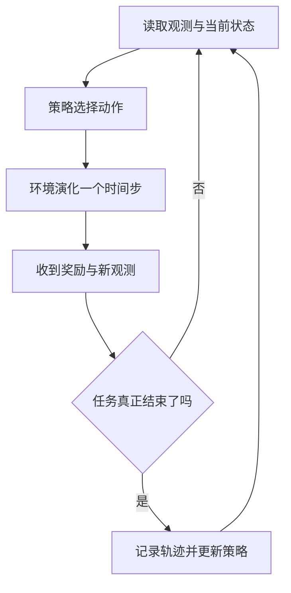
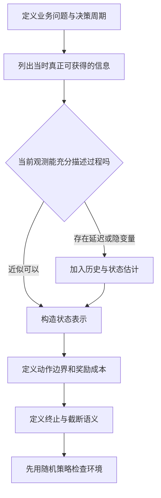
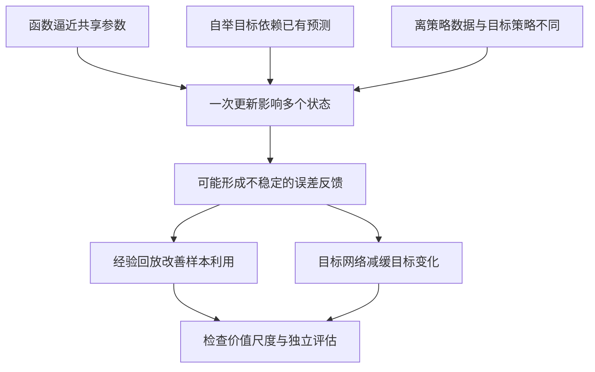
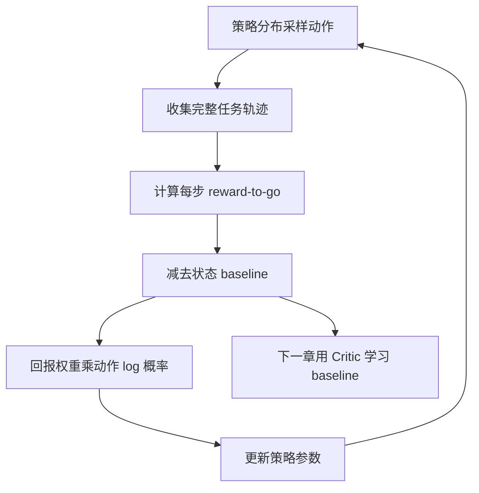

# RL Atlas｜强化学习：从直觉到决策

> 完整中文教程 · 7 个模块 · 24 章 · 含公式、Mermaid 流程图、代码、练习解答与原始资料索引。

本教程沿着“问题 → 数学 → 算法 → 代码 → 实验 → 可信结论”的路径组织。先学会解释一个决策问题，再理解每一种算法为什么出现、解决什么问题、还留下哪些限制。

教程结构受到用户提供的公开推文[《强化学习难点，90% 初学者都搞错了！！》](https://mp.weixin.qq.com/s/x3Jb7imrQtbavvU1vH8Tww)启发；正文、数值例题、练习与代码为独立编写，参考资料列在各章及文末。此文件包含完整教材正文，不依赖购买原推文中的课程。

## 如何使用这本教程

- **先预测，再验证。** 每章先手算例题、解释更新方向，再打开网页中对应的交互实验。
- **按依赖学习。** 具备神经网络基础可以略读网络入门，但不要跳过条件期望、Bellman 方程与终止语义。
- **区分机制与证据。** 浏览器实验用于理解数值机制；小型模拟结果不代表工业现场的节能效果。
- **保留单位与时间。** 工业案例使用运行指标设定值增量，保留下层控制与安全门控，不连接真实设备。
- **检查原始资料。** 数学与接口来源均可追溯；阅读时保留定理假设和实验边界。

建议按个人时间在六至八周内完成一轮：第一至二周处理交互、概率和表格方法；第三周理解 DQN；第四至五周学习 Actor-Critic、PPO 与 SAC；第六周完成环境和评估设计；最后一至二周将离线、模型与约束方法连接到自己的课题。该安排是学习建议，不是学习效果或课时保证。

数学保留为 LaTeX，流程图保留为 Mermaid 图源。使用支持这些格式的 Markdown 阅读器，可直接渲染；不支持时仍可阅读完整公式与图源。

## 目录

- [模块 1 · 交互、回报与探索](#module-1)
  - [01 · 从一次行动，到长期回报](#chapter-01)
  - [02 · 多臂老虎机：探索需要付出什么？](#chapter-02)
  - [03 · 够用的概率：从样本到期望](#chapter-03)
- [模块 2 · MDP、价值与表格控制](#module-2)
  - [04 · MDP 与 POMDP：先把问题写对](#chapter-04)
  - [05 · Bellman 方程：把未来拆成一步](#chapter-05)
  - [06 · 动态规划：模型已知时怎样规划？](#chapter-06)
  - [07 · MC、TD 与 n-step：向什么目标学习？](#chapter-07)
  - [08 · SARSA 与 Q-learning：到底在学谁？](#chapter-08)
- [模块 3 · 从 Q 表到深度价值学习](#module-3)
  - [09 · 函数逼近：从 Q 表到共享参数](#chapter-09)
  - [10 · DQN：把不稳定的学习循环拆开](#chapter-10)
  - [11 · Double DQN：别让同一份噪声既选又评](#chapter-11)
- [模块 4 · 策略梯度、优势与 PPO](#module-4)
  - [12 · REINFORCE：直接学习行动的概率](#chapter-12)
  - [13 · Actor-Critic 与 GAE](#chapter-13)
  - [14 · 重要性采样与信赖域](#chapter-14)
  - [15 · 把 PPO 的裁剪目标拆开](#chapter-15)
- [模块 5 · 连续动作与 SAC](#module-5)
  - [16 · 连续动作与 tanh 高斯策略](#chapter-16)
  - [17 · 最大熵目标与 SAC](#chapter-17)
  - [18 · 根据问题选择算法](#chapter-18)
- [模块 6 · 独立建模与可信实验](#module-6)
  - [19 · 把真实问题写成可验证环境](#chapter-19)
  - [20 · 做一份可信的强化学习实验](#chapter-20)
  - [21 · 贯穿案例：烧成系统设定值决策](#chapter-21)
- [模块 7 · 离线、模型与约束决策](#module-7)
  - [22 · 离线强化学习：从日志到策略](#chapter-22)
  - [23 · 模型学习、Dyna 与短程推演](#chapter-23)
  - [24 · 约束强化学习与研究闭环](#chapter-24)
- [完整参考资料](#references)
- [来源标识索引](#source-index)

---

<a id="module-1"></a>

## 模块 1 · 交互、回报与探索

从一个选择开始，理解长期回报与探索的价值。

**完成本模块后：** 把一个真实问题说清楚，并写出回报。

<a id="chapter-01"></a>

### 01 · 从一次行动，到长期回报

*先把智能体、环境和反馈连成闭环，再讨论算法。*

**程度：** 入门　**建议阅读与推演：** 30 分钟（按个人基础调整）

**学习目标**

- 区分监督预测与序贯决策
- 按统一时间下标写出一段轨迹
- 手算折扣回报并解释折扣因子

**配套网页实验：** return（在网页“交互实验室”打开）

#### 先回答：我们到底要学会什么？

假设你有一个很准的温度预测模型。它回答“保持当前条件，十分钟后可能多热”。但操作员真正需要的是“现在应该怎样调整设定值，才能让未来一小时能耗较低、质量稳定”。预测给出可能发生什么；决策还要比较行动的后果。强化学习研究的正是这种**行动改变未来、反馈又改变行动**的闭环。

把问题写成算法前，先分清五个角色。智能体是做选择的规则或程序；环境是选择之外的过程；状态是用于决策的信息；动作是程序允许改变的量；奖励是评价结果的一项数值。策略 $\pi(a\mid s)$ 表示在状态 $s$ 下选择动作 $a$ 的概率。策略不一定是神经网络，一张表、一条规则也能构成策略。基本术语可对照 [Sutton 与 Barto 的教材](https://mitpress.mit.edu/9780262039246/reinforcement-learning/)。

在本教程的工业案例里，智能体每五分钟给出**有界的运行指标设定值增量**，由下层控制回路跟踪。它不直接驱动风机或阀门。现在先用一个无需工业背景的例子：仓储机器人可以立即取到价值较低的货物，也可以绕路去取更高价值的货物。真正需要比较的是整段路线的收益。

#### 统一时间轴：奖励发生在行动之后

本教程统一使用轨迹 $S_t,A_t,R_{t+1},S_{t+1}$：先看到 $S_t$，选择 $A_t$，环境再返回 $R_{t+1}$ 与 $S_{t+1}$。某些论文把同一个奖励记为 $r_t$，只是下标约定不同，移植公式时要整套对齐。



这里的“更新策略”可以每一步发生，也可以收集一批数据后发生。交互与学习是两个不同的时钟；环境采样一次，不意味着神经网络只能更新一次。

#### 为什么不能只看眼前奖励？

从时刻 $t$ 开始的折扣回报定义为：

$$G_t=\sum_{k=0}^{T-t-1}\gamma^kR_{t+k+1},\qquad 0\leq\gamma\leq1.$$

三步奖励为 $[2,-1,5]$，取 $\gamma=0.9$，则 $G_0=2-0.9+0.81\times5=5.15$。立即获得 4 后结束的路线，其回报为 4。前者第一步奖励较低，但在这个目标下更值得选择。若改成 $\gamma=0.2$，前者回报只有 2，偏好便反转。**修改折扣因子会修改优化目标，不只是修改训练速度。**

持续任务中，若奖励有界且 $\gamma<1$，无限和仍可收敛。$1/(1-\gamma)$ 可作为粗略的有效步数尺度，但不是严格的规划终点。五分钟一步与一分钟一步使用同一个 $\gamma$，对应的物理时间偏好不同；跨采样周期比较时要重新校准。

下面是完整的回报计算函数。从后往前累积，可以避免为每个起点重复计算整段和：

```python
def discounted_returns(rewards, gamma):
    result = [0.0] * len(rewards)
    running = 0.0
    for t in range(len(rewards) - 1, -1, -1):
        running = rewards[t] + gamma * running
        result[t] = running
    return result

assert abs(discounted_returns([2, -1, 5], 0.9)[0] - 5.15) < 1e-9
```

#### 回报、价值和目标不是同一个数

一次实际轨迹得到的 $G_t$ 是随机样本；价值函数是给定条件下对这类样本取期望；学习目标通常还要对初始状态分布取平均。不要因为某一次探索的回报很高，就认为策略已经变好。至少需要独立评估、多个环境随机种子和与基线的比较。

奖励也并非天然存在的“正确答案”。若只奖励产量，策略可能牺牲质量；若只奖励平稳，策略可能永远不调整。工业质量与环境边界应作为显式约束另外报告，而不能靠一个总分掩盖。本章的仓储例子没有安全约束，不能直接等同于工业部署方案。

#### 终止与暂停要分开

到达目标且任务结束，是终止；为了节约计算，把持续过程切成一百步，是截断。两者都需要重置采样器，但截断后的状态仍可能具有未来价值。[Gymnasium 官方说明](https://gymnasium.farama.org/tutorials/gymnasium_basics/handling_time_limits/)专门区分了这两种信号。后续 TD、DQN、GAE 都会用到这个区别。

打开回报实验，先预测 $\gamma$ 变大后远期奖励的贡献，再拖动滑块验证。记录自己的预测与实际差异，比只观看动画更有价值。

#### 把决策周期也当作建模的一部分

同样是“向上调整一次”，五秒执行一次与五分钟执行一次，会造成完全不同的累积变化。设计环境时先确定一条动作保持多久，再定义奖励覆盖哪个时间段。若动作持续时间不固定，普通固定步长 MDP 的时间含义就需要重新检查，而不是随意把不同长度日志拼成相邻 transition。

建议为第一个项目写一张时间对照表：观测形成时间、动作发出时间、下层执行时间、奖励归属区间、质量结果可用时间。每一行只引用当时已经获得的信息。这样，后面看到 $r_{t+1}$ 时知道它对应哪五分钟，看到化验数据时知道它属于哪批物料，而不是只在数学下标上保持一致。

#### 练习与解答

一条路线的奖励为 $[0,0,10]$，另一条为 $[6]$。在什么折扣因子下第一条更优？若过程只是达到采样上限，应把未来价值设为零吗？

<details><summary>查看参考答案</summary>

第一条回报是 $10\gamma^2$，因此当 $\gamma>\sqrt{0.6}\approx0.7746$ 时更优；等号时两者相同。外部采样上限是截断，通常保留最终观测的 bootstrap 值。若任务本身规定“最后一刻即结束”，则是有限时域任务，需要把剩余时间纳入状态，并在真正终点令后续回报为零。

</details>

#### 本章参考资料

- [R1](#reference-1) · [Reinforcement Learning: An Introduction, 2nd edition](https://mitpress.mit.edu/9780262039246/reinforcement-learning/) — Richard S. Sutton · Andrew G. Barto，2018。来源标识：f-sutton。
- [R6](#reference-6) · [Handling Time Limits](https://gymnasium.farama.org/tutorials/gymnasium_basics/handling_time_limits/) — Farama Foundation，持续维护。来源标识：f-gym。

---

<a id="chapter-02"></a>

### 02 · 多臂老虎机：探索需要付出什么？

*在最简单的决策问题里，理解信息为什么有价值。*

**程度：** 入门　**建议阅读与推演：** 35 分钟（按个人基础调整）

**先修章节：** [01 · 从一次行动，到长期回报](#chapter-01)

**学习目标**

- 实现增量均值与 ε-greedy
- 解释 UCB 的不确定性奖励
- 区分实现回报和伪遗憾

**配套网页实验：** bandit（在网页“交互实验室”打开）

#### 去掉状态转移，留下最核心的矛盾

有四台机器，每次只能选一台，机器按未知概率给出 1 或 0 的奖励。你既想多拿奖励，又需要知道哪台机器更好。与完整 MDP 相比，当前动作不会改变下一轮的状态；问题只剩“怎样从有限采样中分配尝试次数”。这就是多臂老虎机。

设第 $a$ 个动作的真实均值为 $\mu_a$，已经观察到 $N(a)$ 次，经验估计为 $\hat\mu(a)$。不要把“目前均值最高”误认为“真实均值最高”：一台只试过一次且恰好中奖的机器，其证据强度远低于一台试过一百次的机器。

#### 用一行更新记录经验

均值不必每次遍历完整历史。第 $n$ 个奖励到来后：

$$Q_n=Q_{n-1}+\frac{1}{n}(R_n-Q_{n-1}).$$

例如某台机器已经试了四次，均值为 0.5，第五次奖励为 1，则新均值为 $0.5+(1-0.5)/5=0.6$。括号里的差是“本次结果比预期好多少”。这个“估计加学习率乘误差”的结构还会在 TD 和 Q-learning 中反复出现。

若环境非平稳，可用固定 $\alpha$ 替代 $1/n$，让新证据权重更大；代价是不再收敛为全部历史样本的普通平均。是否需要遗忘旧经验，应由过程是否发生漂移决定。

#### ε-greedy：明确花出探索预算

以 $1-\epsilon$ 的概率选当前估计最好的动作，以 $\epsilon$ 的概率在所有动作中均匀随机选择。若有四个动作、唯一最优估计动作且 $\epsilon=0.2$，它被选中的概率是 $0.8+0.2/4=0.85$，不是 0.8。

```python
import random

def epsilon_greedy(q, epsilon, rng):
    if rng.random() < epsilon:
        return rng.randrange(len(q))
    best = max(q)
    ties = [a for a, value in enumerate(q) if value == best]
    return rng.choice(ties)

rng = random.Random(42)
q, counts = [0.0] * 4, [0] * 4
# 在每次实际得到 reward 后执行：
a, reward = 2, 1.0
counts[a] += 1
q[a] += (reward - q[a]) / counts[a]
```

随机打破并列很重要。若所有初始值都是零，而程序永远取第一个最大值，纯贪心策略会偏向数组最前面的动作。它可能把实现细节误当作经验。

#### UCB：优先探索还不确定的动作

一种常见 UCB 形式选择：

$$A_t=\arg\max_a\left[Q_t(a)+c\sqrt{\frac{\ln t}{N_t(a)}}\right].$$

从未尝试的动作先各试一次，避免除以零。第一项代表已有收益证据，第二项代表不确定性。$N_t(a)$ 越少，探索奖励越大；一个动作长期没被选中时，$\ln t$ 的增长会让它重新获得关注。[Auer 等人的原始研究](https://doi.org/10.1023/A:1013689704352)分析了满足特定条件的有界奖励问题。不能把该理论保证直接迁移到漂移严重、反馈延迟或选择会改变工况的工业任务。

手算一个时刻：$t=100$，两台机器估计均值分别为 0.7 和 0.6，访问次数为 80 和 5。取 $c=0.2$，上置信指标约为 0.748 和 0.792。UCB 会选第二台：它暂时愿意放弃一点估计收益，换取更多信息。

Thompson Sampling 则从参数后验采样后选最优动作。Bernoulli 奖励可用 Beta 后验：先验 $\mathrm{Beta}(1,1)$，观察到三次成功、一次失败后得到 $\mathrm{Beta}(4,2)$。后验概率不是固定的探索比例，而会随证据改变。

#### 怎样公平比较策略？

累计实现奖励会受到运气影响。已知仿真中的真实均值时，可以计算伪遗憾：

$$\bar R_T=\sum_{t=1}^{T}(\mu_* - \mu_{A_t}),\qquad \mu_*=\max_a\mu_a.$$

它度量“因为选错机器，期望上错失了多少”，不等于最优机器一条随机奖励曲线减当前曲线。网页实验使用明确标注的合成机器，故能显示这个量；真实业务一般不知道 $\mu_*$，不能假装可以直接观测遗憾。

比较时固定机器的真实参数，跨多个随机种子重复，让策略面对同等预算。观察短期奖励、长期遗憾与各臂次数。一次试验里贪心胜出，并不能证明探索无用；反过来，探索过多也确实会浪费预算。

#### 把探索策略放回真实条件中

上述 UCB 探索项的常数与奖励尺度有关。若把 0–1 奖励改为 0–100，仍使用原来的探索系数，利用项与探索项的相对权重就变了。比较方法时应统一量纲，或说明如何缩放，不能只复制一个常见参数值。

固定 $\epsilon$ 也有容易忽略的长期代价：如果最优臂唯一且探索始终均匀随机，长期仍会持续抽到次优臂，因此累积伪遗憾通常持续增长。衰减探索可能减少这项成本，但衰减过早又可能错过正确动作。没有任何一句“多探索”或“尽快利用”能脱离任务条件成为答案。

工业过程更不能把四个操作方案随便轮流试验。Bandit 的无状态转移假设常被设备惯性破坏，安全约束也限制可选动作。它在这里用于理解信息价值，不能替代完整的过程建模。

#### 练习与解答

五个动作、$\epsilon=0.1$，若两个动作并列最大且均匀打破并列，每个最大动作被选中的概率是多少？为什么把 $ε$ 一开始就降到零可能出问题？

<details><summary>查看参考答案</summary>

每个最大动作概率为 $(1-0.1)/2+0.1/5=0.47$，另外三个各为 0.02。太早停止探索会把早期噪声固定成长期偏见；但持续固定探索也会持续支付探索代价。合理安排需要结合采样预算、漂移程度和理论假设，而不能只背一个衰减公式。

</details>

#### 本章参考资料

- [R1](#reference-1) · [Reinforcement Learning: An Introduction, 2nd edition](https://mitpress.mit.edu/9780262039246/reinforcement-learning/) — Richard S. Sutton · Andrew G. Barto，2018。来源标识：f-sutton。
- [R5](#reference-5) · [Finite-time Analysis of the Multiarmed Bandit Problem](https://doi.org/10.1023/A:1013689704352) — Peter Auer · Nicolò Cesa-Bianchi · Paul Fischer，2002。来源标识：f-ucb。

---

<a id="chapter-03"></a>

### 03 · 够用的概率：从样本到期望

*把公式中的 E、条件概率和方差翻译成可计算的操作。*

**程度：** 入门　**建议阅读与推演：** 40 分钟（按个人基础调整）

**先修章节：** [01 · 从一次行动，到长期回报](#chapter-01)；[02 · 多臂老虎机：探索需要付出什么？](#chapter-02)

**学习目标**

- 计算离散期望与条件期望
- 用全期望公式连接策略和环境
- 理解样本均值、方差与偏差

#### 不必先学完整概率论，但要弄清四件事

强化学习公式常让人产生距离感，通常因为把三个层次混在一起：随机变量、一次实现值、对所有可能实现求平均。用大写 $R$ 表示随机奖励，用小写 $r$ 表示某次观察到的奖励，用 $\mathbb E[R]$ 表示按概率加权的平均。神经网络输出的“估计值”又是对这个期望的近似，不是额外的一次真实奖励。

本章只补四个工具：条件概率、期望、全期望公式、方差。需要系统补课时，可沿 [Harvard Stat110](https://stat110.hsites.harvard.edu/) 中这些主题继续读；无需在开始 MDP 前把所有概率分布背完。

#### 期望是加权和，不是最可能结果

若一次动作有 80% 概率获得 2，20% 概率获得 -3，则：

$$\mathbb E[R]=0.8\times2+0.2\times(-3)=1.$$

奖励 1 从未出现过，却完全可以是正确期望。这个区别很重要：价值为 1 不代表下一次一定得到 1，也不代表发生坏结果时模型一定错误。

随机变量经过非线性函数后，通常不能把函数与期望交换。例如 $X$ 以相同概率取 -1 和 1，则 $\mathbb E[X]=0$，但 $\mathbb E[X^2]=1\ne0$。后面最大化偏差也源于类似的非线性操作；不能把“先对有噪声估计取最大”当成“对真实均值取最大”。

#### 条件期望：先规定我们知道什么

$\mathbb E[R\mid S=s,A=a]$ 不是对全部轨迹混在一起平均，而是讨论给定状态和动作下的奖励。如果只看温度，样本里可能混合不同原料批次；这些批次的平均响应可能差异很大。写清条件，是避免把混杂数据当成同一过程的第一步。

设状态 $s$ 下策略选择动作 $a_1$ 的概率为 0.6，选择 $a_2$ 的概率为 0.4。两个动作的条件奖励均值分别为 3 和 -1。则：

$$\mathbb E[R\mid S=s]=\sum_a\pi(a\mid s)\mathbb E[R\mid s,a]=0.6\times3+0.4\times(-1)=1.4.$$

这就是全期望公式的一次应用。Bellman 方程会再加一层：选动作后，环境还会随机走向不同状态。因此一个期望里常同时存在策略随机性与环境随机性。

#### 方差告诉我们一次结论有多不稳定

对前面取 2 或 -3、均值为 1 的奖励：

$$\operatorname{Var}(R)=0.8(2-1)^2+0.2(-3-1)^2=4.$$

标准差是 2，单位与奖励一致。若 $n$ 个样本独立同分布，样本均值方差为 $4/n$。样本数扩大四倍，标准误差才缩小一半。因此“多跑一点”并不能线性提高精度。连续工业采样往往高度相关，不能把相邻的一万条记录当作一万个独立实验。

```python
import random
import math

rng = random.Random(42)
rewards = [2.0 if rng.random() < 0.8 else -3.0 for _ in range(1000)]
mean = sum(rewards) / len(rewards)
sample_variance = sum((r - mean) ** 2 for r in rewards) / (len(rewards) - 1)
standard_error = math.sqrt(sample_variance / len(rewards))
print(mean, sample_variance, standard_error)
# 这是有限样本估计；不要断言它恰好等于 1、4 和 0.0632。
```

这里的随机种子用于复现实验，不会让一次有限样本平均“变成真值”。比较算法时，训练种子代表不同的学习经历，评估种子代表不同的测试环境经历，二者都应记录。

#### 偏差和方差分别在问什么？

偏差问“重复采样后，估计平均偏离真值多少”；方差问“不同采样得到的估计相互差多远”。一个常数估计可能方差为零，却严重错误。MC 用完整回报作目标，可能波动较大；TD 借助当前价值估计，更快得到目标，但会继承估计误差。只有具体说明目标、采样过程和假设后，这些比较才有意义。

均值不是唯一需要的风险指标。两个策略可有相同平均回报，却一个偶尔造成严重越界。工业实验至少还需报告约束违反频率、最大越界幅度、尾部表现和回退次数。这里先建立统计语言，后续再进入 CMDP。

#### 从公式读出实现步骤

看到 $\mathbb E_{a\sim\pi,\,s'\sim P}[f(s,a,s')]$ 时，可以作两种实现：已知离散概率就枚举所有 $a,s'$ 加权求和；不知道概率但能交互就多次采样，再对 $f$ 求平均。动态规划偏向前者，MC 与 TD 依赖后者。这是概率记号与算法之间最重要的一座桥。[决策算法教材](https://algorithmsbook.com/decisionmaking/)进一步讨论了这两种计算方式。

#### 概率与概率密度，提前分清一个坑

离散动作的 $\pi(a\mid s)$ 是概率，所有动作概率之和为 1。连续动作的策略通常给出概率密度，一个精确实数点的概率为零；一个区间内的概率才是密度积分。密度可以大于 1，因此看到连续策略的密度值超过 1，不应直接断言实现错误。

后续 PPO 使用的新旧策略比，在离散情况下是概率比，在连续情况下是同一动作位置的密度比。两者都需要在相同测度、相同动作变换下比较。对动作进行了缩放或 tanh 变换后，不能仍然无条件沿用变换前的密度。

另外，“不相关”比“独立”弱；时序数据看起来相关系数不大，也不能自动视作独立试验。评估算法差异时，独立训练重复通常比把同一轨迹切成很多小段更能说明学习过程的稳定性。

#### 练习与解答

动作 A 总是得 1；动作 B 以相同概率得 -1 或 3。它们的期望与方差分别是多少？只最大化平均单步奖励能区分它们吗？

<details><summary>查看参考答案</summary>

两者期望都是 1。A 的方差为 0；B 的方差为 $0.5(-1-1)^2+0.5(3-1)^2=4$。平均奖励目标无法区分，风险约束或不同的效用目标才可能产生偏好。不能在目标未改变的情况下，指责期望最优算法“不懂风险”。

</details>

#### 本章参考资料

- [R3](#reference-3) · [Statistics 110: Probability](https://stat110.hsites.harvard.edu/) — Joe Blitzstein · Harvard University，持续维护。来源标识：f-probability。
- [R4](#reference-4) · [Algorithms for Decision Making](https://algorithmsbook.com/decisionmaking/) — Mykel J. Kochenderfer · Tim A. Wheeler · Kyle H. Wray，2022。来源标识：f-decision。

---

<a id="module-2"></a>

## 模块 2 · MDP、价值与表格控制

用 Bellman 方程把未来的价值带回现在。

**完成本模块后：** 手算价值更新，实现一个表格控制算法。

<a id="chapter-04"></a>

### 04 · MDP 与 POMDP：先把问题写对

*状态不是传感器清单，而是关于未来的充分信息。*

**程度：** 入门　**建议阅读与推演：** 40 分钟（按个人基础调整）

**先修章节：** [01 · 从一次行动，到长期回报](#chapter-01)；[03 · 够用的概率：从样本到期望](#chapter-03)

**学习目标**

- 写出 MDP 五元组与初始分布
- 诊断状态缺失和部分可观测性
- 区分自然终止、时间截断与有限时域

#### 算法只能优化你真正定义的问题

“让能耗更低”还不是一个强化学习环境。你需要说明何时决策、能看到什么、能改变什么、动作怎样影响下一步、奖励何时到账，以及任务是否结束。把这些条件明确写下来，比先选 PPO 还是 SAC 更重要。

常见折扣 MDP 写为 $\mathcal M=(\mathcal S,\mathcal A,P,R,\gamma)$，实验还需初始状态分布 $\rho_0$。$P(s'\mid s,a)$ 描述状态转移概率，$R(s,a)$ 常表示条件期望奖励；若奖励与下一状态联合随机，可以直接写 $p(s',r\mid s,a)$。这两个记法都有效，但一个项目应采用一致定义。详细形式可参考[作者公开的决策算法教材](https://algorithmsbook.com/decisionmaking/)。

#### 马尔可夫性不是“世界没有记忆”

马尔可夫条件是：给定当前状态和动作，额外历史不再改善下一步分布的预测。

$$P(S_{t+1}\mid S_0,A_0,\ldots,S_t,A_t)=P(S_{t+1}\mid S_t,A_t).$$

世界当然有惯性。关键在于你把相关记忆是否装进了状态。一个小车只给位置，相同位置可能正在向左或向右，下一步不同；加上速度，描述才更充分。对温度控制，只给当前温度往往无法区分正在升温还是降温；可以考虑历史、变化率与执行器状态。

不过，堆更多变量不自动保证马尔可夫性。遗漏的原料特性、设备内部蓄热、未测扰动仍然可能影响未来。必须把“近似状态表示”与“完整物理状态”区分开。

#### 看不全时，就是 POMDP 的语言

真实状态 $S_t$ 不可直接获取时，智能体看到观测 $O_t$。理论上可以维护信念状态 $b_t(s)=P(S_t=s\mid O_{0:t},A_{0:t-1})$；实践中常使用历史窗口、循环网络或状态估计器近似它。历史窗口解决的是信息表示问题，不会凭空提供未测量的事实。

本仓库的工业观测合同保留 120 分钟历史、当前设定值、软测量、最近一次化验与化验年龄、原料模数。化验在时刻 $t$ 还未发布时，不能为了让预测更准，使用事后回填的最新化验值。这会产生时间泄漏，训练表现再好也无法在线复现。



#### 一个完整的小型建模例子

考虑库存教学环境，每天决定补货量。状态为当前库存和已下单未到货数量；动作是从有限集合选择订货量；环境随机产生需求、推进物流；奖励为销售利润减持有与缺货成本；初始分布规定起始库存。若遗漏在途订单，相同库存下明天到货量可能不同，状态就有明显缺失。

再看工业映射：状态来自过去可用信息；动作是归一化设定值增量 $a_t\in[-1,1]^K$；物理建议为 $Y^{sp}_{t+1}=Y^{sp}_t+\mathrm{RATE}\odot a_t$。奖励表达能耗与平滑偏好，质量和环境边界单列为约束成本。网页只进行教学仿真，不连接设备。

#### 两种结束信号怎样进入代码？

按照 [Gymnasium 官方接口](https://gymnasium.farama.org/tutorials/gymnasium_basics/handling_time_limits/)，一步返回五个对象。下面是持续任务的采样骨架：

```python
obs, info = env.reset(seed=42)
for t in range(horizon):
    action = policy(obs)
    next_obs, reward, terminated, truncated, info = env.step(action)
    # 存储真正的最终观测，别误存自动 reset 后的观测。
    replay.add(obs, action, reward, next_obs, terminated)
    obs = next_obs
    if terminated or truncated:
        obs, info = env.reset()
```

**重置采样**用 $terminated\lor truncated$；**停止未来价值自举**一般只用 $terminated$。对本仓库持续工业过程，固定评估窗口结束属于截断。若任务是“未来十步内完成交货”，十步期限本身属于任务定义，则应把剩余步数纳入状态，并在期限结束时真正终止。

#### 先检查环境，再检查学习器

写下同一初始状态、同一动作的预期响应；验证动作上下界、奖励单位、观测形状、随机种子和终止条件。让零动作、随机策略、简单规则各跑一遍。如果零动作都造成物理量瞬间跳变，训练失败首先应怀疑环境。环境通过接口检查，只能证明格式正确，不能证明动力学真实或奖励合理。

#### 一个状态审查的具体方法

从历史日志里找两段“当前观测近似相同，但过去走势不同”的片段，比较相同动作下后续响应。如果响应有系统差别，说明当前表示可能遗漏了历史信息。这个检查不能证明完整马尔可夫性，却能直接揭示一些明显的状态混叠。

对执行滞后也要做相似审查：刚刚发出的设定值是否已经被下层回路接收，控制器是否饱和，上一轮动作是否仍在生效？如果这些信息影响未来，仅记录新的目标数字就可能不足。教程提出这些审查问题，不修改仓库既有状态维度；改变正式观测合同应另行验证数据可用性和接口兼容性。

#### 练习与解答

一个温控状态只包含当前温度和设定值。为什么相同状态下仍可能出现不同下一温度？如果加入最近三次温度，还能直接宣称它就是严格 MDP 吗？

<details><summary>查看参考答案</summary>

设备蓄热、不同升降温速度、执行器滞后或原料扰动都可能造成差别。历史可以减少状态混叠，但无法保证覆盖所有隐变量。应称其为近似状态表示，通过预测残差、不同历史条件下的转移差异和实际任务表现进行验证；不要把建模假设写成已证明事实。

</details>

#### 本章参考资料

- [R4](#reference-4) · [Algorithms for Decision Making](https://algorithmsbook.com/decisionmaking/) — Mykel J. Kochenderfer · Tim A. Wheeler · Kyle H. Wray，2022。来源标识：f-decision。
- [R2](#reference-2) · [UCL Reinforcement Learning Lectures](https://www.davidsilver.uk/teaching/) — David Silver，2015。来源标识：f-silver。
- [R6](#reference-6) · [Handling Time Limits](https://gymnasium.farama.org/tutorials/gymnasium_basics/handling_time_limits/) — Farama Foundation，持续维护。来源标识：f-gym。

---

<a id="chapter-05"></a>

### 05 · Bellman 方程：把未来拆成一步

*不是背公式，而是学会递归地计算一个决定的后果。*

**程度：** 入门　**建议阅读与推演：** 40 分钟（按个人基础调整）

**先修章节：** [03 · 够用的概率：从样本到期望](#chapter-03)；[04 · MDP 与 POMDP：先把问题写对](#chapter-04)

**学习目标**

- 从回报递推推导 Bellman 期望方程
- 区分 V、Q 与优势
- 区分评价一个策略和寻找最优策略

**配套网页实验：** bellman（在网页“交互实验室”打开）

#### 为什么需要价值函数？

若只看下一步奖励，我们看不到动作的长期影响；若为每个动作都重新模拟所有未来，计算量又很大。价值函数把“从这里出发，之后按某个策略行动会怎样”压缩为一个数。它像一本可以反复查询的未来账本，但账本里的数始终依赖策略、奖励和折扣约定。

$$V^\pi(s)=\mathbb E_\pi[G_t\mid S_t=s],\qquad Q^\pi(s,a)=\mathbb E_\pi[G_t\mid S_t=s,A_t=a].$$

$V$ 从状态出发，第一步也按策略选动作；$Q$ 固定第一步动作，之后才按策略继续。因此：

$$V^\pi(s)=\sum_a\pi(a\mid s)Q^\pi(s,a).$$

不要把 $Q^\pi(s,a)$ 理解成动作本身的“固定好坏”。同样的一次绕路，在后续会及时回主路的策略下和继续迷路的策略下，价值完全不同。

#### 从一个等式推导整套方法

将回报第一项提出来：

$$G_t=R_{t+1}+\gamma G_{t+1}.$$

给定当前状态，对动作、转移与未来策略取条件期望：

$$V^\pi(s)=\sum_a\pi(a\mid s)\sum_{s',r}p(s',r\mid s,a)\left[r+\gamma V^\pi(s')\right].$$

这就是 Bellman 期望方程。它没有声称未来只剩一步；它把更远的未来封装到了 $V^\pi(s')$ 里。嵌套期望的展开可参照 [Silver 的 MDP 与动态规划课程](https://www.davidsilver.uk/teaching/)。本节用下面的小问题独立完成数值推演。

设只有一个非终止状态 A。固定策略每一步得到奖励 1，以 0.5 概率留在 A，以 0.5 概率终止；终止后的价值为零，$\gamma=0.9$。则：

$$V(A)=1+0.9\times[0.5V(A)+0.5\times0],\qquad V(A)=\frac{1}{0.55}\approx1.8182.$$

如果从零开始反复代入，得到 $1,1.45,1.6525,\ldots$，逐渐接近同一个值。只看即时奖励会得到 1，恰好漏掉了可能继续获得的奖励。

#### 评价与最优性，差一个 max 却是不同问题

评价问“给定策略会得到多少”；控制问“可以选择策略时，最多得到多少”。后者使用 Bellman 最优方程：

$$Q^*(s,a)=\sum_{s',r}p(s',r\mid s,a)\left[r+\gamma\max_{a'}Q^*(s',a')\right].$$

前者按 $\pi$ 加权平均，后者选最大动作。把期望误写成最大值，会把“当前探索策略的价值”偷换为“假设未来都贪心行动的价值”。这正是后面 SARSA 与 Q-learning 的关键分界。

举例：某状态有两个动作，$Q(s,\text{左})=3$，$Q(s,\text{右})=5$，策略以 0.75 概率向左。该策略的状态价值是 $0.75\times3+0.25\times5=3.5$。选择最优动作的价值则是 5。二者都可以正确，但回答的问题不同。

#### 优势：比当前习惯好多少

$$A^\pi(s,a)=Q^\pi(s,a)-V^\pi(s).$$

以上例为准，左的优势为 -0.5，右为 1.5。优势衡量“这个动作比当前策略在这里的平均表现好多少”。在同一策略下加权平均优势为零：$0.75(-0.5)+0.25(1.5)=0$。后续 Actor-Critic 会用它告诉 Actor 应该增加还是减少某个动作的概率。

#### 写一个可以手工核对的 backup

```python
def expected_backup(transitions, values, gamma):
    # 每一项为 (概率, 下一状态, 奖励, 是否真正终止)。
    total = 0.0
    for probability, next_state, reward, terminal in transitions:
        future = 0.0 if terminal else values[next_state]
        total += probability * (reward + gamma * future)
    return total

v = {"A": 0.0, "end": 0.0}
model = [(0.5, "A", 1.0, False), (0.5, "end", 1.0, True)]
for _ in range(30):
    v["A"] = expected_backup(model, v, 0.9)
print(v["A"])
```

这里每个分支的概率必须合计为 1，终止奖励只记一次。常见错误是进入终止状态时已经奖励 10，又把终止状态价值设置为 10，于是重复计奖。采用“进入终点得到奖励、终点后价值为零”的约定，通常更容易检查。

#### 为什么反复代入可能收敛？

对有限状态、有限动作、有界奖励、$\gamma<1$ 的折扣问题，Bellman 算子在最大范数下是压缩映射，前后两份估计的差最多缩为原来的 $\gamma$ 倍。这个结论支撑表格动态规划；加入任意神经网络、数据分布改变和近似优化后，不能直接沿用该保证。相关理论背景可继续查阅[决策算法教材](https://algorithmsbook.com/decisionmaking/)。

打开 Bellman 实验时，观察数值如何从奖励附近逐步向前传播。一次 backup 不是“发现整条最优路线”，而是把当前知道的下一步价值往前传了一层。

另一个检查是奖励单位：如果奖励以每五分钟的能耗差计量，价值就是这些奖励的折扣累积，而不是某一时刻的温度或吨产品煤耗。给价值图标注单位或归一化约定，能避免把数学分数误读成直接的物理预测。

#### 把一次 backup 拆成三个可检查的步骤

第一步列出候选动作；第二步在每个动作下列出可能的下一状态与对应概率；第三步才计算奖励加未来价值。需要评价策略时，再把动作得分按策略概率加权；需要控制时，再对动作得分取最大。把两个随机层次和一个选择层次分开，很多看似复杂的公式会变成几行表格。

例如“动作有 70% 成功率”并不代表它的策略概率是 0.7。策略概率描述智能体选不选这个动作；成功率描述动作已经选定后环境怎样响应。若智能体只有 20% 概率选择它，该成功分支的联合概率才是 $0.2\times0.7=0.14$。混淆这两个概率，会让计算结果虽落在合理范围，却系统性偏离真实目标。

#### 练习与解答

一个动作立即得 2，之后以 0.7 概率进入价值为 4 的状态，以 0.3 概率终止。$\gamma=0.9$ 时动作价值是多少？若把第二个分支也错误加上 4，会多算多少？

<details><summary>查看参考答案</summary>

正确值为 $2+0.9\times(0.7\times4+0.3\times0)=4.52$。错误值为 5.6，多算 1.08。注意即时奖励 2 在两种分支下都存在，因此先写为 2 没有问题；若奖励随分支变化，应一起放进概率加权和里。

</details>

#### 本章参考资料

- [R1](#reference-1) · [Reinforcement Learning: An Introduction, 2nd edition](https://mitpress.mit.edu/9780262039246/reinforcement-learning/) — Richard S. Sutton · Andrew G. Barto，2018。来源标识：f-sutton。
- [R4](#reference-4) · [Algorithms for Decision Making](https://algorithmsbook.com/decisionmaking/) — Mykel J. Kochenderfer · Tim A. Wheeler · Kyle H. Wray，2022。来源标识：f-decision。
- [R2](#reference-2) · [UCL Reinforcement Learning Lectures](https://www.davidsilver.uk/teaching/) — David Silver，2015。来源标识：f-silver。

---

<a id="chapter-06"></a>

### 06 · 动态规划：模型已知时怎样规划？

*用策略评估、策略改进和价值迭代建立第一条算法主线。*

**程度：** 入门　**建议阅读与推演：** 40 分钟（按个人基础调整）

**先修章节：** [05 · Bellman 方程：把未来拆成一步](#chapter-05)

**学习目标**

- 实现一次同步价值迭代
- 区分策略迭代与价值迭代
- 理解模型误差与计算复杂度的限制

**配套网页实验：** gridworld（在网页“交互实验室”打开）

#### 先给算法一个有利条件：知道环境模型

假设每个状态下，所有动作的转移概率与奖励都已知。我们就不用靠实际行动来估计一个动作的结果，而可以在纸上枚举。这个计算过程称为规划；动态规划利用子问题之间共享的价值，把多步决策拆成一系列 Bellman 更新。[Silver 的动态规划课程](https://www.davidsilver.uk/teaching/)给出了完整理论背景。

先用网格世界：每个格子是状态，四个方向是动作，撞墙保持原位，普通移动奖励 -1，进入目标后任务结束。在这个定义下，最大化回报倾向于缩短到达目标的路径。若加入滑动概率，同一个动作可能走向多个格子，backup 要按所有转移分支加权，不能只算最可能的一支。

#### 策略迭代：先理解当前策略，再改善它

策略迭代交替做两件事。策略评估固定 $\pi$，求 $V^\pi$；策略改进根据当前价值选出更好的动作：

$$\pi_{\mathrm{new}}(s)\in\arg\max_a\sum_{s',r}p(s',r\mid s,a)[r+\gamma V^\pi(s')].$$

第一步不改变策略，第二步不把已有价值当最终答案。只要还有动作改善，就重新评估新策略。若评估做到足够准确，在标准有限折扣 MDP 下可以建立策略改进性质；这是清晰建模条件下的结论，不等于所有近似神经网络优化都单调进步。

#### 价值迭代：每次只评估一点，再贪心改进

价值迭代直接使用最优 backup：

$$V_{k+1}(s)=\max_a\sum_{s',r}p(s',r\mid s,a)[r+\gamma V_k(s')].$$

它可以理解为把评估与改进紧密交织。算法中的 $k$ 表示计算轮数，不是环境真实时间。不要把“做一千次价值迭代”写成“智能体与环境交互一千次”。已知模型时，访问表格并不消耗真实采样。

```python
def value_iteration(model, states, actions, gamma=0.95, tolerance=1e-8):
    v = {state: 0.0 for state in states}
    while True:
        new_v = {}
        for state in states:
            scores = []
            for action in actions[state]:
                score = sum(
                    p * (r + gamma * (0.0 if terminal else v[next_state]))
                    for p, next_state, r, terminal in model[state, action]
                )
                scores.append(score)
            new_v[state] = max(scores) if scores else 0.0
        change = max(abs(new_v[s] - v[s]) for s in states)
        v = new_v
        if change < tolerance:
            return v
```

这段函数要求模型概率有效、动作集合有限且 $\gamma<1$。它使用同步更新：同一轮所有状态只读取旧的 $v$。若一边计算一边覆盖，得到的是异步或原位更新，数值传播速度会不同。两者都可能有效，但比较轮数时要说明更新方式。

#### 手工推演，看到价值如何向前传播

考虑三格直线 A → B → G，只有向右动作。进入 G 的奖励为 10，其余奖励为 0，$\gamma=0.9$，终点后价值为零。初始全部为零。第一轮 B 得到 10，A 仍为 0；第二轮 A 得到 9。后续不再改变。最远的价值信息需要逐步沿图传播。

若 A 还有一个“立即退出并得 8”的动作，初期 A 会选择退出；等 B 的价值传回来后，它才会选择向右。**中间迭代得到的贪心策略可能暂时错误**，这是因为价值尚未传播完成，而不是算法逻辑矛盾。

#### 停止条件应该检查什么？

$\Delta_k=\max_s|V_{k+1}(s)-V_k(s)|$ 衡量相邻计算结果变化，但不是直接测得的真实误差。在压缩条件下可以给出误差界；当 $\gamma$ 接近 1 时，变化很小仍可能对应较大的剩余误差。因此实验需要同时记录容差、折扣因子、更新次数和提取后的策略表现。

一个实用的检查是：用最终价值重新计算每个动作的 backup，确认策略选择一致；再从所有可达起点进行模拟，检查是否陷入非终止循环。奖励设计不合理时，循环本身可能是环境定义下的最优行为；那需要修改问题定义，而非强迫算法“懂常识”。

#### 动态规划为什么无法包办工业任务？

首先，完整转移模型通常未知。其次，多维连续状态无法轻易列成表。若十个变量各离散成十档，就有 $10^{10}$ 个组合，简单扩大数组不能解决维数灾难。再次，模型误差会被规划重复利用：策略可能专门挑模型乐观的区域。

但动态规划仍是很好的教学与调试基准。小环境里它提供可核对的最优值，用来检查 MC、TD、Q-learning 是否学对。

可下载本教程的[完整表格实验脚本](../public/code/tabular_foundations.py)，运行 **python tabular_foundations.py --method q_learning --seed 42**。脚本只用 Python 标准库，先求解 4×4 网格的动态规划基准，再训练并独立评估学习策略；输出全部是教学仿真结果。后续模型基强化学习重新使用“学习模型后规划”的思想，只是必须面对模型误差和分布外问题。相关扩展可参考[决策算法教材](https://algorithmsbook.com/decisionmaking/)。

#### 区分规划预算与模型可信度

对同一张转移表多做十次 backup，只增加计算，没有增加现实证据。若表格里的转移概率本来就是用少量历史样本估计的，规划收敛只表示“对这张表算得更准确”，不表示这张表更接近真实世界。因此实验报告要把模型估计误差与规划求解误差分开。

当状态较多时，也不一定每轮遍历全部状态。可以只更新相关或误差较大的状态，但要清楚哪些状态尚未被充分处理。不同算法之间比较计算效率时，报告实际 backup 次数、耗时和模型访问次数，比只报告含义不同的“迭代轮数”更公平。

#### 练习与解答

把上面的直线例子改为进入 G 奖励 10，每次非终止移动奖励 -1。A 可以直接退出得 8。$\gamma=0.9$ 时，A 最后会选择什么？

<details><summary>查看参考答案</summary>

B 向右进入 G 得 10，所以 $V(B)=10$；A 经 B 的回报为 $-1+0.9\times10=8$，与退出相同。两种动作都可为最优，程序需要明确并列处理。若代码由于固定取第一个最大值而总显示退出，不能解释为另一路线不最优。

</details>

#### 本章参考资料

- [R2](#reference-2) · [UCL Reinforcement Learning Lectures](https://www.davidsilver.uk/teaching/) — David Silver，2015。来源标识：f-silver。
- [R4](#reference-4) · [Algorithms for Decision Making](https://algorithmsbook.com/decisionmaking/) — Mykel J. Kochenderfer · Tim A. Wheeler · Kyle H. Wray，2022。来源标识：f-decision。

---

<a id="chapter-07"></a>

### 07 · MC、TD 与 n-step：向什么目标学习？

*完整结局、一步预期和中间折衷，是同一个估计问题的不同答案。*

**程度：** 进阶　**建议阅读与推演：** 45 分钟（按个人基础调整）

**先修章节：** [05 · Bellman 方程：把未来拆成一步](#chapter-05)；[06 · 动态规划：模型已知时怎样规划？](#chapter-06)

**学习目标**

- 写出 MC 与 TD(0) 的更新目标
- 手算 TD 误差与 n-step return
- 正确处理轨迹截断的 bootstrap

**配套网页实验：** td（在网页“交互实验室”打开）

#### 不知道转移概率，仍然可以估值

动态规划要求知道模型，现实中通常只有采样轨迹。假设先固定策略，暂时不讨论怎样改策略；目标只是从多次体验中估计 $V^\pi$。最直接的方法是从某状态出发，把实际完整回报平均起来。这叫 Monte Carlo，简称 MC。

$$V(S_t)\leftarrow V(S_t)+\alpha[G_t-V(S_t)].$$

若每次访问都使用 $\alpha=1/N(S_t)$，它就是样本均值。一次 episode 中同一状态可能出现多次：first-visit MC 每局只用第一次访问，every-visit MC 使用全部访问。实验必须说明采用哪一种，不能不知不觉混在一起。

#### TD：不等结局，先用下一步预测修正当前预测

若一条工业轨迹连续运行数月，你不想等到结束才更新一次价值。TD(0) 用即时奖励加下一状态估计作目标：

$$\delta_t=R_{t+1}+\gamma(1-d_t)V(S_{t+1})-V(S_t),$$

$$V(S_t)\leftarrow V(S_t)+\alpha\delta_t.$$

$d_t$ 只表示真正终止。用一个估计更新另一个估计，称为 **bootstrapping（自举）**。[Sutton 的原始 TD 论文](https://jmvidal.cse.sc.edu/library/sutton88a.pdf)研究了利用相邻预测之间的差进行学习。这里不需要环境可微，也不需要知道状态转移概率。

手算：当前 $V(s)=2$，下一状态 $V(s')=5$，奖励 1，$\gamma=0.9$、$\alpha=0.1$。目标为 5.5，TD 误差为 3.5，新值为 2.35。若这是终止转移，目标变为 1，新值为 1.9。一次布尔标志错误，就会系统性改变学习目标。

#### 用同一条轨迹比较 MC 与 TD

轨迹为 A → B → 终点，奖励依次为 0 和 4，$\gamma=0.9$，开始时 $V(A)=V(B)=0$。MC 等结束后知道 A 的回报为 3.6、B 为 4。顺序 TD 在 A → B 时目标是零，只能先更新 B；A 要等以后再次访问，或通过额外 replay 更新，才看到 B 的新价值。

这解释了两种方法的不同传播方式。MC 一次把实际终局信息传回较远状态，但该终局可能很偶然；TD 可以更早更新、复用下一状态的统计信息，但暂时不准的下一状态值也会传回。**“MC 无偏、TD 有偏”是一种特定目标下的简写，不是任何设置下都成立的完整定理。**

#### n-step：用几步事实，再接一个估计

若接下来 $n$ 步均未真正终止：

$$G_t^{(n)}=\sum_{k=0}^{n-1}\gamma^kR_{t+k+1}+\gamma^nV(S_{t+n}).$$

$n=1$ 就是 TD(0)；达到真正终点且不再自举时，变成完整回报。例：两步奖励 1、2，$V(S_{t+2})=4$，$\gamma=0.9$，两步目标是 $1+0.9\times2+0.81\times4=6.04$。若第二步真正终止，最后一项应去掉，目标为 2.8。

```python
def n_step_target(rewards, gamma, final_value, terminated):
    target = 0.0
    weight = 1.0
    for reward in rewards:
        target += weight * reward
        weight *= gamma
    if not terminated:
        target += weight * final_value
    return target

assert abs(n_step_target([1, 2], 0.9, 4, False) - 6.04) < 1e-9
assert abs(n_step_target([1, 2], 0.9, 4, True) - 2.8) < 1e-9
```

代码里的最后一个状态必须与奖励序列相衔接。向量环境自动 reset 后返回的新 episode 初始观测，不能拿来作为旧 episode 的最终值。

#### 截断并不是 MC 获得了完整结局

若只采样了前二十步，剩余回报未知，直接把尾部设为零会改变估计对象。可以明确改为二十步有限时域任务，也可以用最终观测的价值估计补上尾部；后一种已经是自举目标，不再是完整轨迹 MC。[Gymnasium 的时间限制说明](https://gymnasium.farama.org/tutorials/gymnasium_basics/handling_time_limits/)展示了为什么截断不应直接清空未来值。

在线策略评估还需注意数据来源。MC 与 TD 在此都假设轨迹由待评估策略生成；如果轨迹来自旧策略，估计对象会改变，需要离策略校正或专门算法。把“有一堆日志”直接等同于“可以评估任何新策略”，是工业离线研究中常见的跨越。

#### 实验应该看什么？

在一个已知真实价值的小环境里，比较估计误差、学习步数和不同种子之间的波动。统一采样预算，并分别调节学习率。观察 TD 越来越快并不意味着它在所有环境都更好；较长 n-step 的效果还取决于奖励延迟、估计误差和策略变化速度。

画误差曲线时，给未访问状态与已访问状态分别统计也很有帮助。否则大量从未访问的状态会把平均误差拉高，掩盖常见状态已经学好的事实；只报告常见状态又可能掩盖覆盖缺口。两组结果对应不同问题，应一起解释。

#### 学习率决定“记忆”怎样累积

更新式里 $\alpha$ 越大，当前目标对旧估计的覆盖越强；它不是单纯的动画播放速度。固定小学习率可能更平滑，却会适应得慢；固定大学习率可能追随漂移，但也更容易放大噪声。若环境平稳、采用递减步长讨论渐近收敛，通常还需要访问次数趋于无穷等条件，不能从一个收敛定理跳到“训练一千步一定正确”。

建议用三组不同初始价值做同一个预测实验。若方法能逐渐修正乐观和悲观初始化，说明数据确实在起作用；若某些状态从未被访问，它们保持初始值并非算法失败，而是没有证据。将“未访问”“估计不准”“目标定义错误”分开诊断，能减少盲目调参。

#### 练习与解答

$V(s)=3$，奖励为 2，$V(s')=8$，$\gamma=0.5$、$\alpha=0.2$。分别计算普通转移、真正终止、外部时间截断时的 TD 更新。

<details><summary>查看参考答案</summary>

普通转移与外部截断都保留 bootstrap：目标为 6，新值为 $3+0.2(6-3)=3.6$。真正终止时目标为 2，新值为 2.8。截断时需要使用实际最终观测的价值，而不是 reset 后初始观测的价值。

</details>

#### 本章参考资料

- [R7](#reference-7) · [Learning to Predict by the Methods of Temporal Differences](https://jmvidal.cse.sc.edu/library/sutton88a.pdf) — Richard S. Sutton，1988。来源标识：f-td。
- [R1](#reference-1) · [Reinforcement Learning: An Introduction, 2nd edition](https://mitpress.mit.edu/9780262039246/reinforcement-learning/) — Richard S. Sutton · Andrew G. Barto，2018。来源标识：f-sutton。
- [R6](#reference-6) · [Handling Time Limits](https://gymnasium.farama.org/tutorials/gymnasium_basics/handling_time_limits/) — Farama Foundation，持续维护。来源标识：f-gym。

---

<a id="chapter-08"></a>

### 08 · SARSA 与 Q-learning：到底在学谁？

*行为策略与目标策略的区别，比记住更新公式更重要。*

**程度：** 进阶　**建议阅读与推演：** 45 分钟（按个人基础调整）

**先修章节：** [02 · 多臂老虎机：探索需要付出什么？](#chapter-02)；[07 · MC、TD 与 n-step：向什么目标学习？](#chapter-07)

**学习目标**

- 从 SARSA 元组解释 on-policy
- 从 max 目标解释 off-policy
- 正确理解悬崖行走与收敛条件

**配套网页实验：** cliff（在网页“交互实验室”打开）

#### 从“评价”走向“控制”

前一章固定策略估计状态价值。现在要一边收集数据，一边改善策略。若没有环境模型，单独知道 $V(s)$ 无法轻易比较每个动作，因为还不知道动作会把我们带到哪里。因此直接估计 $Q(s,a)$，再根据 Q 值选择动作，更自然。

行为策略 $\mu$ 决定数据怎么产生；目标策略 $\pi$ 决定想评估或改进谁。两者相同称为 on-policy，允许不同称为 off-policy。“离策略”不等于“完全离线”：Q-learning 可以边交互边学习，只是更新目标不必跟随探索行为。

#### SARSA：下一步真的会怎样行动？

SARSA 使用五元组 $S_t,A_t,R_{t+1},S_{t+1},A_{t+1}$，其中下一动作实际由当前行为策略选出：

$$Q(S_t,A_t)\leftarrow Q(S_t,A_t)+\alpha\left[R_{t+1}+\gamma(1-d_t)Q(S_{t+1},A_{t+1})-Q(S_t,A_t)\right].$$

若策略是 $\epsilon$-greedy，SARSA 学到的就是这种包含探索行为的策略的后果。它会把“下一步可能随机选错”也纳入价值，而不是假定接下来永远选最好的动作。

#### Q-learning：假设未来贪心，会怎样？

$$Q(S_t,A_t)\leftarrow Q(S_t,A_t)+\alpha\left[R_{t+1}+\gamma(1-d_t)\max_{a'}Q(S_{t+1},a')-Q(S_t,A_t)\right].$$

数据依然可由 $\epsilon$-greedy 行为策略产生，但目标使用下一状态最大值。假设下一状态两个 Q 值为 4 和 1，本次探索恰好选了后者，奖励 0，$\gamma=0.9$。SARSA 的目标是 0.9，Q-learning 的目标是 3.6。差异不在“谁算错”，而在它们对未来行动的假设不同。

[Watkins 与 Dayan 的原始论文](https://www.gatsby.ucl.ac.uk/~dayan/papers/wd92.html)讨论表格 Q-learning 的收敛。必须保留充分访问、合适的步长条件、平稳 MDP 等假设；固定学习率、有限数据、深度网络和非平稳工况都不自动继承这些结论。

#### 同一段更新代码，把目标换清楚

```python
def td_control_update(q, s, a, reward, next_s, next_a,
                      alpha, gamma, terminated, method):
    if terminated:
        future = 0.0
    elif method == "sarsa":
        future = q[next_s][next_a]
    elif method == "q_learning":
        future = max(q[next_s])
    else:
        raise ValueError("unknown control method")
    target = reward + gamma * future
    q[s][a] += alpha * (target - q[s][a])
```

对 SARSA，先从下一状态选好下一动作，再做更新，随后真正执行这个动作。若更新后又重新随机选一次，记录的动作与执行动作不一致，就悄悄改变了算法。对 Q-learning，更新不需要下一实际动作；但采样器仍需选择它来继续收集经验。

#### 悬崖例子为什么经常让 SARSA 绕远路？

网格底边有悬崖，掉下去获得较大负奖励并回到起点，目标在另一侧。固定探索率时，沿悬崖的短路虽然贪心执行很快，但一个随机动作就可能坠落。SARSA 评价包含探索的策略，通常会学到离边缘远一点的路线。Q-learning 的目标假设未来贪心，可能估计短路更好；而训练阶段仍在探索，所以实际训练回报可能更差。

**这不是“SARSA 天生安全，Q-learning 天生激进”的普遍结论。** 改变探索率、奖励、滑动概率、评估方式或状态表示，结果都会变化。安全约束也不会仅因为选择 SARSA 就自动满足。严格工业约束需要单独建模与执行保护。

掉入悬崖后回到起点是否属于真正终止，要由环境明确定义。经典任务可以将其作为非终止重置位置；你也可以构造坠落即终止的变体，但这两个 MDP 的目标与价值不同，不能混用结果。

#### Expected SARSA 把采样目标换成平均

$$y_t=R_{t+1}+\gamma(1-d_t)\sum_{a'}\pi(a'\mid S_{t+1})Q(S_{t+1},a').$$

它明确计算探索策略下的平均下一动作价值，减少了“下一动作恰好选到谁”的随机性，同时保留探索策略的影响。它需要知道策略概率；对表格离散动作这很便宜，对复杂动作空间则未必容易。

#### 训练曲线与评估曲线要分开

除浏览器悬崖实验外，还可下载[完整表格实验脚本](../public/code/tabular_foundations.py)，分别用 **--method sarsa** 与 **--method q_learning** 运行同一个普通网格任务。脚本中的普通网格没有悬崖，适合检查收敛到短路径的基本行为；不要把这两个环境的回报混在同一张对比表里。

在实验里分别看带探索的训练收益和关闭探索后的评估收益。固定环境、总步数、种子与起点，记录掉崖次数、完成率和路径长度。训练中更少掉崖，不等于部署策略在所有扰动下安全；更短的平均路径，也不等于尾部风险更低。若两个策略使用不同探索预算，就不能把全部差异归因于更新公式。

#### 别用网络结构来判断 on-policy 或 off-policy

一张表也可以离策略学习，一个神经网络也可以在策略学习；Actor-Critic 结构本身更不能决定分类。判断时只问：样本由谁产生，更新想评估谁，以及两者不同时用了什么处理。这个判断方法会贯穿 PPO、SAC 和离线 RL。

对 SARSA，保持固定探索率相当于持续评价带探索的行为。若想讨论逐渐趋向贪心最优策略，还需恰当的探索衰减、充分访问和步长安排。对 Q-learning，即使目标是贪心最优，也需要行为策略提供足够的状态动作覆盖。一个从未尝试的动作，不会因为公式里出现了 max 就自动拥有可靠价值。

因此实验中同时显示访问次数往往很有帮助：Q 值异常高的格子可能来自初始化并尚未被数据修正；如果只画最优箭头，读者就会把未经证实的估计误认为已学到的知识。

#### 练习与解答

下一状态 Q 值为 $[5,1]$，$\epsilon=0.2$，唯一贪心动作是第一个。奖励 2，$\gamma=0.9$。计算 Q-learning 和 Expected SARSA 的目标。

<details><summary>查看参考答案</summary>

贪心动作概率为 0.9，另一个为 0.1。Q-learning 目标为 $2+0.9\times5=6.5$；Expected SARSA 的下一状态期望是 $0.9\times5+0.1\times1=4.6$，目标为 $2+0.9\times4.6=6.14$。普通 SARSA 单次目标可能是 6.5 或 2.9，其均值与这个 Expected SARSA 目标一致。

</details>

#### 本章参考资料

- [R8](#reference-8) · [Q-learning](https://www.gatsby.ucl.ac.uk/~dayan/papers/wd92.html) — Christopher J. C. H. Watkins · Peter Dayan，1992。来源标识：f-qlearning。
- [R1](#reference-1) · [Reinforcement Learning: An Introduction, 2nd edition](https://mitpress.mit.edu/9780262039246/reinforcement-learning/) — Richard S. Sutton · Andrew G. Barto，2018。来源标识：f-sutton。
- [R2](#reference-2) · [UCL Reinforcement Learning Lectures](https://www.davidsilver.uk/teaching/) — David Silver，2015。来源标识：f-silver。

---

<a id="module-3"></a>

## 模块 3 · 从 Q 表到深度价值学习

理解 DQN 的训练闭环，也理解它为什么会不稳定。

**完成本模块后：** 解释经验回放、目标网络与 Double DQN。

<a id="chapter-09"></a>

### 09 · 函数逼近：从 Q 表到共享参数

*神经网络让经验能够泛化，也让误差有机会互相放大。*

**程度：** 进阶　**建议阅读与推演：** 40 分钟（按个人基础调整）

**先修章节：** [08 · SARSA 与 Q-learning：到底在学谁？](#chapter-08)

**学习目标**

- 说明表格方法为何无法扩展到大状态空间
- 区分函数逼近和模型学习
- 解释致命三角与半梯度更新

#### 表格里存不下的状态，能否共享经验？

如果状态只是一张小网格，给每个状态动作对一个独立数字就够了。但连续温度、压力、时间序列窗口会产生巨大乃至无限的状态空间。即便强行离散，相邻区间的样本也无法自动帮助彼此。函数逼近用参数 $\theta$ 表示 $Q_\theta(s,a)$，希望相似输入共享学习结果。

最简单的线性形式是 $Q_\theta(s,a)=\phi(s,a)^\top\theta$。神经网络只是更灵活的函数族。离散动作 DQN 常输入一个状态，同时输出每个动作的 Q 值；连续动作 Critic 通常同时输入状态和动作。这些是模型结构选择，不是新的奖励定义。

**价值网络不是环境模型。** $Q_\theta$ 预测长期回报；动力学模型预测下一状态或奖励。两者可以同时使用，但不要因为存在神经网络，就把算法叫作“模型基强化学习”。

#### 共享参数既是优点，也是新风险

假设两个状态的特征分别为 1 和 2，价值函数 $V_\theta(s)=\theta\phi(s)$。当 $\theta=1$ 时，两个估值分别为 1 和 2。为了把第一个状态拟合到 3 而增大 $\theta$，第二个状态也会随之增大，即使没有新证据支持它。表格更新通常只改一个格子；函数逼近会同时改变许多状态的价值。

泛化是否有益，取决于表示是否抓住任务规律。把温度、压力、化验年龄直接拼接后交给网络，不意味着网络一定能辨认滞后和缺失信息。输入尺度、缺失值标记、时间可用性与训练评估分布都需要检查。

#### 为什么它不像普通监督学习那么稳定？

监督学习通常把标签视为固定数据，而 TD 目标包含模型自己的预测：

$$y_t=R_{t+1}+\gamma(1-d_t)\max_{a'}Q_{\bar\theta}(S_{t+1},a').$$

当参数改变时，目标会改变；当策略改变时，采样分布也会改变。数据分布、预测值和训练目标彼此影响，形成反馈系统。把一个监督学习网络直接塞进 Q-learning 循环，可能得到一条越来越小的局部损失，却没有得到越来越好的策略。



函数逼近、自举与离策略学习同时出现，被称为 **deadly triad（致命三角）**。它表示存在不稳定性风险，并非三个条件满足就必然发散。[Jiang 等人的研究](https://proceedings.mlr.press/v139/jiang21j.html)与[目标网络理论分析](https://proceedings.mlr.press/v202/fellows23a.html)提供了更严谨的讨论。

#### 半梯度：当前这一步把目标当作常量

平方损失可以写成 $L(\theta)=\frac12(y-Q_\theta(s,a))^2$。常见 TD 实现只对当前预测求导，不对目标中下一状态的估计反向传播，因此称为半梯度更新。它不是完整 Bellman 残差最小化，不能因为用了梯度下降，就假设有普通监督回归的全部性质。

```python
# PyTorch 中一批离散动作 Q 值：q_values 的形状为 [batch, n_actions]
q_values = online_network(states)
chosen_q = q_values.gather(1, actions.long().unsqueeze(1)).squeeze(1)

with torch.no_grad():
    next_q = target_network(next_states).max(dim=1).values
    target = rewards + gamma * (1.0 - terminated.float()) * next_q

loss = torch.nn.functional.smooth_l1_loss(chosen_q, target)
optimizer.zero_grad()
loss.backward()
optimizer.step()
```

这段是训练更新片段，需要已定义网络、优化器和 batch。重要检查是形状：$[B]$ 与 $[B,1]$ 不小心广播，可能形成 $[B,B]$ 的错误损失，而且程序不会报错。另一个检查是目标必须断开梯度，目标网络参数不应通过该损失被优化器更新。

#### 怎样判断网络是否在学正确的东西？

先在可以求真实值的小环境里比较网络估计与动态规划结果，再扩大状态空间。记录平均 Q、最大绝对 Q、TD 误差、梯度范数和独立评估回报。若奖励被限制在绝对值 $R_{\max}$ 且 $\gamma<1$，真实折扣价值绝对值不超过 $R_{\max}/(1-\gamma)$；预测远超这个尺度是一个调试信号，不是自动证明某一种具体 bug。

观察误差来源时逐项排除：环境是否正确？归一化是否仅用训练集拟合？终止标记是否正确？动作索引是否对应同一个动作？最后才扩大网络或修改复杂算法。小网络也能正确实现错误的问题，大网络也无法修复时间泄漏。

#### 输出层不是分类概率

离散动作 Q 网络的输出是一组价值，可能为负，也不要求加起来等于 1。通常不应因为“有多个动作”就习惯性加 softmax，把它变成分类概率。探索阶段可以根据 Q 值构造行为策略，但那是选动作规则，不是价值函数定义。

同样，输入归一化应仅利用训练阶段可获得的数据统计量，并固定或明确管理后续更新。用整个测试时期的温度均值标准化训练样本，会把未来分布信息泄漏回来。改变标准化统计量时，已有网络看到的输入坐标也会改变，必须与模型版本一起记录。

#### 练习与解答

如果当前网络和目标网络恰好参数相同，它们是否就等同于“只有一个网络”？如果每次梯度更新后立即完整复制参数，目标网络还提供多大的时间滞后？

<details><summary>查看参考答案</summary>

初始化相同不代表训练机制相同：只要后续目标参数被固定一段时间，两份网络就会分离。每一步立刻完整复制时，目标只落后极短时间，失去了大部分延缓目标变化的作用，但目标计算是否 stop-gradient 仍是独立问题。更新周期与软更新系数需要结合训练和采样频率解释。

</details>

#### 本章参考资料

- [R9](#reference-9) · [Emphatic Algorithms for Deep Reinforcement Learning](https://proceedings.mlr.press/v139/jiang21j.html) — Ray Jiang et al.，2021。来源标识：f-triad。
- [R10](#reference-10) · [Why Target Networks Stabilise Temporal Difference Methods](https://proceedings.mlr.press/v202/fellows23a.html) — Mattie Fellows · Matthew J. A. Smith · Shimon Whiteson，2023。来源标识：f-target。
- [R2](#reference-2) · [UCL Reinforcement Learning Lectures](https://www.davidsilver.uk/teaching/) — David Silver，2015。来源标识：f-silver。

---

<a id="chapter-10"></a>

### 10 · DQN：把不稳定的学习循环拆开

*经验回放与目标网络分别解决什么，又没有解决什么？*

**程度：** 进阶　**建议阅读与推演：** 45 分钟（按个人基础调整）

**先修章节：** [08 · SARSA 与 Q-learning：到底在学谁？](#chapter-08)；[09 · 函数逼近：从 Q 表到共享参数](#chapter-09)

**学习目标**

- 写出完整 DQN 数据与参数流
- 正确构造 minibatch TD 目标
- 区分交互步数、优化步数和目标同步频率

**配套网页实验：** replay（在网页“交互实验室”打开）

#### 两个朴素改动为什么如此关键？

如果每拿到一条经验就直接更新价值网络，相邻样本高度相关；策略一变，数据分布随之变化；网络更新又改变后续的目标。DQN 保留 Q-learning 的 Bellman 目标，用经验回放打散近期相关性并复用历史经验，用目标网络减缓目标漂移。[Mnih 等人的原始论文](https://doi.org/10.1038/nature14236)是这一组合的重要来源。

把系统拆成四个对象：在线网络 $Q_\theta$ 负责选动作和被训练；目标网络 $Q_{\bar\theta}$ 提供相对缓慢变化的估值；回放池 $\mathcal D$ 保存转移；环境产生新经验。四个对象各有更新时间，不能含糊地写成一句“训练 DQN”。

#### 一条经验怎样变成一批学习目标？

每条转移保存 $(s,a,r,s',d)$，其中 $d$ 是真正终止标志。从回放池随机抽取一批，构造：

$$y_i=r_i+\gamma(1-d_i)\max_{a'}Q_{\bar\theta}(s_i',a'),$$

$$L(\theta)=\frac1B\sum_{i=1}^{B}\operatorname{Huber}(Q_\theta(s_i,a_i)-y_i).$$

Huber 损失在小误差附近类似平方损失，在较大误差时减缓梯度增长；它不是奖励设计错误的补丁。损失只比较**本条经验执行过的动作**的 Q 值与目标，不能把同一个目标盲目复制给所有动作输出。

设 $r=1$、$\gamma=0.9$、目标网络下一动作估计为 $[2,4,3]$，则非终止目标为 4.6。若在线网络对当前实际动作估计为 3，TD 误差为 1.6；真正终止时目标只有 1。外部时间截断仍使用最终观测估出的未来值。

#### 回放池不是魔法般的独立同分布制造器

随机抽样能减少相邻轨迹的时间相关性，但池内样本仍来自历史策略与环境分布，严格独立同分布不能因此保证。容量太小可能保留过强的短期相关；容量太大又可能使陈旧经验占据大量更新。应记录容量、预热步数、batch 大小和每步交互对应的更新次数。

所谓预热是先积累一定经验再开始优化，不是让智能体“无奖励行动”。奖励与终止标记从第一条经验就应正确记录。离线数据若覆盖不足，单纯增大回放池也无法创造缺失动作的可信后果。

#### 目标网络怎样更新？

硬更新每隔 $C$ 个优化步复制一次：$\bar\theta\leftarrow\theta$。软更新采用：

$$\bar\theta\leftarrow(1-\tau)\bar\theta+\tau\theta.$$

$\tau$ 较小意味着更缓慢跟随；但不同实现可能用相反的参数命名，所以必须看实际公式。目标更新太快，目标仍会剧烈漂移；太慢，目标可能陈旧。不存在脱离环境、更新比与学习率的万能数值。

```python
# 单次 minibatch 更新；网络结构可参考 PyTorch 官方完整教程。
def dqn_update(online, target_net, optimizer, batch, gamma=0.99):
    states, actions, rewards, next_states, terminated = batch
    prediction = online(states).gather(1, actions[:, None]).squeeze(1)
    with torch.no_grad():
        future = target_net(next_states).max(dim=1).values
        expected = rewards + gamma * (~terminated).float() * future
    assert prediction.shape == expected.shape
    loss = torch.nn.functional.smooth_l1_loss(prediction, expected)
    optimizer.zero_grad(set_to_none=True)
    loss.backward()
    optimizer.step()
    return float(loss.detach())
```

这段片段假设 actions 为整型、terminated 为布尔张量，所有张量位于同一设备。完整可运行训练可沿 [PyTorch 官方 DQN 教程](https://docs.pytorch.org/tutorials/intermediate/reinforcement_q_learning.html)练习，设备选择应保留 CPU 回退。

#### 一份能诊断问题的训练记录

至少记录环境步数、优化步数、探索率、回放池大小、TD loss、Q 值尺度和独立评估收益。曲线横轴写清“环境交互步”还是“梯度更新步”；否则一个算法每步更新十次、另一个更新一次，比较可能误导。

评估时固定策略规则并关闭训练探索，使用未参与训练选择的评估种子。训练回报低、评估回报高，可能只是探索造成；训练损失低、评估回报低，则可能是采样覆盖不足或自举偏差。目标网络能缓和一些不稳定来源，但不能保证任意网络与参数设置都收敛，理论条件见[相关目标网络研究](https://proceedings.mlr.press/v202/fellows23a.html)。

浏览器“回放与目标网络”实验用于观察索引采样和目标追随的数值机制，不代表浏览器训练了一个完整 Atari DQN。把机制演示与端到端训练分清楚，才能从可视化学到正确结论。

#### 不要把游戏实现中的处理原样搬到能耗目标

某些基准实现会裁剪奖励以控制数值尺度，但裁剪会改变不同收益或代价的相对关系。把 -1 与 -100 都裁成 -1，会抹掉严重程度；把不同吨产品能耗差异压成同一个值，也可能让算法优化错误目标。工业任务应先定义物理指标、归一化基准与约束，再讨论是否需要数值缩放。

还要把评估模式与学习模式分开：评估时不更新回放池和参数，避免验证集经历重新影响训练决策。可以持续收集诊断日志，但不能让“测试一下”悄悄变成额外训练预算。每个检查点的环境步数、优化步数和配置应能对应到同一份记录。

#### 练习与解答

回放池存入的是外部超时截断的一条转移，$r=0$、$\gamma=0.9$、下一状态最大 Q 为 6。正确目标是多少？若自动 reset 后初始状态 Q 为 2，被错误存入回放池，又会得到什么？

<details><summary>查看参考答案</summary>

正确目标为 5.4；若误用 reset 后观测，则为 1.8；若误把 truncated 当作 terminated，则为 0。三种结果都可能产生看似合理的数值，只有明确环境接口和时间语义才能发现错误。

</details>

#### 本章参考资料

- [R11](#reference-11) · [Human-level control through deep reinforcement learning](https://doi.org/10.1038/nature14236) — Volodymyr Mnih et al.，2015。来源标识：f-dqn。
- [R12](#reference-12) · [Reinforcement Learning (DQN) Tutorial](https://docs.pytorch.org/tutorials/intermediate/reinforcement_q_learning.html) — PyTorch contributors，持续维护。来源标识：f-pytorch。
- [R10](#reference-10) · [Why Target Networks Stabilise Temporal Difference Methods](https://proceedings.mlr.press/v202/fellows23a.html) — Mattie Fellows · Matthew J. A. Smith · Shimon Whiteson，2023。来源标识：f-target。

---

<a id="chapter-11"></a>

### 11 · Double DQN：别让同一份噪声既选又评

*从一个可以手算的偏差，理解动作选择与估值分离。*

**程度：** 进阶　**建议阅读与推演：** 35 分钟（按个人基础调整）

**先修章节：** [03 · 够用的概率：从样本到期望](#chapter-03)；[10 · DQN：把不稳定的学习循环拆开](#chapter-10)

**学习目标**

- 解释最大化偏差的来源
- 区分 DQN 与 Double DQN 目标
- 说明双估计器的局限和消融方法

**配套网页实验：** overestimation（在网页“交互实验室”打开）

#### 估值平均没偏，取最大为什么会偏？

设两个动作真实价值都为零，每个估计独立地以相同概率取 -1 或 +1。单个动作估计的期望是零，但取两者最大值后，四种等概率组合里只有 $(-1,-1)$ 得到 -1，其余都得到 +1，所以：

$$\mathbb E[\max(\hat Q_1,\hat Q_2)]=\tfrac14(-1)+\tfrac34(1)=0.5.$$

这个高估不是环境变得更好了，而是最大值操作倾向于挑中正噪声。一般而言，最大值是凸函数，$\mathbb E[\max_a\hat Q_a]\geq\max_a\mathbb E[\hat Q_a]$。不等式说明方向，但实际差距取决于误差大小、相关性、动作数和各动作真实价值。

在 Q-learning 中，这个最大值进入 TD 目标，再传播给前面的状态。网络不一定在每个状态都高估，但长期反复使用这种目标，可能造成明显偏差。[Double Q-learning 原论文](https://proceedings.neurips.cc/paper_files/paper/2010/hash/091d584fced301b442654dd8c23b3fc9-Abstract.html)研究了这一问题及双估计器思路。

#### 核心做法：分开动作选择与动作评价

理想化地，让估计器 A 负责选动作，让独立估计器 B 负责评价被选动作。若两个动作真值均为零，B 的零均值误差与 A 的选择独立，那么被选动作在 B 下的期望仍为零。它不再直接奖励“A 恰好高估的那一份噪声”。

表格 Double Q-learning 通常维护两张表并交替更新。Double DQN 则复用已有在线网络和目标网络，不需要再新增第三张网络。[van Hasselt 等人的 Double DQN 论文](https://arxiv.org/abs/1509.06461)给出其深度版本。

DQN 的目标是：

$$y^{\mathrm{DQN}}=r+\gamma(1-d)\max_{a'}Q_{\bar\theta}(s',a').$$

Double DQN 先由在线网络选动作，再由目标网络估值：

$$a^*=\arg\max_{a'}Q_\theta(s',a'),$$

$$y^{\mathrm{DDQN}}=r+\gamma(1-d)Q_{\bar\theta}(s',a^*).$$

两者都使用目标网络；所以“用了两个网络”并不是识别 Double DQN 的标准。真正区别是 **argmax 用谁，评价用谁**。

#### 用两个数组检查实现

在线网络下一状态 Q 值为 $[4,3]$，目标网络为 $[2,5]$，$r=1$、$\gamma=0.9$。DQN 选择目标网络中的 5，得到 5.5；Double DQN 由在线网络选第一个动作，再取目标网络对应的 2，得到 2.8。

这不证明 2.8 一定更接近真值，因为此时没有给出真实值。算法改进的目标是缓解系统性的选择偏差，而非保证每一个样本目标都更准确。若真实值恰好更高，Double DQN 这次甚至可能低估。

```python
with torch.no_grad():
    # 选择动作：在线网络。形状 [batch, 1]。
    best_actions = online(next_states).argmax(dim=1, keepdim=True)
    # 评价该动作：目标网络。形状 [batch]。
    next_values = target_net(next_states).gather(1, best_actions).squeeze(1)
    td_target = rewards + gamma * (~terminated).float() * next_values

# 当前状态的 Q(s,a) 与损失，和 DQN 保持相同。
```

常见误写是两个位置都用在线网络，或两个位置都用目标网络；前者丢失稳定目标，后者退回普通 DQN。还要检查 argmax 发生在动作维度，而不是 batch 维度。

#### 两份网络并不真正独立

目标参数来自在线参数的历史副本，二者误差通常相关，因此不能把理想独立估计器的分析直接当成 Double DQN 的无偏保证。若每一步同步，两份网络几乎一致，动作选择和评价的差异也随之减弱。反之，太久不同步又可能增加估值陈旧性。

Double DQN 可能低估，也不能消除数据覆盖、函数逼近、终止处理和奖励设计问题。它是针对一个明确偏差源的改动，而不是“DQN 的全部问题已经解决”。Dueling Network 则是把价值分解为状态价值与动作优势的网络结构；它与 Double DQN 是不同方向，可以组合，但不能混称。

#### 如何做一个可信的比较？

保持网络规模、回放池、探索日程、学习率、交互预算和目标更新规则一致，只替换 TD 目标。用有可求真实值的小任务验证估计偏差，再看独立评估回报与多种子分布。若只看“最大 Q 值更低”，无法判断是否更准确，因为真实价值也可能较高。

浏览器实验首先展示零真值、独立噪声的合成估计问题。这是用来隔离最大化偏差的机制实验；它没有模拟完整 DQN 训练，也不代表任何工业节能效果。先预测增大动作数和噪声幅度的影响，再运行实验验证。

#### 偏差减少，不等于所有误差都减少

若两个动作真实价值并不相同，选择估计器可能因为噪声选中真正较差的动作。独立评价器会忠实地给这个较差动作较低的估值，于是双估计器结果可能低于最优真值。这说明“避免正向选择偏差”和“准确找到最优动作”仍是两个相关但不同的目标。

做合成实验时可以先保持真值相等，单独观察最大化噪声；再拉开动作真值差距，观察错误选择的影响；最后让两份噪声逐渐相关，观察去偏效果减弱。每次只改变一个因素，才能解释曲线为什么变化。若同时增加动作数、噪声和相关性，即使图形很漂亮，也无法知道哪个因素造成差异。

这套分离因素的方法比记住某条曲线的形状更有用，后续比较 GAE 参数、PPO 裁剪幅度和 SAC 温度时都可以沿用。

#### 练习与解答

若两个估计器的误差完全相同，选择与评价分离还能消除上面的 0.5 高估吗？若只有一个动作，是否还存在由动作最大化额外引入的选择偏差？

<details><summary>查看参考答案</summary>

完全相同的误差会让评价重新使用被选择的正噪声，不能得到独立情形的去偏效果。只有一个动作时 max 不再选择多个估计中的较大者，因此没有这一来源的额外偏差；但估计器本身依然可能有拟合偏差或自举误差。

</details>

#### 本章参考资料

- [R13](#reference-13) · [Double Q-learning](https://proceedings.neurips.cc/paper_files/paper/2010/hash/091d584fced301b442654dd8c23b3fc9-Abstract.html) — Hado van Hasselt，2010。来源标识：f-doubleq。
- [R14](#reference-14) · [Deep Reinforcement Learning with Double Q-learning](https://arxiv.org/abs/1509.06461) — Hado van Hasselt · Arthur Guez · David Silver，2015 / AAAI 2016。来源标识：f-double-dqn。

---

<a id="module-4"></a>

## 模块 4 · 策略梯度、优势与 PPO

从 REINFORCE 出发，逐项拆开 PPO 的更新目标。

**完成本模块后：** 看懂概率比、GAE 与正负优势的裁剪。

<a id="chapter-12"></a>

### 12 · REINFORCE：直接学习行动的概率

*不用对环境反向传播，也能知道策略应该朝哪边改。*

**程度：** 进阶　**建议阅读与推演：** 45 分钟（按个人基础调整）

**先修章节：** [03 · 够用的概率：从样本到期望](#chapter-03)；[05 · Bellman 方程：把未来拆成一步](#chapter-05)；[09 · 函数逼近：从 Q 表到共享参数](#chapter-09)

**学习目标**

- 从轨迹概率理解 log-derivative trick
- 解释 reward-to-go 和状态 baseline
- 正确区分梯度上升目标与梯度下降损失

**配套网页实验：** policy-gradient（在网页“交互实验室”打开）

#### 为什么不再先估值，再取 argmax？

价值方法先学“每个动作值多少”，然后选择最大者。动作连续时，求最大值本身可能困难；某些任务还需要随机策略。策略梯度直接用参数化分布 $\pi_\theta(a\mid s)$ 表示行为，训练参数，让高回报行为更可能出现。Critic 不是这一思想的必需条件，最基本的 REINFORCE 可以直接用实际轨迹回报。

离散动作可以使用 logits 加 softmax；连续动作可以用参数化概率密度。参数改变的是分布，不是把每个动作硬编码成正确标签。[Williams 1992 年的论文](https://doi.org/10.1007/BF00992696)是 REINFORCE 的原始来源。

#### 环境不可微，梯度从哪里来？

先用有限时域、无折扣目标 $J(\theta)=\mathbb E_{\tau\sim p_\theta}[R(\tau)]$。轨迹概率为初始分布、策略概率与转移概率的连乘：

$$p_\theta(\tau)=\rho_0(s_0)\prod_{t=0}^{T-1}\pi_\theta(a_t\mid s_t)P(s_{t+1}\mid s_t,a_t).$$

利用 $\nabla p=p\nabla\log p$，得到：

$$\nabla_\theta J=\mathbb E\left[R(\tau)\nabla_\theta\log p_\theta(\tau)\right]=\mathbb E\left[R(\tau)\sum_t\nabla_\theta\log\pi_\theta(a_t\mid s_t)\right].$$

这里假设环境转移与初始分布不直接依赖待优化的策略参数。求对数后，环境项对 $\theta$ 的导数为零，所以不需要对仿真器内部反向传播。公式依赖的是“采到这条轨迹的概率如何随策略变化”。完整推导可对照 [Spinning Up 的策略优化教程](https://spinningup.openai.com/en/latest/spinningup/rl_intro3.html)。

#### 一个动作不应该替过去的奖励邀功

时刻 $t$ 的动作不能改变已经发生的奖励，因此可以把整条轨迹总奖励换为从该动作之后开始的 reward-to-go。对上面的无折扣有限任务，权重为 $G_t=\sum_{k=t}^{T-1}R_{k+1}$。

若目标改为 $J=\mathbb E[\sum_t\gamma^tR_{t+1}]$，且 $G_t$ 定义为从 $t$ 相对折扣的回报，精确的有限轨迹梯度表达包含 $\gamma^tG_t$。一些实现把时间权重吸收到采样分布或采用近似目标中；学习时应先固定一种约定，避免公式与代码一边有 $\gamma^t$、另一边没有。

#### baseline：评价“比预期更好”，减少噪声

用只依赖状态、不依赖当前采样动作的 $b(s_t)$ 替代零基线：

$$\nabla_\theta J=\mathbb E\left[\sum_t\gamma^t\nabla_\theta\log\pi_\theta(A_t\mid S_t)\big(G_t-b(S_t)\big)\right].$$

它不改变期望梯度的关键在于 $\sum_a\pi(a\mid s)\nabla\log\pi(a\mid s)=\nabla\sum_a\pi(a\mid s)=0$。baseline 可以降低方差，但不是任意选择都必然最优；若它偷偷依赖动作，或者让错误的梯度通过权重流回 Actor，推导条件就被破坏。



#### 一次更新到底让哪个概率变大？

单步任务，某动作当前概率 $p=0.25$，获得奖励 2，baseline 为 1。对该动作对应 logit，$\partial\log p/\partial z=1-p=0.75$。权重是 1，所以正梯度为 0.75；学习率 0.1 的一次梯度上升会把 logit 增大 0.075。若奖励变为 0，权重变为 -1，方向就反过来。

这不意味着一次坏奖励证明该动作很差，只是一次随机梯度样本。需要积累批次、合适步长和独立评估，避免被高方差反馈牵着走。

```python
# logits: [T, n_actions]；actions、returns、baselines: [T]
distribution = torch.distributions.Categorical(logits=logits)
log_prob = distribution.log_prob(actions)
steps = torch.arange(len(returns), device=returns.device)
discounts = gamma ** steps
weights = (returns - baselines).detach()
# 优化器做梯度下降，因此对希望最大化的目标取负号。
loss = -(discounts * log_prob * weights).sum()
optimizer.zero_grad(set_to_none=True)
loss.backward()
optimizer.step()
```

多条轨迹时，先对每条轨迹求和再按轨迹数平均，与把所有时间步混合平均存在归一化差异，尤其当长度不同。必须明确优化目标，不要在重构 batch 时悄悄改变权重。

#### REINFORCE 为什么还不够？

完整回报包含大量未来随机性，训练可能方差很高；必须等待轨迹终局，持续任务不方便；一次更新过大可能把已经有效的策略破坏。接下来 Actor-Critic 用价值估计缓解等待与方差，GAE 调节偏差方差，PPO 进一步约束有利方向上的更新激励。每一步都在解决一个具体问题，而不是因为算法名字更新就必然更好。

#### 为什么不能随便重复使用旧轨迹？

推导中的轨迹由当前策略采样。参数改动很多轮后，旧轨迹不再来自当前分布，直接继续用它们当作当前期望，会改变梯度估计。可以考虑重要性采样校正，但概率比可能带来很大方差，并且要求旧策略对新策略关心的动作有足够支持。

这就是“离策略算法可以复用回放池”与“REINFORCE 也把旧数据再训练几遍”之间的区别。PPO 会在同一批近期轨迹上做有限轮更新，并显式使用新旧概率比与额外稳定措施；它仍然不能无条件复用任意陈旧日志。只要理解梯度期望究竟对哪个分布求平均，就能判断一段训练代码的数据使用是否符合算法假设。

#### 练习与解答

一个动作取得回报 5，但状态 baseline 是 7。策略梯度应该提高还是降低它的概率？如果奖励整体都加上一个常数，直接看“奖励为正就增加概率”的口号为什么会失效？

<details><summary>查看参考答案</summary>

相对 baseline 的权重为 -2，该样本会降低其概率。真正决定方向的是相对期望的好坏，不是奖励数值正负。常数偏移在固定长度、特定目标下可不改变最优策略，但在可变长度任务中还可能改变对任务长度的偏好；因此奖励平移也要结合任务定义分析。

</details>

#### 本章参考资料

- [R15](#reference-15) · [Simple Statistical Gradient-Following Algorithms for Connectionist Reinforcement Learning](https://doi.org/10.1007/BF00992696) — Ronald J. Williams，1992。来源标识：f-reinforce。
- [R16](#reference-16) · [Intro to Policy Optimization](https://spinningup.openai.com/en/latest/spinningup/rl_intro3.html) — OpenAI Spinning Up，持续维护。来源标识：f-policy-gradient。

---

<a id="chapter-13"></a>

### 13 · Actor-Critic 与 GAE

*让价值估计为策略更新提供更稳定的方向*

**程度：** 进阶　**建议阅读与推演：** 40 分钟（按个人基础调整）

**先修章节：** [07 · MC、TD 与 n-step：向什么目标学习？](#chapter-07)；[12 · REINFORCE：直接学习行动的概率](#chapter-12)

**学习目标**

- 区分 Actor 与 Critic 的优化目标
- 从 TD 残差推导 GAE 的反向递推
- 正确处理终止、自举和轨迹边界

**配套网页实验：** gae（在网页“交互实验室”打开）

#### 为什么 REINFORCE 之后需要一个 Critic

假设你在模拟环境里试了同一个动作两次：一次后续扰动很小，回报为 20；另一次遇上外部冲击，回报为 2。直接用完整回报推动策略，容易把后续偶然性都归功于当前动作。Actor-Critic 增加一个回答“通常能得到多少”的价值估计器，把绝对结果转换成相对于预期的改善。

Actor 是策略 $\pi_\theta(a\mid s)$，Critic 是 $V_\phi(s)$ 或 $Q_\phi(s,a)$。它们可以共享部分网络，也可以分离；共享表示节省计算，却可能让两个损失的梯度互相干扰。学习本章时先用分离网络，容易检查每个更新在做什么。

#### 优势是相对于当前策略的基准

$$A^\pi(s,a)=Q^\pi(s,a)-V^\pi(s).$$

优势大于零，只表示在这个状态下，动作优于当前策略的平均水平。它不意味着奖励为正，也不意味着满足约束。若所有方案都亏损，一个亏损较少的动作仍可能具有正优势。减去只依赖状态的基线，不改变理想策略梯度的期望，因为 $\sum_a\pi(a\mid s)\nabla\log\pi(a\mid s)=0$。但有限数据下的方差会变化。

实际中不知道真实 $Q^\pi$。一步 TD 残差提供一个可计算的信号：

$$\delta_t=r_{t+1}+\gamma(1-d_t)V_\phi(s_{t+1})-V_\phi(s_t).$$

$d_t$ 仅代表自然终止。Critic 准确时，这个残差的条件期望对应优势；Critic 不准确时，偏差会进入策略更新。因此 Actor-Critic 的关键代价是用估计偏差换取更低方差，并非凭空消除了不确定性。

#### 从多步优势到 GAE

用一个残差，依赖眼前的价值预测；把很多残差加起来，则依赖更长的随机轨迹。GAE 用指数权重组合这些证据：

$$\hat A_t^{\mathrm{GAE}}=\sum_{l=0}^{T-t-1}(\gamma\lambda)^l\delta_{t+l}.$$

$\lambda=0$ 只保留一步 TD；$\lambda$ 接近 1 时，更多真实后续奖励参与更新。在完整终止轨迹、末端价值为零时，$\lambda=1$ 可化为回报减基线；在截断片段末尾，它仍包含末状态自举，不能不加条件地称为完整蒙特卡洛回报。GAE 的来源与推导见 [原始论文](https://arxiv.org/abs/1506.02438)。

##### 手算一次反向递推

设三步残差为 $[1,-0.5,2]$，$\gamma=0.9,\lambda=0.8$，乘积为 $0.72$。最后一步优势为 2；前一步为 $-0.5+0.72\times2=0.94$；第一步为 $1+0.72\times0.94=1.6768$。早期动作得到了一部分后续好结果的信用。把 $\lambda$ 改为 0，三步优势直接回到原始残差。

#### 代码里需要两种不同的 mask

~~~python
# reward、value、next_value 都是一维、长度为 T 的数组。
# next_value 对截断步必须来自截断前的最终观测，不能是 reset 后观测。
gae = 0.0
advantage = np.zeros_like(reward)
for t in reversed(range(len(reward))):
    bootstrap = 1.0 - float(terminated[t])
    same_episode = 1.0 - float(terminated[t] or truncated[t])
    delta = reward[t] + gamma * bootstrap * next_value[t] - value[t]
    gae = delta + gamma * lam * same_episode * gae
    advantage[t] = gae
value_target = advantage + value
~~~

bootstrap 控制是否估计未来；same_episode 控制是否继续累加这段轨迹的残差。外部超时要保留前者，却必须切断后者，否则下一次 reset 后完全不同的状态会污染上一个 episode。固定 rollout 批次的末尾也需要明确保存末状态价值，并在反向计算时以零初始化未知的后续优势。[Gymnasium 的时间边界说明](https://gymnasium.farama.org/tutorials/gymnasium_basics/handling_time_limits/)解释了这个区别。

#### 两个损失怎样配合

Actor 最小化 $-\mathbb E[\log\pi_\theta(a_t\mid s_t)\,\operatorname{stopgrad}(\hat A_t)]$；Critic 最小化预测值与固定回报目标的平方误差。Actor 的优势必须停止梯度，否则它可能通过修改“评分器”降低损失。Critic 的目标也应作为当前更新的固定监督信号。优势标准化常有利于优化尺度，但不是理论必需品，小批次标准化尤其可能改变估计行为。

这里按训练批次的采样分布写出常用代理损失；若严格采用第 12 章“从初始时刻折扣的有限轨迹目标”，且对完整轨迹的时间步直接求和，还需保留该章的 $\gamma^t$ 权重。省略这个权重的常见实现采用了不同的采样约定或近似目标，不能在推导中悄悄混用。

~~~mermaid
flowchart TD
    S["同一批轨迹"] --> V["Critic 估计状态价值"]
    S --> R["奖励与终止信息"]
    V --> D["TD 残差"]
    R --> D
    D --> A["GAE 优势"]
    A --> P["更新 Actor"]
    A --> T["构造价值目标"]
    T --> C["更新 Critic"]
~~~

#### 实验时看什么

在 GAE 实验台调整 $\gamma$ 和 $\lambda$，先预测哪个时间位置最受影响，再看数值。若 Critic 的解释方差下降、策略熵突然塌缩，不要仅增加训练轮数；检查奖励缩放、终止 mask、价值目标和学习率。损失下降只说明拟合了当前目标，不能单独证明策略变好。

#### 多走一步：把误差定位到具体张量

调试时可先冻结 Actor，只训练 Critic 拟合同一小批完整轨迹的回报，确认价值损失能下降；再冻结 Critic，观察人为指定的正优势是否确实提高对应动作概率。这个拆分不会证明整个算法收敛，却可以排除梯度符号、目标形状与参数分组错误。若同时改变两套网络，错误很容易被另一套更新暂时抵消。

还可以做一个基线平移实验：对某状态的所有动作价值同时加 100，再对状态价值加 100，优势应不变。算法关心的是动作相对当前策略的改善，而不是某个随意设定的绝对分数。注意这里是价值定义的代数检验；若直接给每一步环境奖励加常数，并改变 episode 长度，最优行为未必仍相同，不能把两个实验混淆。

在工业场景中，Critic 的状态输入要和 Actor 的可见信息一致。让 Critic 训练时看到未来真实质量、Actor 只看到当前软测量，是一种需要明确理论与实现条件的特权信息设计，不能无意中混入普通基线。入门实验先让两者使用相同观测，并把环境真值严格留在评估日志中。

最后，值函数目标使用的折扣、奖励尺度与策略目标必须一致；若 Critic 学的是归一化奖励而 Actor 优势混入原始奖励，训练可以运行却失去明确解释。记录一个包含原始奖励、缩放奖励、value、delta 和 advantage 的短轨迹表，是最有效的排错材料之一。

#### 练习与解答

1. 所有回报都是负值，优势还能为正吗？
2. 时间截断步的奖励为 1，下一状态价值为 10，$\gamma=0.9$，当前价值为 5；TD 残差是多少？
3. 如果截断后的 reset 状态价值为 0，用它代替最终观测会怎样？

<details><summary>查看参考答案</summary>

1. 能。例如某动作价值为 -3，而状态平均价值为 -8，优势就是 5。
2. 截断仍自举，残差为 $1+0.9\times10-5=5$。若是真正终止，残差才是 -4。
3. 错误残差变为 -4，使算法把人为切断误认为不好的环境结果。修复时应保存最终观测，而不是只修改一个 done 名称。

</details>

**带走的能力：** 可以逐项解释一个 PPO rollout buffer 中的 value、return、advantage 和两类边界标志。

#### 本章参考资料

- [R17](#reference-17) · [High-Dimensional Continuous Control Using Generalized Advantage Estimation](https://arxiv.org/abs/1506.02438) — Schulman et al.，2015 / ICLR 2016。来源标识：gae-paper。
- [R6](#reference-6) · [Handling Time Limits](https://gymnasium.farama.org/tutorials/gymnasium_basics/handling_time_limits/) — Farama Foundation，官方文档。来源标识：gym-time-limits。

---

<a id="chapter-14"></a>

### 14 · 重要性采样与信赖域

*旧数据能用多久，策略为什么不能一步改太大*

**程度：** 进阶　**建议阅读与推演：** 35 分钟（按个人基础调整）

**先修章节：** [03 · 够用的概率：从样本到期望](#chapter-03)；[12 · REINFORCE：直接学习行动的概率](#chapter-12)；[13 · Actor-Critic 与 GAE](#chapter-13)

**学习目标**

- 用概率比修正抽样分布
- 区分动作分布修正和状态分布偏移
- 理解 KL 约束和实际 TRPO 的近似

#### 同一份数据，来自谁的策略

上一章的轨迹来自采集时的旧策略。做完一次梯度更新后，参数改变；若仍把旧数据当作新策略自然产生的数据，估计目标就发生了偏移。重要性采样先处理一个更简单的问题：能否用从分布 $q$ 采来的样本，估计分布 $p$ 下的期望？

$$\mathbb E_{x\sim p}[f(x)]=\mathbb E_{x\sim q}\left[\frac{p(x)}{q(x)}f(x)\right].$$

条件是目标分布有概率质量的位置，采样分布也必须提供支持；若 $p(x)>0$ 而 $q(x)=0$，数据中根本没有那个区域，乘权重不能创造缺失的经验。这个条件会在离线强化学习中再次出现。

#### 用一个硬币例子理解权重

旧策略选择动作 A、B 的概率为 $[0.8,0.2]$，目标策略为 $[0.4,0.6]$。动作的已知收益分别为 1 和 3。目标期望是 $0.4\times1+0.6\times3=2.2$；旧样本上为 A 乘 $0.4/0.8=0.5$，为 B 乘 $0.6/0.2=3$，期望同样得到 2.2。

但一次有限采样可能几乎没有 B。它一旦出现就携带很大的权重，估计会抖动。正确的期望恒等式并不代表小样本估计可靠。逐轨迹重要性权重还要连乘每一步的概率比，序列越长，权重通常越难控制。

#### 策略优化中的概率比

为避免与奖励 $r$ 混淆，本教程把概率比写成 $\rho_t$：

$$\rho_t(\theta)=\frac{\pi_\theta(a_t\mid s_t)}{\pi_{\mathrm{old}}(a_t\mid s_t)}
=\exp\left(\log\pi_\theta(a_t\mid s_t)-\log\pi_{\mathrm{old}}(a_t\mid s_t)\right).$$

由此构造局部代理目标 $L(\theta)=\mathbb E_{s,a\sim\pi_{\mathrm{old}}}[\rho_t(\theta)\hat A_t]$。注意这里仅修正了给定状态时的动作分布，并没有把旧策略访问的状态分布精确变成新策略的状态分布。策略变化越大，新策略可能走到的数据区域越陌生，局部估计就越不可信。这正是限制更新幅度的动机。

#### KL 衡量的是分布变化

对离散动作，有

$$D_{\mathrm{KL}}(p\Vert q)=\sum_a p(a)\log\frac{p(a)}{q(a)}.$$

KL 不对称，不是满足所有距离公理的普通距离；它比较整个概率分布，而不是参数向量。神经网络参数改一点，有时会让输出概率变化很多；反过来，大量冗余参数的变化也可能几乎不改变策略。

原始 TRPO 用一个受 KL 约束的代理优化问题，把提高优势和限制策略变化放在一起。实际算法用采样平均 KL、局部二阶近似以及数值求解，不能把理论边界直接等同于每次实际训练的确定改善。推导与近似范围应结合 [TRPO 原论文](https://arxiv.org/abs/1502.05477)阅读。

$$\max_\theta\ \mathbb E[\rho_t(\theta)\hat A_t],\qquad
\mathbb E_{s\sim\pi_{\mathrm{old}}}\big[D_{\mathrm{KL}}(\pi_{\mathrm{old}}\Vert\pi_\theta)\big]\le\delta.$$

#### 用更新日志检查你的理解

采样时保存 old_log_prob，并在本批所有优化轮次中冻结它；优势也使用这次采样得到的固定估计。以下片段是指标计算示例，并非完整 TRPO 实现：

~~~python
ratio = torch.exp(new_log_prob - old_log_prob.detach())
surrogate = (ratio * advantage.detach()).mean()
# 旧策略样本下，二阶附近常用的非负近似诊断量
approx_kl = ((ratio - 1.0) - (new_log_prob - old_log_prob)).mean()
~~~

当新旧策略相同，ratio 应接近 1。如果第一步就离 1 很远，先检查动作维度上的 log_prob 求和、旧策略是否真的冻结，以及采样与训练时的预处理是否一致。连续动作下，比较的是概率密度比；不要把密度值大于 1 误判成概率非法。

#### 为什么不是把所有旧数据都加进来

“能用概率比”不等于“任意旧样本都适合长期复用”。如果某动作的新概率是旧概率的一百倍，估计会高度依赖少数记录；若旧策略完全没访问某种状态，动作权重仍救不了状态覆盖。PPO 保留短期同批多轮优化，是在采样成本和局部目标可信度之间做工程折中；它通常仍归为 on-policy 算法。[PPO 原论文](https://arxiv.org/abs/1707.06347)给出了这种批次更新设计。

#### 再算一次 KL，而不只记名称

继续使用旧分布 $[0.8,0.2]$ 和新分布 $[0.4,0.6]$。旧到新的 KL 为 $0.8\log2+0.2\log(1/3)\approx0.3348$；反方向则为 $0.4\log(1/2)+0.6\log3\approx0.3819$。两者不同，说明在报告“KL 太大”时必须注明方向、采样状态分布和估计方法。

如果某些概率接近零，直接取对数或相除容易出现数值问题。稳定实现通常从分布对象计算 log_prob，再做差与指数；不要先把极小概率转成低精度浮点数再相除。离散策略使用 logits 构建分布，也比先手工计算 softmax 再取对数更方便检查数值稳定性。

旧策略并不一定需要永久保留第二份网络：采集时保存动作的旧 log_prob 足以计算已采样动作的比值；但如果要计算完整动作分布的精确 KL，还需要能重建旧分布的参数。保存哪些数据取决于指标的定义，不能仅因为某个日志字段叫 KL，就认为它与理论约束完全相同。

另一个常见误解是把一次动作权重修正当成整条轨迹都已修正。第一步动作改变后，后面遇到的状态可能已经不同。信赖域通过限制变化让局部近似更可信，而不是神奇地消除这个差别。理解这一点，会让你在面对历史日志时更重视覆盖诊断，而不是单纯追求一个漂亮的加权损失。

#### 练习与解答

1. 旧概率为 0.1，新概率为 0.3，动作优势为 -2。未裁剪代理贡献是多少？
2. 一批数据中某动作从未出现，是增大权重就能评估吗？
3. 神经网络参数欧氏距离很小，能否推出 KL 一定小？

<details><summary>查看参考答案</summary>

1. 比值为 3，贡献为 -6。这个更新提高了劣势动作的概率，目标会惩罚它。
2. 不能。若只是有限样本碰巧缺失，估计不确定性很大；若采样分布对该动作概率为零，则重要性采样的支持条件直接失败。
3. 不能。输出对参数的敏感度与网络结构、输入有关，应直接监测策略分布的变化。

</details>

**研究衔接：** 工业离线数据中“历史操作没有尝试过”的设定值组合，比单步概率比的计算更值得先检查。

#### 本章参考资料

- [R18](#reference-18) · [Trust Region Policy Optimization](https://arxiv.org/abs/1502.05477) — Schulman et al.，2015。来源标识：trpo-paper。
- [R19](#reference-19) · [Proximal Policy Optimization Algorithms](https://arxiv.org/abs/1707.06347) — Schulman et al.，2017。来源标识：ppo-paper。

---

<a id="chapter-15"></a>

### 15 · 把 PPO 的裁剪目标拆开

*用正负优势、概率比和四个数值例子读懂更新*

**程度：** 进阶　**建议阅读与推演：** 45 分钟（按个人基础调整）

**先修章节：** [13 · Actor-Critic 与 GAE](#chapter-13)；[14 · 重要性采样与信赖域](#chapter-14)

**学习目标**

- 分正负优势计算裁剪目标
- 理解 clip 不会硬性限制概率比
- 建立可调试的 PPO 训练流程

**配套网页实验：** ppo（在网页“交互实验室”打开）

#### PPO 到底希望保留什么

策略梯度告诉我们往哪个方向改变动作概率；GAE 提供更可用的优势；重要性比让同一批旧策略数据支持若干次参数更新。接下来需要的是一种容易实现的机制，避免优化器为了在旧样本上获得更高目标，把策略改得过远。PPO-Clip 的设计是在“继续向有利方向推”的收益上设置平台。

$$L^{\mathrm{clip}}(\theta)=\mathbb E_t\left[\min\left(\rho_t\hat A_t,\operatorname{clip}(\rho_t,1-\epsilon,1+\epsilon)\hat A_t\right)\right].$$

$\epsilon$ 是裁剪范围，例如 0.2；$\rho_t$ 是新旧概率比；$\hat A_t$ 在当前批更新期间固定。训练库一般最小化它的负值。注意 min 位于乘上优势之后，不能先取两个概率比的最小值再乘一个可能为负的优势。

#### 四个数字，四种更新方向

令 $\epsilon=0.2$：

| 优势 | 概率比 | 未裁剪贡献 | 裁剪后贡献 | 取 min 的结果 |
|---|---:|---:|---:|---:|
| $+2$ | 1.4 | 2.8 | 2.4 | 2.4 |
| $+2$ | 0.6 | 1.2 | 1.6 | 1.2 |
| $-2$ | 0.6 | -1.2 | -1.6 | -1.6 |
| $-2$ | 1.4 | -2.8 | -2.4 | -2.8 |

对于好动作，增加概率到一定程度后，单个样本不再提供额外鼓励；但把好动作概率大幅降低仍受到惩罚。对于坏动作，降低概率到一定程度后，不再继续奖励这种变化；但增加坏动作概率仍会使目标变差。这种不对称才是 min 的作用。

#### 最需要纠正的误解

**PPO 裁剪的是目标中的一项，不会把真实概率比强制限制在区间内。** 参数由所有样本共同决定，一个样本的梯度变为零后，其他样本仍可继续推动参数，从而使它的概率比越过边界。裁剪也不提供逐步安全、单调性能提升或严格 KL 约束。原文插图有助于直觉，但如果把它读成“概率比始终在 0.8 到 1.2 之间”，就读错了。[Spinning Up 官方说明](https://spinningup.openai.com/en/latest/algorithms/ppo.html)明确讨论了这一限制与 KL 提前停止。

#### 一次完整更新有哪些步骤

~~~mermaid
flowchart TD
    P["冻结采样策略"] --> R["采集当前批轨迹"]
    R --> G["计算回报与 GAE"]
    G --> B["打乱并抽取 minibatch"]
    B --> L["裁剪策略损失与价值损失"]
    L --> K{"KL 是否过大"}
    K -- "否" --> B
    K -- "是或轮数完成" --> N["结束本批更新"]
    N --> P
~~~

采样阶段记录观测、动作、奖励、old_log_prob、价值和两类终止标志。计算优势后，通常固定这些目标，在同批数据上执行有限轮 minibatch 更新；然后丢弃这批用于策略优化的旧 rollout，重新交互。

~~~python
ratio = (new_log_prob - old_log_prob).exp()
first = ratio * advantages.detach()
second = ratio.clamp(1 - clip_eps, 1 + clip_eps) * advantages.detach()
policy_loss = -torch.minimum(first, second).mean()
value_loss = (values - value_targets.detach()).square().mean()
loss = policy_loss + vf_coef * value_loss - ent_coef * entropy.mean()
optimizer.zero_grad()
loss.backward()
torch.nn.utils.clip_grad_norm_(parameters, max_norm=0.5)
optimizer.step()
~~~

这里展示核心损失，不含网络、环境和采样器；梯度裁剪与概率比裁剪是两件独立的事。前者控制梯度范数，后者改变代理目标。价值裁剪又是额外实现选择，不应混为 PPO 定义本身。

#### 按现象定位问题

若近似 KL 快速增大，先降低学习率或减少每批优化轮数；只调整 $\epsilon$ 不一定足够。clip fraction 很高，说明很多样本的概率比越界，不意味着这些样本都因裁剪而梯度为零。若熵迅速变小但回报没上升，可能过早确定动作；若价值损失尺度巨大，检查奖励与归一化。若训练回报好、独立评估差，检查评估时的观测归一化和随机性，而不只是继续训练。

PPO 的环境样本通常不能像离策略经验那样反复长期利用。能并行采集大量模拟轨迹时，它是清晰、实用的基线；只有静态历史日志时，应转向离线 RL 的问题设定。[原论文](https://arxiv.org/abs/1707.06347)是理解目标与批次更新的起点。

#### 一个 rollout batch 的生命周期

建议为每批数据写入独立的采集编号：先固定参数采集，再计算目标，再进行优化，最后结束该批。不能在 minibatch 之间重算 old_log_prob，否则比值总被重置到接近 1，裁剪机制失去参照；也不应在每个小批次重新构造依赖最新 Critic 的优势，除非明确实现的是另一种研究变体。

一批轨迹的结束不必等于环境结束。假设环境继续运行，而采样器每隔固定步数交给优化器一批数据，最后状态仍需价值自举。下一批采样可从当前环境状态继续，边界处理仍须按算法约定。若为了方便每批都 reset，则会改变初始状态分布和采样模式，应记录这个选择。

对于离散动作，计算所执行动作的 log_prob；对于多维连续动作，使用联合密度的对数，即按动作维求和。优势、联合 log_prob 和价值预测应有一致的 batch 维度。特别检查形状为一维向量和列向量混乘时是否意外广播成方阵；这种错误可能不产生异常，只会悄悄改变目标。

开始调参前，可以用十几个固定样本打印 ratio、advantage、两项代理值及最终 min。确认符号和平台正确后，再观察真实训练日志。每轮汇总中的回报、KL 和熵回答不同的问题：表现有没有改善，策略走了多远，分布还有多分散。没有哪一个数能够单独充当“训练健康分”。

#### 练习与解答

1. $A=3,\rho=1.1,\epsilon=0.2$ 时目标贡献是多少？
2. $A=-3,\rho=0.5$ 时，目标为何不是 -1.5？
3. 把概率比直接裁剪后用于所有计算，会发生什么？

<details><summary>查看参考答案</summary>

1. 两项都为 3.3，尚未进入平台。
2. 两项为 -1.5 和 -2.4，min 选择 -2.4，防止过度降低坏动作概率继续获得虚假的代理收益。
3. 会丢掉 PPO 在“不利方向”继续惩罚的机制；真实比值与监测指标也会被掩盖。这不是标准 PPO-Clip。

</details>

**验收任务：** 在实验台切换优势符号，解释平台为什么从右侧移到左侧，再写下 KL、clip fraction、entropy 各回答什么问题。

#### 本章参考资料

- [R19](#reference-19) · [Proximal Policy Optimization Algorithms](https://arxiv.org/abs/1707.06347) — Schulman et al.，2017。来源标识：ppo-paper。
- [R20](#reference-20) · [Spinning Up: Proximal Policy Optimization](https://spinningup.openai.com/en/latest/algorithms/ppo.html) — OpenAI，官方文档。来源标识：spinup-ppo。

---

<a id="module-5"></a>

## 模块 5 · 连续动作与 SAC

从高斯策略到最大熵，理解连续决策的细节。

**完成本模块后：** 算对动作变换，按任务特点选择算法。

<a id="chapter-16"></a>

### 16 · 连续动作与 tanh 高斯策略

*从“选哪个”走向“调整多少”，同时算对概率密度*

**程度：** 进阶　**建议阅读与推演：** 40 分钟（按个人基础调整）

**先修章节：** [03 · 够用的概率：从样本到期望](#chapter-03)；[12 · REINFORCE：直接学习行动的概率](#chapter-12)；[14 · 重要性采样与信赖域](#chapter-14)

**学习目标**

- 用重参数化生成连续动作
- 推导 tanh 和物理缩放的密度修正
- 区分动作有界与系统安全

**配套网页实验：** gaussian（在网页“交互实验室”打开）

#### 动作不再是一张有限菜单

调整模拟系统的温度设定值，可能需要任意实数增量。把每个控制维度离散成十档，六维联合动作就有一百万个组合；直接枚举最大 Q 值很快变得不实际。连续策略通过输出分布参数，直接产生动作。

最常见的起点是对角高斯：网络给出均值 $\mu_\theta(s)$ 和对数标准差 $\log\sigma_\theta(s)$。标准差必须为正；预测对数再指数变换较方便。限制 log_std 的数值范围是稳定优化的工程选择，需要记录到配置中。

$$u=\mu_\theta(s)+\sigma_\theta(s)\odot\varepsilon,\qquad \varepsilon\sim\mathcal N(0,I).$$

这叫重参数化：随机性被单独放在 $\varepsilon$ 中，动作对网络参数仍然可微。因此可以沿着 $Q(s,a)$ 对动作的梯度优化策略。若误用会切断梯度的普通 sample，SAC 的 Actor 更新路径可能不符合预期。

#### 高斯无界，动作需要有界

令归一化动作为 $a=\tanh(u)$，它落在 $(-1,1)$。再映射到物理动作范围：

$$a^{\mathrm{phys}}=b+c\odot a,\quad b=\frac{h+l}{2},\quad c=\frac{h-l}{2}.$$

在本项目，动作表示归一化设定值增量，物理增量为 $\Delta Y^{sp}=\mathrm{RATE}\odot a$，再由上层安全门控判定是否接受。它不直接驱动燃料阀等操作量，也不替代下层 PID/APC。

tanh 和硬 clip 不同。硬 clip 把大量不同的输入堆到同一边界点；tanh 在有限输入内是可逆的平滑变换，适合用变量替换公式计算密度。接近边界时梯度仍可能很小，这也是为什么“动作频繁饱和”是值得观察的诊断信号。

#### 为什么不能沿用原来的高斯 log_prob

压缩改变了密度。直观地说，把一段宽区间挤进窄区间，同样的概率质量会集中起来。对角高斯经过逐维 tanh 和正尺度缩放后：

$$\log\pi(a^{\mathrm{phys}}\mid s)=\log\mathcal N(u;\mu,\sigma^2)
-\sum_i\log(1-\tanh^2u_i)-\sum_i\log c_i.$$

其中最后一项仅在你计算物理坐标下的密度时需要；若算法统一在归一化动作坐标里定义熵，可以不加入它，但目标熵与所有密度计算必须采用同一约定。[SAC 原论文附录](https://arxiv.org/abs/1801.01290)给出了压缩策略密度的推导。

##### 一维手算

设 $u=0,\mu=0,\sigma=1$，标准正态 log density 约为 -0.91894。此时 tanh 导数为 1，所以归一化动作密度不变。若再放大到 $[-2,2]$，$c=2$，物理 log density 变成 $-0.91894-\log2\approx-1.61209$。区间变宽后，单位长度上的密度变小，与直觉一致。

#### 数值稳定的实现片段

~~~python
# mu、log_std: [batch, action_dim]
std = log_std.exp()
base = torch.distributions.Normal(mu, std)
u = base.rsample()   # 保留重参数化梯度
normalized_action = torch.tanh(u)
log_base = base.log_prob(u).sum(dim=-1)
# log(1 - tanh(u)^2) 的稳定等价式
correction = 2.0 * (math.log(2.0) - u - F.softplus(-2.0 * u))
log_prob = log_base - correction.sum(dim=-1)
# 若使用物理动作密度：log_prob -= torch.log(scale).sum()
~~~

直接计算 log(1 - tanh(u)^2) 在极端输入处可能遇到舍入导致的 log(0)。加很小的 epsilon 是常见办法，但稳定等价式更清楚地保留数学结构。多维独立高斯的联合 log_prob 必须沿动作维求和；若忘记求和，再和一维 Q 值相乘，广播有时不会报错，却改变了损失。

#### 有界、平滑与安全分别意味着什么

tanh 只保证候选动作数值在约定区间。相同的小增量，在一个正常状态下可能可接受，在氧含量异常或执行器接近极限时可能不可接受。即使单次增量有界，连续多次同向增量仍可能让绝对设定值越界。系统安全还需要状态约束、幅值与变化率检查、模型可信度以及回退策略。

对随机策略进行确定性评估时，常用 $\tanh(\mu)$ 作为代表动作。由于非线性，$\tanh(\mathbb E[u])$ 一般不等于 $\mathbb E[\tanh(u)]$，所以应称“均值参数对应的动作”，不要在严格数学语境下称为变换后分布的精确均值。

#### 概率密度与概率，别再混淆

一个均匀分布若只覆盖长度为 0.2 的区间，它的密度就是 5；这完全合法，因为区间上的积分为 1。连续动作取到某个精确实数的概率通常为零，真正有意义的是一小段区间的概率。因此 log_prob 可能为正，微分熵也可能为负；如果你写了“所有 log_prob 必须小于零”的断言，就会误伤正确的连续策略。

对角高斯还隐含了给定状态后的各动作维条件独立。它的均值可随状态协调变化，却没有直接表示同一状态下采样噪声之间的协方差。若多个设定值需要强耦合动作，独立高斯可能不是最合适的表示；这应成为后续建模假设与实验问题，而不是在初学阶段直接添加复杂分布。

可以先画三个分布：固定均值、逐渐增大标准差；固定标准差、把均值推向边界；相同归一化分布、使用不同物理缩放。分别观察探索范围、饱和率和单位密度如何改变。在 tanh 之后，原本高斯形状可能明显变形，所以不能继续把输出称为普通高斯动作分布。

最后检查执行与训练使用的是同一动作。若环境又做一次不透明的硬裁剪，日志里的动作密度却仍按裁剪前动作计算，策略与转移的对应关系就模糊了。教学实现先统一坐标与变换，把任何额外动作修正记录成单独字段，便于在安全门控案例中继续追踪。

#### 练习与解答

1. 两个动作维度的 log density 分别为 -0.4、-0.7，联合 log density 是多少？
2. $\mu$ 很大而 $\sigma$ 很小，会发生什么？
3. 动作从 $[-1,1]$ 放大到 $[-3,3]$ 后，为什么熵改变？

<details><summary>查看参考答案</summary>

1. 对角独立假设下相加，得到 -1.1。
2. tanh 动作集中在边界附近，变化对参数不敏感；应检查奖励尺度、标准差范围、动作缩放和饱和率。
3. 连续变量的微分熵与坐标尺度有关，一维放大三倍会增加 $\log3$。这不意味着物理安全或探索质量自动提升。

</details>

#### 本章参考资料

- [R21](#reference-21) · [Soft Actor-Critic: Off-Policy Maximum Entropy Deep Reinforcement Learning with a Stochastic Actor](https://arxiv.org/abs/1801.01290) — Haarnoja et al.，2018。来源标识：sac-paper。
- [R23](#reference-23) · [Spinning Up: Soft Actor-Critic](https://spinningup.openai.com/en/latest/algorithms/sac.html) — OpenAI，官方文档。来源标识：spinup-sac。

---

<a id="chapter-17"></a>

### 17 · 最大熵目标与 SAC

*复用经验，同时学习价值、随机策略与探索温度*

**程度：** 进阶　**建议阅读与推演：** 45 分钟（按个人基础调整）

**先修章节：** [10 · DQN：把不稳定的学习循环拆开](#chapter-10)；[13 · Actor-Critic 与 GAE](#chapter-13)；[16 · 连续动作与 tanh 高斯策略](#chapter-16)

**学习目标**

- 解释熵正则化改变了什么目标
- 写出双 Q 的自举目标和 Actor 损失
- 区分 SAC 的探索与工业安全约束

**配套网页实验：** gaussian（在网页“交互实验室”打开）

#### 为什么在高回报之外奖励随机性

如果两个动作目前看起来一样好，过早只选择其中一个，就可能错过更多信息。最大熵强化学习在回报之外保留策略多样性：

$$J(\pi)=\mathbb E_\pi\left[\sum_{t\ge0}\gamma^t\left(r_{t+1}+\alpha\mathcal H(\pi(\cdot\mid s_t))\right)\right].$$

$\alpha$ 是熵与任务收益的权衡系数。把熵写成采样形式，$\mathcal H=\mathbb E[-\log\pi(a\mid s)]$，就能在 minibatch 上估计。连续动作使用微分熵，它可能为负，而且取决于动作坐标的尺度；不能直接套用“熵一定非负”的离散直觉。

SAC 将这个目标与离策略经验复用、随机 Actor 和双 Critic 结合。[原始 SAC](https://arxiv.org/abs/1801.01290)与[后续版本](https://arxiv.org/abs/1812.05905)在实现结构上存在差别；本章使用常见的双 Q、双目标 Q、无单独 V 网络的形式。读代码时先确认版本，不要把不同论文里的更新拼成一个算法。

#### 先看 Critic 在拟合什么

从回放缓冲区抽取 $(s_t,a_t,r_{t+1},s_{t+1},d_t)$。在下一状态从当前 Actor 重新采样 $a'\sim\pi_\theta(\cdot\mid s_{t+1})$，然后计算固定目标：

$$y=r_{t+1}+\gamma(1-d_t)\left[\min_{j=1,2}\bar Q_j(s_{t+1},a')-\alpha\log\pi_\theta(a'\mid s_{t+1})\right].$$

两个 Critic 分别最小化 $\mathbb E[(Q_j(s_t,a_t)-y)^2]$。目标分支停止梯度。取较小 Q 值用于缓解过度乐观；它并非消除所有估计误差，也可能引入保守偏差。$d_t$ 仍然只是真正终止，不是外部时间截断。

假设奖励为 1，$\gamma=0.9$，两个目标 Q 为 3 与 4，$\alpha=0.2$，下一动作 log density 为 -0.5，则 $y=1+0.9(3+0.1)=3.79$。这只是手算例子，未表示任何训练结果。若真正终止，目标变为 1。

#### Actor 怎么沿着 Q 改进

Actor 对回放里的状态产生新的可微动作，而不是仅模仿回放中记录的旧动作：

$$L_\pi=\mathbb E_{s\sim\mathcal D,\varepsilon}\left[\alpha\log\pi_\theta(a_\theta\mid s)-\min_j Q_j(s,a_\theta)\right].$$

最小化第一项鼓励熵，最小化第二项的负号鼓励高价值。更新 Actor 时不更新 Critic 参数，但要保留 Q 对动作的梯度；如果把整个 Q 计算包进 no_grad，就会把策略改善的重要路径一起切断。重参数化与 tanh 密度修正因此是算法组成部分，不只是实现装饰。

~~~python
# 伪代码：target、critic、actor、temperature 分开更新
with torch.no_grad():
    next_action, next_logp = actor.sample(next_obs)
    next_q = torch.minimum(target_q1(next_obs, next_action),
                           target_q2(next_obs, next_action))
    target = reward + gamma * (1.0 - terminated.float()) * (next_q - alpha * next_logp)
critic_loss = mse(q1(obs, action), target) + mse(q2(obs, action), target)

# 冻结 Critic 的参数梯度，但保留对 new_action 的可微计算
new_action, logp = actor.sample(obs)
actor_loss = (alpha * logp - torch.minimum(q1(obs, new_action),
                                         q2(obs, new_action))).mean()
~~~

#### 温度与目标网络各解决什么

固定 $\alpha$ 时，奖励放大十倍相当于削弱了熵的相对作用。自动温度让策略熵围绕指定目标调整，但目标熵本身仍是设计选择。它不是自动找到最佳业务权衡，更不是让所有状态的探索都安全。使用自动温度时，记录 target_entropy 的动作坐标与维度约定。

目标网络通常采用 $\bar\phi\leftarrow(1-\tau)\bar\phi+\tau\phi$。这里 $\tau$ 是每次吸收新参数的比例；有些代码用 polyak 表示保留旧参数的比例，二者互为补数。只看参数名照搬 0.995 或 0.005，可能得到完全相反的更新速度。

~~~mermaid
flowchart TD
    E["模拟环境交互"] --> D["经验回放"]
    D --> Q["双 Critic 拟合 soft 目标"]
    D --> A["Actor 生成可微动作"]
    Q --> A
    A --> H["熵与温度调整"]
    A --> E
    Q --> T["缓慢更新目标 Critic"]
    T --> Q
~~~

#### 怎么判定实现开始可信

先确认固定样本上的 Bellman 目标可手算一致，再检查 log_prob、动作范围和张量形状。训练时同时记录 Q 值尺度、奖励尺度、温度、策略熵、动作饱和比例和独立评估回报。Q 值增长但评估回报下降，可能是外推误差；两者一起很小，也可能只是奖励缩放。熵增加只说明分布更分散，并不说明候选动作在工程边界内。

SAC 可以复用旧经验，但普通在线 SAC 仍依赖交互不断纠正估计。把真实历史日志塞进缓冲区、无限训练而不新增数据，并不自动变成可靠的离线算法。这个差别将在第 22 章展开。更新细节可对照 [Spinning Up SAC 文档](https://spinningup.openai.com/en/latest/algorithms/sac.html)。

#### 把 SAC 的数据流分成三张表

第一张表是回放中的历史动作，它用于拟合 Critic 对已观察转移的价值；第二张表是下一状态下的当前策略动作，它用于构造 soft 自举目标；第三张表是当前状态下可微的新动作，它用于更新 Actor。三张表可能有相同形状，却不能互相替换。尤其是 Actor 阶段的动作要保留梯度，Critic 目标阶段则必须停止梯度。

双 Critic 不意味着两个完全独立的测量仪器。它们往往共享数据和训练目标，因此误差可能高度相关。取最小值减少某类乐观偏差，却无法保证识别所有模型漏洞。若两个 Q 一起升高而独立回报不变，应该检查外推、奖励和自举，而不是认为“两票一致”就是可信证据。

温度快速增大时，先核对 log_prob 的 tanh 修正、动作维求和和目标熵坐标。若这些计算错误，自动温度会持续追逐一个根本不对的信号。温度趋近零也不一定是训练失败，它可能反映当前目标和奖励尺度更偏向确定行为；需要结合回报与覆盖判断，而不能只凭曲线形状下结论。

不同实现对每个环境步做多少次梯度更新、何时开始训练、目标网络更新频率都有选择。回放缓冲区还没有足够多样的数据时就反复拟合，容易放大初期偶然性。报告中明确这些更新比例，才能让别人比较你改变的是算法目标还是计算预算。完整复现时还应保存归一化统计和动作变换配置。

#### 练习与解答

1. 如果两个 Q 分别为 10、4，目标取哪个？能否说它就是正确价值？
2. Actor 更新时为什么不能使用回放动作代替新采样动作？
3. SAC 熵很高，能否直接允许设备试错？

<details><summary>查看参考答案</summary>

1. 取 4；它是偏保守的估计选择，不是真值保证。
2. Actor 需要评价自己当前生成的动作，并通过动作梯度改善策略；只评价固定历史动作缺少这条路径。
3. 不能。熵不是安全指标，本项目只允许历史数据或模拟环境训练，候选设定值还需要独立门控。

</details>

#### 本章参考资料

- [R21](#reference-21) · [Soft Actor-Critic: Off-Policy Maximum Entropy Deep Reinforcement Learning with a Stochastic Actor](https://arxiv.org/abs/1801.01290) — Haarnoja et al.，2018。来源标识：sac-paper。
- [R22](#reference-22) · [Soft Actor-Critic Algorithms and Applications](https://arxiv.org/abs/1812.05905) — Haarnoja et al.，2018 / 2019。来源标识：sac-applications。
- [R23](#reference-23) · [Spinning Up: Soft Actor-Critic](https://spinningup.openai.com/en/latest/algorithms/sac.html) — OpenAI，官方文档。来源标识：spinup-sac。

---

<a id="chapter-18"></a>

### 18 · 根据问题选择算法

*从数据、动作和交互预算出发，建立可解释的基线*

**程度：** 实践　**建议阅读与推演：** 30 分钟（按个人基础调整）

**先修章节：** [08 · SARSA 与 Q-learning：到底在学谁？](#chapter-08)；[11 · Double DQN：别让同一份噪声既选又评](#chapter-11)；[15 · 把 PPO 的裁剪目标拆开](#chapter-15)；[17 · 最大熵目标与 SAC](#chapter-17)

**学习目标**

- 按问题设定筛选算法家族
- 区分样本效率、计算效率与部署速度
- 写出第一轮算法对比的公平协议

#### 第一个问题往往不是用 PPO 还是 SAC

先写下：一次决策会不会影响后续状态？如果没有显著跨时间影响，只需预测当前结果后选最优动作，监督学习、上下文老虎机或静态优化可能更合适。若有明确模型与约束，动态规划、模型预测控制或已有优化器可能给出更透明的基线。RL 的价值在于学习序列决策，而不在于替代所有优化方法。

第二个问题是数据从哪里来。能在低成本模拟器中反复交互，与只有一份历史生产日志，是不同的问题设定。第三个问题才是动作空间、状态复杂度以及计算资源。按这个顺序，你会少走很多“先挑最火算法，再硬凑环境”的弯路。

#### 一个能实际使用的选择表

| 任务条件 | 第一条基线 | 下一步比较 | 需要先确认 |
|---|---|---|---|
| 小型离散状态和动作 | DP 或表格 Q-learning | SARSA、Expected SARSA | 模型已知吗，探索是否允许 |
| 大状态、少量离散动作 | DQN | Double DQN、PPO | 表示、回放和目标网络是否正确 |
| 可大量并行的交互模拟 | PPO | SAC，取决于动作空间 | 总环境步数与并行数是否公平 |
| 连续动作且重视经验复用 | SAC | TD3、PPO | 回放覆盖与动作缩放是否合理 |
| 只有历史日志 | 行为克隆 BC | TD3+BC、IQL、CQL | 数据支持、时间泄漏、离线评估 |
| 已知可靠动态模型 | MPC / 规划方法 | 模型基 RL | 模型误差和约束是否量化 |
| 存在硬物理边界 | 合规基线与安全过滤 | CMDP 方法 | 逐步保护与回退是否独立存在 |

这里是实验起点，不是普适排行榜。[SB3 官方实践指南](https://stable-baselines3.readthedocs.io/en/master/guide/rl_tips.html)也强调多次运行和环境验证；[TD3](https://arxiv.org/abs/1802.09477)与 [TD3+BC](https://arxiv.org/abs/2106.06860)分别对应交互式连续控制和离线数据设定，不能因为名称相近就认为可以互换。

#### 三种效率不要混成一个词

样本效率衡量用了多少环境交互达到某个表现；计算效率衡量训练耗时和硬件消耗；部署效率衡量每次决策的延迟与资源。离策略算法能复用样本，并不保证实际墙钟时间更短；大规模并行的 PPO 可能交互步数较多，但在某个模拟器上很快。比较时同时报告环境步数、梯度步数、总时间与硬件。

以一个教学预算为例：给算法 A 和 B 都分配十万环境步，A 每步做一次梯度更新，B 每步做四次。它们的环境信息预算一致，计算预算却不同。若结论是“更省样本”，这样的设置可以解释；若结论是“更快”，就还需要实测时间。预算本身不是结果，应在实验前写入配置。

#### 给水泥运行指标决策写一张选型卡

本项目的动作是有界设定值增量，控制回路在下层；已有历史日志，真实设备禁止在线探索；观测存在时滞和化验滞后。因此直接以在线 PPO 或 SAC 上线试错不符合项目条件。合理起点是复现操作员行为，建立 BC 基线，检查数据覆盖，再与保守离线方法比较。若世界模型经过独立验证，可增加受限模拟推演；约束成本和五层门控单独评估。相关边界来自[仓库领域约定](https://github.com/bahayonghang/rl-learning/blob/main/AGENTS.md)。

已有 PG-MOEA/D-IEpsilon 是必要比较对象，但当前教程没有它的完整实现和原始实验数据。因此课程只能给出接入与比较协议，不能编出一行它的结果，也不能把普通随机搜索改名当作该基线。

#### 决策树帮助提出问题

~~~mermaid
flowchart TD
    Q["动作是否影响未来状态"] --> S{"有长期影响吗"}
    S -- "否" --> B["监督预测或老虎机基线"]
    S -- "是" --> D{"可获得交互数据吗"}
    D -- "仅历史日志" --> O["BC 与离线 RL"]
    D -- "允许模拟交互" --> A{"动作空间"}
    A -- "有限离散" --> V["表格方法或 DQN"]
    A -- "连续" --> P["PPO、SAC 或 TD3 对比"]
    O --> C["覆盖、约束与独立评估"]
    P --> C
    V --> C
~~~

树是缩小候选集的工具，最终还需要考虑模型是否已知、记忆需求、动作约束和可解释性。它没有“保证选到最好”的分支。

#### 把选型变成可被推翻的假设

一份好的选型说明可以写成：“因为交互仅来自模拟器且预算有限，我们比较 SAC 与 PPO，假设经验复用能减少达到预定阈值所需的环境步数。统一观测、奖励、动作映射、评估扰动和种子；报告样本效率与墙钟时间。如果 SAC 的回放误差导致更高失败率，我们保留 PPO 基线。”这段话提出了可检验的预测，也说明了什么证据会让你改变选择。

#### 算法名称以外的三个选择

同一个算法换了观测历史长度、奖励尺度或动作保持时间，可能比更换算法家族带来更大变化。第一轮对比先固定这些建模条件，再比较更新机制；第二轮才针对明确失败现象做改动。否则你会不知道表现改善来自策略方法，还是来自更容易的任务定义。

预先写下停止条件也很有用：若零动作基线已经达到目标，就先证明更复杂策略确实有额外收益；若所有算法都失败，先排查环境与奖励，而不是把失败归为某个算法“不够先进”。把每一个选择与一个待验证的假设绑定，算法比较才有解释价值。

#### 练习与解答

1. 广告曝光只关心即时点击，动作不改变未来用户状态时，必须使用完整 RL 吗？
2. 某算法在单次运行中最高回报更高，是否足以选为最终方法？
3. 连续动作在每一维取五个档位，六维联合动作数量是多少？

<details><summary>查看参考答案</summary>

1. 不必须。上下文老虎机或监督预测加决策规则可能更匹配；若存在长期疲劳等状态影响，再研究序列建模。
2. 不足。需要多种子、固定预算、独立评估和约束指标，并报告不确定性。
3. $5^6=15625$。这说明离散化会快速放大联合动作空间，但不意味着任何离散化都不可用。

</details>

#### 本章参考资料

- [R26](#reference-26) · [Reinforcement Learning Tips and Tricks](https://stable-baselines3.readthedocs.io/en/master/guide/rl_tips.html) — Stable-Baselines3，官方文档。来源标识：sb3-tips。
- [R24](#reference-24) · [Addressing Function Approximation Error in Actor-Critic Methods](https://arxiv.org/abs/1802.09477) — Fujimoto, van Hoof & Meger，2018。来源标识：td3-paper。
- [R30](#reference-30) · [A Minimalist Approach to Offline Reinforcement Learning](https://arxiv.org/abs/2106.06860) — Fujimoto & Gu，2021。来源标识：td3bc-paper。
- [R35](#reference-35) · [rl-learning 项目领域约定](https://github.com/bahayonghang/rl-learning/blob/main/AGENTS.md) — bahayonghang / rl-learning，仓库约定。来源标识：project-contract。

---

<a id="module-6"></a>

## 模块 6 · 独立建模与可信实验

定义环境、建立基线，让每一条结论都有证据。

**完成本模块后：** 完成一份流程工业决策的模拟实验设计。

<a id="chapter-19"></a>

### 19 · 把真实问题写成可验证环境

*状态、动作、奖励和边界，比算法名称更早决定成败*

**程度：** 实践　**建议阅读与推演：** 45 分钟（按个人基础调整）

**先修章节：** [04 · MDP 与 POMDP：先把问题写对](#chapter-04)；[08 · SARSA 与 Q-learning：到底在学谁？](#chapter-08)；[18 · 根据问题选择算法](#chapter-18)

**学习目标**

- 完成环境设计表和时间契约
- 实现并检查 Gymnasium 五元组接口
- 发现信息泄漏、动作映射和终止错误

#### 先定义问题，再定义类

环境不是把一个预测模型包进 step 就完成了。它需要回答：观测在什么时刻可获得，动作何时生效，奖励对应哪个时间段，哪些变量是外生扰动，哪些信息只在未来才知道。若这些约定含糊，算法可以稳定优化一个与真实任务无关的目标。

先写一张表，并让每个字段都有单位和数据来源：

| 字段 | 应回答的问题 | 典型错误 |
|---|---|---|
| 观测 | 决策时刻实际可见什么 | 把未来化验回填进过去状态 |
| 动作 | 是增量、绝对值还是类别 | 归一化两次，或单位混用 |
| 转移 | 时滞和扰动怎样进入 | 默认设定值瞬时被跟踪 |
| 奖励 | 为什么长期累计对应目标 | 只按短期预测评分 |
| 成本 | 哪些边界不能用收益交换 | 把硬约束随意揉进奖励 |
| 边界 | 自然终止还是人为截断 | 超时统一当作终止 |

#### Gymnasium 的最小接口契约

reset 返回初始观测和 info；step 返回下一观测、标量奖励、terminated、truncated 和 info。调用父类 reset(seed=seed) 初始化环境随机发生器，然后只从 self.np_random 采样环境扰动。[官方自定义环境指南](https://gymnasium.farama.org/introduction/create_custom_env/)提供了接口定义。

本教程提供一个[归一化设定值教学环境](../public/code/advanced_toy_env.py)。它只有一维抽象动态，用于验证 API、设定值增量与时间截断；它不是水泥窑模型，不改变项目的正式 POMDP 维度，也没有工业单位或真实工艺结论。

~~~python
obs, info = env.reset(seed=42)
for _ in range(env.horizon):
    action = np.array([0.0], dtype=np.float32)
    next_obs, reward, terminated, truncated, info = env.step(action)
    assert env.observation_space.contains(next_obs)
    assert np.isfinite(reward)
    # 存储 next_obs 后，才考虑 reset。
    replay.append((obs, action, reward, next_obs, terminated, truncated))
    obs = next_obs
    if terminated or truncated:
        break
~~~

#### 一个可手算的模拟转移

教学模型用 $x_{t+1}=\operatorname{clip}(0.8x_t+0.2y_t^{sp}+\eta_t,-1,1)$，设定值由 $y_t^{sp}=\operatorname{clip}(y_{t-1}^{sp}+0.1a_t,-1,1)$ 更新。状态裁剪与下载脚本一致，用于保持教学观测空间有界；它不是实际工艺的动力学假设。令 $x_t=0.4,y_{t-1}^{sp}=0.2,a_t=0.5,\eta_t=0$，则新设定值为 0.25，下一状态为 $0.32+0.05=0.37$。这几个数能直接检验动作符号和更新顺序。

奖励取 $-(x_{t+1}-x_{\mathrm{target}})^2-0.01a_t^2$，只是抽象跟踪任务；质量、安全、真实能耗都未建模。明确简化，比给一个复杂模型冠以“真实工业环境”更有助于学习。教学环境里的 clip 也不代替正式案例的五层门控。

#### 继续任务的时间边界

连续生产任务被截成 72 步，仅仅因为训练或报告需要有限窗口；窗口之外仍有未来价值。因此当前项目规定 terminated=False，truncated=(t>=horizon)。自举目标使用 $1-\mathrm{terminated}$；数据采集循环用 terminated or truncated 判断是否 reset。这两个布尔用途不同。[时间限制文档](https://gymnasium.farama.org/tutorials/gymnasium_basics/handling_time_limits/)同时指出：如果“倒计时结束”本来就是任务定义的一部分，那么有限时域结束可是真正终止，剩余时间还应进入状态。

需要特别检查自动 reset 的向量环境：返回的观测可能属于新 episode。写 replay 或计算 GAE 时应提取真正的最终观测，不能把 reset 后状态连接到旧动作后面。具体字段名随包装器 API 变化，按使用的版本核对。

#### 用基线测试环境，而不只测试 API

在训练任何神经网络前，运行零动作、固定动作、随机动作和简单反馈控制。看零动作是否产生合理漂移，看正负动作是否引起预期方向的变化，看扰动是否可被种子复现。环境检查器能发现 shape、dtype 和范围问题，无法判断“煤耗减少为什么会造成质量变好”这样的物理逻辑。

还应做极端输入检查：NaN、Inf、维度不匹配和范围外动作怎样处理？代码应明确拒绝无效输入或按已记录规则处理，不能静默让异常值进入回放。正式工业环境需沿用[项目契约](https://github.com/bahayonghang/rl-learning/blob/main/AGENTS.md)，输出单独的 cost，并保持门控失败时的安全回退。

#### 用时间线检查一次转移

对于第 t 个决策点，先从已发布信息构造观测，再让策略给出候选增量，经过允许的动作处理后交给模拟动态，最后结算这一步区间的奖励和下一观测。把这五个时刻画在纸上，通常能发现奖励错位：例如动作尚未生效，就拿上一个区间的能耗给它评分。存在纯滞后时，奖励可以晚些受到影响，但索引关系必须自洽。

重置也要有明确含义。每次都从相同的理想稳态开始，可能掩盖策略处理过渡工况的能力；随意随机采样所有变量，又可能组合出从未存在过的状态。教学环境使用简单初始化是为了检查接口，正式模型应从可信历史片段或有依据的状态分布初始化。

测试环境时，保留一份很短的固定动作序列及逐步输出作为可读样例。别人能看到每一步观测、候选动作、执行动作、奖励、成本和边界标志，就能独立判断你定义了什么问题。这个样例比单独展示一段“训练成功”的终端输出更能检验模型是否可信。

#### 练习与解答

1. 把第二天才发布的化验结果填到前一天的观测里，为什么训练会特别好？
2. 上述模型中把 a 改成 -0.5，下一状态应为多少？
3. 同一 seed 应该保证所有硬件上的每个浮点数都完全相同吗？

<details><summary>查看参考答案</summary>

1. 策略偷看了决策时不可获得的未来信息，这是时间泄漏。要用发布时刻构造 as-of join，而不是按测量对应时刻回填可见性。
2. 新设定值 0.15，下一状态 $0.8\times0.4+0.2\times0.15=0.35$。
3. 不一定。种子控制随机过程；库版本、并行顺序和硬件内核仍可能影响结果。报告环境版本与确定性设置，比单独写 seed 更完整。

</details>

#### 本章参考资料

- [R25](#reference-25) · [Create a Custom Environment](https://gymnasium.farama.org/introduction/create_custom_env/) — Farama Foundation，官方文档。来源标识：gym-custom。
- [R6](#reference-6) · [Handling Time Limits](https://gymnasium.farama.org/tutorials/gymnasium_basics/handling_time_limits/) — Farama Foundation，官方文档。来源标识：gym-time-limits。
- [R35](#reference-35) · [rl-learning 项目领域约定](https://github.com/bahayonghang/rl-learning/blob/main/AGENTS.md) — bahayonghang / rl-learning，仓库约定。来源标识：project-contract。

---

<a id="chapter-20"></a>

### 20 · 做一份可信的强化学习实验

*多随机种子、对照与消融，让结果经得起追问*

**程度：** 实践　**建议阅读与推演：** 40 分钟（按个人基础调整）

**先修章节：** [18 · 根据问题选择算法](#chapter-18)；[19 · 把真实问题写成可验证环境](#chapter-19)

**学习目标**

- 区分训练种子和评估扰动
- 设计时间划分、基线与消融
- 报告均值、波动和结论边界

**配套网页实验：** seeds（在网页“交互实验室”打开）

#### 一条漂亮曲线证明不了什么

强化学习存在至少三类随机性：网络初始化、训练时采样和评估时扰动。某个 seed 恰好找到好策略，不代表方法稳定；同一策略在一条平稳扰动上表现好，也不代表它面对工况漂移时可靠。因此实验首先需要定义“结果”到底是某条轨迹、一个训练种子，还是一个跨种子的估计。

[统计悬崖论文](https://arxiv.org/abs/2108.13264)提醒我们关注有限运行次数带来的不确定性。课程实验中的种子数量只是教学起点；真实结论还应考虑效应大小、计算预算和误差区间。

#### 先固定协议，再看结果

统一观测、动作映射、奖励、训练环境步数、评估时刻和模型选择规则。给每个算法相近的调参预算，而不是给新方法反复搜索、给基线只跑默认参数。保留单次曲线，也提供汇总；平滑可改善阅读，不能掩盖失败和波动，必须注明窗口。

本项目要求至少五个训练种子，并与操作员行为基线和 PG-MOEA/D-IEpsilon 比较。评估时让不同方法经历同一组外生扰动，是减少比较噪声的一种办法，但训练 seed 与测试扰动 seed 要分开。最终测试集不能反复用于超参数选择。

#### 时序数据要按可用信息划分

工业日志相邻窗口高度重叠，随机打散会让训练窗口和测试窗口共享大量原始时刻。应按时间、生产批次或工况切分，再在边界留出与历史长度及预测时域匹配的隔离区。标准化参数、软测量模型和缺失值填补规则只用训练区拟合。验证区用于选择模型，测试区用于最后一次固定协议评估。

用“70/15/15”并不能自动避免泄漏；真正要说明的是哪些日期、批次和未来信息进入了各集合。化验发布延迟同样需要按当时的可见性重建。

#### 从五个数计算波动

教学数据 $[8,9,10,11,12]$ 的平均值为 10，样本标准差为 $\sqrt{10/4}\approx1.581$，标准误约为 $1.581/\sqrt5\approx0.707$。标准差描述运行之间的离散，标准误描述均值估计的不确定性；把标准误画成“方法波动”会显得过分稳定。

若方法 B 在相同五个测试条件下均比 A 高 0.2，即使每种方法单独波动很大，配对差值的波动可能很小。反过来，如果同一个训练模型评估一百个 episode，再把它们当一百次独立训练，便夸大了证据量。重采样时应尊重“训练种子—测试轨迹”的层级结构。

~~~python
# scores[training_seed, evaluation_episode]
per_seed = scores.mean(axis=1)
mean_score = per_seed.mean()
std_across_seeds = per_seed.std(ddof=1)
# 先以训练种子为统计单位；保留 episode 数据供层级分析。
print({"mean": mean_score, "std": std_across_seeds,
       "n_train_seeds": len(per_seed)})
~~~

#### 工业任务不能只汇总奖励

至少分别报告煤耗、电耗、质量合格率、氧约束违规率、设定值变化幅度、各安全门拦截次数和推理延迟。奖励是把多个目标合成的训练信号，真实读者需要知道改善来自哪里、代价是什么。评价原始策略与门控后策略：门控保住了边界，但原始策略可能仍频繁提出不合规动作，二者反映不同能力。

| 比较项 | 验证的问题 | 输出 |
|---|---|---|
| 零动作 / 操作员 | 是否超越简单决策 | 相同扰动下的分项指标 |
| PG-MOEA/D-IEpsilon | 是否优于已有优化路线 | 原实现与相同约束协议 |
| 移除历史窗口 | 记忆是否必要 | 延迟工况下的变化 |
| 移除保守项 | 离线覆盖是否关键 | OOD 动作率与价值偏差 |
| 改变门控 | 性能来自策略还是保护层 | 门前、门后与拒绝原因 |

教程没有真实基线数据，因此此表是实验设计，不是已完成的算法排名。不要把规范中的示意数字写成新的实测结果。

#### 一份报告最少包含哪些文件

配置保存所有超参数和随机种子；代码提交哈希定位实现；环境清单记录软件版本；原始日志保留每个 seed 的评估；分析脚本从日志重新生成表格；报告同时列出成功、失败和限制。若只保存一张 PNG，别人无法知道是否挑过最好的一条曲线。[SB3 实践指南](https://stable-baselines3.readthedocs.io/en/master/guide/rl_tips.html)可作为运行和独立评估的核对材料。

#### 消融需要控制什么

移除某个模块时，尽量保持其余训练预算、网络容量和调参机会可比。若删除历史编码器同时把参数量减半，性能下降可能来自信息减少，也可能来自容量变化；应在报告里区分，必要时补一个容量匹配的对照。消融不是删掉越多功能越好，而是每次回答一个具体因果问题。

如果比较的是约束满足率，要保留分母：多少次候选、多少个时间步、多少个 episode，含不含被门控拒绝后的回退。对长短不同的轨迹只报告违规“次数”，会让短轨迹看起来天然更安全。对于截断、失败和异常运行，也应在实验前约定如何计入结果，避免看见数据后修改统计口径。

#### 练习与解答

1. 只把训练回报最高的种子放进论文，偏差在哪里？
2. 五个随机种子的“均值 ± 标准差”能否自动证明显著提升？
3. 门控后违规率为零，是否说明策略从不提出危险动作？

<details><summary>查看参考答案</summary>

1. 选择偏差；读者看到的是挑选后的极值，不是典型表现。应预先确定全部种子并报告失败运行。
2. 不能。它提供离散程度，还要考虑配对设计、区间、效应大小和样本量；显著性也不等于实际收益足够大。
3. 不能。应同时报告门控前违规候选率、每层拦截次数以及回退后的表现。

</details>

#### 本章参考资料

- [R27](#reference-27) · [Deep Reinforcement Learning at the Edge of the Statistical Precipice](https://arxiv.org/abs/2108.13264) — Agarwal et al.，2021。来源标识：rliable-paper。
- [R26](#reference-26) · [Reinforcement Learning Tips and Tricks](https://stable-baselines3.readthedocs.io/en/master/guide/rl_tips.html) — Stable-Baselines3，官方文档。来源标识：sb3-tips。
- [R35](#reference-35) · [rl-learning 项目领域约定](https://github.com/bahayonghang/rl-learning/blob/main/AGENTS.md) — bahayonghang / rl-learning，仓库约定。来源标识：project-contract。

---

<a id="chapter-21"></a>

### 21 · 贯穿案例：烧成系统设定值决策

*把时序预测、离线策略、约束和实验报告接在一起*

**程度：** 实践　**建议阅读与推演：** 55 分钟（按个人基础调整）

**先修章节：** [04 · MDP 与 POMDP：先把问题写对](#chapter-04)；[18 · 根据问题选择算法](#chapter-18)；[19 · 把真实问题写成可验证环境](#chapter-19)；[20 · 做一份可信的强化学习实验](#chapter-20)

**学习目标**

- 区分上层设定值与下层操作量
- 建立含历史、软测量和化验年龄的观测
- 设计五层门控与真实可执行的比较协议

**配套网页实验：** safety（在网页“交互实验室”打开）

#### 从预测准确走到决策有效

预测模型回答“在给定条件下，未来指标可能怎样变化”；决策模型还要回答“如果现在选择另一组设定值，未来轨迹会怎样，值得付出什么代价”。对你熟悉的工业多变量时序建模来说，主要新增挑战是动作依赖、长时滞、数据覆盖和约束，而不仅是把预测头换成策略头。

本章沿用[仓库的烧成系统约定](https://github.com/bahayonghang/rl-learning/blob/main/AGENTS.md)。所有数字是该项目的学习与建模契约，并非对所有水泥厂适用的工程阈值；没有实际数据支持的量不写成现场结论。网站实验不连接生产设备，也不进行真实在线探索。

#### 第一张表：谁在什么周期做什么

| 层级 | 输入与输出 | 本教程中的角色 |
|---|---|---|
| 上层运行指标决策 | 历史观测 → 归一化 CV 设定值增量 | 每 5 分钟给出候选建议 |
| 五层安全门控 | 候选动作与当前状态 → 接受或回退 | 对候选进行独立检查 |
| 下层 DCS / PID / APC | CV 设定值 → 实际操作量 MV | 由既有控制系统执行跟踪 |
| 过程与测量 | 操作与扰动 → 传感器、化验与能耗 | 在课程中仅作模拟或历史数据 |

六个 CV 为分解炉出口温度、窑尾烟室温度、二次风温、三次风温、窑头压力和篦冷机一室压力。策略不直接决定阀门开度或电机输出；跳过既有控制层会改变问题本身。

#### 观测：保留“当时知道什么”

沿用项目观测构成：

$$o_t=\left[X_{t-23:t},Y_t^{sp},\hat q_t,q^{\mathrm{lab}}_\tau,t-\tau,\mathrm{KH},\mathrm{SM},\mathrm{IM}\right].$$

24 个采样点构成项目约定的历史窗口；$\hat q_t$ 是软测量估计，最近已发布化验值与化验年龄同时输入。必须按化验的实际可用时刻构造样本，不能把未来收到的真实质量回填给过去的策略。软测量也只用训练区拟合。环境内部用于评价的真实质量可以放在 info 中，但不能误入策略观测。

历史堆叠或循环网络有助于处理部分可观测性，却不保证有限窗口恢复严格 Markov 性。验证时应专门测试延迟变化、缺测和工况切换；不能因为输入是一段历史，就宣布 POMDP 已经解决。

#### 动作、目标与成本各自独立

策略候选 $a_t\in[-1,1]^6$，通过各维 RATE 映射为物理设定值增量：

$$Y_{t+1}^{sp,\mathrm{candidate}}=Y_t^{sp}+\mathrm{RATE}\odot a_t.$$

例如某一维允许每步变化 2 个单位，策略输出 0.3，就对应 0.6 个单位；这是说明缩放的例子，不是新增任何实际 RATE 参数。绝对边界、变化率与下层可执行性仍要检查。

奖励沿用煤耗、电耗和动作平滑目标；质量与气体边界作为单独成本：

下面沿用仓库领域约定的 $r_t$ 标签，表示某个动作对应评价窗口的奖励。构造训练转移时，应把该窗口反馈统一记为前文的 $R_{t+1}$，对齐动作生效与指标归属时间，并避免把尚未可见的窗口指标放入 $o_t$。

$$r_t=-w_f\frac{F_t-\bar F}{\sigma_F}-w_e\frac{E_t-\bar E}{\sigma_E}
-w_s\left(\|a_t\|^2+\|a_t-a_{t-1}\|^2\right).$$

项目质量带为 f-CaO $[0.5,1.5]\%$，氧含量边界为 $O_2\ge1.2\%$。成本可记录越界量或违规指示，但必须注明定义及其累计尺度。训练区归一化参数不能使用测试数据。CMDP 的期望成本约束也不能替代每一步的物理保护，这与[约束策略优化](https://arxiv.org/abs/1705.10528)所研究的约束形式有关。

#### 五层门控：每一层都可单独解释

~~~mermaid
flowchart TD
    A["候选设定值增量"] --> G1{"1 数据有效性"}
    G1 -- "通过" --> G2{"2 当前状态边界"}
    G2 -- "通过" --> G3{"3 模型可信度与 OOD"}
    G3 -- "通过" --> G4{"4 变化率与曲率可行性"}
    G4 -- "通过" --> G5{"5 绝对边界与授权"}
    G5 -- "通过" --> S["仅在模拟中接受候选"]
    G1 -- "失败" --> F["回退并记录原因"]
    G2 -- "失败" --> F
    G3 -- "失败" --> F
    G4 -- "失败" --> F
    G5 -- "失败" --> F
~~~

第一层检查观测和动作中的 NaN、Inf 及测量异常；第二层检查关键状态；第三层检查支持域，项目示意阈值为标准化偏离不超过 4；第四层沿用归一化增量变化不超过 1.5 的约定；第五层检查目标设定值的绝对范围与 APC 授权。任何失败都记录具体层级，回退到项目定义的 $Y_{\mathrm{safe}}$。

维持当前设定值是本项目的示意回退行为，不等于对所有故障的通用应急措施。既有生产联锁和人工规程仍由现场系统负责；教学门控不是经过认证的安全控制器。即使训练成本符合阈值，也不能取消这些保护。

#### 一条可以逐阶段验收的实验路线

先验证时间对齐、单位和数据可见性；再复现操作员基线与 BC。建立不改变契约的仿真适配器后，使用相同扰动比较离线 RL 候选、操作员与 PG-MOEA/D-IEpsilon。环境持续运行，窗口结束用 truncated；报告门控前、门控后和回退三种事件的分项指标。

当前可访问仓库没有正式历史数据、世界模型权重，也没有规范所引用的完整 PG-MOEA/D-IEpsilon 和现场环境代码。因此这份教程提供建模方案与接入清单，不声称已经完成该工业算法对比。煤耗下降、质量合格率和闭环收益都必须由后续真实实验支持；模拟结果统一称“推演”。

#### 把接入清单留给下一次实验

正式接入前仍需要确认各变量单位与采样时间、RATE 和绝对边界的原始来源、化验发布时刻、实际执行动作日志，以及世界模型使用的训练区间。还需要原基线的配置、权重和可复现实验入口。缺少其中任何一项，都应在结果表标注缺口，而不是用看起来合理的默认值补齐现场事实。课程完成的是可审查的建模路线，工业验证需要这些证据继续接上。

#### 练习与解答

1. 为什么“预测 f-CaO 很准确”不能直接证明策略节能有效？
2. 策略候选未通过 Gate 3，但 Gate 5 有授权，可以执行吗？
3. 每 5 分钟决策，$\gamma=0.98$ 的 $1/(1-\gamma)$ 对应多长时间？

<details><summary>查看参考答案</summary>

1. 决策会改变状态分布和动作条件；预测准确可能只在历史行为附近成立。还需要动作因果有效性、覆盖、约束与对照评估。
2. 不可以。五层是串联条件，任何一层失败都回退；授权不补足模型可信度。
3. 约 50 步，即 250 分钟。这是指数折扣权重的常用时间尺度，不是“超过该时刻完全不考虑”的硬截断。

</details>

#### 本章参考资料

- [R35](#reference-35) · [rl-learning 项目领域约定](https://github.com/bahayonghang/rl-learning/blob/main/AGENTS.md) — bahayonghang / rl-learning，仓库约定。来源标识：project-contract。
- [R33](#reference-33) · [Constrained Policy Optimization](https://arxiv.org/abs/1705.10528) — Achiam et al.，2017。来源标识：cpo-paper。
- [R6](#reference-6) · [Handling Time Limits](https://gymnasium.farama.org/tutorials/gymnasium_basics/handling_time_limits/) — Farama Foundation，官方文档。来源标识：gym-time-limits。

---

<a id="module-7"></a>

## 模块 7 · 离线、模型与约束决策

在历史数据与模型中学习，识别边界与不确定性。

**完成本模块后：** 形成离线 RL、模型学习与安全约束研究路线。

<a id="chapter-22"></a>

### 22 · 离线强化学习：从日志到策略

*理解分布外动作，再比较 BC、TD3+BC、CQL 与 IQL*

**程度：** 进阶　**建议阅读与推演：** 50 分钟（按个人基础调整）

**先修章节：** [10 · DQN：把不稳定的学习循环拆开](#chapter-10)；[17 · 最大熵目标与 SAC](#chapter-17)；[20 · 做一份可信的强化学习实验](#chapter-20)

**学习目标**

- 解释离策略不等于离线
- 理解保守价值和优势加权模仿
- 设计支持域诊断和离线评估

#### 为什么有一百万条日志仍然可能学错

日志数量大，不代表所有重要动作都被覆盖。操作员可能长期把设定值保持在狭窄区域；策略训练时却可能在这些状态上提出极端增量。Q 网络对没见过的动作也会输出数字，而优化器可能恰好挑中错误偏高的数字。在线算法还能通过新交互纠正部分错误，纯离线训练没有这条纠错通道。

这就是离线 RL 与一般 off-policy RL 的关键区别：后者允许行为策略不同于目标策略，但往往仍持续获得新数据；前者面对固定数据集，必须专门处理支持域与外推误差。[CQL 论文](https://arxiv.org/abs/2006.04779)直接讨论了这个问题。

#### 第一条基线：行为克隆

BC 最小化历史动作的负对数似然：$L_{BC}=-\mathbb E_{(s,a)\sim\mathcal D}\log\pi_\theta(a\mid s)$。它回答“能否复现已有决策”，训练和调试相对直接。但它并不优化长期奖励；部署后的小误差可能把状态推离历史分布，使模仿误差累积。

即便如此，BC 是非常重要的诊断基线。如果复杂离线 RL 不能在相同评估协议下稳定超过 BC，应先查奖励、数据和评估，不要只增加模型规模。数据中既有好操作也有差操作时，才有进一步按长期价值区分行为的空间。

#### 三条改善路线，各自在约束什么

| 方法 | 核心做法 | 优点与代价 |
|---|---|---|
| TD3+BC | Actor 同时优化 Q 和贴近日志动作 | 简洁基线；模仿强度与尺度需匹配 |
| CQL | 相对压低支持不足动作的价值 | 降低乐观外推；过强可能过分保守 |
| IQL | 在日志动作上学习价值，再优势加权模仿 | 减少训练时查询未知动作；部署覆盖仍需检查 |

TD3+BC 的连续动作目标可写为 $\mathbb E[\lambda Q(s,\pi(s))-\|\pi(s)-a\|^2]$，原方法对 Q 尺度作归一化。[原论文](https://arxiv.org/abs/2106.06860)适合作为第一个离线深度方法的实现参考。

对于离散动作，CQL 的一个常见正则项是：

$$\alpha\,\mathbb E_{s\sim\mathcal D}\left[\log\sum_a\exp Q(s,a)-\mathbb E_{a\sim\mathcal D(\cdot\mid s)}Q(s,a)\right].$$

它与 Bellman 误差一起优化。这里写的是离散形式；连续动作的积分近似、采样分布与密度修正需要按具体实现处理，不能直接对任意采样动作做未说明的求和。

#### IQL 为什么要学习一个 expectile

IQL 不直接对策略新生成的未知动作做 max。它先利用日志中的 Q 值学习偏向高价值一侧的状态价值：

$$L_V=\mathbb E\left[|\tau-\mathbf1(u<0)|u^2\right],\quad u=Q(s,a)-V(s).$$

$\tau>0.5$ 时，高于 V 的残差权重更大。然后用 $r+\gamma(1-d)V(s')$ 更新 Q，最后以 $\exp(\beta A)$ 为权重拟合日志动作。实际实现需要限制权重大小，避免少量高优势样本支配更新。[IQL 原论文](https://arxiv.org/abs/2110.06169)解释了这种隐式改善路线。

手算：$\tau=0.7$，残差为 +2 时损失为 $0.7\times4=2.8$；残差为 -2 时损失为 $0.3\times4=1.2$。同样幅度的低估受到更大惩罚，所以 V 被推向较高的条件价值，而不是普通均值。

#### 数据构造是一半算法

保存观测、实际执行动作、奖励、下一观测、自然终止与截断。若安全门控拒绝了策略建议，应区分“候选动作”和“实际执行动作”；转移归因于后者。数据还要能追溯控制模式、操作者切换、异常停机、传感器质量以及动作可获得的时刻。没有这些信息，算法可能把人工补救效果错误归给自己的候选动作。

~~~mermaid
flowchart TD
    D["历史日志"] --> T["按时间与可见性构造转移"]
    T --> S["训练、验证、测试隔离"]
    S --> B["行为克隆基线"]
    S --> R["保守离线策略"]
    B --> E["支持域与独立评估"]
    R --> E
    E --> F["记录收益、成本与不确定性"]
~~~

#### 离线评估也有假设

FQE 固定待评估策略，再拟合它的价值；重要性采样依赖行为概率和支持条件；世界模型推演依赖模型在新动作下的可信度。三者都不是免费获得真实反事实结果。应交叉比较估计，检查不同方法排序是否一致，对支持不足区域明确报告不确定。FQE 训练损失很小也不意味着真实价值估计准确。

#### 一个分布外动作的反例

设日志在某状态只出现动作 -0.1、0、0.1，它们的真实回报都在 1 左右。网络对未见过的动作 0.9 输出 Q=20，贪心改进就会选择 0.9；这个高值没有一条对应的真实转移支持。降低训练集 Bellman 误差并不能自动约束该点，因此“训练误差很好”与“决策可信”可以同时背离。

保守项、行为正则或加权模仿分别用不同方式抑制这种漏洞，但都要付出可能错过数据外好动作的代价。离线 RL 的核心权衡不是单纯越保守越好，而是在现有证据支持范围内，判断哪些改善是可信的。数据质量和覆盖比算法名字更先决定可学习的上限。

还应区分历史动作频率与真实行为策略概率。若日志没有保留操作员决策机制，拟合一个行为模型只能得到估计概率；据此计算重要性权重时应报告误差与支持诊断。不要把预测出的密度当成已知真值，更不能把零概率区域用一个极小常数“修复”后就宣称评估无偏。

#### 练习与解答

1. 标准 SAC 在静态日志上训练，为什么 Q 值可能越训越高？
2. IQL 训练时不查询未知动作，是否保证部署动作永远留在数据支持内？
3. 日志记录候选增量 +0.5，但门控实际执行 0；应把哪个动作写进转移？

<details><summary>查看参考答案</summary>

1. Actor 可能不断选择被高估的分布外动作，Bellman 自举继续传播这些错误，而没有新环境反馈纠正。
2. 不保证。函数泛化、状态分布变化和随机采样都可能产生支持不足行为，仍需诊断和门控。
3. 转移应标注实际执行的 0；候选 +0.5 可作为审计字段另存，用于分析拒绝率。

</details>

#### 本章参考资料

- [R28](#reference-28) · [Conservative Q-Learning for Offline Reinforcement Learning](https://arxiv.org/abs/2006.04779) — Kumar et al.，2020。来源标识：cql-paper。
- [R29](#reference-29) · [Offline Reinforcement Learning with Implicit Q-Learning](https://arxiv.org/abs/2110.06169) — Kostrikov, Nair & Levine，2021 / ICLR 2022。来源标识：iql-paper。
- [R30](#reference-30) · [A Minimalist Approach to Offline Reinforcement Learning](https://arxiv.org/abs/2106.06860) — Fujimoto & Gu，2021。来源标识：td3bc-paper。

---

<a id="chapter-23"></a>

### 23 · 模型学习、Dyna 与短程推演

*把预测模型变成可用的规划资源，同时约束模型误差*

**程度：** 进阶　**建议阅读与推演：** 40 分钟（按个人基础调整）

**先修章节：** [08 · SARSA 与 Q-learning：到底在学谁？](#chapter-08)；[19 · 把真实问题写成可验证环境](#chapter-19)；[22 · 离线强化学习：从日志到策略](#chapter-22)

**学习目标**

- 区分真实经验、模型经验和规划更新
- 理解模型误差如何随推演积累
- 设计有支持域限制的短程分叉推演

#### 为什么学完转移模型还要学策略

监督预测可以给出某个动作下的下一状态；决策还需要在多个候选动作之间比较长期后果。模型基强化学习把学到的动态模型用于生成额外转移、规划或改善策略。模型能够减少对昂贵交互的依赖，但它也带来一个新风险：策略可能擅长利用预测模型的错误。

先用表格 Dyna-Q 建立直觉。每次得到真实转移后，做一次普通 Q-learning 更新；再把这个转移记进模型；最后从已见过的状态动作对中抽样，用模型预测的奖励与下一状态重复做若干次规划更新。区别不在于 Q 的更新公式，而在于样本从真实环境还是内部模型产生。

#### 一个最小 Dyna 更新

~~~python
# 适用于确定性小环境的示意；随机环境不能只保存最后一次转移。
q[s, a] += lr * (reward + gamma * (1 - terminal) * q[next_s].max() - q[s, a])
model[(s, a)] = (reward, next_s, terminal)
seen_pairs = list(model)
for _ in range(planning_steps):
    si, ai = seen_pairs[rng.integers(len(seen_pairs))]
    ri, sj, end = model[(si, ai)]
    q[si, ai] += lr * (ri + gamma * (1 - end) * q[sj].max() - q[si, ai])
~~~

若一次终止转移奖励为 1、初始 Q 为 0、学习率为 0.1，真实更新得到 0.1；再规划同一转移一次得到 0.19。没有新增环境信息，但已知信息被传播得更充分。这不代表虚拟样本独立于真实样本，也不能把两次更新算成两次真实交互。

随机环境中，同一状态动作可能对应多种下一状态；只记最后一次结果，会把偶然噪声当成确定规律。可以记录经验转移分布、奖励均值或概率模型，并在规划中采样。非平稳环境还需要考虑模型过期。

#### 深度世界模型的两个误差

一步预测误差来自模型拟合；分布偏移来自策略访问了训练时不常见的状态动作。两者会互相放大：第一步预测偏了一点，第二步模型收到的是偏过的输入，后续可能越来越陌生。在简单的非收缩加性误差例子里，每步固定偏差 0.02，20 步可累计到 0.4；真实系统可能放大或衰减，不能把线性累加当作普遍误差公式。

因此，独立测试集的一步 MSE 低，不足以证明模型适合长程策略优化。需要检查多步误差、动作干预响应、边界附近行为、误差校准以及策略是否在模型漏洞中获得异常高回报。

#### MBPO 的启发：从真实状态短程分叉

[MBPO](https://arxiv.org/abs/1906.08253)强调从真实数据中的状态出发生成短模型轨迹，把模型使用长度作为控制误差的工具。你可以把真实状态理解为经常重新落脚的锚点，而不是让一条虚拟轨迹无限延伸。

~~~mermaid
flowchart TD
    D["真实历史状态库"] --> S["抽取有覆盖的起始状态"]
    S --> M["模型与当前策略短程推演"]
    M --> U{"不确定性与边界检查"}
    U -- "可信" --> B["加入模型经验缓冲区"]
    U -- "不可信" --> X["停止分支并记录原因"]
    B --> P["混合经验改善策略"]
    P --> M
~~~

模型经验比例、分支长度和起始状态选择都应作为实验变量。推演越长未必越好；缓冲区里模型样本很多，也不意味着信息量同比增加。

#### MOPO 的启发：让不确定性进入目标

离线设定下，模型没有机会通过新现场交互及时纠错。[MOPO](https://arxiv.org/abs/2005.13239)在模型奖励中加入不确定性惩罚：$\tilde r(s,a)=\hat r(s,a)-\lambda_u u(s,a)$。集成模型的分歧可以提供一种不确定性信号，但共同偏差可能让所有模型一致地错；它不是严格真实误差的万能估计。

不确定性惩罚与安全成本应保持含义清晰：前者回答“我多不确定”，后者回答“是否违反任务约束”。不能因为模型很自信，就允许越过物理边界；也不能用一个大惩罚系数替代逐步保护。

#### 与工业时序模型连接时要补什么

世界模型需要显式接收候选设定值及其时间位置，表达下层控制的跟踪迟滞。只根据历史预测未来、没有动作条件的模型，不能直接解释另一种决策的反事实后果。软测量模型、外生扰动预测器和动作条件动态模型的职责也要分清。

本项目规范给出 12 步起始、最多 72 步的推演窗口约定；这不是自动可信的长度，应在不超出项目边界的前提下，用实际误差与覆盖验证缩短窗口。所有结果仍称模拟推演。当前教程没有世界模型权重或生产数据，因此不提供虚构的模型精度或节能率。

#### 模型验收与策略验收分开做

模型验收先用固定历史动作和独立片段检查预测；策略验收则检查新策略产生的动作分布与模型训练覆盖是否相符。如果同一模型既被策略反复优化，又作为唯一裁判打分，策略可能对裁判的缺陷过拟合。可以使用独立模型、保留工况和敏感性分析交叉检查，但这些仍不是现场效果的替代证明。

计划增加推演长度前，先观察误差是否随步数明显放大、门控拒绝率是否升高、策略是否集中到训练边界。若出现这些迹象，缩短分支、降低模型样本比例或限制支持域，比继续增加虚拟数据更有依据。

#### 练习与解答

1. 多做一百次规划更新，相当于多采集一百条新现场数据吗？
2. 模型在历史分布的一步误差很低，策略却表现差，可能是什么原因？
3. 所有集成模型都认为一个动作很好，就可以取消门控吗？

<details><summary>查看参考答案</summary>

1. 不相当。规划重复利用现有模型知识，信息来源仍是原始数据。
2. 多步误差累积、动作分布偏移、模型缺乏动作依赖或策略利用模型漏洞，都可能导致这种现象。
3. 不可以。集成可能共享偏差，物理约束与执行授权也独立于模型分歧。

</details>

#### 本章参考资料

- [R31](#reference-31) · [When to Trust Your Model: Model-Based Policy Optimization](https://arxiv.org/abs/1906.08253) — Janner et al.，2019。来源标识：mbpo-paper。
- [R32](#reference-32) · [MOPO: Model-based Offline Policy Optimization](https://arxiv.org/abs/2005.13239) — Yu et al.，2020。来源标识：mopo-paper。
- [R35](#reference-35) · [rl-learning 项目领域约定](https://github.com/bahayonghang/rl-learning/blob/main/AGENTS.md) — bahayonghang / rl-learning，仓库约定。来源标识：project-contract。

---

<a id="chapter-24"></a>

### 24 · 约束强化学习与研究闭环

*把“学会算法”推进到“提出问题并给出可信证据”*

**程度：** 实践　**建议阅读与推演：** 45 分钟（按个人基础调整）

**先修章节：** [20 · 做一份可信的强化学习实验](#chapter-20)；[21 · 贯穿案例：烧成系统设定值决策](#chapter-21)；[22 · 离线强化学习：从日志到策略](#chapter-22)；[23 · 模型学习、Dyna 与短程推演](#chapter-23)

**学习目标**

- 用 CMDP 分离目标与约束
- 理解对偶更新的方向和局限
- 形成可复现的研究问题与交付物

#### 当目标之间不能随意交换

如果把质量违规罚成一个固定负奖励，算法仍可能在能源收益足够大时接受违规。这不一定是实现错误，而是你写给它的目标允许这种交换。CMDP 将主要收益与多个成本分开：

$$\max_\pi J_r(\pi),\qquad J_{c_k}(\pi)=\mathbb E_\pi\left[\sum_{t\ge0}\gamma^t c_k(s_t,a_t)\right]\le d_k.$$

成本可以表示质量越界幅度、气体边界违规、动作限制或支持域风险。$d_k$ 必须与成本的单位、折扣和时间长度一致：每步违规率、未归一化累计次数与折扣累计成本不是同一指标。[CPO 原论文](https://arxiv.org/abs/1705.10528)是阅读约束策略优化的一个起点。

#### 拉格朗日乘子是动态的约束价格

一种常见做法是让策略优化 $J_r-\sum_k\lambda_k(J_{c_k}-d_k)$，并根据约束超额调整非负乘子：

$$\lambda_k\leftarrow\max\left(0,\lambda_k+\eta_\lambda(\hat J_{c_k}-d_k)\right).$$

若成本超过预算，价格增加，后续策略更新更重视该成本；若成本低于预算，价格可以下降。对策略而言是收益与成本的权衡，对乘子而言是在修正违反预算的倾向。这个方向可以用一个数值例子检查：$\lambda=0.5,\eta=0.1,\hat J_c=0.08,d=0.05$，新乘子为 0.503。

~~~python
# 概念片段：reward critic 与每个 cost critic 分开维护。
violation = estimated_cost.detach() - cost_limit
with torch.no_grad():
    lagrange.add_(dual_lr * violation)
    lagrange.clamp_(min=0.0, max=lagrange_cap)
actor_objective = reward_objective - (lagrange.detach() * cost_objectives).sum()
~~~

学习率过大可能让乘子和策略来回振荡；成本尺度差异会导致某个约束长期支配更新。上界有助于数值稳定，但也可能削弱约束压力，必须在报告中说明。普通神经网络优化与有限采样，不保证自动找到全局可行最优解。

#### 期望约束与逐步安全不同

一个策略平均违规率很低，仍可能在某一次产生严重越界。CMDP 常见形式约束的是期望累计成本；逐步硬边界、风险尾部、几乎必然约束需要另外定义和验证。若只写“使用安全 RL”，读者无法知道你具体保证了什么。

本项目把质量和气体边界建模为成本，同时保留五层门控、回退和既有控制系统。门控是独立保护层，不能由较低的平均成本替代。还应报告策略原始建议与门控后的差异，避免一个经常被拒绝的策略借保护层掩盖自身缺陷。

#### 把一个研究想法写成可检验的问题

例如：“在相同历史数据预算与候选动作约束下，显式加入化验年龄是否能减少延迟变化时的质量违规，同时不显著增加煤耗？”这句话包含干预因素、比较对象、条件与指标。它比“把 Transformer 与 SAC 结合提升性能”更容易设计实验，也更容易解释负结果。

可建立四个对照：完整观测、移除化验年龄、移除历史窗口、仅使用最后时刻传感器。固定其余配置，并在未参与调参的延迟与工况条件下评估。若效果只存在于训练工况，就如实说明；负结果能揭示模型是否真正使用了时滞信息。

#### 六至八周的交付节奏

| 时间 | 核心任务 | 可验收交付物 |
|---|---|---|
| 第 1–2 周 | 交互、概率、MDP、表格算法 | 手算 Bellman；独立实现小环境与 Q-learning |
| 第 3 周 | DQN 与策略梯度 | 对照回放、目标网络；解释优势来源 |
| 第 4 周 | GAE、PPO、连续动作 | 正确计算裁剪目标和变换密度 |
| 第 5 周 | SAC 与实验协议 | 同预算基线、多种子原始日志 |
| 第 6 周 | 环境建模与工业案例 | 数据字典、时间可见性、门控用例 |
| 第 7–8 周 | 离线、模型基与约束专题 | 一个窄问题的可复现实验报告 |

这是建议安排，阅读时间标签是估计，不是承诺完成时长。已有神经网络基础可以压缩网络入门，把更多时间放在条件期望、概率比、时间边界与统计评估；这些环节往往比换一个网络更能改善研究可靠性。

#### 最终研究包应该怎样组织

交付物包括环境契约、数据构建脚本、冻结配置、代码版本、所有随机种子的原始评估、生成图表的分析脚本，以及一份解释失败条件的报告。报告分开写已验证结论、模型推演和未验证假设。真实工业收益必须来自对应的现场验证，不能从教学模拟器数值外推。

[多运行统计研究](https://arxiv.org/abs/2108.13264)适合在写报告前复读；它帮助你从“哪个均值更大”进一步问“证据足以支持什么范围的结论”。

#### 选读：与大模型后训练有什么联系

策略、奖励、KL 和信用分配等概念可以迁移到语言模型，但动作序列、数据生成成本和评价方式不同。DPO 直接用偏好数据优化分类式目标，不能简单描述为“与 PPO 完全一样的在线强化学习”。[DPO 原论文](https://arxiv.org/abs/2305.18290)说明了它与奖励建模、偏好目标之间的关系。本教程主线仍是一般序列决策与流程工业，这个分支可在完成基础实验之后选读。

#### 练习与解答

1. 平均成本满足阈值，是否意味着每一步都满足硬边界？
2. 训练成本超过预算时，对偶乘子应增大还是减小？
3. 写一个你愿意接受“没有显著改善”作为结果的研究问题。

<details><summary>查看参考答案</summary>

1. 不意味着。累计期望约束允许事件间的平均，逐步安全需要不同的约束或独立保护。
2. 增大，使违规成本在后续策略更新中更昂贵；同时检查成本单位和估计误差。
3. 示例：“在同样的数据与算力预算下，加入历史窗口是否降低延迟切换场景的约束违规率？”若没有改善，应检查时序信息是否已由其他特征表达，而不是筛掉不利种子。

</details>

**课程完成标准：** 能独立定义决策问题、解释算法机制、搭建可验证实验，并清楚说出自己的证据还不能证明什么。

#### 本章参考资料

- [R33](#reference-33) · [Constrained Policy Optimization](https://arxiv.org/abs/1705.10528) — Achiam et al.，2017。来源标识：cpo-paper。
- [R27](#reference-27) · [Deep Reinforcement Learning at the Edge of the Statistical Precipice](https://arxiv.org/abs/2108.13264) — Agarwal et al.，2021。来源标识：rliable-paper。
- [R34](#reference-34) · [Direct Preference Optimization: Your Language Model is Secretly a Reward Model](https://arxiv.org/abs/2305.18290) — Rafailov et al.，2023。来源标识：dpo-paper。
- [R35](#reference-35) · [rl-learning 项目领域约定](https://github.com/bahayonghang/rl-learning/blob/main/AGENTS.md) — bahayonghang / rl-learning，仓库约定。来源标识：project-contract。

---

<a id="references"></a>

## 完整参考资料

以下按网址去重，共 35 条资料；保留全部 36 个来源标识，便于与网页章节对应。相同网址的不同来源记录合并展示，未丢弃原有映射。

<a id="reference-1"></a>
<a id="source-f-sutton"></a>

### R1 · Reinforcement Learning: An Introduction, 2nd edition

**作者：** Richard S. Sutton · Andrew G. Barto

**年份或维护状态：** 2018

**链接：** [查看原始资料](https://mitpress.mit.edu/9780262039246/reinforcement-learning/)

**阅读提示：** 基础概念、表格方法与函数逼近的参考书；本文的例子与讲解为独立创作。

**来源标识：** f-sutton

<a id="reference-2"></a>
<a id="source-f-silver"></a>

### R2 · UCL Reinforcement Learning Lectures

**作者：** David Silver

**年份或维护状态：** 2015

**链接：** [查看原始资料](https://www.davidsilver.uk/teaching/)

**阅读提示：** MDP、动态规划、无模型预测与控制、函数逼近和策略梯度的原始课程资料。

**来源标识：** f-silver

<a id="reference-3"></a>
<a id="source-f-probability"></a>

### R3 · Statistics 110: Probability

**作者：** Joe Blitzstein · Harvard University

**年份或维护状态：** 持续维护

**链接：** [查看原始资料](https://stat110.hsites.harvard.edu/)

**阅读提示：** 条件概率、期望、方差与全期望公式的补充学习入口。

**来源标识：** f-probability

<a id="reference-4"></a>
<a id="source-f-decision"></a>

### R4 · Algorithms for Decision Making

**作者：** Mykel J. Kochenderfer · Tim A. Wheeler · Kyle H. Wray

**年份或维护状态：** 2022

**链接：** [查看原始资料](https://algorithmsbook.com/decisionmaking/)

**阅读提示：** 作者提供的决策算法教材，含 MDP、POMDP、规划与学习。

**来源标识：** f-decision

<a id="reference-5"></a>
<a id="source-f-ucb"></a>

### R5 · Finite-time Analysis of the Multiarmed Bandit Problem

**作者：** Peter Auer · Nicolò Cesa-Bianchi · Paul Fischer

**年份或维护状态：** 2002

**链接：** [查看原始资料](https://doi.org/10.1023/A:1013689704352)

**阅读提示：** UCB 的原始分析；理论界依赖有界、平稳奖励等条件。

**来源标识：** f-ucb

<a id="reference-6"></a>
<a id="source-f-gym"></a>
<a id="source-gym-time-limits"></a>

### R6 · Handling Time Limits

**作者：** Farama Foundation

**年份或维护状态：** 持续维护；官方文档

**链接：** [查看原始资料](https://gymnasium.farama.org/tutorials/gymnasium_basics/handling_time_limits/)

**阅读提示：** terminated、truncated 与 bootstrap 的官方解释。；自然终止和外部截断的自举差异。

**来源标识：** f-gym、gym-time-limits

<a id="reference-7"></a>
<a id="source-f-td"></a>

### R7 · Learning to Predict by the Methods of Temporal Differences

**作者：** Richard S. Sutton

**年份或维护状态：** 1988

**链接：** [查看原始资料](https://jmvidal.cse.sc.edu/library/sutton88a.pdf)

**阅读提示：** 时序差分预测的原始论文（大学托管副本）。

**来源标识：** f-td

<a id="reference-8"></a>
<a id="source-f-qlearning"></a>

### R8 · Q-learning

**作者：** Christopher J. C. H. Watkins · Peter Dayan

**年份或维护状态：** 1992

**链接：** [查看原始资料](https://www.gatsby.ucl.ac.uk/~dayan/papers/wd92.html)

**阅读提示：** 作者页面，含原文与勘误；收敛结论必须保留其假设。

**来源标识：** f-qlearning

<a id="reference-9"></a>
<a id="source-f-triad"></a>

### R9 · Emphatic Algorithms for Deep Reinforcement Learning

**作者：** Ray Jiang et al.

**年份或维护状态：** 2021

**链接：** [查看原始资料](https://proceedings.mlr.press/v139/jiang21j.html)

**阅读提示：** 函数逼近、离策略与自举组合的不稳定性及其研究背景。

**来源标识：** f-triad

<a id="reference-10"></a>
<a id="source-f-target"></a>

### R10 · Why Target Networks Stabilise Temporal Difference Methods

**作者：** Mattie Fellows · Matthew J. A. Smith · Shimon Whiteson

**年份或维护状态：** 2023

**链接：** [查看原始资料](https://proceedings.mlr.press/v202/fellows23a.html)

**阅读提示：** 目标网络稳定性的理论分析，不能简化为任意配置都保证收敛。

**来源标识：** f-target

<a id="reference-11"></a>
<a id="source-f-dqn"></a>

### R11 · Human-level control through deep reinforcement learning

**作者：** Volodymyr Mnih et al.

**年份或维护状态：** 2015

**链接：** [查看原始资料](https://doi.org/10.1038/nature14236)

**阅读提示：** DQN 原始研究：神经网络、经验回放与目标网络。

**来源标识：** f-dqn

<a id="reference-12"></a>
<a id="source-f-pytorch"></a>

### R12 · Reinforcement Learning (DQN) Tutorial

**作者：** PyTorch contributors

**年份或维护状态：** 持续维护

**链接：** [查看原始资料](https://docs.pytorch.org/tutorials/intermediate/reinforcement_q_learning.html)

**阅读提示：** 可运行的 CartPole 与 PyTorch 教程，版本以官方页面为准。

**来源标识：** f-pytorch

<a id="reference-13"></a>
<a id="source-f-doubleq"></a>

### R13 · Double Q-learning

**作者：** Hado van Hasselt

**年份或维护状态：** 2010

**链接：** [查看原始资料](https://proceedings.neurips.cc/paper_files/paper/2010/hash/091d584fced301b442654dd8c23b3fc9-Abstract.html)

**阅读提示：** 双估计器方法及最大化偏差的原始论文。

**来源标识：** f-doubleq

<a id="reference-14"></a>
<a id="source-f-double-dqn"></a>

### R14 · Deep Reinforcement Learning with Double Q-learning

**作者：** Hado van Hasselt · Arthur Guez · David Silver

**年份或维护状态：** 2015 / AAAI 2016

**链接：** [查看原始资料](https://arxiv.org/abs/1509.06461)

**阅读提示：** Double DQN 将动作选择与动作估值分离。

**来源标识：** f-double-dqn

<a id="reference-15"></a>
<a id="source-f-reinforce"></a>

### R15 · Simple Statistical Gradient-Following Algorithms for Connectionist Reinforcement Learning

**作者：** Ronald J. Williams

**年份或维护状态：** 1992

**链接：** [查看原始资料](https://doi.org/10.1007/BF00992696)

**阅读提示：** REINFORCE 原始论文。

**来源标识：** f-reinforce

<a id="reference-16"></a>
<a id="source-f-policy-gradient"></a>

### R16 · Intro to Policy Optimization

**作者：** OpenAI Spinning Up

**年份或维护状态：** 持续维护

**链接：** [查看原始资料](https://spinningup.openai.com/en/latest/spinningup/rl_intro3.html)

**阅读提示：** 轨迹概率、log-derivative trick、reward-to-go 与 baseline 推导。

**来源标识：** f-policy-gradient

<a id="reference-17"></a>
<a id="source-gae-paper"></a>

### R17 · High-Dimensional Continuous Control Using Generalized Advantage Estimation

**作者：** Schulman et al.

**年份或维护状态：** 2015 / ICLR 2016

**链接：** [查看原始资料](https://arxiv.org/abs/1506.02438)

**阅读提示：** 优势估计、偏差与方差的折中；阅读公式时区分完整轨迹与截断轨迹。

**来源标识：** gae-paper

<a id="reference-18"></a>
<a id="source-trpo-paper"></a>

### R18 · Trust Region Policy Optimization

**作者：** Schulman et al.

**年份或维护状态：** 2015

**链接：** [查看原始资料](https://arxiv.org/abs/1502.05477)

**阅读提示：** 策略分布变化、KL 约束与实际算法近似。

**来源标识：** trpo-paper

<a id="reference-19"></a>
<a id="source-ppo-paper"></a>

### R19 · Proximal Policy Optimization Algorithms

**作者：** Schulman et al.

**年份或维护状态：** 2017

**链接：** [查看原始资料](https://arxiv.org/abs/1707.06347)

**阅读提示：** PPO 裁剪代理目标的原始论文。

**来源标识：** ppo-paper

<a id="reference-20"></a>
<a id="source-spinup-ppo"></a>

### R20 · Spinning Up: Proximal Policy Optimization

**作者：** OpenAI

**年份或维护状态：** 官方文档

**链接：** [查看原始资料](https://spinningup.openai.com/en/latest/algorithms/ppo.html)

**阅读提示：** 正负优势的裁剪解释，以及裁剪并非硬约束的实现说明。

**来源标识：** spinup-ppo

<a id="reference-21"></a>
<a id="source-sac-paper"></a>

### R21 · Soft Actor-Critic: Off-Policy Maximum Entropy Deep Reinforcement Learning with a Stochastic Actor

**作者：** Haarnoja et al.

**年份或维护状态：** 2018

**链接：** [查看原始资料](https://arxiv.org/abs/1801.01290)

**阅读提示：** 最大熵目标与变换后策略密度。

**来源标识：** sac-paper

<a id="reference-22"></a>
<a id="source-sac-applications"></a>

### R22 · Soft Actor-Critic Algorithms and Applications

**作者：** Haarnoja et al.

**年份或维护状态：** 2018 / 2019

**链接：** [查看原始资料](https://arxiv.org/abs/1812.05905)

**阅读提示：** 自动温度与常见现代 SAC 变体。

**来源标识：** sac-applications

<a id="reference-23"></a>
<a id="source-spinup-sac"></a>

### R23 · Spinning Up: Soft Actor-Critic

**作者：** OpenAI

**年份或维护状态：** 官方文档

**链接：** [查看原始资料](https://spinningup.openai.com/en/latest/algorithms/sac.html)

**阅读提示：** 双 Q、重参数化和目标网络的参考实现说明。

**来源标识：** spinup-sac

<a id="reference-24"></a>
<a id="source-td3-paper"></a>

### R24 · Addressing Function Approximation Error in Actor-Critic Methods

**作者：** Fujimoto, van Hoof & Meger

**年份或维护状态：** 2018

**链接：** [查看原始资料](https://arxiv.org/abs/1802.09477)

**阅读提示：** TD3、双 Critic 和延迟策略更新。

**来源标识：** td3-paper

<a id="reference-25"></a>
<a id="source-gym-custom"></a>

### R25 · Create a Custom Environment

**作者：** Farama Foundation

**年份或维护状态：** 官方文档

**链接：** [查看原始资料](https://gymnasium.farama.org/introduction/create_custom_env/)

**阅读提示：** Gymnasium reset、step、空间定义与环境随机性。

**来源标识：** gym-custom

<a id="reference-26"></a>
<a id="source-sb3-tips"></a>

### R26 · Reinforcement Learning Tips and Tricks

**作者：** Stable-Baselines3

**年份或维护状态：** 官方文档

**链接：** [查看原始资料](https://stable-baselines3.readthedocs.io/en/master/guide/rl_tips.html)

**阅读提示：** 独立评估、多次运行、环境检查和实验实践。

**来源标识：** sb3-tips

<a id="reference-27"></a>
<a id="source-rliable-paper"></a>

### R27 · Deep Reinforcement Learning at the Edge of the Statistical Precipice

**作者：** Agarwal et al.

**年份或维护状态：** 2021

**链接：** [查看原始资料](https://arxiv.org/abs/2108.13264)

**阅读提示：** 少量随机种子下的不确定性、区间估计与跨任务汇总。

**来源标识：** rliable-paper

<a id="reference-28"></a>
<a id="source-cql-paper"></a>

### R28 · Conservative Q-Learning for Offline Reinforcement Learning

**作者：** Kumar et al.

**年份或维护状态：** 2020

**链接：** [查看原始资料](https://arxiv.org/abs/2006.04779)

**阅读提示：** 离线数据分布偏移和保守价值学习。

**来源标识：** cql-paper

<a id="reference-29"></a>
<a id="source-iql-paper"></a>

### R29 · Offline Reinforcement Learning with Implicit Q-Learning

**作者：** Kostrikov, Nair & Levine

**年份或维护状态：** 2021 / ICLR 2022

**链接：** [查看原始资料](https://arxiv.org/abs/2110.06169)

**阅读提示：** Expectile 价值估计与优势加权行为克隆。

**来源标识：** iql-paper

<a id="reference-30"></a>
<a id="source-td3bc-paper"></a>

### R30 · A Minimalist Approach to Offline Reinforcement Learning

**作者：** Fujimoto & Gu

**年份或维护状态：** 2021

**链接：** [查看原始资料](https://arxiv.org/abs/2106.06860)

**阅读提示：** 适合作为第一条离线 RL 基线的 TD3+BC。

**来源标识：** td3bc-paper

<a id="reference-31"></a>
<a id="source-mbpo-paper"></a>

### R31 · When to Trust Your Model: Model-Based Policy Optimization

**作者：** Janner et al.

**年份或维护状态：** 2019

**链接：** [查看原始资料](https://arxiv.org/abs/1906.08253)

**阅读提示：** 从真实样本分叉的短模型推演。

**来源标识：** mbpo-paper

<a id="reference-32"></a>
<a id="source-mopo-paper"></a>

### R32 · MOPO: Model-based Offline Policy Optimization

**作者：** Yu et al.

**年份或维护状态：** 2020

**链接：** [查看原始资料](https://arxiv.org/abs/2005.13239)

**阅读提示：** 离线模型误差、不确定性惩罚及其假设。

**来源标识：** mopo-paper

<a id="reference-33"></a>
<a id="source-cpo-paper"></a>

### R33 · Constrained Policy Optimization

**作者：** Achiam et al.

**年份或维护状态：** 2017

**链接：** [查看原始资料](https://arxiv.org/abs/1705.10528)

**阅读提示：** 奖励与成本分离的约束策略优化。

**来源标识：** cpo-paper

<a id="reference-34"></a>
<a id="source-dpo-paper"></a>

### R34 · Direct Preference Optimization: Your Language Model is Secretly a Reward Model

**作者：** Rafailov et al.

**年份或维护状态：** 2023

**链接：** [查看原始资料](https://arxiv.org/abs/2305.18290)

**阅读提示：** 选读：偏好优化与在线策略优化的区别。

**来源标识：** dpo-paper

<a id="reference-35"></a>
<a id="source-project-contract"></a>

### R35 · rl-learning 项目领域约定

**作者：** bahayonghang / rl-learning

**年份或维护状态：** 仓库约定

**链接：** [查看原始资料](https://github.com/bahayonghang/rl-learning/blob/main/AGENTS.md)

**阅读提示：** 烧成系统案例的观测、设定值增量、阈值和五层门控约定；并非通用工程标准。

**来源标识：** project-contract

<a id="source-index"></a>

## 来源标识索引

| 网页来源标识 | 本书资料编号 | 原始资料 |
|---|---|---|
| f-sutton | [R1](#reference-1) | [Reinforcement Learning: An Introduction, 2nd edition](https://mitpress.mit.edu/9780262039246/reinforcement-learning/) |
| f-silver | [R2](#reference-2) | [UCL Reinforcement Learning Lectures](https://www.davidsilver.uk/teaching/) |
| f-probability | [R3](#reference-3) | [Statistics 110: Probability](https://stat110.hsites.harvard.edu/) |
| f-decision | [R4](#reference-4) | [Algorithms for Decision Making](https://algorithmsbook.com/decisionmaking/) |
| f-ucb | [R5](#reference-5) | [Finite-time Analysis of the Multiarmed Bandit Problem](https://doi.org/10.1023/A:1013689704352) |
| f-gym | [R6](#reference-6) | [Handling Time Limits](https://gymnasium.farama.org/tutorials/gymnasium_basics/handling_time_limits/) |
| f-td | [R7](#reference-7) | [Learning to Predict by the Methods of Temporal Differences](https://jmvidal.cse.sc.edu/library/sutton88a.pdf) |
| f-qlearning | [R8](#reference-8) | [Q-learning](https://www.gatsby.ucl.ac.uk/~dayan/papers/wd92.html) |
| f-triad | [R9](#reference-9) | [Emphatic Algorithms for Deep Reinforcement Learning](https://proceedings.mlr.press/v139/jiang21j.html) |
| f-target | [R10](#reference-10) | [Why Target Networks Stabilise Temporal Difference Methods](https://proceedings.mlr.press/v202/fellows23a.html) |
| f-dqn | [R11](#reference-11) | [Human-level control through deep reinforcement learning](https://doi.org/10.1038/nature14236) |
| f-pytorch | [R12](#reference-12) | [Reinforcement Learning (DQN) Tutorial](https://docs.pytorch.org/tutorials/intermediate/reinforcement_q_learning.html) |
| f-doubleq | [R13](#reference-13) | [Double Q-learning](https://proceedings.neurips.cc/paper_files/paper/2010/hash/091d584fced301b442654dd8c23b3fc9-Abstract.html) |
| f-double-dqn | [R14](#reference-14) | [Deep Reinforcement Learning with Double Q-learning](https://arxiv.org/abs/1509.06461) |
| f-reinforce | [R15](#reference-15) | [Simple Statistical Gradient-Following Algorithms for Connectionist Reinforcement Learning](https://doi.org/10.1007/BF00992696) |
| f-policy-gradient | [R16](#reference-16) | [Intro to Policy Optimization](https://spinningup.openai.com/en/latest/spinningup/rl_intro3.html) |
| gae-paper | [R17](#reference-17) | [High-Dimensional Continuous Control Using Generalized Advantage Estimation](https://arxiv.org/abs/1506.02438) |
| trpo-paper | [R18](#reference-18) | [Trust Region Policy Optimization](https://arxiv.org/abs/1502.05477) |
| ppo-paper | [R19](#reference-19) | [Proximal Policy Optimization Algorithms](https://arxiv.org/abs/1707.06347) |
| spinup-ppo | [R20](#reference-20) | [Spinning Up: Proximal Policy Optimization](https://spinningup.openai.com/en/latest/algorithms/ppo.html) |
| sac-paper | [R21](#reference-21) | [Soft Actor-Critic: Off-Policy Maximum Entropy Deep Reinforcement Learning with a Stochastic Actor](https://arxiv.org/abs/1801.01290) |
| sac-applications | [R22](#reference-22) | [Soft Actor-Critic Algorithms and Applications](https://arxiv.org/abs/1812.05905) |
| spinup-sac | [R23](#reference-23) | [Spinning Up: Soft Actor-Critic](https://spinningup.openai.com/en/latest/algorithms/sac.html) |
| td3-paper | [R24](#reference-24) | [Addressing Function Approximation Error in Actor-Critic Methods](https://arxiv.org/abs/1802.09477) |
| gym-custom | [R25](#reference-25) | [Create a Custom Environment](https://gymnasium.farama.org/introduction/create_custom_env/) |
| gym-time-limits | [R6](#reference-6) | [Handling Time Limits](https://gymnasium.farama.org/tutorials/gymnasium_basics/handling_time_limits/) |
| sb3-tips | [R26](#reference-26) | [Reinforcement Learning Tips and Tricks](https://stable-baselines3.readthedocs.io/en/master/guide/rl_tips.html) |
| rliable-paper | [R27](#reference-27) | [Deep Reinforcement Learning at the Edge of the Statistical Precipice](https://arxiv.org/abs/2108.13264) |
| cql-paper | [R28](#reference-28) | [Conservative Q-Learning for Offline Reinforcement Learning](https://arxiv.org/abs/2006.04779) |
| iql-paper | [R29](#reference-29) | [Offline Reinforcement Learning with Implicit Q-Learning](https://arxiv.org/abs/2110.06169) |
| td3bc-paper | [R30](#reference-30) | [A Minimalist Approach to Offline Reinforcement Learning](https://arxiv.org/abs/2106.06860) |
| mbpo-paper | [R31](#reference-31) | [When to Trust Your Model: Model-Based Policy Optimization](https://arxiv.org/abs/1906.08253) |
| mopo-paper | [R32](#reference-32) | [MOPO: Model-based Offline Policy Optimization](https://arxiv.org/abs/2005.13239) |
| cpo-paper | [R33](#reference-33) | [Constrained Policy Optimization](https://arxiv.org/abs/1705.10528) |
| dpo-paper | [R34](#reference-34) | [Direct Preference Optimization: Your Language Model is Secretly a Reward Model](https://arxiv.org/abs/2305.18290) |
| project-contract | [R35](#reference-35) | [rl-learning 项目领域约定](https://github.com/bahayonghang/rl-learning/blob/main/AGENTS.md) |

## 配套代码与复现

以下代码均为教学实现。网页示例中的局部 PyTorch 更新片段需要所在章节说明的网络、优化器和数据；不要将片段误当作已经执行的完整训练。

- [tabular_foundations.py](../public/code/tabular_foundations.py)：仅用 Python 标准库的表格动态规划与 SARSA / Q-learning 实验。
- [advanced_math_checks.py](../public/code/advanced_math_checks.py)：高级章节的数学机制核验。
- [advanced_toy_env.py](../public/code/advanced_toy_env.py)：归一化设定值教学环境；需要 Gymnasium 和 NumPy，非真实水泥窑模型。

实验结果应连同环境版本、参数、随机种子、评估协议、失败情况和约束指标一起保存。教学仿真只验证所声明的机制，不构成现场闭环收益证据。
