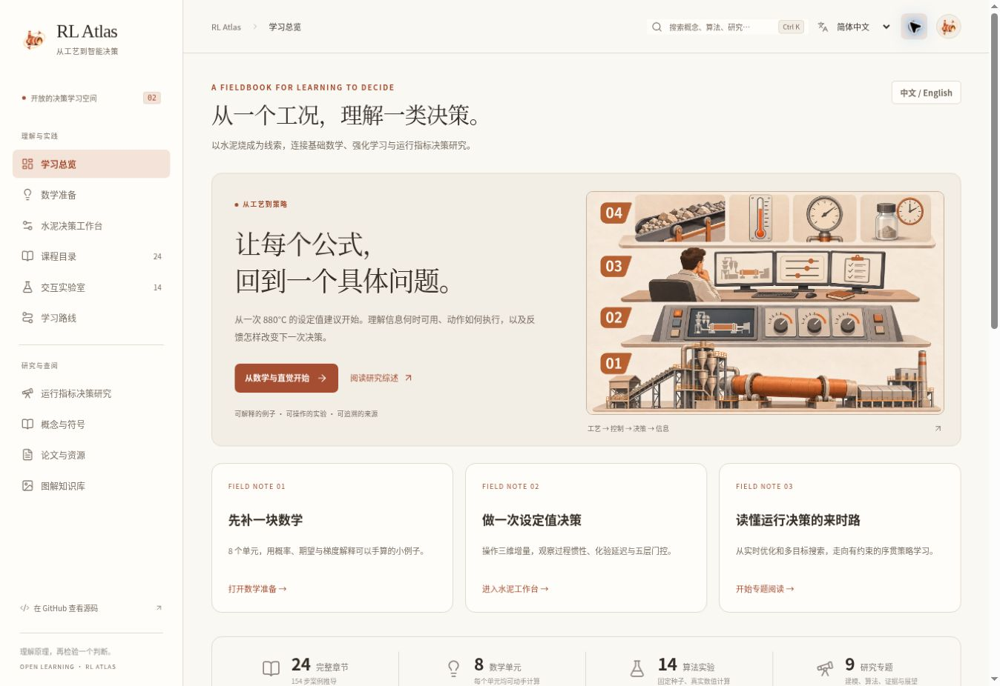
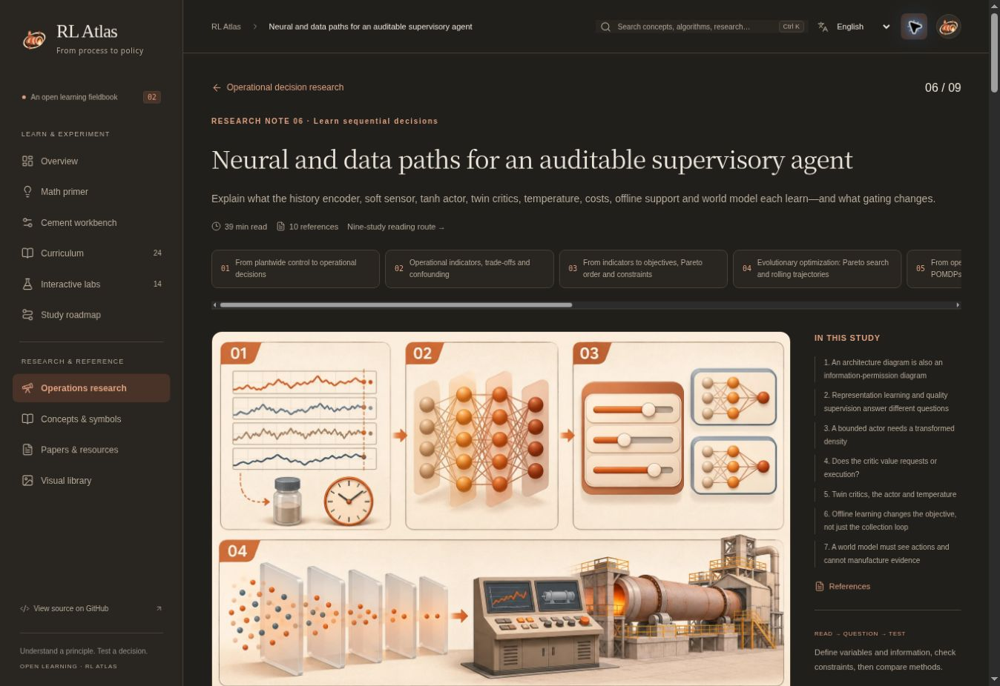
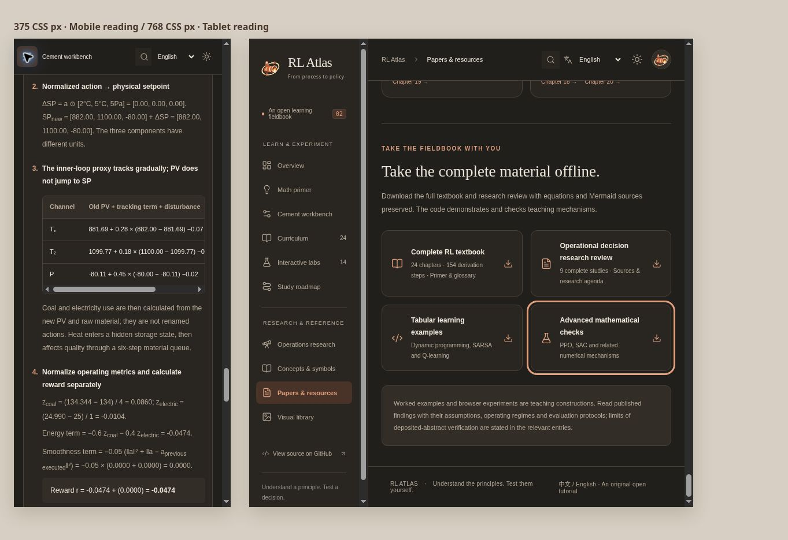

# RL Atlas v2 acceptance record

Date: 2026-11-14. Scope: `rl-learning-web/` and the related Trellis documentation. Base: the user's `2904fa2` dependency update. No package or lock-file versions were changed by this iteration; the user's TypeScript 7 compatible laboratory-metadata check was preserved.

## Automated acceptance

The documented `just check` entry completed with exit code 0 under Linux, Node 24.22, npm 11 and just 1.59. It executes dependency readiness, export generation, tests, strict TypeScript checking and the Vite production build.

| Check | Observed result |
|---|---|
| Tests | 44 passed, 0 failed, 0 skipped, 0 cancelled |
| Authored mathematical content | 2,185 formula occurrences across 205 documents passed KaTeX parsing |
| Mermaid | 40 authored diagrams across the Chinese and English editions passed actual Mermaid parsing |
| Curriculum | 7 modules, 24 chapters, 24 case guides and 154 derivation steps per language |
| Other learning content | 8 mathematics units and 36 glossary entries per language |
| Research | 9 complete studies in each language, 35 primary reference records |
| Figure catalogue | 27 stable entries per language: 20 editable diagrams and 7 illustrations |
| Resource catalogue | 59 URL-deduplicated resources retain all 77 citation IDs and chapter/study relationships |
| Exports | All six generated files equal the corresponding export-builder results |
| Build | Strict type check passed; Vite processed 3,665 modules and completed the production build |

The source-record count, unique resource count, formula occurrences and actual mathematical propositions are different quantities. The 40 Mermaid instances contain both language editions; the visual library presents the 20 diagrams in the selected edition. The separate identity icon is not a gallery entry.

Tests cover stable IDs across editions, untranslated prose checks, formula and answer parity, source retention, DOI and combined catalogue filtering, empty results, old preference compatibility, removed notes/resume entry points, formula/diagram parsing, export consistency and the existing numerical kernels. They do not claim industrial policy training or browser coverage.

## Independent content review

- [Mathematical review](review-mathematics-v2.md): all nine research studies reviewed; three concrete findings corrected before the final export.
- [Primary-source research record](research-review-v2.md): search protocol, all 35 references, actual access scope and evidence boundaries. Some recent papers were accessible only through bibliographic metadata or abstracts; the site states those limits.
- [Foundation translation record](translation-foundations.md) and [advanced translation record](translation-advanced.md): complete prose, step-by-step guides and matching mathematical semantics.
- [Export review](export-v2.md): complete books, full kiln appendix, nine studies, image explanations and stable offline links in both languages.
- Laboratory and kiln translation checks compared 92 states, including 40 kiln states, without changes to the numerical kernels. Numerical cards, SVG geometry, available controls, gates and comparison tables matched across languages. The 72-step horizon and cleanup were also checked.

## Actual browser acceptance

The site ran through the supported Vite preview in Chrome. Desktop screenshots use the actual browser viewport. Responsive checks used same-origin 375 CSS px and 768 CSS px iframes; the effective document content widths were 360 and 753 px after scrollbars. These are CSS-layout checks, not claims of physical iPhone/iPad, touch-device or Safari validation. The temporary iframe fixture was removed after the checks.

| Interaction | Observed result |
|---|---|
| Theme | Warm paper and terracotta light theme; warm charcoal and orange dark theme; icons, cards, plots and controls follow the palette |
| Language | Complete Chinese/English shell, chapter text, guide feedback, mathematics and research; current route survives switching |
| Preferences | Language and theme persisted through a real page reload |
| Research navigation | All nine English research routes rendered their headings, body, equations and diagrams; no page-level horizontal overflow or formula/diagram errors |
| Reading navigation | Research section links scrolled to the correct headings below the fixed header |
| Figure library | Keyword and category filtering, instructional descriptions, actual diagram thumbnails and full detail views rendered |
| Diagram detail | “View source” exposed the authored Mermaid; “Download SVG” produced a real browser download; “Read in context” opened chapter 17 |
| Guide interaction | English SAC guide advanced to its next reasoning step and returned the correct explanation for the selected temperature-update answer |
| Mathematics calculator | Action changed from 0.5 to 1.0; increment updated to 2.00°C, SP to 882.00°C and the illustrative PV to 879.60°C |
| References | 59 resources displayed; DOI `10.1109/TEVC.2004.831456` isolated the matching paper; combining an incompatible evidence filter produced a useful empty state; reset restored the catalogue |
| Evidence filtering | Deployment filter returned the two documented first-party operational accounts with their limits |
| Mobile navigation | Opening showed the menu; Escape closed it; hidden sidebar links became inert again; selecting a destination also closed it |
| Kiln interaction | One pulse plus eleven hold steps advanced 60 minutes, with the expected delayed assay release and English explanations |
| Kiln calculations | Last-step calculations and paired-policy comparison worked at 375 px; long tables scrolled inside their own containers |
| Resource ending | Offline-download cards, provenance note and footer wrapped correctly at tablet width |
| Console | No application errors in the inspected log; unrelated browser-extension metadata messages were excluded |

### Defect found and fixed during browser review

Expanding the English kiln last-step calculation initially increased mobile document width from 360 to 437 px. A grid item's intrinsic minimum width allowed an inner table to stretch its parent. Setting the calculation track to `minmax(0, 1fr)` and constraining its children kept the document at 360 px while long tables retained local scrolling. The expanded calculation and comparison were rechecked after the fix.

Language switching deliberately remounts experiments. It does not preserve temporary sliders, simulated time or rollout histories; this is described in both READMEs and the [locale guide](i18n.md). Theme switching does not require that remount.

## Screenshots

### Chinese light theme

### English dark theme and network illustration

### Narrow calculations and the resource-page ending

## Delivery boundaries

No production equipment, industrial training run, environment threshold or reference material was changed. The teaching model is not a trained kiln controller. The current application ships two complete locales; the structure and maintenance guide explain how to add another complete edition, without advertising unimplemented languages. Windows startup recipes were retained and inspected; this acceptance run executed on Linux. No public hosting deployment is included in this repository update.
