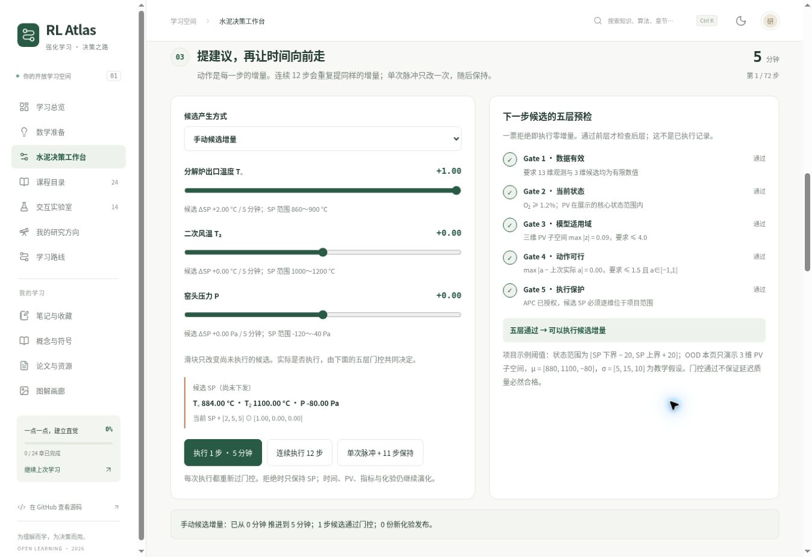

# RL Atlas 验证记录

## 当前版本：水泥烧成案例与数学推导增强

本节记录本次增强的实际验收范围；后面的“首版验收记录”保留前次证据，不与本次检查混计。

### 完整交付范围

| 内容 | 当前数量 / 行为 |
|---|---|
| 课程 | 7 个模块、24 章；章节 ID 与原学习进度兼容 |
| 水泥案例导读 | 24 组、154 个推导步骤；每步包含解释、数字例子和为什么这样做 |
| 判断反馈 | 24 题，每个选项均有独立解释；答题不会自动标记章节完成 |
| 数学准备 | 8 个单元与 8 个实时计算器 |
| 算法实验 | 保留原有 14 个数值实验 |
| 烧成工作台 | 13 维教学观测、3 维设定值增量、5 分钟动态、延迟化验、五层门控与配对比较 |
| 研究与词典 | 6 个可证伪研究假设、36 个概念词条 |
| 来源 | 42 个来源标识、41 个独立 URL；不把论文元数据核验写成全文阅读 |
| 数学与图 | 内容检查解析 868 处数学表达式、12 张内容 Mermaid；学习路线另保留 1 张 Mermaid |
| 介绍图 | 沿用 3 幅原创生成插图；本次未重新生成或复制推文配图 |
| 完整教材 | 仓库版 243,759 字符 / 488,799 UTF-8 字节；网页下载版 243,711 字符 / 488,751 字节 |

字符数包含公式、英文、代码和标点，不等同于汉字数。公式数量统计的是 95 个作者内容片段中的表达式出现次数，不代表互不重复的定理数量。完整教材保留网页中暂时折叠的全部推导、选择反馈、数学准备、研究专题、词典及工作台模型说明。

### 最终自动检查与启动验收

在 Linux、Node.js 24.22.0、npm 11、just 1.59.0 中完成：

| 检查 | 结果与范围 |
|---|---|
| `just setup` 首次运行 | 按锁文件安装 175 个包；安装完成后写入依赖指纹 |
| `just setup` 再次运行 | 识别现有依赖，跳过重复安装 |
| `just dev` | 实际启动 Vite，本机默认地址为 `http://127.0.0.1:5173/`；随后正常停止 |
| 最终 `just check` | 完整教材重新导出、36 / 36 项测试、严格 TypeScript 检查与 Vite 生产构建全部通过 |
| 内容与渲染 | 24 章、24 组导读、154 个步骤、全部选项反馈与导出一致；868 处公式经 KaTeX 解析，12 张内容图经 Mermaid 解析 |
| 导出回归 | Markdown 符号表中的范数竖线不会破坏列；保存的两份教材与规范数据生成结果一致 |
| 数学计算 | 条件概率、期望/方差、梯度有限差分与过冲、SP/PV 时间顺序、原有 11 项算法数值检查通过 |
| 工作台内核 | 9 项行为检查覆盖速率/一阶跟踪、化验采样与发布、不可用信息隔离、物料延迟、五门短路、拒绝后继续演化、种子配对、奖励/约束分离及截断语义 |
| 搜索 | 标题优先匹配；正文、案例、数学准备、研究与词典可检索 |

Windows 的 `cmd.exe` 配置与固定 npm 调用经过源码检查；没有在 Windows 主机上执行本次验收，因此不宣称完成 Windows 运行认证。原 Python 示例没有改动，本次不重复计入前次 Python 执行结果。

### 实际浏览器检查

使用受支持的本地预览，在 Chrome 中操作真实页面。桌面视口约 1363 × 936 CSS px；窄屏通过 390 × 844 的同源嵌入视口检查，滚动条后的内容宽度为 375 CSS px。

| 场景 | 实际观察 |
|---|---|
| 24 章导读 | 逐章打开并展开全部 154 步；无公式错误、无页面级横向溢出 |
| Bellman 判断反馈 | 错误选项解释贪心与原策略评估的区别；正确选项给出 4.288 的代入过程；章节完成数量未被答题改变 |
| 步骤键盘操作 | Enter 激活下一步后，焦点移动到新步骤标题；窄屏第 21 章实际观察到第 2 / 6 步和对应标题 |
| 8 个数学计算器 | 每个单元实际修改参数，指标相应变化；例如 θ=3 时梯度为 6，更新后损失由 4.5 降至 1.62 |
| 固定种子单步 | seed 42、稳定工况、动作 `[1,0,0]`：SP 从 880 到 882°C，5 分钟后 PV 约为 880.468°C |
| 延迟化验 | 一次脉冲后保持，推进至 120 分钟；此时发布 60 分钟采样的化验，采样年龄为 60 分钟；与即时软测量、教学真值分开展示 |
| 约束拒绝 | 低氧在 Gate 2、OOD 在 Gate 3、APC 未授权在 Gate 5 拒绝；实际执行增量归零，SP 保持而时间与过程继续推进 |
| 配对比较 | 保持、手动候选、保守规则三支从同一快照和外部扰动起步；比较不推进主工作台时钟 |
| 72 步教学窗口 | 推进到 360 分钟后停止按钮可用性；页面明确 `truncated=true, terminated=false` 与保留 bootstrap |
| 研究页面 | 研究段落、10 个目录项、20 处数学表达式、1 张 Mermaid 和 6 条研究来源正常显示 |
| 搜索与词典 | PPO 优先进入第 15 章；OAM-Net 可找到研究页；Setpoint 可检索 SP / PV 词条 |
| 窄屏与主题 | 首页、工作台、展开导读/符号、8 个数学单元、研究与词典没有页面级横向溢出；菜单可用；浅色/深色可阅读 |

独立代码审阅与浏览器检查发现的导出竖线转义、步骤焦点、窄屏时钟宽度问题已修复并按对应方式复验。长公式、表格和图采用局部横向滚动，不扩大整页宽度。未观察到应用来源的控制台错误；浏览器扩展自身的元数据错误不计作应用错误。

临时窄屏验收 HTML 已移除，没有进入构建或提交。此方法验证 CSS 断点及实际交互，不等同于真实 iOS / Android 设备或完整跨浏览器兼容性认证。

### 当前版本截图与审阅记录

[案例导读](screenshots/rl-kiln-guide.jpg) · [窄屏首页](screenshots/rl-kiln-mobile-home.jpg) · [窄屏深色词典](screenshots/rl-kiln-mobile-dark.jpg)。

数学和研究的审阅过程见 [基础导读复核](foundations-kiln-notes.md)、[数学准备与进阶复核](learning-review.md)、[研究连接来源](research-connections.md)；工作台模型的所有教学假设见 [模型说明](kiln-workbench.md)。

本次验证的是教学内容、数值机制、静态构建与列出的交互行为。工作台没有训练工业 RL 策略，也没有执行真实工厂评估或 Operator / PG-MOEA/D-IEpsilon 基线实验。保守规则是未训练的教学控制规则；生成曲线不构成现场节能证据。本次未启用线上托管。

---

## 首版验收记录

## 交付范围

本次实现包含 7 个模块、24 个完整章节、14 个交互实验、36 条来源记录（35 个独立 URL）、3 幅原创介绍图，以及阅读进度、收藏、笔记和导出功能。正文包含 355 处数学表达式、11 张 Mermaid 图；学习路线另有 1 张 Mermaid 图。

章节正文合计 70,995 字符。完整 Markdown 导出包含目录、学习目标、章节内容、代码、练习、公式、图源与参考文献，约 108,400 字符。字符数包含代码、标点、英文和公式，不等同于汉字数。

## 自动检查

在 Node.js 24.22.0、npm 11 和 Python 3.12 环境中完成以下检查：

| 命令 / 检查 | 结果 |
|---|---|
| `npm run export:book` | 成功；生成仓库版与网站下载版完整教程 |
| `npm test` | 19 项全部通过：8 项课程与渲染检查、11 项数值行为检查 |
| `npm run build` | TypeScript 严格类型检查及 Vite 生产构建通过 |
| `python public/code/advanced_math_checks.py` | GAE、终止/截断、PPO 正负优势、tanh 密度与尺度检查通过 |
| `python public/code/tabular_foundations.py --method q_learning --seed 42` | 400 回合教学训练与独立贪心评估成功 |
| `python public/code/tabular_foundations.py --method sarsa --seed 42` | 400 回合教学训练与独立贪心评估成功 |
| `advanced_toy_env.py` | Gymnasium 1.4.0 / NumPy 2.5.4 下通过 `check_env` 与五个种子的轻量 rollout |

内容检查实际调用 KaTeX 渲染全部 355 处公式，调用 Mermaid 解析正文全部 11 张图，检查 24 章的练习答案、模块/来源/实验映射、15 处本地资源引用，以及完整教程导出是否与章节数据一致。

数值检查覆盖折扣回报、bootstrap 边界、GAE 两种遮罩、PPO 正负优势、softmax 稳定性、老虎机可复现性、网格最优价值、tanh 密度归一化、多种子 bootstrap、安全门短路与悬崖行走样本。

## 实际浏览器验收

通过受支持的本地预览通道，在 Chrome 中逐页打开并操作真实页面。以下不是单纯检查源文件中是否出现某个字符串。

| 范围 | 实际观察 |
|---|---|
| 24 个章节页面 | 355 处公式与 11 张正文 Mermaid 图正常渲染；24 章均有可展开答案；没有公式错误、图表警告或页面横向溢出 |
| 14 个实验页面 | 全部正常打开并实际操作控件；无 `NaN`/`Infinity` 输出；图表、指标与说明可见 |
| 固定种子的重复操作 | 重跑同一参数得到相同结果；改变最大化偏差实验的动作数后指标改变 |
| 工业安全门 | “载入 OOD 示例”在第三层拒绝候选动作，实际执行增量为 0，后续门不继续计算 |
| 学习路线 | Mermaid 图渲染成功，6 周 / 8 周安排可以切换 |
| 搜索 | 输入关键词后出现正文匹配结果，Enter 打开对应章节 |
| 收藏、完成与笔记 | 写入后刷新仍可读取；笔记与收藏页显示对应条目；测试数据已清理 |
| 手机布局 | 375 CSS px 内容宽度下首页、章节和实验无横向溢出；折叠菜单可导航 |
| 字号与主题 | 正文从 16 px 切换至 18 px 并恢复；浅色与深色实验面板可正常阅读 |

逐页数据保存在 [章节验收数据](qa/readers.json) 与 [实验验收数据](qa/labs.json)。实验数据中的 `changed` 记录首次操作后的数值是否改变；固定种子重跑和默认安全门重算可以合法保持不变。后续参数变化与 OOD 拦截已单独核验，不能把这两个 `false` 解释为按钮失效。

移动布局使用同源嵌入页面限定宽度检验 CSS 断点与交互，未宣称完成真实 iOS / Android 设备兼容性测试。临时验收页面未纳入发布资源。

### 页面截图

[查看手机首页截图](screenshots/home-mobile.jpg)。

## 提交前独立代码复核

对路由、搜索、Markdown 清洗、Mermaid、学习数据存储、导入导出和移动菜单做了独立复核，并修正以下实际问题：

- 搜索窗口重新打开时，按输入框当前关键词生成结果，防止关键词与结果错位。
- 存储失败不会再被成功提示覆盖。笔记保存失败时保留编辑窗口与内容，并明确提示先复制或导出。
- 学习数据导入上限调整为 8 MB，覆盖 24 章各 50,000 字符及 JSON 转义后的合法自导出数据；每章内容仍受长度和 ID 验证约束。
- 手机侧栏关闭时设置 `inert`，打开时维护可访问状态与键盘焦点。
- 公式处理同时保护反引号和波浪线代码块，避免代码中的符号被误当数学。

前两项最后的提示与搜索调整通过代码复核和类型/构建检查；未把存储配额失败描述为在真实浏览器中注入故障验证。

## 结论与边界

这里验证的是教程、交互数值、静态构建与已列页面行为。没有执行完整 DQN / PPO / SAC 深度训练、真实工业控制、生产数据评估或 PG-MOEA/D-IEpsilon 基线对比；没有把教学曲线写成工业收益。没有开展全浏览器矩阵、正式无障碍审计或压力测试，也没有在本次验收中启用线上托管。

复验时从 `npm ci` 开始，依次执行导出、测试、构建；再按上表操作浏览器页面。修改正文后必须重新导出完整教程，修改数值内核后运行对应行为检查。
