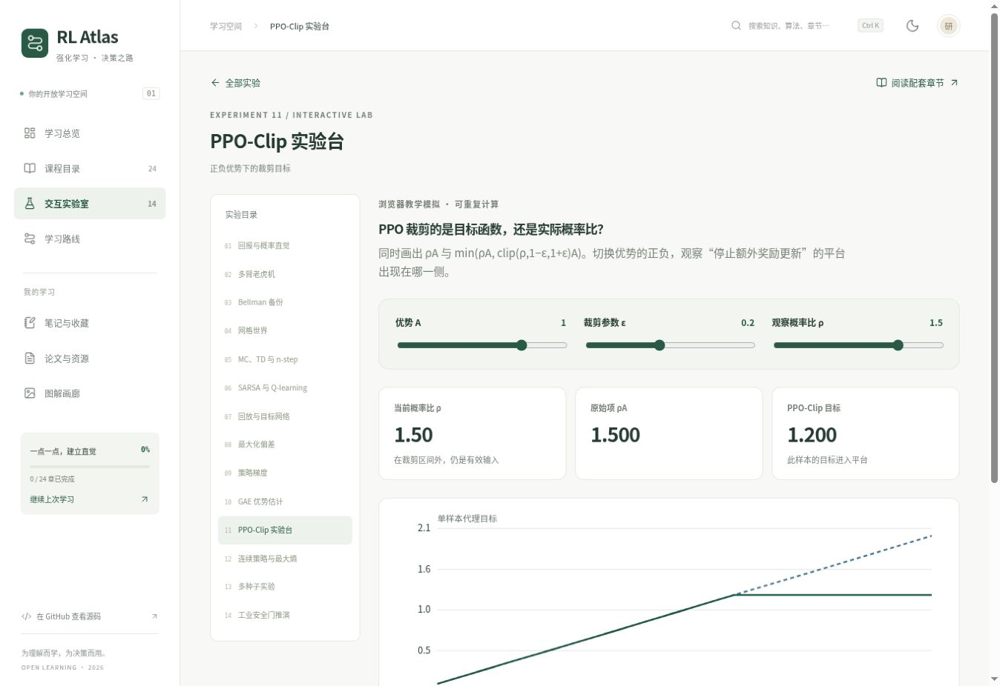

# RL Atlas 验证记录

## 交付范围

本次实现包含 7 个模块、24 个完整章节、14 个交互实验、36 条来源记录（35 个独立 URL）、3 幅原创介绍图，以及阅读进度、收藏、笔记和导出功能。正文包含 355 处数学表达式、11 张 Mermaid 图；学习路线另有 1 张 Mermaid 图。

章节正文合计 70,995 字符。完整 Markdown 导出包含目录、学习目标、章节内容、代码、练习、公式、图源与参考文献，约 108,400 字符。字符数包含代码、标点、英文和公式，不等同于汉字数。

## 自动检查

在 Node.js 24.22.0、npm 11 和 Python 3.12 环境中完成以下检查：

| 命令 / 检查 | 结果 |
|---|---|
| `npm run export:book` | 成功；生成仓库版与网站下载版完整教程 |
| `npm test` | 19 项全部通过：8 项课程与渲染检查、11 项数值行为检查 |
| `npm run build` | TypeScript 严格类型检查及 Vite 生产构建通过 |
| `python public/code/advanced_math_checks.py` | GAE、终止/截断、PPO 正负优势、tanh 密度与尺度检查通过 |
| `python public/code/tabular_foundations.py --method q_learning --seed 42` | 400 回合教学训练与独立贪心评估成功 |
| `python public/code/tabular_foundations.py --method sarsa --seed 42` | 400 回合教学训练与独立贪心评估成功 |
| `advanced_toy_env.py` | Gymnasium 1.4.0 / NumPy 2.5.4 下通过 `check_env` 与五个种子的轻量 rollout |

内容检查实际调用 KaTeX 渲染全部 355 处公式，调用 Mermaid 解析正文全部 11 张图，检查 24 章的练习答案、模块/来源/实验映射、15 处本地资源引用，以及完整教程导出是否与章节数据一致。

数值检查覆盖折扣回报、bootstrap 边界、GAE 两种遮罩、PPO 正负优势、softmax 稳定性、老虎机可复现性、网格最优价值、tanh 密度归一化、多种子 bootstrap、安全门短路与悬崖行走样本。

## 实际浏览器验收

通过受支持的本地预览通道，在 Chrome 中逐页打开并操作真实页面。以下不是单纯检查源文件中是否出现某个字符串。

| 范围 | 实际观察 |
|---|---|
| 24 个章节页面 | 355 处公式与 11 张正文 Mermaid 图正常渲染；24 章均有可展开答案；没有公式错误、图表警告或页面横向溢出 |
| 14 个实验页面 | 全部正常打开并实际操作控件；无 `NaN`/`Infinity` 输出；图表、指标与说明可见 |
| 固定种子的重复操作 | 重跑同一参数得到相同结果；改变最大化偏差实验的动作数后指标改变 |
| 工业安全门 | “载入 OOD 示例”在第三层拒绝候选动作，实际执行增量为 0，后续门不继续计算 |
| 学习路线 | Mermaid 图渲染成功，6 周 / 8 周安排可以切换 |
| 搜索 | 输入关键词后出现正文匹配结果，Enter 打开对应章节 |
| 收藏、完成与笔记 | 写入后刷新仍可读取；笔记与收藏页显示对应条目；测试数据已清理 |
| 手机布局 | 375 CSS px 内容宽度下首页、章节和实验无横向溢出；折叠菜单可导航 |
| 字号与主题 | 正文从 16 px 切换至 18 px 并恢复；浅色与深色实验面板可正常阅读 |

逐页数据保存在 [章节验收数据](qa/readers.json) 与 [实验验收数据](qa/labs.json)。实验数据中的 `changed` 记录首次操作后的数值是否改变；固定种子重跑和默认安全门重算可以合法保持不变。后续参数变化与 OOD 拦截已单独核验，不能把这两个 `false` 解释为按钮失效。

移动布局使用同源嵌入页面限定宽度检验 CSS 断点与交互，未宣称完成真实 iOS / Android 设备兼容性测试。临时验收页面未纳入发布资源。

### 页面截图

[查看手机首页截图](screenshots/home-mobile.jpg)。

## 提交前独立代码复核

对路由、搜索、Markdown 清洗、Mermaid、学习数据存储、导入导出和移动菜单做了独立复核，并修正以下实际问题：

- 搜索窗口重新打开时，按输入框当前关键词生成结果，防止关键词与结果错位。
- 存储失败不会再被成功提示覆盖。笔记保存失败时保留编辑窗口与内容，并明确提示先复制或导出。
- 学习数据导入上限调整为 8 MB，覆盖 24 章各 50,000 字符及 JSON 转义后的合法自导出数据；每章内容仍受长度和 ID 验证约束。
- 手机侧栏关闭时设置 `inert`，打开时维护可访问状态与键盘焦点。
- 公式处理同时保护反引号和波浪线代码块，避免代码中的符号被误当数学。

前两项最后的提示与搜索调整通过代码复核和类型/构建检查；未把存储配额失败描述为在真实浏览器中注入故障验证。

## 结论与边界

这里验证的是教程、交互数值、静态构建与已列页面行为。没有执行完整 DQN / PPO / SAC 深度训练、真实工业控制、生产数据评估或 PG-MOEA/D-IEpsilon 基线对比；没有把教学曲线写成工业收益。没有开展全浏览器矩阵、正式无障碍审计或压力测试，也没有在本次验收中启用线上托管。

复验时从 `npm ci` 开始，依次执行导出、测试、构建；再按上表操作浏览器页面。修改正文后必须重新导出完整教程，修改数值内核后运行对应行为检查。
