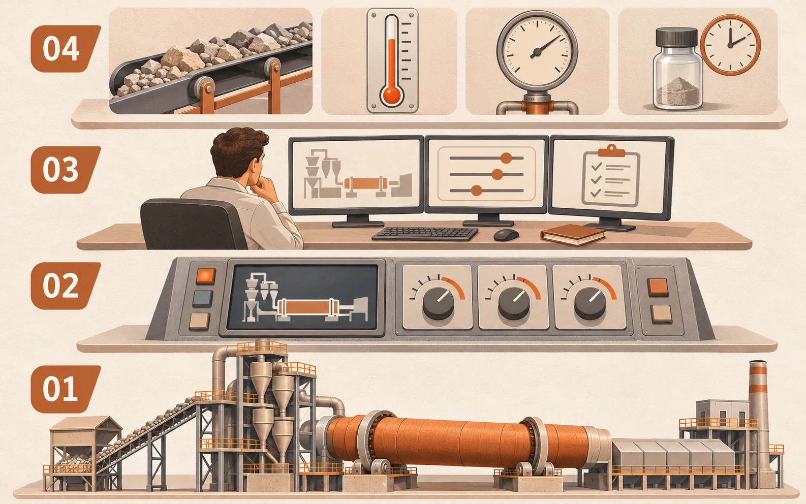
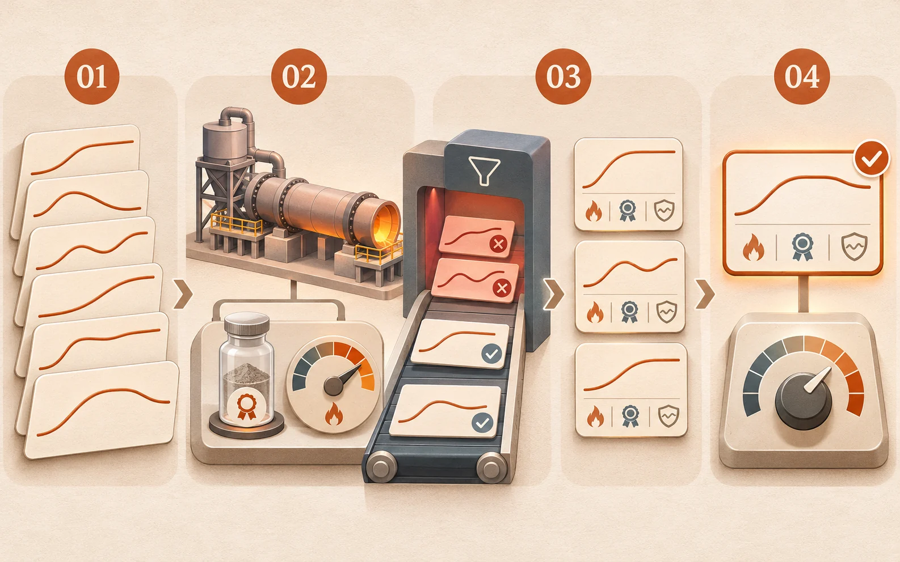
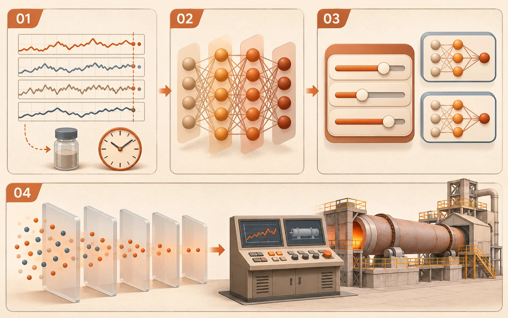
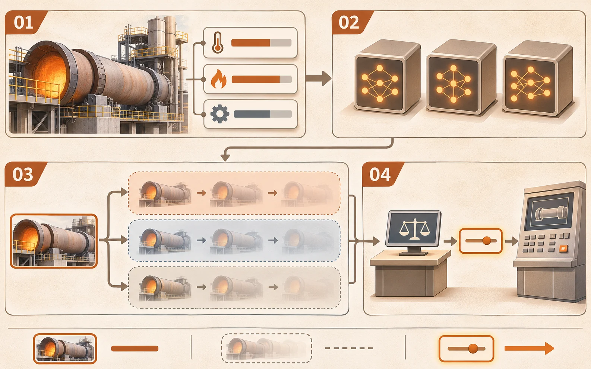

# Operational Decision Research: From Objectives and Evolutionary Optimization to Reinforcement Learning

> English edition of nine complete bilingual studies. Includes reasoning, worked examples, equations, Mermaid, four concept illustrations with region explanations, primary references, and a research agenda.

This review can be read independently. Chapter, mathematics, and workbench links lead to the complete textbook in the same directory tree; illustrations are in the parent images directory. Preserve these relative locations when copying the offline materials.

- [Complete reinforcement-learning textbook](../rl-atlas-tutorial.en.md)
- [Complete kiln workbench model](../rl-atlas-tutorial.en.md#kiln-workbench)

## Studies

- [01 · From plantwide control to operational decisions](#research-history)
- [02 · Operational indicators, trade-offs and confounding](#research-indicators)
- [03 · From indicators to objectives, Pareto order and constraints](#research-objectives)
- [04 · Evolutionary optimization: Pareto search and rolling trajectories](#research-evolution)
- [05 · From operational optimization to MDPs, POMDPs and CMDPs](#research-sequential)
- [06 · Neural and data paths for an auditable supervisory agent](#research-architecture)
- [07 · Evidence map: theory, simulation, field operation and open claims](#research-evidence)
- [08 · Open problems: from accurate prediction to credible decisions](#research-open-problems)
- [09 · Research agenda: six falsifiable questions connecting existing modules](#research-agenda)
- [Complete references](#references)
- [Source-ID index](#source-index)

---

All nine complete studies follow. Read them in order to connect control hierarchy, operating indicators, objectives and constraints, evolutionary optimization, sequential learning, architecture, evidence boundaries, and the research agenda; or enter through a particular question.

Published evidence, teaching assumptions, and proposed research designs are identified separately. A deposited abstract is not independent replication; an official field report is not a result for this project; a proposed architecture is not a trained or deployed method.

## 01 · From plantwide control to operational decisions

Locate the decision layer before comparing RTO, tracking MPC, economic MPC and learned policies.

**Reading estimate:** 24 minutes (adjust to your background)

**Operational decisions: information, targets and control**

Separate measurement, supervisory setpoint decisions, regulatory tracking and the physical kiln. The upper layer proposes bounded targets; inertia, disturbances and regulatory control determine the actual response.

**Read the regions**

- **01** · Physical layer: preheating, calcination, burning and cooling carry material and energy. The layout is conceptual, not an engineering drawing.
- **02** · Control layer: PID/APC tracks setpoints. A changed target temperature does not instantly change the measured temperature.
- **03** · Decision layer: objectives, constraints and predictions inform temperature or pressure setpoint suggestions.
- **04** · Information layer: online signals and delayed assays have different timestamps. Use only information available at the decision time.

These original concept illustrations are not measured curves, identified models, or engineering drawings. The equations and Mermaid diagrams specify the exact relationships.

### 1. Identify the decision before choosing an algorithm

A cement control system is not one black box connecting sensors directly to actuators. Production planning specifies output and product requirements. Operational optimization identifies acceptable operating regions. Supervisory decisions specify controlled-variable targets. PID or APC loops then manipulate the physical process. These layers have different responsibilities and feedback rates; the output of one layer often becomes another layer's reference or constraint. [Skogestad's plantwide-control paper](https://doi.org/10.1016/S0959-1524(00)00023-8) separates the selection of controlled variables from the selection of a controller. Learning methods must respect the same distinction.

This repository places RL at the supervisory layer: every five minutes it proposes bounded CV setpoint increments, retaining the inner control loops, authorization and safety checks. It does not directly command coal feeders or fan openings. Comparing direct-actuator RL with an optimizer restricted to setpoints changes both the algorithm and the available control authority. A resulting performance difference cannot be attributed to learning alone. [Project contract](https://github.com/bahayonghang/rl-learning/blob/main/AGENTS.md)

~~~mermaid
flowchart TD
    P["Production and product requirements"] --> O["Economic objectives and boundaries"]
    O --> S["Supervisory setpoint decision"]
    M["State and quality information"] --> S
    S --> G["Gate and authorization"]
    G --> C["DCS and PID or APC"]
    C --> K["Physical kiln process"]
    K --> M
    K --> A["Indicator accounting and audit"]
    A --> O
~~~

### 2. Steady-state RTO converts economics into an operating point

A classical steady-state real-time optimization problem has the form

$$\min_{x_s,u_s}\ \ell_{econ}(x_s,u_s,d),\qquad 0=f_s(x_s,u_s,d),\quad g(x_s,u_s,d)\le0.$$

The subscript $s$ denotes a steady state and $d$ represents disturbances or operating conditions. Given raw-material properties, prices and production requirements, the model identifies a favorable operating point and translates it into lower-layer targets. The surrounding workflow also needs data reconciliation, parameter estimation, steady-state detection and implementation. A numerical optimum is not evidence that these engineering tasks have been solved. [Darby et al.](https://doi.org/10.1016/j.jprocont.2011.03.009) review this broader RTO practice.

The attraction is a comparatively explicit optimization problem and a direct economic interpretation. The limitation is the assumption that conditions can be approximated as steady during estimation, optimization and implementation. Frequent feed changes, material delays or transitions may make a nominally attractive operating point costly to reach. This limits that formulation; it does not establish that RTO, evolutionary algorithms or optimization in general cannot handle dynamics. Dynamic RTO and receding-horizon formulations address the issue in different ways.

### 3. Tracking MPC and economic MPC optimize different quantities

A tracking MPC formulation often penalizes predicted reference error and input changes:

$$\min_{a_{0:H-1}}\sum_{k=0}^{H-1}\left(\|y_k-y^{ref}_k\|_Q^2+\|\Delta a_k\|_R^2\right)+V_f(x_H).$$

Here $Q$ and $R$ are weighting matrices, not RL action-value functions. The controller predicts a trajectory, applies its first move, receives a new observation and solves again. Feedback comes from repeated estimation and replanning; it does not require executing the original plan to completion. The open [Rawlings–Mayne–Diehl textbook](https://sites.engineering.ucsb.edu/~jbraw/mpc/) develops the associated models, constraints and terminal ingredients.

Economic MPC instead uses an economic or operational stage loss $\ell_{econ}(x_k,a_k)$. Its optimum need not coincide with one fixed tracking reference; some formulations can favor periodic operation. Consequently, familiar stability conclusions from a tracking cost cannot simply be imported. Terminal costs, terminal sets, dissipativity and feasibility must be checked for the particular construction. [Engell](https://doi.org/10.1016/j.jprocont.2006.10.011) and [Ellis et al.](https://doi.org/10.1016/j.jprocont.2014.03.010) explain this shift toward economic operation.

### 4. A small example that requires a trajectory comparison

Consider two gate-approved setpoint candidates, hold and increase slightly, both satisfying the same quality and oxygen constraints. Invented dimensionless energy/smoothness costs are $[0,4]$ after holding and $[1,1]$ after increasing. These numbers illustrate a mechanism; they are not identified kiln dynamics. Looking only at the first period favors holding. With $\gamma=0.9$, the two-period costs are $3.6$ and $1.9$, so an immediate cost buys lower subsequent operational cost without exchanging quality violations for savings.

A dynamic optimizer can discover this trade-off without becoming an RL method. The substantive questions are where its consequence model comes from, how it accounts for the unplanned tail, whether online computation is affordable, and which unseen conditions it must handle. RL offers the possibility of learning a long-horizon value or feedback rule from data, moving some online computation into training. It pays for this with requirements on data support and generalization.

### 5. Compare architectures along four axes

| Question | Steady-state RTO | Dynamic MPC or trajectory search | Learned policy or value |
| --- | --- | --- | --- |
| Optimized object | An operating point under specified conditions | A finite action or setpoint trajectory | An information-to-action rule or long-term value |
| Model role | Steady-state relations and constraints | Dynamic prediction and terminal structure | Interaction data, optionally a world model |
| Response to observations | Update estimates and recompute the point | Estimate state and replan | Policy inference, with controlled retraining if appropriate |
| Main validation issue | Mismatch and implementation coordination | Rollout error, feasibility and computation delay | Support, value bias and distribution change |

This is a set of comparison axes, not a ranking. An EA can solve a dynamic MPC problem. A neural network can supply its model or terminal value. RL can tune an optimizer rather than replace it. The contribution of a hybrid must be established using the same available information, action authority, constraints and resource budget.

### 6. Self-optimizing control asks more than whether tracking error is zero

Let $d$ denote conditions and $u^*(d)$ an ideal feasible operating point. Holding a selected set of CVs at references produces an actual inner-loop operating point $u(c,d)$. For a minimized economic cost $J$, compare

$$\mathcal L(c,d)=J(u(c,d),d)-J(u^*(d),d).$$

The loss is nonnegative when both points satisfy the same constraints and $u^*$ is globally optimal. The question is whether selected CVs maintain small economic losses under disturbances and implementation error, not merely whether their tracking errors approach zero. This perspective from [self-optimizing control](https://doi.org/10.1016/S0959-1524(00)00023-8) transfers usefully to learning architectures: a precisely regulated variable need not be the economically important one.

As an invented example, design one incurs losses $[1,9]$ under two equally likely regimes, while design two incurs $[3,4]$. Testing only the first regime favors design one. Mean losses are 5 and 3.5, and worst losses are 9 and 4, favoring design two once the evaluation scope expands. These are economic losses between feasible closed loops, not permission to buy constraint violations with profit. The example motivates regime-level validation of the complete soft-sensor, setpoint and inner-control chain.

The tutorial preserves the existing CV interface. Studying a different CV selection would require a separate engineering formulation: establish measurements and available degrees of freedom, check inner-loop trackability and economic sensitivity, then evaluate the learning method. Otherwise the benefit of changing the control structure may be mistakenly attributed to the algorithm.

### 7. Lessons the research should retain

First, economic objectives must map to auditable measurements rather than disappear into an unexplained reward. Second, setpoints must respect the inner system's tracking capability, rate limits and authorization. A slow supervisory change can still induce a fast regulatory response. Third, estimation, synchronization, model maintenance and operator exit mechanisms are parts of the decision system, not accessories to add after an algorithm succeeds.

A claim of a better learned operational policy must identify what it improves over operator behavior, the project's PG-MOEA/D-IEpsilon baseline and other appropriate optimization baselines. Better soft sensing, extra model calls and future assay leakage are three very different explanations for apparent progress. The review therefore proceeds from measurable indicators, to precise objectives and constraints, and only then to algorithms and evidence.

### Primary references and evidence boundaries

- [R1](#reference-1) · [Plantwide control: the search for the self-optimizing control structure](https://doi.org/10.1016/S0959-1524(00)00023-8) — Sigurd Skogestad; 2000. Source ID: r2-skogestad.
- [R2](#reference-2) · [RTO: An overview and assessment of current practice](https://doi.org/10.1016/j.jprocont.2011.03.009) — Mark L. Darby, Michael Nikolaou, James Jones, Doug Nicholson; 2011. Source ID: r2-rto.
- [R3](#reference-3) · [Feedback control for optimal process operation](https://doi.org/10.1016/j.jprocont.2006.10.011) — Sebastian Engell; 2007. Source ID: r2-engell.
- [R4](#reference-4) · [A tutorial review of economic model predictive control methods](https://doi.org/10.1016/j.jprocont.2014.03.010) — Matthew Ellis, Helen Durand, Panagiotis D. Christofides; 2014. Source ID: r2-empc.
- [R5](#reference-5) · [Model Predictive Control: Theory, Computation, and Design](https://sites.engineering.ucsb.edu/~jbraw/mpc/) — James B. Rawlings, David Q. Mayne, Moritz M. Diehl; 2020, 2nd paperback edition; current online printing. Source ID: r2-mpcbook.
- [R35](#reference-35) · [rl-learning project domain and safety contracts](https://github.com/bahayonghang/rl-learning/blob/main/AGENTS.md) — bahayonghang / rl-learning; Repository contract. Source ID: r2-project.

**r2-skogestad · Journal of Process Control 10, 487–507:** Author manuscript inspected: CV selection, hierarchical setpoints and economic loss; constant setpoints are a conditional design result.

**r2-rto · Journal of Process Control 21, 874–884:** Publisher abstract verifies the RTO/MPC history and implementation focus; it provides no performance estimate for this project.

**r2-engell · Journal of Process Control 17, 203–219:** Review connecting economic objectives and feedback optimization; distinguishes tracking, steady-state and dynamic optimization.

**r2-empc · Journal of Process Control 24, 1156–1178:** Publisher abstract confirms EMPC stability/performance scope; worked derivations also use the openly available MPC textbook.

**r2-mpcbook · Nob Hill Publishing:** Open author textbook on receding horizons, terminal ingredients, estimation and economic MPC.

**r2-project · Project repository:** Repository conventions for timing, observation, CV increments, costs and five gates; neither a universal process standard nor a validation report.

---

## 02 · Operational indicators, trade-offs and confounding

Put fuel, electricity, quality, throughput, emissions and stability back into units, boundaries and time before comparing policies.

**Reading estimate:** 25 minutes (adjust to your background)

### 1. Define indicators before designing a reward

Energy saving becomes comparable only after specifying the production boundary, product denominator, time window and fuel basis. Clinker production and cement grinding are different accounting boundaries. Electricity per tonne of clinker and total electricity per tonne of cement cannot be placed in one algorithm ranking without reconciliation. The [EPA cement energy guide](https://www.energystar.gov/sites/default/files/buildings/tools/ENERGY%20STAR%20Guide%20for%20the%20Cement%20Industry%2028_08_2013%20Final.pdf) organizes energy use by process, while the [EU BREF](https://publications.jrc.ec.europa.eu/repository/handle/JRC83006) also addresses materials and emissions. We adopt that accounting discipline, not their historical sector averages as measurements of this project.

| Indicator | An explicit definition | Frequently omitted context |
| --- | --- | --- |
| Specific fuel mass | kg fuel / t clinker | Heating value, moisture, fuel mix and conversion basis |
| Specific heat input | GJ fuel heat / t clinker | Lower versus higher heating value, boundary and start/stop periods |
| Specific electricity | kWh / t clinker | Included fans, cooling, transport and auxiliary equipment |
| Quality | f-CaO, other assays and conformity rate | Sample time, release delay, sampling frequency and untested product |
| Throughput | t/h or conforming product per window | Cost of reducing load to reduce instantaneous consumption |
| Emissions | Mass flow, concentration or mass per product | Dry/wet basis, reference conditions, oxygen basis and averaging time |
| Stability | CV variation, tracking error or action variation | Trends versus fluctuations, and stable but incorrect conditions |

### 2. Two averages of specific energy are different

Let interval $i$ consume $E_i$ and produce $M_i$. Aggregate specific electricity is defined when total production $\sum_iM_i>0$; its expansion as a production-weighted average additionally requires each interval to have $M_i>0$:

$$e_{total}=\frac{\sum_i E_i}{\sum_i M_i}=\sum_i\frac{M_i}{\sum_jM_j}\frac{E_i}{M_i}.$$

With positive production in every interval, it is a production-weighted average of interval ratios, not their unweighted mean. If a startup or shutdown interval has $M_i=0,E_i>0$, its ratio is undefined but its energy must remain in the total numerator. For $E=[100,900]$ kWh and $M=[0,100]$ t, the aggregate is 10 kWh/t; discarding the zero-production period incorrectly gives 9. If total production is zero, report energy and operating status separately rather than a per-tonne ratio.

In another invented example, two periods consume 10,000 and 16,000 kWh while producing 100 and 200 t. Their ratios are 100 and 80 kWh/t. The simple mean is 90, whereas the aggregate is $26000/300\approx86.67$ kWh/t. Mixing these conventions can create apparent improvement when load changes.

Similarly, suppose A consumes 10,000 kWh for 100 t and B consumes 14,400 kWh for 150 t. B has 4% lower specific electricity but 44% higher total electricity. Both statements are correct; they answer different questions. Report production, total consumption and specific consumption together, and state whether the policies meet the same production requirement. Selecting one favorable percentage conceals the trade-off.

### 3. Lower fuel mass need not mean lower heat input

Heat input requires multiplying each fuel mass by its heating value:

$$Q_{fuel}=\sum_jm_jH_j,\qquad q_{spec}=\frac{Q_{fuel}}{M_{clinker}}.$$

In a teaching example, A uses 100 kg/t of fuel at 25 MJ/kg, giving 2.5 GJ/t. B uses 90 kg/t at 30 MJ/kg, giving 2.7 GJ/t. Mass falls by 10% while heat input increases by 8%. This is a units example, not a plant observation. Changes in fuel properties and alternative-fuel share must be reconciled before attributing a difference to setpoint decisions.

Carbon accounting also separates combustion from raw-material decomposition and other sources. Lower electricity does not imply the same percentage reduction in total greenhouse-gas emissions. Emission concentration and emitted mass are different quantities: dilution can change concentration without removing the corresponding pollutant mass. Preserve flows, measurement conditions and accounting versions. A normalized reward cannot replace a physical inventory. [BREF](https://publications.jrc.ec.europa.eu/repository/handle/JRC83006)

### 4. Quality has timestamps and a scope

Free lime provides quality-related information, but one number does not determine every product property. The repository uses conventions including f-CaO in $[0.5,1.5]\%$ and $O_2\ge1.2\%$. These are project and teaching interfaces, not universal specifications for other kiln lines. [Project source](https://github.com/bahayonghang/rl-learning/blob/main/AGENTS.md)

Keep sample time $\tau$, result-availability time $v$ and decision time $t$. Only a result with $v\le t$ may enter the policy observation. Its sample age is $t-\tau$. A sample collected at 10:00 and released at 10:40 cannot be read by the 10:20 policy. It can later support appropriately aligned evaluation, but newly released does not mean caused by the most recent action. Material residence time may be distributed rather than a single exact delay; shifting every assay by one fixed lag also requires validation.

### 5. Association is not automatically an action effect

An operator may raise a temperature setpoint because feed has become harder to burn or because deterioration is already suspected. A historical association between high setpoints and high free lime can reflect corrective action under difficult conditions. It does not establish that raising the setpoint caused poorer quality. The following is a hypothesized diagnostic structure, not an identified causal model of the plant.

~~~mermaid
flowchart TD
    D["Feed and load changes"] --> A["Operator setpoint proposal"]
    D --> Q["Later quality and energy"]
    H["History and hidden judgment"] --> A
    H --> Q
    A --> X["Process after inner control"]
    X --> Q
~~~

Check temporal order, measurement provenance, information available to the operator and joint action coverage before deciding which comparisons are identifiable. Matching, stratification and causal models can address some biases without proving that all hidden confounding has disappeared. A world model can fit historical data closely while mainly reproducing the old operating policy, rather than identifying the consequences of changing it.

### 6. Quality and production must not disappear into the denominator

Consider another invented accounting example. The baseline consumes 300 GJ and makes 100 t, all conforming, for 3.0 GJ/t. A candidate consumes 290 GJ and still makes 100 t, but only 90 t conforms. Per total output it uses 2.9 GJ/t, apparently about $3.33\%$ lower. Per conforming output it uses $290/90\approx3.222$ GJ/t, worse than the baseline. These denominators answer different questions; selecting whichever favors a candidate is invalid.

The project's independent quality boundaries remain in force. A conforming-output denominator does not permit compensating for unacceptable quality with energy, and it does not turn an infeasible proposal into an executable one. Define how rework, inventory delay and downstream processing enter the accounting boundary instead of moving them outside a favorable time window. Later quality inspection may support retrospective performance auditing, but it cannot become information that the historical policy already possessed.

Fuel, electricity, output and quality are not independent knobs. Cooling and heat recovery, combustion conditions and fan loads affect system-level trade-offs. A local equipment metric can improve without improving totals for the same product boundary. The process-oriented accounting in the [EPA energy guide](https://www.energystar.gov/sites/default/files/buildings/tools/ENERGY%20STAR%20Guide%20for%20the%20Cement%20Industry%2028_08_2013%20Final.pdf) helps organize the comparison. Actual directions and magnitudes need plant-specific data or validated models, not a percentage inferred from a conceptual illustration.

### 7. Report stability separately from benefit

For normalized executed increments, one useful diagnostic is total variation:

$$TV(a^{exec})=\sum_t\|a_t^{exec}-a_{t-1}^{exec}\|_1.$$

Other diagnostics include CV variance, tracking error, the longest violation episode, gate rejection rate and recovery time. They are not interchangeable. A constant but wrong temperature has low variance. A smooth transition to a new operating condition contains a trend that should not automatically be treated as noise. Holding a setpoint after rejection does not freeze physical dynamics, disturbances or the assay clock.

Separate primary outcomes from explanatory diagnostics. Preserve fuel, electricity, conforming production, quality costs and oxygen costs as outcomes; use support, smoothness and fallback causes to explain them. Time-held-out evaluation, operating-condition strata and independent repeated runs help distinguish an algorithm effect from unusually favorable feed. [Agarwal et al.](https://arxiv.org/abs/2108.13264) provide a useful treatment of uncertainty in limited-run RL comparisons.

### Primary references and evidence boundaries

- [R6](#reference-6) · [BAT Reference Document for the Production of Cement, Lime and Magnesium Oxide](https://publications.jrc.ec.europa.eu/repository/handle/JRC83006) — Frauke Schorcht, Ioanna Kourti, Bianca Maria Scalet, Serge Roudier, Luis Delgado Sancho; 2013. Source ID: r2-cement-bat.
- [R7](#reference-7) · [Energy Efficiency Improvement and Cost Saving Opportunities for Cement Making](https://www.energystar.gov/sites/default/files/buildings/tools/ENERGY%20STAR%20Guide%20for%20the%20Cement%20Industry%2028_08_2013%20Final.pdf) — Ernst Worrell, Katerina Kermeli, Christina Galitsky; 2013. Source ID: r2-energy-guide.
- [R35](#reference-35) · [rl-learning project domain and safety contracts](https://github.com/bahayonghang/rl-learning/blob/main/AGENTS.md) — bahayonghang / rl-learning; Repository contract. Source ID: r2-project.
- [R27](#reference-27) · [Deep Reinforcement Learning at the Edge of the Statistical Precipice](https://arxiv.org/abs/2108.13264) — Rishabh Agarwal, Max Schwarzer, Pablo Samuel Castro, Aaron Courville, Marc G. Bellemare; 2021. Source ID: r2-rliable.

**r2-cement-bat · European Commission JRC, EUR 26129:** Official EU process, energy and emissions reference; used for measurement context, not as an automatic specification for this kiln.

**r2-energy-guide · US EPA ENERGY STAR, 430-R-13-009:** Open EPA ENERGY STAR guide; distinguishes clinker production, grinding, fuel and electricity accounting without transplanting historical averages.

**r2-project · Project repository:** Repository conventions for timing, observation, CV increments, costs and five gates; neither a universal process standard nor a validation report.

**r2-rliable · NeurIPS 2021:** Repeated trials, uncertainty and robust aggregation; time steps are not independent training seeds.

---

## 03 · From indicators to objectives, Pareto order and constraints

Worked examples separate scaling, preferences, feasibility, chance constraints and soft constraints.

**Reading estimate:** 29 minutes (adjust to your background)

### 1. The objective is part of the research question

For current information $h$ and a candidate setpoint path $u$, begin with

$$\min_{u\in\mathcal U(h)}\mathbf f(u;h)=\left(f_F(u;h),f_E(u;h),f_S(u;h)\right),\qquad g_j(u;h)\le0.$$

The objectives may represent fuel, electricity and smoothness, while quality, oxygen, setpoint bounds and authorization define feasibility. The variable $u$ may be a point, a trajectory or policy parameters. The expression alone does not tell us whether optimization is dynamic. That depends on the decision representation, temporal aggregation and consequence model. [MOEA/D](https://doi.org/10.1109/TEVC.2007.892759)

Adding a large quality penalty to energy changes the problem: sufficient energy benefit may compensate for a violation. Some mathematical penalty constructions are exact under specified conditions and sufficiently large coefficients. An arbitrary coefficient in finite-data training does not inherit that result. The project therefore keeps quality and environmental costs explicit and does not alter physical boundaries for a tutorial experiment. [Contract](https://github.com/bahayonghang/rl-learning/blob/main/AGENTS.md)

### 2. Scaling must not conceal preferences

Adding kg/t directly to kWh/t lacks an obvious interpretation. Convert to money, engineering tolerances or frozen training-set scales:

$$z_F=\frac{F-\mu_F}{s_F},\qquad z_E=\frac{E-\mu_E}{s_E},\qquad L_w=w_Fz_F+w_Ez_E.$$

Denominators must be positive and versioned. Standard-deviation scaling gives a smaller normalized improvement to one physical unit of a highly variable indicator; that numerical convention is not automatically an economic preference. Refitting scales on the test regime changes the score assigned to the same physical result and can leak information. Report both raw indicators and normalized objectives.

Consider invented feasible alternatives A=$(95,108)$, B=$(100,100)$ and C=$(104,92)$ in fuel/electricity coordinates. Reference values $(100,100)$ and scales $(5,10)$ give A=$(-1,0.8)$, B=$(0,0)$ and C=$(0.8,-0.8)$. Weights $(0.7,0.3)$ yield losses $-0.46,0,0.32$, selecting A. Weights $(0.2,0.8)$ yield $0.44,0,-0.48$, selecting C. Neither the predictions nor the candidates changed; the preference did.

Expanding gives $L_w=(w_F/s_F)F+(w_E/s_E)E-\mathrm{const}$. The effective coefficients on physical indicators are $w_F/s_F$ and $w_E/s_E$. If the intended objective is cost $C=p_FF+p_EE$, preserve the same preference by choosing $w_F:w_E=p_Fs_F:p_Es_E$. Arbitrary standardization followed by equal weights does not establish equal economic importance.

For a purely invented teaching price of $p_F=0.8$ currency units/kg and $p_E=0.6$ units/kWh, assuming identical product boundaries and acceptable quality, A, B and C cost 140.8, 140.0 and 138.4 currency units/t. This objective selects C. It excludes other production costs and is not a current market-price claim; it demonstrates dimensional multiplication and interpretable preferences. Price changes, throughput or rework require a revised economic definition rather than continued use of these illustrative numbers.

### 3. Pareto order exposes trade-offs without choosing for you

For minimization, $u$ dominates $v$ when it is no worse in every objective and better in at least one:

$$u\prec v\iff[\forall i:f_i(u)\le f_i(v)]\land[\exists j:f_j(u)<f_j(v)].$$

A, B and C above are mutually nondominated. D=$(107,110)$ is dominated by B. An alternative U=$(90,85)$ that violates the project's f-CaO boundary is infeasible first; excellent energy coordinates do not put it on an executable frontier. Nondominance is also relative to the set examined, not proof that a search has reached the global front. [NSGA-II](https://doi.org/10.1109/4235.996017)

A weighted sum may miss points on a nonconvex front. The teaching points $(0,2),(1.1,1.1),(2,0)$ are all nondominated. For any normalized nonnegative pair of weights, at least one endpoint has weighted cost at most 1, whereas the middle point costs 1.1. No scan of linear weights selects it. Decomposition, constraint formulations and coverage must therefore match the problem; increasing the number of weights alone does not fix the issue. [MOEA/D](https://doi.org/10.1109/TEVC.2007.892759)

### 4. Two meanings of epsilon

An epsilon-constraint formulation of multiobjective optimization can be

$$\min_u F(u)\quad\text{subject to}\quad E(u)\le\varepsilon_E,\quad g(u)\le0.$$

An electricity budget of 100 excludes A. B then has lower fuel use than C, so B is selected. Varying a predeclared budget explores different trade-offs. This budget has units and should be justified by operational requirements or an explicit sensitivity study.

An epsilon-level in evolutionary constraint handling instead concerns how violation is compared during search. It can temporarily retain nearly feasible candidates to preserve routes into the feasible region. That does not authorize an equally violating action on equipment. Search tolerance, product-budget preference and hard operational boundaries are different concepts.

~~~mermaid
flowchart TD
    A["Candidate point or trajectory"] --> F["Units and time accounting"]
    F --> C["Feasibility check"]
    C -->|"Infeasible"| R["Reject or continue search"]
    C -->|"Feasible"| P["Pareto comparison"]
    P --> W["Preference or budget selection"]
    W --> G["Independent execution review"]
    R --> A
~~~

### 5. Hard, soft, chance and expected constraints differ

A hard constraint requires $g\le0$ within the modeled admissible set; physical assurance still depends on model error and execution conditions. A soft constraint introduces slack, for example $g\le\xi$, $\xi\ge0$, and penalizes it. This can make infeasibility diagnosable, but it is not a blanket license to relax non-negotiable protection.

A chance constraint controls a stated probability, such as $P(q\le1.5\mid h,u)\ge0.95$. For an assumed, calibrated Gaussian distribution with $\sigma_q>0$, standardization gives $P(q\le1.5)=\Phi((1.5-\mu_q)/\sigma_q)$. Monotonicity of the standard-normal distribution function makes the requirement equivalent to $\mu_q+\Phi^{-1}(0.95)\sigma_q\le1.5$. Approximating the quantile by $\Phi^{-1}(0.95)\approx1.645$ yields

$$\mu_q+1.645\sigma_q\le1.5.$$

With $\mu_q=1.2$ and $\sigma_q=0.2$, the left side is about 1.529. The mean lies inside the range, but the chance requirement fails. With mean 1.1 it becomes about 1.429. This examines only the upper tail. Lower limits, multiple variables and trajectories require additional risk allocation. Per-step 95% coverage is not an infinite-run 95% guarantee. [Original chance-constraint reference](https://doi.org/10.1287/mnsc.6.1.73)

A CMDP constraint such as $\mathbb E_\pi[\sum_t\gamma^tc_t]\le d$ instead controls expected cumulative cost. If 99 outcomes cost zero and one costs 10, their mean is 0.1. A mean budget of 0.2 can be satisfied despite the severe individual event. Define whether the cost measures magnitude, probability or duration, and give its units. [CPO](https://arxiv.org/abs/1705.10528)

For quality, a violation-magnitude cost can be $c_q=(q_{\min}-q)_++(q-q_{\max})_+$. When q is represented by its numerical percentage value, this cost has units of percentage points. An event cost $c_I=\mathbf1_{q\notin[q_{\min},q_{\max}]}$ is dimensionless; a duration cost multiplies the indicator by interval length. They measure different consequences and cannot share an unconverted budget.

Suppose three five-minute intervals have constant qualities $1.4\%,1.6\%,1.9\%$, with the project's upper boundary $1.5\%$ and the lower boundary satisfied. Magnitude costs are $[0,0.1,0.4]$ percentage points, event costs are $[0,1,1]$, and total violation duration is ten minutes. Identical event rates can conceal different peak magnitudes, so report frequency, magnitude and duration together. Constant quality over each interval is an explicit example assumption; sparse assays alone do not establish continuous violation duration.

### 6. Deliver an objective that can be reviewed

Provide a metric dictionary, raw units, normalization version, temporal aggregation, preference rationale, constraint semantics, approved infeasibility fallback, and separate requested/executed action logs. Freeze these across algorithm comparisons. If preference sensitivity is the subject, vary weights systematically and publish the whole comparison.

An explicit formulation reveals ways a reward can be exploited: producing less to lower instantaneous consumption, diluting an emission concentration, remaining motionless at the wrong quality condition, or consulting an assay that had not yet arrived. These are specification and data-governance failures. A more powerful solver cannot repair an incorrectly defined task.

### Primary references and evidence boundaries

- [R9](#reference-9) · [MOEA/D: A Multiobjective Evolutionary Algorithm Based on Decomposition](https://doi.org/10.1109/TEVC.2007.892759) — Qingfu Zhang, Hui Li; 2007. Source ID: r2-moead.
- [R8](#reference-8) · [A Fast and Elitist Multiobjective Genetic Algorithm: NSGA-II](https://doi.org/10.1109/4235.996017) — Kalyanmoy Deb, Amrit Pratap, Sameer Agarwal, T. Meyarivan; 2002. Source ID: r2-nsga2.
- [R13](#reference-13) · [Chance-Constrained Programming](https://doi.org/10.1287/mnsc.6.1.73) — Abraham Charnes, William W. Cooper; 1959. Source ID: r2-chance.
- [R25](#reference-25) · [Constrained Policy Optimization](https://arxiv.org/abs/1705.10528) — Joshua Achiam, David Held, Aviv Tamar, Pieter Abbeel; 2017. Source ID: r2-cpo.
- [R5](#reference-5) · [Model Predictive Control: Theory, Computation, and Design](https://sites.engineering.ucsb.edu/~jbraw/mpc/) — James B. Rawlings, David Q. Mayne, Moritz M. Diehl; 2020, 2nd paperback edition; current online printing. Source ID: r2-mpcbook.
- [R35](#reference-35) · [rl-learning project domain and safety contracts](https://github.com/bahayonghang/rl-learning/blob/main/AGENTS.md) — bahayonghang / rl-learning; Repository contract. Source ID: r2-project.

**r2-moead · IEEE Transactions on Evolutionary Computation 11, 712–731:** Original PDF inspected for decomposition, neighborhoods and scaling; the name does not specify the project-specific variant.

**r2-nsga2 · IEEE Transactions on Evolutionary Computation 6, 182–197:** Original paper inspected for nondominated sorting, crowding, elitism and constrained dominance; evidence consists of test problems.

**r2-chance · Management Science 6, 73–79:** Foundational chance-constraint reference; the Gaussian quantile example is an original teaching derivation.

**r2-cpo · ICML 2017:** Constrained policy optimization and bounds; expected costs are not per-step guarantees.

**r2-mpcbook · Nob Hill Publishing:** Open author textbook on receding horizons, terminal ingredients, estimation and economic MPC.

**r2-project · Project repository:** Repository conventions for timing, observation, CV increments, costs and five gates; neither a universal process standard nor a validation report.

---

## 04 · Evolutionary optimization: Pareto search and rolling trajectories

Separate representation, evaluation, feasibility and search. Derive NSGA-II and MOEA/D, then connect dynamic optimization with MPC and RL.

**Reading estimate:** 31 minutes (adjust to your background)

**From candidate trajectories to an executable suggestion**

Evolutionary optimization encodes candidates, evaluates surrogate predictions, compares constraint satisfaction and selects a preference. It can search dynamic trajectories; model validity, computational budget and rolling execution are the central issues.

**Read the regions**

- **01** · Candidates: each curve card represents a setpoint trajectory. Encoding, smoothness and the initial point define the searchable space.
- **02** · Evaluation: a model predicts energy, quality and other costs before constraints are checked. Attractive predictions are not proof of physical feasibility.
- **03** · Comparison: retain feasible candidates with different trade-offs. The curves are not measured Pareto fronts or performance evidence.
- **04** · Execution: choose with an explicit preference, pass an independent gate, and execute only the current step of the rolling decision.

These original concept illustrations are not measured curves, identified models, or engineering drawings. The equations and Mermaid diagrams specify the exact relationships.

### 1. Ask what an individual represents before choosing the algorithm

In kiln optimization, a population member may encode the next increments of six CV setpoints, a sequence of increments over $H$ steps, or a small set of control points describing a smooth setpoint trajectory. Conditioned on the available observation history, an evaluator passes the candidate through a mechanistic model, surrogate or replay simulator and returns fuel, electricity, quality costs and feasibility. **The representation defines the decision problem; NSGA-II or MOEA/D defines a search procedure over that representation.** A steady-state evaluator produces a steady-state compromise. A dynamic evaluator that propagates delayed quality responses allows an EA to optimize sequential decisions.

Representation, evaluation, feasibility comparison and search are distinct design choices. They determine dimension and smoothness, predictive bias, survival rules and allocation of a finite computational budget. Attributing every failure to “evolutionary algorithms cannot handle time” hides these differences. [MPC theory](https://sites.engineering.ucsb.edu/~jbraw/mpc/) does not require a gradient-based optimizer, and [original dynamic multiobjective research](https://doi.org/10.1109/TEVC.2004.831456) already considered moving Pareto sets and control applications.

~~~mermaid
flowchart TD
  O["Latest observations and history"] --> P["Point or trajectory population"]
  P --> M["Dynamics and metric evaluation"]
  M --> C["Feasibility and violation"]
  C --> S["Ranking or decomposition"]
  S --> V["Selection and variation"]
  V --> P
  S --> B["Preference and first proposal"]
  B --> G["Five gates and inner control"]
  G --> O
~~~

### 2. NSGA-II: compare rank, then preserve spread

For minimization, $u$ dominates $v$ when it is no worse on every objective and strictly better on at least one. The first nondominated front contains candidates dominated by none of the others. Removing it reveals the next front. NSGA-II combines parents and offspring, fills the next generation from better-ranked fronts, and uses crowding distance when the final accepted front does not fit. The original paper also develops constrained dominance and analyzes computational complexity. This is not equivalent to selecting the smallest weighted sum. [Deb et al., 2002](https://doi.org/10.1109/4235.996017)

Within a front, sort by each objective $m$. The crowding distance of an interior individual accumulates

$$d_i=\sum_{m=1}^{M}\frac{f_m(i+1)-f_m(i-1)}{f_m^{\max}-f_m^{\min}}.$$

Boundary individuals are normally assigned infinite distance to preserve extremes. An implementation should skip a constant objective whose zero range supplies no discrimination. The neighbors are obtained from **each objective's own ordering**, not from one ordering reused for all objectives.

Consider four synthetic points $(0,10),(2,7),(4,4),(10,0)$ with both objectives minimized. All four are nondominated. The distance at $(2,7)$ is $4/10+6/10=1.0$; at $(4,4)$ it is $8/10+7/10=1.5$. If only one of these two interior candidates can be retained, the latter is preferred at equal rank. Greater distance means a more sparsely represented region of objective space. It does **not** imply greater safety, higher economic value or better model credibility; those need their own definitions.

### 3. MOEA/D: neighboring scalar subproblems

MOEA/D maintains subproblems associated with weight vectors and shares improvements among neighbors in weight space. One common Tchebycheff scalarization is

$$g(u\mid w,z^*)=\max_m w_m\left|\widetilde f_m(u)-z_m^*\right|,$$

where $\widetilde f_m$ are consistently scaled objectives and $z^*$ estimates an ideal point. A new individual may improve several neighboring subproblems. Here “neighboring” primarily refers to weights; it does not guarantee physical similarity of operating conditions. The original paper also investigates other decompositions. Front coverage, scale sensitivity and finite-population resolution still require assessment. [Zhang and Li, 2007](https://doi.org/10.1109/TEVC.2007.892759)

Let $z^*=(0,0)$ and compare $A=(1,4)$ with $B=(2,2)$. At $w=(0.8,0.2)$, $g(A)=\max(0.8,0.8)=0.8$ and $g(B)=\max(1.6,0.4)=1.6$, so $A$ is preferred. At $w=(0.2,0.8)$ the values become $3.2$ and $1.6$, favoring $B$. Multiple preference subproblems jointly represent a trade-off. A finite run does not guarantee discovery of the true Pareto front, and a biased surrogate can cause the search to optimize the wrong objectives very effectively.

### 4. Constraint handling: search tolerance is not execution permission

A dimensionally explicit violation measure is

$$v(u)=\sum_j\frac{\max(0,g_j(u))}{s_j},\qquad s_j>0,$$

where $g_j\le0$ defines constraint $j$ and $s_j$ sets its scale. Feasibility-first comparisons typically prefer feasible over infeasible candidates, compare violation between infeasible candidates, and compare objectives or Pareto rank between feasible ones. Without normalization, the numerical size of temperature violations may overwhelm pressure or quality violations. [Deb's constraint-handling study](https://doi.org/10.1016/S0045-7825(99)00389-8) and the constrained-dominance definition in NSGA-II provide the original foundations.

Epsilon-level methods allow sufficiently small violations to be treated according to a temporary search tolerance, adjusted as search progresses. This can help search around difficult feasible regions. [Takahama and Sakai, 2006](https://doi.org/10.1109/CEC.2006.1688283) is an original reference. The exact schedule must be checked in the implementation being evaluated; the name PG-MOEA/D-IEpsilon does not reveal this project's complete algorithm.

This epsilon is a **search-comparison rule**. The previous page's epsilon constraint is a **preference budget**. An equipment execution limit is an **engineering constraint**. Use separate fields, units and logs for these concepts. A candidate that remains outside an execution boundary must be rejected or handled by the approved fallback. An expected constraint-cost budget does not remove the five-layer gate. [Repository contract](https://github.com/bahayonghang/rl-learning/blob/main/AGENTS.md)

### 5. Three different meanings of dynamic optimization

| Source of change | Required design change | Common mistake |
| --- | --- | --- |
| Raw materials, prices or equipment conditions vary | Update the evaluation context and track a changing trade-off set | Rerun an unchanged static model |
| Current actions affect future states | Propagate dynamics while evaluating a sequence | Increase population size but retain an instantaneous objective |
| New measurements arrive each cycle | Execute the first action and replan | Treat the complete predicted trajectory as an open-loop command |

Dynamic multiobjective research studies families of changing optimization problems. Receding-horizon control additionally concerns state feedback, the prediction horizon and execution of only the first decision. These ideas can be combined, but they are not interchangeable. [Farina et al., 2004](https://doi.org/10.1109/TEVC.2004.831456); [Rawlings et al.](https://sites.engineering.ucsb.edu/~jbraw/mpc/). The related [OA-DSTR publication](https://doi.org/10.1016/j.asoc.2024.111772) concerns dual-dynamic operational decisions in cement **grinding**. Its search and rolling-decision ideas are relevant, while its physical results cannot be transferred to calcination. Only bibliography and publisher-abstract information were verified for that paper in this review.

### 6. Trajectory parameterization reduces dimension and adds checks

When $H\times K$ independent increments are expensive to search, a small number of control points can represent the proposed setpoint trajectory. An example research interface is

$$Y^{sp}(s)=\frac{\sum_i N_{i,p}(s)w_iP_i}{\sum_i N_{i,p}(s)w_i},\qquad w_i>0.$$

This NURBS expression specifies a representation, not a verified implementation in this repository. Even when curve values remain inside the control-point hull, this does not automatically satisfy five-minute rate bounds, changes between successive increments or delayed quality constraints. Check the sampled execution points and, where necessary, intervals between them. Replanning must connect to the actual current setpoints; an unexecuted previous prediction is not plant history.

Candidate ablations include shifting the previous population for a warm start, injecting fresh candidates after a disturbance, restarting expensive search only after material prediction errors, and re-evaluating model-uncertain candidates. These are testable designs, not established benefits. Fix model-call budgets, wall-clock limits, prediction horizons, gates and preference rules across comparisons. Hypervolume comparisons also need fixed objective scales, a fixed reference point and consistent feasible-solution filtering.

### 7. Compare where computation is spent

An online EA spends computation evaluating candidates during each planning cycle. Offline RL spends substantial computation before operation and then proposes actions through network inference. Their suitability depends on model quality, data support, latency, changing conditions and the cost of errors. They can cooperate: an EA can supply feasible demonstrations or trajectories; RL can supply a warm start, proposal distribution or terminal value. A hybrid must earn its complexity against strong, equally budgeted evolutionary optimization, behavior cloning and simple offline RL, rather than against an inadequately tuned static search.

The project requires Operator and PG-MOEA/D-IEpsilon baselines. Their actual implementation, training data and unified experimental results are not connected to this web tutorial. This page therefore specifies a reproducible comparison and makes no claim that a neural policy outperforms that baseline.

### Primary references and evidence boundaries

- [R8](#reference-8) · [A Fast and Elitist Multiobjective Genetic Algorithm: NSGA-II](https://doi.org/10.1109/4235.996017) — Kalyanmoy Deb, Amrit Pratap, Sameer Agarwal, T. Meyarivan; 2002. Source ID: r2-nsga2.
- [R9](#reference-9) · [MOEA/D: A Multiobjective Evolutionary Algorithm Based on Decomposition](https://doi.org/10.1109/TEVC.2007.892759) — Qingfu Zhang, Hui Li; 2007. Source ID: r2-moead.
- [R10](#reference-10) · [An efficient constraint handling method for genetic algorithms](https://doi.org/10.1016/S0045-7825(99)00389-8) — Kalyanmoy Deb; 2000. Source ID: r2-feasibility.
- [R11](#reference-11) · [Constrained Optimization by the ε Constrained Differential Evolution with Gradient-Based Mutation and Feasible Elites](https://doi.org/10.1109/CEC.2006.1688283) — Tetsuyuki Takahama, Setsuko Sakai; 2006. Source ID: r2-epsilon.
- [R12](#reference-12) · [Dynamic Multiobjective Optimization Problems: Test Cases, Approximations, and Applications](https://doi.org/10.1109/TEVC.2004.831456) — Marco Farina, Kalyanmoy Deb, Paolo Amato; 2004. Source ID: r2-dynamic.
- [R5](#reference-5) · [Model Predictive Control: Theory, Computation, and Design](https://sites.engineering.ucsb.edu/~jbraw/mpc/) — James B. Rawlings, David Q. Mayne, Moritz M. Diehl; 2020, 2nd paperback edition; current online printing. Source ID: r2-mpcbook.
- [R29](#reference-29) · [Collaborative optimization decision making of cement grinding process operational indicators considering dual dynamic problem](https://doi.org/10.1016/j.asoc.2024.111772) — Yonghang Li, Tianqi Yang, Xiaochen Hao, Jieguang Yang, Quanwei Sun; 2024. Source ID: r2-oadstr.
- [R35](#reference-35) · [rl-learning project domain and safety contracts](https://github.com/bahayonghang/rl-learning/blob/main/AGENTS.md) — bahayonghang / rl-learning; Repository contract. Source ID: r2-project.

**r2-nsga2 · IEEE Transactions on Evolutionary Computation 6, 182–197:** Original paper inspected for nondominated sorting, crowding, elitism and constrained dominance; evidence consists of test problems.

**r2-moead · IEEE Transactions on Evolutionary Computation 11, 712–731:** Original PDF inspected for decomposition, neighborhoods and scaling; the name does not specify the project-specific variant.

**r2-feasibility · Computer Methods in Applied Mechanics and Engineering 186, 311–338:** Original source for feasibility-based comparison; read with the constrained-dominance definition in NSGA-II.

**r2-epsilon · IEEE Congress on Evolutionary Computation:** Original epsilon-level constraint-search reference; search tolerance is not permission to relax operational limits.

**r2-dynamic · IEEE Transactions on Evolutionary Computation 8, 425–442:** Original study of changing Pareto sets and a control example; evolutionary search is not restricted to static operating points.

**r2-mpcbook · Nob Hill Publishing:** Open author textbook on receding horizons, terminal ingredients, estimation and economic MPC.

**r2-oadstr · Applied Soft Computing 161, 111772:** Bibliography and publisher abstract verified; the process is grinding, so dynamic-search ideas transfer more readily than physical results.

**r2-project · Project repository:** Repository conventions for timing, observation, CV increments, costs and five gates; neither a universal process standard nor a validation report.

---

## 05 · From operational optimization to MDPs, POMDPs and CMDPs

Move from a present candidate to a trajectory and a feedback policy, connecting history, assay availability, occupancy, delayed returns and separate constraints.

**Reading estimate:** 32 minutes (adjust to your background)

### 1. The object being solved changes, not just the algorithm name

Let $h_t$ denote the information currently available. A one-step optimizer chooses $a_t^*=\arg\min_a\widehat\ell(h_t,a)$. A trajectory optimizer chooses $a_{t:t+H-1}$ and propagates a model to account for future consequences. A feedback policy maps available information to a decision distribution $\pi(a\mid h)$. Trajectory optimization that executes the first action and replans is itself a feedback policy. RL learns long-term values and decision rules from interaction or logs; it does **not** introduce the first way to reason about future outcomes. [MPC textbook](https://sites.engineering.ucsb.edu/~jbraw/mpc/); [Sutton and Barto](https://incompleteideas.net/book/the-book-2nd.html)

In this kiln problem, supervisory actions remain CV setpoint increments, and dynamic evaluation includes the response of the inner DCS/APC loops. A hold-setpoint action does not stop the process: feed, heat transfer, reactions, cooling and disturbances continue. Equating lowest present fuel use with long-run optimality, or implementing rejected actions by freezing the simulator, changes the problem. [Project contract](https://github.com/bahayonghang/rl-learning/blob/main/AGENTS.md)

~~~mermaid
flowchart TD
  D["Arrived signals and assays"] --> H["History or belief state"]
  H --> P["Policy proposes increments"]
  H --> O["Model planner proposes increments"]
  P --> G["Gate determines execution"]
  O --> G
  G --> K["Inner control and process advance"]
  K --> R["Energy rewards and separate costs"]
  K --> D
  R --> L["Value learning or model calibration"]
  L --> P
  L --> O
~~~

### 2. An MDP is a conditional-independence assumption

A sufficient state $S_t$ supports a Markov decision process when

$$P(S_{t+1},R_{t+1},C_{t+1}\mid S_{0:t},A_{0:t})=P(S_{t+1},R_{t+1},C_{t+1}\mid S_t,A_t).$$

Relevant memory may include thermal and material states, current setpoints, the previous executed increment, equipment modes and variables used by the gate. The right-hand side does not assert absence of disturbances. It asserts that, conditional on the present state and action, earlier history supplies no additional information about the next-step distribution. Many such variables are hidden in a kiln; concatenating instantaneous temperatures, pressures and an old assay does not prove the Markov property.

For the theoretical derivation, suppose a sufficient state exists. Let $a$ be a requested action and $G(s,a)$ the gate. The composite kernel $P_G$ includes gating and the inner-loop response. Then

$$V^\pi(s)=\mathbb E_{a\sim\pi(\cdot\mid s)}\!\left[\mathbb E_{(s',r)\sim P_G(\cdot\mid s,a)}\!\left[r+\gamma V^\pi(s')\right]\right].$$

The outer expectation averages policy choices; the inner expectation averages stochastic outcomes for that choice. The optimality equation optimizes over actions while retaining the transition expectation. An action changes which states will subsequently be visited. The objective therefore concerns a policy-induced trajectory distribution, not independent minimization of predicted fuel use on each fixed row of a historical table.

Consider two entirely synthetic, constraint-satisfying alternatives. Their two-step energy costs are $[1,5]$ and $[2,1]$. Immediate optimization chooses the first. With $\gamma=0.9$, negative-cost returns are $-1-0.9\times5=-5.5$ and $-2-0.9\times1=-2.9$, favoring the second. Quality violations have not been hidden in the reward; this example concerns only delayed energy consequences. Evolutionary trajectory optimization, MPC and a correctly learned value function can all recognize this difference.

### 3. Partial observation requires representing what remains unknown

A POMDP separates hidden state $S_t$ from observation $O_t$. An ideal belief $b_t(s)=P(S_t=s\mid O_{0:t},A_{0:t-1})$ combines prediction and observation updates:

$$b_{t+1}(s')\propto P(o_{t+1}\mid s')\int P_G(s'\mid s,a_t)b_t(s)\,ds.$$

Industrial projects rarely possess a fully credible probabilistic model for this update. A history window, recurrent network or temporal encoder approximates an information state instead. That is a testable approximation; using a TCN does not automatically turn the problem into an MDP. Compare memory lengths and encoders with parameter counts, delayed-label alignment and training budgets controlled. Check whether prediction residuals still systematically depend on older history. The [process-industry RL review](https://doi.org/10.1109/JAS.2024.124227) organizes the field, but individual process models still require justification.

The full project interface includes 24 five-minute samples, present setpoints, a soft estimate, released assays and assay age, and raw-meal moduli. This is nominally a roughly two-hour window, while the first and last samples are $23\times5=115$ minutes apart. A window name is not an exact physical delay. The teaching workbench's 13 observation dimensions and three actions also differ from the full 36-variable, six-CV proposal.

Suppose a sample is taken at 10:00 and released at 10:40. A 10:20 policy cannot read it. A 10:45 policy can, but the value describes the 10:00 material: sample age is 45 minutes and time since release is five minutes. After release, supervised soft-sensor training may align the label to the sampling time. This does not permit filling that label into earlier decision inputs. Preserve sampling time, release time, missingness and the value actually available at each decision. [Project observation contract](https://github.com/bahayonghang/rl-learning/blob/main/AGENTS.md)

### 4. CMDPs separate objectives and constraints

Let reward $r$ measure fuel, electricity and executed-action smoothness, and let $c_j$ measure constraint $j$. A discounted formulation with interpretable units is

$$\max_\pi J_r(\pi),\quad J_{c_j}(\pi)\le d_j,$$
$$J_r=(1-\gamma)\mathbb E_\pi\sum_{t\ge0}\gamma^t r_{t+1},\qquad J_{c_j}=(1-\gamma)\mathbb E_\pi\sum_{t\ge0}\gamma^t c_{j,t+1}.$$

The $1-\gamma$ factor makes the criterion for a constant cost equal to that constant. Omitting it is also valid, provided the budget is converted consistently. Long-run average cost is a different definition and cannot inherit an unconverted discounted budget. Quality and oxygen thresholds in this repository are project conventions for separate costs and execution protection, not universal cement standards.

Write $\mathcal L=J_r-\sum_j\lambda_j(J_{c_j}-d_j)$ with $\lambda_j\ge0$. Policy optimization increases $\mathcal L$, while

$$\lambda_j\leftarrow\left[\lambda_j+\eta_\lambda(\widehat J_{c_j}-d_j)\right]_+$$

increases the price of over-budget costs. If estimated cost is $0.12$, the budget $0.10$ and step size $0.5$, the multiplier increases by $0.01$. Below-budget cost tends to decrease it without allowing a negative value. This is an optimization update with estimation noise, not a per-step feasibility proof. A small average can coexist with rare severe violations. Training-budget satisfaction, test-budget satisfaction and instantaneous engineering safety are different propositions. [CPO](https://arxiv.org/abs/1705.10528)

The gate and cost learning serve complementary purposes. Gating prevents known noncompliant proposals from executing; cost values encourage anticipation of future risks. Report rejection rates separately: a policy that continually proposes unacceptable actions but is rescued by fallback may otherwise appear excellent when only executed violations are measured.

### 5. Logs need behavioral support, not merely large row counts

Let $\mu$ be the logging policy and $\pi$ the proposed policy. Importance ratios $\pi(a\mid h)/\mu(a\mid h)$ require support wherever the target policy assigns positive probability, conditional on the same information. Industrial logs often cover narrow regimes and small adjustments. A million nearly unchanged setpoints do not imply coverage of the six-dimensional joint increment space.

Online SAC and TD3 can use new interactions to correct value errors. Repeatedly maximizing a critic trained only on fixed logs may instead select unsupported actions with spuriously high values. Offline methods such as CQL specifically address this evaluation problem through conservative learning or restrictions, with conclusions dependent on data, approximation and optimization assumptions. [CQL](https://arxiv.org/abs/2006.04779). A completed offline training run produces a research candidate, not permission for live exploration. Interaction in this repository remains offline or simulated.

### 6. Make optimization–RL connections replaceable and testable

RL can learn a terminal value, warm-start an optimizer, fit a policy near feasible demonstrations or tune economic-MPC parameters. Gros and Zanon study economic NMPC as an RL function approximator and relate model mismatch to cost modification. Their results have explicit modified-stage-cost, terminal-value and existence conditions; they do not state that an arbitrarily wrong model becomes safe and optimal through RL. [Original paper](https://arxiv.org/abs/1904.04152)

First fix the available information, action interface, preferences, constraints and evaluation environment. Then replace a terminal value, candidate generator or learning component. In a continuing process, a finite simulation window ends by truncation: a value target may bootstrap from the final observation, while advantage recursion must stop across a reset. These controls help attribute differences to the decision method rather than to changed information, actuator permissions or termination semantics.

### Primary references and evidence boundaries

- [R14](#reference-14) · [Reinforcement Learning: An Introduction, Second Edition](https://incompleteideas.net/book/the-book-2nd.html) — Richard S. Sutton, Andrew G. Barto; 2018. Source ID: r2-rlbook.
- [R5](#reference-5) · [Model Predictive Control: Theory, Computation, and Design](https://sites.engineering.ucsb.edu/~jbraw/mpc/) — James B. Rawlings, David Q. Mayne, Moritz M. Diehl; 2020, 2nd paperback edition; current online printing. Source ID: r2-mpcbook.
- [R16](#reference-16) · [Data-driven Economic NMPC using Reinforcement Learning](https://arxiv.org/abs/1904.04152) — Sébastien Gros, Mario Zanon; 2019 preprint / 2020 journal. Source ID: r2-mpc-rl.
- [R15](#reference-15) · [Reinforcement Learning in Process Industries: Review and Perspective](https://doi.org/10.1109/JAS.2024.124227) — Oguzhan Dogru, Junyao Xie, Om Prakash et al.; 2024. Source ID: r2-process-rl.
- [R25](#reference-25) · [Constrained Policy Optimization](https://arxiv.org/abs/1705.10528) — Joshua Achiam, David Held, Aviv Tamar, Pieter Abbeel; 2017. Source ID: r2-cpo.
- [R20](#reference-20) · [Conservative Q-Learning for Offline Reinforcement Learning](https://arxiv.org/abs/2006.04779) — Aviral Kumar, Aurick Zhou, George Tucker, Sergey Levine; 2020. Source ID: r2-cql.
- [R35](#reference-35) · [rl-learning project domain and safety contracts](https://github.com/bahayonghang/rl-learning/blob/main/AGENTS.md) — bahayonghang / rl-learning; Repository contract. Source ID: r2-project.

**r2-rlbook · MIT Press:** Author textbook covering MDPs, Bellman equations, approximation and policy gradients; kiln examples are original.

**r2-mpcbook · Nob Hill Publishing:** Open author textbook on receding horizons, terminal ingredients, estimation and economic MPC.

**r2-mpc-rl · IEEE Transactions on Automatic Control 65, 636–648:** Theory and examples connect MPC with RL function approximation under stated conditions, not arbitrary safe use of wrong models.

**r2-process-rl · IEEE/CAA Journal of Automatica Sinica 11, 283–300:** Process-industry RL review; its taxonomy does not replace source-level verification of deployment evidence.

**r2-cpo · ICML 2017:** Constrained policy optimization and bounds; expected costs are not per-step guarantees.

**r2-cql · NeurIPS 2020:** The paper distinguishes policy-value conservatism from pointwise lower bounds; theoretical and data assumptions matter.

**r2-project · Project repository:** Repository conventions for timing, observation, CV increments, costs and five gates; neither a universal process standard nor a validation report.

---

## 06 · Neural and data paths for an auditable supervisory agent

Explain what the history encoder, soft sensor, tanh actor, twin critics, temperature, costs, offline support and world model each learn—and what gating changes.

**Reading estimate:** 39 minutes (adjust to your background)

**History encoder, policy, critics and execution gates**

Encode the available history, generate an increment suggestion, and evaluate it with value/cost critics. The three sliders represent a teaching subset; the full project has six CVs, as specified in the accompanying text. Independent gates determine execution. Node counts are illustrative; the accompanying equations and Mermaid diagrams specify tensors and losses.

**Read the regions**

- **01** · Inputs: historical signals, actions and assay age. A result released in the future cannot be included in the current observation.
- **02** · Encoder: a temporal network compresses history. A learned representation does not automatically become Markov or causally sufficient.
- **03** · Policy and evaluation: three sliders represent bounded requested increments for the teaching subset; the full project is not limited to three CVs. The adjacent networks illustrate evaluation modules, not a complete prescription of network count or algorithm.
- **04** · Gates and process: the five layers check data validity, current state (including quality and oxygen), model confidence/OOD, rate/curvature, and absolute bounds/authorization. A reward penalty does not replace this path.

These original concept illustrations are not measured curves, identified models, or engineering drawings. The equations and Mermaid diagrams specify the exact relationships.

### 1. An architecture diagram is also an information-permission diagram

Begin with data paths, not with a list of fashionable modules. Fast DCS signals, current CV setpoints, raw-meal features, missingness masks, released assays and their ages enter a temporal encoder. A soft sensor supplies a quality estimate and a separately validated uncertainty description. The actor uses information available at decision time to propose normalized increments. Five gates determine execution. Rewards, costs and the next observation form training records. Hidden current quality belongs to simulator evaluation or subsequently obtained supervision; it must not leak into reconstructed historical policy inputs. [Project contract](https://github.com/bahayonghang/rl-learning/blob/main/AGENTS.md)

~~~mermaid
flowchart TD
  D["Arrived signals, masks and assay age"] --> E["History encoder and soft sensor"]
  E --> A["Bounded actor: requested increment"]
  E --> Q["Twin reward critics and cost critics"]
  A --> G["Five gates: executed increment"]
  G --> P["CV setpoints and inner control"]
  P --> R["Next observation, reward, costs and log"]
  R --> D
  R --> Q
  Q --> A
~~~

This is a proposed research interface, not a trained or deployed industrial network. OAM-Net, QC-MTWaveSME and MC3/OOD are discussed later as possible interfaces. This diagram does not reconstruct their layer counts, parameter counts, loss recipes or unpublished experimental results.

### 2. Representation learning and quality supervision answer different questions

Write $h_t=f_\omega(X_{t-L+1:t},m_t,Y_t^{sp},q_t^{\rm available},\mathrm{age}_t,R_t)$ for the encoded information. Here $m_t$ describes validity and missingness, and $R_t$ denotes raw-material features rather than reward. The encoder could be a TCN, RNN, attention model or simple stacked history. Delay structure, data volume, inference budget and controlled ablations should decide. Improved forecasting does not automatically mean that every control-relevant variable has been preserved.

If a soft sensor predicts mean $\mu_i$ and positive standard deviation $\sigma_i$, a Gaussian observation model gives

$$L_{\rm soft}=\sum_i m_i^{\rm label}\left[\frac{(q_i-\mu_i)^2}{2\sigma_i^2}+\log\sigma_i\right].$$

This negative log likelihood omits constants; $m_i^{\rm label}$ selects legitimate labels. The residual distribution assumption and interval calibration need independent checks. Merely outputting $\sigma$ does not provide a trustworthy uncertainty interval. Align labels to sample time while reconstructing inputs according to decision-time availability. If a shared encoder receives forecasting, critic and actor gradients, report gradient stops, relative loss scales and representation versions so that improvements remain interpretable.

### 3. A bounded actor needs a transformed density

SAC commonly reparameterizes a Gaussian sample and squashes it into the action range:

$$\epsilon\sim\mathcal N(0,I),\quad u=\mu_\theta(h)+\sigma_\theta(h)\odot\epsilon,\quad a^{\rm req}=\tanh u.$$
$$\log\pi_\theta(a^{\rm req}\mid h)=\log\mathcal N(u;\mu_\theta,\sigma_\theta^2)-\sum_i\log(1-\tanh^2u_i).$$

The second term is the change-of-variables Jacobian. With one dimension, $\mu=0,\sigma=1,a=0.5$, the pre-squash value is $u=\operatorname{atanh}(0.5)\approx0.5493$. Gaussian log density is approximately $-1.0698$; subtracting $\log(0.75)\approx-0.2877$ gives transformed log density $-0.7821$. Omitting the Jacobian changes both the entropy objective and policy gradient. Implementations need numerical care near saturation. If physical scaling is included in the density coordinates, its constant Jacobian also belongs in the density. [Original SAC paper](https://arxiv.org/abs/1801.01290)

Execution is

$$a_t^{\rm exec}=G(h_t,a_t^{\rm req}),\qquad Y_{t+1}^{sp}=Y_t^{sp}+\mathrm{RATE}\odot a_t^{\rm exec}.$$

For the project's calciner channel, RATE is $2^\circ\mathrm C$ per step. A request of $0.4$ becomes a $0.8^\circ\mathrm C$ setpoint change only if accepted. Rejection with hold fallback makes the executed increment zero while the process continues. Smoothness terms use executed increments and their changes. Tanh bounds a normalized action; it does not guarantee acceptable future oxygen, quality or mechanical states.

### 4. Does the critic value requests or execution?

Two coherent designs are possible. An **execution-domain critic** $Q^{\rm exec}(h,a^{\rm exec})$ learns physical consequences from executed-action records. Optimizing proposals requires considering $Q^{\rm exec}(h,G(h,a^{\rm req}))$. Rejection and replacement generally make a gate nonsmooth; ordinary SAC gradients cannot silently treat it as a differentiable layer.

A **proposal-domain critic** $Q_G(h,a^{\rm req})$ treats the gate as part of the environment and values the consequences of making a request under that gate. Log requests, executions, rejection reasons and gate versions, and represent enough information to describe this composite environment. If historical logs contain only executed actions, do not invent rejected requests to train this definition. Changing the gate may change the transition relation.

The following SAC equations use the second definition and omit subscript $G$. Policy log probability always belongs to the sampled request. When that request is replaced by a hold action, **evaluating the original Gaussian log probability at the replacement and calling it the sampled action's likelihood is incorrect**. Execution may acquire a point mass at zero through fallback, unlike the original continuous transformed density. High proposal entropy can coexist with almost constant execution, so measure executed diversity and rejection rates together.

### 5. Twin critics, the actor and temperature

Modern SAC uses two reward critics and slowly updated target networks. For a next request $a'\sim\pi_\theta(\cdot\mid h')$,

$$y=r+\gamma(1-d)\left[\min_{i=1,2}\overline Q_i(h',a')-\alpha\log\pi_\theta(a'\mid h')\right],$$
$$L_{Q_i}=\mathbb E_{\mathcal D}\left[(Q_i(h,a^{\rm req})-\operatorname{stopgrad}(y))^2\right].$$

Here $d$ denotes genuine termination, not exhaustion of a time window. Taking the smaller Q mitigates overestimation; it is not a calibrated lower confidence bound. Shared bias can make both critics wrong. [TD3](https://arxiv.org/abs/1802.09477); [SAC Algorithms and Applications](https://arxiv.org/abs/1812.05905). For $r=-0.4,\gamma=0.9,d=0$, target critics $-2,-1.6$, $\alpha=0.2$ and $\log\pi=-0.7$, the target is $y=-0.4+0.9[-2+0.14]=-2.074$.

The actor minimizes

$$L_\pi=\mathbb E_{h,\epsilon}\left[\alpha\log\pi_\theta(a^{\rm req}\mid h)-\min_iQ_i(h,a^{\rm req})\right].$$

Reparameterization moves randomness to a fixed sampling distribution, allowing gradients along $\theta\to u\to a^{\rm req}\to Q$. Freezing critic parameters during actor optimization does not block the derivative of Q with respect to the action. A temperature objective with the usual adjustment direction is $L_\alpha=\alpha(\widehat H-H_{\rm target})$, $\alpha>0$, treating the entropy estimate as constant for that update. If entropy is $0.5$ against a target of $0.8$, gradient descent increases $\alpha$ and strengthens the incentive for randomness. Differential entropy depends on coordinate scale; its target is not a universal constant, and higher entropy does not imply safety.

Separate cost critics estimate $Q_{c_j}$ using a target such as $c_j+\gamma(1-d)\overline Q_{c_j}(h',a')$, without the reward-entropy bonus. A constrained actor may add $\sum_j\lambda_jQ_{c_j}$ to its loss with consistent budget and discount normalization. Quality costs still require correctly aligned labels or a validated proxy with uncertainty treatment. Using the same biased soft sensor for training and final evaluation can create circular evidence.

### 6. Offline learning changes the objective, not just the collection loop

Maximizing an ordinary SAC critic trained on fixed logs can exploit unsupported actions. CQL supplements Bellman fitting with conservative pressure on high-valued actions outside the data. For discrete actions, an illustrative term is

$$L_{\rm conservative}=\beta\left[\mathbb E_h\log\sum_a e^{Q(h,a)}-\mathbb E_{(h,a)\sim\mathcal D}Q(h,a)\right].$$

Continuous actions require integration with appropriate sampling and density corrections; exhaustive enumeration of a six-dimensional grid is not a realistic substitute. The paper's policy-value conservatism statements have assumptions. They do not say that every arbitrary neural Q estimate is a pointwise lower bound on truth. [CQL](https://arxiv.org/abs/2006.04779)

IQL fits a state value through expectile regression over dataset actions:

$$L_V=\mathbb E_{\mathcal D}\left[\left|\tau-\mathbf1_{\delta<0}\right|\delta^2\right],\qquad\delta=\overline Q(h,a)-V(h).$$

At $\tau=0.7$, residual $2$ contributes $2.8$, while residual $-2$ contributes $1.2$. Stronger weighting of positive residuals moves V toward better dataset actions. Q then fits $r+\gamma V(h')$, and the actor uses advantage-weighted behavior cloning, often with weights proportional to $e^{\beta(Q-V)}$ and numerical caps. This reduces the need to query unseen actions during value training; the fitted policy is still not guaranteed to stay within behavioral support. [IQL](https://arxiv.org/abs/2110.06169). Retain plain BC and [TD3+BC](https://arxiv.org/abs/2106.06860) as simple baselines.

### 7. A world model must see actions and cannot manufacture evidence

A control model should estimate $\widehat P_\psi(x_{t+1},r_{t+1},c_{t+1}\mid h_t,a_t^{\rm exec})$, or explicitly estimate the proposal-domain transition including the gate. A network that forecasts temperature from history alone may reproduce correlations under the operator's policy without learning counterfactual responses to changed setpoints. Action conditioning, mode switches, delayed labels and uncertainty require dedicated evaluation.

MBPO branches short model rollouts from real states to reduce long-horizon model error. Its original algorithm also collects real interactions and updates its model; adaptation to fixed logs requires separate treatment of offline support. [MBPO](https://arxiv.org/abs/1906.08253). MOPO incorporates offline-model uncertainty into a conservative objective, but a penalty is not a hard-constraint certificate. [MOPO](https://arxiv.org/abs/2005.13239). Ten thousand generated trajectories remain ten thousand model rollouts, not ten thousand new physical validations.

Finally, the project's five threshold gates are execution rules. Formal predictive-safety-filter results typically require credible model error bounds, terminal safe sets, a backup controller and feasibility assumptions. Having a Gate box in a diagram does not establish those premises. [Wabersich and Zeilinger](https://doi.org/10.1016/j.automatica.2021.109597). This website supplies derivations and teaching simulations; it neither trains SAC in the background nor runs an industrial world model or demonstrates plant savings.

### Primary references and evidence boundaries

- [R18](#reference-18) · [Soft Actor-Critic: Off-Policy Maximum Entropy Deep Reinforcement Learning with a Stochastic Actor](https://arxiv.org/abs/1801.01290) — Tuomas Haarnoja, Aurick Zhou, Pieter Abbeel, Sergey Levine; 2018. Source ID: r2-sac.
- [R19](#reference-19) · [Soft Actor-Critic Algorithms and Applications](https://arxiv.org/abs/1812.05905) — Tuomas Haarnoja et al.; 2018 / 2019. Source ID: r2-sac-apps.
- [R17](#reference-17) · [Addressing Function Approximation Error in Actor-Critic Methods](https://arxiv.org/abs/1802.09477) — Scott Fujimoto, Herke van Hoof, David Meger; 2018. Source ID: r2-td3.
- [R20](#reference-20) · [Conservative Q-Learning for Offline Reinforcement Learning](https://arxiv.org/abs/2006.04779) — Aviral Kumar, Aurick Zhou, George Tucker, Sergey Levine; 2020. Source ID: r2-cql.
- [R21](#reference-21) · [Offline Reinforcement Learning with Implicit Q-Learning](https://arxiv.org/abs/2110.06169) — Ilya Kostrikov, Ashvin Nair, Sergey Levine; 2021 / 2022. Source ID: r2-iql.
- [R22](#reference-22) · [A Minimalist Approach to Offline Reinforcement Learning](https://arxiv.org/abs/2106.06860) — Scott Fujimoto, Shixiang Shane Gu; 2021. Source ID: r2-td3bc.
- [R23](#reference-23) · [When to Trust Your Model: Model-Based Policy Optimization](https://arxiv.org/abs/1906.08253) — Michael Janner, Justin Fu, Marvin Zhang, Sergey Levine; 2019. Source ID: r2-mbpo.
- [R24](#reference-24) · [MOPO: Model-based Offline Policy Optimization](https://arxiv.org/abs/2005.13239) — Tianhe Yu et al.; 2020. Source ID: r2-mopo.
- [R26](#reference-26) · [A predictive safety filter for learning-based control of constrained nonlinear dynamical systems](https://doi.org/10.1016/j.automatica.2021.109597) — Kim Peter Wabersich, Melanie N. Zeilinger; 2021. Source ID: r2-safety-filter.
- [R35](#reference-35) · [rl-learning project domain and safety contracts](https://github.com/bahayonghang/rl-learning/blob/main/AGENTS.md) — bahayonghang / rl-learning; Repository contract. Source ID: r2-project.

**r2-sac · ICML 2018:** Original maximum-entropy objective and transformed density; entropy supplies no process-safety guarantee.

**r2-sac-apps · arXiv:1812.05905:** Modern SAC updates, automatic temperature and physical robotic examples; these are not kiln deployment evidence.

**r2-td3 · ICML 2018:** Twin critics, delayed policy updates and target smoothing in TD3; benchmark evidence is not industrial performance.

**r2-cql · NeurIPS 2020:** The paper distinguishes policy-value conservatism from pointwise lower bounds; theoretical and data assumptions matter.

**r2-iql · ICLR 2022:** Expectile value learning and advantage-weighted cloning do not guarantee that the fitted policy never leaves support.

**r2-td3bc · NeurIPS 2021:** TD3+BC is a useful simple offline baseline against which more elaborate architectures should earn their complexity.

**r2-mbpo · NeurIPS 2019:** Short model rollouts branched from real states; model calls do not constitute additional physical evidence.

**r2-mopo · NeurIPS 2020:** Offline model uncertainty penalties and their assumptions; penalization is not hard-constraint certification.

**r2-safety-filter · Automatica 129, 109597:** Open manuscript inspected for model confidence, terminal safe sets and feasibility assumptions; this is stronger machinery than a threshold gate.

**r2-project · Project repository:** Repository conventions for timing, observation, CV increments, costs and five gates; neither a universal process standard nor a validation report.

---

## 07 · Evidence map: theory, simulation, field operation and open claims

An evidence matrix based on accessible primary material, separating plant data, model loops, field trials and operational accounts while checking attribution and scope.

**Reading estimate:** 29 minutes (adjust to your background)

### 1. Industrial data do not establish who chose actions in the plant

This review was verified on **2026-11-14**. Evidence is recorded according to the primary material actually accessible: original articles or author manuscripts, publisher abstracts, publisher-deposited DOI metadata and official operational accounts. When full text was unavailable, unknowns remain explicit; search snippets are not assembled into an imagined experiment. Paper descriptions are restricted to verified scope, while the tutorial's interfaces, numerical examples and hypotheses are identified as original designs.

The following categories are not a ranking of scientific merit. They answer different questions. A theorem asks whether a result holds under assumptions. A benchmark asks how an algorithm performs in a specified simulation. Plant-data prediction asks whether logged outcomes can be predicted. Closed-loop simulation using a plant-trained surrogate asks what actions do inside that model. Advisory operation asks how people use recommendations. An execution trial asks whether equipment actually followed policy-generated decisions. **Using production data can involve no plant control at all.** The [process-industry RL review](https://doi.org/10.1109/JAS.2024.124227) is a literature map, not a replacement for checking individual experiments.

~~~mermaid
flowchart TD
  C["Specific claim to verify"] --> A["Original or official primary material"]
  A --> T["Theory and simulation evidence"]
  A --> D["Plant logs or surrogate evidence"]
  A --> F["Physical execution evidence"]
  T --> L["Record assumptions, controls and scope"]
  D --> L
  F --> L
  L --> R["Supported wording and open questions"]
~~~

### 2. Method papers do not directly establish kiln savings

| Original source | Material inspected | What it supports | What it does not establish |
| --- | --- | --- | --- |
| [Skogestad 2000](https://doi.org/10.1016/S0959-1524(00)00023-8) | Author manuscript | Conditional arguments about CV selection, hierarchy and self-optimizing control | Fixed CVs are optimal in every regime |
| [NSGA-II](https://doi.org/10.1109/4235.996017) / [MOEA/D](https://doi.org/10.1109/TEVC.2007.892759) | Original papers | Ranking, crowding, decomposition and benchmark behavior | Measured fuel/electricity improvement in this project |
| [SAC Algorithms and Applications](https://arxiv.org/abs/1812.05905) | Open original paper | Maximum-entropy updates and the paper's numerical/robotics experiments | Autonomous operation of this six-CV kiln |
| [Predictive safety filter](https://doi.org/10.1016/j.automatica.2021.109597) | Open author manuscript | Filtering under model, terminal-set and feasibility assumptions | Every threshold Gate inherits the same guarantee |
| [RL statistical evaluation](https://arxiv.org/abs/2108.13264) | Author paper | Problems with few seeds and unstable aggregate statistics | Five seeds are always sufficient, or time points are independent trials |

The most useful part of a theoretical source is often its assumptions. Removing them before transferring a conclusion to a process plant can be more misleading than admitting uncertainty. High benchmark returns do not establish that sensor failures, long assay delays, shutdown risks, operational permissions or metric denominators were represented correctly.

### 3. Related publications: verify attribution and process scope

| Publication | Verified authors, process and access | Permitted conclusion in this review | Remaining unknowns |
| --- | --- | --- | --- |
| [TCNSO-MSL-TD3-related paper, 2026](https://doi.org/10.1088/2631-8695/ae5ed3) | DOI title, authors and publisher-deposited abstract; Yonghang Li is an author; calcination | The abstract describes temporal observations, multistep learning and constraint-related design | Full text unavailable; complete experimental settings and physical execution level remain unverified |
| [OA-DSTR-related paper, 2024](https://doi.org/10.1016/j.asoc.2024.111772) | Bibliography and publisher abstract; Yonghang Li et al.; cement grinding | Relevant work on dynamic search and rolling decisions | Grinding behavior and results cannot be presented as calcination validation |
| [Joint soft-sensor and forecasting study, 2026](https://doi.org/10.1109/TII.2026.3664090) | Publisher-deposited title, authors, journal and pages; Yonghang Li et al. | Research topic and bibliographic attribution | Full text unavailable; internal architecture and losses are not reconstructed |
| [TOD-CGAN, 2026](https://doi.org/10.1016/j.jfranklin.2026.108704) | Bibliography and publisher abstract; Yonghang Li is an author | Conditional generation for calcination operational decisions | Conditional generation is not automatically RL or autonomous execution |
| [CoNERL, 2026](https://doi.org/10.1016/j.aei.2026.104530) | Bibliography, author list and simulation wording in the publisher record | External related work combining evolution and RL | Yonghang Li is not an author; simulation cannot be relabeled as plant savings |

These records are starting points for close reading, not endorsements. For TCNSO-MSL-TD3, the deposited abstract establishes its topic but does not resolve temporal splitting, independent equipment, baseline tuning or consistent gate use. Once the paper and supplementary material are available, fill these fields explicitly. A phrase such as comprehensive experiments does not establish a randomized plant trial.

OAM-Net, QC-MTWaveSME, MC3/OOD, PG-MOEA/D-IEpsilon and NURBS trajectories are known project-interface background. Their exact implementations and the proposed RL connections in this tutorial must be described separately. Similar titles, familiar acronyms or recognizable names do not replace original metadata and full-text evidence.

### 4. What two operational sources actually demonstrate

**The 2022 Yokogawa–JSR joint report** explicitly describes an FKDPP field trial on a distillation unit, lasting 35 days from 2022-01-17 to 02-21. It describes simulator training, DCS integration and existing interlocks. It therefore supports the statement that these organizations reported actual autonomous operation of a particular unit, which is stronger execution evidence than simulation based on plant data. [Official source](https://www.yokogawa.com/news/press-releases/2022/2022-03-22/)

It remains a first-party operator/vendor account, not an independently reproduced randomized comparison in this review. Distillation is not cement calcination. We do not transfer its economic figures, infer that this project can copy the algorithm directly, or treat 35 days as coverage of all feed, fault and seasonal conditions. External validity still depends on controlled variables, time scales, constraints and failure handling.

**DeepMind's 2018 operational account** describes autonomous data-centre cooling with candidate prediction, constraint screening, local verification, uncertainty handling and human override. It supports the existence of a layered operational architecture connecting prediction, selection, local checks and human authority. [Official source](https://deepmind.google/blog/safety-first-ai-for-autonomous-data-centre-cooling-and-industrial-control/)

That account alone does not identify PPO or SAC, and its architecture cannot establish the internal network of this project. Its energy percentages are not used to estimate kiln benefits. The shared lesson is the importance of explaining how training, inference, permissions and fallback connect in an operating system. Neither source proves that a particular RL algorithm is universally superior.

### 5. A credible effect statement needs denominators and controls

Suppose a paper reports reduced specific coal consumption. Ask whether coal was measured by mass or heating value, whether production changed, how off-spec material was counted, whether feed and equipment conditions matched, whether policies experienced the same disturbances, whether test data influenced model tuning, and whether takeover periods were excluded. If one algorithm retains only easy operating periods while another includes all periods, the difference may largely reflect selection.

Curve points are not independent samples. Time steps share a trained policy and strong serial dependence. Training seeds, contiguous operating windows, equipment and seasons represent different sources of variation. Use pairing, uncertainty intervals or hierarchical aggregation appropriate to the experimental design and include failed runs. [Agarwal et al.](https://arxiv.org/abs/2108.13264) explain the sensitivity of RL evaluation to small samples and aggregation; industrial adaptation additionally requires handling process autocorrelation.

### 6. Where this website sits on the evidence map

The site provides original derivations, explicitly calculated teaching examples, browser-based teaching dynamics, inspectable project contracts and proposed research interfaces. It does not supply actual industrial logs, an executable PG-MOEA/D-IEpsilon baseline, a trained industrial SAC policy, a plant comparison or verified savings. [Repository contract](https://github.com/bahayonghang/rl-learning/blob/main/AGENTS.md)

Its claims are therefore about why a question merits study, how to formulate it, how to avoid invalid comparisons and what observations would support or refute a hypothesis. When data and implementations become available, update the same matrix with evidence type, protocol, failure cases and reproduction results, rather than merely replacing the illustration with a more elaborate network.

### Primary references and evidence boundaries

- [R1](#reference-1) · [Plantwide control: the search for the self-optimizing control structure](https://doi.org/10.1016/S0959-1524(00)00023-8) — Sigurd Skogestad; 2000. Source ID: r2-skogestad.
- [R8](#reference-8) · [A Fast and Elitist Multiobjective Genetic Algorithm: NSGA-II](https://doi.org/10.1109/4235.996017) — Kalyanmoy Deb, Amrit Pratap, Sameer Agarwal, T. Meyarivan; 2002. Source ID: r2-nsga2.
- [R9](#reference-9) · [MOEA/D: A Multiobjective Evolutionary Algorithm Based on Decomposition](https://doi.org/10.1109/TEVC.2007.892759) — Qingfu Zhang, Hui Li; 2007. Source ID: r2-moead.
- [R19](#reference-19) · [Soft Actor-Critic Algorithms and Applications](https://arxiv.org/abs/1812.05905) — Tuomas Haarnoja et al.; 2018 / 2019. Source ID: r2-sac-apps.
- [R15](#reference-15) · [Reinforcement Learning in Process Industries: Review and Perspective](https://doi.org/10.1109/JAS.2024.124227) — Oguzhan Dogru, Junyao Xie, Om Prakash et al.; 2024. Source ID: r2-process-rl.
- [R26](#reference-26) · [A predictive safety filter for learning-based control of constrained nonlinear dynamical systems](https://doi.org/10.1016/j.automatica.2021.109597) — Kim Peter Wabersich, Melanie N. Zeilinger; 2021. Source ID: r2-safety-filter.
- [R27](#reference-27) · [Deep Reinforcement Learning at the Edge of the Statistical Precipice](https://arxiv.org/abs/2108.13264) — Rishabh Agarwal, Max Schwarzer, Pablo Samuel Castro, Aaron Courville, Marc G. Bellemare; 2021. Source ID: r2-rliable.
- [R28](#reference-28) · [A novel constrained off-policy deep reinforcement learning approach for temporal decision-making in the cement calcination system](https://doi.org/10.1088/2631-8695/ae5ed3) — Lei Chang, Chong Liu, Xin Shi, Mengyu Bai, Xingzhi Zheng, LiBin Wei, Yonghang Li; 2026. Source ID: r2-tcnso.
- [R29](#reference-29) · [Collaborative optimization decision making of cement grinding process operational indicators considering dual dynamic problem](https://doi.org/10.1016/j.asoc.2024.111772) — Yonghang Li, Tianqi Yang, Xiaochen Hao, Jieguang Yang, Quanwei Sun; 2024. Source ID: r2-oadstr.
- [R30](#reference-30) · [Predictive Monitoring of Industrial Processes and Quality Indices via Joint Training of Soft Sensor and Time-Series Forecasting](https://doi.org/10.1109/TII.2026.3664090) — Yonghang Li, Xiaochen Hao, Xunian Yang, Xingzhi Zheng, Libin Wei; 2026. Source ID: r2-monitoring.
- [R31](#reference-31) · [TOD-CGAN: Transformer-based conditional generative adversarial network for optimising operational decisions in cement calcination systems](https://doi.org/10.1016/j.jfranklin.2026.108704) — Xiaochen Hao, Boxun Li, Yonghang Li, Xunian Yang, Junze Jiao, Yangdong Su; 2026. Source ID: r2-todcgan.
- [R32](#reference-32) · [Co-evolutionary reinforcement learning for industrial optimization: a multi-objective optimization framework for cement rotary kilns](https://doi.org/10.1016/j.aei.2026.104530) — Gang Liu, Shangjian Xie, Xiaochen Hao, Ran Zheng, Shuaixiang Zhai, Mohan Liu; 2026. Source ID: r2-conerl.
- [R33](#reference-33) · [Yokogawa and JSR: 35-day autonomous chemical-plant field test](https://www.yokogawa.com/news/press-releases/2022/2022-03-22/) — Yokogawa Electric Corporation; JSR Corporation; 2022-03-22. Source ID: r2-yokogawa.
- [R34](#reference-34) · [Safety-first AI for autonomous data centre cooling and industrial control](https://deepmind.google/blog/safety-first-ai-for-autonomous-data-centre-cooling-and-industrial-control/) — Chris Gamble, Jim Gao; 2018-08-17. Source ID: r2-deepmind.
- [R35](#reference-35) · [rl-learning project domain and safety contracts](https://github.com/bahayonghang/rl-learning/blob/main/AGENTS.md) — bahayonghang / rl-learning; Repository contract. Source ID: r2-project.

**r2-skogestad · Journal of Process Control 10, 487–507:** Author manuscript inspected: CV selection, hierarchical setpoints and economic loss; constant setpoints are a conditional design result.

**r2-nsga2 · IEEE Transactions on Evolutionary Computation 6, 182–197:** Original paper inspected for nondominated sorting, crowding, elitism and constrained dominance; evidence consists of test problems.

**r2-moead · IEEE Transactions on Evolutionary Computation 11, 712–731:** Original PDF inspected for decomposition, neighborhoods and scaling; the name does not specify the project-specific variant.

**r2-sac-apps · arXiv:1812.05905:** Modern SAC updates, automatic temperature and physical robotic examples; these are not kiln deployment evidence.

**r2-process-rl · IEEE/CAA Journal of Automatica Sinica 11, 283–300:** Process-industry RL review; its taxonomy does not replace source-level verification of deployment evidence.

**r2-safety-filter · Automatica 129, 109597:** Open manuscript inspected for model confidence, terminal safe sets and feasibility assumptions; this is stronger machinery than a threshold gate.

**r2-rliable · NeurIPS 2021:** Repeated trials, uncertainty and robust aggregation; time steps are not independent training seeds.

**r2-tcnso · Engineering Research Express 8, 085407:** Publisher-deposited abstract verifies TCNSO-MSL-TD3 and reported experiments; full text was unavailable and deployment is not established.

**r2-oadstr · Applied Soft Computing 161, 111772:** Bibliography and publisher abstract verified; the process is grinding, so dynamic-search ideas transfer more readily than physical results.

**r2-monitoring · IEEE Transactions on Industrial Informatics 22, 5254–5265:** Publisher-deposited title and authors verified; full text unavailable. Proposed module interfaces are ours, not reconstructed paper details.

**r2-todcgan · Journal of the Franklin Institute 363, 108704:** Title, authors and generative-decision scope verified; conditional generation is not automatically RL or autonomous plant operation.

**r2-conerl · Advanced Engineering Informatics 73, 104530:** External related work; Yonghang Li is not an author. Simulation language in the publisher record is not evidence of plant deployment.

**r2-yokogawa · Official joint press release:** First-party operational report: FKDPP, a distillation unit, simulator training and a 35-day 2022 field trial; not an independent randomized trial or cement evidence.

**r2-deepmind · Google DeepMind official account:** Official operational account of prediction, candidate screening, local verification and human override; no PPO/SAC attribution or transferred savings percentage.

**r2-project · Project repository:** Repository conventions for timing, observation, CV increments, costs and five gates; neither a universal process standard nor a validation report.

---

## 08 · Open problems: from accurate prediction to credible decisions

Testable next steps for hidden state, offline support, closed-loop model error, rare risk, changing objectives and statistical evaluation.

**Reading estimate:** 32 minutes (adjust to your background)

**Short model rollouts branched from an observed state**

Compare short imagined futures with multiple models and carry uncertainty into the decision. Error may accumulate with rollout depth, so a long imagined trajectory is neither a new physical trial nor a safety proof.

**Read the regions**

- **01** · Anchor: start from an observed state or history representation and identify its operating regime.
- **02** · Model ensemble: compare predictions for disagreement. Agreement does not imply that all models are correct.
- **03** · Short rollouts: candidate actions generate different futures. Fading illustrates accumulating uncertainty, not a numerical confidence interval.
- **04** · Return to reality: select using predicted objectives, constraints and uncertainty, then correct with new observations after execution.

These original concept illustrations are not measured curves, identified models, or engineering drawings. The equations and Mermaid diagrams specify the exact relationships.

### 1. Missing information may matter more than network depth

Identical temperatures, pressures and setpoints can correspond to different material residence states and latent quality. History encoding can reduce this ambiguity, but window length needs justification. Check whether residuals depend on older feed changes, mode switches, previous adjustments or unrecorded operator judgment; whether event responses are consistently late; and whether longer windows help only by exposing assays released in the future. A model that predicts average normal-operation trends may fail to distinguish superficially similar states before a disturbance.

Assay missingness may also be informative: operators may request more samples when they suspect instability. Evaluation only at labeled times then reflects a distribution selected by the sampling mechanism. Preserve sample requests, sampling times, release times, missingness and invalidation reasons, and report stratified error and calibration. When these fields are unavailable, state the identification limit rather than treating interpolated values as independent truth. This is a research inference from the POMDP interface, not a claim that current data already contain these fields. [Project observation contract](https://github.com/bahayonghang/rl-learning/blob/main/AGENTS.md)

### 2. Joint action coverage matters more than marginal histograms

Suppose two CVs were historically adjusted only as $(+,+)$ or $(-,-)$. Each coordinate contains positive and negative changes, yet $(+,-)$ remains unvalidated. Six-dimensional actions intensify this sparsity. Examine state-conditional joint actions, neighborhood distances, behavior likelihoods and equipment modes rather than only coordinate ranges. OOD detection is a diagnostic relative to a representation and reference data; it does not prove acceptable consequences for an unseen action. [CQL](https://arxiv.org/abs/2006.04779); [IQL](https://arxiv.org/abs/2110.06169)

Importance weights illustrate an offline-evaluation difficulty:

$$w_{0:T-1}=\prod_{t=0}^{T-1}\frac{\pi(a_t\mid h_t)}{\mu(a_t\mid h_t)}.$$

In a teaching example, the behavior policy increases a setpoint with probability $0.1$, while the target policy does so with probability $0.5$. Five consecutive increases receive weight $5^5=3125$, but occur with behavior probability $10^{-5}$. Rare trajectories can dominate variance. Clipping weights reduces variance at the price of bias; unknown behavior probabilities, hidden operator information and missing support create further problems. The example explains a statistical mechanism, not a recommendation to make trajectory importance sampling the project's final evaluator.

### 3. Accurate one-step prediction need not produce reliable closed-loop rollouts

Compare real and model trajectories from the same initial state. Suppose there is a uniform one-step model-error bound $\varepsilon$ over the comparison domain and a sensitivity bound $L$ for the true closed-loop map. A teaching recurrence is

$$e_{k+1}\le Le_k+\varepsilon,\qquad e_0=0,$$
$$e_H\le\varepsilon\sum_{i=0}^{H-1}L^i=\begin{cases}\varepsilon\dfrac{L^H-1}{L-1},&L\ne1,\\H\varepsilon,&L=1.\end{cases}$$

For a common action sequence, $L$ may bound dynamics sensitivity to state. If the policy reacts separately to the real and predicted states, it must cover the closed-loop map—for example, $L_x+L_aL_\pi$ under suitable Lipschitz assumptions. A discrete rejection gate may have no such global continuity bound. **Test RMSE is not a uniform error bound, and an unverified value of $L$ is not a certificate.**

With normalized $\varepsilon=0.02,L=1.2$, the three-step bound is $0.02(1+1.2+1.44)=0.0728$; the ten-step bound is approximately $0.5192$. These are not measured kiln errors. They explain why longer rollouts can amplify model mismatch. Short branches, ensembles, conservative penalties and stopping rules are candidate designs for limiting exploitation, but require calibration on distributions induced by actions. [MBPO](https://arxiv.org/abs/1906.08253); [MOPO](https://arxiv.org/abs/2005.13239)

~~~mermaid
flowchart TD
  D["Temporally separated real logs"] --> M["Action-conditioned model ensemble"]
  M --> U["Error and uncertainty calibration"]
  U --> S["Restricted short branched rollouts"]
  S --> P["Candidate policy learning"]
  P --> E["Independent regime and fault evaluation"]
  E --> F["Failure mechanisms and stopping rules"]
  F --> U
  D --> E
~~~

### 4. Calibrate uncertainty under the conditions that matter

A quality interval with 95% overall coverage can still be systematically wrong for stale assays, high load or changing feed. Report coverage, interval width and sample counts by assay age, mode, action magnitude and OOD distance. An interval too wide to inform any decision is not useful merely because it covers; a narrow but misleading interval cannot enter a gate on the strength of average prediction error.

The scope of a chance constraint $P(q\le q_{\max})\ge1-\delta$ also matters: a single instant, a conditional regime or an entire trajectory. A claim of at most $1\%$ violation probability per step does not imply $1\%$ probability of any violation over 100 steps. For example, with independent events and probability exactly $1\%$ at every step, the latter is $1-0.99^{100}\approx63.4\%$. With independence but only an at-most-$1\%$ bound, this is an upper bound rather than an equality. Dependence invalidates that product calculation but does not justify equating the two risks. [Foundational chance-constraint theory](https://doi.org/10.1287/mnsc.6.1.73). Allocating risk across a horizon needs an explicit joint-risk model, not merely a larger loss weight.

### 5. Expected constraints, gates and safety certificates remain different

CMDP constraints describe expected budgets but permit uneven concentration of risk across times and trajectories. Biased cost critics, oscillating multipliers or incorrect soft measurements affect learned avoidance. [CPO](https://arxiv.org/abs/1705.10528). The project's five gates check data, state, model credibility, action feasibility and permission. Passing present-observation thresholds does not imply that delayed quality will always remain inside bounds.

Formal predictive safety filtering requires stronger objects: credible error sets, a reachable terminal safe set, a backup controller and conditions preserving future feasibility. Establishing these assumptions is a separate modeling task. [Original predictive-safety-filter paper](https://doi.org/10.1016/j.automatica.2021.109597). Keep execution protection active during research and diagnose unexecuted requests in shadow evaluation; disabling it is not an appropriate way to demonstrate a policy's potential.

Zero observed violations do not prove zero risk. For a fixed policy, suppose 100 genuinely independent, identically distributed experiments each produce a binary event: whether the complete experiment contains at least one violation. With zero events, the binomial one-sided 95% upper confidence bound is $1-0.05^{1/100}\approx2.95\%$. This bounds event probability **per experiment**, not per time step. Dividing one correlated trajectory into 100 samples does not satisfy the independence assumption. Rare industrial events therefore also require explicit fault scenarios and limits on extrapolation.

### 6. Changing economics require versioned evaluation

Feed, product assignments, electricity prices, fuel heating value and equipment wear alter trade-offs. A fixed-weight policy may respond poorly to new preferences; constantly retuned weights make comparisons ambiguous. Preference-conditioned policies, dynamic Pareto search and rolling replanning are legitimate research options, with preference versions, normalization constants and gate versions preserved. [Dynamic multiobjective optimization](https://doi.org/10.1109/TEVC.2004.831456). Selecting favorable preferences after examining test outcomes is another form of test-set model selection.

### 7. Order future work by the evidence it produces

| Unknown | First executable diagnostic | Result that should block extra complexity |
| --- | --- | --- |
| Is history sufficient? | Capacity-controlled memory ablation and residual dependence | Longer history gives no robust gain or benefits only through leakage |
| Are proposals supported? | Conditional joint-action coverage and regime-level errors | Gains occur only in unsupported regions |
| Does the model identify action consequences? | Action-conditioned checks, short/long rollout errors and policy transfer | Low one-step error coexists with closed-loop deterioration |
| Does gating conceal a poor policy? | Request/execution differences, rejection causes and recovery time | Performance depends on frequent fallback |
| Are findings reproducible? | Paired disturbances, multiple seeds and independent time windows | Ranking depends on one seed, one period or test-set tuning |

Repeated runs should estimate sensitivity to training and operating conditions, not produce a selected attractive curve. Predeclare a practically relevant effect size and report uncertainty around it. A small fixed seed count is a starting budget, not evidence of sufficiency. [RL statistical evaluation](https://arxiv.org/abs/2108.13264). These checks can begin with offline data and simulation; this page proposes no trial-and-error exploration on a physical kiln.

### Primary references and evidence boundaries

- [R20](#reference-20) · [Conservative Q-Learning for Offline Reinforcement Learning](https://arxiv.org/abs/2006.04779) — Aviral Kumar, Aurick Zhou, George Tucker, Sergey Levine; 2020. Source ID: r2-cql.
- [R21](#reference-21) · [Offline Reinforcement Learning with Implicit Q-Learning](https://arxiv.org/abs/2110.06169) — Ilya Kostrikov, Ashvin Nair, Sergey Levine; 2021 / 2022. Source ID: r2-iql.
- [R23](#reference-23) · [When to Trust Your Model: Model-Based Policy Optimization](https://arxiv.org/abs/1906.08253) — Michael Janner, Justin Fu, Marvin Zhang, Sergey Levine; 2019. Source ID: r2-mbpo.
- [R24](#reference-24) · [MOPO: Model-based Offline Policy Optimization](https://arxiv.org/abs/2005.13239) — Tianhe Yu et al.; 2020. Source ID: r2-mopo.
- [R13](#reference-13) · [Chance-Constrained Programming](https://doi.org/10.1287/mnsc.6.1.73) — Abraham Charnes, William W. Cooper; 1959. Source ID: r2-chance.
- [R25](#reference-25) · [Constrained Policy Optimization](https://arxiv.org/abs/1705.10528) — Joshua Achiam, David Held, Aviv Tamar, Pieter Abbeel; 2017. Source ID: r2-cpo.
- [R26](#reference-26) · [A predictive safety filter for learning-based control of constrained nonlinear dynamical systems](https://doi.org/10.1016/j.automatica.2021.109597) — Kim Peter Wabersich, Melanie N. Zeilinger; 2021. Source ID: r2-safety-filter.
- [R27](#reference-27) · [Deep Reinforcement Learning at the Edge of the Statistical Precipice](https://arxiv.org/abs/2108.13264) — Rishabh Agarwal, Max Schwarzer, Pablo Samuel Castro, Aaron Courville, Marc G. Bellemare; 2021. Source ID: r2-rliable.
- [R12](#reference-12) · [Dynamic Multiobjective Optimization Problems: Test Cases, Approximations, and Applications](https://doi.org/10.1109/TEVC.2004.831456) — Marco Farina, Kalyanmoy Deb, Paolo Amato; 2004. Source ID: r2-dynamic.
- [R35](#reference-35) · [rl-learning project domain and safety contracts](https://github.com/bahayonghang/rl-learning/blob/main/AGENTS.md) — bahayonghang / rl-learning; Repository contract. Source ID: r2-project.

**r2-cql · NeurIPS 2020:** The paper distinguishes policy-value conservatism from pointwise lower bounds; theoretical and data assumptions matter.

**r2-iql · ICLR 2022:** Expectile value learning and advantage-weighted cloning do not guarantee that the fitted policy never leaves support.

**r2-mbpo · NeurIPS 2019:** Short model rollouts branched from real states; model calls do not constitute additional physical evidence.

**r2-mopo · NeurIPS 2020:** Offline model uncertainty penalties and their assumptions; penalization is not hard-constraint certification.

**r2-chance · Management Science 6, 73–79:** Foundational chance-constraint reference; the Gaussian quantile example is an original teaching derivation.

**r2-cpo · ICML 2017:** Constrained policy optimization and bounds; expected costs are not per-step guarantees.

**r2-safety-filter · Automatica 129, 109597:** Open manuscript inspected for model confidence, terminal safe sets and feasibility assumptions; this is stronger machinery than a threshold gate.

**r2-rliable · NeurIPS 2021:** Repeated trials, uncertainty and robust aggregation; time steps are not independent training seeds.

**r2-dynamic · IEEE Transactions on Evolutionary Computation 8, 425–442:** Original study of changing Pareto sets and a control example; evolutionary search is not restricted to static operating points.

**r2-project · Project repository:** Repository conventions for timing, observation, CV increments, costs and five gates; neither a universal process standard nor a validation report.

---

## 09 · Research agenda: six falsifiable questions connecting existing modules

Turn the state–quality–optimization–setpoint chain into explicit data contracts, baselines, ablations, failure criteria and staged deliverables.

**Reading estimate:** 38 minutes (adjust to your background)

### 1. Connect the research question to the evidence

Organize the project around state awareness → quality soft sensing and forecasting → dynamic multiobjective optimization → supervisory CV setpoint decisions. Existing modules answer parts of this chain. New RL research should state what capability is added at an interface and what observation would refute that claim. Improved return after connecting every module does not establish that every component is necessary.

OAM-Net's reliability-gated multirate fusion and online-information fallback when assays are absent; QC-MTWaveSME's quality/forecasting interface; MC3/OOD monitoring and domain diagnostics; PG-MOEA/D-IEpsilon candidates; and NURBS trajectory representation are treated here as **known project-interface background**. Exact layers, parameters, training recipes and results were not reconstructed. Related public records include [joint soft sensing and forecasting](https://doi.org/10.1109/TII.2026.3664090), [OA-DSTR](https://doi.org/10.1016/j.asoc.2024.111772), [TCNSO-MSL-TD3-related work](https://doi.org/10.1088/2631-8695/ae5ed3) and [TOD-CGAN](https://doi.org/10.1016/j.jfranklin.2026.108704), with access limits documented on the evidence page. The following connections are hypotheses, not claims already established by those publications.

~~~mermaid
flowchart TD
  D["Data rebuilt by availability time"] --> S["State, quality and reliability interfaces"]
  S --> E["Multiobjective trajectory candidates"]
  S --> R["Offline policy and cost-value learning"]
  E --> R
  E --> G["Common five-layer gate"]
  R --> G
  G --> V["Paired simulation and held-out regimes"]
  V --> H["Evidence supporting or refuting hypotheses"]
  H --> S
  H --> E
  H --> R
~~~

### 2. Freeze a data contract before comparing modules

| Field group | Minimum retained information | Purpose |
| --- | --- | --- |
| Clocks and signals | Decision, sensor-sample and arrival times; validity and missingness reasons | Reconstruct availability and communication delays |
| Assays | Sample and release times, result, invalidation and sampling events | Separate material time from information availability |
| Setpoints | CV setpoints before/after adjustment; RATE and boundary versions | Recover physical units from normalized actions |
| Actions and gates | Request, execution, per-layer outcomes, reasons, permissions and gate version | Separate policy skill from fallback assistance |
| Feed and regimes | KH, SM, IM, load, equipment modes and available heating values | Describe disturbances, confounding and regime scope |
| Raw outcomes | Fuel mass/heating value, electricity, clinker output, quality and interval boundaries | Recompute ratios from totals |
| Experiment versions | Split, model, normalization, preferences, seed, simulator and code | Support reproduction and attribution |

If historical logs lack requested actions, permissions or sampling requests, mark them unrecorded. Do not copy execution into a fictitious complete request log. Simulation may expose hidden truth for evaluation, while training inputs still respect actual availability. Research preserves the [five-minute cycle, bounded CV increments and five-gate contract](https://github.com/bahayonghang/rl-learning/blob/main/AGENTS.md); it does not redefine coal, fan or valve manipulation as a way around inner control.

Two temporal ordering conditions are necessary:

$$\max t(\mathcal D_{\rm train})<\min t(\mathcal D_{\rm val}),\qquad \max t(\mathcal D_{\rm val})<\min t(\mathcal D_{\rm test}).$$

Decision-time boundaries alone are insufficient. Purge boundary regions according to history length, forecasting horizon and assay-release delay so that shared raw segments, unreleased labels and overlapping events do not bridge splits. Fit normalization, features, soft sensors and policies on training data; use validation data for hyperparameters, stopping and budget choices; freeze the test period for final evaluation. Report additional equipment or seasonal holdouts only when such data actually exist.

### 3. H1: do reliability and assay age improve decisions?

**Hypothesis.** During missing or stale assays, explicit availability, sample age and reliability improve quality-risk calibration over simple forward filling, reducing ineffective proposals and delayed recovery under the same gate.

**Design.** Retain both assay timestamps, online signals and fault masks. Compare forward filling, masks/age, and reliability fusion at matched encoder capacity with identical labels and policy budgets. Remove age and reliability separately in ablations. Future assays are not a legitimate deployable baseline. A privileged-information upper bound may appear in simulation evaluation only if clearly labeled and separated.

**Decision rule.** Report quality MAE, age-stratified interval coverage, violation duration, gate rejection and recovery after disturbances. Lower normal-regime error accompanied by worse stale-assay calibration or closed-loop risk does not support a decision benefit. If the advantage vanishes after capacity matching, attribute it to capacity rather than to a verified reliability mechanism.

### 4. H2: distinguish history representation from multistep credit

**Hypothesis.** For simulated material and thermal delays, history encoding and multistep value targets separately reduce state ambiguity and delayed-credit error, with a combined benefit distinguishable from simply increasing network size.

**Design.** Use a $2\times2$ experiment: instantaneous/history input × one-step/multistep target, controlling parameter ranges, update counts and effective data windows. The basic multistep target is

$$y_t^{(n)}=\sum_{k=0}^{n-1}\gamma^k r_{t+k+1}+\gamma^n\overline V(h_{t+n}).$$

Truncate subsequent terms at genuine termination. At a time-limit truncation, retain legitimate final-observation bootstrapping without crossing a reset. Offline behavior trajectories differ from the target policy, so specify the off-policy correction or the bias accepted; the expression is not unconditionally unbiased. [RL textbook](https://incompleteideas.net/book/the-book-2nd.html)

**Decision rule.** Vary disturbance onset and delay ranges; report return, quality cost, response lag and value error. Benefits limited to the training delay, reversal under changed delays or leakage across boundaries do not support robust delay handling. If uncertainty is too large to decide, report an inconclusive experiment rather than declaring no effect.

### 5. H3: do optimizer demonstrations and trajectories add sequential value?

**Hypothesis.** Feasible PG-MOEA/D-IEpsilon candidates or trajectories can supply demonstrations and warm starts, while NURBS parameterization can reduce search dimension. To justify a hybrid, RL must add something beyond copying the optimizer under matched preferences and computational budgets.

**Design.** Retain four comparisons: Operator, the actual PG-MOEA/D-IEpsilon implementation, demonstration BC and the hybrid policy. Fix the evaluator, prediction horizon, gate and objective scaling before comparing independent increments with trajectory parameters. Report model calls used to generate demonstrations, training cost and decision latency. Trajectories must connect to actual present setpoints and pass sampled RATE, increment-change and process-feasibility checks.

**Decision rule.** A longer planning horizon or extra model calls hidden in offline preparation cannot be credited to RL. If BC matches the hybrid, the evidence supports policy compression but not additional value learning. The web repository currently has neither the actual PG baseline nor its data, so this remains a protocol without invented scores. Grinding-oriented [OA-DSTR](https://doi.org/10.1016/j.asoc.2024.111772) informs dynamic-comparison design but does not replace a calcination baseline.

### 6. H4: does offline conservatism help as coverage deteriorates?

**Hypothesis.** As support weakens or operating conditions change, conservative or behavior-regularized offline methods exploit fewer unsupported high Q estimates than ordinary online algorithms fitted directly to logs. They must also show that the apparent benefit is not simply permanent setpoint holding.

**Design.** Compare BC, TD3+BC, CQL and IQL with a diagnostic baseline explicitly labeled an online algorithm applied to fixed logs. That baseline receives no additional exploratory plant data. Where possible match sample counts while varying coverage, separating less data from missing joint-action support. Fix representations, actor capacity, tuning attempts and gates. Record conditional action distance, Q calibration, executed variation, rejection and costs. [TD3+BC](https://arxiv.org/abs/2106.06860); [CQL](https://arxiv.org/abs/2006.04779); [IQL](https://arxiv.org/abs/2110.06169)

**Decision rule.** Gains confined to the training surrogate, disappearing under independent models/disturbances, or accompanied by unsupported proposals and frequent fallback do not establish transferable decision improvement. If all methods converge to BC-level performance, available data may not identify improvement beyond behavior. A more elaborate acronym does not resolve missing information.

### 7. H5: does an action-conditioned world model do more than forecast trends?

**Hypothesis.** A model conditioned on executed actions predicts adjustment consequences within supported regions, and short branches from real states reduce opportunities for model exploitation compared with unrestricted long rollouts.

**Design.** Compare history-only forecasting, executed-action conditioning and model ensembles. Then compare zero synthetic rollout, short branches and longer rollouts at matched update budgets. Label real and synthetic transitions separately and retain branch origins, lengths and model versions. Beyond training loss, check action-response direction, out-of-regime calibration and closed-loop errors after policy changes. The training model must not be the only final judge. [MBPO](https://arxiv.org/abs/1906.08253); [MOPO](https://arxiv.org/abs/2005.13239)

**Decision rule.** Improved prediction MAE with the wrong adjustment direction, or higher modeled return alongside worse independent evaluation as rollouts lengthen, indicates model exploitation. It does not support better decisions from a more accurate model. Attribution to short branching requires controlled start states, horizon selection and uncertainty calibration; reduced-data results still need explicit support limits.

### 8. H6: can cost learning reduce dependence on the gate?

**Hypothesis.** Separate cost critics and Lagrangian budget learning encourage anticipatory risk avoidance, reducing rejection, fallback and recovery time under unchanged execution rules while preserving an acceptable energy trade-off.

**Design.** Keep the same five gates active in every execution. Compare with/without cost values, with/without uncertainty inputs, and legally admissible research budgets. Log per-layer rejection, request–execution differences, peak quality/oxygen violations and duration. Ungated requests are audited offline or in shadow only; they are not executed. Register cost units, discount conventions and multiplier step sizes. [CPO](https://arxiv.org/abs/1705.10528) and [predictive safety filtering](https://doi.org/10.1016/j.automatica.2021.109597) inform learning constraints and execution protection respectively; neither replaces the other.

**Decision rule.** Fewer executed violations achieved only through more fallback, or lower mean cost with larger rare peaks, does not establish the hypothesis. A budget met only in the training model is not plant-safety evidence. The question is whether the agent anticipates risk, not whether the gate can be removed.

### 9. Common acceptance protocol and staged outputs

For every hypothesis, predeclare the primary outcome, a practically meaningful minimum improvement $\delta_R$, fixed constraint budgets $d_j$ and failure cases. For example, define $\Delta R=J_r^{\rm candidate}-J_r^{\rm baseline}$. Support an improvement only when its uncertainty interval supports $\Delta R>\delta_R$, constraint metrics remain within predefined budgets and important regimes show no unacceptable deterioration. Otherwise report uncertainty or failure within the tested scope. These research decisions do not modify hard operating limits or engineering permissions. [Evaluation reference](https://arxiv.org/abs/2108.13264)

| Stage | Inspectable output | Evidence needed to proceed |
| --- | --- | --- |
| Data and metrics | Clock dictionary, missingness, denominator audit and frozen splits | No availability leakage; metrics recomputable from raw quantities |
| Prediction and baselines | Simple models, soft-sensor calibration and Operator/PG interfaces | Matched comparison boundaries and runnable actual baselines |
| Six offline studies | Configurations, seeds, ablations, failure logs and intervals | Identified sources of effects; no test-set tuning |
| Simulation stress evaluation | Disturbance/fault scenarios, action logs and mismatch analysis | Explicit operating scope and extrapolation limits |
| Research conclusion | Evidence matrix, reproducible scripts, negative results and next question | Claims restricted to demonstrated capabilities |

The first step is to make data, baselines and interfaces verifiable, rather than immediately launch expensive training. These studies have not been run by this tutorial, no real energy savings have been generated, and no exploration on a physical kiln is proposed. The agenda turns existing work into claims that can be supported, refuted or left uncertain one at a time.

### Primary references and evidence boundaries

- [R35](#reference-35) · [rl-learning project domain and safety contracts](https://github.com/bahayonghang/rl-learning/blob/main/AGENTS.md) — bahayonghang / rl-learning; Repository contract. Source ID: r2-project.
- [R30](#reference-30) · [Predictive Monitoring of Industrial Processes and Quality Indices via Joint Training of Soft Sensor and Time-Series Forecasting](https://doi.org/10.1109/TII.2026.3664090) — Yonghang Li, Xiaochen Hao, Xunian Yang, Xingzhi Zheng, Libin Wei; 2026. Source ID: r2-monitoring.
- [R29](#reference-29) · [Collaborative optimization decision making of cement grinding process operational indicators considering dual dynamic problem](https://doi.org/10.1016/j.asoc.2024.111772) — Yonghang Li, Tianqi Yang, Xiaochen Hao, Jieguang Yang, Quanwei Sun; 2024. Source ID: r2-oadstr.
- [R28](#reference-28) · [A novel constrained off-policy deep reinforcement learning approach for temporal decision-making in the cement calcination system](https://doi.org/10.1088/2631-8695/ae5ed3) — Lei Chang, Chong Liu, Xin Shi, Mengyu Bai, Xingzhi Zheng, LiBin Wei, Yonghang Li; 2026. Source ID: r2-tcnso.
- [R31](#reference-31) · [TOD-CGAN: Transformer-based conditional generative adversarial network for optimising operational decisions in cement calcination systems](https://doi.org/10.1016/j.jfranklin.2026.108704) — Xiaochen Hao, Boxun Li, Yonghang Li, Xunian Yang, Junze Jiao, Yangdong Su; 2026. Source ID: r2-todcgan.
- [R20](#reference-20) · [Conservative Q-Learning for Offline Reinforcement Learning](https://arxiv.org/abs/2006.04779) — Aviral Kumar, Aurick Zhou, George Tucker, Sergey Levine; 2020. Source ID: r2-cql.
- [R21](#reference-21) · [Offline Reinforcement Learning with Implicit Q-Learning](https://arxiv.org/abs/2110.06169) — Ilya Kostrikov, Ashvin Nair, Sergey Levine; 2021 / 2022. Source ID: r2-iql.
- [R22](#reference-22) · [A Minimalist Approach to Offline Reinforcement Learning](https://arxiv.org/abs/2106.06860) — Scott Fujimoto, Shixiang Shane Gu; 2021. Source ID: r2-td3bc.
- [R23](#reference-23) · [When to Trust Your Model: Model-Based Policy Optimization](https://arxiv.org/abs/1906.08253) — Michael Janner, Justin Fu, Marvin Zhang, Sergey Levine; 2019. Source ID: r2-mbpo.
- [R24](#reference-24) · [MOPO: Model-based Offline Policy Optimization](https://arxiv.org/abs/2005.13239) — Tianhe Yu et al.; 2020. Source ID: r2-mopo.
- [R25](#reference-25) · [Constrained Policy Optimization](https://arxiv.org/abs/1705.10528) — Joshua Achiam, David Held, Aviv Tamar, Pieter Abbeel; 2017. Source ID: r2-cpo.
- [R26](#reference-26) · [A predictive safety filter for learning-based control of constrained nonlinear dynamical systems](https://doi.org/10.1016/j.automatica.2021.109597) — Kim Peter Wabersich, Melanie N. Zeilinger; 2021. Source ID: r2-safety-filter.
- [R27](#reference-27) · [Deep Reinforcement Learning at the Edge of the Statistical Precipice](https://arxiv.org/abs/2108.13264) — Rishabh Agarwal, Max Schwarzer, Pablo Samuel Castro, Aaron Courville, Marc G. Bellemare; 2021. Source ID: r2-rliable.
- [R14](#reference-14) · [Reinforcement Learning: An Introduction, Second Edition](https://incompleteideas.net/book/the-book-2nd.html) — Richard S. Sutton, Andrew G. Barto; 2018. Source ID: r2-rlbook.

**r2-project · Project repository:** Repository conventions for timing, observation, CV increments, costs and five gates; neither a universal process standard nor a validation report.

**r2-monitoring · IEEE Transactions on Industrial Informatics 22, 5254–5265:** Publisher-deposited title and authors verified; full text unavailable. Proposed module interfaces are ours, not reconstructed paper details.

**r2-oadstr · Applied Soft Computing 161, 111772:** Bibliography and publisher abstract verified; the process is grinding, so dynamic-search ideas transfer more readily than physical results.

**r2-tcnso · Engineering Research Express 8, 085407:** Publisher-deposited abstract verifies TCNSO-MSL-TD3 and reported experiments; full text was unavailable and deployment is not established.

**r2-todcgan · Journal of the Franklin Institute 363, 108704:** Title, authors and generative-decision scope verified; conditional generation is not automatically RL or autonomous plant operation.

**r2-cql · NeurIPS 2020:** The paper distinguishes policy-value conservatism from pointwise lower bounds; theoretical and data assumptions matter.

**r2-iql · ICLR 2022:** Expectile value learning and advantage-weighted cloning do not guarantee that the fitted policy never leaves support.

**r2-td3bc · NeurIPS 2021:** TD3+BC is a useful simple offline baseline against which more elaborate architectures should earn their complexity.

**r2-mbpo · NeurIPS 2019:** Short model rollouts branched from real states; model calls do not constitute additional physical evidence.

**r2-mopo · NeurIPS 2020:** Offline model uncertainty penalties and their assumptions; penalization is not hard-constraint certification.

**r2-cpo · ICML 2017:** Constrained policy optimization and bounds; expected costs are not per-step guarantees.

**r2-safety-filter · Automatica 129, 109597:** Open manuscript inspected for model confidence, terminal safe sets and feasibility assumptions; this is stronger machinery than a threshold gate.

**r2-rliable · NeurIPS 2021:** Repeated trials, uncertainty and robust aggregation; time steps are not independent training seeds.

**r2-rlbook · MIT Press:** Author textbook covering MDPs, Bellman equations, approximation and policy gradients; kiln examples are original.

---

## Complete references

References are deduplicated by URL into 35 records, preserving all 35 source IDs used by chapters and research studies. Records sharing a URL are displayed together without discarding their original mappings.

### R1 · Plantwide control: the search for the self-optimizing control structure

**Authors:** Sigurd Skogestad

**Year or maintenance status:** 2000

**Link:** [Open the original source](https://doi.org/10.1016/S0959-1524(00)00023-8)

**Reading notes:** Author manuscript inspected: CV selection, hierarchical setpoints and economic loss; constant setpoints are a conditional design result.

**Source IDs:** r2-skogestad

### R2 · RTO: An overview and assessment of current practice

**Authors:** Mark L. Darby, Michael Nikolaou, James Jones, Doug Nicholson

**Year or maintenance status:** 2011

**Link:** [Open the original source](https://doi.org/10.1016/j.jprocont.2011.03.009)

**Reading notes:** Publisher abstract verifies the RTO/MPC history and implementation focus; it provides no performance estimate for this project.

**Source IDs:** r2-rto

### R3 · Feedback control for optimal process operation

**Authors:** Sebastian Engell

**Year or maintenance status:** 2007

**Link:** [Open the original source](https://doi.org/10.1016/j.jprocont.2006.10.011)

**Reading notes:** Review connecting economic objectives and feedback optimization; distinguishes tracking, steady-state and dynamic optimization.

**Source IDs:** r2-engell

### R4 · A tutorial review of economic model predictive control methods

**Authors:** Matthew Ellis, Helen Durand, Panagiotis D. Christofides

**Year or maintenance status:** 2014

**Link:** [Open the original source](https://doi.org/10.1016/j.jprocont.2014.03.010)

**Reading notes:** Publisher abstract confirms EMPC stability/performance scope; worked derivations also use the openly available MPC textbook.

**Source IDs:** r2-empc

### R5 · Model Predictive Control: Theory, Computation, and Design

**Authors:** James B. Rawlings, David Q. Mayne, Moritz M. Diehl

**Year or maintenance status:** 2020, 2nd paperback edition; current online printing

**Link:** [Open the original source](https://sites.engineering.ucsb.edu/~jbraw/mpc/)

**Reading notes:** Open author textbook on receding horizons, terminal ingredients, estimation and economic MPC.

**Source IDs:** r2-mpcbook

### R6 · BAT Reference Document for the Production of Cement, Lime and Magnesium Oxide

**Authors:** Frauke Schorcht, Ioanna Kourti, Bianca Maria Scalet, Serge Roudier, Luis Delgado Sancho

**Year or maintenance status:** 2013

**Link:** [Open the original source](https://publications.jrc.ec.europa.eu/repository/handle/JRC83006)

**Reading notes:** Official EU process, energy and emissions reference; used for measurement context, not as an automatic specification for this kiln.

**Source IDs:** r2-cement-bat

### R7 · Energy Efficiency Improvement and Cost Saving Opportunities for Cement Making

**Authors:** Ernst Worrell, Katerina Kermeli, Christina Galitsky

**Year or maintenance status:** 2013

**Link:** [Open the original source](https://www.energystar.gov/sites/default/files/buildings/tools/ENERGY%20STAR%20Guide%20for%20the%20Cement%20Industry%2028_08_2013%20Final.pdf)

**Reading notes:** Open EPA ENERGY STAR guide; distinguishes clinker production, grinding, fuel and electricity accounting without transplanting historical averages.

**Source IDs:** r2-energy-guide

### R8 · A Fast and Elitist Multiobjective Genetic Algorithm: NSGA-II

**Authors:** Kalyanmoy Deb, Amrit Pratap, Sameer Agarwal, T. Meyarivan

**Year or maintenance status:** 2002

**Link:** [Open the original source](https://doi.org/10.1109/4235.996017)

**Reading notes:** Original paper inspected for nondominated sorting, crowding, elitism and constrained dominance; evidence consists of test problems.

**Source IDs:** r2-nsga2

### R9 · MOEA/D: A Multiobjective Evolutionary Algorithm Based on Decomposition

**Authors:** Qingfu Zhang, Hui Li

**Year or maintenance status:** 2007

**Link:** [Open the original source](https://doi.org/10.1109/TEVC.2007.892759)

**Reading notes:** Original PDF inspected for decomposition, neighborhoods and scaling; the name does not specify the project-specific variant.

**Source IDs:** r2-moead

### R10 · An efficient constraint handling method for genetic algorithms

**Authors:** Kalyanmoy Deb

**Year or maintenance status:** 2000

**Link:** [Open the original source](https://doi.org/10.1016/S0045-7825(99)00389-8)

**Reading notes:** Original source for feasibility-based comparison; read with the constrained-dominance definition in NSGA-II.

**Source IDs:** r2-feasibility

### R11 · Constrained Optimization by the ε Constrained Differential Evolution with Gradient-Based Mutation and Feasible Elites

**Authors:** Tetsuyuki Takahama, Setsuko Sakai

**Year or maintenance status:** 2006

**Link:** [Open the original source](https://doi.org/10.1109/CEC.2006.1688283)

**Reading notes:** Original epsilon-level constraint-search reference; search tolerance is not permission to relax operational limits.

**Source IDs:** r2-epsilon

### R12 · Dynamic Multiobjective Optimization Problems: Test Cases, Approximations, and Applications

**Authors:** Marco Farina, Kalyanmoy Deb, Paolo Amato

**Year or maintenance status:** 2004

**Link:** [Open the original source](https://doi.org/10.1109/TEVC.2004.831456)

**Reading notes:** Original study of changing Pareto sets and a control example; evolutionary search is not restricted to static operating points.

**Source IDs:** r2-dynamic

### R13 · Chance-Constrained Programming

**Authors:** Abraham Charnes, William W. Cooper

**Year or maintenance status:** 1959

**Link:** [Open the original source](https://doi.org/10.1287/mnsc.6.1.73)

**Reading notes:** Foundational chance-constraint reference; the Gaussian quantile example is an original teaching derivation.

**Source IDs:** r2-chance

### R14 · Reinforcement Learning: An Introduction, Second Edition

**Authors:** Richard S. Sutton, Andrew G. Barto

**Year or maintenance status:** 2018

**Link:** [Open the original source](https://incompleteideas.net/book/the-book-2nd.html)

**Reading notes:** Author textbook covering MDPs, Bellman equations, approximation and policy gradients; kiln examples are original.

**Source IDs:** r2-rlbook

### R15 · Reinforcement Learning in Process Industries: Review and Perspective

**Authors:** Oguzhan Dogru, Junyao Xie, Om Prakash et al.

**Year or maintenance status:** 2024

**Link:** [Open the original source](https://doi.org/10.1109/JAS.2024.124227)

**Reading notes:** Process-industry RL review; its taxonomy does not replace source-level verification of deployment evidence.

**Source IDs:** r2-process-rl

### R16 · Data-driven Economic NMPC using Reinforcement Learning

**Authors:** Sébastien Gros, Mario Zanon

**Year or maintenance status:** 2019 preprint / 2020 journal

**Link:** [Open the original source](https://arxiv.org/abs/1904.04152)

**Reading notes:** Theory and examples connect MPC with RL function approximation under stated conditions, not arbitrary safe use of wrong models.

**Source IDs:** r2-mpc-rl

### R17 · Addressing Function Approximation Error in Actor-Critic Methods

**Authors:** Scott Fujimoto, Herke van Hoof, David Meger

**Year or maintenance status:** 2018

**Link:** [Open the original source](https://arxiv.org/abs/1802.09477)

**Reading notes:** Twin critics, delayed policy updates and target smoothing in TD3; benchmark evidence is not industrial performance.

**Source IDs:** r2-td3

### R18 · Soft Actor-Critic: Off-Policy Maximum Entropy Deep Reinforcement Learning with a Stochastic Actor

**Authors:** Tuomas Haarnoja, Aurick Zhou, Pieter Abbeel, Sergey Levine

**Year or maintenance status:** 2018

**Link:** [Open the original source](https://arxiv.org/abs/1801.01290)

**Reading notes:** Original maximum-entropy objective and transformed density; entropy supplies no process-safety guarantee.

**Source IDs:** r2-sac

### R19 · Soft Actor-Critic Algorithms and Applications

**Authors:** Tuomas Haarnoja et al.

**Year or maintenance status:** 2018 / 2019

**Link:** [Open the original source](https://arxiv.org/abs/1812.05905)

**Reading notes:** Modern SAC updates, automatic temperature and physical robotic examples; these are not kiln deployment evidence.

**Source IDs:** r2-sac-apps

### R20 · Conservative Q-Learning for Offline Reinforcement Learning

**Authors:** Aviral Kumar, Aurick Zhou, George Tucker, Sergey Levine

**Year or maintenance status:** 2020

**Link:** [Open the original source](https://arxiv.org/abs/2006.04779)

**Reading notes:** The paper distinguishes policy-value conservatism from pointwise lower bounds; theoretical and data assumptions matter.

**Source IDs:** r2-cql

### R21 · Offline Reinforcement Learning with Implicit Q-Learning

**Authors:** Ilya Kostrikov, Ashvin Nair, Sergey Levine

**Year or maintenance status:** 2021 / 2022

**Link:** [Open the original source](https://arxiv.org/abs/2110.06169)

**Reading notes:** Expectile value learning and advantage-weighted cloning do not guarantee that the fitted policy never leaves support.

**Source IDs:** r2-iql

### R22 · A Minimalist Approach to Offline Reinforcement Learning

**Authors:** Scott Fujimoto, Shixiang Shane Gu

**Year or maintenance status:** 2021

**Link:** [Open the original source](https://arxiv.org/abs/2106.06860)

**Reading notes:** TD3+BC is a useful simple offline baseline against which more elaborate architectures should earn their complexity.

**Source IDs:** r2-td3bc

### R23 · When to Trust Your Model: Model-Based Policy Optimization

**Authors:** Michael Janner, Justin Fu, Marvin Zhang, Sergey Levine

**Year or maintenance status:** 2019

**Link:** [Open the original source](https://arxiv.org/abs/1906.08253)

**Reading notes:** Short model rollouts branched from real states; model calls do not constitute additional physical evidence.

**Source IDs:** r2-mbpo

### R24 · MOPO: Model-based Offline Policy Optimization

**Authors:** Tianhe Yu et al.

**Year or maintenance status:** 2020

**Link:** [Open the original source](https://arxiv.org/abs/2005.13239)

**Reading notes:** Offline model uncertainty penalties and their assumptions; penalization is not hard-constraint certification.

**Source IDs:** r2-mopo

### R25 · Constrained Policy Optimization

**Authors:** Joshua Achiam, David Held, Aviv Tamar, Pieter Abbeel

**Year or maintenance status:** 2017

**Link:** [Open the original source](https://arxiv.org/abs/1705.10528)

**Reading notes:** Constrained policy optimization and bounds; expected costs are not per-step guarantees.

**Source IDs:** r2-cpo

### R26 · A predictive safety filter for learning-based control of constrained nonlinear dynamical systems

**Authors:** Kim Peter Wabersich, Melanie N. Zeilinger

**Year or maintenance status:** 2021

**Link:** [Open the original source](https://doi.org/10.1016/j.automatica.2021.109597)

**Reading notes:** Open manuscript inspected for model confidence, terminal safe sets and feasibility assumptions; this is stronger machinery than a threshold gate.

**Source IDs:** r2-safety-filter

### R27 · Deep Reinforcement Learning at the Edge of the Statistical Precipice

**Authors:** Rishabh Agarwal, Max Schwarzer, Pablo Samuel Castro, Aaron Courville, Marc G. Bellemare

**Year or maintenance status:** 2021

**Link:** [Open the original source](https://arxiv.org/abs/2108.13264)

**Reading notes:** Repeated trials, uncertainty and robust aggregation; time steps are not independent training seeds.

**Source IDs:** r2-rliable

### R28 · A novel constrained off-policy deep reinforcement learning approach for temporal decision-making in the cement calcination system

**Authors:** Lei Chang, Chong Liu, Xin Shi, Mengyu Bai, Xingzhi Zheng, LiBin Wei, Yonghang Li

**Year or maintenance status:** 2026

**Link:** [Open the original source](https://doi.org/10.1088/2631-8695/ae5ed3)

**Reading notes:** Publisher-deposited abstract verifies TCNSO-MSL-TD3 and reported experiments; full text was unavailable and deployment is not established.

**Source IDs:** r2-tcnso

### R29 · Collaborative optimization decision making of cement grinding process operational indicators considering dual dynamic problem

**Authors:** Yonghang Li, Tianqi Yang, Xiaochen Hao, Jieguang Yang, Quanwei Sun

**Year or maintenance status:** 2024

**Link:** [Open the original source](https://doi.org/10.1016/j.asoc.2024.111772)

**Reading notes:** Bibliography and publisher abstract verified; the process is grinding, so dynamic-search ideas transfer more readily than physical results.

**Source IDs:** r2-oadstr

### R30 · Predictive Monitoring of Industrial Processes and Quality Indices via Joint Training of Soft Sensor and Time-Series Forecasting

**Authors:** Yonghang Li, Xiaochen Hao, Xunian Yang, Xingzhi Zheng, Libin Wei

**Year or maintenance status:** 2026

**Link:** [Open the original source](https://doi.org/10.1109/TII.2026.3664090)

**Reading notes:** Publisher-deposited title and authors verified; full text unavailable. Proposed module interfaces are ours, not reconstructed paper details.

**Source IDs:** r2-monitoring

### R31 · TOD-CGAN: Transformer-based conditional generative adversarial network for optimising operational decisions in cement calcination systems

**Authors:** Xiaochen Hao, Boxun Li, Yonghang Li, Xunian Yang, Junze Jiao, Yangdong Su

**Year or maintenance status:** 2026

**Link:** [Open the original source](https://doi.org/10.1016/j.jfranklin.2026.108704)

**Reading notes:** Title, authors and generative-decision scope verified; conditional generation is not automatically RL or autonomous plant operation.

**Source IDs:** r2-todcgan

### R32 · Co-evolutionary reinforcement learning for industrial optimization: a multi-objective optimization framework for cement rotary kilns

**Authors:** Gang Liu, Shangjian Xie, Xiaochen Hao, Ran Zheng, Shuaixiang Zhai, Mohan Liu

**Year or maintenance status:** 2026

**Link:** [Open the original source](https://doi.org/10.1016/j.aei.2026.104530)

**Reading notes:** External related work; Yonghang Li is not an author. Simulation language in the publisher record is not evidence of plant deployment.

**Source IDs:** r2-conerl

### R33 · Yokogawa and JSR: 35-day autonomous chemical-plant field test

**Authors:** Yokogawa Electric Corporation; JSR Corporation

**Year or maintenance status:** 2022-03-22

**Link:** [Open the original source](https://www.yokogawa.com/news/press-releases/2022/2022-03-22/)

**Reading notes:** First-party operational report: FKDPP, a distillation unit, simulator training and a 35-day 2022 field trial; not an independent randomized trial or cement evidence.

**Source IDs:** r2-yokogawa

### R34 · Safety-first AI for autonomous data centre cooling and industrial control

**Authors:** Chris Gamble, Jim Gao

**Year or maintenance status:** 2018-08-17

**Link:** [Open the original source](https://deepmind.google/blog/safety-first-ai-for-autonomous-data-centre-cooling-and-industrial-control/)

**Reading notes:** Official operational account of prediction, candidate screening, local verification and human override; no PPO/SAC attribution or transferred savings percentage.

**Source IDs:** r2-deepmind

### R35 · rl-learning project domain and safety contracts

**Authors:** bahayonghang / rl-learning

**Year or maintenance status:** Repository contract

**Link:** [Open the original source](https://github.com/bahayonghang/rl-learning/blob/main/AGENTS.md)

**Reading notes:** Repository conventions for timing, observation, CV increments, costs and five gates; neither a universal process standard nor a validation report.

**Source IDs:** r2-project

## Source-ID index

| Web source ID | Reference number | Original source |
|---|---|---|
| r2-skogestad | [R1](#reference-1) | [Plantwide control: the search for the self-optimizing control structure](https://doi.org/10.1016/S0959-1524(00)00023-8) |
| r2-rto | [R2](#reference-2) | [RTO: An overview and assessment of current practice](https://doi.org/10.1016/j.jprocont.2011.03.009) |
| r2-engell | [R3](#reference-3) | [Feedback control for optimal process operation](https://doi.org/10.1016/j.jprocont.2006.10.011) |
| r2-empc | [R4](#reference-4) | [A tutorial review of economic model predictive control methods](https://doi.org/10.1016/j.jprocont.2014.03.010) |
| r2-mpcbook | [R5](#reference-5) | [Model Predictive Control: Theory, Computation, and Design](https://sites.engineering.ucsb.edu/~jbraw/mpc/) |
| r2-cement-bat | [R6](#reference-6) | [BAT Reference Document for the Production of Cement, Lime and Magnesium Oxide](https://publications.jrc.ec.europa.eu/repository/handle/JRC83006) |
| r2-energy-guide | [R7](#reference-7) | [Energy Efficiency Improvement and Cost Saving Opportunities for Cement Making](https://www.energystar.gov/sites/default/files/buildings/tools/ENERGY%20STAR%20Guide%20for%20the%20Cement%20Industry%2028_08_2013%20Final.pdf) |
| r2-nsga2 | [R8](#reference-8) | [A Fast and Elitist Multiobjective Genetic Algorithm: NSGA-II](https://doi.org/10.1109/4235.996017) |
| r2-moead | [R9](#reference-9) | [MOEA/D: A Multiobjective Evolutionary Algorithm Based on Decomposition](https://doi.org/10.1109/TEVC.2007.892759) |
| r2-feasibility | [R10](#reference-10) | [An efficient constraint handling method for genetic algorithms](https://doi.org/10.1016/S0045-7825(99)00389-8) |
| r2-epsilon | [R11](#reference-11) | [Constrained Optimization by the ε Constrained Differential Evolution with Gradient-Based Mutation and Feasible Elites](https://doi.org/10.1109/CEC.2006.1688283) |
| r2-dynamic | [R12](#reference-12) | [Dynamic Multiobjective Optimization Problems: Test Cases, Approximations, and Applications](https://doi.org/10.1109/TEVC.2004.831456) |
| r2-chance | [R13](#reference-13) | [Chance-Constrained Programming](https://doi.org/10.1287/mnsc.6.1.73) |
| r2-rlbook | [R14](#reference-14) | [Reinforcement Learning: An Introduction, Second Edition](https://incompleteideas.net/book/the-book-2nd.html) |
| r2-process-rl | [R15](#reference-15) | [Reinforcement Learning in Process Industries: Review and Perspective](https://doi.org/10.1109/JAS.2024.124227) |
| r2-mpc-rl | [R16](#reference-16) | [Data-driven Economic NMPC using Reinforcement Learning](https://arxiv.org/abs/1904.04152) |
| r2-td3 | [R17](#reference-17) | [Addressing Function Approximation Error in Actor-Critic Methods](https://arxiv.org/abs/1802.09477) |
| r2-sac | [R18](#reference-18) | [Soft Actor-Critic: Off-Policy Maximum Entropy Deep Reinforcement Learning with a Stochastic Actor](https://arxiv.org/abs/1801.01290) |
| r2-sac-apps | [R19](#reference-19) | [Soft Actor-Critic Algorithms and Applications](https://arxiv.org/abs/1812.05905) |
| r2-cql | [R20](#reference-20) | [Conservative Q-Learning for Offline Reinforcement Learning](https://arxiv.org/abs/2006.04779) |
| r2-iql | [R21](#reference-21) | [Offline Reinforcement Learning with Implicit Q-Learning](https://arxiv.org/abs/2110.06169) |
| r2-td3bc | [R22](#reference-22) | [A Minimalist Approach to Offline Reinforcement Learning](https://arxiv.org/abs/2106.06860) |
| r2-mbpo | [R23](#reference-23) | [When to Trust Your Model: Model-Based Policy Optimization](https://arxiv.org/abs/1906.08253) |
| r2-mopo | [R24](#reference-24) | [MOPO: Model-based Offline Policy Optimization](https://arxiv.org/abs/2005.13239) |
| r2-cpo | [R25](#reference-25) | [Constrained Policy Optimization](https://arxiv.org/abs/1705.10528) |
| r2-safety-filter | [R26](#reference-26) | [A predictive safety filter for learning-based control of constrained nonlinear dynamical systems](https://doi.org/10.1016/j.automatica.2021.109597) |
| r2-rliable | [R27](#reference-27) | [Deep Reinforcement Learning at the Edge of the Statistical Precipice](https://arxiv.org/abs/2108.13264) |
| r2-tcnso | [R28](#reference-28) | [A novel constrained off-policy deep reinforcement learning approach for temporal decision-making in the cement calcination system](https://doi.org/10.1088/2631-8695/ae5ed3) |
| r2-oadstr | [R29](#reference-29) | [Collaborative optimization decision making of cement grinding process operational indicators considering dual dynamic problem](https://doi.org/10.1016/j.asoc.2024.111772) |
| r2-monitoring | [R30](#reference-30) | [Predictive Monitoring of Industrial Processes and Quality Indices via Joint Training of Soft Sensor and Time-Series Forecasting](https://doi.org/10.1109/TII.2026.3664090) |
| r2-todcgan | [R31](#reference-31) | [TOD-CGAN: Transformer-based conditional generative adversarial network for optimising operational decisions in cement calcination systems](https://doi.org/10.1016/j.jfranklin.2026.108704) |
| r2-conerl | [R32](#reference-32) | [Co-evolutionary reinforcement learning for industrial optimization: a multi-objective optimization framework for cement rotary kilns](https://doi.org/10.1016/j.aei.2026.104530) |
| r2-yokogawa | [R33](#reference-33) | [Yokogawa and JSR: 35-day autonomous chemical-plant field test](https://www.yokogawa.com/news/press-releases/2022/2022-03-22/) |
| r2-deepmind | [R34](#reference-34) | [Safety-first AI for autonomous data centre cooling and industrial control](https://deepmind.google/blog/safety-first-ai-for-autonomous-data-centre-cooling-and-industrial-control/) |
| r2-project | [R35](#reference-35) | [rl-learning project domain and safety contracts](https://github.com/bahayonghang/rl-learning/blob/main/AGENTS.md) |
