# 运行指标决策研究：从目标、进化优化到强化学习

> 九篇完整双语专题的中文版本。原理、算例、公式、九张学术概念图解、四幅既有研究插画及完整读图说明、原始资料与研究议程全部保留。

本文件可以独立阅读。章节、数学与工作台链接指向同目录树中的完整教材；插图位于上一级 images 目录。复制离线资料时请保留这些相对位置。

- [完整强化学习教材](../rl-atlas-tutorial.md)
- [完整烧成工作台模型](../rl-atlas-tutorial.md#kiln-workbench)

## 专题目录

- [01 · 从全厂控制到运行指标决策](#research-history)
- [02 · 运行指标、权衡与因果混杂](#research-indicators)
- [03 · 从指标到目标、Pareto 与约束](#research-objectives)
- [04 · 进化优化：从 Pareto 搜索到滚动轨迹](#research-evolution)
- [05 · 从指标优化到序列决策：MDP、POMDP 与 CMDP](#research-sequential)
- [06 · 网络与数据路径：一个可审计的上层决策系统](#research-architecture)
- [07 · 证据地图：论文、仿真、现场与尚未回答的问题](#research-evidence)
- [08 · 开放问题：从预测准确到决策可信还缺什么](#research-open-problems)
- [09 · 研究路线：把已有模块变成六个可证伪问题](#research-agenda)
- [完整参考资料](#references)
- [来源标识索引](#source-index)

---

以下保留全部九篇专题正文。按顺序可串起控制层级、运行指标、目标约束、进化优化、序贯学习、网络结构、证据边界与研究议程；也可按目录直接进入一个问题。

已发表证据、教学假设与本教程提出的研究设计分别说明。登记摘要不等于独立复现，官方现场报告不等于本项目现场收益，候选结构不等于已训练或已部署的方法。

## 01 · 从全厂控制到运行指标决策

先定位决策层，再理解 RTO、跟踪 MPC、经济 MPC 和学习策略各自回答的问题。

**建议阅读:** 24 分钟（按个人基础调整）

**运行决策：信息、目标与控制分层**

把测量信息、上层设定值决策、下层跟踪控制与真实烧成过程分开看。上层输出的是受约束的目标建议，实际过程还受到惯性、扰动和下层控制影响。

**逐区读图**

- **01** · 底层：预热、分解、烧成和冷却组成真实物料与能量过程。示意布局不代表工程设计图。
- **02** · 控制层：PID/APC 跟踪设定值。改变目标温度不等于测量温度立刻改变。
- **03** · 决策层：结合目标、约束和预测，给出温度或压力等运行指标的设定值建议。
- **04** · 信息层：在线测量与延迟化验有不同时间戳；只能用决策时已经可用的信息。

这些是原创概念插图，不是实测曲线、辨识模型或工程施工图；精确关系以本篇公式和可选择的双语读图说明为准。

### 1. 先问“决定什么”，再问“用什么算法”

水泥烧成系统中的控制并不是一个从传感器直接连到执行器的黑箱。生产计划约束产量和产品，运行优化选择可接受的操作区间，上层决策给出温度、压力等 CV 的设定值，下层 PID/APC 再调节实际操纵量。各层解决的问题和反馈速度不同；一层的输出通常是另一层的目标或边界。Skogestad 的[全厂控制原文](https://doi.org/10.1016/S0959-1524(00)00023-8)将“应该控制哪些变量”与“采用哪种控制器”明确分开，这对学习方法同样重要。

本项目研究的接口位于上层运行决策：每五分钟提出有界 CV 设定值增量。它沿用内层调节、权限和安全门，不直接输出给煤量或风机开度。比较一个直接操纵执行器的 RL 与一个只修改设定值的优化器，无法把结果差异全部归因于学习算法，因为控制权限、动态响应和约束已经不同。[项目契约](https://github.com/bahayonghang/rl-learning/blob/main/AGENTS.md)

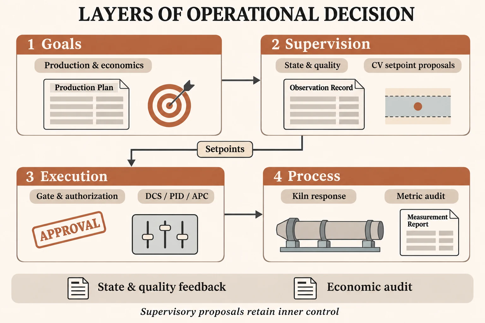

**运行决策分层：信息、目标与执行权限**

先定位决策层，再理解 RTO、跟踪 MPC、经济 MPC 和学习策略各自回答的问题。

**读图要点**

- **目标与上层决策** · 生产要求限定经济目标与操作边界；状态和质量信息支持上层 SP 建议。
- **授权与实际控制** · 建议先过门控，再由 DCS、PID/APC 跟踪设定值；上层学习器不直接指挥执行器。
- **两条反馈路径** · 过程测量更新状态信息；带单位、时间和分母的指标核算用于审计运行目标。

**准确关系与边界**

生产要求 → 目标 → SP 决策 → 门控 → 内层控制 → 过程。过程同时反馈给状态/质量估计与指标审计，后者回到目标核算。RTO、跟踪 MPC、经济 MPC 与学习策略的角色应按决策层和目标区分。

*原创概念图解。图内短英文标签由下方双语文字解释；精确公式、假设与执行边界以正文为准。图像不代表实测数据、真实工程接线或现场性能证据。*

### 2. 稳态 RTO 将经济要求变成操作点

经典稳态实时优化可以写成：

$$\min_{x_s,u_s}\ \ell_{econ}(x_s,u_s,d),\qquad 0=f_s(x_s,u_s,d),\quad g(x_s,u_s,d)\le0.$$

下标 $s$ 表示稳态，$d$ 是扰动或工况参数。模型先回答在给定原料、价格和生产要求下，哪个稳态操作点更有利，再把结果转换为下层目标。RTO 还需要数据协调、参数估计、稳态检测和结果实施；求解器找到最优数值，并不意味着这些工程环节已经完成。[Darby 等的综述](https://doi.org/10.1016/j.jprocont.2011.03.009)讨论的是这整套实践，而不只是一个优化表达式。

稳态近似的优点是问题相对清楚、经济解释直接；限制来自“在求解和实施期间可以把工况近似看作稳定”这一条件。频繁原料变化、长物料延迟或转换过程可能使同一个稳态点的即时实施代价很大。这是特定问题表述的限制，不能据此断言 RTO、进化算法或优化技术不能处理动态问题。动态 RTO 和滚动优化正是对这些条件的不同处理。

### 3. 跟踪 MPC 与经济 MPC 的目标不同

跟踪 MPC 常最小化预测输出与目标之间的偏差，再加动作变化项：

$$\min_{a_{0:H-1}}\sum_{k=0}^{H-1}\left(\|y_k-y^{ref}_k\|_Q^2+\|\Delta a_k\|_R^2\right)+V_f(x_H).$$

这里的 $Q,R$ 是权重矩阵，不是 RL 的动作价值函数。控制器使用动态模型预测一段轨迹，只执行第一步，再用新观测重新求解。这种反馈来自重复估计和重新规划，不要求每次都执行最初计划的全部动作。[Rawlings、Mayne 与 Diehl 的开放教材](https://sites.engineering.ucsb.edu/~jbraw/mpc/)详细讨论其模型、约束和终端条件。

经济 MPC 把阶段目标直接改成经济或运行损失 $\ell_{econ}(x_k,a_k)$。最低经济损失不一定恰好位于某个固定参考点，某些问题甚至可能偏好周期运行；因此传统跟踪代价的稳定性结论不能不加条件地照搬。终端集、终端代价、耗散性和可行性等结构，要与具体设计一起检查。[Engell](https://doi.org/10.1016/j.jprocont.2006.10.011)与[Ellis 等](https://doi.org/10.1016/j.jprocont.2014.03.010)提供了从跟踪到经济运行的理论背景。

### 4. 一个需要动态比较的设定值算例

假设只有“保持”和“小幅上调”两个已通过门控的候选，两方案均遵守质量与氧含量约束。下面的无量纲能耗/平滑性成本是课堂假设，不是辨识出的烧成规律：保持后两段成本为 $[0,4]$；上调后为 $[1,1]$。若只看第一段，保持更好；两段折扣和取 $\gamma=0.9$，则保持为 $3.6$，上调为 $1.9$。后者用眼前代价换取随后运行成本改善，没有用节能收益交换质量越界。

能够比较这两段轨迹的动态优化器同样可以发现这种取舍，完全不必先变成 RL。真正需要回答的是：后果模型来自哪里，未知未来如何补足，计算预算是否允许每步重算，策略将在哪些未见工况被使用。RL 的候选价值是从数据中学习长期价值或反馈规则，使部分在线搜索转移到训练阶段；它仍要承担数据支持和泛化的代价。

### 5. 用四个问题比较架构

| 问题 | 稳态 RTO | 动态 MPC / 轨迹优化 | 学习策略或价值 |
| --- | --- | --- | --- |
| 优化对象 | 工况下的操作点 | 有限时域动作或设定值路径 | 从信息到动作的规则、长期价值 |
| 模型如何进入 | 稳态关系与约束 | 动态预测与终端结构 | 交互数据，可同时使用世界模型 |
| 新观测如何改变决策 | 更新参数或重算操作点 | 状态估计后重新规划 | 策略推断；必要时按受控协议再训练 |
| 主要验证问题 | 模型失配与实施协调 | 多步误差、可行性、计算延迟 | 支持覆盖、价值偏差与分布变化 |

这个表是比较维度，不是排名。EA 可作为动态 MPC 的求解器；神经网络可为 MPC 提供模型或末端价值；RL 也可以调节一个优化器的参数。方法可以组合，研究贡献必须通过相同信息、相同动作权限、相同约束和相同资源预算来识别。

### 6. 自优化控制关心的不是“把误差压到零”

设工况为 $d$，理想可行操作点为 $u^*(d)$。选择某组 CV 并保持其设定值后，内层闭环实际形成操作点 $u(c,d)$。对最小化经济成本 $J$，可以比较损失

$$\mathcal L(c,d)=J(u(c,d),d)-J(u^*(d),d).$$

在两者都满足同一约束、$u^*$ 是全局最优的条件下，损失非负。关注的是扰动和实现误差下，所选 CV 是否仍能保持较小经济损失，而不只是跟踪误差是否接近零。这是[自优化控制](https://doi.org/10.1016/S0959-1524(00)00023-8)对学习架构很有用的提问方式：控制得很准的变量，可能并不是经济上最敏感的变量。

用虚构损失举例：方案一在两个等可能工况下损失为 $[1,9]$，方案二为 $[3,4]$。只在第一个工况验证会偏好方案一；平均损失分别为 5 与 3.5，最坏损失为 9 与 4，评价范围扩展后会选方案二。这里比较的是可行闭环的经济损失，不是允许违反约束换利润。该思想提示我们分工况验证软测量、设定值与内层响应的完整链条。

本教程保持仓库已有 CV 接口，不重新选择实际装置控制结构。若以后研究新的 CV 组合，应把它作为独立的工程建模课题：先确定测量与可操纵自由度，再检查内层可跟踪性和经济敏感性，最后讨论学习方法。否则 CV 变化带来的收益会被错误记到新算法名下。

### 7. 本项目应该保留的历史经验

第一，经济目标必须能落到可测的运行指标，不能只剩一个不知单位的 reward。第二，设定值应与内层可跟踪范围、速度和授权协调；缓慢的外层建议也可能激起快速的内层响应。第三，状态估计、时间同步、模型维护和操作人员退出机制是决策系统的一部分，不能只在算法成功后再补。

最后，所谓“学习到更好的运行策略”，应具体说明它相对于操作员策略、已有 PG-MOEA/D-IEpsilon 与其他合理优化基线多解决了什么问题。如果改进来自更准确的软测量、更晚到但被错误回填的化验，或更多模型调用，就应分别归因。后面的综述沿这条线展开：指标先定义清楚，约束再写准确，算法最后接受公平检验。

### 本篇原始资料与阅读边界

- [R1](#reference-1) · [Plantwide control: the search for the self-optimizing control structure](https://doi.org/10.1016/S0959-1524(00)00023-8) — Sigurd Skogestad; 2000. 来源标识: r2-skogestad.
- [R2](#reference-2) · [RTO: An overview and assessment of current practice](https://doi.org/10.1016/j.jprocont.2011.03.009) — Mark L. Darby, Michael Nikolaou, James Jones, Doug Nicholson; 2011. 来源标识: r2-rto.
- [R3](#reference-3) · [Feedback control for optimal process operation](https://doi.org/10.1016/j.jprocont.2006.10.011) — Sebastian Engell; 2007. 来源标识: r2-engell.
- [R4](#reference-4) · [A tutorial review of economic model predictive control methods](https://doi.org/10.1016/j.jprocont.2014.03.010) — Matthew Ellis, Helen Durand, Panagiotis D. Christofides; 2014. 来源标识: r2-empc.
- [R5](#reference-5) · [Model Predictive Control: Theory, Computation, and Design](https://sites.engineering.ucsb.edu/~jbraw/mpc/) — James B. Rawlings, David Q. Mayne, Moritz M. Diehl; 2020, 2nd paperback edition; current online printing. 来源标识: r2-mpcbook.
- [R35](#reference-35) · [rl-learning project domain and safety contracts](https://github.com/bahayonghang/rl-learning/blob/main/AGENTS.md) — bahayonghang / rl-learning; Repository contract. 来源标识: r2-project.

**r2-skogestad · Journal of Process Control 10, 487–507:** 作者手稿已读：控制变量选择、分层设定值与经济损失；并非所有工况都适用的恒定设定值结论。

**r2-rto · Journal of Process Control 21, 874–884:** 出版社摘要核验 RTO 与 MPC 的历史和组织实施问题；不从综述推断本项目收益。

**r2-engell · Journal of Process Control 17, 203–219:** 经济目标与反馈优化的综述；区分跟踪目标、稳态优化和动态经济优化。

**r2-empc · Journal of Process Control 24, 1156–1178:** 出版社摘要核验经济 MPC、稳定性与性能主题；具体教学推导另以开放 MPC 教材为依据。

**r2-mpcbook · Nob Hill Publishing:** 作者开放教材；滚动时域、终端条件、状态估计和经济 MPC 的理论入口。

**r2-project · Project repository:** 本仓库的周期、观测、CV 增量、成本和五层门控约定；不是通用工艺标准或验证报告。

---

## 02 · 运行指标、权衡与因果混杂

把煤耗、电耗、质量、产量、排放与平稳性放回单位、边界和时间，再讨论策略收益。

**建议阅读:** 25 分钟（按个人基础调整）

### 1. 指标定义先于奖励设计

“节能”只有在明确生产边界、产品分母、时间窗和燃料口径后，才是可比较的量。熟料烧成与水泥粉磨是不同边界；每吨熟料电耗与每吨水泥综合电耗不能直接拼成一张算法排名。[EPA 水泥能效指南](https://www.energystar.gov/sites/default/files/buildings/tools/ENERGY%20STAR%20Guide%20for%20the%20Cement%20Industry%2028_08_2013%20Final.pdf)按工序讨论能耗，[欧盟 BREF](https://publications.jrc.ec.europa.eu/repository/handle/JRC83006)同时处理能源、物料与排放。本页借用这种核算思路，不把历史行业平均数当成本项目实测值。

| 指标 | 一个清楚的定义 | 决策研究中容易漏掉什么 |
| --- | --- | --- |
| 单位燃料质量 | kg 燃料 / t 熟料 | 热值、含水、替代燃料比例和煤耗折算基准 |
| 单位热耗 | GJ 燃料热输入 / t 熟料 | 低位或高位热值、系统边界、启动和停机段 |
| 单位电耗 | kWh / t 熟料 | 包含哪些风机、冷却、输送和辅助设备 |
| 质量 | f-CaO、其他检验与合格率 | 样品时间、发布延迟、采样频率和未检样品 |
| 产量 | t/h 或窗口合格产品总量 | 降低负荷换取较低瞬时能耗的代价 |
| 排放 | 质量流量、浓度或单位产品排放 | 干湿基、标态、参考氧和统计时间的统一 |
| 平稳性 | CV 波动、跟踪误差、增量总变差 | 趋势与波动的区别，以及平稳但偏离目标的状态 |

### 2. “平均单位能耗”有两种不同算法

设第 $i$ 个时间段能耗为 $E_i$，产量为 $M_i$。只要总产量 $\sum_iM_i>0$，总体单位电耗就按总量核算；当各段均有 $M_i>0$ 时，还可以展开成产量加权平均：

$$e_{total}=\frac{\sum_i E_i}{\sum_i M_i}=\sum_i\frac{M_i}{\sum_jM_j}\frac{E_i}{M_i}.$$

所以在各段产量为正的条件下，它是按产量加权的单位能耗，而不是各段比值的普通平均。启停段若 $M_i=0,E_i>0$，该段比值没有定义，但能耗仍须保留在总分子中；不能为计算平均而删除。例如两段 $E=[100,900]$ kWh、$M=[0,100]$ t，总体为 10 kWh/t，删去零产段会错误得到 9。若总产量为零，就不报告该窗口的吨产品比值，而单独列能耗与运行状态。

另一个教学例中，两段分别耗电 10,000 和 16,000 kWh，生产 100 和 200 t。各段为 100 和 80 kWh/t；普通平均为 90，总量口径却为 $26000/300\approx86.67$ kWh/t。负荷变化时，混用这两个数会产生虚假的改善。

同样，若 A 方案用 10,000 kWh 生产 100 t，B 用 14,400 kWh 生产 150 t，B 的单位电耗低 4%，总耗电却高 44%。两句话都可以正确，但回答的问题不同。研究报告应同时给产量、总量和单位量，说明比较是否满足相同生产要求，而不是只选一个有利的百分比。

### 3. 燃料质量下降不一定代表热输入下降

热输入需要把燃料质量乘以对应热值：

$$Q_{fuel}=\sum_j m_j H_j,\qquad q_{spec}=\frac{Q_{fuel}}{M_{clinker}}.$$

教学例 A 使用 100 kg/t、热值 25 MJ/kg 的燃料，热输入为 2.5 GJ/t；B 使用 90 kg/t、热值 30 MJ/kg 的燃料，却是 2.7 GJ/t。质量口径减少 10%，热输入反而增加 8%。这不是对任何实际工厂的判断，而是单位换算说明：不同燃料、含水和替代燃料条件下，先统一基准才能把变化归因于设定值策略。

碳排放还涉及燃烧与原料分解等不同来源；仅降低电耗，不足以推出全部温室气体排放按同一比例下降。排放浓度与排放质量也不同：稀释可能改变浓度，未必减少污染物质量。研究应保存原始流量、测量条件和核算版本，不能让归一化 reward 取代物理核算。[BREF](https://publications.jrc.ec.europa.eu/repository/handle/JRC83006)

### 4. 质量指标有时间戳，也有适用范围

f-CaO 提供熟料质量相关信息，但不代表所有产品性质都由一个数决定。当前仓库采用 f-CaO 区间 $[0.5,1.5]\%$ 与 $O_2\ge1.2\%$ 等约定；这些是教学与项目接口，不能作为别的窑线的普遍阈值。[项目来源](https://github.com/bahayonghang/rl-learning/blob/main/AGENTS.md)

至少要保留样品采集时刻 $\tau$、结果可用时刻 $v$ 和决策时刻 $t$。只有 $v\le t$ 的化验可以进入策略输入；样品年龄是 $t-\tau$。10:00 采样、10:40 返回的结果不能被 10:20 的策略读取。事后可以把它用于正确对齐的质量评价，但“新发布”不等于“反映刚才动作”。物料停留分布不一定是一个精确固定滞后，简单把所有样品平移一个常数也需要验证。

### 5. 不把相关性直接写成动作效果

操作员可能在原料变难烧、质量已有恶化迹象时提高温度设定值。历史上“高设定值与高 f-CaO 同时出现”，可以是补救动作和困难工况共同造成，不能直接断言提高设定值使质量变差。下图表达这个假设结构；它是诊断思路，不是已识别的工艺因果图。

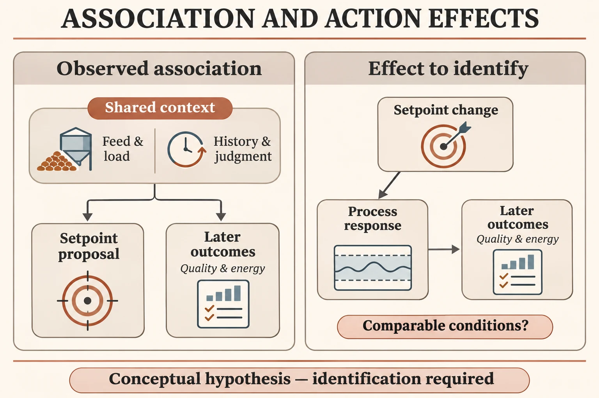

**因果混杂：为什么日志相关性不是动作效果**

把煤耗、电耗、质量、产量、排放与平稳性放回单位、边界和时间，再讨论策略收益。

**读图要点**

- **共同原因** · 原料、负荷、历史及未记录的操作判断可能同时影响设定值选择与后续质量、能耗。
- **动作作用路径** · 设定值建议要经过门控与内层控制，过程状态改变后才可能影响后续指标。
- **指标口径** · 煤耗、电耗、质量、产量、排放和平稳性必须保留单位、核算时间与分母。

**准确关系与边界**

原料/负荷 → 操作建议且 → 后续结果；历史/判断也同时指向两者。另有 建议 → 受控过程 → 结果 的作用路径。这些共同原因使条件相关不自动等于干预效果，按时间留出测试集也不能单独消除混杂。

*原创概念图解。图内短英文标签由下方双语文字解释；精确公式、假设与执行边界以正文为准。图像不代表实测数据、真实工程接线或现场性能证据。*

应先检查时间先后、测量来源、操作员当时可见的信息和联合动作覆盖，再决定能做哪类比较。匹配工况、分层分析或因果模型可以减少部分偏差，却不能证明已经控制全部隐藏因素。世界模型拟合误差很低，也可能只是复现历史操作规律，并未识别改变策略后的后果。

### 6. 质量和产量不能在分母里悄悄消失

另取一个虚构核算例：基线消耗 300 GJ，生产 100 t 且全部合格，单位热耗为 3.0 GJ/t；候选方案消耗 290 GJ，仍生产 100 t，但只有 90 t 合格。按全部产量计算为 2.9 GJ/t，表面下降约 $3.33\%$；按合格产量则为 $290/90\approx3.222$ GJ/t，高于基线。两种分母回答不同问题，不能只选择对方案有利的那个。

本项目质量边界仍独立成立；使用合格产量分母不代表可以付出额外能耗来“抵消”不合格质量，更不让不合格候选变成可执行方案。返工、库存滞后与后续处理若属于核算边界，也应明确归属，不要在改变时间窗时把它们移走。质量检验后来才完成，允许用于事后绩效审计，但不能回流成为当时策略已知的信息。

煤耗、电耗、产量和质量也不是互不相关的旋钮。冷却和余热回收、燃烧条件与风机负荷会改变全系统的折中；某个局部设备指标变好，未必使同一产品边界内的总指标改善。[EPA 能效指南](https://www.energystar.gov/sites/default/files/buildings/tools/ENERGY%20STAR%20Guide%20for%20the%20Cement%20Industry%2028_08_2013%20Final.pdf)的分工序核算可用于组织这个检查。具体方向和幅度必须由本装置数据或经验证模型回答，不能从概念示意图读出节能百分比。

### 7. 平稳性与收益应分别报告

归一化执行增量可用总变差描述：

$$TV(a^{exec})=\sum_t\|a_t^{exec}-a_{t-1}^{exec}\|_1.$$

同样可记录 CV 方差、跟踪误差、最长连续超限、门控拒绝率和恢复时间。它们互不等价：恒定但错误的温度可以方差很小；从旧工况平滑转向新工况会有趋势，不能把所有变化都视为噪声。门控拒绝后保持设定值，也不会使物理过程、扰动或化验时钟停止。

最后把指标分成主结果和诊断，而不是把主结果合成一个无法解释的总分。主结果保留煤耗、电耗、合格产量、质量和氧量成本；诊断解释数据支持、动作平滑和回退原因。采用时间外评估、按工况分层和独立重复运行，才能区别算法变化与某次有利原料。关于小样本算法比较的不确定性，可继续阅读 [Agarwal 等](https://arxiv.org/abs/2108.13264)。

### 本篇原始资料与阅读边界

- [R6](#reference-6) · [BAT Reference Document for the Production of Cement, Lime and Magnesium Oxide](https://publications.jrc.ec.europa.eu/repository/handle/JRC83006) — Frauke Schorcht, Ioanna Kourti, Bianca Maria Scalet, Serge Roudier, Luis Delgado Sancho; 2013. 来源标识: r2-cement-bat.
- [R7](#reference-7) · [Energy Efficiency Improvement and Cost Saving Opportunities for Cement Making](https://www.energystar.gov/sites/default/files/buildings/tools/ENERGY%20STAR%20Guide%20for%20the%20Cement%20Industry%2028_08_2013%20Final.pdf) — Ernst Worrell, Katerina Kermeli, Christina Galitsky; 2013. 来源标识: r2-energy-guide.
- [R35](#reference-35) · [rl-learning project domain and safety contracts](https://github.com/bahayonghang/rl-learning/blob/main/AGENTS.md) — bahayonghang / rl-learning; Repository contract. 来源标识: r2-project.
- [R27](#reference-27) · [Deep Reinforcement Learning at the Edge of the Statistical Precipice](https://arxiv.org/abs/2108.13264) — Rishabh Agarwal, Max Schwarzer, Pablo Samuel Castro, Aaron Courville, Marc G. Bellemare; 2021. 来源标识: r2-rliable.

**r2-cement-bat · European Commission JRC, EUR 26129:** 欧盟官方工艺、能耗与排放参考。用于说明指标口径，不将其中规范自动套用于当前窑线。

**r2-energy-guide · US EPA ENERGY STAR, 430-R-13-009:** EPA ENERGY STAR 开放全文；区分熟料烧成、粉磨、燃料与电力核算，不照搬历史行业平均数。

**r2-project · Project repository:** 本仓库的周期、观测、CV 增量、成本和五层门控约定；不是通用工艺标准或验证报告。

**r2-rliable · NeurIPS 2021:** 重复实验、不确定性与稳健汇总；不能把时间步当独立训练种子。

---

## 03 · 从指标到目标、Pareto 与约束

用完整算例解释尺度、偏好、可行性、机会约束与软约束为什么不能混为一谈。

**建议阅读:** 29 分钟（按个人基础调整）

### 1. 目标函数是研究问题的一部分

对于当前工况 $h$ 和候选设定值路径 $u$，可以先写多目标问题：

$$\min_{u\in\mathcal U(h)}\mathbf f(u;h)=\left(f_F(u;h),f_E(u;h),f_S(u;h)\right),\qquad g_j(u;h)\le0.$$

三个目标可以分别表示煤耗、电耗和平滑性；质量、氧量、设定值范围和授权条件进入可行集合。这里 $u$ 可以是一点、若干步路径或策略参数，不能仅凭这个式子判断是否存在动态优化。选取哪个对象、目标如何累积以及模型怎样预测后果，才定义了问题。[MOEA/D 原文](https://doi.org/10.1109/TEVC.2007.892759)

把质量超限乘一个大数加到能耗里，会改变问题：它可能允许足够大的节能收益交换违反。某些数学罚函数在特定条件和足够参数下具有精确性，但有限训练中的任意惩罚系数没有这种自动保证。项目约定要求独立质量与环境成本；教程不擅自修改边界。[项目契约](https://github.com/bahayonghang/rl-learning/blob/main/AGENTS.md)

### 2. 单位缩放不能隐藏偏好

直接把 kg/t 和 kWh/t 相加没有清楚的解释。可以换成货币、工程容许尺度，或冻结在训练集上的标准化量：

$$z_F=\frac{F-\mu_F}{s_F},\qquad z_E=\frac{E-\mu_E}{s_E},\qquad L_w=w_Fz_F+w_Ez_E.$$

除数必须大于零，且记录版本。若以标准差归一化，高波动指标的一单位物理改善会被压得更小；这是一种数值选择，不自动对应经济偏好。换测试工况后重新拟合尺度，会使同样物理结果得到不同分数，也可能造成信息泄漏。报告原始单位指标和归一化目标两套数。

给出一组完全虚构的可行方案：A 的 $(F,E)=(95,108)$，B 为 $(100,100)$，C 为 $(104,92)$。取参考均值 $(100,100)$、尺度 $(5,10)$，得到 A=$(-1,0.8)$，B=$(0,0)$，C=$(0.8,-0.8)$。权重 $(0.7,0.3)$ 下损失为 $-0.46,0,0.32$，选 A；换为 $(0.2,0.8)$，损失为 $0.44,0,-0.48$，选 C。模型和候选都没变，改变的是偏好。

把归一化表达式展开，可见 $L_w=(w_F/s_F)F+(w_E/s_E)E-\mathrm{const}$，真正作用在原始指标上的系数是 $w_F/s_F$ 与 $w_E/s_E$。若目标本来是成本 $C=p_FF+p_EE$，想让归一化写法保留同一偏好，可令 $w_F:w_E=p_Fs_F:p_Es_E$。不能先任意标准化，再声称相同权重就代表相同经济重要性。

例如仅为教学假设燃料价格 $p_F=0.8$ 元/kg、电价 $p_E=0.6$ 元/kWh，并假定三个方案产品边界与质量相同，则 A、B、C 分别为 140.8、140.0、138.4 元/t。这个口径选择 C。它没有包含全部生产成本，也不代表当前市场价格；其作用是展示单位怎样相乘、偏好怎样解释。若加入价格变化、产量或返工，必须重新明确定义经济目标，而不是继续沿用这些数字。

### 3. Pareto 前沿描述取舍，不代替最终选择

最小化时，$u$ 支配 $v$，表示所有目标都不更差，而且至少一项更好：

$$u\prec v\iff [\forall i:f_i(u)\le f_i(v)]\land[\exists j:f_j(u)<f_j(v)].$$

上例 A、B、C 互不支配；D=$(107,110)$ 被 B 支配。若另有 U=$(90,85)$ 但 f-CaO 超项目边界，它首先是不可行候选，不能因为两个能耗指标很好就加入允许执行的前沿。非支配指相对于已比较集合，不等于已证明到达全局真实前沿。[NSGA-II](https://doi.org/10.1109/4235.996017)

加权和也未必找得到所有非凸前沿点。教学点 $(0,2),(1.1,1.1),(2,0)$ 都非支配；任意两目标非负权重归一化后，总有一个端点的加权值不超过 1，而中点恒为 1.1。因此仅扫描线性权重会错过这个中点。分解方式、约束法与解集覆盖要结合问题选择，不是权重扫描次数越多就自动解决。[MOEA/D](https://doi.org/10.1109/TEVC.2007.892759)

### 4. 两种 epsilon 不应混淆

多目标的 epsilon-constraint 表述可以是：

$$\min_u F(u)\quad\text{subject to}\quad E(u)\le\varepsilon_E,\quad g(u)\le0.$$

对 A、B、C，若电耗预算设为 100，A 被排除，B 的煤耗低于 C，于是选 B。改变预算便能沿不同取舍搜索。预算有明确单位，应来自生产要求或预先声明的研究扫描。

进化约束处理中的 epsilon-level，通常是搜索时比较违反程度的容忍水平。它可能暂时让近可行解参与搜索，以免种群过早丢失通向可行区的路径；这不是批准工厂执行同样超限动作。数学搜索中的松弛、产品指标预算和设备硬边界是三个不同概念。

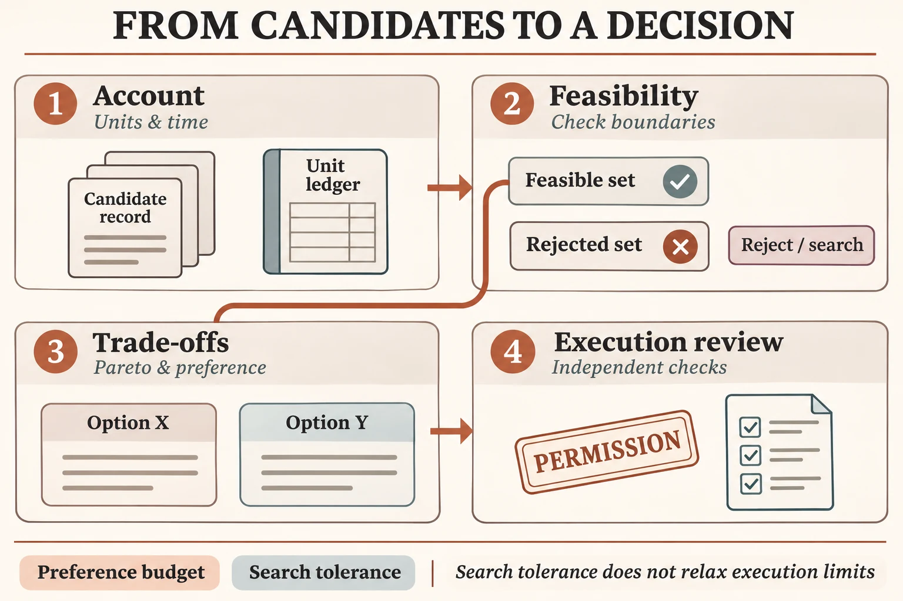

**从指标核算到可行性与 Pareto 选择**

用完整算例解释尺度、偏好、可行性、机会约束与软约束为什么不能混为一谈。

**读图要点**

- **尺度与可行性** · 先核对量纲、时间窗口和归一化，再按明确约束判定候选是否可行。
- **Pareto 与偏好** · 对可行候选比较支配关系；Pareto 集通常不只一个点，仍需偏好或预算作选择。
- **独立执行审核** · 选出的候选仍要通过实际执行路径；优化中的容忍规则不自动授权执行。

**准确关系与边界**

候选 → 核算 → 可行性；不通过则拒绝/继续搜索，通过后才比较 Pareto 与偏好，再独立审核。epsilon-constraint 的预算与进化搜索中暂时容忍违反的 epsilon 是不同概念；软惩罚、机会约束和逐步硬边界不能互相替代。

*原创概念图解。图内短英文标签由下方双语文字解释；精确公式、假设与执行边界以正文为准。图像不代表实测数据、真实工程接线或现场性能证据。*

### 5. 硬、软、机会和期望约束各控制什么

硬约束要求在所建模型的允许集合内满足 $g\le0$；实际保证仍依赖模型误差和执行条件。软约束引入松弛量 $\xi\ge0$，例如 $g\le\xi$ 并惩罚 $\xi$，使不可行问题有可诊断的折中；不能把它无条件用于不可放宽的物理保护。

机会约束控制指定概率：$P(q\le1.5\mid h,u)\ge0.95$。假设仅用于算例的预测质量为高斯分布，$\sigma_q>0$ 且分布校准可靠，把质量标准化后有 $P(q\le1.5)=\Phi((1.5-\mu_q)/\sigma_q)$。由于标准正态分布函数 $\Phi$ 单调，要求该概率至少 0.95，等价于 $\mu_q+\Phi^{-1}(0.95)\sigma_q\le1.5$。使用近似分位数 $\Phi^{-1}(0.95)\approx1.645$，得到：

$$\mu_q+1.645\sigma_q\le1.5.$$

若 $\mu_q=1.2,\sigma_q=0.2$，左侧约为 1.529，均值虽在范围内，仍未满足该上界概率要求。若均值降为 1.1，左侧约为 1.429。这只是单侧上界；下界、多个变量和整段轨迹还要另分配风险，不能把每步 95% 当成无限运行的整体 95%。[机会约束的原始理论入口](https://doi.org/10.1287/mnsc.6.1.73)

CMDP 中常见 $\mathbb E_\pi[\sum_t\gamma^t c_t]\le d$，控制的是期望累计成本。若 99 次成本为 0、一次为 10，平均为 0.1；平均预算 0.2 可以满足，那次严重事件却仍然存在。成本的幅度、概率、时长和单位都要明确。[CPO](https://arxiv.org/abs/1705.10528)

具体到质量，超限幅度成本可以是 $c_q=(q_{\min}-q)_++(q-q_{\max})_+$；若 q 按百分数的数值表示，单位就是百分点。事件成本 $c_I=\mathbf1_{q\notin[q_{\min},q_{\max}]}$ 是无量纲；持续时间成本可把对应区间长度乘以事件指示。它们衡量的是不同后果，不应共享一个未经换算的预算。

假设三个连续 5 分钟区间的质量分别恒为 $1.4\%,1.6\%,1.9\%$，上界为项目的 $1.5\%$，下界均满足。幅度成本为 $[0,0.1,0.4]$ 个百分点，事件成本为 $[0,1,1]$，超限累计持续 10 分钟。相同平均事件率可能对应完全不同的最大超限程度；所以至少并报频率、幅度与持续时间。这个区间恒值是假设，稀疏化验本身不能直接证明真实连续超限时长。

### 6. 可审阅的目标设计应交付什么

应交付指标字典、原始单位、归一化版本、时间聚合规则、权重或预算的选择理由、每种约束的语义、不可行时的批准回退，以及候选和执行动作的独立日志。比较算法时冻结这些条件；只有研究目标本身就是偏好敏感性时，才系统改变权重并展示全套结果。

目标写得越清楚，越容易发现奖励被“钻空子”的位置：少生产来降低瞬时耗能、用稀释改善浓度、长期保持却偏离质量要求、利用尚未返回的化验作决策。修复这些问题属于任务定义和数据治理，不能靠换一个更强的优化器补救。

### 本篇原始资料与阅读边界

- [R9](#reference-9) · [MOEA/D: A Multiobjective Evolutionary Algorithm Based on Decomposition](https://doi.org/10.1109/TEVC.2007.892759) — Qingfu Zhang, Hui Li; 2007. 来源标识: r2-moead.
- [R8](#reference-8) · [A Fast and Elitist Multiobjective Genetic Algorithm: NSGA-II](https://doi.org/10.1109/4235.996017) — Kalyanmoy Deb, Amrit Pratap, Sameer Agarwal, T. Meyarivan; 2002. 来源标识: r2-nsga2.
- [R13](#reference-13) · [Chance-Constrained Programming](https://doi.org/10.1287/mnsc.6.1.73) — Abraham Charnes, William W. Cooper; 1959. 来源标识: r2-chance.
- [R25](#reference-25) · [Constrained Policy Optimization](https://arxiv.org/abs/1705.10528) — Joshua Achiam, David Held, Aviv Tamar, Pieter Abbeel; 2017. 来源标识: r2-cpo.
- [R5](#reference-5) · [Model Predictive Control: Theory, Computation, and Design](https://sites.engineering.ucsb.edu/~jbraw/mpc/) — James B. Rawlings, David Q. Mayne, Moritz M. Diehl; 2020, 2nd paperback edition; current online printing. 来源标识: r2-mpcbook.
- [R35](#reference-35) · [rl-learning project domain and safety contracts](https://github.com/bahayonghang/rl-learning/blob/main/AGENTS.md) — bahayonghang / rl-learning; Repository contract. 来源标识: r2-project.

**r2-moead · IEEE Transactions on Evolutionary Computation 11, 712–731:** 原论文 PDF 核验分解、邻域与尺度处理；不能由算法名推断具体项目改进版。

**r2-nsga2 · IEEE Transactions on Evolutionary Computation 6, 182–197:** 原论文全文核验非支配排序、拥挤距离、精英保留及约束支配；证据为测试问题。

**r2-chance · Management Science 6, 73–79:** 机会约束的原始理论入口；教程中的高斯分位数算例为独立教学推导。

**r2-cpo · ICML 2017:** 约束策略优化与理论性能界；期望成本不是逐时刻无违规保证。

**r2-mpcbook · Nob Hill Publishing:** 作者开放教材；滚动时域、终端条件、状态估计和经济 MPC 的理论入口。

**r2-project · Project repository:** 本仓库的周期、观测、CV 增量、成本和五层门控约定；不是通用工艺标准或验证报告。

---

## 04 · 进化优化：从 Pareto 搜索到滚动轨迹

拆开候选表示、评价模型、约束比较与搜索器，推导 NSGA-II 和 MOEA/D，解释动态优化如何与 MPC、RL 连接。

**建议阅读:** 31 分钟（按个人基础调整）

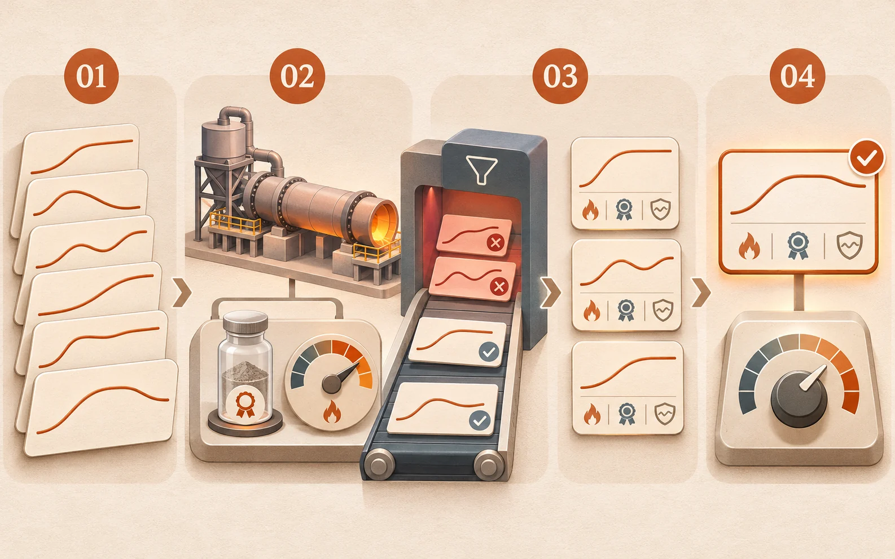

**从候选轨迹到可执行的优化建议**

进化优化依次完成候选编码、代理模型评价、约束比较和偏好选择。它可以搜索动态轨迹；关键问题是模型可信度、计算预算和滚动执行的一致性。

**逐区读图**

- **01** · 候选：曲线卡片代表不同设定值轨迹。编码维度、平滑性和初始点决定可搜索的方案空间。
- **02** · 评价：用模型估计能耗、质量与其他代价，再检查约束。预测好看并不证明真实过程可行。
- **03** · 比较：保留不同权衡的可行候选；示意曲线不是实测 Pareto 前沿，也不承载性能结论。
- **04** · 执行：根据明确偏好选一个方案，通过独立门控后仅执行滚动决策的当前一步。

这些是原创概念插图，不是实测曲线、辨识模型或工程施工图；精确关系以本篇公式和可选择的双语读图说明为准。

### 1. 先问一个个体表示什么，再问使用哪种进化算法

在烧成优化中，一个种群个体可以表示六个 CV 的下一步设定值增量，也可以表示未来 $H$ 步的增量序列，或一条平滑设定值轨迹的少量控制点。给定观测历史，评价器把候选送进机理模型、代理模型或回放仿真，返回煤耗、电耗、质量成本和可执行性。**表示决定要解决的问题；NSGA-II 或 MOEA/D 决定如何搜索这个表示空间。** 如果评价器只计算稳态煤电耗，搜索得到的就是稳态折中；如果评价器逐步推进动力学并计算延迟质量，EA 同样能够搜索序列决策。

这四部分可以独立改进：动作表示决定维数与光滑性，评价模型决定预测偏差，约束比较决定候选存活规则，搜索器决定有限预算如何分配。把失败统一归因于“进化算法不懂时序”会掩盖真正的瓶颈。[MPC 原理](https://sites.engineering.ucsb.edu/~jbraw/mpc/)并不要求求解器一定是梯度算法；[动态多目标优化原始研究](https://doi.org/10.1109/TEVC.2004.831456)也早已讨论变化的 Pareto 集与控制问题。

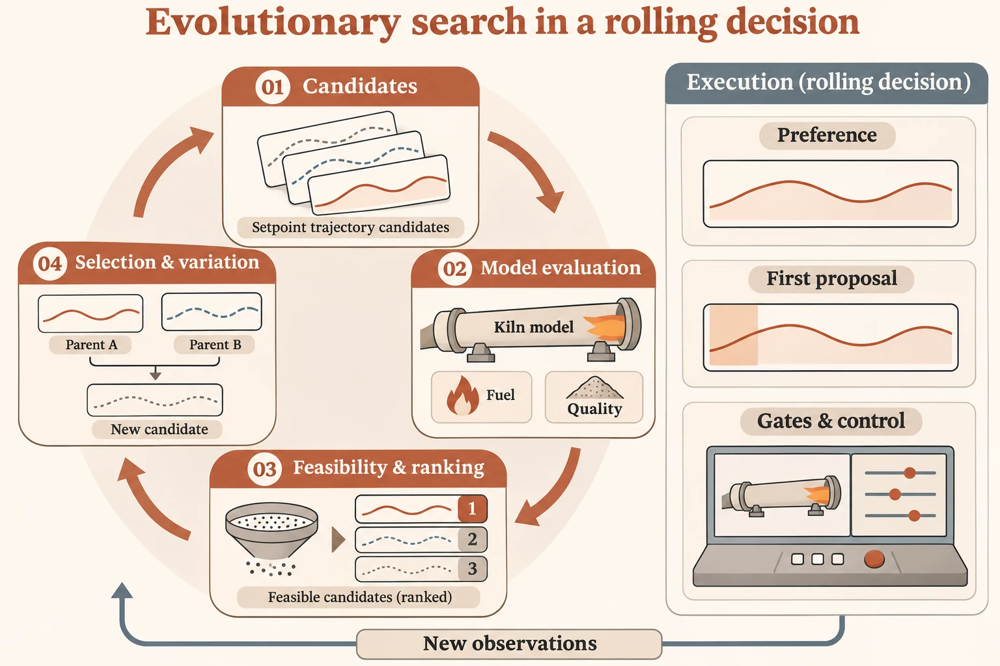

**进化优化：搜索循环与滚动执行**

拆开候选表示、评价模型、约束比较与搜索器，推导 NSGA-II 和 MOEA/D，解释动态优化如何与 MPC、RL 连接。

**读图要点**

- **候选表示与评价** · 个体可以表示当前点或未来轨迹；动力学和指标模型给出预测目标与违反量。
- **搜索内部循环** · NSGA-II 的排序与 MOEA/D 的分解是不同比较机制；选择、交叉和变异形成新候选。
- **滚动执行循环** · 按偏好选候选，仅将当前一步送往统一门控与内层控制，然后根据新信息重新优化。

**准确关系与边界**

观测/历史 → 种群 → 模型与约束评价 → 排序或分解 → 选择变异 → 种群；优选分支 → 第一步建议 → 门控/内层控制 → 新观测。进化搜索可以处理动态轨迹，但效果依赖模型、预算与公平的滚动评价。

*原创概念图解。图内短英文标签由下方双语文字解释；精确公式、假设与执行边界以正文为准。图像不代表实测数据、真实工程接线或现场性能证据。*

### 2. NSGA-II：先比较等级，再保留分布

对最小化目标，若个体 $u$ 的所有目标不差于 $v$，且至少一个严格更好，就称 $u$ 支配 $v$。第一非支配层不被任何候选支配；去掉它再求第二层。NSGA-II 合并父代和子代后，从较低等级的前沿依次填充下一代；最后一个装不下的前沿使用拥挤距离维持分布。原论文同时给出了约束支配处理与计算复杂度分析，不能把它缩写成“只保留最小加权和”。[Deb 等，2002](https://doi.org/10.1109/4235.996017)

在某个前沿内，分别按目标 $m$ 排序，内部个体的拥挤距离累计为

$$d_i=\sum_{m=1}^{M}\frac{f_m(i+1)-f_m(i-1)}{f_m^{\max}-f_m^{\min}}.$$

边界个体通常置为无限大以保护极端折中；某目标在该前沿完全相同、分母为零时，工程实现应跳过这个没有区分度的目标。分子中的前后邻居按**当前目标各自排序**，并非只按第一个目标排序后复用。

手算四个教学点 $(0,10),(2,7),(4,4),(10,0)$，两目标都最小化，四者互不支配。中间点 $(2,7)$ 的距离为 $4/10+6/10=1.0$；$(4,4)$ 为 $8/10+7/10=1.5$。若只能从两个内部点保留一个，在等级相同的前提下保留后者。距离大表示附近候选更稀疏，**不表示该工况更安全、经济价值更大或模型更可信**。这些性质要由独立定义的评价项判定。

### 3. MOEA/D：把前沿拆成相邻的标量子问题

MOEA/D 为多个权重向量维护子问题，并利用权重空间的邻居共享候选改进。常见 Tchebycheff 分解为

$$g(u\mid w,z^*)=\max_m w_m\left|\widetilde f_m(u)-z_m^*\right|,$$

其中 $\widetilde f_m$ 是尺度一致的目标，$z^*$ 是理想点估计。一个新个体可以改善多个相邻子问题；“邻近”主要指权重向量接近，不是两个候选在物理状态空间必然相近。原文还比较了其他分解方式；选定分解后仍要检查前沿覆盖、尺度敏感性和有限种群分辨率。[Zhang 与 Li，2007](https://doi.org/10.1109/TEVC.2007.892759)

取 $z^*=(0,0)$，候选 $A=(1,4)$、$B=(2,2)$。在 $w=(0.8,0.2)$ 下，$g(A)=\max(0.8,0.8)=0.8$，$g(B)=\max(1.6,0.4)=1.6$，选 $A$；在 $w=(0.2,0.8)$ 下变为 $3.2$ 与 $1.6$，选 $B$。这是多个偏好子问题共同覆盖折中的机制。它不能保证有限代搜索已找全真实 Pareto 前沿，代理模型若存在系统偏差，搜索也可能精确地优化错误目标。

### 4. 可行性处理：搜索时允许考察，不代表执行时允许越界

一种清楚的约束违反量是

$$v(u)=\sum_j\frac{\max(0,g_j(u))}{s_j},\qquad s_j>0,$$

其中 $g_j\le0$ 表示第 $j$ 项约束，$s_j$ 统一量纲。可行性优先比较通常遵循：可行者优于不可行者；两个不可行者比较违反量；两个可行者再比较目标或 Pareto 等级。归一化不能省略，否则温度的数值量级可能压过压力或质量。[Deb 的约束处理研究](https://doi.org/10.1016/S0045-7825(99)00389-8)与 NSGA-II 的约束支配提供了这一思想的原始入口。

$\epsilon$ 水平方法在搜索比较中把足够小的违反量暂按某种容忍水平处理，并随搜索进度改变该水平，以帮助穿越窄可行域附近的搜索障碍。[Takahama 与 Sakai，2006](https://doi.org/10.1109/CEC.2006.1688283)是原始方法之一。具体更新日程需要读对应实现，不能仅凭名字重建本项目的 PG-MOEA/D-IEpsilon。

这里的 $\epsilon$ 是**候选搜索规则**；上一页的 $\epsilon$ 约束是**多目标偏好预算**；设备执行边界则是**工程约束**。三者应使用不同字段、单位和日志。一个搜索阶段仍不满足执行条件的候选，必须被拒绝或由既定回退处理。约束成本的期望预算也不会自动解除五层门控。[本仓库约定](https://github.com/bahayonghang/rl-learning/blob/main/AGENTS.md)

### 5. “动态”至少有三种含义

| 动态来自哪里 | 应该改变什么 | 容易误判的地方 |
| --- | --- | --- |
| 原料、价格或设备状态随时变 | 更新评价上下文并跟踪移动的折中集 | 只重跑静态模型，未更新模型条件 |
| 现在的动作影响未来状态 | 在评价器中推进动力学并优化序列 | 只换成更大种群，仍使用即时目标 |
| 每个周期获得新测量 | 执行序列第一步并重新规划 | 把整条预测轨迹当作必须开环执行的命令 |

原始动态多目标文献解决的是随时间变化的问题族；滚动优化则还涉及状态反馈、预测窗口与第一步执行。这些概念可以组合，但不应混用。[Farina 等，2004](https://doi.org/10.1109/TEVC.2004.831456)；[Rawlings 等教材](https://sites.engineering.ucsb.edu/~jbraw/mpc/)。与用户研究相关的 [OA-DSTR 论文](https://doi.org/10.1016/j.asoc.2024.111772)研究对象是水泥**粉磨**的双动态运行指标决策。其搜索与滚动思路值得对照；本次仅核验书目和出版社摘要，不能据此转述烧成现场结果。

### 6. 轨迹参数化减少维数，也引入新检查

若直接优化 $H\times K$ 个增量过于昂贵，可以将候选设定值轨迹参数化为少量控制点。例如一个可研究的 NURBS 接口为

$$Y^{sp}(s)=\frac{\sum_i N_{i,p}(s)w_iP_i}{\sum_i N_{i,p}(s)w_i},\qquad w_i>0.$$

控制点、节点向量和权重是轨迹表示，不是已经验证的本项目实现。即使曲线值保持在控制点包围范围内，也不自动满足每 5 分钟的增量限幅、相邻增量变化率或延迟质量约束；必须在执行采样点和必要的区间上检查。重新规划时还要与当前真实设定值连续衔接，不能把上一轮未执行的轨迹当成事实。

适合做消融的改进包括：将上一轮种群平移作热启动；保留少量新候选防止工况变化后陷入旧前沿；只在误差或扰动明显时重启昂贵搜索；对模型不确定区间重新评价。它们是待检验设计，不是本文已经证明的收益。比较时固定模型调用预算、墙钟时限、预测窗口、门控和偏好选择规则；若使用超体积，还要固定目标尺度、参考点和可行解筛选。

### 7. 公平比较应当解释计算花在哪里

在线 EA 将计算花在每次规划的候选评价；离线 RL 将大量计算前置到策略学习，再以网络推理给出候选。谁更合适取决于评价模型、数据支持、实时预算、变化速度及错误代价。二者也能互补：EA 提供可行示范或高质量轨迹，RL 提供热启动、候选分布或终端价值。混合方法需要与相同预算下的强 EA、纯行为克隆和简单离线 RL 比较，不能只与未经调参的静态单点搜索比较。

本项目保留 Operator 与 PG-MOEA/D-IEpsilon 基线要求。当前网页没有接入其实际实现、训练数据和统一评价结果，因此本页解释的是可复现的研究设计，而没有宣称任何网络优于该基线。

### 本篇原始资料与阅读边界

- [R8](#reference-8) · [A Fast and Elitist Multiobjective Genetic Algorithm: NSGA-II](https://doi.org/10.1109/4235.996017) — Kalyanmoy Deb, Amrit Pratap, Sameer Agarwal, T. Meyarivan; 2002. 来源标识: r2-nsga2.
- [R9](#reference-9) · [MOEA/D: A Multiobjective Evolutionary Algorithm Based on Decomposition](https://doi.org/10.1109/TEVC.2007.892759) — Qingfu Zhang, Hui Li; 2007. 来源标识: r2-moead.
- [R10](#reference-10) · [An efficient constraint handling method for genetic algorithms](https://doi.org/10.1016/S0045-7825(99)00389-8) — Kalyanmoy Deb; 2000. 来源标识: r2-feasibility.
- [R11](#reference-11) · [Constrained Optimization by the ε Constrained Differential Evolution with Gradient-Based Mutation and Feasible Elites](https://doi.org/10.1109/CEC.2006.1688283) — Tetsuyuki Takahama, Setsuko Sakai; 2006. 来源标识: r2-epsilon.
- [R12](#reference-12) · [Dynamic Multiobjective Optimization Problems: Test Cases, Approximations, and Applications](https://doi.org/10.1109/TEVC.2004.831456) — Marco Farina, Kalyanmoy Deb, Paolo Amato; 2004. 来源标识: r2-dynamic.
- [R5](#reference-5) · [Model Predictive Control: Theory, Computation, and Design](https://sites.engineering.ucsb.edu/~jbraw/mpc/) — James B. Rawlings, David Q. Mayne, Moritz M. Diehl; 2020, 2nd paperback edition; current online printing. 来源标识: r2-mpcbook.
- [R29](#reference-29) · [Collaborative optimization decision making of cement grinding process operational indicators considering dual dynamic problem](https://doi.org/10.1016/j.asoc.2024.111772) — Yonghang Li, Tianqi Yang, Xiaochen Hao, Jieguang Yang, Quanwei Sun; 2024. 来源标识: r2-oadstr.
- [R35](#reference-35) · [rl-learning project domain and safety contracts](https://github.com/bahayonghang/rl-learning/blob/main/AGENTS.md) — bahayonghang / rl-learning; Repository contract. 来源标识: r2-project.

**r2-nsga2 · IEEE Transactions on Evolutionary Computation 6, 182–197:** 原论文全文核验非支配排序、拥挤距离、精英保留及约束支配；证据为测试问题。

**r2-moead · IEEE Transactions on Evolutionary Computation 11, 712–731:** 原论文 PDF 核验分解、邻域与尺度处理；不能由算法名推断具体项目改进版。

**r2-feasibility · Computer Methods in Applied Mechanics and Engineering 186, 311–338:** 可行性比较的原始方法入口；配合 NSGA-II 原文的约束支配定义阅读。

**r2-epsilon · IEEE Congress on Evolutionary Computation:** ε 水平比较与约束搜索的原始文献；搜索容忍度不等于放宽设备执行边界。

**r2-dynamic · IEEE Transactions on Evolutionary Computation 8, 425–442:** 动态 Pareto 集与控制问题的原始研究；说明 EA 不限于静态单点优化。

**r2-mpcbook · Nob Hill Publishing:** 作者开放教材；滚动时域、终端条件、状态估计和经济 MPC 的理论入口。

**r2-oadstr · Applied Soft Computing 161, 111772:** 书目与出版社摘要核验；对象是粉磨，动态搜索与滚动思想可借鉴，烧成结果不可据此推定。

**r2-project · Project repository:** 本仓库的周期、观测、CV 增量、成本和五层门控约定；不是通用工艺标准或验证报告。

---

## 05 · 从指标优化到序列决策：MDP、POMDP 与 CMDP

从当前候选、未来轨迹推到反馈策略，说明历史、化验可用性、占用分布、延迟回报与独立约束如何进入同一个问题。

**建议阅读:** 32 分钟（按个人基础调整）

### 1. 改变的是求解对象，而不只是算法名字

设当前信息为 $h_t$。单步优化寻找 $a_t^*=\arg\min_a\widehat\ell(h_t,a)$；轨迹优化寻找 $a_{t:t+H-1}$，通过模型把当前选择对未来状态的影响计入目标；反馈策略则学习一个随可用信息改变动作的映射 $\pi(a\mid h)$。轨迹优化每次执行第一步再重算，也是一种反馈策略。RL 的特点是通过交互或日志学习长期价值与决策规律，**不是首次让优化能够考虑未来**。[MPC 教材](https://sites.engineering.ucsb.edu/~jbraw/mpc/)；[Sutton 与 Barto](https://incompleteideas.net/book/the-book-2nd.html)

对于烧成，上层动作始终是 CV 设定值增量；动态评价中应包含内层 DCS/APC 的响应。学到一个保持设定值的动作，并不意味着过程停止变化：原料、传热、反应、冷却及扰动仍然继续。把“当前煤耗最低”直接当作长期最优，或者把“拒绝动作”实现成冻结仿真，都改变了原来要研究的过程。[项目契约](https://github.com/bahayonghang/rl-learning/blob/main/AGENTS.md)

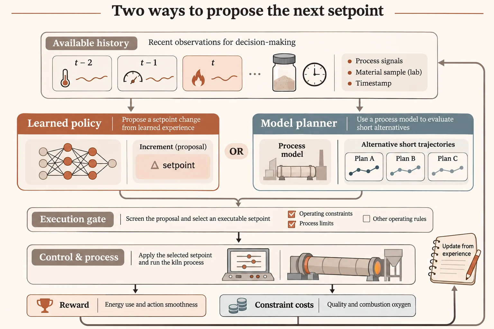

**序列决策：历史、候选与延迟反馈**

从当前候选、未来轨迹推到反馈策略，说明历史、化验可用性、占用分布、延迟回报与独立约束如何进入同一个问题。

**读图要点**

- **信息与候选** · 只把已到达的信号及化验写入历史/信念；学习策略与模型规划是可比较的候选生成路径。
- **执行与后果** · 候选增量先过门控，再改变 CV 设定值；内层控制与物料、热惯性共同决定未来响应。
- **奖励与独立成本** · 奖励由归一化煤耗、电耗及平滑项构成；质量和氧约束作为单独成本记录。

**准确关系与边界**

已到达信息 → 历史/信念 → 策略或规划 → 门控执行 → 过程 → 下一信息与独立奖励/成本。反馈可支持价值学习或模型校准。两种生成路径不表示必须同时执行；期望成本约束不等于每一步的安全保证。

*原创概念图解。图内短英文标签由下方双语文字解释；精确公式、假设与执行边界以正文为准。图像不代表实测数据、真实工程接线或现场性能证据。*

### 2. MDP 是条件独立假设，不是把一行数据命名为 state

如果充分状态 $S_t$ 满足

$$P(S_{t+1},R_{t+1},C_{t+1}\mid S_{0:t},A_{0:t})=P(S_{t+1},R_{t+1},C_{t+1}\mid S_t,A_t),$$

就可以使用 Markov 决策过程。状态应覆盖影响未来分布的重要记忆，例如热状态、物料状态、当前设定值、前次执行增量、设备模式及门控所依赖的变量。右侧不是“没有扰动”，而是“给定当前状态和动作后，更早历史不再额外改变下一步分布”。现实中这些隐变量往往无法全部测量，所以直接把瞬时温度、压力和旧化验拼成向量，并不能证明 Markov 性。

理论推导先假定充分状态存在。令 $a$ 表示候选动作，门控为 $G(s,a)$；复合转移核 $P_G$ 包含执行门控和内层响应。价值满足

$$V^\pi(s)=\mathbb E_{a\sim\pi(\cdot\mid s)}\!\left[\mathbb E_{(s',r)\sim P_G(\cdot\mid s,a)}\!\left[r+\gamma V^\pi(s')\right]\right].$$

外层平均策略可能选的动作，内层平均过程在该动作下的随机结果。最优性方程把动作平均换成优化，但仍保留对随机转移的期望。一步差异会改变后续访问的状态，因此优化的是由策略诱导的整条轨迹分布，而非在固定历史数据的每一行上分别找最小预测煤耗。

一个完全虚构且两方案均满足约束的能耗例子：方案 A 两步成本为 $[1,5]$，方案 B 为 $[2,1]$。即时优化选 A；取 $\gamma=0.9$，负成本回报分别为 $-1-0.9\times5=-5.5$ 与 $-2-0.9\times1=-2.9$，长期选择 B。这里没有把质量违规塞入奖励，差异只是早期动作造成后续能耗变化。EA 轨迹规划、MPC 或正确学习的价值函数都可能识别这个差异。

### 3. 部分可观测：需要对“尚不知道什么”建模

POMDP 区分隐藏状态 $S_t$ 与观测 $O_t$。理想信念 $b_t(s)=P(S_t=s\mid O_{0:t},A_{0:t-1})$ 通过转移预测和观测更新递推：

$$b_{t+1}(s')\propto P(o_{t+1}\mid s')\int P_G(s'\mid s,a_t)b_t(s)\,ds.$$

实际项目通常没有足够可信的完整概率模型，因此使用历史窗口、循环网络或时序编码器近似信息状态。这是可检验的逼近，不是“用了 TCN 就自动成为 MDP”。比较窗口长度和编码器时，应控制参数量、延迟标签对齐与训练预算；验证剩余预测误差是否还系统依赖更早历史。[流程工业 RL 综述](https://doi.org/10.1109/JAS.2024.124227)提供领域问题的组织框架，具体建模仍须依过程而定。

项目全量接口含每 5 分钟一次的 24 个采样点、当前设定值、软测量、已发布化验与化验年龄、原料率值。24 点窗口名义上覆盖约两小时，但首末采样点间隔是 $23\times5=115$ 分钟；不要把窗口命名当成精确物理时滞。教学工作台的 13 维观测、3 维动作也不等于全量 36 变量、6 CV 方案。

一份化验在 10:00 取样、10:40 发布：10:20 的策略不得读取它；10:45 可读取它，但该值描述 10:00 的材料，样品年龄为 45 分钟、发布后年龄为 5 分钟，两者含义不同。训练软测量可在标签发布后对齐到取样时刻进行监督；这并不允许重建历史决策输入时提前填入该标签。数据表至少要保留采样时间、发布时间、缺失标记和当时可用值。[项目观测约定](https://github.com/bahayonghang/rl-learning/blob/main/AGENTS.md)

### 4. CMDP：把目标与约束分开，并保持单位一致

定义奖励 $r$ 衡量煤、电和执行平滑性，成本 $c_j$ 衡量第 $j$ 项约束。一个便于解释单位的折扣形式是

$$\max_\pi J_r(\pi),\quad J_{c_j}(\pi)\le d_j,$$
$$J_r=(1-\gamma)\mathbb E_\pi\sum_{t\ge0}\gamma^t r_{t+1},\qquad J_{c_j}=(1-\gamma)\mathbb E_\pi\sum_{t\ge0}\gamma^t c_{j,t+1}.$$

乘上 $1-\gamma$ 后，常值成本的指标等于该常值；去掉这个因子也完全可以，但预算必须同步换算。平均成本形式又是另一种长期定义，不能直接复用未经转换的预算。本项目中的质量和氧含量阈值属于项目约定，作为独立成本与执行保护使用，不是全球水泥工艺标准。

拉格朗日函数为 $\mathcal L=J_r-\sum_j\lambda_j(J_{c_j}-d_j)$，$\lambda_j\ge0$。策略方向提高 $\mathcal L$，乘子通过

$$\lambda_j\leftarrow\left[\lambda_j+\eta_\lambda(\widehat J_{c_j}-d_j)\right]_+$$

提高超预算约束的代价。若估计成本 $0.12$、预算 $0.10$、步长 $0.5$，乘子增加 $0.01$；若成本低于预算，则倾向降低乘子，但不会降到负数。这是带估计噪声的优化更新，不是每一步都可行的证明。平均成本小可以与少量严重违规并存；训练期的预算满足、测试期的预算满足和逐时刻工程安全也不是同一命题。[CPO 原论文](https://arxiv.org/abs/1705.10528)

因此门控和成本学习各有作用：门控阻止当前已知不合规候选执行，成本价值让策略学会提前避开未来风险。门控拒绝率应独立报告，否则一个不断提出危险建议、总靠回退保持运行的策略，可能在仅看执行后违规率时显得很好。

### 5. 从日志学策略，需要行为支持而不仅是样本数量

设日志行为策略为 $\mu$，目标策略为 $\pi$。重要性比率 $\pi(a\mid h)/\mu(a\mid h)$ 有意义的必要支持条件是：目标策略给正概率的动作，行为策略在相同信息条件下也要有支持。工业日志常集中在窄工况和小幅调整区；一百万条近乎保持动作，并不等于可靠覆盖所有六维联合增量。

普通在线 SAC/TD3 依靠后续交互纠正价值误差；直接让它们在固定日志上反复最大化 Critic，可能选择数据外的虚高价值动作。CQL 等离线方法正是针对这种分布外评价风险提出约束或保守学习，理论结论也依赖数据、函数逼近和优化假设。[CQL](https://arxiv.org/abs/2006.04779)。离线学习可以生成研究候选，但不能从“训练结束”推导出“允许现场探索”。本仓库交互范围仍是离线与仿真。

### 6. RL 与优化的连接点应当可替换、可消融

可以让 RL 学终端价值、为优化器提供热启动、在可行示范附近学习策略，或调整经济 MPC 的参数。Gros 与 Zanon 研究了经济 NMPC 作为 RL 函数逼近器的联系，并分析了模型与成本修正之间的关系。相关定理有明确的修改阶段成本、终端价值及存在性条件；不能概括为“即使模型任意错误，RL 也保证控制最优且安全”。[原论文](https://arxiv.org/abs/1904.04152)

比较时先固定同一个状态信息、动作接口、偏好、约束与评价环境，再替换终端价值、候选生成器或策略学习器。持续过程在有限模拟窗口结束时是截断：价值目标可以对最终观测 bootstrap，但优势递推不能跨越重置串接下一段轨迹。这样得到的差异才能主要归因于决策方法，而不是标签泄漏、动作权限或终止语义被悄悄改变。

### 本篇原始资料与阅读边界

- [R14](#reference-14) · [Reinforcement Learning: An Introduction, Second Edition](https://incompleteideas.net/book/the-book-2nd.html) — Richard S. Sutton, Andrew G. Barto; 2018. 来源标识: r2-rlbook.
- [R5](#reference-5) · [Model Predictive Control: Theory, Computation, and Design](https://sites.engineering.ucsb.edu/~jbraw/mpc/) — James B. Rawlings, David Q. Mayne, Moritz M. Diehl; 2020, 2nd paperback edition; current online printing. 来源标识: r2-mpcbook.
- [R16](#reference-16) · [Data-driven Economic NMPC using Reinforcement Learning](https://arxiv.org/abs/1904.04152) — Sébastien Gros, Mario Zanon; 2019 preprint / 2020 journal. 来源标识: r2-mpc-rl.
- [R15](#reference-15) · [Reinforcement Learning in Process Industries: Review and Perspective](https://doi.org/10.1109/JAS.2024.124227) — Oguzhan Dogru, Junyao Xie, Om Prakash et al.; 2024. 来源标识: r2-process-rl.
- [R25](#reference-25) · [Constrained Policy Optimization](https://arxiv.org/abs/1705.10528) — Joshua Achiam, David Held, Aviv Tamar, Pieter Abbeel; 2017. 来源标识: r2-cpo.
- [R20](#reference-20) · [Conservative Q-Learning for Offline Reinforcement Learning](https://arxiv.org/abs/2006.04779) — Aviral Kumar, Aurick Zhou, George Tucker, Sergey Levine; 2020. 来源标识: r2-cql.
- [R35](#reference-35) · [rl-learning project domain and safety contracts](https://github.com/bahayonghang/rl-learning/blob/main/AGENTS.md) — bahayonghang / rl-learning; Repository contract. 来源标识: r2-project.

**r2-rlbook · MIT Press:** 作者教材，涵盖 MDP、Bellman、函数逼近与策略梯度；本页窑案例独立编写。

**r2-mpcbook · Nob Hill Publishing:** 作者开放教材；滚动时域、终端条件、状态估计和经济 MPC 的理论入口。

**r2-mpc-rl · IEEE Transactions on Automatic Control 65, 636–648:** 原文理论条件与例子支持 MPC 作为 RL 函数逼近器的联系；不声称任意错误模型都可安全使用。

**r2-process-rl · IEEE/CAA Journal of Automatica Sinica 11, 283–300:** 流程工业 RL 综述；文献分类不替代每篇论文的部署证据核查。

**r2-cpo · ICML 2017:** 约束策略优化与理论性能界；期望成本不是逐时刻无违规保证。

**r2-cql · NeurIPS 2020:** 原论文区分策略价值下界与逐点下界；理论和数据假设不可省略。

**r2-project · Project repository:** 本仓库的周期、观测、CV 增量、成本和五层门控约定；不是通用工艺标准或验证报告。

---

## 06 · 网络与数据路径：一个可审计的上层决策系统

逐一说明历史编码、软测量、tanh Actor、双 Critic、温度、成本、离线支持与世界模型各自学习什么，以及门控改变了哪些语义。

**建议阅读:** 39 分钟（按个人基础调整）

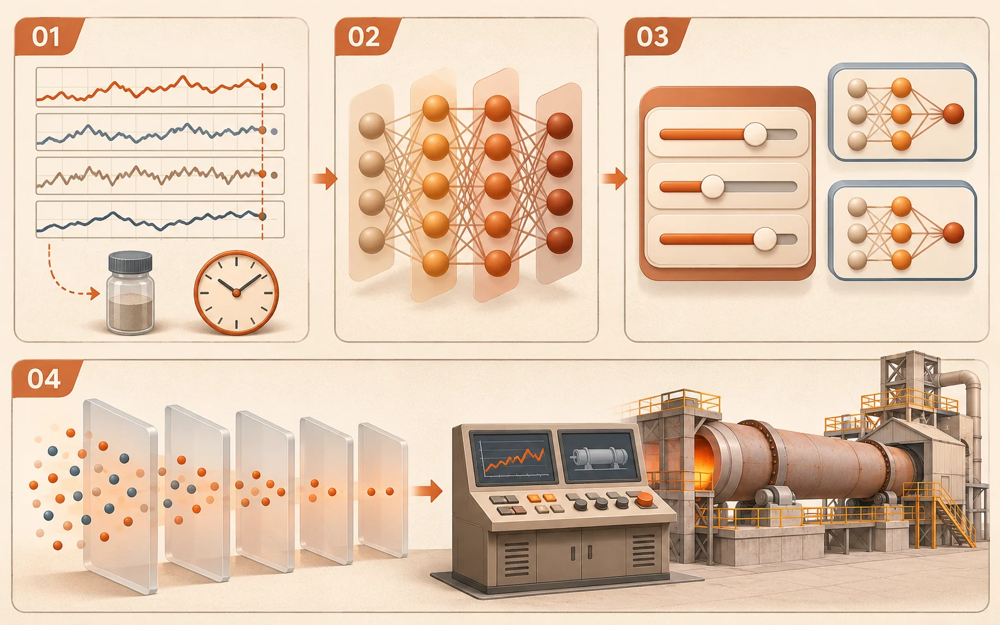

**历史编码、策略、评价网络与执行门控**

先把过去可用的信息编码，再由策略产生增量建议；图中三个滑块对应教学子集，完整项目采用六个 CV，维度以配套正文为准。价值/成本网络负责评价，独立门控决定实际执行。网络中的节点数量为示意，具体张量与损失以配套正文的公式与读图说明为准。

**逐区读图**

- **01** · 输入：历史在线信号、动作和化验年龄；不得把未来发布的化验结果提前放入观测。
- **02** · 编码：时序网络把历史窗口压缩为表示；学得的表示不自动满足 Markov 性或因果充分性。
- **03** · 策略与评价：三个滑块表示教学子集的有界请求增量；完整项目不限定为三个 CV。旁边的网络是评价模块概念，不是网络数量或具体算法的完整规定。
- **04** · 门控与过程：五层依次检查数据有效性、当前状态（核心 CV/PV 范围与氧边界）、模型可信度/OOD、变化率/曲率、绝对边界与授权。惩罚项不能代替这条执行路径。

这些是原创概念插图，不是实测曲线、辨识模型或工程施工图；精确关系以本篇公式和可选择的双语读图说明为准。

### 1. 一张网络结构图必须同时是一张信息权限图

设计从数据路径开始，而不是从“堆更多模块”开始。快速 DCS 信号、当前 CV 设定值、原料率值、缺失掩码、已发布化验及其年龄进入时序编码器；软测量输出质量估计与经验证的不确定性描述。Actor 读取当时可用的表示，产生归一化候选增量，五层门控决定真正执行什么。奖励、成本和下一时刻观测形成训练记录。隐藏的当前真实质量只属于仿真评价或后来取得的监督标签，不得偷偷进入历史决策输入。[项目契约](https://github.com/bahayonghang/rl-learning/blob/main/AGENTS.md)

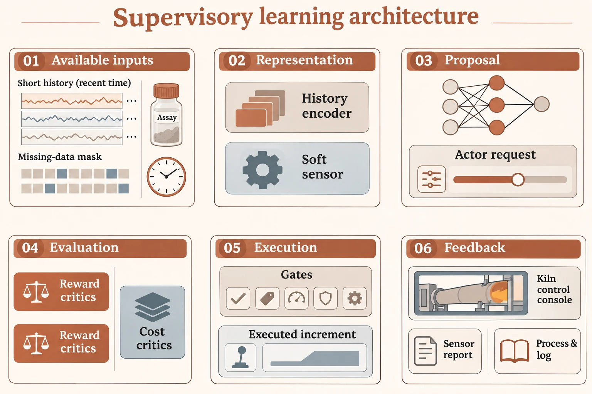

**可审计的策略系统：信息权限与执行路径**

逐一说明历史编码、软测量、tanh Actor、双 Critic、温度、成本、离线支持与世界模型各自学习什么，以及门控改变了哪些语义。

**读图要点**

- **合法信息接口** · 历史编码器与软测量只读决策时可用的信息；未来化验、隐含真值与测试目标不能进入策略输入。
- **策略与评价网络** · 有界 Actor 提出请求增量；双奖励 Critic 与成本 Critic 学习不同目标，节点数并非网络规模规定。
- **执行与日志** · 五层门控决定执行增量，内层控制跟踪 CV SP，日志分别保留请求、执行、奖励与成本。

**准确关系与边界**

合法历史 → 编码/软测量 → Actor 与 Critic；Actor 请求 → 五层门控 → CV SP/内层控制 → 下一观测与日志。日志支持 Critic 更新，Critic 给 Actor 的是学习信号，不是设备指令；门控后动作语义须与价值函数及离线数据一致。

*原创概念图解。图内短英文标签由下方双语文字解释；精确公式、假设与执行边界以正文为准。图像不代表实测数据、真实工程接线或现场性能证据。*

这是建议的研究接口，不是已经训练和部署的工业网络。模块名称 OAM-Net、QC-MTWaveSME、MC3/OOD 在后续研究页中作为可接入接口讨论；此图不推断这些已有模块的层数、参数量、损失配方或未公开实验成绩。

### 2. 表示学习与质量监督各自回答不同问题

用 $h_t=f_\omega(X_{t-L+1:t},m_t,Y_t^{sp},q_t^{\rm available},\mathrm{age}_t,R_t)$ 表示信息编码。$m_t$ 表示缺失与有效性，$R_t$ 在本节指原料特征，不是奖励。编码器可以是 TCN、RNN、注意力网络或简单堆叠；选择应由时滞、数据规模、推理预算和消融结果决定。较低预测误差不自动说明表示保留了控制所需的全部信息。

若软测量输出均值 $\mu_i$ 和标准差 $\sigma_i>0$，一个高斯观测模型的监督损失是

$$L_{\rm soft}=\sum_i m_i^{\rm label}\left[\frac{(q_i-\mu_i)^2}{2\sigma_i^2}+\log\sigma_i\right].$$

这是省略常数的负对数似然；$m_i^{\rm label}$ 只选择合法可用标签。它要求残差分布假设及独立校准检查，输出一个数字 $\sigma$ 并不等于获得可靠置信区间。标签应对齐取样时刻，输入必须按决策时的可用性重建。若共享编码器同时接收预测损失、Critic 损失和 Actor 梯度，需要报告哪些梯度被截断、各损失如何缩放及表示版本；否则难以解释性能来自哪里。

### 3. 有界 Actor：边界来自变量变换，密度也必须跟着变

SAC 常使用可重参数化的高斯样本，再压缩到动作区间：

$$\epsilon\sim\mathcal N(0,I),\quad u=\mu_\theta(h)+\sigma_\theta(h)\odot\epsilon,\quad a^{\rm req}=\tanh u.$$
$$\log\pi_\theta(a^{\rm req}\mid h)=\log\mathcal N(u;\mu_\theta,\sigma_\theta^2)-\sum_i\log(1-\tanh^2u_i).$$

第二项来自变量替换的 Jacobian。若一维 $\mu=0,\sigma=1,a=0.5$，则 $u=\operatorname{atanh}(0.5)\approx0.5493$，高斯 log-density 约为 $-1.0698$；减去 $\log(0.75)\approx-0.2877$ 后，变换后的对数密度约为 $-0.7821$。省略 Jacobian 会改变熵目标和策略梯度。数值实现需处理饱和附近的稳定性，物理单位缩放若进入密度坐标也须加上对应常数 Jacobian。[SAC 原论文](https://arxiv.org/abs/1801.01290)

门控后执行为

$$a_t^{\rm exec}=G(h_t,a_t^{\rm req}),\qquad Y_{t+1}^{sp}=Y_t^{sp}+\mathrm{RATE}\odot a_t^{\rm exec}.$$

例如分解炉通道的项目 RATE 为每步 $2^\circ\mathrm C$，候选 $0.4$ 只有在通过时才对应 $0.8^\circ\mathrm C$ 的设定值变化。拒绝并保持时该通道实际增量为零，但过程照常推进。平滑性项必须使用执行增量及其变化。tanh 只限制归一化动作大小，不保证下一步氧含量、质量或机械状态可行。

### 4. Critic 到底评价候选，还是评价执行？必须选清楚

有两种一致的设计。**执行域 Critic** $Q^{\rm exec}(h,a^{\rm exec})$ 学习物理执行的后果，训练记录使用实际执行动作；要优化候选，就要考虑 $Q^{\rm exec}(h,G(h,a^{\rm req}))$。含拒绝和替换的门控通常不光滑，不能把它默认为可微层直接套用普通 SAC 梯度。

**候选域 Critic** $Q_G(h,a^{\rm req})$ 则把门控作为环境的一部分，评价“提出该候选后，既定 Gate 会如何执行”的长期结果。训练必须同时记录候选、执行、门控原因和版本，并使表示足以描述该复合环境。若老日志只有执行动作，不能假造被拒绝的候选去训练这个定义。换 Gate 后，转移关系也可能变化。

下文 SAC 公式使用第二种定义，并省略下标 $G$。策略 log-prob 始终属于采样得到的候选动作。若候选被替换为保持动作，**不能在替换值上计算原高斯 log-prob，并声称它是本次采样的概率**。执行动作分布可能因回退而包含原点质量，与原连续高斯变换密度不同。候选熵很高、执行却一直保持也是可能的；必须联合报告执行多样性与拒绝率。

### 5. 双 Critic、Actor 与温度的更新方向

现代 SAC 使用两个奖励 Critic 与慢更新目标网络。对于下一候选 $a'\sim\pi_\theta(\cdot\mid h')$，目标为

$$y=r+\gamma(1-d)\left[\min_{i=1,2}\overline Q_i(h',a')-\alpha\log\pi_\theta(a'\mid h')\right],$$
$$L_{Q_i}=\mathbb E_{\mathcal D}\left[(Q_i(h,a^{\rm req})-\operatorname{stopgrad}(y))^2\right].$$

$d$ 只表示真实终止，不是时间窗口截断。双 Q 取较小值用于缓解过估计；这不是可靠性置信下界，两个网络共享偏差时仍会一起犯错。[TD3](https://arxiv.org/abs/1802.09477)；[SAC Algorithms and Applications](https://arxiv.org/abs/1812.05905)。取 $r=-0.4,\gamma=0.9,d=0$，两目标 Q 为 $-2,-1.6$，$\alpha=0.2,\log\pi=-0.7$，则 $y=-0.4+0.9[-2+0.14]=-2.074$。

Actor 最小化

$$L_\pi=\mathbb E_{h,\epsilon}\left[\alpha\log\pi_\theta(a^{\rm req}\mid h)-\min_iQ_i(h,a^{\rm req})\right].$$

重参数化使随机性来自固定采样分布，梯度可沿 $\theta\to u\to a^{\rm req}\to Q$ 传播。优化 Actor 时固定 Critic 参数，不等于阻断 Q 对动作的导数。常见温度目标的方向可写成 $L_\alpha=\alpha(\widehat H-H_{\rm target})$，$\alpha>0$；把熵估计视为此步常数。若熵 $0.5$ 低于目标 $0.8$，梯度下降会提高 $\alpha$，增加保持随机性的动力。连续变量的微分熵依坐标尺度变化，目标值不是普适常数；更高熵也不是更安全。

成本 Critic 另外估计 $Q_{c_j}$，目标可用 $c_j+\gamma(1-d)\overline Q_{c_j}(h',a')$，不加入奖励熵项。约束 Actor 可以在损失中加 $\sum_j\lambda_jQ_{c_j}$，预算与折扣归一化保持一致。质量成本仍需来自正确标签或经验证的代理及不确定性处理；用同一个偏置软测量同时训练和评价，可能产生自我证明。

### 6. 离线数据改变了学习目标，不能只关闭采样循环

普通 SAC 在固定日志上最大化 Q，容易利用数据外误差。CQL 在 Bellman 误差之外，对高估的数据外动作施加保守压力。离散动作下，一个示意项为

$$L_{\rm conservative}=\beta\left[\mathbb E_h\log\sum_a e^{Q(h,a)}-\mathbb E_{(h,a)\sim\mathcal D}Q(h,a)\right].$$

连续动作需要积分及相应采样/密度校正，不能直接把六维网格穷举当成现实实现。原文关于策略价值的保守性结论有假设，不能改写为“任意神经网络 Q 在每个点都一定低于真值”。[CQL](https://arxiv.org/abs/2006.04779)

IQL 通过数据动作上的 expectile 回归学习状态价值：

$$L_V=\mathbb E_{\mathcal D}\left[\left|\tau-\mathbf1_{\delta<0}\right|\delta^2\right],\qquad\delta=\overline Q(h,a)-V(h).$$

$\tau=0.7$ 时，$\delta=2$ 的损失为 $2.8$，$\delta=-2$ 为 $1.2$，正残差受到更大权重，使 V 倾向拟合较好的数据动作。随后 Q 拟合 $r+\gamma V(h')$，Actor 进行由优势加权的行为克隆，常用权重与 $e^{\beta(Q-V)}$ 成正比，并设置数值上限。它减少价值训练时查询未见动作的需要，仍不保证拟合策略永不越出行为支持。[IQL](https://arxiv.org/abs/2110.06169)。普通 BC 和 [TD3+BC](https://arxiv.org/abs/2106.06860)应是保留的简单基线。

### 7. 世界模型必须显式看到动作，且不能替代证据

用于控制的模型应估计 $\widehat P_\psi(x_{t+1},r_{t+1},c_{t+1}\mid h_t,a_t^{\rm exec})$，或明确估计包含 Gate 的候选域转移。只根据历史预测下一温度的网络，可能准确复现操作员策略下的相关性，却未学会改变设定值后的反事实响应。动作条件、模式切换、延迟标签和模型不确定性需要专门验证。

MBPO 从真实状态分叉较短模型推演来减轻长序列模型误差，原始算法仍包含采集真实交互和更新模型；把它用于固定日志需重新考虑离线分布支持。[MBPO](https://arxiv.org/abs/1906.08253)。MOPO 将离线模型的不确定性纳入保守目标，但惩罚不是设备硬约束证明。[MOPO](https://arxiv.org/abs/2005.13239)。模型生成一万条轨迹仍是一万次模型推演，不是新增的一万次现场验证。

最后，五层阈值门控是项目执行规则；预测安全过滤器的形式化保证通常另需有效模型误差界、终端安全集合、备用控制器和可行性条件。应把“架构中有 Gate”与“满足特定安全定理”分开表述。[Wabersich 与 Zeilinger](https://doi.org/10.1016/j.automatica.2021.109597)。当前网站提供推导与教学模拟，没有在后台训练 SAC、运行工业世界模型或证明现场收益。

### 本篇原始资料与阅读边界

- [R18](#reference-18) · [Soft Actor-Critic: Off-Policy Maximum Entropy Deep Reinforcement Learning with a Stochastic Actor](https://arxiv.org/abs/1801.01290) — Tuomas Haarnoja, Aurick Zhou, Pieter Abbeel, Sergey Levine; 2018. 来源标识: r2-sac.
- [R19](#reference-19) · [Soft Actor-Critic Algorithms and Applications](https://arxiv.org/abs/1812.05905) — Tuomas Haarnoja et al.; 2018 / 2019. 来源标识: r2-sac-apps.
- [R17](#reference-17) · [Addressing Function Approximation Error in Actor-Critic Methods](https://arxiv.org/abs/1802.09477) — Scott Fujimoto, Herke van Hoof, David Meger; 2018. 来源标识: r2-td3.
- [R20](#reference-20) · [Conservative Q-Learning for Offline Reinforcement Learning](https://arxiv.org/abs/2006.04779) — Aviral Kumar, Aurick Zhou, George Tucker, Sergey Levine; 2020. 来源标识: r2-cql.
- [R21](#reference-21) · [Offline Reinforcement Learning with Implicit Q-Learning](https://arxiv.org/abs/2110.06169) — Ilya Kostrikov, Ashvin Nair, Sergey Levine; 2021 / 2022. 来源标识: r2-iql.
- [R22](#reference-22) · [A Minimalist Approach to Offline Reinforcement Learning](https://arxiv.org/abs/2106.06860) — Scott Fujimoto, Shixiang Shane Gu; 2021. 来源标识: r2-td3bc.
- [R23](#reference-23) · [When to Trust Your Model: Model-Based Policy Optimization](https://arxiv.org/abs/1906.08253) — Michael Janner, Justin Fu, Marvin Zhang, Sergey Levine; 2019. 来源标识: r2-mbpo.
- [R24](#reference-24) · [MOPO: Model-based Offline Policy Optimization](https://arxiv.org/abs/2005.13239) — Tianhe Yu et al.; 2020. 来源标识: r2-mopo.
- [R26](#reference-26) · [A predictive safety filter for learning-based control of constrained nonlinear dynamical systems](https://doi.org/10.1016/j.automatica.2021.109597) — Kim Peter Wabersich, Melanie N. Zeilinger; 2021. 来源标识: r2-safety-filter.
- [R35](#reference-35) · [rl-learning project domain and safety contracts](https://github.com/bahayonghang/rl-learning/blob/main/AGENTS.md) — bahayonghang / rl-learning; Repository contract. 来源标识: r2-project.

**r2-sac · ICML 2018:** 原文最大熵目标和变换密度；熵不提供工艺安全保证。

**r2-sac-apps · arXiv:1812.05905:** 现代 SAC 更新、自动温度与实际机器人案例；不能转译为烧成部署证据。

**r2-td3 · ICML 2018:** TD3 的双 Critic、延迟策略更新与目标平滑；原基准不等于工业效果。

**r2-cql · NeurIPS 2020:** 原论文区分策略价值下界与逐点下界；理论和数据假设不可省略。

**r2-iql · ICLR 2022:** Expectile 价值学习与优势加权行为克隆；不保证最终策略绝不越出数据支持。

**r2-td3bc · NeurIPS 2021:** TD3+BC 作为应保留的简单离线比较对象，而非宣布某个复杂架构必然更好。

**r2-mbpo · NeurIPS 2019:** 从真实状态分叉的短模型推演；模型调用不是新增现实证据。

**r2-mopo · NeurIPS 2020:** 离线模型不确定性惩罚及其假设；惩罚并非硬约束认证。

**r2-safety-filter · Automatica 129, 109597:** 开放作者稿核验模型置信、终端安全集及可行性条件；不同于简单阈值门控。

**r2-project · Project repository:** 本仓库的周期、观测、CV 增量、成本和五层门控约定；不是通用工艺标准或验证报告。

---

## 07 · 证据地图：论文、仿真、现场与尚未回答的问题

按实际可读的一手材料建立证据矩阵，区分生产数据、模型闭环、现场试验和运营报告，核验相关论文归属与适用范围。

**建议阅读:** 29 分钟（按个人基础调整）

### 1. “用了工业数据”不能回答“谁在现场决定动作”

本综述核验日期为 **2026-11-14**。证据按实际可访问的一手材料记录：作者原文或开放手稿、出版社摘要、出版社登记的 DOI 书目、官方运营说明。全文无法取得时，明确保留未知，不用检索摘要拼出未见过的实验细节。对相关论文的介绍只陈述已核验范围；本文的网络接口、教学算例与研究假设另外标明为原创设计。

以下层级不是论文价值排名，而是回答不同问题的证据类型。理论证明回答“在这些假设下是否成立”；数值基准回答“在规定的仿真问题上表现怎样”；生产数据预测回答“在日志分布上能否预测”；基于生产数据训练的模拟闭环回答“在该代理模型内选择动作会怎样”；现场建议模式回答“人如何采用建议”；实际执行试验回答“设备是否按照该策略改变了动作”。**有生产数据，仍可能完全没有进行现场控制。** [流程工业 RL 综述](https://doi.org/10.1109/JAS.2024.124227)是文献地图，不能替代每篇工作的实验核查。

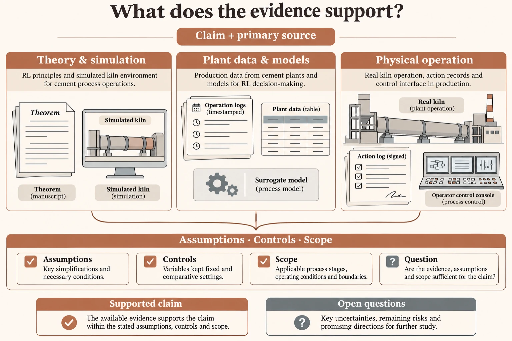

**证据地图：从具体主张到允许的结论**

按实际可读的一手材料建立证据矩阵，区分生产数据、模型闭环、现场试验和运营报告，核验相关论文归属与适用范围。

**读图要点**

- **主张与原始材料** · 先写清要核验的结论，再查原论文或官方运营材料，保留实际读到的范围。
- **三类证据** · 理论、模拟、真实日志和现场执行各支持不同主张；使用工业数据不说明动作由谁执行。
- **结论边界** · 记录假设、对照、工况、统计和未回答的问题，再选择与证据强度一致的措辞。

**准确关系与边界**

具体主张 → 一手资料 → 分辨证据类别 → 核对假设/对照/范围 → 支持的表述与开放问题。三条分支是证据分类，不能读成必然逐级升级的部署路线，也不能把别人的现场报告写成本项目收益。

*原创概念图解。图内短英文标签由下方双语文字解释；精确公式、假设与执行边界以正文为准。图像不代表实测数据、真实工程接线或现场性能证据。*

### 2. 方法论文的证据不能直接兑换为烧成收益

| 原始来源 | 本次核验材料 | 可以支持什么 | 不能由此推出什么 |
| --- | --- | --- | --- |
| [Skogestad 2000](https://doi.org/10.1016/S0959-1524(00)00023-8) | 作者手稿 | 控制变量选择、层次与自优化控制的条件性论证 | 固定 CV 对所有工况都最优 |
| [NSGA-II](https://doi.org/10.1109/4235.996017) / [MOEA/D](https://doi.org/10.1109/TEVC.2007.892759) | 原文 | 多目标排序、拥挤度、分解与测试问题表现 | 已优化本项目真实煤电耗 |
| [SAC Algorithms and Applications](https://arxiv.org/abs/1812.05905) | 开放原文 | 最大熵更新及论文中的数值与机器人实验 | 六 CV 烧成系统已实现自主控制 |
| [预测安全过滤器](https://doi.org/10.1016/j.automatica.2021.109597) | 开放作者稿 | 在模型、终端集合与可行性条件下的过滤方法 | 任意阈值 Gate 都继承同样保证 |
| [统计评估研究](https://arxiv.org/abs/2108.13264) | 作者论文 | 少量随机种子与不稳定汇总的评估问题 | 五个种子必然足够，或同一轨迹的时间步互相独立 |

理论来源最有价值的部分经常是限定条件。把一个条件性结果删掉前提后迁移到工业系统，会比直接承认未知更危险。算法在标准控制基准上获得高回报，也不能说明工业任务的传感器故障、长化验时滞、停窑风险、操作权限和目标分母已经被正确表达。

### 3. 与本研究主线相关的论文：核验归属，也核验工艺对象

| 论文 | 已核验的作者/对象与材料 | 本综述允许的结论 | 保留的未知 |
| --- | --- | --- | --- |
| [TCNSO-MSL-TD3 相关论文，2026](https://doi.org/10.1088/2631-8695/ae5ed3) | DOI 登记题名、作者和出版社摘要；作者包含 Yonghang Li；对象为烧成 | 摘要描述时序观测、多步学习与约束相关设计 | 未取得全文，不能确定完整实验设置或现场执行层级 |
| [OA-DSTR 相关论文，2024](https://doi.org/10.1016/j.asoc.2024.111772) | 书目与出版社摘要；Yonghang Li 等；对象为水泥粉磨 | 可作为动态搜索与滚动决策的相关工作 | 不能把粉磨的对象、指标响应或结果直接当作烧成验证 |
| [软测量与时序预测联合训练，2026](https://doi.org/10.1109/TII.2026.3664090) | 出版社登记题名、作者、期刊与页码；Yonghang Li 等 | 可确认研究主题与书目归属 | 本次未取得全文，不重建内部网络与损失细节 |
| [TOD-CGAN，2026](https://doi.org/10.1016/j.jfranklin.2026.108704) | 书目与出版社摘要；作者包含 Yonghang Li | 条件生成用于烧成运行决策的相关思路 | 条件生成不自动等于 RL，也不自动说明现场自主执行 |
| [CoNERL，2026](https://doi.org/10.1016/j.aei.2026.104530) | 书目、作者列表与出版社记录中的仿真表述 | 外部进化与 RL 结合的相关工作 | 作者列表不含 Yonghang Li；不能列为用户成果，也不能将仿真改称现场节能 |

这些书目为后续精读提供入口，不是为了给任何方法背书。以 TCNSO-MSL-TD3 为例，出版社摘要足以确认其研究主题，却不足以回答划分是否严格按时间、是否有独立装置、对照策略如何调参、Gate 是否一致等问题。获得全文与补充材料后，应逐项填写，而不是把“comprehensive experiments”解释成已完成现场随机对照。

用户已有 OAM-Net、QC-MTWaveSME、MC3/OOD、PG-MOEA/D-IEpsilon 和 NURBS 轨迹等研究模块，可作为本项目已知接口背景；其准确实现与本文提出的 RL 连接方案应分别说明。论文题名相近、缩写相似或作者中包含熟悉姓名，都不能代替原始书目与全文证据。

### 4. 两个真实运营来源，分别能说明什么

**Yokogawa 与 JSR 的 2022 年官方联合报告**明确记录了一个蒸馏装置的 FKDPP 控制现场试验：从 2022-01-17 到 02-21，持续 35 天。报告描述了模拟器训练、DCS 集成及既有联锁等环节。因此它可以支持“该运营方报告了特定装置上的实际自主控制试验”，比仅使用工厂数据的仿真证据更接近执行层。[官方原页](https://www.yokogawa.com/news/press-releases/2022/2022-03-22/)

但是，这是一份运营方与供应商的一手报告，而不是本文独立复现的随机对照研究。蒸馏装置也不是水泥窑。这里不移植其经济数字，不推断本项目可以直接复制同一算法，不把 35 天试验等同于覆盖所有原料、故障和季节工况的长期保证。要评估其外推性，仍需控制变量、过程时标、约束与失效处置的具体比较。

**DeepMind 的 2018 年官方运营说明**描述了数据中心冷却的自主 AI 系统：预测候选后进行约束筛选，再由本地系统复核，并保留不确定性处理和人工退出路径。它支持“预测、候选筛选、本地检查与人类权限可以构成分层执行架构”这一事实。[官方原页](https://deepmind.google/blog/safety-first-ai-for-autonomous-data-centre-cooling-and-industrial-control/)

该运营说明本身不够确定具体使用了 PPO 或 SAC，也不能据其架构图反推本项目的网络结构。本文不引用其中的节能比例来估计烧成收益。两份材料的共同启发是：现场系统必须说明训练、推理、权限与回退如何连接；这并不构成某个 RL 算法普适优越的证据。

### 5. 一个可以复核的效果声明需要哪些分母

假设论文报告“单位煤耗下降”。至少还要追问：按总燃料质量还是热值折算；产量是否变化；质量不合格品是否计入；原料、燃料热值和设备状态是否匹配；对照是否经历相同扰动；模型是否用测试期数据调过参数；人工接管期间是否被删除。若算法 A 只保留容易工况而 B 承担全部工况，平均数差异可能主要来自样本选择。

同样，一条曲线的点数不能当成样本量。每个时间点共享同一训练策略和强时间相关性；训练随机种子、连续工况窗口、装置和季节是不同的变异来源。应按设计进行配对、区间估计或分层汇总，并公开失败运行。[Agarwal 等](https://arxiv.org/abs/2108.13264)解释了 RL 评估为何容易受有限样本和汇总方式影响；将其思想迁移到工业时，还要额外处理过程自相关。

### 6. 当前网页的证据位置

本网站已经提供的是：原创推导、显式计算的教学例子、浏览器中的教学动力学、可查看的项目契约和研究接口。它没有提供实际工业日志、PG-MOEA/D-IEpsilon 可运行基线、训练后的工业 SAC 模型、现场对照试验或可验证的收益数字。[仓库约定](https://github.com/bahayonghang/rl-learning/blob/main/AGENTS.md)

因此本综述将主张限定为“为什么值得研究、如何定义问题、如何避免错误比较、什么证据会支持或推翻假设”。后续一旦获得真实数据与实现，应在同一证据矩阵中更新材料类型、实验协议、失败例与复现实验，而不是仅把介绍图换成更复杂的架构。

### 本篇原始资料与阅读边界

- [R1](#reference-1) · [Plantwide control: the search for the self-optimizing control structure](https://doi.org/10.1016/S0959-1524(00)00023-8) — Sigurd Skogestad; 2000. 来源标识: r2-skogestad.
- [R8](#reference-8) · [A Fast and Elitist Multiobjective Genetic Algorithm: NSGA-II](https://doi.org/10.1109/4235.996017) — Kalyanmoy Deb, Amrit Pratap, Sameer Agarwal, T. Meyarivan; 2002. 来源标识: r2-nsga2.
- [R9](#reference-9) · [MOEA/D: A Multiobjective Evolutionary Algorithm Based on Decomposition](https://doi.org/10.1109/TEVC.2007.892759) — Qingfu Zhang, Hui Li; 2007. 来源标识: r2-moead.
- [R19](#reference-19) · [Soft Actor-Critic Algorithms and Applications](https://arxiv.org/abs/1812.05905) — Tuomas Haarnoja et al.; 2018 / 2019. 来源标识: r2-sac-apps.
- [R15](#reference-15) · [Reinforcement Learning in Process Industries: Review and Perspective](https://doi.org/10.1109/JAS.2024.124227) — Oguzhan Dogru, Junyao Xie, Om Prakash et al.; 2024. 来源标识: r2-process-rl.
- [R26](#reference-26) · [A predictive safety filter for learning-based control of constrained nonlinear dynamical systems](https://doi.org/10.1016/j.automatica.2021.109597) — Kim Peter Wabersich, Melanie N. Zeilinger; 2021. 来源标识: r2-safety-filter.
- [R27](#reference-27) · [Deep Reinforcement Learning at the Edge of the Statistical Precipice](https://arxiv.org/abs/2108.13264) — Rishabh Agarwal, Max Schwarzer, Pablo Samuel Castro, Aaron Courville, Marc G. Bellemare; 2021. 来源标识: r2-rliable.
- [R28](#reference-28) · [A novel constrained off-policy deep reinforcement learning approach for temporal decision-making in the cement calcination system](https://doi.org/10.1088/2631-8695/ae5ed3) — Lei Chang, Chong Liu, Xin Shi, Mengyu Bai, Xingzhi Zheng, LiBin Wei, Yonghang Li; 2026. 来源标识: r2-tcnso.
- [R29](#reference-29) · [Collaborative optimization decision making of cement grinding process operational indicators considering dual dynamic problem](https://doi.org/10.1016/j.asoc.2024.111772) — Yonghang Li, Tianqi Yang, Xiaochen Hao, Jieguang Yang, Quanwei Sun; 2024. 来源标识: r2-oadstr.
- [R30](#reference-30) · [Predictive Monitoring of Industrial Processes and Quality Indices via Joint Training of Soft Sensor and Time-Series Forecasting](https://doi.org/10.1109/TII.2026.3664090) — Yonghang Li, Xiaochen Hao, Xunian Yang, Xingzhi Zheng, Libin Wei; 2026. 来源标识: r2-monitoring.
- [R31](#reference-31) · [TOD-CGAN: Transformer-based conditional generative adversarial network for optimising operational decisions in cement calcination systems](https://doi.org/10.1016/j.jfranklin.2026.108704) — Xiaochen Hao, Boxun Li, Yonghang Li, Xunian Yang, Junze Jiao, Yangdong Su; 2026. 来源标识: r2-todcgan.
- [R32](#reference-32) · [Co-evolutionary reinforcement learning for industrial optimization: a multi-objective optimization framework for cement rotary kilns](https://doi.org/10.1016/j.aei.2026.104530) — Gang Liu, Shangjian Xie, Xiaochen Hao, Ran Zheng, Shuaixiang Zhai, Mohan Liu; 2026. 来源标识: r2-conerl.
- [R33](#reference-33) · [Yokogawa and JSR: 35-day autonomous chemical-plant field test](https://www.yokogawa.com/news/press-releases/2022/2022-03-22/) — Yokogawa Electric Corporation; JSR Corporation; 2022-03-22. 来源标识: r2-yokogawa.
- [R34](#reference-34) · [Safety-first AI for autonomous data centre cooling and industrial control](https://deepmind.google/blog/safety-first-ai-for-autonomous-data-centre-cooling-and-industrial-control/) — Chris Gamble, Jim Gao; 2018-08-17. 来源标识: r2-deepmind.
- [R35](#reference-35) · [rl-learning project domain and safety contracts](https://github.com/bahayonghang/rl-learning/blob/main/AGENTS.md) — bahayonghang / rl-learning; Repository contract. 来源标识: r2-project.

**r2-skogestad · Journal of Process Control 10, 487–507:** 作者手稿已读：控制变量选择、分层设定值与经济损失；并非所有工况都适用的恒定设定值结论。

**r2-nsga2 · IEEE Transactions on Evolutionary Computation 6, 182–197:** 原论文全文核验非支配排序、拥挤距离、精英保留及约束支配；证据为测试问题。

**r2-moead · IEEE Transactions on Evolutionary Computation 11, 712–731:** 原论文 PDF 核验分解、邻域与尺度处理；不能由算法名推断具体项目改进版。

**r2-sac-apps · arXiv:1812.05905:** 现代 SAC 更新、自动温度与实际机器人案例；不能转译为烧成部署证据。

**r2-process-rl · IEEE/CAA Journal of Automatica Sinica 11, 283–300:** 流程工业 RL 综述；文献分类不替代每篇论文的部署证据核查。

**r2-safety-filter · Automatica 129, 109597:** 开放作者稿核验模型置信、终端安全集及可行性条件；不同于简单阈值门控。

**r2-rliable · NeurIPS 2021:** 重复实验、不确定性与稳健汇总；不能把时间步当独立训练种子。

**r2-tcnso · Engineering Research Express 8, 085407:** 出版社登记摘要确认 TCNSO-MSL-TD3 与实验表述；未取得全文，不把摘要当现场部署证明。

**r2-oadstr · Applied Soft Computing 161, 111772:** 书目与出版社摘要核验；对象是粉磨，动态搜索与滚动思想可借鉴，烧成结果不可据此推定。

**r2-monitoring · IEEE Transactions on Industrial Informatics 22, 5254–5265:** 出版社登记题名和作者已核验，未取得全文；模块接口是本教程设计，不臆造论文细节。

**r2-todcgan · Journal of the Franklin Institute 363, 108704:** 题名、作者与生成式决策主题已核验；条件生成不自动等同于 RL 或现场自主控制。

**r2-conerl · Advanced Engineering Informatics 73, 104530:** 外部相关工作；作者列表不含 Yonghang Li。出版社记录中的仿真表述不等于现场闭环部署。

**r2-yokogawa · Official joint press release:** 运营方/供应商一手报告：FKDPP、蒸馏装置、模拟训练及 2022 年 35 天现场试验。非独立随机试验，不外推到水泥。

**r2-deepmind · Google DeepMind official account:** 官方运营说明：预测、候选筛选、当地复核与人工退出。本文不据此判定使用 PPO/SAC，也不搬用节能百分比。

**r2-project · Project repository:** 本仓库的周期、观测、CV 增量、成本和五层门控约定；不是通用工艺标准或验证报告。

---

## 08 · 开放问题：从预测准确到决策可信还缺什么

围绕隐藏状态、离线支持、闭环模型误差、罕见风险、目标漂移和评价统计提出可检验的下一步，而不是把复杂网络当作答案。

**建议阅读:** 32 分钟（按个人基础调整）

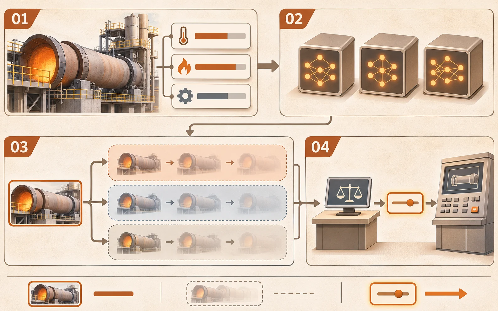

**从真实状态分叉的短时模型推演**

用多个模型比较短期候选未来，并把不确定性带入决策。随着推演加深，误差可能累积，因此长模型轨迹不能当成新的真实试验或安全证明。

**逐区读图**

- **01** · 锚点：从真实记录中的当前状态或历史表示开始，明确数据属于哪个工况。
- **02** · 模型组：多个预测器用于比较分歧；模型一致不等于模型都正确。
- **03** · 短推演：不同候选动作生成不同未来；逐渐变淡表示不确定性累积的概念，不是定量置信区间。
- **04** · 选择与回到现实：综合预测目标、约束与不确定性选择建议，实际执行后再用新观测校正。

这些是原创概念插图，不是实测曲线、辨识模型或工程施工图；精确关系以本篇公式和可选择的双语读图说明为准。

### 1. 缺少的可能是信息，而不是更深的网络

同样的温度、压力和设定值，可以对应不同的物料停留状态与潜在质量。历史编码能减少这种歧义，但窗口长度不能凭方便选定。应检查：预测残差是否依赖更早的进料、工况切换、前次调整或未记录的人工判断；对变化事件是否始终响应过晚；扩大窗口后收益是否只是多看到了将来发布的化验。一个能预测正常工况平均趋势的网络，未必能在异常来临前区分两个表面相似的状态。

化验缺失也可能不是随机的：操作员可能在怀疑质量波动时加密取样。如果只在有化验时评价误差，得到的是被采样机制选择过的分布。研究应保留采样请求、取样、发布、缺失和失效原因，分层报告误差与校准；没有这些字段时就承认识别边界，不能把插值值当成独立真值。这里是对项目 POMDP 接口的研究推论，不是声称已有数据具备这些字段。[项目观测约定](https://github.com/bahayonghang/rl-learning/blob/main/AGENTS.md)

### 2. 联合动作覆盖比每个通道的直方图更重要

设历史中两个 CV 只出现过 $(+,+)$ 与 $(-,-)$ 两种联合调整。两个通道各自都覆盖了正负动作，但 $(+,-)$ 仍是未验证的组合。六维动作下这种稀疏性会更严重。应同时考察状态条件下的联合动作、近邻距离、行为策略似然及不同装置模式，而不是只画每维最大最小值。分布外检测也只是针对某个表示和参照数据的诊断，无法证明未见动作具有可接受后果。[CQL](https://arxiv.org/abs/2006.04779)；[IQL](https://arxiv.org/abs/2110.06169)

离线评价的难点可以用重要性权重直观看出：

$$w_{0:T-1}=\prod_{t=0}^{T-1}\frac{\pi(a_t\mid h_t)}{\mu(a_t\mid h_t)}.$$

在一个教学行为策略中，“上调”概率为 $0.1$，目标策略为 $0.5$。连续五次上调的轨迹权重为 $5^5=3125$，而该轨迹在行为策略中的概率只有 $10^{-5}$。少量稀有轨迹可以支配估计方差。截断权重可降低方差，却引入偏差；行为概率未知、隐藏判断未记录或支持为零时，问题更严重。这个算例只是说明统计机制，并非建议把轨迹重要性采样直接作为本项目最终评估器。

### 3. 单步预测好，并不意味着闭环推演可靠

考虑真实和模型轨迹从同一状态开始。若在比较域内有统一单步模型误差 $\varepsilon$，且真实闭环映射的敏感度上界为 $L$，则可以得到一个教学误差递推：

$$e_{k+1}\le Le_k+\varepsilon,\qquad e_0=0,$$
$$e_H\le\varepsilon\sum_{i=0}^{H-1}L^i=\begin{cases}\varepsilon\dfrac{L^H-1}{L-1},&L\ne1,\\H\varepsilon,&L=1.\end{cases}$$

如果比较的是同一动作序列，$L$ 可取动力学对状态的敏感度；如果策略分别读取各自的真实/模型状态，$L$ 必须覆盖闭环映射，例如在相应 Lipschitz 假设下取 $L_x+L_aL_\pi$。含离散拒绝的门控可能没有这样的全局连续界。**测试集 RMSE 不是统一误差上界，未经验证的 $L$ 也不是证书。**

取归一化误差 $\varepsilon=0.02,L=1.2$，三步上界为 $0.02(1+1.2+1.44)=0.0728$，十步约为 $0.5192$。这不是实际窑误差，而是解释长推演为何可能放大偏差。短分叉、模型集合、保守惩罚和停止规则可以作为控制模型利用风险的设计；它们仍需在行动后分布上校准。[MBPO](https://arxiv.org/abs/1906.08253)；[MOPO](https://arxiv.org/abs/2005.13239)

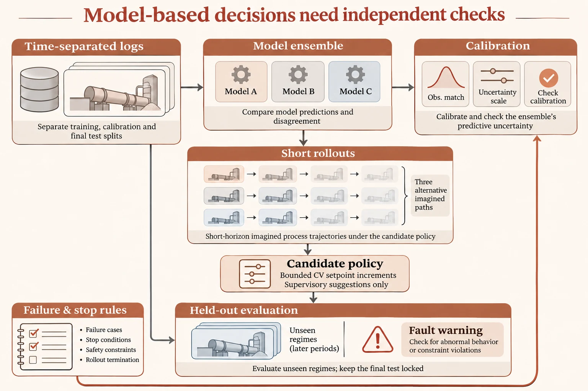

**闭环模型研究：校准、短推演与失败反馈**

围绕隐藏状态、离线支持、闭环模型误差、罕见风险、目标漂移和评价统计提出可检验的下一步，而不是把复杂网络当作答案。

**读图要点**

- **隔离数据与校准** · 按时间隔离日志，训练动作条件模型集合，并在独立数据核验误差与不确定性。
- **受限模型经验** · 只从有覆盖起点做受限短分叉，再学习候选策略；模型预测仍是模拟经验。
- **工况与故障评价** · 开发阶段的留出工况与故障诊断用于寻找失效机制，反馈校准和停止规则；最终锁定测试集不能反复用于调参。

**准确关系与边界**

日志 → 模型 → 校准 → 短分叉 → 候选策略 → 独立评价 → 失败/停止规则 → 重新校准；真实留出数据也直接支持评价。反馈修改属于开发/校准阶段；看过最终锁定测试结果后反复调参，再复用同一测试集，不能仍称独立测试。闭环误差须包含策略响应，单步预测准确不证明安全或收益。

*原创概念图解。图内短英文标签由下方双语文字解释；精确公式、假设与执行边界以正文为准。图像不代表实测数据、真实工程接线或现场性能证据。*

### 4. 不确定性要在真正关心的条件下校准

一个总体覆盖率 95% 的质量区间，仍可能在旧化验、高负荷或原料变化时系统失准。因此除了总体覆盖，还应按化验年龄、装置模式、动作幅度与 OOD 距离分组，报告覆盖率、区间宽度及数据数量。宽到毫无行动价值的区间不能仅凭覆盖高就称为优秀；窄而失真的区间也不能只凭好看的平均误差进入 Gate。

同样，机会约束 $P(q\le q_{\max})\ge1-\delta$ 的保证对象必须说清楚：单个时刻、某个工况条件还是整条轨迹。若每一步都声称违规概率最多 $1\%$，并不意味着 100 步中至少一次违规的概率也只有 $1\%$。例如，若各步事件独立且每步违规概率恰为 $1\%$，则后者为 $1-0.99^{100}\approx63.4\%$；独立但每步仅有“至多 $1\%$”时，这个数是上界而非等式。有依赖时不能使用这个乘积式，但仍不能把逐步概率当成全程概率。[机会约束原始理论](https://doi.org/10.1287/mnsc.6.1.73)。将预算分配到时域需要明确联合风险模型，不能只调大一个损失权重。

### 5. 期望约束、执行门控和正式安全保证之间仍有距离

CMDP 的期望成本约束能表达长期预算，却允许风险在时间和轨迹间不均匀分布。成本 Critic 偏差、乘子振荡或软测量错误，都会影响学到的规避行为。[CPO](https://arxiv.org/abs/1705.10528)。项目五层门控检查数据、状态、模型可信度、动作可行性与执行权限；当前观测满足阈值，也不能推出延迟质量永远不越界。

形式化预测安全过滤需要更强的对象：可信的误差集合、能安全到达的终端集合、备用控制器，以及使后续仍有可行方案的条件。是否满足这些前提要单独建模证明。[预测安全过滤器原论文](https://doi.org/10.1016/j.automatica.2021.109597)。在研究中应保持 Gate 激活，对未经执行的候选做影子诊断，而非通过关闭执行保护来“展示 RL 的上限”。

零违规样本也不是零风险的证明。对一个固定策略，若进行了 100 次真正独立、相同分布的实验，每次事件定义为“该完整实验是否至少出现一次违规”，观察到零次事件时，二项模型下单侧 95% 上置信界为 $1-0.05^{1/100}\approx2.95\%$。这是**每次实验**发生事件的概率界，不是每个时间步的风险界；将同一相关轨迹切成 100 点不满足独立假设。工业稀有事件评价更需要故障场景与明确的外推边界。

### 6. 经济目标也会变，策略更新不能绕开评价版本

原料、产品任务、电价、燃料热值与设备磨损会改变折中。一个固定权重策略可能对新偏好反应差；一个不断调权重的系统又使实验不可比。可以研究偏好条件策略、动态 Pareto 搜索或滚动重规划，但必须保存偏好版本、归一化常数和门控版本。[动态多目标优化](https://doi.org/10.1109/TEVC.2004.831456)。在测试期看到结果后挑选最有利的偏好，相当于使用测试集选择模型。

### 7. 把未来工作排成证据顺序

| 未知问题 | 首个可执行诊断 | 什么结果会阻止进一步复杂化 |
| --- | --- | --- |
| 历史是否足够 | 控制容量后的窗口消融与残差依赖分析 | 更长窗口无稳健收益或只靠泄漏获益 |
| 候选是否有数据支持 | 条件联合动作覆盖与分工况误差 | 高收益只出现在无支持区域 |
| 模型能否回答动作后果 | 动作条件验证、短长推演误差与策略迁移测试 | 低单步误差伴随闭环失稳或指标反转 |
| Gate 是否掩盖坏策略 | 请求/执行差异、拒绝原因、恢复时间 | 执行表现靠大比例回退维持 |
| 结果是否可复现 | 配对扰动、多种子与独立时间窗口 | 排名依赖单个种子、窗口或测试调参 |

重复运行的目标不是取得一条好看的曲线，而是估计结果对训练与工况的敏感性。应预先声明实际关心的改善幅度，并报告其区间；固定少数种子是起点，不是充分性证明。[RL 统计评估](https://arxiv.org/abs/2108.13264)。这些检查都可以先在离线材料与仿真中完成。本页没有提出在真实窑上进行试错探索。

### 本篇原始资料与阅读边界

- [R20](#reference-20) · [Conservative Q-Learning for Offline Reinforcement Learning](https://arxiv.org/abs/2006.04779) — Aviral Kumar, Aurick Zhou, George Tucker, Sergey Levine; 2020. 来源标识: r2-cql.
- [R21](#reference-21) · [Offline Reinforcement Learning with Implicit Q-Learning](https://arxiv.org/abs/2110.06169) — Ilya Kostrikov, Ashvin Nair, Sergey Levine; 2021 / 2022. 来源标识: r2-iql.
- [R23](#reference-23) · [When to Trust Your Model: Model-Based Policy Optimization](https://arxiv.org/abs/1906.08253) — Michael Janner, Justin Fu, Marvin Zhang, Sergey Levine; 2019. 来源标识: r2-mbpo.
- [R24](#reference-24) · [MOPO: Model-based Offline Policy Optimization](https://arxiv.org/abs/2005.13239) — Tianhe Yu et al.; 2020. 来源标识: r2-mopo.
- [R13](#reference-13) · [Chance-Constrained Programming](https://doi.org/10.1287/mnsc.6.1.73) — Abraham Charnes, William W. Cooper; 1959. 来源标识: r2-chance.
- [R25](#reference-25) · [Constrained Policy Optimization](https://arxiv.org/abs/1705.10528) — Joshua Achiam, David Held, Aviv Tamar, Pieter Abbeel; 2017. 来源标识: r2-cpo.
- [R26](#reference-26) · [A predictive safety filter for learning-based control of constrained nonlinear dynamical systems](https://doi.org/10.1016/j.automatica.2021.109597) — Kim Peter Wabersich, Melanie N. Zeilinger; 2021. 来源标识: r2-safety-filter.
- [R27](#reference-27) · [Deep Reinforcement Learning at the Edge of the Statistical Precipice](https://arxiv.org/abs/2108.13264) — Rishabh Agarwal, Max Schwarzer, Pablo Samuel Castro, Aaron Courville, Marc G. Bellemare; 2021. 来源标识: r2-rliable.
- [R12](#reference-12) · [Dynamic Multiobjective Optimization Problems: Test Cases, Approximations, and Applications](https://doi.org/10.1109/TEVC.2004.831456) — Marco Farina, Kalyanmoy Deb, Paolo Amato; 2004. 来源标识: r2-dynamic.
- [R35](#reference-35) · [rl-learning project domain and safety contracts](https://github.com/bahayonghang/rl-learning/blob/main/AGENTS.md) — bahayonghang / rl-learning; Repository contract. 来源标识: r2-project.

**r2-cql · NeurIPS 2020:** 原论文区分策略价值下界与逐点下界；理论和数据假设不可省略。

**r2-iql · ICLR 2022:** Expectile 价值学习与优势加权行为克隆；不保证最终策略绝不越出数据支持。

**r2-mbpo · NeurIPS 2019:** 从真实状态分叉的短模型推演；模型调用不是新增现实证据。

**r2-mopo · NeurIPS 2020:** 离线模型不确定性惩罚及其假设；惩罚并非硬约束认证。

**r2-chance · Management Science 6, 73–79:** 机会约束的原始理论入口；教程中的高斯分位数算例为独立教学推导。

**r2-cpo · ICML 2017:** 约束策略优化与理论性能界；期望成本不是逐时刻无违规保证。

**r2-safety-filter · Automatica 129, 109597:** 开放作者稿核验模型置信、终端安全集及可行性条件；不同于简单阈值门控。

**r2-rliable · NeurIPS 2021:** 重复实验、不确定性与稳健汇总；不能把时间步当独立训练种子。

**r2-dynamic · IEEE Transactions on Evolutionary Computation 8, 425–442:** 动态 Pareto 集与控制问题的原始研究；说明 EA 不限于静态单点优化。

**r2-project · Project repository:** 本仓库的周期、观测、CV 增量、成本和五层门控约定；不是通用工艺标准或验证报告。

---

## 09 · 研究路线：把已有模块变成六个可证伪问题

沿“状态感知→质量预测→动态多目标优化→设定值决策”主线，定义数据契约、基线、消融、失败标准和分阶段产物。

**建议阅读:** 38 分钟（按个人基础调整）

### 1. 研究主线应从决策问题贯穿到证据

本项目可沿“状态感知 → 质量软测量与时序预测 → 动态多目标优化 → 上层 CV 设定值决策”组织。已有模块分别回答一部分问题；新的 RL 研究应说明在哪个接口增加了什么能力，以及什么观察会推翻这项主张。将全部模块连接起来之后回报上升，不能单独证明每个模块都有必要。

OAM-Net 的可靠性门控与多速率融合、化验缺失时回退到在线信息；QC-MTWaveSME 的质量与预测接口；MC3/OOD 的监测与域外诊断；PG-MOEA/D-IEpsilon 的多目标候选；NURBS 的轨迹表示，均在此作为**已知项目背景接口**讨论。具体层数、参数、训练配方和成绩没有在本次工作中重建。相关公开书目为[联合软测量与预测](https://doi.org/10.1109/TII.2026.3664090)、[OA-DSTR](https://doi.org/10.1016/j.asoc.2024.111772)、[TCNSO-MSL-TD3 相关工作](https://doi.org/10.1088/2631-8695/ae5ed3)与 [TOD-CGAN](https://doi.org/10.1016/j.jfranklin.2026.108704)；本综述对其访问范围见证据页，下面是待检验的新连接，而不是这些论文已经证明的结论。

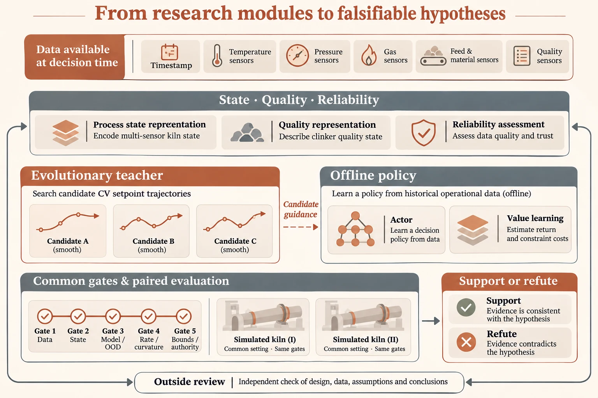

**研究议程：统一接口、两类候选与可证伪评价**

沿“状态感知→质量预测→动态多目标优化→设定值决策”主线，定义数据契约、基线、消融、失败标准和分阶段产物。

**读图要点**

- **信息契约** · 重建数据可用时间，明确状态表示、质量预测、可靠性与缺失信息接口。
- **两类候选及连接** · 多目标优化产生轨迹建议，离线学习产生反馈策略与成本价值；二者可比较，也可在明确数据契约下连接。
- **共同门控与假设检验** · 用同一五层门控、配对扰动和独立工况评价候选，分别记录对六项假设的支持或失败证据。

**准确关系与边界**

可用数据 → 状态/质量/可靠性 → 优化或策略 → 统一门控 → 配对评价 → 假设证据；失败反馈修订接口、优化与学习。优化候选可向学习提供受审计的数据，但复杂模块组合不等于已证实的新方法或现场节能结果。

*原创概念图解。图内短英文标签由下方双语文字解释；精确公式、假设与执行边界以正文为准。图像不代表实测数据、真实工程接线或现场性能证据。*

### 2. 先固定数据契约，避免不同模块看到不同的过去

| 字段组 | 至少保留什么 | 为什么进入研究协议 |
| --- | --- | --- |
| 时钟与信号 | 决策时间、传感器采样时间、到达时间、有效性与缺失原因 | 对齐可用信息，识别通信延迟 |
| 化验 | 取样时间、发布时间、结果、失效标记与采样事件 | 分开质量对应时刻与策略可读取时刻 |
| 设定值 | 调整前后 CV 设定值、RATE 与边界版本 | 将归一化动作还原到物理单位 |
| 动作与门控 | 候选、执行、各层结果、拒绝原因、权限与 Gate 版本 | 区分策略能力与回退贡献 |
| 原料和工况 | KH、SM、IM、负荷、设备模式及可取得的燃料热值 | 描述扰动、混杂与分工况范围 |
| 原始指标 | 燃料质量/热值、电量、熟料产量、质量记录、时间边界 | 重算总量比，不只接受预制平均指标 |
| 实验版本 | 数据划分、模型、归一化、偏好、种子、仿真与代码版本 | 允许复现与归因 |

历史日志没有候选动作、权限或采样请求时，应记为“未记录”，而不是由执行值复制生成虚假的完整记录。仿真可以提供隐藏真值用于最终评价，但训练输入依然按真实可用信息构造。研究不改变[现有 5 分钟周期、有界 CV 增量及五层门控契约](https://github.com/bahayonghang/rl-learning/blob/main/AGENTS.md)，也不把煤量、风量或阀门开度当作可绕过内层控制的动作。

划分必须满足两个时间顺序条件：

$$\max t(\mathcal D_{\rm train})<\min t(\mathcal D_{\rm val}),\qquad \max t(\mathcal D_{\rm val})<\min t(\mathcal D_{\rm test}).$$

但仅按决策时间分界仍不够。根据历史窗口、预测目标跨度与化验发布延迟设置隔离区，防止同一原始片段、尚未发布标签或同一事件通过窗口重叠跨入两侧。标准化、特征选择、软测量拟合和策略训练使用训练期；超参数、停止条件和预算选择使用验证期；测试期冻结后只作最终评价。额外装置或季节留出只有在相应数据实际存在时才报告。

### 3. H1：可靠性与化验年龄是否改善决策，而不仅是平均预测

**假设。** 在化验缺失或变旧时，显式使用可用性、样品年龄和可靠性描述，比简单前向填充更能校准质量风险，并在相同门控下减少无效候选与延迟恢复。

**设计。** 记录每份化验的双时间戳、在线信号和故障掩码，比较同一编码容量下的前向填充、带掩码/年龄、可靠性融合三个版本；所有版本共享相同软测量标签和策略预算。再单独删除年龄或可靠性输入，而不把未来化验作为“理想基线”。可在仿真评价中提供一个明确标注的特权信息上限，但不能混入可部署结果。

**判定。** 同时报告质量 MAE、分年龄区间覆盖、违规持续时间、Gate 拒绝和扰动后恢复。若只降低正常工况平均误差，却让旧化验条件下的区间失准或闭环风险上升，则该决策收益假设不获支持。若容量匹配后收益消失，应把结论归为容量差异，不能宣称可靠性机制已被验证。

### 4. H2：历史表示与多步价值，各自解决了多少延迟

**假设。** 对具有物料与热惯性的模拟扰动，历史编码和多步价值目标分别减少状态混叠与延迟信用误差，且两者的组合收益可与单纯增大网络区分。

**设计。** 做“瞬时/历史输入 × 一步/多步目标”的 $2\times2$ 设计，固定参数量范围、更新次数和有效数据窗口。多步目标的基本形式为

$$y_t^{(n)}=\sum_{k=0}^{n-1}\gamma^k r_{t+k+1}+\gamma^n\overline V(h_{t+n}),$$

在真实终止时截断后续项；时间窗口截断保留合法末观测 bootstrap，但不跨 reset 拼接。离线行为轨迹与目标策略不同，多步学习还要说明采用的离策略修正或接受了何种偏差，不能把上式直接当作无条件无偏估计。[RL 教材](https://incompleteideas.net/book/the-book-2nd.html)

**判定。** 使用不同扰动起点与时滞范围，报告回报、质量成本、时滞响应及价值误差。若效果仅出现在训练过的固定延迟，换延迟即反转，或多步收益来自跨边界标签泄漏，则不支持稳健延迟建模；若预算不足导致区间过宽，应报告结论不确定，而不是自动宣布无效。

### 5. H3：优化示范与轨迹表示，是否真的带来序列改进

**假设。** PG-MOEA/D-IEpsilon 提供的可行候选/轨迹可作为离线策略的示范或热启动；NURBS 参数化可减少搜索维数。但 RL 必须在相同偏好和计算预算下，表现出超出“复制优化器”的增益，混合才有研究价值。

**设计。** 必须保留 Operator、实际 PG-MOEA/D-IEpsilon、示范 BC 和混合策略四组。先固定评价模型、预测窗口、门控及目标尺度，再比较逐步增量与轨迹参数化；报告生成示范的模型调用数、策略训练成本和每次决策延迟。轨迹必须与当前真实 SP 衔接，通过采样点的 RATE、增量变化和工艺可行性检查。

**判定。** 若混合方法只是把更长规划窗口或更多模型调用隐藏到离线阶段，不能归因于 RL；若 BC 已达到同等效果，证据支持策略压缩而不支持额外价值学习。当前仓库网页没有实际 PG 基线实现和数据，这项实验在接入它们之前保持为协议，不填入虚构对比数字。粉磨领域的 [OA-DSTR](https://doi.org/10.1016/j.asoc.2024.111772)可启发动态比较设计，但不代替烧成对照。

### 6. H4：离线保守性是否在覆盖下降时仍有价值

**假设。** 数据支持减少或工况改变时，保守/受约束的离线学习比普通在线算法直接拟合日志更少利用数据外虚高价值；同时应证明其并未退化成永远保持设定值。

**设计。** 比较 BC、TD3+BC、CQL、IQL，以及明确标为“在线算法直接用于固定日志”的诊断基线；不允许该基线在真实设备补采探索。构造不同覆盖条件时，尽量匹配样本量并分开“少数据”与“缺少联合动作支持”。固定状态表示、Actor 容量、调参次数和 Gate，记录条件动作距离、Q 校准、执行变化、拒绝率与成本。[TD3+BC](https://arxiv.org/abs/2106.06860)；[CQL](https://arxiv.org/abs/2006.04779)；[IQL](https://arxiv.org/abs/2110.06169)

**判定。** 若改善只存在于训练代理中，在独立模型/扰动下消失，或高回报伴随无支持候选与大量回退，则不支持可迁移决策收益。若所有方法都退回 BC 水平，说明当前数据可能不足以识别超越行为策略的改进，不能靠再换更复杂缩写解决。

### 7. H5：动作条件世界模型是否优于只预测趋势

**假设。** 含执行动作的模型能够在被数据支持的范围内预测调整后果；从真实状态开始的短分叉，比无约束长推演更不容易让策略利用模型偏差。

**设计。** 比较无动作预测、执行动作条件预测、模型集合三个版本；再比较零模型推演、短分叉和较长推演，统一总更新预算。把真实日志与合成转移分别标记，记录分叉源、长度与模型版本。训练损失之外，验证对动作变化的响应、工况外校准及政策改变后的闭环误差；不把相同模型既当训练环境又当唯一裁判。[MBPO](https://arxiv.org/abs/1906.08253)；[MOPO](https://arxiv.org/abs/2005.13239)

**判定。** 若预测 MAE 改善但调整方向错误，或推演越长回报越好而独立评价越差，则出现了模型利用，不支持“更准确模型带来更好决策”。短分叉只有在数据起点、长度控制和不确定性校准共同固定时才能归因；减少真实数据量后仍须报告支持边界。

### 8. H6：成本学习能否减少对 Gate 的依赖

**假设。** 独立成本 Critic 与拉格朗日预算学习，使候选提前避开未来风险，因而在不改变执行规则的前提下减少拒绝、回退与恢复时间，并保持可接受的能耗折中。

**设计。** 执行时始终保留同样的五层门控。比较有/无成本价值、有/无不确定性条件输入和不同合法成本预算，记录每层拒绝、候选与执行差、质量/氧含量的峰值违反量和持续时间。未经门控的候选只做离线或影子审计，不执行。成本预算的折扣定义、物理单位和拉格朗日步长必须登记。[CPO](https://arxiv.org/abs/1705.10528)与[预测安全过滤](https://doi.org/10.1016/j.automatica.2021.109597)分别提供学习约束和执行保护的理论参照，不能互相替代。

**判定。** 若执行后违规少只是因为回退更多，或成本均值下降但罕见峰值更高，假设尚未成立；若预算只在训练模型中满足，不能称现场安全。评价重点是能否提前规避风险，而非证明 Gate 可以删除。

### 9. 共同验收协议与阶段产物

六项假设都先声明主指标、实际重要的最小改善量 $\delta_R$、固定约束预算 $d_j$ 和失败情形。例如定义 $\Delta R=J_r^{\rm candidate}-J_r^{\rm baseline}$；只有效应区间足以支持 $\Delta R>\delta_R$、约束指标在预定预算内且关键分工况没有不可接受退化时，才支持对应实验范围内的改善。区间不足以区分时报告“不确定”。这些研究判定不修改硬边界或工程权限。[评估方法参考](https://arxiv.org/abs/2108.13264)

| 阶段 | 应交付的可检查产物 | 进入下一阶段前需要的证据 |
| --- | --- | --- |
| 数据与指标 | 时间字典、缺失报告、分母核算、冻结划分 | 无可用性泄漏，指标能从原始量重算 |
| 预测与基线 | 简单模型、软测量校准、Operator/PG 接口 | 比较边界一致，实际基线可运行 |
| 六项离线实验 | 配置、种子、消融、失败日志与统计区间 | 效应来源明确，未用测试结果调参 |
| 仿真压力评价 | 扰动/故障场景、请求执行日志、模型失配分析 | 报告适用范围与不能外推的条件 |
| 研究结论 | 证据矩阵、可复现脚本、负结果与下一问题 | 只声称实验真正支持的能力 |

这条路线的第一步是把数据、基线和接口变得可验证，而不是立即进行大型离线训练。本文未运行这些研究实验，未生成任何真实节能结果，也未提出在实体烧成系统上探索。它把已有工作组织成可以逐项被支持、被推翻或被判定仍不确定的研究计划。

### 本篇原始资料与阅读边界

- [R35](#reference-35) · [rl-learning project domain and safety contracts](https://github.com/bahayonghang/rl-learning/blob/main/AGENTS.md) — bahayonghang / rl-learning; Repository contract. 来源标识: r2-project.
- [R30](#reference-30) · [Predictive Monitoring of Industrial Processes and Quality Indices via Joint Training of Soft Sensor and Time-Series Forecasting](https://doi.org/10.1109/TII.2026.3664090) — Yonghang Li, Xiaochen Hao, Xunian Yang, Xingzhi Zheng, Libin Wei; 2026. 来源标识: r2-monitoring.
- [R29](#reference-29) · [Collaborative optimization decision making of cement grinding process operational indicators considering dual dynamic problem](https://doi.org/10.1016/j.asoc.2024.111772) — Yonghang Li, Tianqi Yang, Xiaochen Hao, Jieguang Yang, Quanwei Sun; 2024. 来源标识: r2-oadstr.
- [R28](#reference-28) · [A novel constrained off-policy deep reinforcement learning approach for temporal decision-making in the cement calcination system](https://doi.org/10.1088/2631-8695/ae5ed3) — Lei Chang, Chong Liu, Xin Shi, Mengyu Bai, Xingzhi Zheng, LiBin Wei, Yonghang Li; 2026. 来源标识: r2-tcnso.
- [R31](#reference-31) · [TOD-CGAN: Transformer-based conditional generative adversarial network for optimising operational decisions in cement calcination systems](https://doi.org/10.1016/j.jfranklin.2026.108704) — Xiaochen Hao, Boxun Li, Yonghang Li, Xunian Yang, Junze Jiao, Yangdong Su; 2026. 来源标识: r2-todcgan.
- [R20](#reference-20) · [Conservative Q-Learning for Offline Reinforcement Learning](https://arxiv.org/abs/2006.04779) — Aviral Kumar, Aurick Zhou, George Tucker, Sergey Levine; 2020. 来源标识: r2-cql.
- [R21](#reference-21) · [Offline Reinforcement Learning with Implicit Q-Learning](https://arxiv.org/abs/2110.06169) — Ilya Kostrikov, Ashvin Nair, Sergey Levine; 2021 / 2022. 来源标识: r2-iql.
- [R22](#reference-22) · [A Minimalist Approach to Offline Reinforcement Learning](https://arxiv.org/abs/2106.06860) — Scott Fujimoto, Shixiang Shane Gu; 2021. 来源标识: r2-td3bc.
- [R23](#reference-23) · [When to Trust Your Model: Model-Based Policy Optimization](https://arxiv.org/abs/1906.08253) — Michael Janner, Justin Fu, Marvin Zhang, Sergey Levine; 2019. 来源标识: r2-mbpo.
- [R24](#reference-24) · [MOPO: Model-based Offline Policy Optimization](https://arxiv.org/abs/2005.13239) — Tianhe Yu et al.; 2020. 来源标识: r2-mopo.
- [R25](#reference-25) · [Constrained Policy Optimization](https://arxiv.org/abs/1705.10528) — Joshua Achiam, David Held, Aviv Tamar, Pieter Abbeel; 2017. 来源标识: r2-cpo.
- [R26](#reference-26) · [A predictive safety filter for learning-based control of constrained nonlinear dynamical systems](https://doi.org/10.1016/j.automatica.2021.109597) — Kim Peter Wabersich, Melanie N. Zeilinger; 2021. 来源标识: r2-safety-filter.
- [R27](#reference-27) · [Deep Reinforcement Learning at the Edge of the Statistical Precipice](https://arxiv.org/abs/2108.13264) — Rishabh Agarwal, Max Schwarzer, Pablo Samuel Castro, Aaron Courville, Marc G. Bellemare; 2021. 来源标识: r2-rliable.
- [R14](#reference-14) · [Reinforcement Learning: An Introduction, Second Edition](https://incompleteideas.net/book/the-book-2nd.html) — Richard S. Sutton, Andrew G. Barto; 2018. 来源标识: r2-rlbook.

**r2-project · Project repository:** 本仓库的周期、观测、CV 增量、成本和五层门控约定；不是通用工艺标准或验证报告。

**r2-monitoring · IEEE Transactions on Industrial Informatics 22, 5254–5265:** 出版社登记题名和作者已核验，未取得全文；模块接口是本教程设计，不臆造论文细节。

**r2-oadstr · Applied Soft Computing 161, 111772:** 书目与出版社摘要核验；对象是粉磨，动态搜索与滚动思想可借鉴，烧成结果不可据此推定。

**r2-tcnso · Engineering Research Express 8, 085407:** 出版社登记摘要确认 TCNSO-MSL-TD3 与实验表述；未取得全文，不把摘要当现场部署证明。

**r2-todcgan · Journal of the Franklin Institute 363, 108704:** 题名、作者与生成式决策主题已核验；条件生成不自动等同于 RL 或现场自主控制。

**r2-cql · NeurIPS 2020:** 原论文区分策略价值下界与逐点下界；理论和数据假设不可省略。

**r2-iql · ICLR 2022:** Expectile 价值学习与优势加权行为克隆；不保证最终策略绝不越出数据支持。

**r2-td3bc · NeurIPS 2021:** TD3+BC 作为应保留的简单离线比较对象，而非宣布某个复杂架构必然更好。

**r2-mbpo · NeurIPS 2019:** 从真实状态分叉的短模型推演；模型调用不是新增现实证据。

**r2-mopo · NeurIPS 2020:** 离线模型不确定性惩罚及其假设；惩罚并非硬约束认证。

**r2-cpo · ICML 2017:** 约束策略优化与理论性能界；期望成本不是逐时刻无违规保证。

**r2-safety-filter · Automatica 129, 109597:** 开放作者稿核验模型置信、终端安全集及可行性条件；不同于简单阈值门控。

**r2-rliable · NeurIPS 2021:** 重复实验、不确定性与稳健汇总；不能把时间步当独立训练种子。

**r2-rlbook · MIT Press:** 作者教材，涵盖 MDP、Bellman、函数逼近与策略梯度；本页窑案例独立编写。

---

## 完整参考资料

以下按网址去重，共 35 条资料；保留全部 35 个来源标识，便于与网页章节及研究专题对应。相同网址的不同来源记录合并展示，未丢弃原有映射。

### R1 · Plantwide control: the search for the self-optimizing control structure

**作者:** Sigurd Skogestad

**年份或维护状态:** 2000

**链接:** [查看原始资料](https://doi.org/10.1016/S0959-1524(00)00023-8)

**阅读提示:** 作者手稿已读：控制变量选择、分层设定值与经济损失；并非所有工况都适用的恒定设定值结论。

**来源标识:** r2-skogestad

### R2 · RTO: An overview and assessment of current practice

**作者:** Mark L. Darby, Michael Nikolaou, James Jones, Doug Nicholson

**年份或维护状态:** 2011

**链接:** [查看原始资料](https://doi.org/10.1016/j.jprocont.2011.03.009)

**阅读提示:** 出版社摘要核验 RTO 与 MPC 的历史和组织实施问题；不从综述推断本项目收益。

**来源标识:** r2-rto

### R3 · Feedback control for optimal process operation

**作者:** Sebastian Engell

**年份或维护状态:** 2007

**链接:** [查看原始资料](https://doi.org/10.1016/j.jprocont.2006.10.011)

**阅读提示:** 经济目标与反馈优化的综述；区分跟踪目标、稳态优化和动态经济优化。

**来源标识:** r2-engell

### R4 · A tutorial review of economic model predictive control methods

**作者:** Matthew Ellis, Helen Durand, Panagiotis D. Christofides

**年份或维护状态:** 2014

**链接:** [查看原始资料](https://doi.org/10.1016/j.jprocont.2014.03.010)

**阅读提示:** 出版社摘要核验经济 MPC、稳定性与性能主题；具体教学推导另以开放 MPC 教材为依据。

**来源标识:** r2-empc

### R5 · Model Predictive Control: Theory, Computation, and Design

**作者:** James B. Rawlings, David Q. Mayne, Moritz M. Diehl

**年份或维护状态:** 2020, 2nd paperback edition; current online printing

**链接:** [查看原始资料](https://sites.engineering.ucsb.edu/~jbraw/mpc/)

**阅读提示:** 作者开放教材；滚动时域、终端条件、状态估计和经济 MPC 的理论入口。

**来源标识:** r2-mpcbook

### R6 · BAT Reference Document for the Production of Cement, Lime and Magnesium Oxide

**作者:** Frauke Schorcht, Ioanna Kourti, Bianca Maria Scalet, Serge Roudier, Luis Delgado Sancho

**年份或维护状态:** 2013

**链接:** [查看原始资料](https://publications.jrc.ec.europa.eu/repository/handle/JRC83006)

**阅读提示:** 欧盟官方工艺、能耗与排放参考。用于说明指标口径，不将其中规范自动套用于当前窑线。

**来源标识:** r2-cement-bat

### R7 · Energy Efficiency Improvement and Cost Saving Opportunities for Cement Making

**作者:** Ernst Worrell, Katerina Kermeli, Christina Galitsky

**年份或维护状态:** 2013

**链接:** [查看原始资料](https://www.energystar.gov/sites/default/files/buildings/tools/ENERGY%20STAR%20Guide%20for%20the%20Cement%20Industry%2028_08_2013%20Final.pdf)

**阅读提示:** EPA ENERGY STAR 开放全文；区分熟料烧成、粉磨、燃料与电力核算，不照搬历史行业平均数。

**来源标识:** r2-energy-guide

### R8 · A Fast and Elitist Multiobjective Genetic Algorithm: NSGA-II

**作者:** Kalyanmoy Deb, Amrit Pratap, Sameer Agarwal, T. Meyarivan

**年份或维护状态:** 2002

**链接:** [查看原始资料](https://doi.org/10.1109/4235.996017)

**阅读提示:** 原论文全文核验非支配排序、拥挤距离、精英保留及约束支配；证据为测试问题。

**来源标识:** r2-nsga2

### R9 · MOEA/D: A Multiobjective Evolutionary Algorithm Based on Decomposition

**作者:** Qingfu Zhang, Hui Li

**年份或维护状态:** 2007

**链接:** [查看原始资料](https://doi.org/10.1109/TEVC.2007.892759)

**阅读提示:** 原论文 PDF 核验分解、邻域与尺度处理；不能由算法名推断具体项目改进版。

**来源标识:** r2-moead

### R10 · An efficient constraint handling method for genetic algorithms

**作者:** Kalyanmoy Deb

**年份或维护状态:** 2000

**链接:** [查看原始资料](https://doi.org/10.1016/S0045-7825(99)00389-8)

**阅读提示:** 可行性比较的原始方法入口；配合 NSGA-II 原文的约束支配定义阅读。

**来源标识:** r2-feasibility

### R11 · Constrained Optimization by the ε Constrained Differential Evolution with Gradient-Based Mutation and Feasible Elites

**作者:** Tetsuyuki Takahama, Setsuko Sakai

**年份或维护状态:** 2006

**链接:** [查看原始资料](https://doi.org/10.1109/CEC.2006.1688283)

**阅读提示:** ε 水平比较与约束搜索的原始文献；搜索容忍度不等于放宽设备执行边界。

**来源标识:** r2-epsilon

### R12 · Dynamic Multiobjective Optimization Problems: Test Cases, Approximations, and Applications

**作者:** Marco Farina, Kalyanmoy Deb, Paolo Amato

**年份或维护状态:** 2004

**链接:** [查看原始资料](https://doi.org/10.1109/TEVC.2004.831456)

**阅读提示:** 动态 Pareto 集与控制问题的原始研究；说明 EA 不限于静态单点优化。

**来源标识:** r2-dynamic

### R13 · Chance-Constrained Programming

**作者:** Abraham Charnes, William W. Cooper

**年份或维护状态:** 1959

**链接:** [查看原始资料](https://doi.org/10.1287/mnsc.6.1.73)

**阅读提示:** 机会约束的原始理论入口；教程中的高斯分位数算例为独立教学推导。

**来源标识:** r2-chance

### R14 · Reinforcement Learning: An Introduction, Second Edition

**作者:** Richard S. Sutton, Andrew G. Barto

**年份或维护状态:** 2018

**链接:** [查看原始资料](https://incompleteideas.net/book/the-book-2nd.html)

**阅读提示:** 作者教材，涵盖 MDP、Bellman、函数逼近与策略梯度；本页窑案例独立编写。

**来源标识:** r2-rlbook

### R15 · Reinforcement Learning in Process Industries: Review and Perspective

**作者:** Oguzhan Dogru, Junyao Xie, Om Prakash et al.

**年份或维护状态:** 2024

**链接:** [查看原始资料](https://doi.org/10.1109/JAS.2024.124227)

**阅读提示:** 流程工业 RL 综述；文献分类不替代每篇论文的部署证据核查。

**来源标识:** r2-process-rl

### R16 · Data-driven Economic NMPC using Reinforcement Learning

**作者:** Sébastien Gros, Mario Zanon

**年份或维护状态:** 2019 preprint / 2020 journal

**链接:** [查看原始资料](https://arxiv.org/abs/1904.04152)

**阅读提示:** 原文理论条件与例子支持 MPC 作为 RL 函数逼近器的联系；不声称任意错误模型都可安全使用。

**来源标识:** r2-mpc-rl

### R17 · Addressing Function Approximation Error in Actor-Critic Methods

**作者:** Scott Fujimoto, Herke van Hoof, David Meger

**年份或维护状态:** 2018

**链接:** [查看原始资料](https://arxiv.org/abs/1802.09477)

**阅读提示:** TD3 的双 Critic、延迟策略更新与目标平滑；原基准不等于工业效果。

**来源标识:** r2-td3

### R18 · Soft Actor-Critic: Off-Policy Maximum Entropy Deep Reinforcement Learning with a Stochastic Actor

**作者:** Tuomas Haarnoja, Aurick Zhou, Pieter Abbeel, Sergey Levine

**年份或维护状态:** 2018

**链接:** [查看原始资料](https://arxiv.org/abs/1801.01290)

**阅读提示:** 原文最大熵目标和变换密度；熵不提供工艺安全保证。

**来源标识:** r2-sac

### R19 · Soft Actor-Critic Algorithms and Applications

**作者:** Tuomas Haarnoja et al.

**年份或维护状态:** 2018 / 2019

**链接:** [查看原始资料](https://arxiv.org/abs/1812.05905)

**阅读提示:** 现代 SAC 更新、自动温度与实际机器人案例；不能转译为烧成部署证据。

**来源标识:** r2-sac-apps

### R20 · Conservative Q-Learning for Offline Reinforcement Learning

**作者:** Aviral Kumar, Aurick Zhou, George Tucker, Sergey Levine

**年份或维护状态:** 2020

**链接:** [查看原始资料](https://arxiv.org/abs/2006.04779)

**阅读提示:** 原论文区分策略价值下界与逐点下界；理论和数据假设不可省略。

**来源标识:** r2-cql

### R21 · Offline Reinforcement Learning with Implicit Q-Learning

**作者:** Ilya Kostrikov, Ashvin Nair, Sergey Levine

**年份或维护状态:** 2021 / 2022

**链接:** [查看原始资料](https://arxiv.org/abs/2110.06169)

**阅读提示:** Expectile 价值学习与优势加权行为克隆；不保证最终策略绝不越出数据支持。

**来源标识:** r2-iql

### R22 · A Minimalist Approach to Offline Reinforcement Learning

**作者:** Scott Fujimoto, Shixiang Shane Gu

**年份或维护状态:** 2021

**链接:** [查看原始资料](https://arxiv.org/abs/2106.06860)

**阅读提示:** TD3+BC 作为应保留的简单离线比较对象，而非宣布某个复杂架构必然更好。

**来源标识:** r2-td3bc

### R23 · When to Trust Your Model: Model-Based Policy Optimization

**作者:** Michael Janner, Justin Fu, Marvin Zhang, Sergey Levine

**年份或维护状态:** 2019

**链接:** [查看原始资料](https://arxiv.org/abs/1906.08253)

**阅读提示:** 从真实状态分叉的短模型推演；模型调用不是新增现实证据。

**来源标识:** r2-mbpo

### R24 · MOPO: Model-based Offline Policy Optimization

**作者:** Tianhe Yu et al.

**年份或维护状态:** 2020

**链接:** [查看原始资料](https://arxiv.org/abs/2005.13239)

**阅读提示:** 离线模型不确定性惩罚及其假设；惩罚并非硬约束认证。

**来源标识:** r2-mopo

### R25 · Constrained Policy Optimization

**作者:** Joshua Achiam, David Held, Aviv Tamar, Pieter Abbeel

**年份或维护状态:** 2017

**链接:** [查看原始资料](https://arxiv.org/abs/1705.10528)

**阅读提示:** 约束策略优化与理论性能界；期望成本不是逐时刻无违规保证。

**来源标识:** r2-cpo

### R26 · A predictive safety filter for learning-based control of constrained nonlinear dynamical systems

**作者:** Kim Peter Wabersich, Melanie N. Zeilinger

**年份或维护状态:** 2021

**链接:** [查看原始资料](https://doi.org/10.1016/j.automatica.2021.109597)

**阅读提示:** 开放作者稿核验模型置信、终端安全集及可行性条件；不同于简单阈值门控。

**来源标识:** r2-safety-filter

### R27 · Deep Reinforcement Learning at the Edge of the Statistical Precipice

**作者:** Rishabh Agarwal, Max Schwarzer, Pablo Samuel Castro, Aaron Courville, Marc G. Bellemare

**年份或维护状态:** 2021

**链接:** [查看原始资料](https://arxiv.org/abs/2108.13264)

**阅读提示:** 重复实验、不确定性与稳健汇总；不能把时间步当独立训练种子。

**来源标识:** r2-rliable

### R28 · A novel constrained off-policy deep reinforcement learning approach for temporal decision-making in the cement calcination system

**作者:** Lei Chang, Chong Liu, Xin Shi, Mengyu Bai, Xingzhi Zheng, LiBin Wei, Yonghang Li

**年份或维护状态:** 2026

**链接:** [查看原始资料](https://doi.org/10.1088/2631-8695/ae5ed3)

**阅读提示:** 出版社登记摘要确认 TCNSO-MSL-TD3 与实验表述；未取得全文，不把摘要当现场部署证明。

**来源标识:** r2-tcnso

### R29 · Collaborative optimization decision making of cement grinding process operational indicators considering dual dynamic problem

**作者:** Yonghang Li, Tianqi Yang, Xiaochen Hao, Jieguang Yang, Quanwei Sun

**年份或维护状态:** 2024

**链接:** [查看原始资料](https://doi.org/10.1016/j.asoc.2024.111772)

**阅读提示:** 书目与出版社摘要核验；对象是粉磨，动态搜索与滚动思想可借鉴，烧成结果不可据此推定。

**来源标识:** r2-oadstr

### R30 · Predictive Monitoring of Industrial Processes and Quality Indices via Joint Training of Soft Sensor and Time-Series Forecasting

**作者:** Yonghang Li, Xiaochen Hao, Xunian Yang, Xingzhi Zheng, Libin Wei

**年份或维护状态:** 2026

**链接:** [查看原始资料](https://doi.org/10.1109/TII.2026.3664090)

**阅读提示:** 出版社登记题名和作者已核验，未取得全文；模块接口是本教程设计，不臆造论文细节。

**来源标识:** r2-monitoring

### R31 · TOD-CGAN: Transformer-based conditional generative adversarial network for optimising operational decisions in cement calcination systems

**作者:** Xiaochen Hao, Boxun Li, Yonghang Li, Xunian Yang, Junze Jiao, Yangdong Su

**年份或维护状态:** 2026

**链接:** [查看原始资料](https://doi.org/10.1016/j.jfranklin.2026.108704)

**阅读提示:** 题名、作者与生成式决策主题已核验；条件生成不自动等同于 RL 或现场自主控制。

**来源标识:** r2-todcgan

### R32 · Co-evolutionary reinforcement learning for industrial optimization: a multi-objective optimization framework for cement rotary kilns

**作者:** Gang Liu, Shangjian Xie, Xiaochen Hao, Ran Zheng, Shuaixiang Zhai, Mohan Liu

**年份或维护状态:** 2026

**链接:** [查看原始资料](https://doi.org/10.1016/j.aei.2026.104530)

**阅读提示:** 外部相关工作；作者列表不含 Yonghang Li。出版社记录中的仿真表述不等于现场闭环部署。

**来源标识:** r2-conerl

### R33 · Yokogawa and JSR: 35-day autonomous chemical-plant field test

**作者:** Yokogawa Electric Corporation; JSR Corporation

**年份或维护状态:** 2022-03-22

**链接:** [查看原始资料](https://www.yokogawa.com/news/press-releases/2022/2022-03-22/)

**阅读提示:** 运营方/供应商一手报告：FKDPP、蒸馏装置、模拟训练及 2022 年 35 天现场试验。非独立随机试验，不外推到水泥。

**来源标识:** r2-yokogawa

### R34 · Safety-first AI for autonomous data centre cooling and industrial control

**作者:** Chris Gamble, Jim Gao

**年份或维护状态:** 2018-08-17

**链接:** [查看原始资料](https://deepmind.google/blog/safety-first-ai-for-autonomous-data-centre-cooling-and-industrial-control/)

**阅读提示:** 官方运营说明：预测、候选筛选、当地复核与人工退出。本文不据此判定使用 PPO/SAC，也不搬用节能百分比。

**来源标识:** r2-deepmind

### R35 · rl-learning project domain and safety contracts

**作者:** bahayonghang / rl-learning

**年份或维护状态:** Repository contract

**链接:** [查看原始资料](https://github.com/bahayonghang/rl-learning/blob/main/AGENTS.md)

**阅读提示:** 本仓库的周期、观测、CV 增量、成本和五层门控约定；不是通用工艺标准或验证报告。

**来源标识:** r2-project

## 来源标识索引

| 网页来源标识 | 本书资料编号 | 原始资料 |
|---|---|---|
| r2-skogestad | [R1](#reference-1) | [Plantwide control: the search for the self-optimizing control structure](https://doi.org/10.1016/S0959-1524(00)00023-8) |
| r2-rto | [R2](#reference-2) | [RTO: An overview and assessment of current practice](https://doi.org/10.1016/j.jprocont.2011.03.009) |
| r2-engell | [R3](#reference-3) | [Feedback control for optimal process operation](https://doi.org/10.1016/j.jprocont.2006.10.011) |
| r2-empc | [R4](#reference-4) | [A tutorial review of economic model predictive control methods](https://doi.org/10.1016/j.jprocont.2014.03.010) |
| r2-mpcbook | [R5](#reference-5) | [Model Predictive Control: Theory, Computation, and Design](https://sites.engineering.ucsb.edu/~jbraw/mpc/) |
| r2-cement-bat | [R6](#reference-6) | [BAT Reference Document for the Production of Cement, Lime and Magnesium Oxide](https://publications.jrc.ec.europa.eu/repository/handle/JRC83006) |
| r2-energy-guide | [R7](#reference-7) | [Energy Efficiency Improvement and Cost Saving Opportunities for Cement Making](https://www.energystar.gov/sites/default/files/buildings/tools/ENERGY%20STAR%20Guide%20for%20the%20Cement%20Industry%2028_08_2013%20Final.pdf) |
| r2-nsga2 | [R8](#reference-8) | [A Fast and Elitist Multiobjective Genetic Algorithm: NSGA-II](https://doi.org/10.1109/4235.996017) |
| r2-moead | [R9](#reference-9) | [MOEA/D: A Multiobjective Evolutionary Algorithm Based on Decomposition](https://doi.org/10.1109/TEVC.2007.892759) |
| r2-feasibility | [R10](#reference-10) | [An efficient constraint handling method for genetic algorithms](https://doi.org/10.1016/S0045-7825(99)00389-8) |
| r2-epsilon | [R11](#reference-11) | [Constrained Optimization by the ε Constrained Differential Evolution with Gradient-Based Mutation and Feasible Elites](https://doi.org/10.1109/CEC.2006.1688283) |
| r2-dynamic | [R12](#reference-12) | [Dynamic Multiobjective Optimization Problems: Test Cases, Approximations, and Applications](https://doi.org/10.1109/TEVC.2004.831456) |
| r2-chance | [R13](#reference-13) | [Chance-Constrained Programming](https://doi.org/10.1287/mnsc.6.1.73) |
| r2-rlbook | [R14](#reference-14) | [Reinforcement Learning: An Introduction, Second Edition](https://incompleteideas.net/book/the-book-2nd.html) |
| r2-process-rl | [R15](#reference-15) | [Reinforcement Learning in Process Industries: Review and Perspective](https://doi.org/10.1109/JAS.2024.124227) |
| r2-mpc-rl | [R16](#reference-16) | [Data-driven Economic NMPC using Reinforcement Learning](https://arxiv.org/abs/1904.04152) |
| r2-td3 | [R17](#reference-17) | [Addressing Function Approximation Error in Actor-Critic Methods](https://arxiv.org/abs/1802.09477) |
| r2-sac | [R18](#reference-18) | [Soft Actor-Critic: Off-Policy Maximum Entropy Deep Reinforcement Learning with a Stochastic Actor](https://arxiv.org/abs/1801.01290) |
| r2-sac-apps | [R19](#reference-19) | [Soft Actor-Critic Algorithms and Applications](https://arxiv.org/abs/1812.05905) |
| r2-cql | [R20](#reference-20) | [Conservative Q-Learning for Offline Reinforcement Learning](https://arxiv.org/abs/2006.04779) |
| r2-iql | [R21](#reference-21) | [Offline Reinforcement Learning with Implicit Q-Learning](https://arxiv.org/abs/2110.06169) |
| r2-td3bc | [R22](#reference-22) | [A Minimalist Approach to Offline Reinforcement Learning](https://arxiv.org/abs/2106.06860) |
| r2-mbpo | [R23](#reference-23) | [When to Trust Your Model: Model-Based Policy Optimization](https://arxiv.org/abs/1906.08253) |
| r2-mopo | [R24](#reference-24) | [MOPO: Model-based Offline Policy Optimization](https://arxiv.org/abs/2005.13239) |
| r2-cpo | [R25](#reference-25) | [Constrained Policy Optimization](https://arxiv.org/abs/1705.10528) |
| r2-safety-filter | [R26](#reference-26) | [A predictive safety filter for learning-based control of constrained nonlinear dynamical systems](https://doi.org/10.1016/j.automatica.2021.109597) |
| r2-rliable | [R27](#reference-27) | [Deep Reinforcement Learning at the Edge of the Statistical Precipice](https://arxiv.org/abs/2108.13264) |
| r2-tcnso | [R28](#reference-28) | [A novel constrained off-policy deep reinforcement learning approach for temporal decision-making in the cement calcination system](https://doi.org/10.1088/2631-8695/ae5ed3) |
| r2-oadstr | [R29](#reference-29) | [Collaborative optimization decision making of cement grinding process operational indicators considering dual dynamic problem](https://doi.org/10.1016/j.asoc.2024.111772) |
| r2-monitoring | [R30](#reference-30) | [Predictive Monitoring of Industrial Processes and Quality Indices via Joint Training of Soft Sensor and Time-Series Forecasting](https://doi.org/10.1109/TII.2026.3664090) |
| r2-todcgan | [R31](#reference-31) | [TOD-CGAN: Transformer-based conditional generative adversarial network for optimising operational decisions in cement calcination systems](https://doi.org/10.1016/j.jfranklin.2026.108704) |
| r2-conerl | [R32](#reference-32) | [Co-evolutionary reinforcement learning for industrial optimization: a multi-objective optimization framework for cement rotary kilns](https://doi.org/10.1016/j.aei.2026.104530) |
| r2-yokogawa | [R33](#reference-33) | [Yokogawa and JSR: 35-day autonomous chemical-plant field test](https://www.yokogawa.com/news/press-releases/2022/2022-03-22/) |
| r2-deepmind | [R34](#reference-34) | [Safety-first AI for autonomous data centre cooling and industrial control](https://deepmind.google/blog/safety-first-ai-for-autonomous-data-centre-cooling-and-industrial-control/) |
| r2-project | [R35](#reference-35) | [rl-learning project domain and safety contracts](https://github.com/bahayonghang/rl-learning/blob/main/AGENTS.md) |
