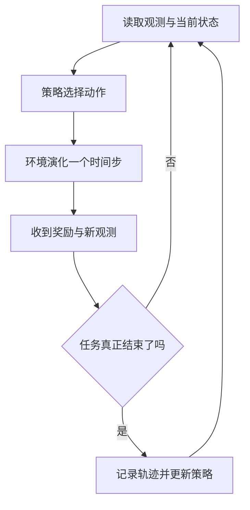
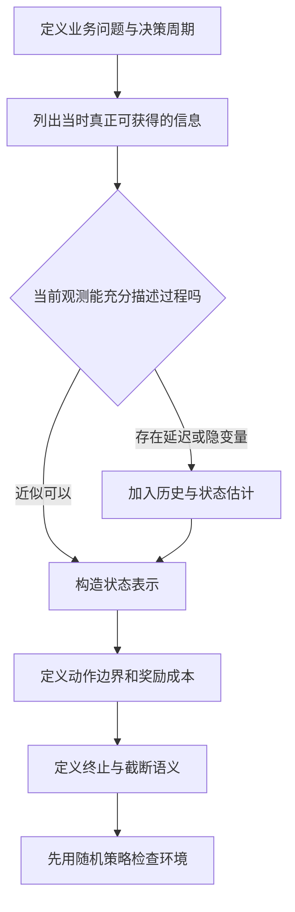
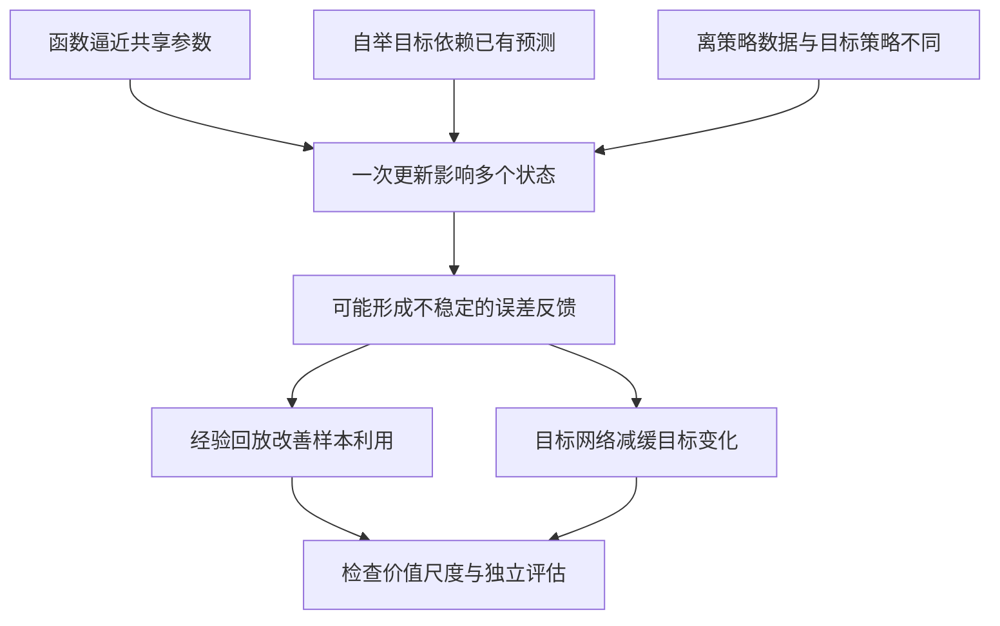
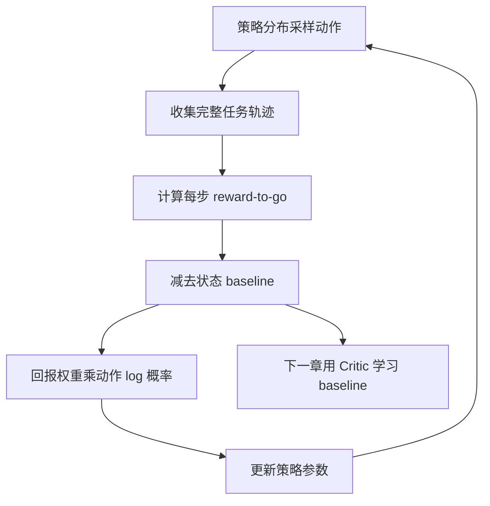

# RL Atlas｜强化学习：从直觉到决策

> 完整中文教程 · 8 个数学准备单元 · 24 组水泥案例逐步推导 · 7 个模块 / 24 章 · 研究专题、概念词典、公式、Mermaid、代码与练习解答。

本教程沿着“问题 → 数学 → 算法 → 代码 → 实验 → 可信结论”的路径组织。先学会解释一个决策问题，再理解每一种算法为什么出现、解决什么问题、还留下哪些限制。

教程结构受到用户提供的公开推文[《强化学习难点，90% 初学者都搞错了！！》](https://mp.weixin.qq.com/s/x3Jb7imrQtbavvU1vH8Tww)启发；正文、数值例题、练习与代码为独立编写，参考资料列在各章及文末。此文件包含完整教材正文，不依赖购买原推文中的课程。

## 如何使用这本教程

- **先预测，再验证。** 每章先手算例题、解释更新方向，再打开网页中对应的交互实验。
- **按依赖学习。** 具备神经网络基础可以略读网络入门，但不要跳过条件期望、Bellman 方程与终止语义。
- **区分机制与证据。** 浏览器实验用于理解数值机制；小型模拟结果不代表工业现场的节能效果。
- **保留单位与时间。** 工业案例使用运行指标设定值增量，保留下层控制与安全门控，不连接真实设备。
- **检查原始资料。** 数学与接口来源均可追溯；阅读时保留定理假设和实验边界。

建议按个人时间在六至八周内完成一轮：第一至二周处理交互、概率和表格方法；第三周理解 DQN；第四至五周学习 Actor-Critic、PPO 与 SAC；第六周完成环境和评估设计；最后一至二周将离线、模型与约束方法连接到自己的课题。该安排是学习建议，不是学习效果或课时保证。

数学保留为 LaTeX，流程图保留为 Mermaid 图源。使用支持这些格式的 Markdown 阅读器，可直接渲染；不支持时仍可阅读完整公式与图源。

## 目录

- [数学准备：从符号到可计算的例子](#math-primer)
- [模块 1 · 交互、回报与探索](#module-1)
  - [01 · 从一次行动，到长期回报](#chapter-01)
  - [02 · 多臂老虎机：探索需要付出什么？](#chapter-02)
  - [03 · 够用的概率：从样本到期望](#chapter-03)
- [模块 2 · MDP、价值与表格控制](#module-2)
  - [04 · MDP 与 POMDP：先把问题写对](#chapter-04)
  - [05 · Bellman 方程：把未来拆成一步](#chapter-05)
  - [06 · 动态规划：模型已知时怎样规划？](#chapter-06)
  - [07 · MC、TD 与 n-step：向什么目标学习？](#chapter-07)
  - [08 · SARSA 与 Q-learning：到底在学谁？](#chapter-08)
- [模块 3 · 从 Q 表到深度价值学习](#module-3)
  - [09 · 函数逼近：从 Q 表到共享参数](#chapter-09)
  - [10 · DQN：把不稳定的学习循环拆开](#chapter-10)
  - [11 · Double DQN：别让同一份噪声既选又评](#chapter-11)
- [模块 4 · 策略梯度、优势与 PPO](#module-4)
  - [12 · REINFORCE：直接学习行动的概率](#chapter-12)
  - [13 · Actor-Critic 与 GAE](#chapter-13)
  - [14 · 重要性采样与信赖域](#chapter-14)
  - [15 · 把 PPO 的裁剪目标拆开](#chapter-15)
- [模块 5 · 连续动作与 SAC](#module-5)
  - [16 · 连续动作与 tanh 高斯策略](#chapter-16)
  - [17 · 最大熵目标与 SAC](#chapter-17)
  - [18 · 根据问题选择算法](#chapter-18)
- [模块 6 · 独立建模与可信实验](#module-6)
  - [19 · 把真实问题写成可验证环境](#chapter-19)
  - [20 · 做一份可信的强化学习实验](#chapter-20)
  - [21 · 贯穿案例：烧成系统设定值决策](#chapter-21)
- [模块 7 · 离线、模型与约束决策](#module-7)
  - [22 · 离线强化学习：从日志到策略](#chapter-22)
  - [23 · 模型学习、Dyna 与短程推演](#chapter-23)
  - [24 · 约束强化学习与研究闭环](#chapter-24)
- [水泥工作台：模型、时间与实验](#kiln-workbench)
- [衔接已有研究：流程工业强化学习](#research)
- [概念与符号词典](#glossary)
- [完整参考资料](#references)
- [来源标识索引](#source-index)

---

<a id="math-primer"></a>

## 数学准备：从符号到可计算的例子

把数学当作描述决策的语言。每次先读一个水泥窑的小问题，再认清符号、代入数字、拖动参数；能解释数字为什么变化，再进入正式章节。这里的概率、奖励和响应系数均是教学设定，不是工厂统计或操作建议。

<a id="math-language"></a>

### 数学 1 · 先读懂符号、单位和时间

把一条 transition 读成一次完整的设定值决策。

#### 先讲一个你能想象的场景

现在是 10:00，分解炉出口温度的设定值为 880°C。你看到温度、压力、氧含量、最近两小时的变化，以及已经公布的质量化验结果。你要做的是建议下一次设定值调整。下层 APC/PID 再决定如何跟踪这个设定值。

假设允许每 5 分钟最多调整 2°C。策略输出一个无单位的数 $a_t=0.5$，不表示温度是 0.5°C，也不表示给煤量增加 50%。它只是允许变化范围的一半：

$$\Delta T_t^{sp}=2a_t=2\times0.5=1\;^\circ\mathrm C.$$

于是候选设定值为 $880+1=881^\circ\mathrm C$。门控通过后，设定值才变成 881°C；温度测量值不会在同一瞬间变成 881°C。设定值是目标，过程变量是实际响应。

#### 下标和上标各在说什么

| 写法 | 读法 | 在这个例子里 |
|---|---|---|
| $t$ | 当前决策步 | 10:00 这一刻 |
| $t+1$ | 下一个决策步 | 10:05 这一刻 |
| $T_t$ | 第 $t$ 步的温度测量值 | 当前实际温度 |
| $T_t^{sp}$ | 第 $t$ 步温度设定值 | 上标 sp 是 setpoint 的标签，**不是乘方** |
| $a_t$ | 当前选择的归一化动作 | 这里是 0.5 |
| $r_{t+1}$ | 这次动作之后得到的即时反馈 | 10:00–10:05 的能耗与动作平稳性评分 |
| $G_t$ | 从现在往后的累计回报 | 即时反馈及更远的后果一起考虑 |
| $\pi_\theta$ | 参数为 $\theta$ 的策略 | 一个根据观测选择动作的规则/网络 |

$\Delta$ 表示“变化量”，$\hat q$ 上面的帽子表示“估计值”，$\bar F$ 的横线表示参考均值，$\|\mathbf a\|^2$ 表示各动作分量平方后相加。它们不是要先背住的密码；遇到一个符号，先追问它表示什么量、单位是什么、哪个时间点可获得。

#### 一个经验样本为什么长这样

$$\bigl(o_t,\;a_t,\;r_{t+1},\;o_{t+1}\bigr).$$

按因果时间读：先观察 $o_t$，再选择 $a_t$，环境在这 5 分钟内演化，最后得到 $r_{t+1}$ 和新的观测 $o_{t+1}$。这四项称为一次转移或 transition。策略学习需要知道“在什么情况下做了什么，后来发生了什么”，所以不能只保存一张没有动作记录的温度表。

安全门存在时，还要分别记录请求动作和实际执行动作。门控拒绝了升温请求，实际保持设定值，后续结果就不能被当作“成功执行升温”的经验。请同时保存请求 SP、执行 SP、MV、门控原因和接管标记。

#### 为什么当前化验不一定代表当前质量

一份样品在 09:00 采集，09:40 公布；10:00 时它已经可以被策略使用，但描述的是较早物料的质量。10:00 采样、10:40 才公布的结果，在 10:00 的决策输入里还不能出现。

“发生在什么时候”与“在什么时候知道”是两个不同的时间。后续的 POMDP、软测量、数据切分和世界模型都会用到这个区别。

**应用到章节：** [第 01 章](#chapter-01)；[第 04 章](#chapter-04)；[第 19 章](#chapter-19)

**网页动手部分：** 对应数学准备单元提供同题参数计算器。纸面推导与初始数字均保留在本节中。

---

<a id="math-probability"></a>

### 数学 2 · 概率与条件概率

为什么同一次升温，可能有不同后果？

#### 概率先从计数理解

设一个教学数据集里有 100 次“相似窑况下的小幅升温”。其中 70 次下一步温度回到稳定区间，30 次仍偏低。我们用频率 70/100=0.7 估计“回稳”的概率。这个数字描述重复情境下的不确定性，不保证下一次一定回稳。

用 $A$ 表示“下一步回稳”，则 $P(A)=0.7$；“仍偏低”是另一个互斥结果，概率是 $1-0.7=0.3$。两个结果已经覆盖全部可能时，它们的概率要加起来等于 1。

#### 竖线不是除号

$$P(A\mid B)=\frac{P(A\cap B)}{P(B)},\qquad P(B)>0.$$

$P(A\mid B)$ 读作“在已经知道 $B$ 的条件下，$A$ 发生的概率”。$A\cap B$ 表示两个事件同时发生。

假设 100 次记录里，40 次属于“原料较难烧”，其中 20 次回稳。我们现在只看这 40 次，分母就从 100 改为 40：

$$P(\text{回稳}\mid\text{难烧})=\frac{20}{40}=0.5.$$

另外 60 次原料正常，50 次回稳，条件概率为 $50/60\approx0.8333$。总体仍然是 70 次回稳，但知道原料状态以后，对下一步的判断不同。这就是条件信息的价值。

#### 为什么环境转移概率要带状态和动作

$$P(s_{t+1}=s'\mid s_t=s,a_t=a).$$

它表示：已知当前窑况是 $s$，并且执行动作 $a$，下一步到达 $s'$ 的概率。相同动作在不同窑况可能不同；相同窑况下不同动作也可能不同。所以一个固定的“升温成功率”无法描述全部运行范围。

在真实历史数据里，操作员往往在坏工况时才大幅调整。直接把“做过调整的记录”和“没有调整的记录”平均比较，会混进原始工况差异。上述条件概率来自教学模型，不自动证明动作的因果效果；实际建模需要动作信息、状态覆盖和混杂因素分析。

#### 联合概率与贝叶斯公式为什么成立

由条件概率定义，$P(A\cap B)=P(A\mid B)P(B)$。交换事件顺序，同一联合概率也等于 $P(B\mid A)P(A)$，所以：

$$P(B\mid A)=\frac{P(A\mid B)P(B)}{P(A)},\qquad P(A)>0.$$

若只知道“没有回稳”，想反推“原料难烧”的可能性，教学数据中难烧且未回稳有 20 次，全部未回稳有 30 次，因此是 $20/30=2/3$。这是从结果修正判断，并不表示看到一次未回稳就能确诊原料异常。

**应用到章节：** [第 02 章](#chapter-02)；[第 03 章](#chapter-03)；[第 04 章](#chapter-04)

**网页动手部分：** 对应数学准备单元提供同题参数计算器。纸面推导与初始数字均保留在本节中。

---

<a id="math-expectation"></a>

### 数学 3 · 期望与全期望

把可能的后果，按发生概率加权。

#### 一个动作的价值，不能只看最好结果

教学环境里，小幅升温后可能有两种结果：以 0.7 的概率得到回报 3，以 0.3 的概率得到回报 −2。这里的回报是我们定义的无量纲评分，不是 3 kWh 或 −2°C。连续重复 100 次，若频率接近模型，大约有 70 次得 3 分、30 次得 −2 分，平均为：

$$\frac{70\times3+30\times(-2)}{100}=1.5.$$

把“次数 / 总次数”换成概率，就得到期望：

$$\mathbb E[R]=\sum_i p_i r_i=0.7\times3+0.3\times(-2)=1.5.$$

$\mathbb E$ 表示期望，$\sum_i$ 表示把第 1、2、… 种结果的项全部加起来。期望 1.5 并不要求某一次恰好得到 1.5；这个例子中一次只会得到 3 或 −2。

#### 为什么不是把两个结果直接平均

$(3+(-2))/2=0.5$ 暗中假设两个结果概率各为一半。它与题目给的 0.7/0.3 不一致。做期望时先列全结果，再列概率，检查概率和为 1，最后逐项相乘相加。

对于两个随机量，不要求独立也有：

$$\mathbb E[X+\gamma Y]=\mathbb E[X]+\gamma\mathbb E[Y].$$

这是期望的线性性。因为同一个加权和可以拆成两部分；不是“未来与现在互不影响”。但 $\mathbb E[XY]=\mathbb E[X]\mathbb E[Y]$ 一般不成立，需要额外条件。

#### 全期望：先按工况算，再按工况占比算

设正常原料占 60%，难烧原料占 40%。某动作在两种工况下的条件期望分别为 2 和 −1。那么总体期望是：

$$\mathbb E[R]=0.6\times2+0.4\times(-1)=0.8.$$

这就是全期望公式：

$$\mathbb E[R]=\sum_s P(S=s)\mathbb E[R\mid S=s].$$

外层按工况加权，内层按该工况可能的结果加权。Bellman 方程以后会多次做同一件事：先按动作，再按下一状态，把不同分支的后果平均起来。

#### 样本均值与数学期望有何关系

真实系统里通常不知道完整概率，只看到 $N$ 个回报样本。因此用：

$$\widehat{\mathbb E[R]}=\frac1N\sum_{i=1}^{N}r_i.$$

帽子提醒我们这是估计。样本不足、连续数据相关、工况分布变了，都会使估计不稳定。回放池、批量更新、多种子评估和置信区间都是在认真处理“我们只看到了有限样本”。

能源奖励与质量成本可以各自求期望，但它们仍是不同对象。奖励的平均值好看，不能代替检查质量越界概率。

**应用到章节：** [第 03 章](#chapter-03)；[第 05 章](#chapter-05)

**网页动手部分：** 对应数学准备单元提供同题参数计算器。纸面推导与初始数字均保留在本节中。

---

<a id="math-variance"></a>

### 数学 4 · 方差、样本与不确定性

平均结果相同，波动可能完全不同。

#### 为什么只看均值不够

策略 A 在四次教学推演中得到 $[2,2,2,2]$，策略 B 得到 $[-4,8,-4,8]$。二者平均回报都是 2，但 B 的单次结果变化很大。若只展示最好的一次 8 分，就会隐藏失败情况。

先算均值 $\mu$，再算每次偏离均值多少，再平方，最后按概率平均：

$$\mathrm{Var}(R)=\mathbb E[(R-\mu)^2].$$

对 B，两个可能结果各占一半：

$$\mathrm{Var}(R)=0.5(-4-2)^2+0.5(8-2)^2=36.$$

标准差是方差的平方根，$\sigma=\sqrt{36}=6$，因此又回到与回报相同的单位。平方先消除了正负抵消，也使很大的偏离占更高权重。

#### 两个容易混淆的分母

若这四个结果就是我们定义的完整离散分布，每个概率 1/4，用除以 4 得到该分布的方差。若它们只是未知总体的四个独立同分布样本，常用无偏样本方差：

$$s^2=\frac{1}{N-1}\sum_{i=1}^{N}(r_i-\bar r)^2.$$

为什么是 $N-1$？我们先用同一组数据估计了均值，样本到自己均值的距离会偏小。独立同分布且二阶矩存在时，偏差恰好由这个修正补回。它不是把任何工业时序片段除以 $N-1$ 就自动解决相关性。

#### 为什么平均更多样本通常更稳

独立同分布样本且方差有限时：

$$\mathrm{Var}(\bar R)=\frac{\sigma^2}{N},\qquad
\mathrm{SE}(\bar R)\approx\frac{s}{\sqrt N}.$$

因为独立时交叉协方差为零，求和的方差为 $N\sigma^2$，再除以 $N^2$，得到 $\sigma^2/N$。若样本强相关，就还要考虑协方差。相邻 5 分钟的窑数据通常不是彼此独立的试验，不能把一段长轨迹里所有点都当作独立种子。

#### 偏差、方差与模型不确定性

偏差是系统性地估错，方差是重复采样时估计值的变化。一个一直报偏低 0.2% 的质量模型，可以方差很小但偏差很大。增加同样有偏的数据不会自动修好仪表偏差或时间泄漏。

RL 中，完整回报包含很多未来随机因素，方差可能较大；TD 使用估计的未来价值，可能引入偏差。GAE 的 $\lambda$ 不是“越大越好”的旋钮，而是在这些来源之间取舍。工业评估还需要同时报告约束越界、最坏工况和接管率，不能把方差当作安全指标的替代品。

**应用到章节：** [第 07 章](#chapter-07)；[第 13 章](#chapter-13)；[第 20 章](#chapter-20)

**网页动手部分：** 对应数学准备单元提供同题参数计算器。纸面推导与初始数字均保留在本节中。

---

<a id="math-discount"></a>

### 数学 5 · 求和、折扣与递推

为什么未来要乘 γ，怎样把无限未来拆成一步？

#### 从一段有限轨迹开始

设教学推演三步奖励为 $[-1,2,3]$。第一步为了调整付出一点代价，后两步得到收益。折扣因子 $\gamma=0.9$ 时：

$$G_0=-1+0.9\times2+0.9^2\times3=-1+1.8+2.43=3.23.$$

最前面一项没有折扣，是因为从当前动作出发，马上得到的反馈权重为 1。第二项距离一步所以乘一次 $\gamma$；第三项距离两步所以乘两次。$r_{t+1}$ 的下标加一，不意味着它要乘一次 $\gamma$。

#### 求和符号只是把规律写短

$$G_t=\sum_{k=0}^{T-t-1}\gamma^k r_{t+k+1}.$$

当 $k=0$，得到 $r_{t+1}$；$k=1$，得到 $\gamma r_{t+2}$；依此类推。看不懂求和时，先写前三项，通常就能看出结构。

#### 推出递推式，每一步都写出来

$$G_t=r_{t+1}+\gamma r_{t+2}+\gamma^2r_{t+3}+\cdots.$$

把第一项留下，其他项提出公因子 $\gamma$：

$$G_t=r_{t+1}+\gamma\bigl(r_{t+2}+\gamma r_{t+3}+\cdots\bigr).$$

括号里正好是“从下一步起算的回报”$G_{t+1}$，所以：

$$G_t=r_{t+1}+\gamma G_{t+1}.$$

这一步只是代数整理，还没有估计、优化或神经网络。下一章对它取条件期望，才得到价值函数的 Bellman 关系。

#### 为什么要折扣，如何连接 5 分钟决策

折扣可以表达越远结果的权重下降，并在奖励有界且 $0\le\gamma<1$ 时帮助无限和收敛。设每步奖励始终为 1，则有限和乘 $\gamma$ 后相减，可以得到：

$$1+\gamma+\cdots+\gamma^{n-1}=\frac{1-\gamma^n}{1-\gamma}
\longrightarrow\frac1{1-\gamma}.$$

$1/(1-\gamma)$ 是总权重对应的粗略有效步数，不是到那里以后就“看不见”了。把前 $H$ 步奖励与后面的尾部回报分开，可以写成：

$$G_t=\sum_{k=0}^{H-1}\gamma^kR_{t+k+1}+\gamma^H G_{t+H}.$$

每步 5 分钟、$\gamma=0.98$ 时，60 分钟对应 $H=12$，那一时刻之后的**尾部价值**系数为 $0.98^{12}\approx0.785$；120 分钟后的尾部系数约为 0.616。若单独问“60 分钟时收到的那一条奖励”$R_{t+12}$，它是求和中的第 12 项，系数则是 $\gamma^{11}$。第一条奖励 $R_{t+1}$ 不折扣，因此二者相差一次幂。折扣影响远期质量后果能传回多少；真实时间延迟还需要正确的状态、模型和数据。

如果用半衰期 $H$ 分钟表达偏好，要求 $\gamma^{H/5}=1/2$，就有 $\gamma=2^{-5/H}$。选择折扣应结合评价目标与延迟分析，而不是机械套用一个常数。

**应用到章节：** [第 01 章](#chapter-01)；[第 05 章](#chapter-05)；[第 07 章](#chapter-07)

**网页动手部分：** 对应数学准备单元提供同题参数计算器。纸面推导与初始数字均保留在本节中。

---

<a id="math-gradient"></a>

### 数学 6 · 导数、链式法则与梯度更新

把“让预测误差变小”变成一次能手算的更新。

#### 导数问的是：改一点参数，结果往哪边走

设一个极小价值网络只有一个参数：$\hat V_\theta(x)=\theta x$。$x$ 是已归一化的工况特征，$\theta$ 是可学习权重，目标值 $y=3$。用平方误差衡量预测与目标的距离：

$$L(\theta)=\frac12\bigl(\theta x-y\bigr)^2.$$

为什么平方？正负误差都成为非负数，大误差被更强地惩罚，而且导数简单。前面的 1/2 只是为了求导时抵消平方产生的 2。

#### 把复杂表达式拆成两个简单函数

先令 $z=\theta x-y$，于是 $L=z^2/2$。内层 $z$ 随 $\theta$ 的变化率是 $x$；外层 $L$ 随 $z$ 的变化率是 $z$。链式法则把沿途变化率相乘：

$$\frac{\partial L}{\partial\theta}
=\frac{\partial L}{\partial z}\frac{\partial z}{\partial\theta}
=z\,x=(\theta x-y)x.$$

$\partial$ 表示偏导：当参数不止一个时，先看只改变其中一个会怎样。把各参数偏导放成一个向量，就是梯度 $\nabla_\theta L$。

#### 代入一组完整数字

$x=2,\theta=0.5,y=3$ 时，预测为 $0.5\times2=1$，误差为 $1-3=-2$，损失为 $(-2)^2/2=2$，梯度为 $-2\times2=-4$。

梯度下降沿着梯度相反方向移动：

$$\theta_{\mathrm{new}}=\theta-\eta\nabla_\theta L.$$

若学习率 $\eta=0.1$，新参数为 $0.5-0.1(-4)=0.9$，新预测 1.8，新损失 $(1.8-3)^2/2=0.72$。这次变小了。若步长过大，就可能越过低点甚至使损失变大；下面的计算器可以直接看到。

#### 为什么 Critic 下降、Actor 常常上升

Critic 通常最小化误差，因此写减号。策略想最大化期望回报 $J(\theta)$，可写 $\theta\leftarrow\theta+\eta\nabla_\theta J$；也可以把损失定义为 $L_\pi=-J$，再统一做下降。代码里的减号要结合优化目标读，不能只凭“都叫梯度”判断方向。

TD 目标含有下一状态估值。如果把目标也同时当作当前参数的可微函数，更新就会变成另一个问题。DQN 常冻结目标网络，或对目标停止梯度，再只对当前预测求导；这叫半梯度更新的思想。它有适用条件，并不保证任意函数逼近和离策略数据组合都稳定。

**应用到章节：** [第 09 章](#chapter-09)；[第 12 章](#chapter-12)；[第 17 章](#chapter-17)

**网页动手部分：** 对应数学准备单元提供同题参数计算器。纸面推导与初始数字均保留在本节中。

---

<a id="math-log"></a>

### 数学 7 · 对数、概率乘积与策略梯度

为什么 RL 的代码里经常出现 log_prob？

#### 一段轨迹的概率为什么是乘积

先考虑一个教学策略，连续两次选择“小幅上调”的条件概率分别是 0.6 和 0.7；这两个概率已分别以各自当时的观测为条件。只看策略选择部分，对这段已给定状态序列的动作概率因子是 $0.6\times0.7=0.42$。

完整轨迹还包括初始状态概率和环境转移概率。它不是把两个边缘概率随便相乘，而是反复使用概率链式分解：

$$P_\theta(\tau)=p(s_0)\prod_{t=0}^{T-1}\pi_\theta(a_t\mid s_t)\,p(s_{t+1}\mid s_t,a_t).$$

$\prod$ 是连续相乘。$\tau$ 是整段轨迹，不是某一个时间点。

#### 对数把乘法变成加法

$$\log(xy)=\log x+\log y,\qquad x,y>0.$$

这里的 log 通常是自然对数。对轨迹概率取对数以后，每一步的 log 概率都可以加起来。若环境转移本身不含策略参数 $\theta$，对 $\theta$ 求导时那些环境项的直接导数是零：

$$\nabla_\theta\log P_\theta(\tau)
=\sum_t\nabla_\theta\log\pi_\theta(a_t\mid s_t).$$

这不表示“动作不影响环境”。动作依然改变后续状态分布；只是给定轨迹后，环境概率函数没有我们正在训练的那组策略权重。

#### log 导数技巧只是一条代数恒等式

对于正的可微概率 $p_\theta$：

$$\nabla_\theta\log p_\theta=\frac{\nabla_\theta p_\theta}{p_\theta}
\quad\Longrightarrow\quad
\nabla_\theta p_\theta=p_\theta\nabla_\theta\log p_\theta.$$

为什么要这样改写？期望回报的导数原本含 $\nabla P_\theta(\tau)$。换成右边后，就能把 $P_\theta(\tau)$ 放回“按轨迹概率加权”的期望里，用实际采样轨迹估计梯度：

$$\nabla_\theta J(\theta)
=\mathbb E_{\tau\sim P_\theta}\left[G(\tau)\nabla_\theta\log P_\theta(\tau)\right].$$

这是在可交换求导与积分/求和等条件下的推导。它不是对奖励本身求导，因此环境不必向你提供“温度对设定值的解析导数”。

#### 为什么 PPO 又需要新旧概率比

同一个动作在旧策略下概率为 0.2，新策略下为 0.3，概率比为 $0.3/0.2=1.5$。也可以先相减 log 概率，再取指数：

$$\rho=\exp\bigl(\log\pi_{\mathrm{new}}-\log\pi_{\mathrm{old}}\bigr).$$

概率比衡量的是这个样本动作相对旧策略变得多常见，不是温度乘了 1.5。旧概率为零而新概率为正时，旧数据根本无法覆盖这项，比例校正也无从计算；这会连接到离线 RL 的动作支持问题。

**应用到章节：** [第 12 章](#chapter-12)；[第 14 章](#chapter-14)；[第 15 章](#chapter-15)

**网页动手部分：** 对应数学准备单元提供同题参数计算器。纸面推导与初始数字均保留在本节中。

---

<a id="math-density"></a>

### 数学 8 · 连续动作、密度与变量变换

为什么密度能大于 1，tanh 后为什么要改 log 概率？

#### 从三个按钮走向一条滑杆

离散策略可以给“降低、保持、提高”三个动作分配概率。连续策略允许动作取 −1 到 1 之间任意值，不能给每个点都分配一个正的概率再相加。我们用概率密度 $p(a)$，靠区间下的面积表示概率：

$$P(l\le A\le u)=\int_l^u p(a)\,da.$$

积分可以先直观理解为“把许多很窄的小长方形面积加起来”。若在区间 $[0,0.5]$ 上均匀分布，密度为 2，但总面积是 $2\times0.5=1$。所以密度 2 完全合法；不能把密度当成 200% 的事件概率。

#### 高斯策略中的三个量

$$U=\mu+\sigma\epsilon,\qquad \epsilon\sim\mathcal N(0,1),\quad\sigma>0.$$

$\mu$ 决定中心，$\sigma$ 决定散开程度，$\epsilon$ 是标准正态噪声。给定 $\epsilon$ 后，$U$ 是 $\mu,\sigma$ 的可微函数，这就是重参数化：把随机性放在一个与待学参数分开的噪声源中。

高斯分布没有上下界，所以很多连续控制策略先生成 $U$，再用 $A=\tanh U$ 把它映到 $(-1,1)$。最后才乘物理变化率，例如 $\Delta T^{sp}=2A$。

#### 压缩坐标以后，面积必须保持

同一小段概率质量，在变换前后应相等：

$$p_A(a)\,da=p_U(u)\,du.$$

因此：

$$p_A(a)=p_U(u)\left|\frac{du}{da}\right|
=\frac{p_U(u)}{\left|da/du\right|}.$$

由于 $\frac{d}{du}\tanh u=1-\tanh^2u=1-a^2$，得到：

$$\log p_A(a)=\log p_U(u)-\log(1-a^2).$$

靠近边界时，tanh 把较长的一段 $u$ 压进较短的一段 $a$，所以相对**同一个 $u$ 处的原高斯密度**，需要按区间压缩比例放大。绝对密度还取决于高斯尾部，不能据此推断越靠近 $\pm1$ 就必然越高；对有限均值和正有限方差的高斯，其变换后的密度最终在边界趋向零。忽略 Jacobian 修正，熵和策略梯度使用的就不是 tanh 后候选动作的分布。后续门控若把候选替换成保持动作，还会进一步改变实际执行分布。

#### 再变成 °C 时怎么办

若 $\Delta T=2A$，则 $\log p_{\Delta T}(\Delta T)=\log p_A(A)-\log2$。这个常数不改变某些固定尺度下的参数梯度，但会影响报告的密度/熵数值与温度目标的单位约定。

tanh 只限制当前建议的幅值。多次建议累计后，设定值仍可能越过机械边界；即使每次动作都小，也可能进入不安全工况。因此还需要状态、数据支持、执行边界和质量成本的独立检查。

**应用到章节：** [第 16 章](#chapter-16)；[第 17 章](#chapter-17)

**网页动手部分：** 对应数学准备单元提供同题参数计算器。纸面推导与初始数字均保留在本节中。

---

<a id="module-1"></a>

## 模块 1 · 交互、回报与探索

从一个选择开始，理解长期回报与探索的价值。

**完成本模块后：** 把一个真实问题说清楚，并写出回报。

<a id="chapter-01"></a>

### 01 · 从一次行动，到长期回报

*先把智能体、环境和反馈连成闭环，再讨论算法。*

**程度：** 入门　**建议阅读与推演：** 30 分钟（按个人基础调整）

**学习目标**

- 区分监督预测与序贯决策
- 按统一时间下标写出一段轨迹
- 手算折扣回报并解释折扣因子

**配套网页实验：** return（在网页“交互实验室”打开）

#### 跟着水泥案例，一步一步推导

##### 当前情景

从同一个决策现场开始：分解炉出口温度的当前设定值是 880°C，实际测量值是 878°C。每隔 5 分钟，上层策略可以提出一个归一化增量 a，范围为 −1 到 1，再乘以 2°C。以下只展开这个通道便于手算；正式系统仍保留其他通道、历史、软测量、最近已发布的化验及化验年龄。全部试验发生在教学模拟器中。

**要回答的问题：** 眼前温度略低时，为什么“预测下一个温度”和“决定是否把设定值调到 881°C”是两件事？

**先建立直觉：** 预测回答“给定这个动作，后面可能怎样”；决策还要比较不同动作的长期后果。强化学习让策略用反馈改善这种比较。它在本项目中处于运行指标决策层，下层 DCS/APC 仍负责跟踪设定值。先理解谁观察、谁建议、谁执行，再理解算法。

##### 符号与工艺含义

| 符号 | 名称 | 在烧成案例中的含义 |
|---|---|---|
| $T_{c,t}^{\mathrm{sp}}$ | 当前温度设定值 | 单位 °C；操作系统希望分解炉出口温度跟踪的目标，不等于传感器此刻测到的温度。 |
| $a_t$ | 归一化候选动作 | 无单位，范围 [−1,1]；乘以 2°C 得到本次 5 分钟决策的设定值增量。 |
| $o_t$ | 当前可见信息 | 由不同单位的传感器历史、设定值、软测量和已发布化验等组成；不是对窑内所有物理状态的直接观测。 |
| $r_{t+1}$ | 行动后的奖励 | 归一化教学分数；汇总动作后一个区间的煤耗、电耗与动作平滑性，不包含质量约束成本。 |
| $c_{q,t+1}$ | 质量约束成本 | 这里以 f-CaO 百分数的百分点偏离量计，单独记录越界程度；质量值来自模拟真值或正确对齐的化验。 |
| $G_t$ | 从当前开始的回报 | 折扣后的奖励分数之和；比较当前动作对多个后续 5 分钟区间的影响。 |

##### 第 1 步：先把测量值、设定值和动作分开

上标 sp 表示 setpoint，即设定值；没有这个上标的温度才是测量量。下标 t 表示第 t 次决策，不是摄氏度。归一化动作把不同物理通道都装进统一的 −1 到 1 数轴，实际允许改变多少由通道的速率限制决定。

$$
T_{c,t}=878^\circ\mathrm C,\quad T_{c,t}^{\mathrm{sp}}=880^\circ\mathrm C,\quad \Delta T_{c,t}^{\mathrm{sp}}=(2^\circ\mathrm C)a_t
$$

**代入数字：**

a 等于 0 表示保持 880°C；a 等于 0.5 表示增加 2×0.5=1°C；a 等于 −1 表示减少 2°C。a=0.5 既不是增加 0.5°C，也不是把喂煤阀开到 50%。

**为什么需要这一步：**

很多初学实现把动作误当作设备开度，或把设定值误当作瞬间可实现的测量值。先检查单位和控制层次，可以在写学习算法之前排除这两类建模错误。

##### 第 2 步：预测模型提供后果，策略负责选择

f 是预测器：输入当前信息和一个指定动作，输出预测温度。π 是策略：输入当前信息，输出动作或动作概率。符号“∼”表示从给定概率分布抽取，竖线“|”读作“在已知……的条件下”。有预测器，并不会自动得到应该选哪个动作的准则。

$$
\widehat T_{c,t+1}=f(o_t,a_t),\qquad a_t\sim\pi(\cdot\mid o_t)
$$

**代入数字：**

教学模型可能预测：保持设定值，下个温度为 878.5°C；提出上调 1°C，下个温度为 878.8°C。这两个预测本身没有说明哪个长期煤耗更低，也没有说明未来 f-CaO 会不会越界。策略还需比较长期奖励并满足约束。

**为什么需要这一步：**

监督学习通常用历史输入和标签训练预测关系；强化学习的核心对象是影响后续数据和回报的行动规则。二者可以合作：软测量补充观测，世界模型预测后果，策略决定候选动作。

##### 第 3 步：候选动作先通过门控，再交给下层控制

cand 只表示候选，不表示已执行。项目要求依次检查数据、状态、模型可信度、动作可行性和执行授权五层条件。全部通过后，候选设定值才可在模拟环境中交给 DCS/APC；由下层回路调整操纵变量，温度经过动态过程逐渐响应。

$$
T_{c,t+1}^{\mathrm{sp,cand}}=880+2(0.5)=881,\qquad Y_d=\begin{cases}Y_{\mathrm{cand}},&\text{all gates pass},\\Y_{\mathrm{safe}},&\text{otherwise}.\end{cases}
$$

**代入数字：**

即使 881°C 位于本项目 860–900°C 的设定值范围内，模型输入超出历史分布或 APC 未授权时，仍应维持安全设定值。通过范围检查只是其中一项；“动作已经限幅”不能推出“动作已经安全”。

**为什么需要这一步：**

分层控制保留已有调节回路的职责。教学手算只描述上层建议，既不绕过下层控制，也不授权在真实窑上进行探索。后面所有动作比较都继承这个边界。

##### 第 4 步：一次 transition 按时间把因果顺序记清

transition 就是一次转移记录：先看到当前信息，再提出动作，然后收集下一个区间的反馈及下一次可见信息。奖励写成 r 的 t+1 下标，是为了强调它发生在动作之后。成本可作为额外字段保存，并不因四元组简写而消失。

$$
(o_t,a_t)\longrightarrow(r_{t+1},c_{t+1},o_{t+1}),\qquad \mathcal D\ni(o_t,a_t,r_{t+1},o_{t+1})
$$

**代入数字：**

10:00 看到 880°C 设定值和 878°C 测量值，建议增加 1°C；10:05 得到这 5 分钟的能耗分数和新传感器历史。10:05 刚发布的化验可能对应更早的样品，不能说它就是 10:00 动作造成的即时质量。

**为什么需要这一步：**

热惯性、物料输送和化验发布都有延迟。记录样品时间、发布时间及历史动作，才能逐步学习延迟影响；把新发布化验直接归给刚发生的动作，会破坏学习信号的时间含义。

##### 第 5 步：奖励与成本是两个通道

z 是把煤耗、电耗减去参考均值再除以参考尺度的标准化数。平方项按实际下发增量 a 的 exec 上标计平滑成本：门控通过时等于候选，回退保持时为 0。q 以百分数数值表示 f-CaO，例如 1.8 表示 1.8%。质量成本另算，不能让节能得分抵消越界。

$$
r_{t+1}=-(w_f z_{F,t+1}+w_e z_{E,t+1})-w_s\!\left((a_t^{\mathrm{exec}})^2+(a_t^{\mathrm{exec}}-a_{t-1}^{\mathrm{exec}})^2\right),\quad c_{q,t+1}=\max(0,0.5-q_{t+1})+\max(0,q_{t+1}-1.5)
$$

**代入数字：**

假设能耗项给出 +0.8 分，平滑项扣 0.2 分，则奖励是 0.6 分；如果模拟真值 q=1.8%，质量成本为 max(0,−1.3)+max(0,0.3)=0.3 个百分点。奖励为正仍不表示约束满足。

**为什么需要这一步：**

“独立记录奖励与成本”指两个数据和目标通道，不是假设它们统计独立。节能和质量可能相关；后续约束决策要同时研究二者。0.5–1.5% 是本项目约定，不能推广成所有水泥工艺的统一标准。

##### 第 6 步：把不同时间的奖励折算到当前

大写 R 表示尚未实现的随机奖励，实际观测后写小写 r。求和符号表示把每个 k 对应的项依次相加；k=0 是下一个区间，所以第一项乘 1。γ 是折扣因子，这里取 0.9 仅为手算方便，每往后一个决策区间再乘一次。

$$
G_t=\sum_{k=0}^{\infty}\gamma^kR_{t+k+1},\qquad 1+0.9(-0.5)+0.9^2(2)=2.17
$$

**代入数字：**

若后续三个区间的奖励为 1、−0.5、2，那么前三项贡献为 1−0.45+1.62=2.17。连续运行的窑在三个区间后仍有未来，所以这只是有限前缀；完整回报还包括后续项，或用明确说明的尾部价值来估计。

**为什么需要这一步：**

当前稍微多耗能的调整，可能换来后续更稳定的状态；只优化下一步容易看漏它。回报定义及智能体—环境交互遵循 [Sutton 与 Barto 教材](https://mitpress.mit.edu/9780262039246/reinforcement-learning/)。

##### 检查自己的理解

当前设定值为 880°C，策略输出 a=0.5。以下哪种解释正确？

1. 把实际出口温度立即变成 881°C，并把最新化验当作这次动作的结果。
2. 提出 881°C 的候选设定值，通过五层门控后由下层回路跟踪，质量反馈仍需按时间对齐。
3. 直接把喂煤执行器调到 50%，因为动作已经归一化。

**正确选项：2。**

- 选项 1：设定值不是测量值，热过程不会瞬间跟踪；最新发布化验也可能对应旧样品，不能据此建立即时因果关系。
- 选项 2：正确。2°C×0.5=1°C，得到的是上层候选设定值；门控、下层动态和反馈延迟仍然存在。
- 选项 3：归一化数值只按该通道的设定值速率换算；本项目禁止策略绕过 DCS/APC 直接操纵执行器。

**带回你的研究：** 强化学习学的是“看到什么信息时，如何提出有长期收益且满足约束的候选动作”。温度预测、设定值建议、下层调节和延迟质量观测各有职责；一条时间对齐的转移记录是它们之间的连接。

#### 从案例走向系统正文

#### 先回答：我们到底要学会什么？

假设你有一个很准的温度预测模型。它回答“保持当前条件，十分钟后可能多热”。但操作员真正需要的是“现在应该怎样调整设定值，才能让未来一小时能耗较低、质量稳定”。预测给出可能发生什么；决策还要比较行动的后果。强化学习研究的正是这种**行动改变未来、反馈又改变行动**的闭环。

把问题写成算法前，先分清五个角色。智能体是做选择的规则或程序；环境是选择之外的过程；状态是用于决策的信息；动作是程序允许改变的量；奖励是评价结果的一项数值。策略 $\pi(a\mid s)$ 表示在状态 $s$ 下选择动作 $a$ 的概率。策略不一定是神经网络，一张表、一条规则也能构成策略。基本术语可对照 [Sutton 与 Barto 的教材](https://mitpress.mit.edu/9780262039246/reinforcement-learning/)。

在本教程的工业案例里，智能体每五分钟给出**有界的运行指标设定值增量**，由下层控制回路跟踪。它不直接驱动风机或阀门。现在先用一个无需工业背景的例子：仓储机器人可以立即取到价值较低的货物，也可以绕路去取更高价值的货物。真正需要比较的是整段路线的收益。

#### 统一时间轴：奖励发生在行动之后

本教程统一使用轨迹 $S_t,A_t,R_{t+1},S_{t+1}$：先看到 $S_t$，选择 $A_t$，环境再返回 $R_{t+1}$ 与 $S_{t+1}$。某些论文把同一个奖励记为 $r_t$，只是下标约定不同，移植公式时要整套对齐。



这里的“更新策略”可以每一步发生，也可以收集一批数据后发生。交互与学习是两个不同的时钟；环境采样一次，不意味着神经网络只能更新一次。

#### 为什么不能只看眼前奖励？

从时刻 $t$ 开始的折扣回报定义为：

$$G_t=\sum_{k=0}^{T-t-1}\gamma^kR_{t+k+1},\qquad 0\leq\gamma\leq1.$$

三步奖励为 $[2,-1,5]$，取 $\gamma=0.9$，则 $G_0=2-0.9+0.81\times5=5.15$。立即获得 4 后结束的路线，其回报为 4。前者第一步奖励较低，但在这个目标下更值得选择。若改成 $\gamma=0.2$，前者回报只有 2，偏好便反转。**修改折扣因子会修改优化目标，不只是修改训练速度。**

持续任务中，若奖励有界且 $\gamma<1$，无限和仍可收敛。$1/(1-\gamma)$ 可作为粗略的有效步数尺度，但不是严格的规划终点。五分钟一步与一分钟一步使用同一个 $\gamma$，对应的物理时间偏好不同；跨采样周期比较时要重新校准。

下面是完整的回报计算函数。从后往前累积，可以避免为每个起点重复计算整段和：

```python
def discounted_returns(rewards, gamma):
    result = [0.0] * len(rewards)
    running = 0.0
    for t in range(len(rewards) - 1, -1, -1):
        running = rewards[t] + gamma * running
        result[t] = running
    return result

assert abs(discounted_returns([2, -1, 5], 0.9)[0] - 5.15) < 1e-9
```

#### 回报、价值和目标不是同一个数

一次实际轨迹得到的 $G_t$ 是随机样本；价值函数是给定条件下对这类样本取期望；学习目标通常还要对初始状态分布取平均。不要因为某一次探索的回报很高，就认为策略已经变好。至少需要独立评估、多个环境随机种子和与基线的比较。

奖励也并非天然存在的“正确答案”。若只奖励产量，策略可能牺牲质量；若只奖励平稳，策略可能永远不调整。工业质量与环境边界应作为显式约束另外报告，而不能靠一个总分掩盖。本章的仓储例子没有安全约束，不能直接等同于工业部署方案。

#### 终止与暂停要分开

到达目标且任务结束，是终止；为了节约计算，把持续过程切成一百步，是截断。两者都需要重置采样器，但截断后的状态仍可能具有未来价值。[Gymnasium 官方说明](https://gymnasium.farama.org/tutorials/gymnasium_basics/handling_time_limits/)专门区分了这两种信号。后续 TD、DQN、GAE 都会用到这个区别。

打开回报实验，先预测 $\gamma$ 变大后远期奖励的贡献，再拖动滑块验证。记录自己的预测与实际差异，比只观看动画更有价值。

#### 把决策周期也当作建模的一部分

同样是“向上调整一次”，五秒执行一次与五分钟执行一次，会造成完全不同的累积变化。设计环境时先确定一条动作保持多久，再定义奖励覆盖哪个时间段。若动作持续时间不固定，普通固定步长 MDP 的时间含义就需要重新检查，而不是随意把不同长度日志拼成相邻 transition。

建议为第一个项目写一张时间对照表：观测形成时间、动作发出时间、下层执行时间、奖励归属区间、质量结果可用时间。每一行只引用当时已经获得的信息。这样，后面看到 $r_{t+1}$ 时知道它对应哪五分钟，看到化验数据时知道它属于哪批物料，而不是只在数学下标上保持一致。

#### 练习与解答

一条路线的奖励为 $[0,0,10]$，另一条为 $[6]$。在什么折扣因子下第一条更优？若过程只是达到采样上限，应把未来价值设为零吗？

<details><summary>查看参考答案</summary>

第一条回报是 $10\gamma^2$，因此当 $\gamma>\sqrt{0.6}\approx0.7746$ 时更优；等号时两者相同。外部采样上限是截断，通常保留最终观测的 bootstrap 值。若任务本身规定“最后一刻即结束”，则是有限时域任务，需要把剩余时间纳入状态，并在真正终点令后续回报为零。

</details>

#### 本章参考资料

- [R1](#reference-1) · [Reinforcement Learning: An Introduction, 2nd edition](https://mitpress.mit.edu/9780262039246/reinforcement-learning/) — Richard S. Sutton · Andrew G. Barto，2018。来源标识：f-sutton。
- [R6](#reference-6) · [Handling Time Limits](https://gymnasium.farama.org/tutorials/gymnasium_basics/handling_time_limits/) — Farama Foundation，持续维护。来源标识：f-gym。

---

<a id="chapter-02"></a>

### 02 · 多臂老虎机：探索需要付出什么？

*在最简单的决策问题里，理解信息为什么有价值。*

**程度：** 入门　**建议阅读与推演：** 35 分钟（按个人基础调整）

**先修章节：** [01 · 从一次行动，到长期回报](#chapter-01)

**学习目标**

- 实现增量均值与 ε-greedy
- 解释 UCB 的不确定性奖励
- 区分实现回报和伪遗憾

**配套网页实验：** bandit（在网页“交互实验室”打开）

#### 跟着水泥案例，一步一步推导

##### 当前情景

教学模拟器每次恢复到同一个 880°C 设定值和相同历史状态，只比较两个通过门控的候选动作：H 为 a=0，保持 880°C；U 为 a=0.5，在本次 5 分钟提出 881°C。暂时只研究单次奖励，把实际窑中的热惯性和延迟质量留到后续章节；成本照样单独记录。

**要回答的问题：** 某个动作目前平均得分较高，为什么还可能值得再试另一个动作？

**先建立直觉：** 先不要同时处理状态变化和长期回报。老虎机把问题压缩为“几种选择的平均得分未知，怎样边收集证据边选择”。这里每次重置、分布不变是假设，真实窑不满足这种独立重复结构，因而老虎机只是理解探索的第一块积木。

##### 符号与工艺含义

| 符号 | 名称 | 在烧成案例中的含义 |
|---|---|---|
| $a\in\{H,U\}$ | 两种候选动作 | H 对应归一化 0，U 对应 0.5；分别是保持 880°C 与提出 881°C，每次决策间隔 5 分钟。 |
| $N_t(a)$ | 已尝试次数 | 无量纲计数；到当前为止，在重置模拟器中选择该候选动作的次数。 |
| $Q_t(a)$ | 平均奖励估计 | 单位为教学奖励分数；对该动作既有能耗和平滑性反馈的平均，不是质量合格概率。 |
| $\mu_a$ | 真实平均奖励 | 教学分数；在设定的随机模拟机制中无限重复该动作的总体平均，通常对学习者未知。 |
| $\epsilon$ | 随机探索比例 | 无单位，介于 0 与 1；触发均匀随机选动作的概率，不是每个非最优动作的最终概率。 |
| $c_q$ | 质量成本 | f-CaO 越界的百分点数；与奖励估计分开保存，探索仍只在教学模拟器和门控允许集合内进行。 |

##### 第 1 步：先明确“同一个动作的平均值”依赖什么条件

E 读作期望，也就是按照发生概率加权的总体平均。右边的 Q 是手里已有 n 次样本的算术平均；下标 i 只数该动作自己的尝试，不数另一动作的尝试。两者不同：总体平均是要估计的对象，样本平均会随运气波动。

$$
\mu_a=\mathbb E[R\mid A=a],\qquad Q_n(a)=\frac{1}{n}\sum_{i=1}^{n}R_i(a)
$$

**代入数字：**

U 在四次相同起点的模拟中得到 1、0、1、1 分，则 Q(U)=(1+0+1+1)/4=0.75。一次 0 分不证明 U 无效，四次平均 0.75 也不证明真实平均恰好是 0.75。

**为什么需要这一步：**

若不重置热状态，后一次结果会受前一次动作影响；若把不同原料条件混在一起，动作平均值还混合了情景差异。这里刻意冻结这些因素，是为了单独看清估计误差。

##### 第 2 步：从总和推导增量均值，而不是背更新式

前 n−1 个数的总和等于它们的平均值乘数量，所以第一步可以把旧样本替换为 (n−1)Q。第二步只是加减同一个 Q，把分子凑成 nQ。最后分成两项，就得到“旧估计加一个缩小后的误差”。

$$
Q_n=\frac{(n-1)Q_{n-1}+R_n}{n}=\frac{nQ_{n-1}+R_n-Q_{n-1}}{n}=Q_{n-1}+\frac{R_n-Q_{n-1}}{n}
$$

**代入数字：**

第五次 U 得到 0 分。新均值为 0.75+(0−0.75)/5=0.60；直接重算也为 3/5=0.60。这里步长是 1/5，而不是 1/总交互次数，因为只更新 U 自己的均值。

**为什么需要这一步：**

这个等式说明为什么不必保留全部历史样本也能精确维护平均数。以后把 1/n 换成固定小步长，可以更重视新数据，但那时估计已经不再是所有历史样本的等权平均。

##### 第 3 步：只看当前最大平均值可能锁定一次好运

argmax 返回使估计值最大的动作名字，不返回数值本身。如果一直贪心选择 H，就可能再也收不到 U 的新证据；U 的低估因此无法修正。问题不在于平均值不值得看，而在于它还带着不确定性。

$$
a_t^{\mathrm{greedy}}\in\arg\max_a Q_t(a),\qquad Q_t(H)=0.70,\quad Q_t(U)=0.60
$$

**代入数字：**

H 已试 95 次，U 只试 5 次，共积累 100 次反馈。0.70 与 0.60 的差距有可能反映真实差异，也可能主要来自 U 的五次偶然结果。两个平均值的小数位数相同，并不表示两者证据同样充分。

**为什么需要这一步：**

探索是在当前收益与信息价值之间做选择。信息的价值来自它可能改变以后的决策；没有以后重复决策时，探索动机和长期重复任务就不相同。

##### 第 4 步：把 ε-greedy 看成两条选择路径的概率相加

假设 H 是唯一贪心动作。80% 的时候直接选 H；20% 的时候均匀随机选两个动作，此时 H 和 U 各分到 10%。H 可以从两条互斥路径被选中，因此把两条路径的概率相加。概率总和仍是 1。

$$
\pi(H)=(1-\epsilon)+\frac{\epsilon}{2}=0.8+0.1=0.9,\qquad \pi(U)=\frac{\epsilon}{2}=0.1\quad(\epsilon=0.2)
$$

**代入数字：**

一百次决策中“约 20 次进入随机分支”不等于“约 20 次选 U”；随机分支里还会选到 H，所以 U 的期望次数是 10 次。具体一百次可以偏离这个期望。

**为什么需要这一步：**

随机探索概率与最终动作概率不是同一个数。后面计算 SARSA 的期望目标、行为策略概率和重要性采样权重，都需要这个完整动作概率。

##### 第 5 步：UCB 给证据稀少的动作一个不确定性加分

此处 t 计已完成的总尝试数，用这个指标选择下一次动作。根号项随某动作尝试次数增大而减小：证据越少，乐观加分越高。ln 是自然对数。未试动作分母为零，不能直接代入；应先试每个允许动作，或单独处理未试动作。

$$
U_t(a)=Q_t(a)+c\sqrt{\frac{\ln t}{N_t(a)}},\qquad U_{100}(H)\approx0.744,\quad U_{100}(U)\approx0.792\quad(c=0.2)
$$

**代入数字：**

H 的加分为 0.2×sqrt(ln100/95)≈0.044；U 的加分为 0.2×sqrt(ln100/5)≈0.192。因此 UCB 下一轮选择 U，尽管它的当前样本均值更低。

**为什么需要这一步：**

这个教学系数只用于展示机制，不构成工业可信区间。UCB 的理论依赖奖励分布等条件，参见 [Auer 等人的原始论文](https://doi.org/10.1023/A:1013689704352)；热状态变化和数据相关性会破坏这里的简单假设。

##### 第 6 步：遗憾比较真实平均机会，不是给单次结果贴标签

这里写的是按真实均值定义的伪遗憾：每选一次 H，相比总选均值更高的 U，平均少获得 0.1 分。它不是把本次随机结果与另一个从未发生的结果直接相减，也不表示我们在真实日志中知道这些总体均值。

$$
\operatorname{Regret}(T)=\sum_{t=1}^{T}(\mu_*-\mu_{A_t}),\qquad \mu_H=0.6,\ \mu_U=0.7\Rightarrow \mu_* - \mu_H=0.1
$$

**代入数字：**

若 H 某次恰好得到 1 分，仍不改变它均值为 0.6 的设定；该次选择的均值机会差还是 0.1。模拟器可公开真均值用来画教学曲线，实际工艺通常没有这种上帝视角。

**为什么需要这一步：**

老虎机解释了探索，却尚未解决动作改变未来热状态、延迟化验和约束成本的问题。下一阶段引入状态转移，正是因为把连续烧成决策当独立老虎机会漏掉这些核心结构。

##### 检查自己的理解

H 是唯一贪心动作，两个动作的 ε-greedy 策略取 ε=0.2。U 的最终选择概率是多少？

1. 0.2，因为全部探索都必须选当前较差的动作。
2. 0.1，因为随机分支占 0.2，分支内部两个动作各占一半。
3. 0，因为 U 的平均奖励比 H 低。

**正确选项：2。**

- 选项 1：标准 ε-greedy 的随机分支包含全部允许动作，也可能再次选中贪心动作；把探索等同于强制选非贪心动作会算错行为概率。
- 选项 2：正确。0.2×1/2=0.1；H 还有贪心分支，所以它的概率是 0.8+0.1=0.9。
- 选项 3：这描述的是纯贪心策略。ε 大于 0 的目的，就是让当前估计较低的允许动作仍有机会得到新证据。

**带回你的研究：** 平均奖励告诉你目前看到了什么，样本数量告诉你这个判断有多充分。探索策略决定下一条证据从哪里来；它的数学价值必须放在相应的重复试验假设和允许动作集合内理解。

#### 从案例走向系统正文

#### 去掉状态转移，留下最核心的矛盾

有四台机器，每次只能选一台，机器按未知概率给出 1 或 0 的奖励。你既想多拿奖励，又需要知道哪台机器更好。与完整 MDP 相比，当前动作不会改变下一轮的状态；问题只剩“怎样从有限采样中分配尝试次数”。这就是多臂老虎机。

设第 $a$ 个动作的真实均值为 $\mu_a$，已经观察到 $N(a)$ 次，经验估计为 $\hat\mu(a)$。不要把“目前均值最高”误认为“真实均值最高”：一台只试过一次且恰好中奖的机器，其证据强度远低于一台试过一百次的机器。

#### 用一行更新记录经验

均值不必每次遍历完整历史。第 $n$ 个奖励到来后：

$$Q_n=Q_{n-1}+\frac{1}{n}(R_n-Q_{n-1}).$$

例如某台机器已经试了四次，均值为 0.5，第五次奖励为 1，则新均值为 $0.5+(1-0.5)/5=0.6$。括号里的差是“本次结果比预期好多少”。这个“估计加学习率乘误差”的结构还会在 TD 和 Q-learning 中反复出现。

若环境非平稳，可用固定 $\alpha$ 替代 $1/n$，让新证据权重更大；代价是不再收敛为全部历史样本的普通平均。是否需要遗忘旧经验，应由过程是否发生漂移决定。

#### ε-greedy：明确花出探索预算

以 $1-\epsilon$ 的概率选当前估计最好的动作，以 $\epsilon$ 的概率在所有动作中均匀随机选择。若有四个动作、唯一最优估计动作且 $\epsilon=0.2$，它被选中的概率是 $0.8+0.2/4=0.85$，不是 0.8。

```python
import random

def epsilon_greedy(q, epsilon, rng):
    if rng.random() < epsilon:
        return rng.randrange(len(q))
    best = max(q)
    ties = [a for a, value in enumerate(q) if value == best]
    return rng.choice(ties)

rng = random.Random(42)
q, counts = [0.0] * 4, [0] * 4
# 在每次实际得到 reward 后执行：
a, reward = 2, 1.0
counts[a] += 1
q[a] += (reward - q[a]) / counts[a]
```

随机打破并列很重要。若所有初始值都是零，而程序永远取第一个最大值，纯贪心策略会偏向数组最前面的动作。它可能把实现细节误当作经验。

#### UCB：优先探索还不确定的动作

一种常见 UCB 形式选择：

$$A_{t+1}=\arg\max_a\left[Q_t(a)+c\sqrt{\frac{\ln t}{N_t(a)}}\right].$$

从未尝试的动作先各试一次，避免除以零。第一项代表已有收益证据，第二项代表不确定性。$N_t(a)$ 越少，探索奖励越大；一个动作长期没被选中时，$\ln t$ 的增长会让它重新获得关注。[Auer 等人的原始研究](https://doi.org/10.1023/A:1013689704352)分析了满足特定条件的有界奖励问题。不能把该理论保证直接迁移到漂移严重、反馈延迟或选择会改变工况的工业任务。

手算一个时刻：令 $t$ 表示已完成的总尝试数；$t=100$ 时，两台机器估计均值分别为 0.7 和 0.6，访问次数为 95 和 5，合计恰好 100。取 $c=0.2$，上置信指标约为 0.744 和 0.792。UCB 下一轮会选第二台：它暂时愿意放弃一点估计收益，换取更多信息。

Thompson Sampling 则从参数后验采样后选最优动作。Bernoulli 奖励可用 Beta 后验：先验 $\mathrm{Beta}(1,1)$，观察到三次成功、一次失败后得到 $\mathrm{Beta}(4,2)$。后验概率不是固定的探索比例，而会随证据改变。

#### 怎样公平比较策略？

累计实现奖励会受到运气影响。已知仿真中的真实均值时，可以计算伪遗憾：

$$\bar R_T=\sum_{t=1}^{T}(\mu_* - \mu_{A_t}),\qquad \mu_*=\max_a\mu_a.$$

它度量“因为选错机器，期望上错失了多少”，不等于最优机器一条随机奖励曲线减当前曲线。网页实验使用明确标注的合成机器，故能显示这个量；真实业务一般不知道 $\mu_*$，不能假装可以直接观测遗憾。

比较时固定机器的真实参数，跨多个随机种子重复，让策略面对同等预算。观察短期奖励、长期遗憾与各臂次数。一次试验里贪心胜出，并不能证明探索无用；反过来，探索过多也确实会浪费预算。

#### 把探索策略放回真实条件中

上述 UCB 探索项的常数与奖励尺度有关。若把 0–1 奖励改为 0–100，仍使用原来的探索系数，利用项与探索项的相对权重就变了。比较方法时应统一量纲，或说明如何缩放，不能只复制一个常见参数值。

固定 $\epsilon$ 也有容易忽略的长期代价：如果最优臂唯一且探索始终均匀随机，长期仍会持续抽到次优臂，因此累积伪遗憾通常持续增长。衰减探索可能减少这项成本，但衰减过早又可能错过正确动作。没有任何一句“多探索”或“尽快利用”能脱离任务条件成为答案。

工业过程更不能把四个操作方案随便轮流试验。Bandit 的无状态转移假设常被设备惯性破坏，安全约束也限制可选动作。它在这里用于理解信息价值，不能替代完整的过程建模。

#### 练习与解答

五个动作、$\epsilon=0.1$，若两个动作并列最大且均匀打破并列，每个最大动作被选中的概率是多少？为什么把 $ε$ 一开始就降到零可能出问题？

<details><summary>查看参考答案</summary>

每个最大动作概率为 $(1-0.1)/2+0.1/5=0.47$，另外三个各为 0.02。太早停止探索会把早期噪声固定成长期偏见；但持续固定探索也会持续支付探索代价。合理安排需要结合采样预算、漂移程度和理论假设，而不能只背一个衰减公式。

</details>

#### 本章参考资料

- [R1](#reference-1) · [Reinforcement Learning: An Introduction, 2nd edition](https://mitpress.mit.edu/9780262039246/reinforcement-learning/) — Richard S. Sutton · Andrew G. Barto，2018。来源标识：f-sutton。
- [R5](#reference-5) · [Finite-time Analysis of the Multiarmed Bandit Problem](https://doi.org/10.1023/A:1013689704352) — Peter Auer · Nicolò Cesa-Bianchi · Paul Fischer，2002。来源标识：f-ucb。

---

<a id="chapter-03"></a>

### 03 · 够用的概率：从样本到期望

*把公式中的 E、条件概率和方差翻译成可计算的操作。*

**程度：** 入门　**建议阅读与推演：** 40 分钟（按个人基础调整）

**先修章节：** [01 · 从一次行动，到长期回报](#chapter-01)；[02 · 多臂老虎机：探索需要付出什么？](#chapter-02)

**学习目标**

- 计算离散期望与条件期望
- 用全期望公式连接策略和环境
- 理解样本均值、方差与偏差

#### 跟着水泥案例，一步一步推导

##### 当前情景

继续在重置的窑教学模拟器中观察：起点设定值 880°C，H 保持不变，U 为 a=0.5，提出在 5 分钟增加 1°C。每次观测包含既有历史、软测量和已发布化验。把“下一时刻进入教学稳定状态”记为事件 B；它只是简化标签，不等同于质量约束自动满足。

**要回答的问题：** “上调的概率”“上调以后稳定的概率”“任意一次决策后稳定的概率”为什么是三个不同的数？

**先建立直觉：** 概率可以先理解成大量同条件重复试验中的比例；期望则是按这些比例加权的平均。条件竖线会改变你统计的人群。先在一百条模拟记录里数清分母，随后 Bellman 方程里的条件期望就不再只是符号。

##### 符号与工艺含义

| 符号 | 名称 | 在烧成案例中的含义 |
|---|---|---|
| $A=U$ | 选择上调的事件 | 指归一化动作 0.5，即把 880°C 变成 881°C 候选设定值；事件本身没有单位。 |
| $B$ | 下一状态稳定的事件 | 教学模型的分类结果；由模拟状态定义，不是一个真实化验数值。 |
| $P(B\mid A=U)$ | 条件概率 | 无单位比例；只在选择 U 的那部分记录中，计算 B 发生的比例。 |
| $R$ | 随机奖励 | 教学分数；表示动作后尚未确定的能耗和平滑性反馈，不包含单独保存的质量成本。 |
| $\mathbb E[R]$ | 奖励期望 | 单位仍是教学分数；所有可能结果按各自概率加权后的总体平均。 |
| $\operatorname{Var}(R)$ | 奖励方差 | 单位为分数的平方；衡量结果围绕均值的离散程度，不是质量越界成本。 |

##### 第 1 步：联合概率是在全部记录里数“同时发生”

先看一个人工构造、比例恰好如此的一百条记录表：40 条选了 U，其中 32 条随后稳定。符号 ∩ 读作“并且”，因此第二个事件要求既选 U 又出现 B。它在全部一百条记录中的比例为 32%。

$$
P(A=U)=\frac{40}{100}=0.4,\qquad P(B\cap\{A=U\})=\frac{32}{100}=0.32
$$

**代入数字：**

第一问“随机抽一条记录，动作是不是上调”，分子是 40；第二问“动作上调且后面稳定吗”，分子是 32。两问的分母都是全部记录 100，因此它们是总体上的两个不同事件。

**为什么需要这一步：**

现实数据里的计数比例通常只是概率的估计。这里把这一百条表当作给定教学分布，方便精确运算；不要把每个实测比例都当作已经知道的自然规律。

##### 第 2 步：条件概率把分母缩到已知条件的人群

竖线右边是已经知道的条件。既然知道动作是 U，就应在 40 条 U 记录内问稳定占多少。分母从 100 缩成 40，得 80%。此定义要求条件事件概率大于零；如果从未发生 U，不能用 0/0 得出一个条件概率。

$$
P(B\mid A=U)=\frac{P(B\cap\{A=U\})}{P(A=U)}=\frac{0.32}{0.4}=\frac{32}{40}=0.8
$$

**代入数字：**

“上调以后有 80% 稳定”并不意味着“全部决策里有 80% 是上调且稳定”；后者还需乘以选择上调的 40%，得到 0.4×0.8=0.32。

**为什么需要这一步：**

这是乘法法则的来处：联合概率等于条件概率乘条件本身的概率。它不要求两个事件独立。相反，决策动作与后续状态有依赖，正是我们需要条件概率的原因。

##### 第 3 步：期望先列结果，再用概率加权

设 U 的奖励只有两个可能结果：80% 得 2 分，20% 得 −1 分。期望不是取两个数的中点，而是按出现比例相乘再求和。结果为 1.4 分，虽然单次运行永远不会恰好出现 1.4 这个奖励。

$$
P(R=2\mid U)=0.8,\quad P(R=-1\mid U)=0.2,\qquad \mathbb E[R\mid U]=0.8(2)+0.2(-1)=1.4
$$

**代入数字：**

在一百次比例恰好等于给定概率的模拟里，总分为 80×2+20×(−1)=140，平均每次 1.4。若两种结果的概率都为 0.5，平均才是 0.5 分；奖励取值相同而概率不同，期望可以明显不同。

**为什么需要这一步：**

强化学习的价值通常是未来回报的期望，所以同一状态的价值不是下一次必然兑现的承诺。质量成本也可以有自己的期望，但它仍是另一条约束通道。

##### 第 4 步：全期望先在各动作内部平均，再按选动作概率平均

假定策略选 H 的概率为 0.6，选 U 的概率为 0.4，H 的条件平均奖励为 1 分。全部记录被 H 与 U 分成互斥且覆盖所有情况的两组，所以总体平均等于两组均值按组占比加权。求和下标 a 表示逐个遍历动作，而不是时间。

$$
\mathbb E[R]=\sum_aP(A=a)\mathbb E[R\mid A=a]=0.6(1.0)+0.4(1.4)=1.16
$$

**代入数字：**

把 U 组进一步展开：总体中得到 U 的 2 分结果的权重是 0.4×0.8=0.32，得到 U 的 −1 分结果权重是 0.4×0.2=0.08。加上 H 贡献 0.6×1，共得 0.64−0.08+0.60=1.16，与先分组再平均一致。

**为什么需要这一步：**

Bellman 方程会重复同一个动作：先对下一状态平均，再对策略选动作平均。全期望并没有添加玄妙的新规则，只是对同一批结果换了一种分组顺序。

##### 第 5 步：用有限样本估计期望，允许它暂时不等于总体

总体期望需要知道结果的真实概率；样本平均只需要已有记录。独立同分布且满足相应可积性条件时，样本数增加会让均值趋近总体期望，但不要求每个有限样本恰好等于期望，也不保证每加一条都更接近。

$$
\overline R_n=\frac{1}{n}\sum_{i=1}^nR_i,\qquad \overline R_4=\frac{2+2-1+2}{4}=1.25\ne1.4
$$

**代入数字：**

四次 U 的平均为 1.25 分，与真均值 1.4 差 0.15。第五次如果得到 −1，均值会变为 0.8，反而离 1.4 更远；这不与长期收敛矛盾。一次局部偏离不能自动判定学习代码出错。

**为什么需要这一步：**

窑的连续 5 分钟数据具有相关性，原料条件也可能漂移，不能直接套用独立同分布的结论。需要先说明样本来源，再决定是否能用该均值及其误差估计作推断。

##### 第 6 步：方差区分结果波动与均值估计的不确定性

先用每个结果减去均值，得到偏差；平方使正负偏差不相互抵消；最后按概率加权，得到 1.44 分平方。开平方后标准差为 1.2 分。若一百次确实独立同分布，均值的标准误差才是标准差除以根号样本数。

$$
\operatorname{Var}(R\mid U)=0.8(2-1.4)^2+0.2(-1-1.4)^2=1.44,\quad \sigma_R=1.2,\quad \operatorname{SE}(\overline R_{100})=\frac{1.2}{\sqrt{100}}=0.12
$$

**代入数字：**

单次奖励仍只会是 2 或 −1，不会因为收集一百次数据就变得几乎等于 1.4。变稳定的是“这一百次的平均值”。一百个高度相关的相邻传感器片段，也不能自动当成一百次独立试验。

**为什么需要这一步：**

把单次波动与均值不确定性混为一谈，会误读训练曲线和算法比较。条件概率、全期望和方差的背景可参见 [Harvard Stat 110 官方课程](https://stat110.hsites.harvard.edu/)；本页数值全部为独立编写的教学例子。

##### 检查自己的理解

策略 40% 选 U；选 U 后，下一状态稳定的概率为 80%。一次随机决策“选 U 且随后稳定”的概率是多少？

1. 80%，因为题目已经给出稳定概率。
2. 32%，因为联合概率为 40%×80%。
3. 120%，把两件事情各自的概率加起来。

**正确选项：2。**

- 选项 1：80% 的分母是已选择 U 的那一组；问题的分母是全部决策，还需要考虑 U 本身只占其中 40%。
- 选项 2：正确。P(U 且稳定)=P(U)P(稳定|U)=0.4×0.8=0.32，不需要假设动作与稳定事件独立。
- 选项 3：“同时发生”不能这样相加；120% 还超过了概率的上界 100%。加法用于适当处理后的事件并集，不是这里的条件路径。

**带回你的研究：** 每看到一个概率，先问它的统计人群；每看到一个期望，先列出结果、条件和权重。价值函数、TD 目标和策略梯度最终都会回到这些基本操作。

#### 从案例走向系统正文

#### 不必先学完整概率论，但要弄清四件事

强化学习公式常让人产生距离感，通常因为把三个层次混在一起：随机变量、一次实现值、对所有可能实现求平均。用大写 $R$ 表示随机奖励，用小写 $r$ 表示某次观察到的奖励，用 $\mathbb E[R]$ 表示按概率加权的平均。神经网络输出的“估计值”又是对这个期望的近似，不是额外的一次真实奖励。

本章只补四个工具：条件概率、期望、全期望公式、方差。需要系统补课时，可沿 [Harvard Stat110](https://stat110.hsites.harvard.edu/) 中这些主题继续读；无需在开始 MDP 前把所有概率分布背完。

#### 期望是加权和，不是最可能结果

若一次动作有 80% 概率获得 2，20% 概率获得 -3，则：

$$\mathbb E[R]=0.8\times2+0.2\times(-3)=1.$$

奖励 1 从未出现过，却完全可以是正确期望。这个区别很重要：价值为 1 不代表下一次一定得到 1，也不代表发生坏结果时模型一定错误。

随机变量经过非线性函数后，通常不能把函数与期望交换。例如 $X$ 以相同概率取 -1 和 1，则 $\mathbb E[X]=0$，但 $\mathbb E[X^2]=1\ne0$。后面最大化偏差也源于类似的非线性操作；不能把“先对有噪声估计取最大”当成“对真实均值取最大”。

#### 条件期望：先规定我们知道什么

$\mathbb E[R\mid S=s,A=a]$ 不是对全部轨迹混在一起平均，而是讨论给定状态和动作下的奖励。如果只看温度，样本里可能混合不同原料批次；这些批次的平均响应可能差异很大。写清条件，是避免把混杂数据当成同一过程的第一步。

设状态 $s$ 下策略选择动作 $a_1$ 的概率为 0.6，选择 $a_2$ 的概率为 0.4。两个动作的条件奖励均值分别为 3 和 -1。则：

$$\mathbb E[R\mid S=s]=\sum_a\pi(a\mid s)\mathbb E[R\mid s,a]=0.6\times3+0.4\times(-1)=1.4.$$

这就是全期望公式的一次应用。Bellman 方程会再加一层：选动作后，环境还会随机走向不同状态。因此一个期望里常同时存在策略随机性与环境随机性。

#### 方差告诉我们一次结论有多不稳定

对前面取 2 或 -3、均值为 1 的奖励：

$$\operatorname{Var}(R)=0.8(2-1)^2+0.2(-3-1)^2=4.$$

标准差是 2，单位与奖励一致。若 $n$ 个样本独立同分布，样本均值方差为 $4/n$。样本数扩大四倍，标准误差才缩小一半。因此“多跑一点”并不能线性提高精度。连续工业采样往往高度相关，不能把相邻的一万条记录当作一万个独立实验。

```python
import random
import math

rng = random.Random(42)
rewards = [2.0 if rng.random() < 0.8 else -3.0 for _ in range(1000)]
mean = sum(rewards) / len(rewards)
sample_variance = sum((r - mean) ** 2 for r in rewards) / (len(rewards) - 1)
standard_error = math.sqrt(sample_variance / len(rewards))
print(mean, sample_variance, standard_error)
# 这是有限样本估计；不要断言它恰好等于 1、4 和 0.0632。
```

这里的随机种子用于复现实验，不会让一次有限样本平均“变成真值”。比较算法时，训练种子代表不同的学习经历，评估种子代表不同的测试环境经历，二者都应记录。

#### 偏差和方差分别在问什么？

偏差问“重复采样后，估计平均偏离真值多少”；方差问“不同采样得到的估计相互差多远”。一个常数估计可能方差为零，却严重错误。MC 用完整回报作目标，可能波动较大；TD 借助当前价值估计，更快得到目标，但会继承估计误差。只有具体说明目标、采样过程和假设后，这些比较才有意义。

均值不是唯一需要的风险指标。两个策略可有相同平均回报，却一个偶尔造成严重越界。工业实验至少还需报告约束违反频率、最大越界幅度、尾部表现和回退次数。这里先建立统计语言，后续再进入 CMDP。

#### 从公式读出实现步骤

看到 $\mathbb E_{a\sim\pi,\,s'\sim P}[f(s,a,s')]$ 时，可以作两种实现：已知离散概率就枚举所有 $a,s'$ 加权求和；不知道概率但能交互就多次采样，再对 $f$ 求平均。动态规划偏向前者，MC 与 TD 依赖后者。这是概率记号与算法之间最重要的一座桥。[决策算法教材](https://algorithmsbook.com/decisionmaking/)进一步讨论了这两种计算方式。

#### 概率与概率密度，提前分清一个坑

离散动作的 $\pi(a\mid s)$ 是概率，所有动作概率之和为 1。连续动作的策略通常给出概率密度，一个精确实数点的概率为零；一个区间内的概率才是密度积分。密度可以大于 1，因此看到连续策略的密度值超过 1，不应直接断言实现错误。

后续 PPO 使用的新旧策略比，在离散情况下是概率比，在连续情况下是同一动作位置的密度比。两者都需要在相同测度、相同动作变换下比较。对动作进行了缩放或 tanh 变换后，不能仍然无条件沿用变换前的密度。

另外，“不相关”比“独立”弱；时序数据看起来相关系数不大，也不能自动视作独立试验。评估算法差异时，独立训练重复通常比把同一轨迹切成很多小段更能说明学习过程的稳定性。

#### 练习与解答

动作 A 总是得 1；动作 B 以相同概率得 -1 或 3。它们的期望与方差分别是多少？只最大化平均单步奖励能区分它们吗？

<details><summary>查看参考答案</summary>

两者期望都是 1。A 的方差为 0；B 的方差为 $0.5(-1-1)^2+0.5(3-1)^2=4$。平均奖励目标无法区分，风险约束或不同的效用目标才可能产生偏好。不能在目标未改变的情况下，指责期望最优算法“不懂风险”。

</details>

#### 本章参考资料

- [R3](#reference-3) · [Statistics 110: Probability](https://stat110.hsites.harvard.edu/) — Joe Blitzstein · Harvard University，持续维护。来源标识：f-probability。
- [R4](#reference-4) · [Algorithms for Decision Making](https://algorithmsbook.com/decisionmaking/) — Mykel J. Kochenderfer · Tim A. Wheeler · Kyle H. Wray，2022。来源标识：f-decision。

---

<a id="module-2"></a>

## 模块 2 · MDP、价值与表格控制

用 Bellman 方程把未来的价值带回现在。

**完成本模块后：** 手算价值更新，实现一个表格控制算法。

<a id="chapter-04"></a>

### 04 · MDP 与 POMDP：先把问题写对

*状态不是传感器清单，而是关于未来的充分信息。*

**程度：** 入门　**建议阅读与推演：** 40 分钟（按个人基础调整）

**先修章节：** [01 · 从一次行动，到长期回报](#chapter-01)；[03 · 够用的概率：从样本到期望](#chapter-03)

**学习目标**

- 写出 MDP 五元组与初始分布
- 诊断状态缺失和部分可观测性
- 区分自然终止、时间截断与有限时域

#### 跟着水泥案例，一步一步推导

##### 当前情景

当前设定值仍为 880°C，候选 a=0.5 对应本次 5 分钟提出 881°C。现在取消老虎机的反复重置：动作会改变未来热状态；同为 878°C 的测量值，可能一个正在升温、另一个正在降温。化验晚到，软测量有误差，因此策略面对的是部分可见的连续过程。

**要回答的问题：** 只把“当前温度 878°C”喂给算法，为什么不足以定义一个可靠的决策状态？

**先建立直觉：** 状态的作用是保留预测后续决策后果所需的信息。真实物理状态包括看不见的热量分布、物料过程等；策略实际拿到的是观测。把一段历史、已知设定值及延迟信息加入观测，是补充证据，不是宣称所有隐藏状态已经被测到了。

##### 符号与工艺含义

| 符号 | 名称 | 在烧成案例中的含义 |
|---|---|---|
| $s_t$ | 环境状态 | 描述窑过程的物理或教学状态；可能混合 °C、流量、成分等量，也可能是明确标注的离散教学标签。 |
| $o_t$ | 策略观测 | 决策时已经可获取的数据集合；包括项目约定的 24 步历史及延迟信息，不能含未来发布的化验。 |
| $p(s',r\mid s,a)$ | 转移与奖励联合分布 | 无单位概率或概率密度；给定当前状态和候选动作，描述下一状态与下一奖励如何出现。 |
| $\widehat q_t$ | 当前质量软测量 | 单位 %；由当时可见输入估计的 f-CaO，不是刚完成的真实化验，也不保证无误差。 |
| $\tau(t)$ | 可用化验的样品时间 | 以 5 分钟索引表示；只从在 t 时刻以前已发布的化验里选取，并保留其原始取样时间。 |
| $\gamma$ | 折扣因子 | 无单位；每向未来推进一个 5 分钟区间，奖励权重再乘一次，示例值不替代项目的调参依据。 |

##### 第 1 步：MDP 先规定问题，而不是先选网络

S 是允许的状态集合，A 是动作集合，p 是随机转移规律，r 指奖励规则，γ 指时间权重，ρ₀ 指起始状态分布。此处只投影一个温度设定值通道；正式环境的状态和动作维数不因课堂手算而改变。约束成本还需另行列出。

$$
\mathcal M=(\mathcal S,\mathcal A,p,r,\gamma,\rho_0),\qquad a_t\in[-1,1],\quad T_{c,t+1}^{\mathrm{sp,cand}}=880+2a_t
$$

**代入数字：**

若 a=−0.5，候选设定值为 879°C；如果它通过门控，模拟器才计算下个状态、能耗奖励和质量成本。单独写一个“神经网络输出动作”的函数，尚未说明环境怎样响应及如何评价这个动作。

**为什么需要这一步：**

模型定义决定算法究竟解决什么问题。奖励、约束、动作单位或时间步写错，即使训练损失持续下降，也可能是在认真优化一个错误目标。

##### 第 2 步：Markov 条件是在说什么信息已经足够

左侧知道完整过去，右侧只知道当前状态和动作。等号表示：一旦当前状态已经包含与未来有关的信息，再提供更早历史不会改变下一步分布。它不表示下一状态只受当前传感器数值影响，也不表示环境没有随机性。

$$
P(S_{t+1},R_{t+1}\mid S_t,A_t,S_{t-1},A_{t-1},\ldots)=P(S_{t+1},R_{t+1}\mid S_t,A_t)
$$

**代入数字：**

两条记录都显示温度 878°C、设定值 880°C；第一条过去 15 分钟从 874°C 升来，第二条从 882°C 降来。若只存当前温度，模型把两种后续趋势混在一起；加入历史斜率和既有动作能帮助区分。

**为什么需要这一步：**

Markov 性是对状态表示是否充分的要求。有限历史可以缓解缺失信息，但没有一般定理保证“拼接 24 个点”就得到真实充分状态；这需要过程知识和验证。

##### 第 3 步：POMDP 把真实状态与可见证据分开

大写字母表示随机量。环境状态推进，观测机制再给出带噪声或不完整的证据；理论上，策略可以利用完整观测与动作历史。实际实现会用有限窗口或递归网络压缩历史，这种压缩是近似，不能把软测量直接等同于真实状态。

$$
S_{t+1}\sim p(\cdot\mid S_t,A_t),\quad O_t\sim\mathcal O(\cdot\mid S_t),\quad A_t\sim\pi(\cdot\mid O_{0:t},A_{0:t-1})
$$

**代入数字：**

当前软测量 f-CaO 为 1.1%，最新已发布化验为 1.0%，但样品已过去 60 分钟。两者都是有用证据，却回答不同时间和不同测量机制下的问题。把其中任意一个当作“此刻确定无误的质量”会低估不确定性。

**为什么需要这一步：**

部分可观测建模及状态估计的完整背景见 [Algorithms for Decision Making](https://algorithmsbook.com/decisionmaking/)。窑案例让这一抽象概念具体化为热惯性、隐藏过程和晚到化验。

##### 第 4 步：把化验年龄和数据可用时间写进观测

X 是项目约定的 24 个历史采样或汇总窗；Y 是完整当前设定值；m 是生料模数。这里年龄显式用分钟表示，因每个索引间隔为 5 分钟。τ 必须按“已经发布”筛选后，再保留样品自身的时间，不能按离线文件里的最终完整数据直接向前填。

$$
o_t=\left[X_{t-23:t},Y_t^{\mathrm{sp}},\widehat q_t,q_{\tau(t)}^{\mathrm{lab}},5\bigl(t-\tau(t)\bigr),m_t\right]
$$

**代入数字：**

t=20 时，样品索引 8 的化验刚发布，则年龄为 5×(20−8)=60 分钟。样品索引 18 的化验虽在未来最终会进入数据库，此刻尚未发布，不能放入 o₂₀；训练时也必须重建当时实际可见的输入。

**为什么需要这一步：**

未来标签可在事后用于评估或学习预测器，却不能变成过去策略的输入。严格区分取样时间与发布时间，才能避免“离线成绩很好、部署时拿不到同样信息”的数据泄漏。

##### 第 5 步：奖励与成本沿同一转移分别输出

奖励评价能耗和平滑性，成本评价质量及氧含量边界，二者共享物理过程却承担不同职责。O₂ 用百分数数值表示，所以 1.1% 代入 1.1。模拟器可以用其隐藏真值产生诊断成本；真实日志中的晚到质量必须按来源和时间对齐。

$$
(s_t,a_t)\mapsto(s_{t+1},r_{t+1},c_{q,t+1},c_{\mathrm{gas},t+1}),\qquad c_{\mathrm{gas},t+1}=\max(0,1.2-O_{2,t+1})
$$

**代入数字：**

某次能耗奖励为 0.6 分，O₂=1.1%，则气体成本为 0.1 个百分点。正奖励不能覆盖这个成本，也不能让不满足门控的候选动作获得执行许可。此数字只是展示项目定义。

**为什么需要这一步：**

如果把全部风险随手乘一个系数混进奖励，算法就可能学会拿节能分数交换越界。本项目的约束建模明确保留成本通道，后面的约束 RL 再研究如何优化。

##### 第 6 步：运行窗口结束，不等于窑过程没有未来

H 是为了采样或训练设置的窗口长度。到达 H 只说明当前记录窗口结束；窑并没有自然到达“后续奖励恒为零”的终止状态。因此学习目标仍需保留下一状态价值。若另建真正有限时域的数学任务，应把剩余时间加入状态并明确其终止定义。

$$
\texttt{terminated}=\mathrm{False},\quad \texttt{truncated}=(t\ge H),\qquad y_t=r_{t+1}+\gamma V(o_{t+1})
$$

**代入数字：**

记录到第 72 个 5 分钟区间就切分文件，奖励为 1，下一状态价值估计为 5，γ=0.9，则目标仍是 1+0.9×5=5.5，不能仅因文件结束变成 1。

**为什么需要这一步：**

这种区分遵循 [Gymnasium 官方时间限制说明](https://gymnasium.farama.org/tutorials/gymnasium_basics/handling_time_limits/)，并与本仓库连续窑环境契约一致。教学两状态模型只是抽象算例，不替换正式环境。

##### 检查自己的理解

10:00 的决策记录缺少当时未发布的化验。离线整理时，能否把 11:00 才发布的结果填回 10:00 的策略观测？

1. 能，因为化验更准确，填回去会让策略更聪明。
2. 不能作为当时输入；可保留真实取样与发布时间，用于事后标签或对齐评估。
3. 能，只要不把化验直接写进奖励，输入就不会泄漏。

**正确选项：2。**

- 选项 1：准确性不能替代可用性。10:00 的策略拿不到 11:00 的信息，回填会让训练输入包含部署时无法获得的未来证据。
- 选项 2：正确。输入必须还原决策时的信息集；晚到数据仍可用于适当的事后监督和评估，但时间角色必须明确。
- 选项 3：泄漏也会发生在观测输入中，与它是否进入奖励无关。策略利用了未来特征，离线决策评估就已经失真。

**带回你的研究：** 先写清状态、观测、动作、转移、奖励、成本和时间语义，再选择算法。历史与软测量是在管理隐藏状态的不确定性；窗口截断和晚到化验都不能偷换环境的因果顺序。

#### 从案例走向系统正文

#### 算法只能优化你真正定义的问题

“让能耗更低”还不是一个强化学习环境。你需要说明何时决策、能看到什么、能改变什么、动作怎样影响下一步、奖励何时到账，以及任务是否结束。把这些条件明确写下来，比先选 PPO 还是 SAC 更重要。

常见折扣 MDP 写为 $\mathcal M=(\mathcal S,\mathcal A,P,R,\gamma)$，实验还需初始状态分布 $\rho_0$。$P(s'\mid s,a)$ 描述状态转移概率，$R(s,a)$ 常表示条件期望奖励；若奖励与下一状态联合随机，可以直接写 $p(s',r\mid s,a)$。这两个记法都有效，但一个项目应采用一致定义。详细形式可参考[作者公开的决策算法教材](https://algorithmsbook.com/decisionmaking/)。

#### 马尔可夫性不是“世界没有记忆”

马尔可夫条件是：给定当前状态和动作，额外历史不再改善下一步分布的预测。

$$P(S_{t+1}\mid S_0,A_0,\ldots,S_t,A_t)=P(S_{t+1}\mid S_t,A_t).$$

世界当然有惯性。关键在于你把相关记忆是否装进了状态。一个小车只给位置，相同位置可能正在向左或向右，下一步不同；加上速度，描述才更充分。对温度控制，只给当前温度往往无法区分正在升温还是降温；可以考虑历史、变化率与执行器状态。

不过，堆更多变量不自动保证马尔可夫性。遗漏的原料特性、设备内部蓄热、未测扰动仍然可能影响未来。必须把“近似状态表示”与“完整物理状态”区分开。

#### 看不全时，就是 POMDP 的语言

真实状态 $S_t$ 不可直接获取时，智能体看到观测 $O_t$。理论上可以维护信念状态 $b_t(s)=P(S_t=s\mid O_{0:t},A_{0:t-1})$；实践中常使用历史窗口、循环网络或状态估计器近似它。历史窗口解决的是信息表示问题，不会凭空提供未测量的事实。

本仓库的工业观测合同保留 120 分钟历史、当前设定值、软测量、最近一次化验与化验年龄、原料模数。化验在时刻 $t$ 还未发布时，不能为了让预测更准，使用事后回填的最新化验值。这会产生时间泄漏，训练表现再好也无法在线复现。



#### 一个完整的小型建模例子

考虑库存教学环境，每天决定补货量。状态为当前库存和已下单未到货数量；动作是从有限集合选择订货量；环境随机产生需求、推进物流；奖励为销售利润减持有与缺货成本；初始分布规定起始库存。若遗漏在途订单，相同库存下明天到货量可能不同，状态就有明显缺失。

再看工业映射：状态来自过去可用信息；动作是归一化设定值增量 $a_t\in[-1,1]^K$；物理建议为 $Y^{sp}_{t+1}=Y^{sp}_t+\mathrm{RATE}\odot a_t$。奖励表达能耗与平滑偏好，质量和环境边界单列为约束成本。网页只进行教学仿真，不连接设备。

#### 两种结束信号怎样进入代码？

按照 [Gymnasium 官方接口](https://gymnasium.farama.org/tutorials/gymnasium_basics/handling_time_limits/)，一步返回五个对象。下面是持续任务的采样骨架：

```python
obs, info = env.reset(seed=42)
for t in range(horizon):
    action = policy(obs)
    next_obs, reward, terminated, truncated, info = env.step(action)
    # 存储真正的最终观测，别误存自动 reset 后的观测。
    replay.add(obs, action, reward, next_obs, terminated)
    obs = next_obs
    if terminated or truncated:
        obs, info = env.reset()
```

**重置采样**用 $terminated\lor truncated$；**停止未来价值自举**一般只用 $terminated$。对本仓库持续工业过程，固定评估窗口结束属于截断。若任务是“未来十步内完成交货”，十步期限本身属于任务定义，则应把剩余步数纳入状态，并在期限结束时真正终止。

#### 先检查环境，再检查学习器

写下同一初始状态、同一动作的预期响应；验证动作上下界、奖励单位、观测形状、随机种子和终止条件。让零动作、随机策略、简单规则各跑一遍。如果零动作都造成物理量瞬间跳变，训练失败首先应怀疑环境。环境通过接口检查，只能证明格式正确，不能证明动力学真实或奖励合理。

#### 一个状态审查的具体方法

从历史日志里找两段“当前观测近似相同，但过去走势不同”的片段，比较相同动作下后续响应。如果响应有系统差别，说明当前表示可能遗漏了历史信息。这个检查不能证明完整马尔可夫性，却能直接揭示一些明显的状态混叠。

对执行滞后也要做相似审查：刚刚发出的设定值是否已经被下层回路接收，控制器是否饱和，上一轮动作是否仍在生效？如果这些信息影响未来，仅记录新的目标数字就可能不足。教程提出这些审查问题，不修改仓库既有状态维度；改变正式观测合同应另行验证数据可用性和接口兼容性。

#### 练习与解答

一个温控状态只包含当前温度和设定值。为什么相同状态下仍可能出现不同下一温度？如果加入最近三次温度，还能直接宣称它就是严格 MDP 吗？

<details><summary>查看参考答案</summary>

设备蓄热、不同升降温速度、执行器滞后或原料扰动都可能造成差别。历史可以减少状态混叠，但无法保证覆盖所有隐变量。应称其为近似状态表示，通过预测残差、不同历史条件下的转移差异和实际任务表现进行验证；不要把建模假设写成已证明事实。

</details>

#### 本章参考资料

- [R4](#reference-4) · [Algorithms for Decision Making](https://algorithmsbook.com/decisionmaking/) — Mykel J. Kochenderfer · Tim A. Wheeler · Kyle H. Wray，2022。来源标识：f-decision。
- [R2](#reference-2) · [UCL Reinforcement Learning Lectures](https://www.davidsilver.uk/teaching/) — David Silver，2015。来源标识：f-silver。
- [R6](#reference-6) · [Handling Time Limits](https://gymnasium.farama.org/tutorials/gymnasium_basics/handling_time_limits/) — Farama Foundation，持续维护。来源标识：f-gym。

---

<a id="chapter-05"></a>

### 05 · Bellman 方程：把未来拆成一步

*不是背公式，而是学会递归地计算一个决定的后果。*

**程度：** 入门　**建议阅读与推演：** 40 分钟（按个人基础调整）

**先修章节：** [03 · 够用的概率：从样本到期望](#chapter-03)；[04 · MDP 与 POMDP：先把问题写对](#chapter-04)

**学习目标**

- 从回报递推推导 Bellman 期望方程
- 区分 V、Q 与优势
- 区分评价一个策略和寻找最优策略

**配套网页实验：** bellman（在网页“交互实验室”打开）

#### 跟着水泥案例，一步一步推导

##### 当前情景

本次窑决策从 880°C 设定值开始，H 为保持，U 为 a=0.5、在 5 分钟提出增加 1°C。为把全部概率写在纸上，下面另外定义一个虚构两状态 MDP：S 表示“稳”、W 表示“扰动”。它不追踪绝对设定值的累积，不是物理窑模型；完整系统仍需历史、软测量、已发布化验、门控和单独成本。

**要回答的问题：** 如果未来还有无限多个区间，为什么只写“一步奖励加下一状态价值”，就已经包含整个未来？

**先建立直觉：** 把长账单从第一项后剪开，剩下那一段仍是一张同样结构的账单。Bellman 方程先做这个代数拆分，再对动作和下一状态取平均。复杂的地方通常不在等号本身，而在于有没有把条件、概率和被平均的对象说清楚。

##### 符号与工艺含义

| 符号 | 名称 | 在烧成案例中的含义 |
|---|---|---|
| $G_t$ | 随机回报 | 单位为教学分数；从第 t 次窑决策开始的所有未来奖励按 5 分钟步长折扣后的和。 |
| $V^\pi(s)$ | 状态价值 | 教学分数；从状态 s 出发持续按策略 π 决策时，回报的期望。 |
| $Q^\pi(s,a)$ | 动作价值 | 教学分数；第一步指定候选动作 a，此后再遵循 π 的期望回报。 |
| $\pi(a\mid s)$ | 策略概率 | 无单位；在给定状态下提出某候选动作的概率，各允许动作的概率之和为 1。 |
| $p(s',r\mid s,a)$ | 一步结果概率 | 无单位；给定当前状态及动作，下一状态 s′ 和奖励 r 共同出现的概率。 |
| $\gamma$ | 折扣因子 | 无单位；本页取 0.9，用于手算各未来 5 分钟区间的相对权重。 |

##### 第 1 步：从完整回报中单独取出第一项

第一处等号只是把求和展开。第二处等号把第二项以后的每一项共同含有的 γ 提到括号外。括号里从下一次决策开始，第一项权重又是 1，因此它恰好就是 G 的 t+1 下标。没有任何奖励被删除或重复计算。

$$
G_t=R_{t+1}+\gamma R_{t+2}+\gamma^2R_{t+3}+\cdots=R_{t+1}+\gamma\bigl(R_{t+2}+\gamma R_{t+3}+\cdots\bigr)=R_{t+1}+\gamma G_{t+1}
$$

**代入数字：**

若前三项奖励为 1、2、3，γ=0.9，则前三项和为 1+0.9×2+0.81×3=5.23；写成 1+0.9×(2+0.9×3) 仍是 5.23。真实连续窑的剩余尾项照同样方式保留。

**为什么需要这一步：**

这个递归等式先于任何学习算法成立。它把无限未来压缩成一个同类子问题，使动态规划和 TD 都有了可重复使用的一步关系。

##### 第 2 步：价值是在固定起点和固定策略下取平均

竖线右边固定起点状态；E 的 π 下标表示此后动作按 π 产生。第一处等号是价值定义，第二处直接代入上一步的回报分解。这里的平均要覆盖策略随机性和环境随机性，不是某条已发生轨迹的总分。

$$
V^\pi(s)=\mathbb E_\pi[G_t\mid S_t=s]=\mathbb E_\pi[R_{t+1}+\gamma G_{t+1}\mid S_t=s]
$$

**代入数字：**

在当前教学状态 S，策略以 60% 选 H、40% 选 U。即使固定同一状态，每条模拟轨迹仍可能选到不同动作、转到不同状态，V 必须把这些可能性一起考虑。

**为什么需要这一步：**

“固定当前状态”不等于“未来确定”。如果把一条运气很好的轨迹直接当作价值，会混淆随机样本与总体期望；价值估计正是为了从多条证据中逼近后者。

##### 第 3 步：先按动作分组：全期望的第一层

当前状态固定后，不同动作把未来情况分成几组。每组内部先求平均，再乘进入这一组的概率 π；这就是上一章的全期望。给定第一步动作后的平均回报，被命名为 Q，所以最后一个等号只是换成缩写。

$$
V^\pi(s)=\sum_a\pi(a\mid s)\,\mathbb E_\pi[R_{t+1}+\gamma G_{t+1}\mid S_t=s,A_t=a]=\sum_a\pi(a\mid s)Q^\pi(s,a)
$$

**代入数字：**

若先选 H 的长期平均为 4 分，先选 U 为 2 分，则该随机策略的状态价值为 0.6×4+0.4×2=3.2 分。这里不能取 max 得 4，因为当前问题是在评价既有的 60/40 策略。

**为什么需要这一步：**

V 与 Q 的差异来自是否把第一步动作固定。理解这个条件差异，就能看懂为什么策略评估需要平均，而贪心改进需要比较动作。

##### 第 4 步：再按下一状态和奖励分组：全期望的第二层

s′ 读作“下一状态”，不是对 s 求导。对每个可能的一步结果，先算该分支的即时奖励与折扣尾部，再按分支概率相加。最后把条件期望换为 V，依赖状态满足 Markov 性且后续仍遵循同一策略；一般 POMDP 的单个观测不能无条件如此替换。

$$
Q^\pi(s,a)=\sum_{s',r}p(s',r\mid s,a)\left[r+\gamma\mathbb E_\pi[G_{t+1}\mid S_{t+1}=s']\right]=\sum_{s',r}p(s',r\mid s,a)[r+\gamma V^\pi(s')]
$$

**代入数字：**

教学模型在 S 选 H：80% 到 S 并得 2 分，20% 到 W 并得 −1 分。给定 H 后，分支概率 0.8+0.2=1；即时奖励和下一状态相关，所以这里使用联合结果表，而不是随意把二者当作独立。

**为什么需要这一步：**

Bellman 方程的“未来变成 V”不是把未知未来丢掉，而是用它的条件平均作为摘要。真实窑使用历史状态近似时，这个摘要的充分性仍需检验。

##### 第 5 步：用一张候选价值表计算两个动作的一步备份

再规定 S 选 U：90% 到 S 得 1 分，10% 到 W 得 −2 分。所有概率和分数都是本页假设。现在暂用 V_k(S)=4、V_k(W)=1 估计尾部；k 是计算迭代次数，不是现场时间。这张表尚未证明是正确价值。

$$
V_k(S)=4,\ V_k(W)=1:\quad Q_k(S,H)=0.8(2+0.9\cdot4)+0.2(-1+0.9\cdot1)=4.46,\quad Q_k(S,U)=0.9(1+0.9\cdot4)+0.1(-2+0.9\cdot1)=4.03
$$

**代入数字：**

H 的好分支为 2+3.6=5.6，坏分支为 −1+0.9=−0.1；加权为 4.48−0.02=4.46。U 的两分支为 4.6 与 −1.1，加权为 4.14−0.11=4.03。

**为什么需要这一步：**

写出每条分支可以核验概率是否归一、奖励下标是否正确、折扣是否只乘尾部。这个数是一次“备份”的结果，不应误称已经求得真正的 Vπ。

##### 第 6 步：既有策略的平均与最优选择回答不同问题

Tπ 是“对给定策略做一次 Bellman 备份”的运算记号；T* 表示把第一步动作选成当前估计最优者。4.288 是评价 60/40 策略的新估计，4.46 是在同一尾部表下贪心选择的结果，两者都不是温度值。

$$
(T^\pi V_k)(S)=0.6(4.46)+0.4(4.03)=4.288,\qquad (T^*V_k)(S)=\max(4.46,4.03)=4.46
$$

**代入数字：**

只算即时奖励，H 为 0.8×2+0.2×(−1)=1.4，U 为 0.9×1+0.1×(−2)=0.7，策略平均为 1.12。加上未来后为 4.288，说明 Bellman 备份确实包含当前和尾部两个部分。

**为什么需要这一步：**

评估和改进的区别贯穿动态规划、SARSA、Q-learning 及 Actor–Critic。标准推导见 [Sutton 与 Barto 教材](https://mitpress.mit.edu/9780262039246/reinforcement-learning/)。质量成本可构造自己的 Bellman 关系，但本页没有把它混进能耗奖励。

##### 检查自己的理解

沿用本页 V_k(S)=4、V_k(W)=1 与 60% H / 40% U 策略，对 S 做一次策略评估备份，结果是多少？

1. 4.288；先分别计算动作分支，再按 0.6 与 0.4 加权。
2. 4.46；任何价值函数都应该选当前最大的动作。
3. 1.12；期望只能平均即时奖励，不能平均未来。

**正确选项：1。**

- 选项 1：正确。0.6×4.46+0.4×4.03=4.288。这是一次备份，不是已收敛的固定点价值。
- 选项 2：4.46 是同一尾部价值下的贪心备份。题目要求评价既定随机策略，不能把它悄悄替换成总选 H 的策略。
- 选项 3：1.12 只包括即时奖励。条件期望同样适用于未来回报；Bellman 关系正是把折扣尾部接到每条分支之后。

**带回你的研究：** Bellman 方程的每个等号都有明确来源：回报代数拆分、价值定义、按动作全期望、按转移全期望，以及 Markov 状态对未来的充分概括。先理解这些依据，更新算法就会变得可推导。

#### 从案例走向系统正文

#### 为什么需要价值函数？

若只看下一步奖励，我们看不到动作的长期影响；若为每个动作都重新模拟所有未来，计算量又很大。价值函数把“从这里出发，之后按某个策略行动会怎样”压缩为一个数。它像一本可以反复查询的未来账本，但账本里的数始终依赖策略、奖励和折扣约定。

$$V^\pi(s)=\mathbb E_\pi[G_t\mid S_t=s],\qquad Q^\pi(s,a)=\mathbb E_\pi[G_t\mid S_t=s,A_t=a].$$

$V$ 从状态出发，第一步也按策略选动作；$Q$ 固定第一步动作，之后才按策略继续。因此：

$$V^\pi(s)=\sum_a\pi(a\mid s)Q^\pi(s,a).$$

不要把 $Q^\pi(s,a)$ 理解成动作本身的“固定好坏”。同样的一次绕路，在后续会及时回主路的策略下和继续迷路的策略下，价值完全不同。

#### 从一个等式推导整套方法

将回报第一项提出来：

$$G_t=R_{t+1}+\gamma G_{t+1}.$$

给定当前状态，对动作、转移与未来策略取条件期望：

$$V^\pi(s)=\sum_a\pi(a\mid s)\sum_{s',r}p(s',r\mid s,a)\left[r+\gamma V^\pi(s')\right].$$

这就是 Bellman 期望方程。它没有声称未来只剩一步；它把更远的未来封装到了 $V^\pi(s')$ 里。嵌套期望的展开可参照 [Silver 的 MDP 与动态规划课程](https://www.davidsilver.uk/teaching/)。本节用下面的小问题独立完成数值推演。

设只有一个非终止状态 A。固定策略每一步得到奖励 1，以 0.5 概率留在 A，以 0.5 概率终止；终止后的价值为零，$\gamma=0.9$。则：

$$V(A)=1+0.9\times[0.5V(A)+0.5\times0],\qquad V(A)=\frac{1}{0.55}\approx1.8182.$$

如果从零开始反复代入，得到 $1,1.45,1.6525,\ldots$，逐渐接近同一个值。只看即时奖励会得到 1，恰好漏掉了可能继续获得的奖励。

#### 评价与最优性，差一个 max 却是不同问题

评价问“给定策略会得到多少”；控制问“可以选择策略时，最多得到多少”。后者使用 Bellman 最优方程：

$$Q^*(s,a)=\sum_{s',r}p(s',r\mid s,a)\left[r+\gamma\max_{a'}Q^*(s',a')\right].$$

前者按 $\pi$ 加权平均，后者选最大动作。把期望误写成最大值，会把“当前探索策略的价值”偷换为“假设未来都贪心行动的价值”。这正是后面 SARSA 与 Q-learning 的关键分界。

举例：某状态有两个动作，$Q(s,\text{左})=3$，$Q(s,\text{右})=5$，策略以 0.75 概率向左。该策略的状态价值是 $0.75\times3+0.25\times5=3.5$。选择最优动作的价值则是 5。二者都可以正确，但回答的问题不同。

#### 优势：比当前习惯好多少

$$A^\pi(s,a)=Q^\pi(s,a)-V^\pi(s).$$

以上例为准，左的优势为 -0.5，右为 1.5。优势衡量“这个动作比当前策略在这里的平均表现好多少”。在同一策略下加权平均优势为零：$0.75(-0.5)+0.25(1.5)=0$。后续 Actor-Critic 会用它告诉 Actor 应该增加还是减少某个动作的概率。

#### 写一个可以手工核对的 backup

```python
def expected_backup(transitions, values, gamma):
    # 每一项为 (概率, 下一状态, 奖励, 是否真正终止)。
    total = 0.0
    for probability, next_state, reward, terminal in transitions:
        future = 0.0 if terminal else values[next_state]
        total += probability * (reward + gamma * future)
    return total

v = {"A": 0.0, "end": 0.0}
model = [(0.5, "A", 1.0, False), (0.5, "end", 1.0, True)]
for _ in range(30):
    v["A"] = expected_backup(model, v, 0.9)
print(v["A"])
```

这里每个分支的概率必须合计为 1，终止奖励只记一次。常见错误是进入终止状态时已经奖励 10，又把终止状态价值设置为 10，于是重复计奖。采用“进入终点得到奖励、终点后价值为零”的约定，通常更容易检查。

#### 为什么反复代入可能收敛？

对有限状态、有限动作、有界奖励、$\gamma<1$ 的折扣问题，Bellman 算子在最大范数下是压缩映射，前后两份估计的差最多缩为原来的 $\gamma$ 倍。这个结论支撑表格动态规划；加入任意神经网络、数据分布改变和近似优化后，不能直接沿用该保证。相关理论背景可继续查阅[决策算法教材](https://algorithmsbook.com/decisionmaking/)。

打开 Bellman 实验时，观察数值如何从奖励附近逐步向前传播。一次 backup 不是“发现整条最优路线”，而是把当前知道的下一步价值往前传了一层。

另一个检查是奖励单位：如果奖励以每五分钟的能耗差计量，价值就是这些奖励的折扣累积，而不是某一时刻的温度或吨产品煤耗。给价值图标注单位或归一化约定，能避免把数学分数误读成直接的物理预测。

#### 把一次 backup 拆成三个可检查的步骤

第一步列出候选动作；第二步在每个动作下列出可能的下一状态与对应概率；第三步才计算奖励加未来价值。需要评价策略时，再把动作得分按策略概率加权；需要控制时，再对动作得分取最大。把两个随机层次和一个选择层次分开，很多看似复杂的公式会变成几行表格。

例如“动作有 70% 成功率”并不代表它的策略概率是 0.7。策略概率描述智能体选不选这个动作；成功率描述动作已经选定后环境怎样响应。若智能体只有 20% 概率选择它，该成功分支的联合概率才是 $0.2\times0.7=0.14$。混淆这两个概率，会让计算结果虽落在合理范围，却系统性偏离真实目标。

#### 练习与解答

一个动作立即得 2，之后以 0.7 概率进入价值为 4 的状态，以 0.3 概率终止。$\gamma=0.9$ 时动作价值是多少？若把第二个分支也错误加上 4，会多算多少？

<details><summary>查看参考答案</summary>

正确值为 $2+0.9\times(0.7\times4+0.3\times0)=4.52$。错误值为 5.6，多算 1.08。注意即时奖励 2 在两种分支下都存在，因此先写为 2 没有问题；若奖励随分支变化，应一起放进概率加权和里。

</details>

#### 本章参考资料

- [R1](#reference-1) · [Reinforcement Learning: An Introduction, 2nd edition](https://mitpress.mit.edu/9780262039246/reinforcement-learning/) — Richard S. Sutton · Andrew G. Barto，2018。来源标识：f-sutton。
- [R4](#reference-4) · [Algorithms for Decision Making](https://algorithmsbook.com/decisionmaking/) — Mykel J. Kochenderfer · Tim A. Wheeler · Kyle H. Wray，2022。来源标识：f-decision。
- [R2](#reference-2) · [UCL Reinforcement Learning Lectures](https://www.davidsilver.uk/teaching/) — David Silver，2015。来源标识：f-silver。

---

<a id="chapter-06"></a>

### 06 · 动态规划：模型已知时怎样规划？

*用策略评估、策略改进和价值迭代建立第一条算法主线。*

**程度：** 入门　**建议阅读与推演：** 40 分钟（按个人基础调整）

**先修章节：** [05 · Bellman 方程：把未来拆成一步](#chapter-05)

**学习目标**

- 实现一次同步价值迭代
- 区分策略迭代与价值迭代
- 理解模型误差与计算复杂度的限制

**配套网页实验：** gridworld（在网页“交互实验室”打开）

#### 跟着水泥案例，一步一步推导

##### 当前情景

继续用上一章明确虚构的 S/W 两状态 MDP。H/U 标签源于 880°C 起点的保持与 a=0.5、每 5 分钟加 1°C 候选，但模型不模拟设定值累积，也不替代完整窑环境。本章假定转移表完全已知，固定 S 下 60% H、40% U 的策略，研究怎样反复计算它的长期价值。

**要回答的问题：** 价值公式右边又有未知价值，为什么从零开始反复代入就能得到答案？什么时候不能这样保证？

**先建立直觉：** 未知价值彼此依赖，并不意味着无法计算。先猜一张表，按模型重算一张更有根据的表。折扣因子小于 1 时，一次备份最多保留原来最大误差的 γ 倍；反复运算逐渐消除初始猜测的影响。这是有条件的数学保证，不是神经网络训练的万能保证。

##### 符号与工艺含义

| 符号 | 名称 | 在烧成案例中的含义 |
|---|---|---|
| $V_k(s)$ | 第 k 轮价值表 | 教学奖励分数；k 表示计算迭代轮数，不表示又在窑上经过 k 个 5 分钟区间。 |
| $r^\pi(s)$ | 策略的一步平均奖励 | 教学分数；在状态 s 按固定策略选动作后，对所有一步结果取平均。 |
| $P^\pi(s,s')$ | 策略诱导的转移概率 | 无单位；先对动作概率加权后得到的状态转移矩阵，每行之和为 1。 |
| $T^\pi$ | 策略评估备份算子 | 把一张价值表变成另一张价值表的规则，不是物理温度或额外设备。 |
| $\Vert v\Vert _\infty$ | 最大绝对值范数 | 这里单位为奖励分数；在所有状态中取 \|v(s)\| 最大者，用来衡量最坏估计误差。 |
| $\delta_k$ | 当前备份残差 | 教学分数；当前表与用它再备份一次所得表之间的最大差异，不直接等于真实误差。 |

##### 第 1 步：先把固定策略折进转移表

行表示当前 S、W，列表示下一 S、W。在 S，H 的转移为 0.8/0.2，U 为 0.9/0.1，所以到 S 的总概率为 0.6×0.8+0.4×0.9=0.84。另规定 W 下两个动作完全相同：40% 到 S 得 0，60% 留 W 得 −1；这只是补齐课堂模型。

$$
P^\pi=\begin{pmatrix}0.84&0.16\\0.40&0.60\end{pmatrix},\qquad r^\pi=\begin{pmatrix}1.12\\-0.60\end{pmatrix}
$$

**代入数字：**

S 的一步平均奖励为 0.6×1.4+0.4×0.7=1.12；W 为 0.4×0+0.6×(−1)=−0.60。两行概率分别是 0.84+0.16=1 和 0.4+0.6=1，先检查这个最基本的模型完整性。

**为什么需要这一步：**

固定策略后，原来的“状态—动作—状态”过程可以化成一个状态转移过程。先做这个化简，评估时就无需反复处理动作层的求和，也不会误把评估写成改进。

##### 第 2 步：把 Bellman 关系写成可反复执行的赋值

右边全部使用旧表 V_k，左边写入新表 V_{k+1}，这叫同步评估。即时奖励来自固定模型；尾部来自上一轮猜测。等式现在是计算规则，不是在断言每一轮已经满足最终固定点方程。

$$
V_{k+1}(S)=1.12+0.9[0.84V_k(S)+0.16V_k(W)],\quad V_{k+1}(W)=-0.60+0.9[0.40V_k(S)+0.60V_k(W)]
$$

**代入数字：**

初始化 V₀(S)=V₀(W)=0，只表示先用零猜尾部。第一轮得到 V₁(S)=1.12、V₁(W)=−0.60，因为所有尾部项暂为零。这不表示真实窑在下个区间以后停止运行。

**为什么需要这一步：**

初始化是算法内部选择，与任务终止语义无关。完整工业过程仍是 continuing task，历史、软测量、延迟化验和成本依旧存在；两状态表只是计算练习。

##### 第 3 步：第二轮把又一层未来传播回来

先乘转移概率，再把下一状态均值相加，最后乘折扣并加当前奖励。S 的括号是 0.9408−0.096=0.8448；W 的括号是 0.448−0.36=0.088。计算顺序直接对应“先发生一步，再评价尾部”。

$$
V_2(S)=1.12+0.9[0.84(1.12)+0.16(-0.60)]=1.88032,\quad V_2(W)=-0.60+0.9[0.40(1.12)+0.60(-0.60)]=-0.5208
$$

**代入数字：**

S 从第一轮 1.12 增加到 1.88032；W 从 −0.60 增加到 −0.5208。W 虽然即时平均奖励为负，但它有机会转到较好的 S，因此长期价值不必一直为负。

**为什么需要这一步：**

动态规划的“传播”是通过转移概率把邻接状态的价值带回来，而不是要求真实设备重新试一遍。已知模型越精确，这种计算越能回答模型内的问题；模型错误则会进入结果。

##### 第 4 步：用最大误差解释为什么每轮能压缩分歧

u、v 是两张不同猜测表。相减时即时奖励抵消，剩下概率加权的差。绝对值不大于“各绝对差的加权和”，而每个绝对差都不超过全表最大差。由于这一行概率总和为 1，最终上界就是 γ 乘最大差。

$$
|(T^\pi u)(s)-(T^\pi v)(s)|=\gamma\left|\sum_{s'}P^\pi(s,s')[u(s')-v(s')]\right|\le\gamma\|u-v\|_\infty
$$

**代入数字：**

如果两张表在任何状态都最多相差 2 分，γ=0.9 时，备份后的最大差最多 1.8 分；重复十次最多是 2×0.9¹⁰≈0.6974 分。这个上界可以不紧，但说明初始分歧在缩小。

**为什么需要这一步：**

有限状态、奖励有界、0≤γ<1、精确模型及相应备份条件保证该压缩关系和唯一固定点。γ=1 时这个证明不再给严格压缩；神经网络投影、变化的数据分布也不自动继承它。

##### 第 5 步：固定点也能用线性方程核对

收敛时新表与旧表相同，所以把两个 k 下标都替换为 π。把右边含未知数的项移到左边，得到普通二元一次方程。这个解和反复评估的极限应一致，可以互相检查代码或手算。

$$
\begin{aligned}V^\pi(S)&=1.12+0.9[0.84V^\pi(S)+0.16V^\pi(W)],\\V^\pi(W)&=-0.60+0.9[0.40V^\pi(S)+0.60V^\pi(W)]\end{aligned}\quad\Longrightarrow\quad\begin{cases}0.244V^\pi(S)-0.144V^\pi(W)=1.12,\\-0.36V^\pi(S)+0.46V^\pi(W)=-0.60.\end{cases}
$$

**代入数字：**

解得 Vπ(S)≈7.09934、Vπ(W)≈4.25166。代回第一行：1.12+0.9×(0.84×7.09934+0.16×4.25166)≈7.09934。W 的长期价值为正，是因为能转入 S 并积累后续正奖励。

**为什么需要这一步：**

一个状态的即时奖励符号并不能决定它的长期价值。线性方程解法适合这个微型模型；大状态空间需要考虑存储和求解成本，这才有迭代法及后来的样本学习。

##### 第 6 步：停止标准要把残差换成可解释的误差上界

残差是“再算一次还会改多少”，真实误差是“距离未知正确答案多少”，两者不同。利用三角不等式和上一条压缩关系，误差不超过残差加 γ 倍自身；移项后得到这里的分母 1−γ。

$$
\delta_k=\|T^\pi V_k-V_k\|_\infty,\qquad \|V_k-V^\pi\|_\infty\le\frac{\delta_k}{1-\gamma}
$$

**代入数字：**

γ=0.9，若当前最大备份差为 0.02 分，则在前述精确表格条件下，当前价值误差最多为 0.02/0.1=0.2 分。不能因为残差是 0.02，就声称真实价值误差也最多 0.02。

**为什么需要这一步：**

折扣越接近 1，同样残差所对应的最坏价值误差上界越大。这个量能帮助设置有意义的评估精度，而不是盲目使用某个漂亮的小数。

##### 第 7 步：评估完成后，才问是否改策略

把刚求得的 Vπ 放回上一章两条动作分支，可得到这两个动作价值。比较它们后，新策略在 S 选择 H。随后如果想知道新策略的完整价值，必须重新评估；旧 Vπ 评价的是旧的 60/40 策略。

$$
Q^\pi(S,H)\approx7.27682,\quad Q^\pi(S,U)\approx6.83311,\qquad \pi_{\mathrm{new}}(S)\in\arg\max_aQ^\pi(S,a)=H
$$

**代入数字：**

旧策略的价值仍为 0.6×7.27682+0.4×6.83311≈7.09934。改成 H 的一步改进使用相同旧尾部，但未来也全改策略后，整个价值表还会继续变化。

**为什么需要这一步：**

评估与改进交替构成策略迭代，参见 [David Silver 官方课程](https://www.davidsilver.uk/teaching/)。这里选 H 只是在虚构奖励模型内的结论，不能据此推断真实窑应保持设定值，更不能省略质量约束和门控。

##### 检查自己的理解

在本页满足压缩条件的模型中，γ=0.9，当前备份残差 δ=0.02。能保证的价值最大误差上界是多少？

1. 0.02，因为残差就是与真实答案的差。
2. 0.2，因为上界为 0.02/(1−0.9)。
3. 0，因为只要重复两轮就已经达到固定点。

**正确选项：2。**

- 选项 1：残差只比较相邻计算结果；未知真实价值还包含后续所有迭代变化，需要通过压缩条件换算。
- 选项 2：正确。在精确有限折扣模型等条件成立时，误差上界为 δ/(1−γ)=0.2；这个结论不能直接套到任意神经网络训练。
- 选项 3：两轮只传播有限层次的未来，一般不会已经精确收敛。迭代次数和误差之间要看模型及折扣，而不是固定两轮。

**带回你的研究：** 动态规划通过已知转移模型反复重算价值。收敛来自概率加权不会放大最大差、折扣又进一步缩小差异；这个具体理由也告诉我们，它的保证在哪些更复杂情境下会失效。

#### 从案例走向系统正文

#### 先给算法一个有利条件：知道环境模型

假设每个状态下，所有动作的转移概率与奖励都已知。我们就不用靠实际行动来估计一个动作的结果，而可以在纸上枚举。这个计算过程称为规划；动态规划利用子问题之间共享的价值，把多步决策拆成一系列 Bellman 更新。[Silver 的动态规划课程](https://www.davidsilver.uk/teaching/)给出了完整理论背景。

先用网格世界：每个格子是状态，四个方向是动作，撞墙保持原位，普通移动奖励 -1，进入目标后任务结束。在这个定义下，最大化回报倾向于缩短到达目标的路径。若加入滑动概率，同一个动作可能走向多个格子，backup 要按所有转移分支加权，不能只算最可能的一支。

#### 策略迭代：先理解当前策略，再改善它

策略迭代交替做两件事。策略评估固定 $\pi$，求 $V^\pi$；策略改进根据当前价值选出更好的动作：

$$\pi_{\mathrm{new}}(s)\in\arg\max_a\sum_{s',r}p(s',r\mid s,a)[r+\gamma V^\pi(s')].$$

第一步不改变策略，第二步不把已有价值当最终答案。只要还有动作改善，就重新评估新策略。若评估做到足够准确，在标准有限折扣 MDP 下可以建立策略改进性质；这是清晰建模条件下的结论，不等于所有近似神经网络优化都单调进步。

#### 价值迭代：每次只评估一点，再贪心改进

价值迭代直接使用最优 backup：

$$V_{k+1}(s)=\max_a\sum_{s',r}p(s',r\mid s,a)[r+\gamma V_k(s')].$$

它可以理解为把评估与改进紧密交织。算法中的 $k$ 表示计算轮数，不是环境真实时间。不要把“做一千次价值迭代”写成“智能体与环境交互一千次”。已知模型时，访问表格并不消耗真实采样。

```python
def value_iteration(model, states, actions, gamma=0.95, tolerance=1e-8):
    v = {state: 0.0 for state in states}
    while True:
        new_v = {}
        for state in states:
            scores = []
            for action in actions[state]:
                score = sum(
                    p * (r + gamma * (0.0 if terminal else v[next_state]))
                    for p, next_state, r, terminal in model[state, action]
                )
                scores.append(score)
            new_v[state] = max(scores) if scores else 0.0
        change = max(abs(new_v[s] - v[s]) for s in states)
        v = new_v
        if change < tolerance:
            return v
```

这段函数要求模型概率有效、动作集合有限且 $\gamma<1$。它使用同步更新：同一轮所有状态只读取旧的 $v$。若一边计算一边覆盖，得到的是异步或原位更新，数值传播速度会不同。两者都可能有效，但比较轮数时要说明更新方式。

#### 手工推演，看到价值如何向前传播

考虑三格直线 A → B → G，只有向右动作。进入 G 的奖励为 10，其余奖励为 0，$\gamma=0.9$，终点后价值为零。初始全部为零。第一轮 B 得到 10，A 仍为 0；第二轮 A 得到 9。后续不再改变。最远的价值信息需要逐步沿图传播。

若 A 还有一个“立即退出并得 8”的动作，初期 A 会选择退出；等 B 的价值传回来后，它才会选择向右。**中间迭代得到的贪心策略可能暂时错误**，这是因为价值尚未传播完成，而不是算法逻辑矛盾。

#### 停止条件应该检查什么？

$\Delta_k=\max_s|V_{k+1}(s)-V_k(s)|$ 衡量相邻计算结果变化，但不是直接测得的真实误差。在压缩条件下可以给出误差界；当 $\gamma$ 接近 1 时，变化很小仍可能对应较大的剩余误差。因此实验需要同时记录容差、折扣因子、更新次数和提取后的策略表现。

一个实用的检查是：用最终价值重新计算每个动作的 backup，确认策略选择一致；再从所有可达起点进行模拟，检查是否陷入非终止循环。奖励设计不合理时，循环本身可能是环境定义下的最优行为；那需要修改问题定义，而非强迫算法“懂常识”。

#### 动态规划为什么无法包办工业任务？

首先，完整转移模型通常未知。其次，多维连续状态无法轻易列成表。若十个变量各离散成十档，就有 $10^{10}$ 个组合，简单扩大数组不能解决维数灾难。再次，模型误差会被规划重复利用：策略可能专门挑模型乐观的区域。

但动态规划仍是很好的教学与调试基准。小环境里它提供可核对的最优值，用来检查 MC、TD、Q-learning 是否学对。

可下载本教程的[完整表格实验脚本](./code/tabular_foundations.py)，运行 **python tabular_foundations.py --method q_learning --seed 42**。脚本只用 Python 标准库，先求解 4×4 网格的动态规划基准，再训练并独立评估学习策略；输出全部是教学仿真结果。后续模型基强化学习重新使用“学习模型后规划”的思想，只是必须面对模型误差和分布外问题。相关扩展可参考[决策算法教材](https://algorithmsbook.com/decisionmaking/)。

#### 区分规划预算与模型可信度

对同一张转移表多做十次 backup，只增加计算，没有增加现实证据。若表格里的转移概率本来就是用少量历史样本估计的，规划收敛只表示“对这张表算得更准确”，不表示这张表更接近真实世界。因此实验报告要把模型估计误差与规划求解误差分开。

当状态较多时，也不一定每轮遍历全部状态。可以只更新相关或误差较大的状态，但要清楚哪些状态尚未被充分处理。不同算法之间比较计算效率时，报告实际 backup 次数、耗时和模型访问次数，比只报告含义不同的“迭代轮数”更公平。

#### 练习与解答

把上面的直线例子改为进入 G 奖励 10，每次非终止移动奖励 -1。A 可以直接退出得 8。$\gamma=0.9$ 时，A 最后会选择什么？

<details><summary>查看参考答案</summary>

B 向右进入 G 得 10，所以 $V(B)=10$；A 经 B 的回报为 $-1+0.9\times10=8$，与退出相同。两种动作都可为最优，程序需要明确并列处理。若代码由于固定取第一个最大值而总显示退出，不能解释为另一路线不最优。

</details>

#### 本章参考资料

- [R2](#reference-2) · [UCL Reinforcement Learning Lectures](https://www.davidsilver.uk/teaching/) — David Silver，2015。来源标识：f-silver。
- [R4](#reference-4) · [Algorithms for Decision Making](https://algorithmsbook.com/decisionmaking/) — Mykel J. Kochenderfer · Tim A. Wheeler · Kyle H. Wray，2022。来源标识：f-decision。

---

<a id="chapter-07"></a>

### 07 · MC、TD 与 n-step：向什么目标学习？

*完整结局、一步预期和中间折衷，是同一个估计问题的不同答案。*

**程度：** 进阶　**建议阅读与推演：** 45 分钟（按个人基础调整）

**先修章节：** [05 · Bellman 方程：把未来拆成一步](#chapter-05)；[06 · 动态规划：模型已知时怎样规划？](#chapter-06)

**学习目标**

- 写出 MC 与 TD(0) 的更新目标
- 手算 TD 误差与 n-step return
- 正确处理轨迹截断的 bootstrap

**配套网页实验：** td（在网页“交互实验室”打开）

#### 跟着水泥案例，一步一步推导

##### 当前情景

现在不再拥有完整转移表，只拿到模拟轨迹：设定值从 880°C 出发，a=0.5 提出增加 1°C，通过门控后记录每个 5 分钟区间的奖励、历史观测、软测量和已发布化验。奖励不含单独的质量成本。连续窑没有自然终点，但训练记录会被人为切成窗口。

**要回答的问题：** 只看到一条转移，还没有等到遥远未来的化验和奖励，怎样开始更新价值？更新量究竟从哪里来？

**先建立直觉：** MC 等到一个定义明确的回报样本；TD 用已观测的一步奖励加上“目前对后续的估计”。两者差异在学习目标的来源。先拆出目标，再算目标与当前预测的差，最后决定向目标靠近多少，就不会把公式里的每个项混在一起。

##### 符号与工艺含义

| 符号 | 名称 | 在烧成案例中的含义 |
|---|---|---|
| $G_t$ | 回报 | 奖励分数；从当前候选设定值决策后开始的折扣奖励和，连续过程还包含记录窗口以外的未来。 |
| $V(o_t)$ | 当前价值估计 | 奖励分数；这里以增强观测近似状态，依赖历史、设定值、软测量及可用化验。 |
| $y_t$ | 学习目标 | 奖励分数；本次更新希望当前预测靠近的数，可以由完整回报或带自举的片段构成。 |
| $\delta_t$ | 时序差分误差 | 奖励分数；目标减当前预测，正值表示当前预测比本次目标偏低。 |
| $\alpha$ | 学习率 | 无单位；决定把本次误差的多少比例用于更新，不是折扣未来奖励的 γ。 |
| $n$ | 多步目标的步数 | 无量纲整数；n 个已观测奖励对应 n 个 5 分钟区间，然后再接价值尾部。 |

##### 第 1 步：先区分完整回报与被截短的记录

假设只观测到下一步 1 分、再下一步 2 分。2.8 是前两个奖励的折扣和，不是连续窑完整的 G。只有一个真正终止且此后回报为零的任务，才可以在终点直接结束 MC 求和。文件结束或采样窗口用完不满足这个条件。

$$
G_t=R_{t+1}+\gamma R_{t+2}+\gamma^2G_{t+2},\qquad 1+0.9(2)=2.8
$$

**代入数字：**

把 30 分钟记录切成更短的 10 分钟段，不应该让同一物理过程突然变得没有未来。若每次切段都把尾部设零，学到的价值会依赖文件切法，而不只是运行策略和环境。

**为什么需要这一步：**

MC 的“等到回报”要先说明回报在哪个任务定义下完整。连续工业过程常用带尾部估计的多步目标，不能把截断轨迹尾端伪装成自然终止。

##### 第 2 步：把真实但未知的尾部换成现有估计

左侧是回报恒等式；箭头不是新的恒等式，而是学习方法的选择：已经看到的第一步用真实样本 r，未知的后续平均用当前 V 估计。用估计来构造另一个估计的目标，叫自举。

$$
G_t=R_{t+1}+\gamma G_{t+1}\quad\leadsto\quad y_t^{\mathrm{TD}}=r_{t+1}+\gamma V(o_{t+1})
$$

**代入数字：**

动作后观测到奖励 1 分，下一增强观测的价值目前估成 5 分，γ=0.9，则目标为 1+0.9×5=5.5 分。5 分可能不准，所以 5.5 是本次学习目标，不是证明当前真实价值恰好为 5.5。

**为什么需要这一步：**

TD 能在每步反馈后更新，而不必等很长的完整回报；代价是目标继承了尾部估计误差。TD 的原始思想见 [Sutton 1988 论文](https://jmvidal.cse.sc.edu/library/sutton88a.pdf)。

##### 第 3 步：误差先回答“目前差多少、方向是什么”

假设当前观测价值估为 2 分。目标 5.5 减去当前预测 2，得到正误差 3.5，表示此次证据希望把当前预测往上推。这里 δ 是价值上的差，不是温度偏差，也不是质量越界量。

$$
\delta_t=y_t^{\mathrm{TD}}-V(o_t)=1+0.9(5)-2=3.5
$$

**代入数字：**

如果下一状态价值换成 0，其他数不变，目标为 1、误差为 −1，就应往下调。这说明单看即时奖励为正，不能判断 TD 更新必然向上；还要比较当前预测和尾部。

**为什么需要这一步：**

把目标与误差分开命名，可以快速定位错误：奖励下标错误会污染目标，减法方向错误会让更新反着走，温度单位混入则说明被预测的对象已经错了。

##### 第 4 步：更新只吸收本次误差的一部分

α=0.1 表示向当前目标移动十分之一。展开可见，新值是旧值与目标的加权平均，两项权重和为 1。每次目标含有随机奖励和估计尾部，因此不必一次全盘接受它。

$$
V_{\mathrm{new}}(o_t)=V_{\mathrm{old}}(o_t)+\alpha\delta_t=2+0.1(3.5)=2.35=(1-0.1)2+0.1(5.5)
$$

**代入数字：**

更新后 2.35 仍小于 5.5，但已经向它靠近。下一条样本可能给出另一个目标；继续更新会综合多次证据。α=1 才是直接替换成目标，α=0 则完全不学习。

**为什么需要这一步：**

学习率决定接受新证据的速度，折扣因子决定未来的相对权重，两者位置和作用不同。把 γ 写到误差外面当学习率，会改变所求的任务。

##### 第 5 步：多步目标逐段展开，再接上尾部

n=2 时先取两个真实奖励，所以第二个奖励乘 γ；尾部从两步之后开始，必须乘 γ²。求和只到 n−1，因为第一项索引从 0 开始。多步目标并不是把 n 个不同的一步目标随意相加。

$$
y_t^{(n)}=\sum_{k=0}^{n-1}\gamma^kr_{t+k+1}+\gamma^nV(o_{t+n}),\qquad y_t^{(2)}=1+0.9(2)+0.9^2(4)=6.04
$$

**代入数字：**

已观测部分为 2.8，尾部为 0.81×4=3.24，加起来 6.04。若仍用当前估计 2、学习率 0.1，则这次更新会得到 2+0.1×(6.04−2)=2.404。它与一步目标的结果不同，因为使用的信息不同。

**为什么需要这一步：**

增加 n 会减少对近处估计的依赖，却引入更长随机轨迹及等待时间；偏差与方差如何变化还依赖具体任务和估计误差，不能机械地说某个 n 总是最好。

##### 第 6 步：只在真正终止时关闭自举

指示符在花括号条件成立时取 1，否则取 0。真实任务终止时 d=1，尾部乘零；外部时间限制只令 truncated 为真，不改变 d。本项目窑环境保持 terminated=False，所以采样窗口尾部仍需自举。

$$
y_t=r_{t+1}+\gamma(1-d_t)V(o_{t+1}),\qquad d_t=\mathbf 1\{\texttt{terminated}\},\quad \texttt{truncated}\not\Rightarrow d_t=1
$$

**代入数字：**

本页 r=1、γ=0.9、下一值 5，即使窗口刚好结束，目标仍是 5.5。只有另一个被明确定义为真正终止的教学任务，才会把此处目标变为 1。

**为什么需要这一步：**

相关接口语义见 [Gymnasium 官方文档](https://gymnasium.farama.org/tutorials/gymnasium_basics/handling_time_limits/)。若环境自动重置，还应从正确的最终观测自举，而不是误用重置后的新起点。

##### 第 7 步：把晚到质量与价值目标的时间角色区分开

I_t 表示 t 时刻实际能获得的信息。策略输入必须属于当时的信息集，但事后学习目标可以使用后来收集到的奖励，这是学习未来后果的正常方式。不能因此倒过来把未来化验塞进过去的策略观测。

$$
o_t\in\mathcal I_t,\qquad y_t^{(n)}\ \text{may use later collected rewards},\qquad c_{q,t+1}\ \text{is recorded separately}
$$

**代入数字：**

10:00 的动作输入只含已发布化验和当时软测量；11:00 可用新证据改进对其长期后果的估计。质量成本按正确时间另行记录，既不能硬塞为 10:00 已知输入，也不能凭奖励为正就忽略。

**为什么需要这一步：**

“用未来结果训练”与“决策时偷看未来”是不同操作。明确输入、目标和成本的时间角色，才能让离线训练与实际可用信息保持一致。

##### 检查自己的理解

r=1、γ=0.9、下一价值为 5，当前窗口因达到采样长度而 truncated=True，terminated=False。一步 TD 目标是多少？

1. 1，因为看到任何结束标志都必须清空未来。
2. 5.5，因为只是外部截断，下一状态价值仍要保留。
3. 4.5，因为既然截断就不应保留最后一步奖励。

**正确选项：2。**

- 选项 1：把截断当终止会系统性低估窗口尾部的价值。窑过程仍继续，文件或采样窗口结束不意味着未来回报为零。
- 选项 2：正确。目标为 1+0.9×5=5.5；该项目的连续过程语义要求保留自举。
- 选项 3：最后一步奖励已经在动作后发生，应保留；截断不删除已观测奖励，也不删除仍存在的未来。

**带回你的研究：** 学习更新可以拆成四个问题：用什么信息构造目标、目标减当前预测得到什么误差、接受误差的多少比例，以及任务是否真的结束。MC、TD 与 n-step 的差异首先出现在目标这一层。

#### 从案例走向系统正文

#### 不知道转移概率，仍然可以估值

动态规划要求知道模型，现实中通常只有采样轨迹。假设先固定策略，暂时不讨论怎样改策略；目标只是从多次体验中估计 $V^\pi$。最直接的方法是从某状态出发，把实际完整回报平均起来。这叫 Monte Carlo，简称 MC。

$$V(S_t)\leftarrow V(S_t)+\alpha[G_t-V(S_t)].$$

若每次访问都使用 $\alpha=1/N(S_t)$，它就是样本均值。一次 episode 中同一状态可能出现多次：first-visit MC 每局只用第一次访问，every-visit MC 使用全部访问。实验必须说明采用哪一种，不能不知不觉混在一起。

#### TD：不等结局，先用下一步预测修正当前预测

若一条工业轨迹连续运行数月，你不想等到结束才更新一次价值。TD(0) 用即时奖励加下一状态估计作目标：

$$\delta_t=R_{t+1}+\gamma(1-d_t)V(S_{t+1})-V(S_t),$$

$$V(S_t)\leftarrow V(S_t)+\alpha\delta_t.$$

$d_t$ 只表示真正终止。用一个估计更新另一个估计，称为 **bootstrapping（自举）**。[Sutton 的原始 TD 论文](https://jmvidal.cse.sc.edu/library/sutton88a.pdf)研究了利用相邻预测之间的差进行学习。这里不需要环境可微，也不需要知道状态转移概率。

手算：当前 $V(s)=2$，下一状态 $V(s')=5$，奖励 1，$\gamma=0.9$、$\alpha=0.1$。目标为 5.5，TD 误差为 3.5，新值为 2.35。若这是终止转移，目标变为 1，新值为 1.9。一次布尔标志错误，就会系统性改变学习目标。

#### 用同一条轨迹比较 MC 与 TD

轨迹为 A → B → 终点，奖励依次为 0 和 4，$\gamma=0.9$，开始时 $V(A)=V(B)=0$。MC 等结束后知道 A 的回报为 3.6、B 为 4。顺序 TD 在 A → B 时目标是零，只能先更新 B；A 要等以后再次访问，或通过额外 replay 更新，才看到 B 的新价值。

这解释了两种方法的不同传播方式。MC 一次把实际终局信息传回较远状态，但该终局可能很偶然；TD 可以更早更新、复用下一状态的统计信息，但暂时不准的下一状态值也会传回。**“MC 无偏、TD 有偏”是一种特定目标下的简写，不是任何设置下都成立的完整定理。**

#### n-step：用几步事实，再接一个估计

若接下来 $n$ 步均未真正终止：

$$G_t^{(n)}=\sum_{k=0}^{n-1}\gamma^kR_{t+k+1}+\gamma^nV(S_{t+n}).$$

$n=1$ 就是 TD(0)；达到真正终点且不再自举时，变成完整回报。例：两步奖励 1、2，$V(S_{t+2})=4$，$\gamma=0.9$，两步目标是 $1+0.9\times2+0.81\times4=6.04$。若第二步真正终止，最后一项应去掉，目标为 2.8。

```python
def n_step_target(rewards, gamma, final_value, terminated):
    target = 0.0
    weight = 1.0
    for reward in rewards:
        target += weight * reward
        weight *= gamma
    if not terminated:
        target += weight * final_value
    return target

assert abs(n_step_target([1, 2], 0.9, 4, False) - 6.04) < 1e-9
assert abs(n_step_target([1, 2], 0.9, 4, True) - 2.8) < 1e-9
```

代码里的最后一个状态必须与奖励序列相衔接。向量环境自动 reset 后返回的新 episode 初始观测，不能拿来作为旧 episode 的最终值。

#### 截断并不是 MC 获得了完整结局

若只采样了前二十步，剩余回报未知，直接把尾部设为零会改变估计对象。可以明确改为二十步有限时域任务，也可以用最终观测的价值估计补上尾部；后一种已经是自举目标，不再是完整轨迹 MC。[Gymnasium 的时间限制说明](https://gymnasium.farama.org/tutorials/gymnasium_basics/handling_time_limits/)展示了为什么截断不应直接清空未来值。

在线策略评估还需注意数据来源。MC 与 TD 在此都假设轨迹由待评估策略生成；如果轨迹来自旧策略，估计对象会改变，需要离策略校正或专门算法。把“有一堆日志”直接等同于“可以评估任何新策略”，是工业离线研究中常见的跨越。

#### 实验应该看什么？

在一个已知真实价值的小环境里，比较估计误差、学习步数和不同种子之间的波动。统一采样预算，并分别调节学习率。观察 TD 越来越快并不意味着它在所有环境都更好；较长 n-step 的效果还取决于奖励延迟、估计误差和策略变化速度。

画误差曲线时，给未访问状态与已访问状态分别统计也很有帮助。否则大量从未访问的状态会把平均误差拉高，掩盖常见状态已经学好的事实；只报告常见状态又可能掩盖覆盖缺口。两组结果对应不同问题，应一起解释。

#### 学习率决定“记忆”怎样累积

更新式里 $\alpha$ 越大，当前目标对旧估计的覆盖越强；它不是单纯的动画播放速度。固定小学习率可能更平滑，却会适应得慢；固定大学习率可能追随漂移，但也更容易放大噪声。若环境平稳、采用递减步长讨论渐近收敛，通常还需要访问次数趋于无穷等条件，不能从一个收敛定理跳到“训练一千步一定正确”。

建议用三组不同初始价值做同一个预测实验。若方法能逐渐修正乐观和悲观初始化，说明数据确实在起作用；若某些状态从未被访问，它们保持初始值并非算法失败，而是没有证据。将“未访问”“估计不准”“目标定义错误”分开诊断，能减少盲目调参。

#### 练习与解答

$V(s)=3$，奖励为 2，$V(s')=8$，$\gamma=0.5$、$\alpha=0.2$。分别计算普通转移、真正终止、外部时间截断时的 TD 更新。

<details><summary>查看参考答案</summary>

普通转移与外部截断都保留 bootstrap：目标为 6，新值为 $3+0.2(6-3)=3.6$。真正终止时目标为 2，新值为 2.8。截断时需要使用实际最终观测的价值，而不是 reset 后初始观测的价值。

</details>

#### 本章参考资料

- [R7](#reference-7) · [Learning to Predict by the Methods of Temporal Differences](https://jmvidal.cse.sc.edu/library/sutton88a.pdf) — Richard S. Sutton，1988。来源标识：f-td。
- [R1](#reference-1) · [Reinforcement Learning: An Introduction, 2nd edition](https://mitpress.mit.edu/9780262039246/reinforcement-learning/) — Richard S. Sutton · Andrew G. Barto，2018。来源标识：f-sutton。
- [R6](#reference-6) · [Handling Time Limits](https://gymnasium.farama.org/tutorials/gymnasium_basics/handling_time_limits/) — Farama Foundation，持续维护。来源标识：f-gym。

---

<a id="chapter-08"></a>

### 08 · SARSA 与 Q-learning：到底在学谁？

*行为策略与目标策略的区别，比记住更新公式更重要。*

**程度：** 进阶　**建议阅读与推演：** 45 分钟（按个人基础调整）

**先修章节：** [02 · 多臂老虎机：探索需要付出什么？](#chapter-02)；[07 · MC、TD 与 n-step：向什么目标学习？](#chapter-07)

**学习目标**

- 从 SARSA 元组解释 on-policy
- 从 max 目标解释 off-policy
- 正确理解悬崖行走与收敛条件

**配套网页实验：** cliff（在网页“交互实验室”打开）

#### 跟着水泥案例，一步一步推导

##### 当前情景

从 880°C 设定值开始，当前候选 a=0.5 表示在本次 5 分钟增加 1°C。转移后继续在模拟器比较 H 与 U 两种允许候选，观测包含历史、软测量和已发布化验；质量成本与奖励分开。两动作在本例都通过门控，行为策略仍会随机探索。

**要回答的问题：** 下一步实际探索选了一个当前估值较低的动作，今天的价值更新该跟着实际动作，还是假设下一步会选最优动作？

**先建立直觉：** SARSA 与 Q-learning 的区别不是是否实时运行，而是学习目标描述哪一种后续行为。SARSA 沿着正在采样的策略评价；Q-learning 的一步目标假设下一步按当前估计贪心选择。把“谁产生数据”和“评价谁”分开，就能理解 on-policy 与 off-policy。

##### 符号与工艺含义

| 符号 | 名称 | 在烧成案例中的含义 |
|---|---|---|
| $\mu(a\mid s)$ | 行为策略 | 无单位概率；实际在模拟器中产生设定值候选及训练记录的策略。 |
| $\pi(a\mid s)$ | 目标策略 | 无单位概率；价值学习希望评价或改进的后续行动规则，可以与行为策略不同。 |
| $Q(s,a)$ | 动作价值估计 | 教学奖励分数；在状态 s 先选候选动作 a，再按指定后续行为得到的预期回报。 |
| $\epsilon$ | 探索混合比例 | 无单位；此例取 0.2，两动作情况下唯一贪心动作最终概率为 0.9。 |
| $y_t$ | 动作价值目标 | 教学奖励分数；下一动作的选取方式决定目标是在评价哪种后续行为。 |
| $\alpha$ | 表格更新学习率 | 无单位；此例取 0.1，每次只把当前动作对应表项向目标移动十分之一。 |

##### 第 1 步：一条数据里，下一动作是明确发生过的选择

SARSA 的名字来自 State、Action、Reward、State、Action 五个量。当前动作已经产生下一状态，行为策略还会在那里选择下一动作。假设下一状态下 H 估值为 4、U 为 1，这两个数是长期奖励估计，不是设定值或温度。

$$
(S_t,A_t,R_{t+1},S_{t+1},A_{t+1}),\qquad Q(S_{t+1},H)=4,\quad Q(S_{t+1},U)=1
$$

**代入数字：**

ε=0.2 时，行为策略最终以 0.9 选 H、0.1 选 U；这条轨迹碰巧抽到 U。虽然 U 当前估值低，它确实是本次行为策略接下来要执行的候选，必须在记录中保留这个事实。

**为什么需要这一步：**

在 SARSA 中，构造目标用的下一动作，应是随后行为使用的那个抽样动作。若计算目标后又重新抽一次并执行，就不再严格对应同一条五元组轨迹。

##### 第 2 步：SARSA 使用实际下一动作的价值

本条轨迹下一动作是 U，所以尾部取 Q(S′,U)=1。它把“以后仍按照正在探索的行为策略行事”包含在采样目标里。一次目标有抽样波动，但多次同条件采样会体现该行为策略的动作分布。

$$
y_t^{\mathrm{SARSA}}=r_{t+1}+\gamma Q(S_{t+1},A_{t+1})=1+0.9(1)=1.9
$$

**代入数字：**

当前 Q(S_t,A_t)=2、α=0.1，则更新为 2+0.1×(1.9−2)=1.99。即时奖励虽为正，当前预测仍略微下调，因为这次估计的总目标比 2 小。

**为什么需要这一步：**

这正是 on-policy 的具体含义：数据来自谁，价值就在评价谁。它不意味着算法天然保守或永远安全；所评价的行为策略本身也可能产生高成本。

##### 第 3 步：Q-learning 使用下一状态的最大估值

a′ 表示下一状态的候选动作枚举，不是本次实际抽到的动作。最大值选中 H 的 4 分；即使行为轨迹实际接着选 U，Q-learning 的目标仍使用贪心尾部。这就是行为策略与目标策略的分离。

$$
y_t^{Q}=r_{t+1}+\gamma\max_{a'}Q(S_{t+1},a')=1+0.9\max(4,1)=4.6
$$

**代入数字：**

同一个当前表项 2，用 α=0.1 更新为 2+0.1×(4.6−2)=2.26。与 SARSA 的 1.99 不同，不是其中一个算错，而是它们评价的后续规则不同。

**为什么需要这一步：**

Q-learning 的经典表格结果依赖覆盖、学习率及有限环境等条件，见 [Watkins 与 Dayan 原论文](https://www.gatsby.ucl.ac.uk/~dayan/papers/wd92.html)。不能把这一结果无条件推广到任意神经网络和固定日志。

##### 第 4 步：Expected SARSA 对行为动作分布直接求平均

这里不使用一次抽到的 U，也不改成总选 H，而是对行为策略的下一动作概率显式平均。括号为 3.6+0.1=3.7。它仍然评价这个 ε-greedy 行为，只是消除了“下一动作抽样”这一部分随机性。

$$
y_t^{\mathrm{ExpSARSA}}=r_{t+1}+\gamma\sum_{a'}\mu(a'\mid S_{t+1})Q(S_{t+1},a')=1+0.9[0.9(4)+0.1(1)]=4.33
$$

**代入数字：**

如果本次抽到 H，SARSA 目标为 4.6；抽到 U 则为 1.9。按 0.9/0.1 平均，0.9×4.6+0.1×1.9=4.33，和显式期望完全一致。当前值更新后为 2.233。

**为什么需要这一步：**

期望目标不是无噪声真值：下一状态和奖励仍可能随机，Q 也仍有误差。它只把一个能枚举的随机选择平均掉，展示了概率工具如何直接影响算法设计。

##### 第 5 步：同一更新骨架，区别集中在尾部规则

三个算法都先构造目标，再减当前预测，再按学习率更新当前访问的表项。SARSA 的尾部是实际动作，Expected SARSA 是指定策略平均，Q-learning 是最大值。表格中未访问的其他表项不因这一次赋值而直接改变。

$$
Q_{\mathrm{new}}(S_t,A_t)=Q_{\mathrm{old}}(S_t,A_t)+\alpha[y_t-Q_{\mathrm{old}}(S_t,A_t)]
$$

**代入数字：**

把三种 y 依次放进同一段更新代码，就得到 1.99、2.233 和 2.26。可先手工核对这一条转移，再运行完整模拟；这样更容易发现选错下一动作或错误使用 max 的实现问题。

**为什么需要这一步：**

理解共有骨架，后面将表格换成神经网络时，只需额外处理参数共享、梯度与稳定性，不必重新把每个算法当作互不相关的公式记忆。

##### 第 6 步：区分策略评价差异与质量安全保证

某些悬崖行走例子中，SARSA 会把继续 ε 探索时掉下悬崖的回报后果算进来，因此学出较远路线；这依赖该奖励、动作噪声和布局。不能据此推出 SARSA 在水泥窑上必然比 Q-learning 更安全。

$$
\max_a Q(s,a)\ \not\Rightarrow\ c_q=0,\qquad \text{on-policy}\ \not\Rightarrow\ \text{safe}
$$

**代入数字：**

即使某候选的能耗 Q 为 4，另一个为 1，前者若被质量预测、氧含量或执行门控拒绝，也不能按能耗排序强行执行。算法目标与允许动作集合、独立成本约束必须共同定义。

**为什么需要这一步：**

算法比较必须说清环境和行为策略。此处没有真实工业性能结论，也没有把成本折进奖励冒充约束；后续安全章节将单独处理可行性和保守决策。

##### 检查自己的理解

下一状态 Q(H)=4、Q(U)=1；ε-greedy 行为以 0.9/0.1 选择它们，本次实际选 U。r=1、γ=0.9 时，SARSA 目标是多少？

1. 4.6，因为所有控制算法都应取最大 Q。
2. 4.33，因为 SARSA 每次都自动枚举动作求期望。
3. 1.9，因为这一条 SARSA 样本使用实际下一动作 U。

**正确选项：3。**

- 选项 1：4.6 是这里的 Q-learning 贪心目标；它把实际探索动作替换成了最大估值动作。
- 选项 2：4.33 是 Expected SARSA 对动作分布求平均后的目标，普通采样 SARSA 此次只用实际抽到的动作。
- 选项 3：正确。1+0.9×Q(U)=1.9；很多次此类样本的条件平均才会体现 0.9/0.1 的完整行为分布。

**带回你的研究：** 先标明行为策略，再标明目标策略，最后看尾部究竟取实际动作、策略平均还是最大值。这个比较比只记 on-policy/off-policy 标签更能解释算法为何学出不同结果。

#### 从案例走向系统正文

#### 从“评价”走向“控制”

前一章固定策略估计状态价值。现在要一边收集数据，一边改善策略。若没有环境模型，单独知道 $V(s)$ 无法轻易比较每个动作，因为还不知道动作会把我们带到哪里。因此直接估计 $Q(s,a)$，再根据 Q 值选择动作，更自然。

行为策略 $\mu$ 决定数据怎么产生；目标策略 $\pi$ 决定想评估或改进谁。两者相同称为 on-policy，允许不同称为 off-policy。“离策略”不等于“完全离线”：Q-learning 可以边交互边学习，只是更新目标不必跟随探索行为。

#### SARSA：下一步真的会怎样行动？

SARSA 使用五元组 $S_t,A_t,R_{t+1},S_{t+1},A_{t+1}$，其中下一动作实际由当前行为策略选出：

$$Q(S_t,A_t)\leftarrow Q(S_t,A_t)+\alpha\left[R_{t+1}+\gamma(1-d_t)Q(S_{t+1},A_{t+1})-Q(S_t,A_t)\right].$$

若策略是 $\epsilon$-greedy，SARSA 学到的就是这种包含探索行为的策略的后果。它会把“下一步可能随机选错”也纳入价值，而不是假定接下来永远选最好的动作。

#### Q-learning：假设未来贪心，会怎样？

$$Q(S_t,A_t)\leftarrow Q(S_t,A_t)+\alpha\left[R_{t+1}+\gamma(1-d_t)\max_{a'}Q(S_{t+1},a')-Q(S_t,A_t)\right].$$

数据依然可由 $\epsilon$-greedy 行为策略产生，但目标使用下一状态最大值。假设下一状态两个 Q 值为 4 和 1，本次探索恰好选了后者，奖励 0，$\gamma=0.9$。SARSA 的目标是 0.9，Q-learning 的目标是 3.6。差异不在“谁算错”，而在它们对未来行动的假设不同。

[Watkins 与 Dayan 的原始论文](https://www.gatsby.ucl.ac.uk/~dayan/papers/wd92.html)讨论表格 Q-learning 的收敛。必须保留充分访问、合适的步长条件、平稳 MDP 等假设；固定学习率、有限数据、深度网络和非平稳工况都不自动继承这些结论。

#### 同一段更新代码，把目标换清楚

```python
def td_control_update(q, s, a, reward, next_s, next_a,
                      alpha, gamma, terminated, method):
    if terminated:
        future = 0.0
    elif method == "sarsa":
        future = q[next_s][next_a]
    elif method == "q_learning":
        future = max(q[next_s])
    else:
        raise ValueError("unknown control method")
    target = reward + gamma * future
    q[s][a] += alpha * (target - q[s][a])
```

对 SARSA，先从下一状态选好下一动作，再做更新，随后真正执行这个动作。若更新后又重新随机选一次，记录的动作与执行动作不一致，就悄悄改变了算法。对 Q-learning，更新不需要下一实际动作；但采样器仍需选择它来继续收集经验。

#### 悬崖例子为什么经常让 SARSA 绕远路？

网格底边有悬崖，掉下去获得较大负奖励并回到起点，目标在另一侧。固定探索率时，沿悬崖的短路虽然贪心执行很快，但一个随机动作就可能坠落。SARSA 评价包含探索的策略，通常会学到离边缘远一点的路线。Q-learning 的目标假设未来贪心，可能估计短路更好；而训练阶段仍在探索，所以实际训练回报可能更差。

**这不是“SARSA 天生安全，Q-learning 天生激进”的普遍结论。** 改变探索率、奖励、滑动概率、评估方式或状态表示，结果都会变化。安全约束也不会仅因为选择 SARSA 就自动满足。严格工业约束需要单独建模与执行保护。

掉入悬崖后回到起点是否属于真正终止，要由环境明确定义。经典任务可以将其作为非终止重置位置；你也可以构造坠落即终止的变体，但这两个 MDP 的目标与价值不同，不能混用结果。

#### Expected SARSA 把采样目标换成平均

$$y_t=R_{t+1}+\gamma(1-d_t)\sum_{a'}\pi(a'\mid S_{t+1})Q(S_{t+1},a').$$

它明确计算探索策略下的平均下一动作价值，减少了“下一动作恰好选到谁”的随机性，同时保留探索策略的影响。它需要知道策略概率；对表格离散动作这很便宜，对复杂动作空间则未必容易。

#### 训练曲线与评估曲线要分开

除浏览器悬崖实验外，还可下载[完整表格实验脚本](./code/tabular_foundations.py)，分别用 **--method sarsa** 与 **--method q_learning** 运行同一个普通网格任务。脚本中的普通网格没有悬崖，适合检查收敛到短路径的基本行为；不要把这两个环境的回报混在同一张对比表里。

在实验里分别看带探索的训练收益和关闭探索后的评估收益。固定环境、总步数、种子与起点，记录掉崖次数、完成率和路径长度。训练中更少掉崖，不等于部署策略在所有扰动下安全；更短的平均路径，也不等于尾部风险更低。若两个策略使用不同探索预算，就不能把全部差异归因于更新公式。

#### 别用网络结构来判断 on-policy 或 off-policy

一张表也可以离策略学习，一个神经网络也可以在策略学习；Actor-Critic 结构本身更不能决定分类。判断时只问：样本由谁产生，更新想评估谁，以及两者不同时用了什么处理。这个判断方法会贯穿 PPO、SAC 和离线 RL。

对 SARSA，保持固定探索率相当于持续评价带探索的行为。若想讨论逐渐趋向贪心最优策略，还需恰当的探索衰减、充分访问和步长安排。对 Q-learning，即使目标是贪心最优，也需要行为策略提供足够的状态动作覆盖。一个从未尝试的动作，不会因为公式里出现了 max 就自动拥有可靠价值。

因此实验中同时显示访问次数往往很有帮助：Q 值异常高的格子可能来自初始化并尚未被数据修正；如果只画最优箭头，读者就会把未经证实的估计误认为已学到的知识。

#### 练习与解答

下一状态 Q 值为 $[5,1]$，$\epsilon=0.2$，唯一贪心动作是第一个。奖励 2，$\gamma=0.9$。计算 Q-learning 和 Expected SARSA 的目标。

<details><summary>查看参考答案</summary>

贪心动作概率为 0.9，另一个为 0.1。Q-learning 目标为 $2+0.9\times5=6.5$；Expected SARSA 的下一状态期望是 $0.9\times5+0.1\times1=4.6$，目标为 $2+0.9\times4.6=6.14$。普通 SARSA 单次目标可能是 6.5 或 2.9，其均值与这个 Expected SARSA 目标一致。

</details>

#### 本章参考资料

- [R8](#reference-8) · [Q-learning](https://www.gatsby.ucl.ac.uk/~dayan/papers/wd92.html) — Christopher J. C. H. Watkins · Peter Dayan，1992。来源标识：f-qlearning。
- [R1](#reference-1) · [Reinforcement Learning: An Introduction, 2nd edition](https://mitpress.mit.edu/9780262039246/reinforcement-learning/) — Richard S. Sutton · Andrew G. Barto，2018。来源标识：f-sutton。
- [R2](#reference-2) · [UCL Reinforcement Learning Lectures](https://www.davidsilver.uk/teaching/) — David Silver，2015。来源标识：f-silver。

---

<a id="module-3"></a>

## 模块 3 · 从 Q 表到深度价值学习

理解 DQN 的训练闭环，也理解它为什么会不稳定。

**完成本模块后：** 解释经验回放、目标网络与 Double DQN。

<a id="chapter-09"></a>

### 09 · 函数逼近：从 Q 表到共享参数

*神经网络让经验能够泛化，也让误差有机会互相放大。*

**程度：** 进阶　**建议阅读与推演：** 40 分钟（按个人基础调整）

**先修章节：** [08 · SARSA 与 Q-learning：到底在学谁？](#chapter-08)

**学习目标**

- 说明表格方法为何无法扩展到大状态空间
- 区分函数逼近和模型学习
- 解释致命三角与半梯度更新

#### 跟着水泥案例，一步一步推导

##### 当前情景

分解炉出口温度设定值为 880°C，实际温度 878°C；a=0.5 仍只表示本次 5 分钟提出增加 1°C。真实输入包含多变量历史、软测量和可用化验，无法给每种组合建一个独立表格。为看清求导，本页先投影到一个归一化温差特征，再解释完整网络。质量成本仍另行建模。

**要回答的问题：** TD 目标已经算出来后，神经网络参数为什么沿某个方向变化？“半梯度”究竟少算了哪一部分？

**先建立直觉：** 表格直接修改一个格子，网络则通过共享参数同时影响很多状态的预测。先把目标暂时钉住，问当前预测偏了多少；再问每个参数稍动一点会让预测怎么变。两个局部变化率相乘，就得到参数应如何调整。这是链式法则的具体用途。

##### 符号与工艺含义

| 符号 | 名称 | 在烧成案例中的含义 |
|---|---|---|
| $x$ | 归一化温差特征 | 无单位；本页取 (880°C−实测 Tc)/2°C，用单一特征展示计算，不改变正式环境的观测维数。 |
| $Q_\theta(o,a)$ | 带参数的动作价值 | 教学奖励分数；网络根据窑历史观测和候选设定值动作预测长期回报，不是动作概率。 |
| $y$ | 本次固定目标 | 教学奖励分数；由奖励与尾部估计组成，在当前梯度更新中按方法规定停止求导。 |
| $L$ | 预测损失 | 本页为分数平方；衡量当前 Q 与本次目标之间的差距，不直接等于工业运行成本。 |
| $\nabla_\theta L$ | 参数梯度 | 每个参数对应一个局部变化率；描述微小增加该参数时损失怎样变化，单位取决于参数尺度。 |
| $\overline\theta$ | 目标参数 | 与在线网络同形状的一组参数；用于产生相对稳定的尾部估计，不是未来真实状态。 |

##### 第 1 步：先把输入尺度与被预测的对象说清楚

温差分子与分母都以 °C 计，相除后无单位。这里用一个线性头 θx 代替大网络，只看当前选中动作的输出。完整网络可以同时输出多个离散动作的 Q，但它们是奖励分数，不要求为正或加起来等于 1。

$$
x=\frac{880-878}{2}=1,\qquad Q_\theta(o,a)=\theta x,\qquad \theta=2\Rightarrow Q_\theta=2
$$

**代入数字：**

温差为 2°C 时 x=1；温差为 1°C 时 x=0.5，同一个 θ=2 给出 Q=1。两个状态共享一个参数，因此修改 θ 会同时改变两个状态的预测，这正是函数逼近与表格的关键差别。

**为什么需要这一步：**

归一化有助于让不同量纲的输入在数值上可处理，但归一化统计量必须来自允许使用的训练资料。它不能把未来化验变成合法输入，也不能凭空恢复隐藏物理状态。

##### 第 2 步：先计算目标，然后明确本次把它当常数

这一条教学转移的即时奖励为 0.5，尾部网络估计为 5，折扣为 0.9，因此目标恰为 5。当前预测为 2，差距是 3。a′ 在这个求导例子里已经指定；这里先不讨论它来自实际动作还是贪心动作。

$$
y=r_{t+1}+\gamma Q_{\overline\theta}(o_{t+1},a')=0.5+0.9(5)=5
$$

**代入数字：**

代码可以先在不记录梯度的上下文计算 y，再让在线网络预测 Q。目标为 5 只代表本次监督信号；它可能随新数据、参数更新及软测量误差而改变，不是真值证明。

**为什么需要这一步：**

把“怎样构造目标”和“怎样拟合目标”分开，能明确梯度经过哪些计算路径。下一章 DQN 用独立目标网络，让这个暂时固定目标的操作更稳定。

##### 第 3 步：平方损失把误差大小变成一个可优化的数

误差为 −3，平方后不分正负，乘二分之一是为了求导时抵消平方产生的系数 2。导数可以理解为当前位置的坡度：当前 Q 稍微增加，损失会下降，因此对 Q 的局部变化率为负。

$$
L(\theta)=\frac12[Q_\theta-y]^2=\frac12(2-5)^2=4.5,\qquad \frac{\partial L}{\partial Q}=Q-y=-3
$$

**代入数字：**

把 Q 从 2 小幅增加到 2.01，损失从 4.5 变成 (−2.99)²/2=4.47005，确实下降。变化约为 −3×0.01=−0.03；差出的极小部分来自曲线不是完全直线。

**为什么需要这一步：**

这一步把“预测应该往上调”变成一个数值方向。初学者可以先用小幅扰动验证导数符号，再把同样的逻辑交给自动求导处理大量参数。

##### 第 4 步：链式法则把输出坡度传给参数

θ 不直接出现在损失最外层，而是先影响 Q，再影响 L。若 θ 小增一份，Q 约增 x 份；每份 Q 又让 L 约变 Q−y 份，所以总变化率是两段相乘。这就是链式法则，不是凭经验给参数加一个误差。

$$
\frac{\partial L}{\partial\theta}=\frac{\partial L}{\partial Q}\frac{\partial Q}{\partial\theta}=(Q-y)x=(-3)(1)=-3
$$

**代入数字：**

如果同样误差 −3 出现在 x=0.5 的样本，参数梯度为 −1.5；如果 x=−1，梯度反而为 +3，因为此时增加 θ 会降低 Q。误差相同不代表参数调整方向和幅度相同。

**为什么需要这一步：**

网络训练必须考虑输入及中间层如何把参数变化传到输出。直接把 TD 误差加到全部权重上，通常不对应任何正确的损失下降方向。

##### 第 5 步：梯度下降沿坡度的反方向移动

梯度给出损失局部增加最快的方向，所以最小化时减去它。梯度为负，减去负数就使参数增加。当前 x=1，参数增加也让 Q 增加，从 2 向目标 5 靠近。

$$
\theta_{\mathrm{new}}=\theta-\alpha\nabla_\theta L=2-0.1(-3)=2.3,\qquad L_{\mathrm{new}}=\frac12(2.3-5)^2=3.645
$$

**代入数字：**

学习率 0.1 时损失从 4.5 降到 3.645；这条简单二次函数上可以精确核算。复杂网络用过大步长可能跨过低点甚至使损失上升，因此“梯度方向正确”不代表任意步长都正确。

**为什么需要这一步：**

这里的减号与以后策略梯度的奖励上升目标要区分：最小化损失用下降，最大化期望奖励用上升；实现常在奖励目标前加负号来统一使用优化器的下降接口。

##### 第 6 步：两层网络只是把局部变化率再接一段

h 是隐藏层输出。w₂ 直接影响 Q，因此乘 h；w₁ 要先影响 h，再经 w₂ 影响 Q，因此多乘一个 w₂。真实网络还会有非线性激活，每经过一段就乘该段的局部导数，再把多条路径的贡献相加。

$$
h=w_1x,\quad Q=w_2h,\quad \frac{\partial L}{\partial w_2}=(Q-y)h,\quad \frac{\partial L}{\partial w_1}=(Q-y)w_2x
$$

**代入数字：**

取 x=1、w₁=1、w₂=2，则 h=1、Q=2，仍用 y=5。得到对 w₂ 的梯度 −3×1=−3，对 w₁ 的梯度 −3×2×1=−6。两个权重梯度不同，是因为它们位于不同计算路径。

**为什么需要这一步：**

反向传播就是系统地重复这种链式计算。共享层一旦更新，未被当前损失直接选中的其他动作输出也可能改变，因此网络不再有表格那种“只动一个格子”的局部性。

##### 第 7 步：半梯度把自举目标的参数依赖暂时截断

第二式假设 yθ=r+γQθ(o′,a′)、下一动作 a′ 固定且该步未终止；完整求导还会沿目标里的同一组参数走一条路径。半梯度不走这条路径，只把目标当当前标签。它仍是“固定标签代理损失”的正确梯度，却不是移动目标残差的完整梯度。

$$
g_{\mathrm{semi}}=[Q_\theta(o,a)-y]\nabla_\theta Q_\theta(o,a),\quad \nabla_\theta\frac12[Q_\theta(o,a)-y_\theta]^2=[Q_\theta-y_\theta]\left[\nabla_\theta Q_\theta(o,a)-\gamma\nabla_\theta Q_\theta(o',a')\right]
$$

**代入数字：**

代码中的 detach 或 stop-gradient 正是声明这次不对目标求导。若忘记截断，算法会同时通过改当前预测和改下一预测来减小残差，已不是本来想实现的 TD 半梯度更新。

**为什么需要这一步：**

半梯度里的“半”不是把数值除以二，而是忽略目标依赖的那部分求导路径。保留完整路径也不自动解决强化学习稳定性，二者对应不同更新规则及分析条件。

##### 第 8 步：共享参数、自举和离策略数据共同带来新风险

共享参数让修正一个状态影响其他状态；自举又把那些状态的预测接回目标；离策略数据使被更新状态的分布与目标行为不同。三者可能形成相互放大的误差循环，这常被称为 deadly triad，但并不表示三者一出现就一定发散。

$$
\text{function approximation}+\text{bootstrapping}+\text{off-policy data}\ \leadsto\ \text{possible instability}
$$

**代入数字：**

一批旧操作日志在某些窑况很密集、另一些很稀疏。网络为了拟合密集区域改动共享权重，可能推高稀疏区域 Q；自举再把这份虚高接回来。数据中没有相应真实证据，却可能看到预测越抬越高。

**为什么需要这一步：**

这解释了为何不能直接把表格 Q-learning 里的表替换成网络就假定一切照旧。相关理论边界可参见 [Sutton 与 Barto 教材](https://mitpress.mit.edu/9780262039246/reinforcement-learning/) 和 [Fellows 等人的目标网络分析](https://proceedings.mlr.press/v202/fellows23a.html)。

##### 检查自己的理解

x=1、θ=2、固定目标 y=5、损失为 (Q−y)²/2、学习率 0.1。一次梯度下降后 θ 是多少？

1. 1.7，因为当前误差是 −3，参数应直接减小。
2. 2.3，因为梯度为 −3，下降更新为 2−0.1×(−3)。
3. 5，因为任何监督目标都应立即替换整个网络参数。

**正确选项：2。**

- 选项 1：误差的符号还要经过链式求导及优化方向判断。本例梯度为负，沿下降方向应增加参数，而不是再加一个负变化。
- 选项 2：正确。Q=θx，x=1，梯度为 (2−5)×1=−3；新参数 2.3 让预测向固定目标靠近。
- 选项 3：参数不是目标值；只有这个极特殊的一维 x=1 情形二者数值可直接比较，且学习率 0.1 也没有授权一步替换成 5。

**带回你的研究：** 从误差到权重更新，需要输出损失的导数、网络局部导数和优化方向三步。半梯度明确截断目标路径；理解这个选择，才能看懂目标网络为何必要，以及函数逼近为什么引入新的稳定性问题。

#### 从案例走向系统正文

#### 表格里存不下的状态，能否共享经验？

如果状态只是一张小网格，给每个状态动作对一个独立数字就够了。但连续温度、压力、时间序列窗口会产生巨大乃至无限的状态空间。即便强行离散，相邻区间的样本也无法自动帮助彼此。函数逼近用参数 $\theta$ 表示 $Q_\theta(s,a)$，希望相似输入共享学习结果。

最简单的线性形式是 $Q_\theta(s,a)=\phi(s,a)^\top\theta$。神经网络只是更灵活的函数族。离散动作 DQN 常输入一个状态，同时输出每个动作的 Q 值；连续动作 Critic 通常同时输入状态和动作。这些是模型结构选择，不是新的奖励定义。

**价值网络不是环境模型。** $Q_\theta$ 预测长期回报；动力学模型预测下一状态或奖励。两者可以同时使用，但不要因为存在神经网络，就把算法叫作“模型基强化学习”。

#### 共享参数既是优点，也是新风险

假设两个状态的特征分别为 1 和 2，价值函数 $V_\theta(s)=\theta\phi(s)$。当 $\theta=1$ 时，两个估值分别为 1 和 2。为了把第一个状态拟合到 3 而增大 $\theta$，第二个状态也会随之增大，即使没有新证据支持它。表格更新通常只改一个格子；函数逼近会同时改变许多状态的价值。

泛化是否有益，取决于表示是否抓住任务规律。把温度、压力、化验年龄直接拼接后交给网络，不意味着网络一定能辨认滞后和缺失信息。输入尺度、缺失值标记、时间可用性与训练评估分布都需要检查。

#### 为什么它不像普通监督学习那么稳定？

监督学习通常把标签视为固定数据，而 TD 目标包含模型自己的预测：

$$y_t=R_{t+1}+\gamma(1-d_t)\max_{a'}Q_{\bar\theta}(S_{t+1},a').$$

当参数改变时，目标会改变；当策略改变时，采样分布也会改变。数据分布、预测值和训练目标彼此影响，形成反馈系统。把一个监督学习网络直接塞进 Q-learning 循环，可能得到一条越来越小的局部损失，却没有得到越来越好的策略。



函数逼近、自举与离策略学习同时出现，被称为 **deadly triad（致命三角）**。它表示存在不稳定性风险，并非三个条件满足就必然发散。[Jiang 等人的研究](https://proceedings.mlr.press/v139/jiang21j.html)与[目标网络理论分析](https://proceedings.mlr.press/v202/fellows23a.html)提供了更严谨的讨论。

#### 半梯度：当前这一步把目标当作常量

平方损失可以写成 $L(\theta)=\frac12(y-Q_\theta(s,a))^2$。常见 TD 实现只对当前预测求导，不对目标中下一状态的估计反向传播，因此称为半梯度更新。它不是完整 Bellman 残差最小化，不能因为用了梯度下降，就假设有普通监督回归的全部性质。

```python
# PyTorch 中一批离散动作 Q 值：q_values 的形状为 [batch, n_actions]
q_values = online_network(states)
chosen_q = q_values.gather(1, actions.long().unsqueeze(1)).squeeze(1)

with torch.no_grad():
    next_q = target_network(next_states).max(dim=1).values
    target = rewards + gamma * (1.0 - terminated.float()) * next_q

loss = torch.nn.functional.smooth_l1_loss(chosen_q, target)
optimizer.zero_grad()
loss.backward()
optimizer.step()
```

这段是训练更新片段，需要已定义网络、优化器和 batch。重要检查是形状：$[B]$ 与 $[B,1]$ 不小心广播，可能形成 $[B,B]$ 的错误损失，而且程序不会报错。另一个检查是目标必须断开梯度，目标网络参数不应通过该损失被优化器更新。

#### 怎样判断网络是否在学正确的东西？

先在可以求真实值的小环境里比较网络估计与动态规划结果，再扩大状态空间。记录平均 Q、最大绝对 Q、TD 误差、梯度范数和独立评估回报。若奖励被限制在绝对值 $R_{\max}$ 且 $\gamma<1$，真实折扣价值绝对值不超过 $R_{\max}/(1-\gamma)$；预测远超这个尺度是一个调试信号，不是自动证明某一种具体 bug。

观察误差来源时逐项排除：环境是否正确？归一化是否仅用训练集拟合？终止标记是否正确？动作索引是否对应同一个动作？最后才扩大网络或修改复杂算法。小网络也能正确实现错误的问题，大网络也无法修复时间泄漏。

#### 输出层不是分类概率

离散动作 Q 网络的输出是一组价值，可能为负，也不要求加起来等于 1。通常不应因为“有多个动作”就习惯性加 softmax，把它变成分类概率。探索阶段可以根据 Q 值构造行为策略，但那是选动作规则，不是价值函数定义。

同样，输入归一化应仅利用训练阶段可获得的数据统计量，并固定或明确管理后续更新。用整个测试时期的温度均值标准化训练样本，会把未来分布信息泄漏回来。改变标准化统计量时，已有网络看到的输入坐标也会改变，必须与模型版本一起记录。

#### 练习与解答

如果当前网络和目标网络恰好参数相同，它们是否就等同于“只有一个网络”？如果每次梯度更新后立即完整复制参数，目标网络还提供多大的时间滞后？

<details><summary>查看参考答案</summary>

初始化相同不代表训练机制相同：只要后续目标参数被固定一段时间，两份网络就会分离。每一步立刻完整复制时，目标只落后极短时间，失去了大部分延缓目标变化的作用，但目标计算是否 stop-gradient 仍是独立问题。更新周期与软更新系数需要结合训练和采样频率解释。

</details>

#### 本章参考资料

- [R9](#reference-9) · [Emphatic Algorithms for Deep Reinforcement Learning](https://proceedings.mlr.press/v139/jiang21j.html) — Ray Jiang et al.，2021。来源标识：f-triad。
- [R10](#reference-10) · [Why Target Networks Stabilise Temporal Difference Methods](https://proceedings.mlr.press/v202/fellows23a.html) — Mattie Fellows · Matthew J. A. Smith · Shimon Whiteson，2023。来源标识：f-target。
- [R2](#reference-2) · [UCL Reinforcement Learning Lectures](https://www.davidsilver.uk/teaching/) — David Silver，2015。来源标识：f-silver。

---

<a id="chapter-10"></a>

### 10 · DQN：把不稳定的学习循环拆开

*经验回放与目标网络分别解决什么，又没有解决什么？*

**程度：** 进阶　**建议阅读与推演：** 45 分钟（按个人基础调整）

**先修章节：** [08 · SARSA 与 Q-learning：到底在学谁？](#chapter-08)；[09 · 函数逼近：从 Q 表到共享参数](#chapter-09)

**学习目标**

- 写出完整 DQN 数据与参数流
- 正确构造 minibatch TD 目标
- 区分交互步数、优化步数和目标同步频率

**配套网页实验：** replay（在网页“交互实验室”打开）

#### 跟着水泥案例，一步一步推导

##### 当前情景

将当前 880°C 设定值的候选集合暂时离散为 H：a=0、保持；U：a=0.5、每 5 分钟提出增加 1°C。DQN 学习这两个离散候选的 Q。正式窑仍是连续增量与多通道任务，此离散化只是入门算例；所有训练数据来自带门控的模拟器，观测保留历史、软测量和当时可用化验，质量成本另存。

**要回答的问题：** 已经有神经网络和 Q-learning 公式，为什么还要回放缓冲区与另一份目标网络？它们分别切断哪一种不稳定反馈？

**先建立直觉：** 刚经历的相邻片段往往很相似；若一边沿同一轨迹连续训练，一边让用作目标的网络立即随当前更新变化，学习会追着高度相关且不断移动的目标跑。回放改变训练样本的组合方式，目标网络放慢目标变化，两者处理的是不同问题。

##### 符号与工艺含义

| 符号 | 名称 | 在烧成案例中的含义 |
|---|---|---|
| $\mathcal D$ | 经验回放缓冲区 | 存放过去模拟转移的集合；每条含观测、候选动作索引、奖励、下一观测及终止语义，成本另有字段。 |
| $Q_\theta$ | 在线价值网络 | 输出单位为奖励分数；用来拟合目标，并供当前行为策略选择离散设定值候选。 |
| $Q_{\overline\theta}$ | 目标价值网络 | 输出单位为奖励分数；参数更新较慢，用于构造下一状态的自举尾部。 |
| $B$ | 小批量 | 一组从缓冲区抽取的样本；其大小是训练条数，不是 5 分钟物理时间步数。 |
| $y_i$ | 第 i 条样本的目标 | 奖励分数；使用该转移的真实即时奖励与目标网络的折扣尾部。 |
| $d_i$ | 真正终止标记 | 无单位 0/1 指示量；项目连续窑中为 0，外部窗口截断不能把它设成 1。 |

##### 第 1 步：先把每次转移完整保存，避免数据角色混淆

DQN 的动作索引对应候选列表，而列表中的每个值再按 2°C 速率换算。保存时必须知道真正进入模拟器的候选和门控结果；本页假定两个候选均通过。成本信息可以同记录旁存，但不能混成 Q 的奖励标签。

$$
\mathcal D\leftarrow\mathcal D\cup\{(o_t,a_t,r_{t+1},o_{t+1},d_t)\},\qquad \Delta T_{c,t}^{\mathrm{sp}}=2a_t
$$

**代入数字：**

索引 1 对应 U，也就是 a=0.5、候选 881°C，不是把温度直接设为数字 1。记录的 o_t 只含当时已发布化验；之后才获得的化验不能重新填成这个过去输入的“当前真值”。

**为什么需要这一步：**

网络稳定机制无法修复错误的动作编码或未来信息泄漏。先保证一条经验表示同一个真实发生的模拟事件，回放才有明确语义。

##### 第 2 步：随机回放减少相邻样本的紧密绑定

缓冲区混合较早和较新的转移，小批量随机抽样后，连续梯度更新不再总沿着刚走过的几个相似窑况。除以 m 是批平均，使目标尺度不随批大小机械增加。随机抽取并不证明经验之间真正独立，也不自动消除策略变化造成的分布偏移。

$$
B=\{i_1,\ldots,i_m\}\sim\operatorname{Sample}(\mathcal D),\qquad L_B=\frac1m\sum_{i\in B}\ell_i
$$

**代入数字：**

连续六个 5 分钟片段可能都处于一次升温过程。回放可以把其中两条与另几个独立模拟回合的平稳片段组合训练，使一批数据不完全由这次升温支配。

**为什么需要这一步：**

回放同时提高同一经验的利用次数，但它也会保留旧策略和旧分布。工业日志本来就缺少某些动作时，回放不会凭空补出那些动作的真实后果。

##### 第 3 步：目标网络给下一状态的最大估值定一个慢些移动的参照

当前样本奖励为 1，下一状态的目标网络输出 H 为 2、U 为 4，且未真正终止，所以尾部取 4，再乘 0.9。计算目标时停止梯度，当前这一步不通过目标网络修改它自己的参数。

$$
y_i=r_{i+1}+\gamma(1-d_i)\max_{a'}Q_{\overline\theta}(o_{i+1},a'),\qquad y=1+0.9\max(2,4)=4.6
$$

**代入数字：**

即使在线网络对下一状态给出另外一组数，这个普通 DQN 目标仍由目标网络选择并评价下一动作。窗口 truncated=True 时 d 仍为 0；只有真正终止才把整段尾部乘零。

**为什么需要这一步：**

把目标网络暂时冻结，能避免一次在线参数更新立刻同时改变自己的监督标签。DQN 的原始结构见 [Mnih 等人的 Nature 论文](https://doi.org/10.1038/nature14236)。

##### 第 4 步：只对这条样本实际动作的输出建立监督

在线网络会输出各离散候选的 Q，但这条转移只观察到所选动作的后果，所以用动作索引取出对应输出。不能把同一个奖励目标复制给所有候选，也不能在当前状态先取 max 后假装它就是实际采样动作。

$$
q_i=Q_\theta(o_i,a_i),\qquad e_i=q_i-y_i=3-4.6=-1.6
$$

**代入数字：**

若这条记录选择 U，在线输出为 H 的 7、U 的 3，仍应取 3 来与 4.6 比较。H 的 7 没有在这条记录中对应的实际转移监督，不能因为它更大就替换当前动作。

**为什么需要这一步：**

选错当前动作输出会把不同动作的因果证据混在一起。共享网络参数更新后其他输出可能随之变化，但那与直接把所有动作标成同一目标是两回事。

##### 第 5 步：Huber 损失限制极大误差的局部斜率

小误差区域是平方函数，大误差区域改成直线。此处 |e|=1.6，大于 1，损失为 1.6−0.5=1.1；在负误差区斜率为 −1。它限制的是损失对输出的斜率，网络参数梯度仍会乘网络本身的导数。

$$
\ell(e)=\begin{cases}\frac12e^2,&|e|\le1,\\|e|-\frac12,&|e|>1,\end{cases}\qquad e=-1.6\Rightarrow\ell=1.1,\quad\frac{\partial\ell}{\partial q}=-1
$$

**代入数字：**

若仅用一个特征 x=1 的线性输出演示、当前 q=3、学习率 0.1，则权重向上变 0.1，预测变 3.1。复杂网络不能保证每个 Q 恰好改变 0.1，因为它还受输入和共享层影响。

**为什么需要这一步：**

Huber 可减少离群 TD 误差对单次更新的支配，但不是稳定性或约束满足的证明。官方实现示例可见 [PyTorch DQN 教程](https://docs.pytorch.org/tutorials/intermediate/reinforcement_q_learning.html)。

##### 第 6 步：目标更新作用于参数，而不是随意平均输出

这展示常见的软更新变体；原始 DQN 使用隔若干训练步整份复制的目标更新。软更新对每个对应参数做加权平均，τ 越小变化越慢。τ 是更新系数，不是上一章的化验样品时间符号，两处语境不同。

$$
\overline\theta\leftarrow(1-\tau)\overline\theta+\tau\theta,\qquad \overline\theta=4,\ \theta=6,\ \tau=0.1\Rightarrow\overline\theta_{\mathrm{new}}=4.2
$$

**代入数字：**

参数标量的手算为 0.9×4+0.1×6=4.2。非线性网络的“参数平均后的输出”一般不等于“原来两份输出的平均”，所以不能用平均两个 Q 输出来冒充目标参数更新。

**为什么需要这一步：**

训练步与物理步也应区分：每采集一个 5 分钟区间，可以进行若干优化步；“每隔 C 步复制”必须说明是环境步还是优化步，否则复现设置会改变。

##### 第 7 步：两种稳定机制仍然没有解决全部问题

回放缓和样本连续相关，目标网络缓和目标快速移动；普通 DQN 仍让同一组下一状态估计既选最大动作又给它打分，所以下一章要处理最大值的选择偏差。连续动作、多通道约束及不可观测状态也没有被这两个组件自动解决。

$$
\text{replay}\rightarrow\text{sample mixing},\qquad \text{target network}\rightarrow\text{slower targets},\qquad \max Q\rightarrow\text{possible selection bias}
$$

**代入数字：**

一组目标输出看上去很高，可能是估值噪声、稀疏数据或训练错误，不能据此宣称节煤。即使数值稳定，也需要独立质量成本、门控和适当基线比较；本页仅验证算法内部的计算链。

**为什么需要这一步：**

每个组件都有它具体缓解的问题。说清已经解决哪条反馈路径、还有什么没解决，比把 DQN 当作“深度学习加上 RL 就自然有效”的整包概念更有用。

##### 检查自己的理解

本条样本选择 U；在线网络当前输出 H=7、U=3，目标网络下一状态输出 H=2、U=4，r=1、γ=0.9，未终止。应比较哪两个数计算误差？

1. 当前最大 7 与目标 4.6，因为两个状态都要取 max。
2. 当前实际动作输出 3 与目标 4.6，误差为 −1.6。
3. 当前实际动作输出 3 与目标 1，因为使用回放后不能自举。

**正确选项：2。**

- 选项 1：下一状态取 max 是 Q-learning 目标；当前状态必须取数据实际选择的动作。否则这条经验被错误地用来监督 H。
- 选项 2：正确。当前 gather 得到 U 的 3；下一状态目标为 1+0.9×4=4.6，所以 q−y=−1.6。
- 选项 3：回放改变样本抽取方式，并不取消自举。该步未真正终止，应保留下一状态的折扣价值。

**带回你的研究：** DQN 的核心链条是：保存正确转移、混合抽样、固定目标、索引实际动作输出、按损失更新在线参数、慢些更新目标参数。每一环都有明确的数据角色和所解决的问题。

#### 从案例走向系统正文

#### 两个朴素改动为什么如此关键？

如果每拿到一条经验就直接更新价值网络，相邻样本高度相关；策略一变，数据分布随之变化；网络更新又改变后续的目标。DQN 保留 Q-learning 的 Bellman 目标，用经验回放打散近期相关性并复用历史经验，用目标网络减缓目标漂移。[Mnih 等人的原始论文](https://doi.org/10.1038/nature14236)是这一组合的重要来源。

把系统拆成四个对象：在线网络 $Q_\theta$ 负责选动作和被训练；目标网络 $Q_{\bar\theta}$ 提供相对缓慢变化的估值；回放池 $\mathcal D$ 保存转移；环境产生新经验。四个对象各有更新时间，不能含糊地写成一句“训练 DQN”。

#### 一条经验怎样变成一批学习目标？

每条转移保存 $(s,a,r,s',d)$，其中 $d$ 是真正终止标志。从回放池随机抽取一批，构造：

$$y_i=r_i+\gamma(1-d_i)\max_{a'}Q_{\bar\theta}(s_i',a'),$$

$$L(\theta)=\frac1B\sum_{i=1}^{B}\operatorname{Huber}(Q_\theta(s_i,a_i)-y_i).$$

Huber 损失在小误差附近类似平方损失，在较大误差时减缓梯度增长；它不是奖励设计错误的补丁。损失只比较**本条经验执行过的动作**的 Q 值与目标，不能把同一个目标盲目复制给所有动作输出。

设 $r=1$、$\gamma=0.9$、目标网络下一动作估计为 $[2,4,3]$，则非终止目标为 4.6。若在线网络对当前实际动作估计为 3，TD 误差为 1.6；真正终止时目标只有 1。外部时间截断仍使用最终观测估出的未来值。

#### 回放池不是魔法般的独立同分布制造器

随机抽样能减少相邻轨迹的时间相关性，但池内样本仍来自历史策略与环境分布，严格独立同分布不能因此保证。容量太小可能保留过强的短期相关；容量太大又可能使陈旧经验占据大量更新。应记录容量、预热步数、batch 大小和每步交互对应的更新次数。

所谓预热是先积累一定经验再开始优化，不是让智能体“无奖励行动”。奖励与终止标记从第一条经验就应正确记录。离线数据若覆盖不足，单纯增大回放池也无法创造缺失动作的可信后果。

#### 目标网络怎样更新？

硬更新每隔 $C$ 个优化步复制一次：$\bar\theta\leftarrow\theta$。软更新采用：

$$\bar\theta\leftarrow(1-\tau)\bar\theta+\tau\theta.$$

$\tau$ 较小意味着更缓慢跟随；但不同实现可能用相反的参数命名，所以必须看实际公式。目标更新太快，目标仍会剧烈漂移；太慢，目标可能陈旧。不存在脱离环境、更新比与学习率的万能数值。

```python
# 单次 minibatch 更新；网络结构可参考 PyTorch 官方完整教程。
def dqn_update(online, target_net, optimizer, batch, gamma=0.99):
    states, actions, rewards, next_states, terminated = batch
    prediction = online(states).gather(1, actions[:, None]).squeeze(1)
    with torch.no_grad():
        future = target_net(next_states).max(dim=1).values
        expected = rewards + gamma * (~terminated).float() * future
    assert prediction.shape == expected.shape
    loss = torch.nn.functional.smooth_l1_loss(prediction, expected)
    optimizer.zero_grad(set_to_none=True)
    loss.backward()
    optimizer.step()
    return float(loss.detach())
```

这段片段假设 actions 为整型、terminated 为布尔张量，所有张量位于同一设备。完整可运行训练可沿 [PyTorch 官方 DQN 教程](https://docs.pytorch.org/tutorials/intermediate/reinforcement_q_learning.html)练习，设备选择应保留 CPU 回退。

#### 一份能诊断问题的训练记录

至少记录环境步数、优化步数、探索率、回放池大小、TD loss、Q 值尺度和独立评估收益。曲线横轴写清“环境交互步”还是“梯度更新步”；否则一个算法每步更新十次、另一个更新一次，比较可能误导。

评估时固定策略规则并关闭训练探索，使用未参与训练选择的评估种子。训练回报低、评估回报高，可能只是探索造成；训练损失低、评估回报低，则可能是采样覆盖不足或自举偏差。目标网络能缓和一些不稳定来源，但不能保证任意网络与参数设置都收敛，理论条件见[相关目标网络研究](https://proceedings.mlr.press/v202/fellows23a.html)。

浏览器“回放与目标网络”实验用于观察索引采样和目标追随的数值机制，不代表浏览器训练了一个完整 Atari DQN。把机制演示与端到端训练分清楚，才能从可视化学到正确结论。

#### 不要把游戏实现中的处理原样搬到能耗目标

某些基准实现会裁剪奖励以控制数值尺度，但裁剪会改变不同收益或代价的相对关系。把 -1 与 -100 都裁成 -1，会抹掉严重程度；把不同吨产品能耗差异压成同一个值，也可能让算法优化错误目标。工业任务应先定义物理指标、归一化基准与约束，再讨论是否需要数值缩放。

还要把评估模式与学习模式分开：评估时不更新回放池和参数，避免验证集经历重新影响训练决策。可以持续收集诊断日志，但不能让“测试一下”悄悄变成额外训练预算。每个检查点的环境步数、优化步数和配置应能对应到同一份记录。

#### 练习与解答

回放池存入的是外部超时截断的一条转移，$r=0$、$\gamma=0.9$、下一状态最大 Q 为 6。正确目标是多少？若自动 reset 后初始状态 Q 为 2，被错误存入回放池，又会得到什么？

<details><summary>查看参考答案</summary>

正确目标为 5.4；若误用 reset 后观测，则为 1.8；若误把 truncated 当作 terminated，则为 0。三种结果都可能产生看似合理的数值，只有明确环境接口和时间语义才能发现错误。

</details>

#### 本章参考资料

- [R11](#reference-11) · [Human-level control through deep reinforcement learning](https://doi.org/10.1038/nature14236) — Volodymyr Mnih et al.，2015。来源标识：f-dqn。
- [R12](#reference-12) · [Reinforcement Learning (DQN) Tutorial](https://docs.pytorch.org/tutorials/intermediate/reinforcement_q_learning.html) — PyTorch contributors，持续维护。来源标识：f-pytorch。
- [R10](#reference-10) · [Why Target Networks Stabilise Temporal Difference Methods](https://proceedings.mlr.press/v202/fellows23a.html) — Mattie Fellows · Matthew J. A. Smith · Shimon Whiteson，2023。来源标识：f-target。

---

<a id="chapter-11"></a>

### 11 · Double DQN：别让同一份噪声既选又评

*从一个可以手算的偏差，理解动作选择与估值分离。*

**程度：** 进阶　**建议阅读与推演：** 35 分钟（按个人基础调整）

**先修章节：** [03 · 够用的概率：从样本到期望](#chapter-03)；[10 · DQN：把不稳定的学习循环拆开](#chapter-10)

**学习目标**

- 解释最大化偏差的来源
- 区分 DQN 与 Double DQN 目标
- 说明双估计器的局限和消融方法

**配套网页实验：** overestimation（在网页“交互实验室”打开）

#### 跟着水泥案例，一步一步推导

##### 当前情景

仍从 880°C 的设定值比较 H 保持与 U：a=0.5、每 5 分钟提出 881°C，两者均是通过门控的模拟候选。输入保留历史、软测量及已发布化验。现在关注一个纯估计问题：即使每个动作的 Q 误差平均为零，取最大值后为什么还可能偏高？质量成本仍与奖励分开。

**要回答的问题：** 从两份带噪声的估值里挑最大的，再把它当成被选动作的可信价值，会产生什么偏差？

**先建立直觉：** 最大值更容易挑中被噪声高估的动作。用同一份噪声决定谁胜出、又宣布胜出者值多少，会把选择偏差带进自举目标。Double 方法拆开“选谁”和“给分”，但真实网络之间相关，所以它是缓解机制，不是无条件消除偏差的证明。

##### 符号与工艺含义

| 符号 | 名称 | 在烧成案例中的含义 |
|---|---|---|
| $q(a)$ | 真实动作价值 | 教学奖励分数；给定数学模拟机制中希望估计的长期均值，通常不是日志里直接可见的标签。 |
| $\xi_a$ | 估计噪声 | 奖励分数；使某候选的估值相对真实价值偶然偏高或偏低。 |
| $Q_\theta$ | 在线估值 | 奖励分数；Double DQN 用它在下一状态选出动作索引。 |
| $Q_{\overline\theta}$ | 目标估值 | 奖励分数；Double DQN 用它评价在线网络已经选定的那个动作。 |
| $I=\arg\max_a Q(a)$ | 胜出动作索引 | 动作标签，没有温度或奖励单位；需要另一步查询才能得到所选动作的价值。 |
| $y^{\mathrm{DDQN}}$ | Double DQN 目标 | 奖励分数；即时奖励加上对已选下一动作的目标网络评价。 |

##### 第 1 步：先构造每个动作都无偏的最小例子

两动作的真实价值都为零；对每个动作，估计误差独立地以一半概率加 1、一半概率减 1。每个估计的平均都是 0，因为正负噪声抵消。这里的独立噪声是为了手算而指定的假设，不是声称真实神经网络误差独立。

$$
q(H)=q(U)=0,\quad \widehat q(a)=q(a)+\xi_a,\quad P(\xi_a=1)=P(\xi_a=-1)=\tfrac12
$$

**代入数字：**

H 自己的期望估值为 0.5×1+0.5×(−1)=0；U 也一样。单独检查每个动作是否平均正确，会得出“没有偏差”的结论；接下来再检查最大值是否仍无偏。

**为什么需要这一步：**

如果先给每个估计都加入正偏差，就无法分辨问题来自原始估计还是选择操作。这个例子故意让单个估计无偏，以隔离 max 本身的影响。

##### 第 2 步：枚举四种结果，看最大值怎样筛选噪声

独立的一半/一半噪声产生四种等概率组合：(−1,−1)、(−1,+1)、(+1,−1)、(+1,+1)。只有两者都低估时最大值是 −1，其余三种最大值都是 +1，所以平均为 0.5。

$$
\mathbb E[\max(\widehat q(H),\widehat q(U))]=\tfrac14[-1+1+1+1]=0.5>\max(q(H),q(U))=0
$$

**代入数字：**

单个估计有 50% 概率为 +1，取最大后的结果却有 75% 概率为 +1。噪声没有变，但选择规则更偏爱正噪声；这解释了为什么“每个 Q 都无偏”不能推出“最大 Q 也无偏”。

**为什么需要这一步：**

更一般地，最大值是凸函数，因此取期望与取最大值交换顺序会产生相应不等式。教学枚举已经足以看到机制，无需先掌握凸分析。

##### 第 3 步：用第二份独立估计评价第一份选中的动作

先由 A 的噪声决定动作 I，再查询 B 对同一动作的估值。如果 B 与选取过程独立，且每个动作在 B 中无偏，那么即使知道 I 选了谁，B 的正负噪声仍会抵消。这个相等真值为零的例子最终就回到零期望。

$$
I=\arg\max_a\widehat q_A(a),\qquad \mathbb E[\widehat q_B(I)\mid I]=q(I),\qquad \mathbb E[\widehat q_B(I)]=0
$$

**代入数字：**

A 可能因为 H 的噪声是 +1 而选 H；B 对 H 仍有一半为 +1、一半为 −1，平均是 0。不能在 B 里再取一次最大值，否则又重新挑中了 B 自己的幸运噪声。

**为什么需要这一步：**

若动作真值不同，A 也可能选错，独立评价得到的是所选动作真值的平均，未必等于最优真值。Double Q 的目的及边界见 [Hasselt 原论文](https://proceedings.neurips.cc/paper_files/paper/2010/hash/091d584fced301b442654dd8c23b3fc9-Abstract.html)。

##### 第 4 步：把选择与评价拆分应用到 DQN 目标

在线网络只负责第一行的动作索引；目标网络只负责第二行查询该索引的值。d 仍是真正终止标记，连续窑窗口截断时为零。这个拆分不需要再增加第三个网络，而是改变已有两网络的使用方式。

$$
a^*=\arg\max_{a'}Q_\theta(o_{t+1},a'),\qquad y_t^{\mathrm{DDQN}}=r_{t+1}+\gamma(1-d_t)Q_{\overline\theta}(o_{t+1},a^*)
$$

**代入数字：**

在线网络在下一状态输出 H=4、U=3，所以选 H。目标网络输出 H=2、U=5，评价时必须查询 H 的 2，不能因为 U 的 5 更大又改选 U。

**为什么需要这一步：**

argmax 返回动作、max 返回数值，两者差异在此非常关键。很多实现错误来自写对了两个网络名字，却仍在目标网络上重新执行最大化。

##### 第 5 步：同一条转移精确比较普通 DQN 与 Double DQN

奖励为 1、折扣为 0.9、未终止。普通 DQN 在目标网络中取最大值 5；Double DQN 由在线网络选 H，再查询目标网络的 2。固定同一条转移和同一组目标估值时，查询某个动作的值不超过最大值，所以 Double 目标必不大于普通目标，也可能相等。

$$
y^{\mathrm{DQN}}=1+0.9\max(2,5)=5.5,\qquad y^{\mathrm{DDQN}}=1+0.9Q_{\overline\theta}(o',H)=1+0.9(2)=2.8
$$

**代入数字：**

1+0.9×4=4.6 也不是此处 Double DQN 的目标，因为 4 是在线网络对 H 的估值；在线网络负责选 H，不能顺手又替代第二份网络给 H 打分。

**为什么需要这一步：**

把同一条转移的两种目标放在一起，能明确改动只有下一步的选择—评价关系。当前动作输出、回放、损失及目标参数更新等组件仍沿用上一章。

##### 第 6 步：承认真实网络相关，避免过度承诺

目标网络来自在线网络的旧副本或软更新，训练数据也高度重叠，所以并不满足前面独立噪声例子的理想条件。Double DQN 通常用于减少最大化偏差，却不能保证每个状态完全无偏、必定提高回报或满足工业约束。

$$
\overline\theta\approx\text{an older copy of }\theta\quad\Longrightarrow\quad Q_\theta\ \text{and}\ Q_{\overline\theta}\ \text{are generally correlated}
$$

**代入数字：**

如果两份网络都因缺少某类原料数据而把该区域高估，选择与评价仍可能共同偏高。一个低于普通 DQN 的目标也不自动更接近真值，需要仿真评估和数据覆盖分析来判断。

**为什么需要这一步：**

原始方法与实验范围见 [Double DQN 论文](https://arxiv.org/abs/1509.06461)。在窑任务中，质量成本、延迟观测和门控不因换成 Double DQN 而消失，更不能把估值修正误称为已验证节能收益。

##### 检查自己的理解

下一状态在线 Q 为 [4,3]、目标 Q 为 [2,5]，动作顺序是 [H,U]；r=1、γ=0.9、未终止。Double DQN 目标是多少？

1. 2.8：在线选 H，目标网络按 H 的索引取 2。
2. 5.5：在目标网络里再次选最大值 5。
3. 4.6：在线选 H 后直接使用在线值 4。

**正确选项：1。**

- 选项 1：正确。选择动作与评价动作拆开：argmax[4,3] 是 H，随后查询目标网络的 H=2，得到 1+0.9×2。
- 选项 2：这回到了普通 DQN 的目标；在第二份估计里重新最大化，会重新引入那份估计自己的选择偏差。
- 选项 3：这没有让目标网络完成评价，仍由同一份在线估计既选又评，不符合 Double DQN 目标定义。

**带回你的研究：** 最大化不仅是在数值上选大者，也是在随机估计中偏向高噪声者。Double DQN 用在线网络选动作、目标网络评动作来缓解这个耦合；其效果需要放在实际误差相关性和数据覆盖下理解。

#### 从案例走向系统正文

#### 估值平均没偏，取最大为什么会偏？

设两个动作真实价值都为零，每个估计独立地以相同概率取 -1 或 +1。单个动作估计的期望是零，但取两者最大值后，四种等概率组合里只有 $(-1,-1)$ 得到 -1，其余都得到 +1，所以：

$$\mathbb E[\max(\hat Q_1,\hat Q_2)]=\tfrac14(-1)+\tfrac34(1)=0.5.$$

这个高估不是环境变得更好了，而是最大值操作倾向于挑中正噪声。一般而言，最大值是凸函数，$\mathbb E[\max_a\hat Q_a]\geq\max_a\mathbb E[\hat Q_a]$。不等式说明方向，但实际差距取决于误差大小、相关性、动作数和各动作真实价值。

在 Q-learning 中，这个最大值进入 TD 目标，再传播给前面的状态。网络不一定在每个状态都高估，但长期反复使用这种目标，可能造成明显偏差。[Double Q-learning 原论文](https://proceedings.neurips.cc/paper_files/paper/2010/hash/091d584fced301b442654dd8c23b3fc9-Abstract.html)研究了这一问题及双估计器思路。

#### 核心做法：分开动作选择与动作评价

理想化地，让估计器 A 负责选动作，让独立估计器 B 负责评价被选动作。若两个动作真值均为零，B 的零均值误差与 A 的选择独立，那么被选动作在 B 下的期望仍为零。它不再直接奖励“A 恰好高估的那一份噪声”。

表格 Double Q-learning 通常维护两张表并交替更新。Double DQN 则复用已有在线网络和目标网络，不需要再新增第三张网络。[van Hasselt 等人的 Double DQN 论文](https://arxiv.org/abs/1509.06461)给出其深度版本。

DQN 的目标是：

$$y^{\mathrm{DQN}}=r+\gamma(1-d)\max_{a'}Q_{\bar\theta}(s',a').$$

Double DQN 先由在线网络选动作，再由目标网络估值：

$$a^*=\arg\max_{a'}Q_\theta(s',a'),$$

$$y^{\mathrm{DDQN}}=r+\gamma(1-d)Q_{\bar\theta}(s',a^*).$$

两者都使用目标网络；所以“用了两个网络”并不是识别 Double DQN 的标准。真正区别是 **argmax 用谁，评价用谁**。

#### 用两个数组检查实现

在线网络下一状态 Q 值为 $[4,3]$，目标网络为 $[2,5]$，$r=1$、$\gamma=0.9$。DQN 选择目标网络中的 5，得到 5.5；Double DQN 由在线网络选第一个动作，再取目标网络对应的 2，得到 2.8。

这不证明 2.8 一定更接近真值，因为此时没有给出真实值。算法改进的目标是缓解系统性的选择偏差，而非保证每一个样本目标都更准确。若真实值恰好更高，Double DQN 这次甚至可能低估。

```python
with torch.no_grad():
    # 选择动作：在线网络。形状 [batch, 1]。
    best_actions = online(next_states).argmax(dim=1, keepdim=True)
    # 评价该动作：目标网络。形状 [batch]。
    next_values = target_net(next_states).gather(1, best_actions).squeeze(1)
    td_target = rewards + gamma * (~terminated).float() * next_values

# 当前状态的 Q(s,a) 与损失，和 DQN 保持相同。
```

常见误写是两个位置都用在线网络，或两个位置都用目标网络；前者丢失稳定目标，后者退回普通 DQN。还要检查 argmax 发生在动作维度，而不是 batch 维度。

#### 两份网络并不真正独立

目标参数来自在线参数的历史副本，二者误差通常相关，因此不能把理想独立估计器的分析直接当成 Double DQN 的无偏保证。若每一步同步，两份网络几乎一致，动作选择和评价的差异也随之减弱。反之，太久不同步又可能增加估值陈旧性。

Double DQN 可能低估，也不能消除数据覆盖、函数逼近、终止处理和奖励设计问题。它是针对一个明确偏差源的改动，而不是“DQN 的全部问题已经解决”。Dueling Network 则是把价值分解为状态价值与动作优势的网络结构；它与 Double DQN 是不同方向，可以组合，但不能混称。

#### 如何做一个可信的比较？

保持网络规模、回放池、探索日程、学习率、交互预算和目标更新规则一致，只替换 TD 目标。用有可求真实值的小任务验证估计偏差，再看独立评估回报与多种子分布。若只看“最大 Q 值更低”，无法判断是否更准确，因为真实价值也可能较高。

浏览器实验首先展示零真值、独立噪声的合成估计问题。这是用来隔离最大化偏差的机制实验；它没有模拟完整 DQN 训练，也不代表任何工业节能效果。先预测增大动作数和噪声幅度的影响，再运行实验验证。

#### 偏差减少，不等于所有误差都减少

若两个动作真实价值并不相同，选择估计器可能因为噪声选中真正较差的动作。独立评价器会忠实地给这个较差动作较低的估值，于是双估计器结果可能低于最优真值。这说明“避免正向选择偏差”和“准确找到最优动作”仍是两个相关但不同的目标。

做合成实验时可以先保持真值相等，单独观察最大化噪声；再拉开动作真值差距，观察错误选择的影响；最后让两份噪声逐渐相关，观察去偏效果减弱。每次只改变一个因素，才能解释曲线为什么变化。若同时增加动作数、噪声和相关性，即使图形很漂亮，也无法知道哪个因素造成差异。

这套分离因素的方法比记住某条曲线的形状更有用，后续比较 GAE 参数、PPO 裁剪幅度和 SAC 温度时都可以沿用。

#### 练习与解答

若两个估计器的误差完全相同，选择与评价分离还能消除上面的 0.5 高估吗？若只有一个动作，是否还存在由动作最大化额外引入的选择偏差？

<details><summary>查看参考答案</summary>

完全相同的误差会让评价重新使用被选择的正噪声，不能得到独立情形的去偏效果。只有一个动作时 max 不再选择多个估计中的较大者，因此没有这一来源的额外偏差；但估计器本身依然可能有拟合偏差或自举误差。

</details>

#### 本章参考资料

- [R13](#reference-13) · [Double Q-learning](https://proceedings.neurips.cc/paper_files/paper/2010/hash/091d584fced301b442654dd8c23b3fc9-Abstract.html) — Hado van Hasselt，2010。来源标识：f-doubleq。
- [R14](#reference-14) · [Deep Reinforcement Learning with Double Q-learning](https://arxiv.org/abs/1509.06461) — Hado van Hasselt · Arthur Guez · David Silver，2015 / AAAI 2016。来源标识：f-double-dqn。

---

<a id="module-4"></a>

## 模块 4 · 策略梯度、优势与 PPO

从 REINFORCE 出发，逐项拆开 PPO 的更新目标。

**完成本模块后：** 看懂概率比、GAE 与正负优势的裁剪。

<a id="chapter-12"></a>

### 12 · REINFORCE：直接学习行动的概率

*不用对环境反向传播，也能知道策略应该朝哪边改。*

**程度：** 进阶　**建议阅读与推演：** 45 分钟（按个人基础调整）

**先修章节：** [03 · 够用的概率：从样本到期望](#chapter-03)；[05 · Bellman 方程：把未来拆成一步](#chapter-05)；[09 · 函数逼近：从 Q 表到共享参数](#chapter-09)

**学习目标**

- 从轨迹概率理解 log-derivative trick
- 解释 reward-to-go 和状态 baseline
- 正确区分梯度上升目标与梯度下降损失

**配套网页实验：** policy-gradient（在网页“交互实验室”打开）

#### 跟着水泥案例，一步一步推导

##### 当前情景

设定值从 880°C 出发，H 为 a=0、U 为 a=0.5，即本次 5 分钟提出增加 1°C。现在直接学习两候选的选择概率。推导使用明确有限的 T 步数学教学任务，状态含剩余时间、当前设定值及可见历史；它不改变真实连续窑的 terminated=False 契约。候选仍经门控，输入不能偷看延迟化验，质量成本另存。

**要回答的问题：** 环境和化验过程都不能求导，为什么只对“选择动作的概率”求导，就能提高期望回报？基线为什么能减掉而不改变理论期望？

**先建立直觉：** 不是对已经发生的温度、煤耗或化验反向传播，而是改变以后再次抽到这类行动轨迹的概率：比参考水平更好的样本增加其所选动作的概率，较差样本减少。轨迹概率、对数导数和基线三个步骤，把这个直觉变成可估计的梯度。

##### 符号与工艺含义

| 符号 | 名称 | 在烧成案例中的含义 |
|---|---|---|
| $\tau$ | 完整教学轨迹 | 包含状态、候选动作、每个 5 分钟区间奖励及下一状态的序列；此处不是化验样品时间符号。 |
| $p_\theta(\tau)$ | 轨迹概率 | 无单位；由参数为 θ 的策略与固定环境共同生成某条离散教学轨迹的概率。 |
| $\pi_\theta(a\mid s)$ | 参数化动作概率 | 无单位；在给定窑历史状态下选择某个允许候选的概率，H 与 U 的概率之和为 1。 |
| $J(\theta)$ | 策略目标 | 教学奖励分数；有限教学任务的期望折扣回报，质量成本不被藏进这个奖励定义。 |
| $\nabla_\theta$ | 对策略参数求梯度 | 收集每个参数的局部变化率；本页只对策略参数求导，环境、奖励规则和数据处理方式固定。 |
| $b(s)$ | 状态基线 | 教学奖励分数；给定状态下的参考水平，不随本次随机选到哪个动作而变。 |

##### 第 1 步：从任意实数分数得到合法动作概率

z 称为 logit，是网络输出的实数，不是 Q 值，也不必在 0 到 1 之间。指数把它变为正数，再除以所有候选的指数总和，使概率加起来为 1。这里 j 遍历动作，θ 是决定这些 logits 的网络参数。

$$
\pi_\theta(i\mid s)=\frac{e^{z_i}}{\sum_j e^{z_j}},\qquad z_U=0,\ z_H=\ln3\Rightarrow \pi(U)=\frac1{1+3}=0.25,\ \pi(H)=0.75
$$

**代入数字：**

e⁰=1，e 的 ln3 次方为 3，所以 U/H 权重为 1/3，归一化成 0.25/0.75。U 对应的实际建议仍是 a=0.5 与候选 881°C；25% 是选择这个建议的概率，不是温度增量的百分比。

**为什么需要这一步：**

直接学习概率使随机策略成为参数化对象。有限 logits 下每个候选概率都大于零，这也让随后对数概率的推导有明确的支持条件。

##### 第 2 步：轨迹概率来自条件概率逐段相乘

ρ₀ 是起点概率，乘积符号表示对每个 t 连乘。每一步先选动作，再由环境产生下一状态和奖励；概率链式法则给出这些条件概率的乘积，Markov 假设让环境条件可缩成当前状态与动作。连乘不等于假设各步相互独立。

$$
p_\theta(\tau)=\rho_0(s_0)\prod_{t=0}^{T-1}\pi_\theta(a_t\mid s_t)\,p(s_{t+1},r_{t+1}\mid s_t,a_t)
$$

**代入数字：**

一条两步轨迹的起点概率为 1，第一动作概率 0.25、第一转移概率 0.8，第二动作在新状态的概率 0.6、第二转移概率 0.5，则整条轨迹概率为 1×0.25×0.8×0.6×0.5=0.06。

**为什么需要这一步：**

策略只控制乘积里的 π 项；环境概率虽然通常未知，但仍存在于生成数据的机制中。这个分解是“不需要对窑动力学求导”的关键入口。

##### 第 3 步：期望回报就是对所有轨迹加权求和

R(τ) 是把某条已经指定的轨迹算成一个总分；J 才是所有可能轨迹按发生概率加权后的平均。对一条固定的离散轨迹，它记录的奖励数值已经确定，改变策略参数改变的是以后抽到它的概率，不是把那份既有奖励改写。

$$
R(\tau)=\sum_{t=0}^{T-1}\gamma^tr_{t+1},\qquad J(\theta)=\sum_\tau p_\theta(\tau)R(\tau)
$$

**代入数字：**

两步奖励为 1 和 4，γ=0.9，则该轨迹总分为 1+0.9×4=4.6。若另一条轨迹总分更高，优化 J 希望增加高分轨迹所占的概率，但所有概率必须一起归一化。

**为什么需要这一步：**

本页先在有限离散教学空间推导，因而求和与求导可直接处理。连续状态需要积分及相应正则条件；连续窑采样窗口也不能未经说明就当作此有限任务的真正终点。

##### 第 4 步：梯度先落在轨迹发生概率上

这里环境、奖励规则及初始分布固定，θ 只属于策略，因此对固定轨迹求导时 R(τ) 是常数。有限求和的导数等于逐项导数之和。梯度的方向描述怎样微调策略参数能在局部提高平均总分。

$$
\nabla_\theta J(\theta)=\sum_\tau R(\tau)\nabla_\theta p_\theta(\tau)
$$

**代入数字：**

如果某个参数使一条 4.6 分轨迹的概率增加一点，它对 J 有正贡献；但它也必然让其他轨迹的概率发生变化，所以不能只奖励一条轨迹而忽略归一化关系。后面的对数概率梯度会自动表达这种竞争。

**为什么需要这一步：**

这一步说明我们不需要对具体温度或延迟化验数值求导。若奖励函数本身也含待优化的 θ，公式需要额外项；本页的策略梯度假设明确排除了这种参数混用。

##### 第 5 步：对数导数技巧把难枚举的导数改成可采样的平均

log 的局部导数是 1/p，再用链式法则得到第一式。两边乘 p，就把 ∇p 换成 p∇log p。代回上一行后出现“概率乘被平均量再求和”，于是可以认成期望。只在正概率支持上使用这一步。

$$
\nabla_\theta\log p_\theta(\tau)=\frac{\nabla_\theta p_\theta(\tau)}{p_\theta(\tau)}\quad\Rightarrow\quad\nabla_\theta J=\sum_\tau p_\theta(\tau)R(\tau)\nabla_\theta\log p_\theta(\tau)=\mathbb E_{\tau\sim p_\theta}[R(\tau)\nabla_\theta\log p_\theta(\tau)]
$$

**代入数字：**

我们不必列出所有可能的窑轨迹再求和，而可以用当前策略在模拟器中生成多条轨迹，计算每条的“总分乘对数概率梯度”，然后取样本平均来估计这个期望。

**为什么需要这一步：**

这个改写是 REINFORCE 能用样本学习的原因。它不是忽略环境随机性，而是让环境通过采样参与平均；公式来源参见 [Williams 的 REINFORCE 原论文](https://doi.org/10.1007/BF00992696)。

##### 第 6 步：取对数把轨迹连乘变成各步策略项相加

乘积的对数等于对数之和。起始分布和环境转移不含策略参数 θ，对它们求导得到零，所以最后只剩每一步策略的对数概率梯度。这里对采样轨迹的状态和动作取值固定，不是沿环境路径反向传播。

$$
\log p_\theta(\tau)=\log\rho_0(s_0)+\sum_t\left[\log\pi_\theta(a_t\mid s_t)+\log p(s_{t+1},r_{t+1}\mid s_t,a_t)\right],\qquad \nabla_\theta\log p_\theta(\tau)=\sum_t\nabla_\theta\log\pi_\theta(a_t\mid s_t)
$$

**代入数字：**

上一条概率为 0.06 的轨迹里，0.8 和 0.5 两个环境概率无需显式计算梯度；只需知道实际两个动作在其状态下的策略概率 0.25、0.6，并让策略网络给出它们的 log-probability。

**为什么需要这一步：**

一个不能微分的模拟器仍可提供样本，因此策略梯度不要求物理窑模型可微。若门控会把建议改成其他执行动作，轨迹必须一致记录采样动作和环境响应；不能把执行动作误当成从原策略直接抽到的动作。

##### 第 7 步：当前动作不影响过去奖励，因而可以改用 reward-to-go

原来每步梯度都乘整条轨迹总分；其中已经发生的过去奖励，在给定当时历史后与本次动作选择无关。对本次动作概率求平均时，score 的平均为零，所以过去那部分的期望贡献为零，可以删除来减少噪声。剩下的是从本步开始的未来回报。

$$
G_t=\sum_{k=t}^{T-1}\gamma^{k-t}R_{k+1},\qquad \nabla_\theta J=\mathbb E\left[\sum_{t=0}^{T-1}\gamma^tG_t\nabla_\theta\log\pi_\theta(A_t\mid S_t)\right]
$$

**代入数字：**

奖励为 1、4，γ=0.9 时，t=0 的权重是 G₀=4.6；t=1 的 G₁=4，但从最初时刻衡量还要乘 γ¹，所以权重是 3.6。直接用 4 替代 3.6，并不严格对应这里定义的起点折扣目标。

**为什么需要这一步：**

外面的 γ 的 t 次方很容易在推导中丢失。某些实现采用不同采样约定或近似目标，省略它时应说明；本页保留它，使目标定义与每一步权重一致。

##### 第 8 步：状态基线的贡献为何恰好为零

固定 s 后，b(s) 对所有候选动作相同，才能从动作求和里提出。随后 π 与分母抵消；所有动作概率之和恒为 1，而常数的导数为零。因此将 G_t 换成 G_t−b(S_t)，不会改变此条件期望里的梯度。

$$
\mathbb E_{A\sim\pi(\cdot\mid s)}[b(s)\nabla_\theta\log\pi_\theta(A\mid s)]=b(s)\sum_a\pi_\theta(a\mid s)\frac{\nabla_\theta\pi_\theta(a\mid s)}{\pi_\theta(a\mid s)}=b(s)\nabla_\theta\sum_a\pi_\theta(a\mid s)=b(s)\nabla_\theta1=0
$$

**代入数字：**

若 U 概率增加的局部速度为 +v，H 必须以 −v 抵消，固定基线 b 给出的总贡献为 bv−bv=0。如果每个动作使用不同基线，这种抵消一般不成立，不能随意删去。

**为什么需要这一步：**

证明针对当前动作采样前已固定的状态函数，任意基线不保证降低方差。Actor 更新停止基线梯度；但 detach 只切求导路径，不能让依赖本次动作或同条回报的统计量自动满足此证明。Critic 的学习是另一个明确目标。

##### 第 9 步：从 softmax 本身推导“被选动作减概率”

第一项 z_i 对 z_j 的导数：若 j 就是 i，值为 1，否则为 0。第二项用 log 的导数和指数导数，得到归一化后的 π(j)。两项相减，自动给出被选动作与其他动作的竞争方向；指示符不是一个新概率。

$$
\log\pi(i)=z_i-\log\sum_k e^{z_k},\qquad \frac{\partial\log\pi(i)}{\partial z_j}=\mathbf1\{i=j\}-\frac{e^{z_j}}{\sum_k e^{z_k}}=\mathbf1\{i=j\}-\pi(j)
$$

**代入数字：**

抽到 U，当前 π(U)=0.25、π(H)=0.75，则对 U 的 logit 梯度为 1−0.25=0.75，对 H 的 logit 梯度为 0−0.75=−0.75。提高 U 的相对分数，同时降低 H 的相对分数，会增加 U 的概率。

**为什么需要这一步：**

这使“增加好动作的概率”成为可验证的导数，而非一句口号。更大的网络只需继续把这些 logit 梯度经链式法则传回参数，与上一章的反向传播原理相同。

##### 第 10 步：代入一条样本，完整算出概率怎样改变

这里 A₀ 表示优势样本 G₀−b，不是动作随机变量，语境以“优势”明确区分。取起点 t=0，所以折扣外因子为 1；学习率 0.1，直接把两个 logits 当作参数做梯度上升。U 概率从 0.25 增到约 0.279。

$$
G_0=2,\ b(s_0)=1\Rightarrow A_0=1,\quad z_U'=0+0.1(1)(0.75)=0.075,\quad z_H'=\ln3-0.075,\quad\pi'(U)=\frac1{1+3e^{-0.15}}\approx0.27916
$$

**代入数字：**

若回报仍为 2、基线改为 3，优势就变为 −1，两个更新方向反转，U 概率会下降。回报为正不等于这次表现高于参考水平；策略梯度关心的是它乘到的优势权重。

**为什么需要这一步：**

样本回报带噪声，一次提高某动作概率不代表该动作已被证明更好。相反，需要许多合规模拟样本形成平均更新，并持续观察奖励、独立成本和估计误差。

##### 第 11 步：把最大化回报写成优化器能最小化的损失

前面的负号把梯度上升转换成梯度下降。N 是采样轨迹数，内层按每条轨迹的时间求和；这与不加说明地除以所有时间步总数可能对应不同权重。stopgrad 表示回报与基线在 Actor 这一项中作为固定权重，不反向改写它们。

$$
L_{\mathrm{actor}}=-\frac1N\sum_{n=1}^{N}\sum_{t=0}^{T_n-1}\gamma^t\log\pi_\theta(a_t^{(n)}\mid s_t^{(n)})\operatorname{stopgrad}\left(G_t^{(n)}-b(s_t^{(n)})\right)
$$

**代入数字：**

对起点那条优势为 1 的 U 样本，损失为 −log0.25；梯度下降得到的 logit 改变，正好等价于上一步的奖励梯度上升。若优势为 −1，损失的梯度也随之反转。

**为什么需要这一步：**

清晰推导及实现约定可参见 [Spinning Up 官方策略梯度说明](https://spinningup.openai.com/en/latest/spinningup/rl_intro3.html)。负号、折扣权重、基线梯度和采样归一化共同决定实际优化的目标。

##### 第 12 步：从完整回报的等待问题，走向下一章 Critic

左边 REINFORCE 通常需要完整回报，方差可能很大；右边用价值网络近似未来并形成 TD 优势，是 Actor–Critic 的入口。箭头表示方法改变，不是声称两个样本数恒等。Critic 参数 φ 与 Actor 参数 θ 的学习角色要区分。

$$
G_t-b(S_t)\quad\leadsto\quad r_{t+1}+\gamma V_\phi(S_{t+1})-V_\phi(S_t)
$$

**代入数字：**

真实窑在一个采样窗口后仍持续运行，不能把窗口末尾当成有限教学任务终点。用 Critic 接尾部时，应保留 truncated 边界的自举；软测量和化验延迟仍通过合法历史输入处理。

**为什么需要这一步：**

直接提高期望奖励的概率梯度不自带质量可行性保证。生产边界仍由独立成本、约束方法与五层门控共同处理；本页只在模拟和明确定义的教学任务中解释更新。

##### 检查自己的理解

起点抽到 U，π(U)=0.25，样本回报 G=2，但状态基线 b=3。用小步长做策略梯度上升，这条样本会怎样影响 U 的 logit？

1. 增加，因为回报 2 是正数，任何正回报都应该强化。
2. 减少，因为优势为 −1，乘上 1−0.25 后给出负的 logit 梯度。
3. 不变，因为减去基线后理论期望贡献为零，所以每个样本都为零。

**正确选项：2。**

- 选项 1：基线后的权重是 G−b=−1；正回报仍可能低于该状态的参考水平，不能只看回报本身的符号。
- 选项 2：正确。该样本对 U logit 的上升方向为 (2−3)×(1−0.25)=−0.75，因此小步长会降低它。
- 选项 3：零的是基线项对动作分布取平均后的贡献，不是每条样本的贡献，更不是整个带回报的策略梯度恒为零。

**带回你的研究：** 轨迹概率的链式分解、对数导数技巧、过去奖励的零贡献、状态基线的零均值，以及 softmax 的明确导数，共同解释了 REINFORCE 为什么能工作。它通过改变行动概率改善期望回报，不要求对窑的物理响应求导。

#### 从案例走向系统正文

#### 为什么不再先估值，再取 argmax？

价值方法先学“每个动作值多少”，然后选择最大者。动作连续时，求最大值本身可能困难；某些任务还需要随机策略。策略梯度直接用参数化分布 $\pi_\theta(a\mid s)$ 表示行为，训练参数，让高回报行为更可能出现。Critic 不是这一思想的必需条件，最基本的 REINFORCE 可以直接用实际轨迹回报。

离散动作可以使用 logits 加 softmax；连续动作可以用参数化概率密度。参数改变的是分布，不是把每个动作硬编码成正确标签。[Williams 1992 年的论文](https://doi.org/10.1007/BF00992696)是 REINFORCE 的原始来源。

#### 环境不可微，梯度从哪里来？

先用有限时域、无折扣目标 $J(\theta)=\mathbb E_{\tau\sim p_\theta}[R(\tau)]$。轨迹概率为初始分布、策略概率与转移概率的连乘：

$$p_\theta(\tau)=\rho_0(s_0)\prod_{t=0}^{T-1}\pi_\theta(a_t\mid s_t)P(s_{t+1}\mid s_t,a_t).$$

利用 $\nabla p=p\nabla\log p$，得到：

$$\nabla_\theta J=\mathbb E\left[R(\tau)\nabla_\theta\log p_\theta(\tau)\right]=\mathbb E\left[R(\tau)\sum_t\nabla_\theta\log\pi_\theta(a_t\mid s_t)\right].$$

这里假设环境转移与初始分布不直接依赖待优化的策略参数。求对数后，环境项对 $\theta$ 的导数为零，所以不需要对仿真器内部反向传播。公式依赖的是“采到这条轨迹的概率如何随策略变化”。完整推导可对照 [Spinning Up 的策略优化教程](https://spinningup.openai.com/en/latest/spinningup/rl_intro3.html)。

#### 一个动作不应该替过去的奖励邀功

时刻 $t$ 的动作不能改变已经发生的奖励，因此可以把整条轨迹总奖励换为从该动作之后开始的 reward-to-go。对上面的无折扣有限任务，权重为 $G_t=\sum_{k=t}^{T-1}R_{k+1}$。

若目标改为 $J=\mathbb E[\sum_t\gamma^tR_{t+1}]$，且 $G_t$ 定义为从 $t$ 相对折扣的回报，精确的有限轨迹梯度表达包含 $\gamma^tG_t$。一些实现把时间权重吸收到采样分布或采用近似目标中；学习时应先固定一种约定，避免公式与代码一边有 $\gamma^t$、另一边没有。

#### baseline：评价“比预期更好”，减少噪声

用只依赖状态、不依赖当前采样动作的 $b(s_t)$ 替代零基线：

$$\nabla_\theta J=\mathbb E\left[\sum_t\gamma^t\nabla_\theta\log\pi_\theta(A_t\mid S_t)\big(G_t-b(S_t)\big)\right].$$

它不改变期望梯度的关键在于 $\sum_a\pi(a\mid s)\nabla\log\pi(a\mid s)=\nabla\sum_a\pi(a\mid s)=0$。baseline 可以降低方差，但不是任意选择都必然最优；若它偷偷依赖动作，或者让错误的梯度通过权重流回 Actor，推导条件就被破坏。



#### 一次更新到底让哪个概率变大？

单步任务，某动作当前概率 $p=0.25$，获得奖励 2，baseline 为 1。对该动作对应 logit，$\partial\log p/\partial z=1-p=0.75$。权重是 1，所以正梯度为 0.75；学习率 0.1 的一次梯度上升会把 logit 增大 0.075。若奖励变为 0，权重变为 -1，方向就反过来。

这不意味着一次坏奖励证明该动作很差，只是一次随机梯度样本。需要积累批次、合适步长和独立评估，避免被高方差反馈牵着走。

```python
# logits: [T, n_actions]；actions、returns、baselines: [T]
distribution = torch.distributions.Categorical(logits=logits)
log_prob = distribution.log_prob(actions)
steps = torch.arange(len(returns), device=returns.device)
discounts = gamma ** steps
weights = (returns - baselines).detach()
# 优化器做梯度下降，因此对希望最大化的目标取负号。
loss = -(discounts * log_prob * weights).sum()
optimizer.zero_grad(set_to_none=True)
loss.backward()
optimizer.step()
```

多条轨迹时，先对每条轨迹求和再按轨迹数平均，与把所有时间步混合平均存在归一化差异，尤其当长度不同。必须明确优化目标，不要在重构 batch 时悄悄改变权重。

#### REINFORCE 为什么还不够？

完整回报包含大量未来随机性，训练可能方差很高；必须等待轨迹终局，持续任务不方便；一次更新过大可能把已经有效的策略破坏。接下来 Actor-Critic 用价值估计缓解等待与方差，GAE 调节偏差方差，PPO 进一步约束有利方向上的更新激励。每一步都在解决一个具体问题，而不是因为算法名字更新就必然更好。

#### 为什么不能随便重复使用旧轨迹？

推导中的轨迹由当前策略采样。参数改动很多轮后，旧轨迹不再来自当前分布，直接继续用它们当作当前期望，会改变梯度估计。可以考虑重要性采样校正，但概率比可能带来很大方差，并且要求旧策略对新策略关心的动作有足够支持。

这就是“离策略算法可以复用回放池”与“REINFORCE 也把旧数据再训练几遍”之间的区别。PPO 会在同一批近期轨迹上做有限轮更新，并显式使用新旧概率比与额外稳定措施；它仍然不能无条件复用任意陈旧日志。只要理解梯度期望究竟对哪个分布求平均，就能判断一段训练代码的数据使用是否符合算法假设。

#### 练习与解答

一个动作取得回报 5，但状态 baseline 是 7。策略梯度应该提高还是降低它的概率？如果奖励整体都加上一个常数，直接看“奖励为正就增加概率”的口号为什么会失效？

<details><summary>查看参考答案</summary>

相对 baseline 的权重为 -2，该样本会降低其概率。真正决定方向的是相对期望的好坏，不是奖励数值正负。常数偏移在固定长度、特定目标下可不改变最优策略，但在可变长度任务中还可能改变对任务长度的偏好；因此奖励平移也要结合任务定义分析。

</details>

#### 本章参考资料

- [R15](#reference-15) · [Simple Statistical Gradient-Following Algorithms for Connectionist Reinforcement Learning](https://doi.org/10.1007/BF00992696) — Ronald J. Williams，1992。来源标识：f-reinforce。
- [R16](#reference-16) · [Intro to Policy Optimization](https://spinningup.openai.com/en/latest/spinningup/rl_intro3.html) — OpenAI Spinning Up，持续维护。来源标识：f-policy-gradient。

---

<a id="chapter-13"></a>

### 13 · Actor-Critic 与 GAE

*让价值估计为策略更新提供更稳定的方向*

**程度：** 进阶　**建议阅读与推演：** 40 分钟（按个人基础调整）

**先修章节：** [07 · MC、TD 与 n-step：向什么目标学习？](#chapter-07)；[12 · REINFORCE：直接学习行动的概率](#chapter-12)

**学习目标**

- 区分 Actor 与 Critic 的优化目标
- 从 TD 残差推导 GAE 的反向递推
- 正确处理终止、自举和轨迹边界

**配套网页实验：** gae（在网页“交互实验室”打开）

#### 跟着水泥案例，一步一步推导

##### 当前情景

在烧成模拟器里，策略每 5 分钟提出一组上层 CV 设定值增量。分解炉温度设定值小幅上调后，当前煤耗先增加，之后质量改善。我们需要判断这次建议相对于当时通常能做到的水平好多少，不能把后来所有变化都记在当前动作名下。

**要回答的问题：** 怎样把几步之后才出现的反馈，转成当前设定值建议可用、又不过度依赖长轨迹偶然性的学习信号？

**先建立直觉：** 先请 Critic 预测“通常能得到多少”，再比较实际反馈；一步预测可能有偏差，整条轨迹可能很嘈杂，所以让不同长度的证据共同投票。GAE 的指数权重来自这次投票，而不是随意给未来残差乘一个系数。

##### 符号与工艺含义

| 符号 | 名称 | 在烧成案例中的含义 |
|---|---|---|
| $V(s_t)$ | 状态价值 | 在当前策略下，从当前信息状态开始的预期折扣回报；烧成案例实际用历史观测近似状态。 |
| $\delta_t$ | TD 残差 | 实际一步奖励加下一步预测，与这一步预测之间的差。 |
| $A_t^{(n)}$ | n 步优势估计 | 先用 n 步真实奖励，再接上末端价值，最后减去起点基线。 |
| $\gamma$ | 奖励折扣 | 决定任务目标对较远收益的权重，不是数据可信度。 |
| $\lambda$ | 轨迹混合系数 | 控制长短优势估计的混合，与奖励折扣有不同作用。 |
| $K$ | 可用片段长度 | 从当前步到轨迹边界还有多少步，不保证已到物理过程终点。 |

##### 第 1 步：从绝对回报变成相对于预期的改善

Q 评价执行这次设定值建议之后的前景，V 评价按当前策略通常会怎样。减去 V 后，只保留这次动作相对基准的好坏。非终止一步中，用实际奖励加下一状态价值近似 Q，就得到 TD 残差；它只是优势的一次带噪估计。

$$
A^\pi(s,a)=Q^\pi(s,a)-V^\pi(s),\qquad \delta_t=r_{t+1}+\gamma V(s_{t+1})-V(s_t)
$$

**代入数字：**

教学例：当前 V 为 4，一步奖励为 −1，下一状态 V 为 6，折扣为 0.9。残差等于 −1+0.9×6−4=0.4。当前奖励虽然为负，整体前景仍比原先预期好。

**为什么需要这一步：**

如果用奖励正负直接评价动作，会把必要的短期能耗投入误当成坏动作。优势评价的是相对改善，但正优势也不能证明质量或氧量满足约束。

##### 第 2 步：把一步证据扩成 n 步证据

先沿实际采样轨迹读取 n 个奖励，超过 n 步的部分交给 Critic 预测。这把“一步就相信模型”推广为“多看几步事实再相信模型”。若 n 到达真正终止状态，末端价值为零；若只是采样片段结束，末端价值仍要保留。

$$
A_t^{(n)}=\sum_{l=0}^{n-1}\gamma^l r_{t+l+1}+\gamma^n V(s_{t+n})-V(s_t)
$$

**代入数字：**

取奖励 −1、2，价值 V(s₀)=4、V(s₁)=6、V(s₂)=5。两步优势为 −1+0.9×2+0.9²×5−4=0.85；一步优势仍为 0.4。两者回答同一个问题，使用的事实长度不同。

**为什么需要这一步：**

增加 n 并非无条件更准：对末端价值的依赖减弱了，但更多随机扰动进入估计。这正是需要混合多种长度的原因。

##### 第 3 步：展开 TD 残差，看到中间价值互相抵消

第一个残差含有加 γV(sₜ₊₁)，第二个残差乘 γ 后含有减 γV(sₜ₊₁)，两项恰好抵消；后续各个中间价值同样抵消，只剩起点负价值、末端正价值和真实奖励。这种首尾保留、中间消去的求和叫望远镜求和。

$$
\sum_{l=0}^{n-1}\gamma^l\delta_{t+l}=\sum_{l=0}^{n-1}\gamma^l r_{t+l+1}+\gamma^n V(s_{t+n})-V(s_t)=A_t^{(n)}
$$

**代入数字：**

上一步的第二个残差是 2+0.9×5−6=0.5。于是两步优势也可以算为 0.4+0.9×0.5=0.85，与直接累加奖励完全一致。

**为什么需要这一步：**

这一恒等式把难以重复计算的所有 n 步回报，转成可以一次反向扫描的残差序列。GAE 的高效实现依靠这一步，不能只记最后的递推代码。

##### 第 4 步：让不同长度按几何权重投票

有限片段最后一个 K 步估计收下剩余权重，使全部权重之和为 1。把每个 n 步优势替换成残差和，再交换求和顺序：第 l 个残差会出现在所有长度大于 l 的估计中，这些混合权重之和恰好为 λ 的 l 次方。与原有 γ 的 l 次方相乘，才得到 γλ。

$$
\hat A_t=(1-\lambda)\sum_{n=1}^{K-1}\lambda^{n-1}A_t^{(n)}+\lambda^{K-1}A_t^{(K)}=\sum_{l=0}^{K-1}(\gamma\lambda)^l\delta_{t+l}
$$

**代入数字：**

K=3、λ=0.8 时，三个估计的权重为 0.2、0.16、0.64。第二个残差出现在后两项，权重合计 0.8；第三个仅出现在末项，权重为 0.64。

**为什么需要这一步：**

λ=0 只用一步证据；λ=1 采用整个可用片段的回报加末端自举。后者只有在真实终止且末值为零时，才等于完整蒙特卡洛回报减基线。

##### 第 5 步：反向计算，并区分自举边界与轨迹边界

d 只标记真正终止；m 表示下一残差是否仍属于同一条可用轨迹，遇到终止、超时重置或采样片段边界都要切断。超时前的最终观测仍有未来价值，所以可以自举，却不能把 reset 后另一条轨迹的优势接过来。

$$
\delta_t=r_{t+1}+\gamma(1-d_t)V(s_{t+1})-V(s_t),\qquad \hat A_t=\delta_t+\gamma\lambda m_t\hat A_{t+1}
$$

**代入数字：**

给定残差 [1,−0.5,2]、γ=0.9、λ=0.8，逆序计算为 2、−0.5+0.72×2=0.94、1+0.72×0.94=1.6768。若第二步已发生 reset，第一段不能再接入最后一个残差 2。

**为什么需要这一步：**

水泥烧成是持续过程，教学轨迹长度通常只是外部采样限制。把超时当物理终止会系统性低估尾部价值；跨 reset 求和则会制造并不存在的因果联系。

##### 第 6 步：分别更新建议者与评分者

Actor 增加正优势建议的概率，Critic 拟合固定的价值目标。优势从采样时的旧价值计算，更新 Actor 时停止梯度，避免策略通过修改评分器来让损失变小。这里写的是常见采样批次代理目标；若按第 12 章对完整有限轨迹直接求和，还要保持对应的 γᵗ 权重约定。

$$
L_{\mathrm{actor}}=-\mathbb E[\log\pi_\theta(a_t\mid s_t)\,\operatorname{stopgrad}(\hat A_t)],\qquad L_V=\mathbb E[(V_\phi(s_t)-\operatorname{stopgrad}(\hat A_t+V_{\mathrm{old}}(s_t)))^2]
$$

**代入数字：**

第一步优势为 1.6768 时，其已采样设定值增量得到正向推动；这并不表示每个 CV 都应上调。改变哪个方向，取决于该动作的对数概率梯度。

**为什么需要这一步：**

把“优势为正”误读为“动作数值应变大”是连续控制的常见错误。学习改变的是动作分布，安全门仍独立决定建议能否被模拟执行。

##### 检查自己的理解

持续烧成过程的一段采样因时长限制结束，下一次 reset 进入另一工况。最后一步 GAE 应如何处理？

1. 保留结束前最终观测的价值自举，同时切断跨 reset 的优势递推。
2. 把 terminated 设为 true，让末端未来价值强制为零。
3. 继续加上 reset 后第一步的优势，以便获得更长轨迹。

**正确选项：1。**

- 选项 1：正确。截断只说明这次采样结束，不说明烧成过程没有未来；但新轨迹的残差不能接到旧轨迹上。
- 选项 2：不正确。外部时长限制不是物理终止，这样会把本来存在的后续价值删掉。
- 选项 3：不正确。reset 后的状态不一定由原动作产生，连接它会污染信用分配；应该在轨迹边界停止递推。

**带回你的研究：** GAE 是多步优势的几何混合；γ 定义任务的时间权重，λ 选择估计器，两个边界 mask 保护正确的时间关系。

#### 从案例走向系统正文

#### 为什么 REINFORCE 之后需要一个 Critic

假设你在模拟环境里试了同一个动作两次：一次后续扰动很小，回报为 20；另一次遇上外部冲击，回报为 2。直接用完整回报推动策略，容易把后续偶然性都归功于当前动作。Actor-Critic 增加一个回答“通常能得到多少”的价值估计器，把绝对结果转换成相对于预期的改善。

Actor 是策略 $\pi_\theta(a\mid s)$，Critic 是 $V_\phi(s)$ 或 $Q_\phi(s,a)$。它们可以共享部分网络，也可以分离；共享表示节省计算，却可能让两个损失的梯度互相干扰。学习本章时先用分离网络，容易检查每个更新在做什么。

#### 优势是相对于当前策略的基准

$$A^\pi(s,a)=Q^\pi(s,a)-V^\pi(s).$$

优势大于零，只表示在这个状态下，动作优于当前策略的平均水平。它不意味着奖励为正，也不意味着满足约束。若所有方案都亏损，一个亏损较少的动作仍可能具有正优势。减去只依赖状态的基线，不改变理想策略梯度的期望，因为 $\sum_a\pi(a\mid s)\nabla\log\pi(a\mid s)=0$。但有限数据下的方差会变化。

实际中不知道真实 $Q^\pi$。一步 TD 残差提供一个可计算的信号：

$$\delta_t=r_{t+1}+\gamma(1-d_t)V_\phi(s_{t+1})-V_\phi(s_t).$$

$d_t$ 仅代表自然终止。Critic 准确时，这个残差的条件期望对应优势；Critic 不准确时，偏差会进入策略更新。因此 Actor-Critic 的关键代价是用估计偏差换取更低方差，并非凭空消除了不确定性。

#### 从多步优势到 GAE

用一个残差，依赖眼前的价值预测；把很多残差加起来，则依赖更长的随机轨迹。GAE 用指数权重组合这些证据：

$$\hat A_t^{\mathrm{GAE}}=\sum_{l=0}^{T-t-1}(\gamma\lambda)^l\delta_{t+l}.$$

$\lambda=0$ 只保留一步 TD；$\lambda$ 接近 1 时，更多真实后续奖励参与更新。在完整终止轨迹、末端价值为零时，$\lambda=1$ 可化为回报减基线；在截断片段末尾，它仍包含末状态自举，不能不加条件地称为完整蒙特卡洛回报。GAE 的来源与推导见 [原始论文](https://arxiv.org/abs/1506.02438)。

##### 手算一次反向递推

设三步残差为 $[1,-0.5,2]$，$\gamma=0.9,\lambda=0.8$，乘积为 $0.72$。最后一步优势为 2；前一步为 $-0.5+0.72\times2=0.94$；第一步为 $1+0.72\times0.94=1.6768$。早期动作得到了一部分后续好结果的信用。把 $\lambda$ 改为 0，三步优势直接回到原始残差。

#### 代码里需要两种不同的 mask

~~~python
# reward、value、next_value 都是一维、长度为 T 的数组。
# next_value 对截断步必须来自截断前的最终观测，不能是 reset 后观测。
gae = 0.0
advantage = np.zeros_like(reward)
for t in reversed(range(len(reward))):
    bootstrap = 1.0 - float(terminated[t])
    same_episode = 1.0 - float(terminated[t] or truncated[t])
    delta = reward[t] + gamma * bootstrap * next_value[t] - value[t]
    gae = delta + gamma * lam * same_episode * gae
    advantage[t] = gae
value_target = advantage + value
~~~

bootstrap 控制是否估计未来；same_episode 控制是否继续累加这段轨迹的残差。外部超时要保留前者，却必须切断后者，否则下一次 reset 后完全不同的状态会污染上一个 episode。固定 rollout 批次的末尾也需要明确保存末状态价值，并在反向计算时以零初始化未知的后续优势。[Gymnasium 的时间边界说明](https://gymnasium.farama.org/tutorials/gymnasium_basics/handling_time_limits/)解释了这个区别。

#### 两个损失怎样配合

Actor 最小化 $-\mathbb E[\log\pi_\theta(a_t\mid s_t)\,\operatorname{stopgrad}(\hat A_t)]$；Critic 最小化预测值与固定回报目标的平方误差。Actor 的优势必须停止梯度，否则它可能通过修改“评分器”降低损失。Critic 的目标也应作为当前更新的固定监督信号。优势标准化常有利于优化尺度，但不是理论必需品，小批次标准化尤其可能改变估计行为。

这里按训练批次的采样分布写出常用代理损失；若严格采用第 12 章“从初始时刻折扣的有限轨迹目标”，且对完整轨迹的时间步直接求和，还需保留该章的 $\gamma^t$ 权重。省略这个权重的常见实现采用了不同的采样约定或近似目标，不能在推导中悄悄混用。

~~~mermaid
flowchart TD
    S["同一批轨迹"] --> V["Critic 估计状态价值"]
    S --> R["奖励与终止信息"]
    V --> D["TD 残差"]
    R --> D
    D --> A["GAE 优势"]
    A --> P["更新 Actor"]
    A --> T["构造价值目标"]
    T --> C["更新 Critic"]
~~~

#### 实验时看什么

在 GAE 实验台调整 $\gamma$ 和 $\lambda$，先预测哪个时间位置最受影响，再看数值。若 Critic 的解释方差下降、策略熵突然塌缩，不要仅增加训练轮数；检查奖励缩放、终止 mask、价值目标和学习率。损失下降只说明拟合了当前目标，不能单独证明策略变好。

#### 多走一步：把误差定位到具体张量

调试时可先冻结 Actor，只训练 Critic 拟合同一小批完整轨迹的回报，确认价值损失能下降；再冻结 Critic，观察人为指定的正优势是否确实提高对应动作概率。这个拆分不会证明整个算法收敛，却可以排除梯度符号、目标形状与参数分组错误。若同时改变两套网络，错误很容易被另一套更新暂时抵消。

还可以做一个基线平移实验：对某状态的所有动作价值同时加 100，再对状态价值加 100，优势应不变。算法关心的是动作相对当前策略的改善，而不是某个随意设定的绝对分数。注意这里是价值定义的代数检验；若直接给每一步环境奖励加常数，并改变 episode 长度，最优行为未必仍相同，不能把两个实验混淆。

在工业场景中，Critic 的状态输入要和 Actor 的可见信息一致。让 Critic 训练时看到未来真实质量、Actor 只看到当前软测量，是一种需要明确理论与实现条件的特权信息设计，不能无意中混入普通基线。入门实验先让两者使用相同观测，并把环境真值严格留在评估日志中。

最后，值函数目标使用的折扣、奖励尺度与策略目标必须一致；若 Critic 学的是归一化奖励而 Actor 优势混入原始奖励，训练可以运行却失去明确解释。记录一个包含原始奖励、缩放奖励、value、delta 和 advantage 的短轨迹表，是最有效的排错材料之一。

#### 练习与解答

1. 所有回报都是负值，优势还能为正吗？
2. 时间截断步的奖励为 1，下一状态价值为 10，$\gamma=0.9$，当前价值为 5；TD 残差是多少？
3. 如果截断后的 reset 状态价值为 0，用它代替最终观测会怎样？

<details><summary>查看参考答案</summary>

1. 能。例如某动作价值为 -3，而状态平均价值为 -8，优势就是 5。
2. 截断仍自举，残差为 $1+0.9\times10-5=5$。若是真正终止，残差才是 -4。
3. 错误残差变为 -4，使算法把人为切断误认为不好的环境结果。修复时应保存最终观测，而不是只修改一个 done 名称。

</details>

**带走的能力：** 可以逐项解释一个 PPO rollout buffer 中的 value、return、advantage 和两类边界标志。

#### 本章参考资料

- [R17](#reference-17) · [High-Dimensional Continuous Control Using Generalized Advantage Estimation](https://arxiv.org/abs/1506.02438) — Schulman et al.，2015 / ICLR 2016。来源标识：gae-paper。
- [R6](#reference-6) · [Handling Time Limits](https://gymnasium.farama.org/tutorials/gymnasium_basics/handling_time_limits/) — Farama Foundation，官方文档。来源标识：gym-time-limits。

---

<a id="chapter-14"></a>

### 14 · 重要性采样与信赖域

*旧数据能用多久，策略为什么不能一步改太大*

**程度：** 进阶　**建议阅读与推演：** 35 分钟（按个人基础调整）

**先修章节：** [03 · 够用的概率：从样本到期望](#chapter-03)；[12 · REINFORCE：直接学习行动的概率](#chapter-12)；[13 · Actor-Critic 与 GAE](#chapter-13)

**学习目标**

- 用概率比修正抽样分布
- 区分动作分布修正和状态分布偏移
- 理解 KL 约束和实际 TRPO 的近似

#### 跟着水泥案例，一步一步推导

##### 当前情景

模拟器采集过一批设定值建议：旧策略偏爱保持当前 CV 设定值，新策略更常提出小幅调整。我们想复用旧数据评价新策略，但旧数据中两种动作出现次数并不代表新策略的选择频率。

**要回答的问题：** 什么条件下可以给旧样本重新加权？为什么加权后仍然需要限制策略改变的幅度？

**先建立直觉：** 把每个旧样本看成一张投票，新策略更常选择的动作应获得更大权重。可是没有采集过的动作没有票可加；极少出现的动作获得巨额票数，也会让结果被少数样本支配。

##### 符号与工艺含义

| 符号 | 名称 | 在烧成案例中的含义 |
|---|---|---|
| $\mu(a\mid s)$ | 行为策略 | 实际产生这批旧样本的动作分布，可能是旧策略或操作员行为模型。 |
| $\pi(a\mid s)$ | 目标策略 | 当前希望评价或优化的新动作分布。 |
| $\rho(a,s)$ | 概率比 | 目标概率除以行为概率；连续动作使用同坐标系中的概率密度。 |
| $D_{\mathrm{KL}}$ | KL 散度 | 衡量两个动作分布的差异，通常有方向性，不是欧氏距离。 |
| $\hat A$ | 旧策略优势估计 | 固定旧数据上的改进信号，不能自动当成新策略的真实优势。 |

##### 第 1 步：先在同一个状态里写清目标期望

固定当前历史观测，只比较“保持”与“小幅调整”两个设定值候选。f 可以是一次可计算的优势或其他评价量。目标策略下的平均结果要用目标策略的概率加权，不能直接对旧数据中的两类结果求普通平均。

$$
\mathbb E_{a\sim\pi}[f(a)]=\sum_a\pi(a\mid s)f(a)
$$

**代入数字：**

令 f(保持)=1、f(调整)=3，新策略概率为 [0.4,0.6]。目标期望为 0.4×1+0.6×3=2.2；这是玩具评价分数，不是工厂节能率。

**为什么需要这一步：**

先固定状态可以把“动作频率变化”与“长期状态分布变化”分开。重要性采样的第一条恒等式只解决前者。

##### 第 2 步：乘除行为概率，得到可用旧样本计算的形式

在目标期望的每一项乘以再除以行为概率，并没有改变数学值，却把求和权重换成了实际采样分布。于是旧样本只需各自乘以概率比，就能在假设成立时估计固定状态下的新策略期望。

$$
\sum_a\pi(a\mid s)f(a)=\sum_a\mu(a\mid s)\frac{\pi(a\mid s)}{\mu(a\mid s)}f(a)=\mathbb E_{a\sim\mu}[\rho(a,s)f(a)]
$$

**代入数字：**

旧策略 [0.8,0.2]，新策略 [0.4,0.6]，两个权重分别为 0.5 和 3。加权旧期望为 0.8×0.5×1+0.2×3×3=2.2；不加权则是 1.4。

**为什么需要这一步：**

概率比大于 1 只是说某动作相对更受新策略偏爱，并不自动表示动作更优；是否值得提高概率仍由优势等评价信号决定。

##### 第 3 步：检查支持条件与有限样本覆盖

目标策略想选的动作，在行为分布里必须可能出现；否则分母为零，无法靠已有样本恢复那部分期望。即使连续高斯理论上处处有密度，有限日志也可能几乎不包含某段动作区域。有效样本量可以提示权重集中，但不能把缺失的数据变出来。

$$
\pi(a\mid s)>0\;\Longrightarrow\;\mu(a\mid s)>0,\qquad \operatorname{ESS}=\frac{(\sum_i\rho_i)^2}{\sum_i\rho_i^2}
$$

**代入数字：**

若旧策略从不调整，概率 [1,0]，新策略仍给调整 0.6，重要性采样公式失去支持条件。若旧概率只是 0.001，对应权重将是 600，估计会高度依赖极少数调整样本。

**为什么需要这一步：**

工业日志中的某些工况从未尝试过大幅设定值变化，不代表这些动作已经被证明无害。数学上的密度非零与实际可靠的数据支持要分别检查。

##### 第 4 步：认识一步比例不能修复整条轨迹分布

改变前面的设定值会改变后续温度、质量与可见工况，所以状态分布也会变化。完整轨迹的重要性权重包含很多比例的乘积，容易产生大方差。TRPO 类方法转而在旧状态分布上优化局部代理目标，再约束新旧策略足够接近。

$$
\rho_{0:T}=\prod_{t=0}^{T}\frac{\pi(a_t\mid s_t)}{\mu(a_t\mid s_t)},\qquad L_{\mu}(\pi)=\mathbb E_{s\sim d^{\mu},a\sim\mu}[\rho(a,s)A^{\mu}(s,a)]
$$

**代入数字：**

若连续十步每个比例都为 2，轨迹权重为 1024；若都为 0.5，权重约为 0.00098。直接把许多这种轨迹混在一起，估计可能被少数轨迹主导。

**为什么需要这一步：**

这解释了“可以复用一批旧数据”为什么不等于“可以无限重复训练任意旧日志”。偏离采样策略越远，局部近似通常越值得怀疑。

##### 第 5 步：把允许改变多少写成分布约束

TRPO 的常用实现用平均 KL 约束控制旧状态分布上的策略变化，配合二阶近似和线搜索。理论性能界使用的条件比工程实现更强，平均约束、有限采样和近似求解不能被简化为无条件单调改进定理。

$$
\max_\theta\;\mathbb E[\rho_t(\theta)\hat A_t]\quad\text{subject to}\quad\mathbb E_{s\sim d^{\mu}}[D_{\mathrm{KL}}(\mu(\cdot\mid s)\Vert\pi_\theta(\cdot\mid s))]\le\delta
$$

**代入数字：**

上述二动作分布的 KL(旧∥新)=0.8 ln(0.8/0.4)+0.2 ln(0.2/0.6)≈0.3348。若演示用 KL 预算为 0.01，这次变化过大，应该缩小更新。

**为什么需要这一步：**

限制的是动作概率分布的变化，不是温度变化或氧量下限。策略更新约束与执行层五层门控处理的是不同问题，两者不能互相代替。

##### 检查自己的理解

旧数据只包含“保持设定值”，新策略却有 30% 概率提出另一种设定值调整。能否仅靠重要性权重可靠评价新策略？

1. 能，给从未出现的动作一个很大的权重即可。
2. 不能，目标策略的部分动作缺少行为策略支持，现有数据无法提供相应结果。
3. 能，只要新策略的动作仍被 tanh 限制在 −1 到 1。

**正确选项：2。**

- 选项 1：不正确。没有对应样本就没有可重加权的结果，而且行为概率为零时比例未定义。
- 选项 2：正确。需要限制目标策略的支持区域、补充有权限的模拟证据，或明确评价不可识别的范围；不能把缺口写成可信收益。
- 选项 3：不正确。动作数值有界不能创造历史覆盖，也不能保证这些动作在该工况下满足物理约束。

**带回你的研究：** 重要性采样依赖支持与覆盖；信任域控制局部策略变化，不解决未知工况和设备安全。

#### 从案例走向系统正文

#### 同一份数据，来自谁的策略

上一章的轨迹来自采集时的旧策略。做完一次梯度更新后，参数改变；若仍把旧数据当作新策略自然产生的数据，估计目标就发生了偏移。重要性采样先处理一个更简单的问题：能否用从分布 $q$ 采来的样本，估计分布 $p$ 下的期望？

$$\mathbb E_{x\sim p}[f(x)]=\mathbb E_{x\sim q}\left[\frac{p(x)}{q(x)}f(x)\right].$$

条件是目标分布有概率质量的位置，采样分布也必须提供支持；若 $p(x)>0$ 而 $q(x)=0$，数据中根本没有那个区域，乘权重不能创造缺失的经验。这个条件会在离线强化学习中再次出现。

#### 用一个硬币例子理解权重

旧策略选择动作 A、B 的概率为 $[0.8,0.2]$，目标策略为 $[0.4,0.6]$。动作的已知收益分别为 1 和 3。目标期望是 $0.4\times1+0.6\times3=2.2$；旧样本上为 A 乘 $0.4/0.8=0.5$，为 B 乘 $0.6/0.2=3$，期望同样得到 2.2。

但一次有限采样可能几乎没有 B。它一旦出现就携带很大的权重，估计会抖动。正确的期望恒等式并不代表小样本估计可靠。逐轨迹重要性权重还要连乘每一步的概率比，序列越长，权重通常越难控制。

#### 策略优化中的概率比

为避免与奖励 $r$ 混淆，本教程把概率比写成 $\rho_t$：

$$\rho_t(\theta)=\frac{\pi_\theta(a_t\mid s_t)}{\pi_{\mathrm{old}}(a_t\mid s_t)}
=\exp\left(\log\pi_\theta(a_t\mid s_t)-\log\pi_{\mathrm{old}}(a_t\mid s_t)\right).$$

由此构造局部代理目标 $L(\theta)=\mathbb E_{s,a\sim\pi_{\mathrm{old}}}[\rho_t(\theta)\hat A_t]$。注意这里仅修正了给定状态时的动作分布，并没有把旧策略访问的状态分布精确变成新策略的状态分布。策略变化越大，新策略可能走到的数据区域越陌生，局部估计就越不可信。这正是限制更新幅度的动机。

#### KL 衡量的是分布变化

对离散动作，有

$$D_{\mathrm{KL}}(p\Vert q)=\sum_a p(a)\log\frac{p(a)}{q(a)}.$$

KL 不对称，不是满足所有距离公理的普通距离；它比较整个概率分布，而不是参数向量。神经网络参数改一点，有时会让输出概率变化很多；反过来，大量冗余参数的变化也可能几乎不改变策略。

原始 TRPO 用一个受 KL 约束的代理优化问题，把提高优势和限制策略变化放在一起。实际算法用采样平均 KL、局部二阶近似以及数值求解，不能把理论边界直接等同于每次实际训练的确定改善。推导与近似范围应结合 [TRPO 原论文](https://arxiv.org/abs/1502.05477)阅读。

$$\max_\theta\ \mathbb E[\rho_t(\theta)\hat A_t],\qquad
\mathbb E_{s\sim\pi_{\mathrm{old}}}\big[D_{\mathrm{KL}}(\pi_{\mathrm{old}}\Vert\pi_\theta)\big]\le\delta.$$

#### 用更新日志检查你的理解

采样时保存 old_log_prob，并在本批所有优化轮次中冻结它；优势也使用这次采样得到的固定估计。以下片段是指标计算示例，并非完整 TRPO 实现：

~~~python
ratio = torch.exp(new_log_prob - old_log_prob.detach())
surrogate = (ratio * advantage.detach()).mean()
# 旧策略样本下，二阶附近常用的非负近似诊断量
approx_kl = ((ratio - 1.0) - (new_log_prob - old_log_prob)).mean()
~~~

当新旧策略相同，ratio 应接近 1。如果第一步就离 1 很远，先检查动作维度上的 log_prob 求和、旧策略是否真的冻结，以及采样与训练时的预处理是否一致。连续动作下，比较的是概率密度比；不要把密度值大于 1 误判成概率非法。

#### 为什么不是把所有旧数据都加进来

“能用概率比”不等于“任意旧样本都适合长期复用”。如果某动作的新概率是旧概率的一百倍，估计会高度依赖少数记录；若旧策略完全没访问某种状态，动作权重仍救不了状态覆盖。PPO 保留短期同批多轮优化，是在采样成本和局部目标可信度之间做工程折中；它通常仍归为 on-policy 算法。[PPO 原论文](https://arxiv.org/abs/1707.06347)给出了这种批次更新设计。

#### 再算一次 KL，而不只记名称

继续使用旧分布 $[0.8,0.2]$ 和新分布 $[0.4,0.6]$。旧到新的 KL 为 $0.8\log2+0.2\log(1/3)\approx0.3348$；反方向则为 $0.4\log(1/2)+0.6\log3\approx0.3819$。两者不同，说明在报告“KL 太大”时必须注明方向、采样状态分布和估计方法。

如果某些概率接近零，直接取对数或相除容易出现数值问题。稳定实现通常从分布对象计算 log_prob，再做差与指数；不要先把极小概率转成低精度浮点数再相除。离散策略使用 logits 构建分布，也比先手工计算 softmax 再取对数更方便检查数值稳定性。

旧策略并不一定需要永久保留第二份网络：采集时保存动作的旧 log_prob 足以计算已采样动作的比值；但如果要计算完整动作分布的精确 KL，还需要能重建旧分布的参数。保存哪些数据取决于指标的定义，不能仅因为某个日志字段叫 KL，就认为它与理论约束完全相同。

另一个常见误解是把一次动作权重修正当成整条轨迹都已修正。第一步动作改变后，后面遇到的状态可能已经不同。信赖域通过限制变化让局部近似更可信，而不是神奇地消除这个差别。理解这一点，会让你在面对历史日志时更重视覆盖诊断，而不是单纯追求一个漂亮的加权损失。

#### 练习与解答

1. 旧概率为 0.1，新概率为 0.3，动作优势为 -2。未裁剪代理贡献是多少？
2. 一批数据中某动作从未出现，是增大权重就能评估吗？
3. 神经网络参数欧氏距离很小，能否推出 KL 一定小？

<details><summary>查看参考答案</summary>

1. 比值为 3，贡献为 -6。这个更新提高了劣势动作的概率，目标会惩罚它。
2. 不能。若只是有限样本碰巧缺失，估计不确定性很大；若采样分布对该动作概率为零，则重要性采样的支持条件直接失败。
3. 不能。输出对参数的敏感度与网络结构、输入有关，应直接监测策略分布的变化。

</details>

**研究衔接：** 工业离线数据中“历史操作没有尝试过”的设定值组合，比单步概率比的计算更值得先检查。

#### 本章参考资料

- [R18](#reference-18) · [Trust Region Policy Optimization](https://arxiv.org/abs/1502.05477) — Schulman et al.，2015。来源标识：trpo-paper。
- [R19](#reference-19) · [Proximal Policy Optimization Algorithms](https://arxiv.org/abs/1707.06347) — Schulman et al.，2017。来源标识：ppo-paper。

---

<a id="chapter-15"></a>

### 15 · 把 PPO 的裁剪目标拆开

*用正负优势、概率比和四个数值例子读懂更新*

**程度：** 进阶　**建议阅读与推演：** 45 分钟（按个人基础调整）

**先修章节：** [13 · Actor-Critic 与 GAE](#chapter-13)；[14 · 重要性采样与信赖域](#chapter-14)

**学习目标**

- 分正负优势计算裁剪目标
- 理解 clip 不会硬性限制概率比
- 建立可调试的 PPO 训练流程

**配套网页实验：** ppo（在网页“交互实验室”打开）

#### 跟着水泥案例，一步一步推导

##### 当前情景

在同一批烧成模拟轨迹上训练数轮后，策略可能过度偏爱一次偶然获益的设定值建议。PPO 希望复用这批样本，同时让已经改变很多的概率不再持续获得同方向奖励。

**要回答的问题：** PPO 到底裁剪什么？为什么正优势与负优势必须分开推导，才能读懂代码中的 min？

**先建立直觉：** 好的建议可以提高概率，但提高到一定程度后不给额外奖励；坏的建议可以降低概率，但降到一定程度后也不给额外奖励。若朝坏方向走，损失仍会提醒它纠正。

##### 符号与工艺含义

| 符号 | 名称 | 在烧成案例中的含义 |
|---|---|---|
| $\rho_t(\theta)$ | 新旧概率比 | 同一历史观测、同一已采样设定值增量，在新旧策略中的密度之比。 |
| $\hat A_t$ | 固定优势 | 由旧轨迹估计的相对改善信号，更新时不随 Actor 梯度改变。 |
| $\epsilon$ | 裁剪宽度 | 限定代理目标给予额外激励的区域，不是对真实概率比的硬限制。 |
| $L^{\mathrm{clip}}$ | 裁剪代理目标 | PPO 要最大化的样本目标；实现中常取负号后最小化。 |

##### 第 1 步：先冻结采样时的信息

采样时保存动作、旧对数概率和价值估计。更新时重新算新对数概率，而旧对数概率必须保持不变。对连续设定值增量使用密度而非某一点的概率，且新旧分布必须采用相同的动作变换和单位。

$$
\rho_t(\theta)=\exp\!\left(\log\pi_\theta(a_t\mid s_t)-\log\pi_{\mathrm{old}}(a_t\mid s_t)\right)
$$

**代入数字：**

某动作的旧密度为 0.2，新密度为 0.28，比例为 1.4；若训练过程中把旧密度也改成 0.28，比例会错误地回到 1，失去参照。

**为什么需要这一步：**

PPO 的“近端”是相对采样策略而言。如果参照随每次梯度更新一起移动，就无法识别这一整批训练已经偏离了多少。

##### 第 2 步：把普通代理目标与截断版本取较小值

普通代理目标希望按照优势改变概率。PPO 同时计算一个把比例截到区间内的版本，并取数值较小者，构成较保守的样本目标。由于优势可能为负，不能把乘法与 min 的顺序随意交换。

$$
L_t^{\mathrm{clip}}=\min\!\left(\rho_t\hat A_t,\operatorname{clip}(\rho_t,1-\epsilon,1+\epsilon)\hat A_t\right)
$$

**代入数字：**

设 ε=0.2，裁剪区间为 [0.8,1.2]。比例 1.4 会在第二分支变成 1.2；比例 0.6 会在第二分支变成 0.8，但最终选中哪个分支还要看优势符号。

**为什么需要这一步：**

只记“比例超过区间就没梯度”是错的。朝降低代理目标的方向越界时，普通分支仍可继续生效。

##### 第 3 步：正优势：停止奖励过度增加概率

优势为正时，目标希望增加这个动作的概率。当比例越过上界，截断分支更小，目标变平；当比例低于下界，普通分支更小，目标仍惩罚降低好动作的概率。这里的惩罚是优化目标意义上的，不是安全成本。

$$
\hat A_t>0\quad\Longrightarrow\quad L_t^{\mathrm{clip}}=\hat A_t\min(\rho_t,1+\epsilon)
$$

**代入数字：**

优势为 2。比例 1.4 时，min(2.8,2.4)=2.4；比例 0.6 时，min(1.2,1.6)=1.2。可见只有继续大幅增大概率的激励被截断。

**为什么需要这一步：**

一次模拟中的高优势可能部分来自噪声。停止额外奖励可以减弱对该样本的过度追逐，但不会证明动作在所有工况下都更好。

##### 第 4 步：负优势：停止奖励过度减少概率

乘以负数会反转大小关系。负优势动作应降低概率；当比例已经低于下界，目标停在平台上。如果反而增加这个坏动作的概率，普通分支给出更差的目标，纠正方向依旧存在。

$$
\hat A_t<0\quad\Longrightarrow\quad L_t^{\mathrm{clip}}=\hat A_t\max(\rho_t,1-\epsilon)
$$

**代入数字：**

优势为 −2。比例 0.6 时，min(−1.2,−1.6)=−1.6；比例 1.4 时，min(−2.8,−2.4)=−2.8。把两种符号放在同一张曲线图中，才看得到两侧平台不同。

**为什么需要这一步：**

若把负优势也写成乘 min(比例,上界)，就会反转局部更新逻辑。手算四种情况比只背一个公式更容易发现实现错误。

##### 第 5 步：为什么平台不构成硬边界

神经网络参数被许多样本共享，某个样本处于平台，不代表其他样本、熵项或共享价值网络不能继续改变它的概率。一次较大的梯度步也可以跨过边界。因此裁剪的是代理目标，训练后比例仍可能落在区间外。

$$
L_{\mathrm{total}}=-\mathbb E[L_t^{\mathrm{clip}}]+c_VL_V-c_H\mathcal H(\pi_\theta)
$$

**代入数字：**

样本甲的正优势比例已为 1.3，局部代理目标不再鼓励继续增加；样本乙对共享参数的更新仍可能把甲推到 1.5。此时 PPO 并没有违反它的公式，只是公式从来没有硬性禁止这种变化。

**为什么需要这一步：**

监控近似 KL、clip fraction、熵与价值拟合，可以提示更新是否异常；它们也不能替代质量成本、OOD 和执行权限检查。

##### 第 6 步：把策略优化与烧成执行放在两个层次

策略在模拟器内采样归一化候选增量 req；五层门控通过或替换后得到实际执行增量 exec，再由 RATE 转成设定值变化并交给内层控制回路。被拒绝的候选不进入这条实际更新式。PPO 的损失只决定如何更新建议分布，不直接输出给煤量或风机开度。

$$
a_t^{req}\sim\pi_\theta(\cdot\mid o_t),\quad a_t^{exec}=\operatorname{Gate}(o_t,a_t^{req}),\quad Y_{t+1}^{sp}=Y_t^{sp}+\operatorname{RATE}\odot a_t^{exec}
$$

**代入数字：**

归一化增量 0.3 不能读作“煤量增加 30%”。它只代表对应 CV 通道的允许单步设定值变化的 30%，还要经过权限、范围与模型可信度检查。

**为什么需要这一步：**

把概率更新尺度、动作归一化尺度和物理执行尺度分清，才不会把机器学习训练技巧错误地宣传成工艺安全保证。

##### 检查自己的理解

ε=0.2、优势为 −2、比例为 0.6 时，PPO 该样本的最大化目标是多少？

1. −1.2，因为始终使用未裁剪的比例。
2. −1.6，因为两个分支分别为 −1.2 和 −1.6，取较小者。
3. 0，因为比例越界后目标值必须为零。

**正确选项：2。**

- 选项 1：不正确。这忽略了截断分支；负优势下过度降低概率的额外奖励会被停止。
- 选项 2：正确。平台值为 −1.6；平台表示该分支对比例的局部梯度为零，不表示目标值为零。
- 选项 3：不正确。梯度为零与函数值为零不同，而且所有越界情况也并非都在平台上。

**带回你的研究：** 先判断优势符号，再比较两个分支。PPO 平台限制额外激励，无法保证概率比、物理动作或过程状态必然安全。

#### 从案例走向系统正文

#### PPO 到底希望保留什么

策略梯度告诉我们往哪个方向改变动作概率；GAE 提供更可用的优势；重要性比让同一批旧策略数据支持若干次参数更新。接下来需要的是一种容易实现的机制，避免优化器为了在旧样本上获得更高目标，把策略改得过远。PPO-Clip 的设计是在“继续向有利方向推”的收益上设置平台。

$$L^{\mathrm{clip}}(\theta)=\mathbb E_t\left[\min\left(\rho_t\hat A_t,\operatorname{clip}(\rho_t,1-\epsilon,1+\epsilon)\hat A_t\right)\right].$$

$\epsilon$ 是裁剪范围，例如 0.2；$\rho_t$ 是新旧概率比；$\hat A_t$ 在当前批更新期间固定。训练库一般最小化它的负值。注意 min 位于乘上优势之后，不能先取两个概率比的最小值再乘一个可能为负的优势。

#### 四个数字，四种更新方向

令 $\epsilon=0.2$：

| 优势 | 概率比 | 未裁剪贡献 | 裁剪后贡献 | 取 min 的结果 |
|---|---:|---:|---:|---:|
| $+2$ | 1.4 | 2.8 | 2.4 | 2.4 |
| $+2$ | 0.6 | 1.2 | 1.6 | 1.2 |
| $-2$ | 0.6 | -1.2 | -1.6 | -1.6 |
| $-2$ | 1.4 | -2.8 | -2.4 | -2.8 |

对于好动作，增加概率到一定程度后，单个样本不再提供额外鼓励；但把好动作概率大幅降低仍受到惩罚。对于坏动作，降低概率到一定程度后，不再继续奖励这种变化；但增加坏动作概率仍会使目标变差。这种不对称才是 min 的作用。

#### 最需要纠正的误解

**PPO 裁剪的是目标中的一项，不会把真实概率比强制限制在区间内。** 参数由所有样本共同决定，一个样本的梯度变为零后，其他样本仍可继续推动参数，从而使它的概率比越过边界。裁剪也不提供逐步安全、单调性能提升或严格 KL 约束。原文插图有助于直觉，但如果把它读成“概率比始终在 0.8 到 1.2 之间”，就读错了。[Spinning Up 官方说明](https://spinningup.openai.com/en/latest/algorithms/ppo.html)明确讨论了这一限制与 KL 提前停止。

#### 一次完整更新有哪些步骤

~~~mermaid
flowchart TD
    P["冻结采样策略"] --> R["采集当前批轨迹"]
    R --> G["计算回报与 GAE"]
    G --> B["打乱并抽取 minibatch"]
    B --> L["裁剪策略损失与价值损失"]
    L --> K{"KL 是否过大"}
    K -- "否" --> B
    K -- "是或轮数完成" --> N["结束本批更新"]
    N --> P
~~~

采样阶段记录观测、动作、奖励、old_log_prob、价值和两类终止标志。计算优势后，通常固定这些目标，在同批数据上执行有限轮 minibatch 更新；然后丢弃这批用于策略优化的旧 rollout，重新交互。

~~~python
ratio = (new_log_prob - old_log_prob).exp()
first = ratio * advantages.detach()
second = ratio.clamp(1 - clip_eps, 1 + clip_eps) * advantages.detach()
policy_loss = -torch.minimum(first, second).mean()
value_loss = (values - value_targets.detach()).square().mean()
loss = policy_loss + vf_coef * value_loss - ent_coef * entropy.mean()
optimizer.zero_grad()
loss.backward()
torch.nn.utils.clip_grad_norm_(parameters, max_norm=0.5)
optimizer.step()
~~~

这里展示核心损失，不含网络、环境和采样器；梯度裁剪与概率比裁剪是两件独立的事。前者控制梯度范数，后者改变代理目标。价值裁剪又是额外实现选择，不应混为 PPO 定义本身。

#### 按现象定位问题

若近似 KL 快速增大，先降低学习率或减少每批优化轮数；只调整 $\epsilon$ 不一定足够。clip fraction 很高，说明很多样本的概率比越界，不意味着这些样本都因裁剪而梯度为零。若熵迅速变小但回报没上升，可能过早确定动作；若价值损失尺度巨大，检查奖励与归一化。若训练回报好、独立评估差，检查评估时的观测归一化和随机性，而不只是继续训练。

PPO 的环境样本通常不能像离策略经验那样反复长期利用。能并行采集大量模拟轨迹时，它是清晰、实用的基线；只有静态历史日志时，应转向离线 RL 的问题设定。[原论文](https://arxiv.org/abs/1707.06347)是理解目标与批次更新的起点。

#### 一个 rollout batch 的生命周期

建议为每批数据写入独立的采集编号：先固定参数采集，再计算目标，再进行优化，最后结束该批。不能在 minibatch 之间重算 old_log_prob，否则比值总被重置到接近 1，裁剪机制失去参照；也不应在每个小批次重新构造依赖最新 Critic 的优势，除非明确实现的是另一种研究变体。

一批轨迹的结束不必等于环境结束。假设环境继续运行，而采样器每隔固定步数交给优化器一批数据，最后状态仍需价值自举。下一批采样可从当前环境状态继续，边界处理仍须按算法约定。若为了方便每批都 reset，则会改变初始状态分布和采样模式，应记录这个选择。

对于离散动作，计算所执行动作的 log_prob；对于多维连续动作，使用联合密度的对数，即按动作维求和。优势、联合 log_prob 和价值预测应有一致的 batch 维度。特别检查形状为一维向量和列向量混乘时是否意外广播成方阵；这种错误可能不产生异常，只会悄悄改变目标。

开始调参前，可以用十几个固定样本打印 ratio、advantage、两项代理值及最终 min。确认符号和平台正确后，再观察真实训练日志。每轮汇总中的回报、KL 和熵回答不同的问题：表现有没有改善，策略走了多远，分布还有多分散。没有哪一个数能够单独充当“训练健康分”。

#### 练习与解答

1. $A=3,\rho=1.1,\epsilon=0.2$ 时目标贡献是多少？
2. $A=-3,\rho=0.5$ 时，目标为何不是 -1.5？
3. 把概率比直接裁剪后用于所有计算，会发生什么？

<details><summary>查看参考答案</summary>

1. 两项都为 3.3，尚未进入平台。
2. 两项为 -1.5 和 -2.4，min 选择 -2.4，防止过度降低坏动作概率继续获得虚假的代理收益。
3. 会丢掉 PPO 在“不利方向”继续惩罚的机制；真实比值与监测指标也会被掩盖。这不是标准 PPO-Clip。

</details>

**验收任务：** 在实验台切换优势符号，解释平台为什么从右侧移到左侧，再写下 KL、clip fraction、entropy 各回答什么问题。

#### 本章参考资料

- [R19](#reference-19) · [Proximal Policy Optimization Algorithms](https://arxiv.org/abs/1707.06347) — Schulman et al.，2017。来源标识：ppo-paper。
- [R20](#reference-20) · [Spinning Up: Proximal Policy Optimization](https://spinningup.openai.com/en/latest/algorithms/ppo.html) — OpenAI，官方文档。来源标识：spinup-ppo。

---

<a id="module-5"></a>

## 模块 5 · 连续动作与 SAC

从高斯策略到最大熵，理解连续决策的细节。

**完成本模块后：** 算对动作变换，按任务特点选择算法。

<a id="chapter-16"></a>

### 16 · 连续动作与 tanh 高斯策略

*从“选哪个”走向“调整多少”，同时算对概率密度*

**程度：** 进阶　**建议阅读与推演：** 40 分钟（按个人基础调整）

**先修章节：** [03 · 够用的概率：从样本到期望](#chapter-03)；[12 · REINFORCE：直接学习行动的概率](#chapter-12)；[14 · 重要性采样与信赖域](#chapter-14)

**学习目标**

- 用重参数化生成连续动作
- 推导 tanh 和物理缩放的密度修正
- 区分动作有界与系统安全

**配套网页实验：** gaussian（在网页“交互实验室”打开）

#### 跟着水泥案例，一步一步推导

##### 当前情景

烧成的 CV 设定值增量是连续且有界的。网络可以先生成高斯随机变量，再用 tanh 压到 −1 到 1；然而压缩改变了概率密度，若忽略它，SAC 的熵和 Actor 损失都会使用错误的量。

**要回答的问题：** 一个无界高斯怎样变成可求梯度的有界建议？为什么不能只把采样值 tanh 一下，却沿用原来的高斯 log probability？

**先建立直觉：** 把一小段橡皮筋压短，段内总概率没有凭空消失，单位长度承载的概率就会变大。Jacobian 记录的就是这种长度或体积变化；重参数化则把随机性固定在一份外部噪声里，让网络参数有清楚的梯度路径。

##### 符号与工艺含义

| 符号 | 名称 | 在烧成案例中的含义 |
|---|---|---|
| $\epsilon\sim\mathcal N(0,I)$ | 标准噪声 | 与网络参数无关的随机输入，便于把采样写成可微函数。 |
| $u=\mu_\theta+\sigma_\theta\odot\epsilon$ | 未压缩动作 | 高斯变量，还没有满足归一化动作范围。 |
| $a=\tanh u$ | 归一化增量 | 各维落在 −1 与 1 之间的 CV 设定值候选增量。 |
| $b$ | 物理尺度 | 每个通道的正 RATE，决定从归一化增量到工程单位的映射。 |
| $\det J$ | Jacobian 行列式 | 局部体积缩放量，决定变换前后密度如何换算。 |

##### 第 1 步：把高斯采样拆成参数与固定来源的噪声

网络输出均值和对数标准差，用指数确保标准差为正。采样来自不依赖参数的标准正态噪声；在一次梯度计算中，噪声固定，u 对均值和标准差的导数可以直接计算。实践中限制 log σ 的数值范围是优化设置，应记录在实验配置中。

$$
\epsilon\sim\mathcal N(0,I),\qquad u_\theta(s,\epsilon)=\mu_\theta(s)+\exp(\log\sigma_\theta(s))\odot\epsilon
$$

**代入数字：**

一维教学例：均值 0.2、标准差 0.5、噪声 −1，则 u=−0.3。若同一份噪声下均值增加 0.1，u 也增加 0.1，可以直接追踪变化。

**为什么需要这一步：**

只把采样当作一条不可微随机命令，会看不到 Critic 对动作的导数如何传回 Actor。重参数化明确保留这条路径。

##### 第 2 步：用平滑变换满足归一化范围

tanh 单调可逆，将实数映射到开区间 (−1,1)，再逐通道乘以 RATE 得到设定值增量。它与直接截断高斯不同：直接 clip 会把区间外的整段概率堆到边界，不能继续按普通连续密度处理。

$$
a=\tanh u,\qquad \Delta Y^{sp}=b\odot a,\qquad \frac{\partial a_i}{\partial u_i}=1-\tanh^2u_i
$$

**代入数字：**

u=−0.3 时，归一化增量约 −0.2913。若某个抽象通道的教学尺度为 2 单位，物理增量约 −0.5826 单位；该尺度仅用于算例，不修改项目 RATE。

**为什么需要这一步：**

有界的是本次候选增量。累计后的绝对设定值、氧量、质量和设备权限仍需另外检查，tanh 不是安全控制器。

##### 第 3 步：从小区间概率守恒推导密度换算

对于单调一维变换，事件“u 落在某小区间”与“a 落在其映射小区间”是同一个事件，概率必须相等。tanh 在接近边界处把区间压得很短，因此密度需要除以小于 1 的导数。多维独立分量变换的 Jacobian 是对角矩阵，行列式为各导数的乘积。

$$
p_A(a)\,da=p_U(u)\,du,\qquad p_A(a)=p_U(u)\left|\frac{du}{da}\right|=\frac{p_U(u)}{1-a^2}
$$

**代入数字：**

若 u≈1.0986，则 a=0.8，导数为 1−0.8²=0.36。相应动作密度是该 u 处高斯密度的 1/0.36≈2.7778 倍；这不是概率总量增加。

**为什么需要这一步：**

密度可以大于 1，因为只有对一个区间积分才是概率。混淆密度与概率，会误判熵项或概率比的计算。

##### 第 4 步：取对数并加入物理尺度

对数把多维 Jacobian 的乘积变成求和。若算法统一在归一化动作坐标中计算密度，最后的物理尺度项不必加入；若在工程单位里计算，必须加入。固定尺度项不改变某些 Actor 梯度，却会平移微分熵，因此自动温度的目标熵也要使用同一坐标约定。

$$
\log\pi_{\Delta Y}(\Delta Y\mid s)=\log p_U(u\mid s)-\sum_i\log(1-\tanh^2u_i)-\sum_i\log b_i
$$

**代入数字：**

标准一维高斯在 u=0 的对数密度为约 −0.91894，tanh 导数此时为 1。若物理尺度 b=2，则物理增量的对数密度变为 −0.91894−ln2≈−1.61209。

**为什么需要这一步：**

把摄氏度、帕和归一化量混用，会让看似相同的熵目标代表不同分布。实现应固定坐标系并在日志中明确它。

##### 第 5 步：在大幅度输入处稳定计算 Jacobian

当 u 很大时，浮点计算的 tanh 可能四舍五入为 1，直接求 log(1−a²) 会得到负无穷。利用等价的 softplus 形式可避免先做接近相等的数相减。小常数修补可以防止崩溃，却会引入近似，需要理解它与精确变换的区别。

$$
\log(1-\tanh^2u)=2\left(\log2-u-\operatorname{softplus}(-2u)\right)
$$

**代入数字：**

u=0 时右式为 2(ln2−ln2)=0，与 log1 一致；u=10 时仍能给出有限结果，而低精度的 1−tanh²(10) 可能已经被舍入为零。

**为什么需要这一步：**

训练不稳定有时来自错误密度或浮点计算，并非网络不够大。先检查样本、log probability 和损失是否有限，再调学习率。

##### 第 6 步：沿可微动作路径优化建议分布

在满足可微与交换积分求导条件时，可以通过重参数化动作求梯度。SAC 中 f 同时包含动作价值和对数密度，要保留正确的总导数。若后续硬门控替换动作，门控通常不可微，不能假设这条简单梯度自动涵盖了门控后的全部效果。

$$
\nabla_\theta\mathbb E_{\epsilon}[f_\theta(\tanh(\mu_\theta+\sigma_\theta\epsilon))]=\mathbb E_{\epsilon}[\nabla_\theta f_\theta(a_\theta(\epsilon))]
$$

**代入数字：**

Critic 认为略减某个 CV 设定值有益时，梯度经 a、tanh、u 传回均值和标准差；如果 tanh 已高度饱和，其导数很小，动作方向的梯度也可能变弱。

**为什么需要这一步：**

这条链路解释了可微随机策略为什么能学连续建议，也说明模型梯度、门控与实际执行语义需要分别验证。

##### 检查自己的理解

高斯样本经 tanh 映射为设定值增量后，直接沿用高斯对数密度会怎样？

1. 完全正确，变换只影响动作数值。
2. 只要 tanh 使动作有界，就同时保证密度与安全约束正确。
3. 会漏掉 Jacobian 修正，从而改变熵和依赖密度的训练目标。

**正确选项：3。**

- 选项 1：不正确。区间长度在变，密度必须随着变换调整才能保持总概率。
- 选项 2：不正确。有界动作、正确密度和过程安全是三个不同条件。
- 选项 3：正确。归一化坐标需要 tanh 的 Jacobian，工程单位坐标还需要正尺度项；所有目标必须采用一致约定。

**带回你的研究：** 先用重参数化保留梯度，再用变量替换保证密度正确；有界采样仅完成候选动作生成这一层。

#### 从案例走向系统正文

#### 动作不再是一张有限菜单

调整模拟系统的温度设定值，可能需要任意实数增量。把每个控制维度离散成十档，六维联合动作就有一百万个组合；直接枚举最大 Q 值很快变得不实际。连续策略通过输出分布参数，直接产生动作。

最常见的起点是对角高斯：网络给出均值 $\mu_\theta(s)$ 和对数标准差 $\log\sigma_\theta(s)$。标准差必须为正；预测对数再指数变换较方便。限制 log_std 的数值范围是稳定优化的工程选择，需要记录到配置中。

$$u=\mu_\theta(s)+\sigma_\theta(s)\odot\varepsilon,\qquad \varepsilon\sim\mathcal N(0,I).$$

这叫重参数化：随机性被单独放在 $\varepsilon$ 中，动作对网络参数仍然可微。因此可以沿着 $Q(s,a)$ 对动作的梯度优化策略。若误用会切断梯度的普通 sample，SAC 的 Actor 更新路径可能不符合预期。

#### 高斯无界，动作需要有界

令归一化动作为 $a=\tanh(u)$，它落在 $(-1,1)$。再映射到物理动作范围：

$$a^{\mathrm{phys}}=b+c\odot a,\quad b=\frac{h+l}{2},\quad c=\frac{h-l}{2}.$$

在本项目，动作表示归一化设定值增量，物理增量为 $\Delta Y^{sp}=\mathrm{RATE}\odot a$，再由上层安全门控判定是否接受。它不直接驱动燃料阀等操作量，也不替代下层 PID/APC。

tanh 和硬 clip 不同。硬 clip 把大量不同的输入堆到同一边界点；tanh 在有限输入内是可逆的平滑变换，适合用变量替换公式计算密度。接近边界时梯度仍可能很小，这也是为什么“动作频繁饱和”是值得观察的诊断信号。

#### 为什么不能沿用原来的高斯 log_prob

压缩改变了密度。直观地说，把一段宽区间挤进窄区间，同样的概率质量会集中起来。对角高斯经过逐维 tanh 和正尺度缩放后：

$$\log\pi(a^{\mathrm{phys}}\mid s)=\log\mathcal N(u;\mu,\sigma^2)
-\sum_i\log(1-\tanh^2u_i)-\sum_i\log c_i.$$

其中最后一项仅在你计算物理坐标下的密度时需要；若算法统一在归一化动作坐标里定义熵，可以不加入它，但目标熵与所有密度计算必须采用同一约定。[SAC 原论文附录](https://arxiv.org/abs/1801.01290)给出了压缩策略密度的推导。

##### 一维手算

设 $u=0,\mu=0,\sigma=1$，标准正态 log density 约为 -0.91894。此时 tanh 导数为 1，所以归一化动作密度不变。若再放大到 $[-2,2]$，$c=2$，物理 log density 变成 $-0.91894-\log2\approx-1.61209$。区间变宽后，单位长度上的密度变小，与直觉一致。

#### 数值稳定的实现片段

~~~python
# mu、log_std: [batch, action_dim]
std = log_std.exp()
base = torch.distributions.Normal(mu, std)
u = base.rsample()   # 保留重参数化梯度
normalized_action = torch.tanh(u)
log_base = base.log_prob(u).sum(dim=-1)
# log(1 - tanh(u)^2) 的稳定等价式
correction = 2.0 * (math.log(2.0) - u - F.softplus(-2.0 * u))
log_prob = log_base - correction.sum(dim=-1)
# 若使用物理动作密度：log_prob -= torch.log(scale).sum()
~~~

直接计算 log(1 - tanh(u)^2) 在极端输入处可能遇到舍入导致的 log(0)。加很小的 epsilon 是常见办法，但稳定等价式更清楚地保留数学结构。多维独立高斯的联合 log_prob 必须沿动作维求和；若忘记求和，再和一维 Q 值相乘，广播有时不会报错，却改变了损失。

#### 有界、平滑与安全分别意味着什么

tanh 只保证候选动作数值在约定区间。相同的小增量，在一个正常状态下可能可接受，在氧含量异常或执行器接近极限时可能不可接受。即使单次增量有界，连续多次同向增量仍可能让绝对设定值越界。系统安全还需要状态约束、幅值与变化率检查、模型可信度以及回退策略。

对随机策略进行确定性评估时，常用 $\tanh(\mu)$ 作为代表动作。由于非线性，$\tanh(\mathbb E[u])$ 一般不等于 $\mathbb E[\tanh(u)]$，所以应称“均值参数对应的动作”，不要在严格数学语境下称为变换后分布的精确均值。

#### 概率密度与概率，别再混淆

一个均匀分布若只覆盖长度为 0.2 的区间，它的密度就是 5；这完全合法，因为区间上的积分为 1。连续动作取到某个精确实数的概率通常为零，真正有意义的是一小段区间的概率。因此 log_prob 可能为正，微分熵也可能为负；如果你写了“所有 log_prob 必须小于零”的断言，就会误伤正确的连续策略。

对角高斯还隐含了给定状态后的各动作维条件独立。它的均值可随状态协调变化，却没有直接表示同一状态下采样噪声之间的协方差。若多个设定值需要强耦合动作，独立高斯可能不是最合适的表示；这应成为后续建模假设与实验问题，而不是在初学阶段直接添加复杂分布。

可以先画三个分布：固定均值、逐渐增大标准差；固定标准差、把均值推向边界；相同归一化分布、使用不同物理缩放。分别观察探索范围、饱和率和单位密度如何改变。在 tanh 之后，原本高斯形状可能明显变形，所以不能继续把输出称为普通高斯动作分布。

最后检查执行与训练使用的是同一动作。若环境又做一次不透明的硬裁剪，日志里的动作密度却仍按裁剪前动作计算，策略与转移的对应关系就模糊了。教学实现先统一坐标与变换，把任何额外动作修正记录成单独字段，便于在安全门控案例中继续追踪。

#### 练习与解答

1. 两个动作维度的 log density 分别为 -0.4、-0.7，联合 log density 是多少？
2. $\mu$ 很大而 $\sigma$ 很小，会发生什么？
3. 动作从 $[-1,1]$ 放大到 $[-3,3]$ 后，为什么熵改变？

<details><summary>查看参考答案</summary>

1. 对角独立假设下相加，得到 -1.1。
2. tanh 动作集中在边界附近，变化对参数不敏感；应检查奖励尺度、标准差范围、动作缩放和饱和率。
3. 连续变量的微分熵与坐标尺度有关，一维放大三倍会增加 $\log3$。这不意味着物理安全或探索质量自动提升。

</details>

#### 本章参考资料

- [R21](#reference-21) · [Soft Actor-Critic: Off-Policy Maximum Entropy Deep Reinforcement Learning with a Stochastic Actor](https://arxiv.org/abs/1801.01290) — Haarnoja et al.，2018。来源标识：sac-paper。
- [R23](#reference-23) · [Spinning Up: Soft Actor-Critic](https://spinningup.openai.com/en/latest/algorithms/sac.html) — OpenAI，官方文档。来源标识：spinup-sac。

---

<a id="chapter-17"></a>

### 17 · 最大熵目标与 SAC

*复用经验，同时学习价值、随机策略与探索温度*

**程度：** 进阶　**建议阅读与推演：** 45 分钟（按个人基础调整）

**先修章节：** [10 · DQN：把不稳定的学习循环拆开](#chapter-10)；[13 · Actor-Critic 与 GAE](#chapter-13)；[16 · 连续动作与 tanh 高斯策略](#chapter-16)

**学习目标**

- 解释熵正则化改变了什么目标
- 写出双 Q 的自举目标和 Actor 损失
- 区分 SAC 的探索与工业安全约束

**配套网页实验：** gaussian（在网页“交互实验室”打开）

#### 跟着水泥案例，一步一步推导

##### 当前情景

在有权限的烧成模拟器中，早期价值估计不准，策略可能过早只选择一种 CV 设定值增量。SAC 通过最大熵目标保留一定动作多样性，并通过经验回放复用交互数据；这些随机动作仍只用于模拟推演。

**要回答的问题：** 为什么 SAC 的 Critic、Actor 和温度 α 都会出现 log probability？三个损失分别在解决什么问题？

**先建立直觉：** Critic 评价收益与未来决策余地，Actor 寻找兼顾价值和分布多样性的建议，温度调节两者的相对权重。熵鼓励分布不要过早塌缩，但它对设备是否安全没有直接判断能力。

##### 符号与工艺含义

| 符号 | 名称 | 在烧成案例中的含义 |
|---|---|---|
| $\mathcal H(\pi)$ | 策略熵 | 对负对数密度的期望；连续动作的微分熵依赖坐标尺度，可以为负。 |
| $\alpha$ | 温度 | 熵相对于任务回报的权重，要求为正。 |
| $Q_{\phi_1},Q_{\phi_2}$ | 双价值网络 | 两个动作价值估计器，目标中取较小者以缓解过估计。 |
| $a'_\theta$ | 下一步重参数化动作 | 由当前策略在下一观测下生成，用于估计软 Bellman 目标。 |
| $\mathcal H_{\mathrm{target}}$ | 目标熵 | 自动温度使用的设计目标，与动作归一化约定一致，不是工艺安全阈值。 |

##### 第 1 步：把随机性写成可优化的量

最大熵目标在任务奖励之外，给动作分布的多样性一定权重。用负对数密度的样本值估计熵后，就可以和普通奖励一起参与期望计算。连续熵不同于离散选择个数，数值必须结合坐标尺度理解。

$$
\mathcal H(\pi(\cdot\mid s))=\mathbb E_{a\sim\pi}[-\log\pi(a\mid s)],\qquad J=\mathbb E\sum_{t\ge0}\gamma^t\left[r_{t+1}+\alpha\mathcal H(\pi(\cdot\mid s_t))\right]
$$

**代入数字：**

若某样本 log π=−0.5、α=0.2，它对应的样本熵奖励为 −α log π=0.1。这只是目标函数中的一项，不表示其真实节煤效果为 0.1。

**为什么需要这一步：**

把熵单独写出来，可以看到奖励量纲和温度的关系。煤耗奖励缩放改变时，固定 α 代表的探索力度也会改变。

##### 第 2 步：从软价值定义得到 Critic 的目标

现代常用 SAC 把下一状态的价值写成下一动作 Q 减去温度乘对数密度，再用一个或多个动作样本估计期望。目标网络延缓自举目标变化；双 Q 取最小值降低部分过估计风险，却不保证完全消除误差。

$$
V(s')=\mathbb E_{a'\sim\pi}[\min_iQ_{\bar\phi_i}(s',a')-\alpha\log\pi(a'\mid s')],\qquad y=r+\gamma(1-d)V(s')
$$

**代入数字：**

教学例 r=1、γ=0.9、下一步 Q 为 3 和 4、log π=−0.5、α=0.2。非终止目标为 1+0.9×(3+0.1)=3.79；真正终止时目标为 1。

**为什么需要这一步：**

熵项出现在未来价值里，是目标定义推导出的结果。持续烧成轨迹因时长截断时 d 仍为零，并使用截断前最终观测。

##### 第 3 步：让两个 Critic 拟合同一个停止梯度的目标

回放池复用先前模拟交互，但拟合的输入必须是实际执行的动作及其产生的转移。若安全门替换过候选动作，日志要分别保留候选与执行动作，不能把执行结果错误归因给被拒绝的候选。

$$
L_{Q_i}=\mathbb E_{(s,a,r,s')\sim\mathcal D}\left[(Q_{\phi_i}(s,a)-\operatorname{stopgrad}(y))^2\right],\qquad \bar\phi\leftarrow\tau\phi+(1-\tau)\bar\phi
$$

**代入数字：**

策略建议增量 0.7，但门控回退到 0，后续状态由 0 产生。Critic 的这条监督样本应标记执行动作 0；候选 0.7 和拒绝原因保留给门控诊断。

**为什么需要这一步：**

回放并不自动保证因果配对正确。工业安全中间层越多，越需要明确训练的是原环境动作价值，还是包含门控后的复合决策系统。

##### 第 4 步：将软价值最大化改写成 Actor 最小化

最大化 Q 加熵等价于最小化 α log π 减 Q。更新 Actor 时 Critic 参数不跟着更新，但 Q 对动作的梯度需要保留；动作经重参数化和 tanh 连接到策略参数，对数密度也必须包含上一章的 Jacobian。

$$
L_\pi=\mathbb E_{s\sim\mathcal D,\epsilon}\left[\alpha\log\pi_\theta(a_\theta(s,\epsilon)\mid s)-\min_iQ_{\phi_i}(s,a_\theta(s,\epsilon))\right]
$$

**代入数字：**

两个候选分布的平均 Q 都约为 3，熵较高的那个在 α>0 时更有吸引力；若提高熵让平均 Q 明显降低，最终取舍取决于 α，而不是机械地越随机越好。

**为什么需要这一步：**

把 Critic 参数冻结与把整个 Q 输出 detach 是两件事。后者会切断价值对动作的指导，使 Actor 只剩熵方向。

##### 第 5 步：用约束视角理解自动温度的方向

策略固定时，温度损失对 α 的导数等于实际熵减目标熵。若实际熵太低，梯度下降会增大 α，使后续 Actor 更重视熵；若实际熵太高，α 会减小。实践中也常使用对 log α 的等方向代理损失，需核对具体实现符号与停止梯度。

$$
L_\alpha=\mathbb E\left[\alpha\left(-\log\pi_\theta(a\mid s)-\mathcal H_{\mathrm{target}}\right)\right],\qquad \alpha=\exp\eta>0
$$

**代入数字：**

实际熵估计 −2，目标熵 −1，差为 −1，梯度下降推动 α 增大。连续熵为负并不异常，比较的是在同一坐标下实际值是否低于目标。

**为什么需要这一步：**

“目标熵通常取动作维度的负数”是常见默认设置，不是普适理论最优值，更不能解释成安全余量。

##### 第 6 步：区分可交互模拟训练与纯历史日志训练

标准在线 SAC 可以在可信模拟环境中不断收集新策略造成的结果，以纠正部分估计误差。若只有固定历史日志，新策略选到数据外动作时无法获得真实纠正，直接照搬 SAC 可能放大外推误差，应转向离线 RL 的约束或保守方法。

$$
\mathcal D_{k+1}=\mathcal D_k\cup\{\text{new simulated transitions}\}
$$

**代入数字：**

日志只覆盖小幅 CV 设定值调整，SAC Actor 却因 Q 外推错误偏爱接近边界的动作。在离线场景，回放一百万次同一批日志也不会新增这些边界动作的证据。

**为什么需要这一步：**

是否能获得新动作的可信反馈，比算法名字更先决定方法选择。网页的熵和密度实验只讲机制，不等于已经训练好工业 SAC。

##### 检查自己的理解

在同一归一化坐标下，实际策略熵低于目标熵。自动温度更新应朝哪个方向？

1. 减小 α，让策略更快集中到当前最高 Q 动作。
2. 增大 α，让后续 Actor 更新更重视熵。
3. 直接降低氧量约束阈值，以增加可选动作。

**正确选项：2。**

- 选项 1：不正确。减小熵权重通常会进一步弱化多样性，与熵低于目标时的调节方向相反。
- 选项 2：正确。温度梯度的符号由实际熵减目标熵决定；这只调训练目标，不修改工艺边界。
- 选项 3：不正确。算法温度与氧量安全阈值无关，项目阈值与门控不得为了探索而放宽。

**带回你的研究：** SAC 的三个更新分别拟合软价值、优化随机策略、调节熵权重；它们都依赖正确密度与数据语义，熵本身不提供工业安全保证。

#### 从案例走向系统正文

#### 为什么在高回报之外奖励随机性

如果两个动作目前看起来一样好，过早只选择其中一个，就可能错过更多信息。最大熵强化学习在回报之外保留策略多样性：

$$J(\pi)=\mathbb E_\pi\left[\sum_{t\ge0}\gamma^t\left(r_{t+1}+\alpha\mathcal H(\pi(\cdot\mid s_t))\right)\right].$$

$\alpha$ 是熵与任务收益的权衡系数。把熵写成采样形式，$\mathcal H=\mathbb E[-\log\pi(a\mid s)]$，就能在 minibatch 上估计。连续动作使用微分熵，它可能为负，而且取决于动作坐标的尺度；不能直接套用“熵一定非负”的离散直觉。

SAC 将这个目标与离策略经验复用、随机 Actor 和双 Critic 结合。[原始 SAC](https://arxiv.org/abs/1801.01290)与[后续版本](https://arxiv.org/abs/1812.05905)在实现结构上存在差别；本章使用常见的双 Q、双目标 Q、无单独 V 网络的形式。读代码时先确认版本，不要把不同论文里的更新拼成一个算法。

#### 先看 Critic 在拟合什么

从回放缓冲区抽取 $(s_t,a_t,r_{t+1},s_{t+1},d_t)$。在下一状态从当前 Actor 重新采样 $a'\sim\pi_\theta(\cdot\mid s_{t+1})$，然后计算固定目标：

$$y=r_{t+1}+\gamma(1-d_t)\left[\min_{j=1,2}\bar Q_j(s_{t+1},a')-\alpha\log\pi_\theta(a'\mid s_{t+1})\right].$$

两个 Critic 分别最小化 $\mathbb E[(Q_j(s_t,a_t)-y)^2]$。目标分支停止梯度。取较小 Q 值用于缓解过度乐观；它并非消除所有估计误差，也可能引入保守偏差。$d_t$ 仍然只是真正终止，不是外部时间截断。

假设奖励为 1，$\gamma=0.9$，两个目标 Q 为 3 与 4，$\alpha=0.2$，下一动作 log density 为 -0.5，则 $y=1+0.9(3+0.1)=3.79$。这只是手算例子，未表示任何训练结果。若真正终止，目标变为 1。

#### Actor 怎么沿着 Q 改进

Actor 对回放里的状态产生新的可微动作，而不是仅模仿回放中记录的旧动作：

$$L_\pi=\mathbb E_{s\sim\mathcal D,\varepsilon}\left[\alpha\log\pi_\theta(a_\theta\mid s)-\min_j Q_j(s,a_\theta)\right].$$

最小化第一项鼓励熵，最小化第二项的负号鼓励高价值。更新 Actor 时不更新 Critic 参数，但要保留 Q 对动作的梯度；如果把整个 Q 计算包进 no_grad，就会把策略改善的重要路径一起切断。重参数化与 tanh 密度修正因此是算法组成部分，不只是实现装饰。

~~~python
# 伪代码：target、critic、actor、temperature 分开更新
with torch.no_grad():
    next_action, next_logp = actor.sample(next_obs)
    next_q = torch.minimum(target_q1(next_obs, next_action),
                           target_q2(next_obs, next_action))
    target = reward + gamma * (1.0 - terminated.float()) * (next_q - alpha * next_logp)
critic_loss = mse(q1(obs, action), target) + mse(q2(obs, action), target)

# 冻结 Critic 的参数梯度，但保留对 new_action 的可微计算
new_action, logp = actor.sample(obs)
actor_loss = (alpha * logp - torch.minimum(q1(obs, new_action),
                                         q2(obs, new_action))).mean()
~~~

#### 温度与目标网络各解决什么

固定 $\alpha$ 时，奖励放大十倍相当于削弱了熵的相对作用。自动温度让策略熵围绕指定目标调整，但目标熵本身仍是设计选择。它不是自动找到最佳业务权衡，更不是让所有状态的探索都安全。使用自动温度时，记录 target_entropy 的动作坐标与维度约定。

目标网络通常采用 $\bar\phi\leftarrow(1-\tau)\bar\phi+\tau\phi$。这里 $\tau$ 是每次吸收新参数的比例；有些代码用 polyak 表示保留旧参数的比例，二者互为补数。只看参数名照搬 0.995 或 0.005，可能得到完全相反的更新速度。

~~~mermaid
flowchart TD
    E["模拟环境交互"] --> D["经验回放"]
    D --> Q["双 Critic 拟合 soft 目标"]
    D --> A["Actor 生成可微动作"]
    Q --> A
    A --> H["熵与温度调整"]
    A --> E
    Q --> T["缓慢更新目标 Critic"]
    T --> Q
~~~

#### 怎么判定实现开始可信

先确认固定样本上的 Bellman 目标可手算一致，再检查 log_prob、动作范围和张量形状。训练时同时记录 Q 值尺度、奖励尺度、温度、策略熵、动作饱和比例和独立评估回报。Q 值增长但评估回报下降，可能是外推误差；两者一起很小，也可能只是奖励缩放。熵增加只说明分布更分散，并不说明候选动作在工程边界内。

SAC 可以复用旧经验，但普通在线 SAC 仍依赖交互不断纠正估计。把真实历史日志塞进缓冲区、无限训练而不新增数据，并不自动变成可靠的离线算法。这个差别将在第 22 章展开。更新细节可对照 [Spinning Up SAC 文档](https://spinningup.openai.com/en/latest/algorithms/sac.html)。

#### 把 SAC 的数据流分成三张表

第一张表是回放中的历史动作，它用于拟合 Critic 对已观察转移的价值；第二张表是下一状态下的当前策略动作，它用于构造 soft 自举目标；第三张表是当前状态下可微的新动作，它用于更新 Actor。三张表可能有相同形状，却不能互相替换。尤其是 Actor 阶段的动作要保留梯度，Critic 目标阶段则必须停止梯度。

双 Critic 不意味着两个完全独立的测量仪器。它们往往共享数据和训练目标，因此误差可能高度相关。取最小值减少某类乐观偏差，却无法保证识别所有模型漏洞。若两个 Q 一起升高而独立回报不变，应该检查外推、奖励和自举，而不是认为“两票一致”就是可信证据。

温度快速增大时，先核对 log_prob 的 tanh 修正、动作维求和和目标熵坐标。若这些计算错误，自动温度会持续追逐一个根本不对的信号。温度趋近零也不一定是训练失败，它可能反映当前目标和奖励尺度更偏向确定行为；需要结合回报与覆盖判断，而不能只凭曲线形状下结论。

不同实现对每个环境步做多少次梯度更新、何时开始训练、目标网络更新频率都有选择。回放缓冲区还没有足够多样的数据时就反复拟合，容易放大初期偶然性。报告中明确这些更新比例，才能让别人比较你改变的是算法目标还是计算预算。完整复现时还应保存归一化统计和动作变换配置。

#### 练习与解答

1. 如果两个 Q 分别为 10、4，目标取哪个？能否说它就是正确价值？
2. Actor 更新时为什么不能使用回放动作代替新采样动作？
3. SAC 熵很高，能否直接允许设备试错？

<details><summary>查看参考答案</summary>

1. 取 4；它是偏保守的估计选择，不是真值保证。
2. Actor 需要评价自己当前生成的动作，并通过动作梯度改善策略；只评价固定历史动作缺少这条路径。
3. 不能。熵不是安全指标，本项目只允许历史数据或模拟环境训练，候选设定值还需要独立门控。

</details>

#### 本章参考资料

- [R21](#reference-21) · [Soft Actor-Critic: Off-Policy Maximum Entropy Deep Reinforcement Learning with a Stochastic Actor](https://arxiv.org/abs/1801.01290) — Haarnoja et al.，2018。来源标识：sac-paper。
- [R22](#reference-22) · [Soft Actor-Critic Algorithms and Applications](https://arxiv.org/abs/1812.05905) — Haarnoja et al.，2018 / 2019。来源标识：sac-applications。
- [R23](#reference-23) · [Spinning Up: Soft Actor-Critic](https://spinningup.openai.com/en/latest/algorithms/sac.html) — OpenAI，官方文档。来源标识：spinup-sac。

---

<a id="chapter-18"></a>

### 18 · 根据问题选择算法

*从数据、动作和交互预算出发，建立可解释的基线*

**程度：** 实践　**建议阅读与推演：** 30 分钟（按个人基础调整）

**先修章节：** [08 · SARSA 与 Q-learning：到底在学谁？](#chapter-08)；[11 · Double DQN：别让同一份噪声既选又评](#chapter-11)；[15 · 把 PPO 的裁剪目标拆开](#chapter-15)；[17 · 最大熵目标与 SAC](#chapter-17)

**学习目标**

- 按问题设定筛选算法家族
- 区分样本效率、计算效率与部署速度
- 写出第一轮算法对比的公平协议

#### 跟着水泥案例，一步一步推导

##### 当前情景

同一个上层烧成设定值决策问题，可能只有历史日志，也可能有可反复交互的简化模拟器。直接从“哪个算法最强”开始，容易把不匹配的数据条件藏在模型名字后面。

**要回答的问题：** 在写 PPO、SAC 或离线 RL 之前，应先回答哪些问题，才能选择可验证的方法与基线？

**先建立直觉：** 算法选择像选测量工具：先知道有哪些数据、能做什么试验、要比较什么，再挑能在这些条件下回答问题的工具。复杂模型的价值必须通过相同接口、相同预算和相同约束下的增益体现。

##### 符号与工艺含义

| 符号 | 名称 | 在烧成案例中的含义 |
|---|---|---|
| $\mathcal D$ | 固定数据集 | 在决策时序与执行动作配对正确之后得到的历史转移集合。 |
| $\mathcal E$ | 可交互环境 | 允许采集新模拟结果的环境，不指真实窑上试错。 |
| $B$ | 实验预算 | 交互次数、训练计算和调参次数，应同时记录而非只报墙钟时间。 |
| $J_R,J_{C_k}$ | 收益与成本指标 | 收益和各项约束单独评价，不能只凭合成回报判断优劣。 |
| $\pi_{\mathrm{base}}$ | 参考策略 | 操作员行为策略及项目 PG-MOEA/D-IEpsilon 等预先确定的比较对象。 |

##### 第 1 步：先固定动作接口和决策周期

本项目的动作是连续有界的 CV 设定值增量，每 5 分钟决策一次。比较算法时保持这些物理语义一致。把一个算法设置成直接操纵给煤量、另一个输出温度设定值，会把控制结构差异混入算法效果。

$$
a_t\in[-1,1]^K,\qquad \Delta Y_t^{sp}=\operatorname{RATE}\odot a_t,\qquad \Delta t=5\text{ min}
$$

**代入数字：**

DQN 需要离散动作，可以为教学设计少量增量档位；但六通道各用三档会产生 3⁶=729 个组合，不能把一维网格世界的简单性直接移植过来。

**为什么需要这一步：**

动作空间结构决定方法是否自然适配。离散化并非错误，但它改变可实现策略集合与搜索成本，必须明示。

##### 第 2 步：判断能否获得新策略的后果

只有固定日志时，行为克隆、TD3+BC、IQL 或 CQL 是更符合数据条件的比较对象；可交互模拟器中，可以评价 PPO、TD3、SAC 的学习行为。这里 online 只表示数据不断由当前策略产生，不授权真实生产探索。

$$
\text{fixed }\mathcal D\Rightarrow\text{offline setting},\qquad \mathcal E\text{ interaction}\Rightarrow\text{simulated online setting}
$$

**代入数字：**

同样训练十万次参数更新，固定日志方法没有增加任何环境证据；模拟交互方法可能额外生成了十万步新转移。若不报告交互预算，两者的“学习效率”无法公平比较。

**为什么需要这一步：**

离线分布外误差不能靠把在线算法训练得更久来解决。数据获取方式是方法选择的第一道分支。

##### 第 3 步：在交互条件下比较数据使用方式

PPO 主要使用较新的轨迹并有限次复用；TD3 和 SAC 通过回放池利用多个过去策略的数据。后者可能减少昂贵的环境采样，但增加自举和离策略估计问题。PPO 的实现常较直观，也不意味着在每个模拟器上最稳。

$$
\text{PPO}:\mathcal D\approx\mathcal D_{\pi_{\mathrm{old}}},\qquad \text{TD3/SAC}:\mathcal D=\bigcup_k\mathcal D_{\pi_k}
$$

**代入数字：**

若每个世界模型推演都很快，采样效率可能不是主要瓶颈；若使用高成本物理模拟，回放带来的复用更值得测试。比较时仍需在相同模型误差条件下评价。

**为什么需要这一步：**

“稳定”“高效”必须指定指标和条件。只展示最好的一条学习曲线，无法支持某算法普遍更好的结论。

##### 第 4 步：把可观测性与约束作为独立设计轴

同一算法可以使用不同历史编码器，也可以采用不同成本约束处理。历史编码解决部分可观测问题，CMDP 处理期望成本，执行门控负责逐次建议审核。应分别做消融，而不是把换算法、加记忆、改奖励同时进行。

$$
h_t=f_\omega(o_{t-L+1:t}),\qquad J_{C_k}(\pi)\le d_k
$$

**代入数字：**

SAC+TCN 比无历史 PPO 好，可能来自历史信息而非 SAC 本身。至少补充 PPO+同一 TCN、SAC+同一无历史表示，才能讨论交互作用。

**为什么需要这一步：**

算法、表示、奖励与安全层同时变化时，无法解释改进来自哪里，也很难将研究结论推广到新的窑况。

##### 第 5 步：从能够解释的基线逐层增加复杂度

这里的箭头是实验递进顺序，不表示性能必定逐步提高。保持设定值可做接口检查；操作员策略和 PG-MOEA/D-IEpsilon 是项目要求的核心基线；行为克隆检查日志中的行为能否先被稳定重现，然后才测试 RL 是否带来额外收益。

$$
\pi_{\mathrm{hold}}\rightarrow\pi_{\mathrm{operator}}\rightarrow\pi_{\mathrm{PG}}\rightarrow\pi_{\mathrm{BC}}\rightarrow\pi_{\mathrm{RL}}
$$

**代入数字：**

若 RL 在分布外工况频繁触发回退，门控后的实际策略可能几乎等于保持设定值。此时原始 Actor 的高 Q 没有意义，应比较最终执行轨迹和回退频率。

**为什么需要这一步：**

当前可访问仓库没有真实日志与 PG-MOEA/D-IEpsilon 可执行实现，教程只能规定比较协议，不能填入虚构基线数值或宣布某算法获胜。

##### 第 6 步：将选择变成一项可被推翻的小实验

先写“在固定数据与预算下，方法 A 是否改善收益且不恶化指定成本”，再规定留出工况、种子、区间与失败标准。选择方法时看收益、成本、覆盖、校准、复杂度和部署接口的共同证据。

$$
\Delta J_R=J_R(\pi)-J_R(\pi_{\mathrm{base}}),\qquad \Delta J_{C_k}=J_{C_k}(\pi)-J_{C_k}(\pi_{\mathrm{base}})
$$

**代入数字：**

如果收益改善只出现在训练分布，留出原料变化工况的质量超限却更多，那么这次算法选择没有通过预设目标；不能只用总体均值掩盖失败工况。

**为什么需要这一步：**

可证伪的选择问题可以指导下一步：补数据、改表示或换算法。只有“试试更大的模型”无法定位原因。

##### 检查自己的理解

现在只有固定操作日志，不能取得新策略在模拟器中的可信转移，合理的第一条学习基线是什么？

1. 行为克隆并检查覆盖，再与合适的离线 RL 方法比较。
2. 直接运行在线 SAC，更新次数足够多就能补齐未知动作的结果。
3. 先把动作改为直接给煤，以增加算法自由度。

**正确选项：1。**

- 选项 1：正确。先知道数据能复现什么、缺少什么，再评价离线改进；所有动作仍保持项目设定值增量接口。
- 选项 2：不正确。重复训练不产生新证据，离线数据外动作的 Q 外推风险仍然存在。
- 选项 3：不正确。更改到直接执行器控制违反当前控制结构，也使基线失去可比性。

**带回你的研究：** 先选问题与证据条件，再选算法；表示、约束与门控是需要独立比较的设计部分。

#### 从案例走向系统正文

#### 第一个问题往往不是用 PPO 还是 SAC

先写下：一次决策会不会影响后续状态？如果没有显著跨时间影响，只需预测当前结果后选最优动作，监督学习、上下文老虎机或静态优化可能更合适。若有明确模型与约束，动态规划、模型预测控制或已有优化器可能给出更透明的基线。RL 的价值在于学习序列决策，而不在于替代所有优化方法。

第二个问题是数据从哪里来。能在低成本模拟器中反复交互，与只有一份历史生产日志，是不同的问题设定。第三个问题才是动作空间、状态复杂度以及计算资源。按这个顺序，你会少走很多“先挑最火算法，再硬凑环境”的弯路。

#### 一个能实际使用的选择表

| 任务条件 | 第一条基线 | 下一步比较 | 需要先确认 |
|---|---|---|---|
| 小型离散状态和动作 | DP 或表格 Q-learning | SARSA、Expected SARSA | 模型已知吗，探索是否允许 |
| 大状态、少量离散动作 | DQN | Double DQN、PPO | 表示、回放和目标网络是否正确 |
| 可大量并行的交互模拟 | PPO | SAC，取决于动作空间 | 总环境步数与并行数是否公平 |
| 连续动作且重视经验复用 | SAC | TD3、PPO | 回放覆盖与动作缩放是否合理 |
| 只有历史日志 | 行为克隆 BC | TD3+BC、IQL、CQL | 数据支持、时间泄漏、离线评估 |
| 已知可靠动态模型 | MPC / 规划方法 | 模型基 RL | 模型误差和约束是否量化 |
| 存在硬物理边界 | 合规基线与安全过滤 | CMDP 方法 | 逐步保护与回退是否独立存在 |

这里是实验起点，不是普适排行榜。[SB3 官方实践指南](https://stable-baselines3.readthedocs.io/en/master/guide/rl_tips.html)也强调多次运行和环境验证；[TD3](https://arxiv.org/abs/1802.09477)与 [TD3+BC](https://arxiv.org/abs/2106.06860)分别对应交互式连续控制和离线数据设定，不能因为名称相近就认为可以互换。

#### 三种效率不要混成一个词

样本效率衡量用了多少环境交互达到某个表现；计算效率衡量训练耗时和硬件消耗；部署效率衡量每次决策的延迟与资源。离策略算法能复用样本，并不保证实际墙钟时间更短；大规模并行的 PPO 可能交互步数较多，但在某个模拟器上很快。比较时同时报告环境步数、梯度步数、总时间与硬件。

以一个教学预算为例：给算法 A 和 B 都分配十万环境步，A 每步做一次梯度更新，B 每步做四次。它们的环境信息预算一致，计算预算却不同。若结论是“更省样本”，这样的设置可以解释；若结论是“更快”，就还需要实测时间。预算本身不是结果，应在实验前写入配置。

#### 给水泥运行指标决策写一张选型卡

本项目的动作是有界设定值增量，控制回路在下层；已有历史日志，真实设备禁止在线探索；观测存在时滞和化验滞后。因此直接以在线 PPO 或 SAC 上线试错不符合项目条件。合理起点是复现操作员行为，建立 BC 基线，检查数据覆盖，再与保守离线方法比较。若世界模型经过独立验证，可增加受限模拟推演；约束成本和五层门控单独评估。相关边界来自[仓库领域约定](https://github.com/bahayonghang/rl-learning/blob/main/AGENTS.md)。

已有 PG-MOEA/D-IEpsilon 是必要比较对象，但当前教程没有它的完整实现和原始实验数据。因此课程只能给出接入与比较协议，不能编出一行它的结果，也不能把普通随机搜索改名当作该基线。

#### 决策树帮助提出问题

~~~mermaid
flowchart TD
    Q["动作是否影响未来状态"] --> S{"有长期影响吗"}
    S -- "否" --> B["监督预测或老虎机基线"]
    S -- "是" --> D{"可获得交互数据吗"}
    D -- "仅历史日志" --> O["BC 与离线 RL"]
    D -- "允许模拟交互" --> A{"动作空间"}
    A -- "有限离散" --> V["表格方法或 DQN"]
    A -- "连续" --> P["PPO、SAC 或 TD3 对比"]
    O --> C["覆盖、约束与独立评估"]
    P --> C
    V --> C
~~~

树是缩小候选集的工具，最终还需要考虑模型是否已知、记忆需求、动作约束和可解释性。它没有“保证选到最好”的分支。

#### 把选型变成可被推翻的假设

一份好的选型说明可以写成：“因为交互仅来自模拟器且预算有限，我们比较 SAC 与 PPO，假设经验复用能减少达到预定阈值所需的环境步数。统一观测、奖励、动作映射、评估扰动和种子；报告样本效率与墙钟时间。如果 SAC 的回放误差导致更高失败率，我们保留 PPO 基线。”这段话提出了可检验的预测，也说明了什么证据会让你改变选择。

#### 算法名称以外的三个选择

同一个算法换了观测历史长度、奖励尺度或动作保持时间，可能比更换算法家族带来更大变化。第一轮对比先固定这些建模条件，再比较更新机制；第二轮才针对明确失败现象做改动。否则你会不知道表现改善来自策略方法，还是来自更容易的任务定义。

预先写下停止条件也很有用：若零动作基线已经达到目标，就先证明更复杂策略确实有额外收益；若所有算法都失败，先排查环境与奖励，而不是把失败归为某个算法“不够先进”。把每一个选择与一个待验证的假设绑定，算法比较才有解释价值。

#### 练习与解答

1. 广告曝光只关心即时点击，动作不改变未来用户状态时，必须使用完整 RL 吗？
2. 某算法在单次运行中最高回报更高，是否足以选为最终方法？
3. 连续动作在每一维取五个档位，六维联合动作数量是多少？

<details><summary>查看参考答案</summary>

1. 不必须。上下文老虎机或监督预测加决策规则可能更匹配；若存在长期疲劳等状态影响，再研究序列建模。
2. 不足。需要多种子、固定预算、独立评估和约束指标，并报告不确定性。
3. $5^6=15625$。这说明离散化会快速放大联合动作空间，但不意味着任何离散化都不可用。

</details>

#### 本章参考资料

- [R26](#reference-26) · [Reinforcement Learning Tips and Tricks](https://stable-baselines3.readthedocs.io/en/master/guide/rl_tips.html) — Stable-Baselines3，官方文档。来源标识：sb3-tips。
- [R24](#reference-24) · [Addressing Function Approximation Error in Actor-Critic Methods](https://arxiv.org/abs/1802.09477) — Fujimoto, van Hoof & Meger，2018。来源标识：td3-paper。
- [R30](#reference-30) · [A Minimalist Approach to Offline Reinforcement Learning](https://arxiv.org/abs/2106.06860) — Fujimoto & Gu，2021。来源标识：td3bc-paper。
- [R35](#reference-35) · [rl-learning 项目领域约定](https://github.com/bahayonghang/rl-learning/blob/main/AGENTS.md) — bahayonghang / rl-learning，仓库约定。来源标识：project-contract。

---

<a id="module-6"></a>

## 模块 6 · 独立建模与可信实验

定义环境、建立基线，让每一条结论都有证据。

**完成本模块后：** 完成一份流程工业决策的模拟实验设计。

<a id="chapter-19"></a>

### 19 · 把真实问题写成可验证环境

*状态、动作、奖励和边界，比算法名称更早决定成败*

**程度：** 实践　**建议阅读与推演：** 45 分钟（按个人基础调整）

**先修章节：** [04 · MDP 与 POMDP：先把问题写对](#chapter-04)；[08 · SARSA 与 Q-learning：到底在学谁？](#chapter-08)；[18 · 根据问题选择算法](#chapter-18)

**学习目标**

- 完成环境设计表和时间契约
- 实现并检查 Gymnasium 五元组接口
- 发现信息泄漏、动作映射和终止错误

#### 跟着水泥案例，一步一步推导

##### 当前情景

10:20，策略准备提出下一次烧成 CV 设定值增量。10:00 取样的化验要到 10:40 才返回；数据库最终会把它记在 10:00 行上。如果直接按采样时间拼表，策略在历史回放中就会提前知道未来。

**要回答的问题：** 怎样把一个真实存在延迟、缺失和内层控制的过程，转成时间语义正确的 Gymnasium 决策环境？

**先建立直觉：** 环境不是一张任意输入输出表，而是一个按时间提供信息的裁判。策略在每个时刻只能看到当时已经到达的信息；动作必须先经过设定值与控制回路，结果才能成为下一条转移。

##### 符号与工艺含义

| 符号 | 名称 | 在烧成案例中的含义 |
|---|---|---|
| $x_t$ | 潜在物理状态 | 包括未充分测量的物料、热状态和滞后，通常不能全部直接观测。 |
| $o_t$ | 可用观测 | 决策时实际已到达的历史信号、设定值、软测量及化验信息。 |
| $\tau_j,v_j$ | 采样与可用时刻 | τ 是样品对应的物理时间，v 是化验结果进入决策系统的时间。 |
| $h_t$ | 历史表示 | 用有限窗口或递归编码近似潜在状态，不自动满足严格 Markov 性。 |
| $d_t,b_t$ | 终止与截断 | d 表示任务真正结束，b 表示外部采样边界；持续烧成约定 d 始终为假。 |

##### 第 1 步：先分清物理状态与可观测信息

完全 Markov 状态需要包含预测下一状态所需的信息；烧成中许多热与物料状态不可直接测量，所以更自然地视为 POMDP。历史窗口、软测量和递归编码是估计隐状态的方法，而不是把变量拼长后就证明得到 MDP。

$$
x_{t+1}\sim P(\cdot\mid x_t,a_t),\qquad o_t\sim O(\cdot\mid x_t),\qquad h_t=f(o_{t-L+1:t})
$$

**代入数字：**

两次分解炉温度都为同一读数，一次正在上升、一次正在下降，后续响应可能不同。增加过去变化轨迹能区分这两种情况，但仍未必覆盖所有未观测因素。

**为什么需要这一步：**

若把缺失记忆造成的预测误差全归因给算法，可能反复更换 PPO、SAC 却没有改善。建模首先要检查信息是否足够。

##### 第 2 步：给化验记录保留两只时钟

只能从已经可用的结果中选择物理采样时刻最新的一条，并记录样品年龄。到达时间用于决定能否看见，采样时间用于决定结果描述的是多早的物料。还应记录缺失掩码、修订版本和仪器状态，避免用后续修订悄悄改写过去信息。

$$
\mathcal I_t=\{j:v_j\le t\},\qquad j^*=\arg\max_{j\in\mathcal I_t}\tau_j,\qquad \mathrm{age}_t=t-\tau_{j^*}
$$

**代入数字：**

在 10:20，10:00 采样、10:40 返回的值不可用；若最新可用结果在 09:00 采样、09:40 返回，则样品年龄为 80 分钟，到达后已过去 40 分钟。两种年龄不是同一个量。

**为什么需要这一步：**

把未来化验对齐到采样时刻后直接喂给策略，会造成严重时间泄漏。模型可能看似提前预测质量，实际只是偷看了答案。

##### 第 3 步：维持项目观测契约并审查预处理

项目以 24 个五分钟采样点组成名义两小时窗口，并加入当前设定值、在线质量估计、最近可用化验及年龄、原料模数。24 个点的首尾时间差是 115 分钟，不要据此悄悄增加一个点而改变接口。归一化器与软测量模型只能由训练段拟合。

$$
o_t=\left[X_{t-23:t},Y_t^{sp},\hat q_t,q_{\tau}^{lab},t-\tau,KH,SM,IM\right]
$$

**代入数字：**

某天没有新化验时，应保留可用性与年龄含义并使用已设计的在线回退；不能把整天之后的化验均值填回上午，更不能在测试集上重新拟合标准化均值。

**为什么需要这一步：**

输入中一个看似普通的填充值，也可能携带未来信息。接口维数、缺失策略和时间单位都必须可追踪。

##### 第 4 步：让 step 严格表达建议到结果的顺序

策略先生成归一化设定值增量，经过 RATE 和五层门控，内层 PID/APC 才操纵具体执行器。环境记录实际执行增量及其后果。质量真值可能在将来才可评价，因此必须区分训练标签的事后可获得性和策略观测的当时可获得性。

$$
a_t\rightarrow\Delta Y_t^{sp}\rightarrow\text{gate}\rightarrow Y_{t+1}^{sp}\rightarrow\text{inner control}\rightarrow(o_{t+1},r_{t+1},c_{t+1})
$$

**代入数字：**

门控拒绝候选 0.6、实际保持 0，则 transition 中执行动作是 0。候选、拒绝层级、回退状态和批准标记另外保留；否则学习器会以为 0.6 产生了保持设定值的结果。

**为什么需要这一步：**

环境转移定义错误会让再先进的算法学习错误因果关系。日志既要支持价值训练，也要支持完整的建议审核。

##### 第 5 步：把持续过程与采样边界分开

本项目约定烧成任务持续运行，H 只是一次模拟或训练片段的长度。终止与截断分别返回，价值目标只由真正终止关闭自举；GAE 等跨步累计又要在 reset 边界停止。自动重置包装器还需正确读取最终观测。

$$
\mathrm{terminated}=\mathrm{False},\qquad \mathrm{truncated}=(t\ge H),\qquad y=r+\gamma(1-\mathrm{terminated})V(o_{t+1})
$$

**代入数字：**

片段结束时下一状态价值为 10、奖励为 −1、γ=0.9，则超时目标为 8；如果错误地视为终止，目标只剩 −1，差异完全来自 API 语义。

**为什么需要这一步：**

接口能够运行不代表目标正确。尤其持续工业过程，错误终止语义会系统性扭曲尾部估值。

##### 第 6 步：分开验证接口、数值与现实可信度

Gymnasium check_env 检查空间、返回值和随机性等接口要求；单位测试检查奖励、时间对齐和边界；留出工况下的多步预测与响应审查才触及模型可信度。网页及附带 toy env 都是机制演示，不包含真实烧成机理辨识证据。

$$
\text{API validity}\;\not\Rightarrow\;\text{causal fidelity}\;\not\Rightarrow\;\text{deployment validity}
$$

**代入数字：**

一个错误地让降低温度立即降低 f-CaO 的教学方程，也可能顺利通过 check_env。通过接口检查只能说明程序符合约定，不能确认这个响应方向符合物理过程。

**为什么需要这一步：**

研究报告应分别写“接口通过”“数值行为符合假设”“真实数据支持程度”，避免把软件验收包装成工艺验证。

##### 检查自己的理解

10:00 的样品在 10:40 才返回结果。构造 10:20 策略输入时，应该怎么做？

1. 使用它，因为数据库把结果标记在 10:00。
2. 仅使用 10:20 前已返回的化验，并按其采样时间计算年龄。
3. 将它作为下一步奖励后，再同时放进当前观测。

**正确选项：2。**

- 选项 1：不正确。采样时刻说明样品对应的物料时间，不说明决策系统何时知道结果。
- 选项 2：正确。先按结果可用时间筛选，再保留采样时间与年龄，才能重建真实信息集。
- 选项 3：不正确。事后可以使用结果评价历史决策，但不能因此让当时的策略看到未来标签。

**带回你的研究：** 环境建模的首要工作是定义信息何时可见、动作实际如何执行、边界到底意味着什么。

#### 从案例走向系统正文

#### 先定义问题，再定义类

环境不是把一个预测模型包进 step 就完成了。它需要回答：观测在什么时刻可获得，动作何时生效，奖励对应哪个时间段，哪些变量是外生扰动，哪些信息只在未来才知道。若这些约定含糊，算法可以稳定优化一个与真实任务无关的目标。

先写一张表，并让每个字段都有单位和数据来源：

| 字段 | 应回答的问题 | 典型错误 |
|---|---|---|
| 观测 | 决策时刻实际可见什么 | 把未来化验回填进过去状态 |
| 动作 | 是增量、绝对值还是类别 | 归一化两次，或单位混用 |
| 转移 | 时滞和扰动怎样进入 | 默认设定值瞬时被跟踪 |
| 奖励 | 为什么长期累计对应目标 | 只按短期预测评分 |
| 成本 | 哪些边界不能用收益交换 | 把硬约束随意揉进奖励 |
| 边界 | 自然终止还是人为截断 | 超时统一当作终止 |

#### Gymnasium 的最小接口契约

reset 返回初始观测和 info；step 返回下一观测、标量奖励、terminated、truncated 和 info。调用父类 reset(seed=seed) 初始化环境随机发生器，然后只从 self.np_random 采样环境扰动。[官方自定义环境指南](https://gymnasium.farama.org/introduction/create_custom_env/)提供了接口定义。

本教程提供一个[归一化设定值教学环境](./code/advanced_toy_env.py)。它只有一维抽象动态，用于验证 API、设定值增量与时间截断；它不是水泥窑模型，不改变项目的正式 POMDP 维度，也没有工业单位或真实工艺结论。

~~~python
obs, info = env.reset(seed=42)
for _ in range(env.horizon):
    action = np.array([0.0], dtype=np.float32)
    next_obs, reward, terminated, truncated, info = env.step(action)
    assert env.observation_space.contains(next_obs)
    assert np.isfinite(reward)
    # 存储 next_obs 后，才考虑 reset。
    replay.append((obs, action, reward, next_obs, terminated, truncated))
    obs = next_obs
    if terminated or truncated:
        break
~~~

#### 一个可手算的模拟转移

教学模型用 $x_{t+1}=\operatorname{clip}(0.8x_t+0.2y_t^{sp}+\eta_t,-1,1)$，设定值由 $y_t^{sp}=\operatorname{clip}(y_{t-1}^{sp}+0.1a_t,-1,1)$ 更新。状态裁剪与下载脚本一致，用于保持教学观测空间有界；它不是实际工艺的动力学假设。令 $x_t=0.4,y_{t-1}^{sp}=0.2,a_t=0.5,\eta_t=0$，则新设定值为 0.25，下一状态为 $0.32+0.05=0.37$。这几个数能直接检验动作符号和更新顺序。

奖励取 $-(x_{t+1}-x_{\mathrm{target}})^2-0.01a_t^2$，只是抽象跟踪任务；质量、安全、真实能耗都未建模。明确简化，比给一个复杂模型冠以“真实工业环境”更有助于学习。教学环境里的 clip 也不代替正式案例的五层门控。

#### 继续任务的时间边界

连续生产任务被截成 72 步，仅仅因为训练或报告需要有限窗口；窗口之外仍有未来价值。因此当前项目规定 terminated=False，truncated=(t>=horizon)。自举目标使用 $1-\mathrm{terminated}$；数据采集循环用 terminated or truncated 判断是否 reset。这两个布尔用途不同。[时间限制文档](https://gymnasium.farama.org/tutorials/gymnasium_basics/handling_time_limits/)同时指出：如果“倒计时结束”本来就是任务定义的一部分，那么有限时域结束可是真正终止，剩余时间还应进入状态。

需要特别检查自动 reset 的向量环境：返回的观测可能属于新 episode。写 replay 或计算 GAE 时应提取真正的最终观测，不能把 reset 后状态连接到旧动作后面。具体字段名随包装器 API 变化，按使用的版本核对。

#### 用基线测试环境，而不只测试 API

在训练任何神经网络前，运行零动作、固定动作、随机动作和简单反馈控制。看零动作是否产生合理漂移，看正负动作是否引起预期方向的变化，看扰动是否可被种子复现。环境检查器能发现 shape、dtype 和范围问题，无法判断“煤耗减少为什么会造成质量变好”这样的物理逻辑。

还应做极端输入检查：NaN、Inf、维度不匹配和范围外动作怎样处理？代码应明确拒绝无效输入或按已记录规则处理，不能静默让异常值进入回放。正式工业环境需沿用[项目契约](https://github.com/bahayonghang/rl-learning/blob/main/AGENTS.md)，输出单独的 cost，并保持门控失败时的安全回退。

#### 用时间线检查一次转移

对于第 t 个决策点，先从已发布信息构造观测，再让策略给出候选增量，经过允许的动作处理后交给模拟动态，最后结算这一步区间的奖励和下一观测。把这五个时刻画在纸上，通常能发现奖励错位：例如动作尚未生效，就拿上一个区间的能耗给它评分。存在纯滞后时，奖励可以晚些受到影响，但索引关系必须自洽。

重置也要有明确含义。每次都从相同的理想稳态开始，可能掩盖策略处理过渡工况的能力；随意随机采样所有变量，又可能组合出从未存在过的状态。教学环境使用简单初始化是为了检查接口，正式模型应从可信历史片段或有依据的状态分布初始化。

测试环境时，保留一份很短的固定动作序列及逐步输出作为可读样例。别人能看到每一步观测、候选动作、执行动作、奖励、成本和边界标志，就能独立判断你定义了什么问题。这个样例比单独展示一段“训练成功”的终端输出更能检验模型是否可信。

#### 练习与解答

1. 把第二天才发布的化验结果填到前一天的观测里，为什么训练会特别好？
2. 上述模型中把 a 改成 -0.5，下一状态应为多少？
3. 同一 seed 应该保证所有硬件上的每个浮点数都完全相同吗？

<details><summary>查看参考答案</summary>

1. 策略偷看了决策时不可获得的未来信息，这是时间泄漏。要用发布时刻构造 as-of join，而不是按测量对应时刻回填可见性。
2. 新设定值 0.15，下一状态 $0.8\times0.4+0.2\times0.15=0.35$。
3. 不一定。种子控制随机过程；库版本、并行顺序和硬件内核仍可能影响结果。报告环境版本与确定性设置，比单独写 seed 更完整。

</details>

#### 本章参考资料

- [R25](#reference-25) · [Create a Custom Environment](https://gymnasium.farama.org/introduction/create_custom_env/) — Farama Foundation，官方文档。来源标识：gym-custom。
- [R6](#reference-6) · [Handling Time Limits](https://gymnasium.farama.org/tutorials/gymnasium_basics/handling_time_limits/) — Farama Foundation，官方文档。来源标识：gym-time-limits。
- [R35](#reference-35) · [rl-learning 项目领域约定](https://github.com/bahayonghang/rl-learning/blob/main/AGENTS.md) — bahayonghang / rl-learning，仓库约定。来源标识：project-contract。

---

<a id="chapter-20"></a>

### 20 · 做一份可信的强化学习实验

*多随机种子、对照与消融，让结果经得起追问*

**程度：** 实践　**建议阅读与推演：** 40 分钟（按个人基础调整）

**先修章节：** [18 · 根据问题选择算法](#chapter-18)；[19 · 把真实问题写成可验证环境](#chapter-19)

**学习目标**

- 区分训练种子和评估扰动
- 设计时间划分、基线与消融
- 报告均值、波动和结论边界

**配套网页实验：** seeds（在网页“交互实验室”打开）

#### 跟着水泥案例，一步一步推导

##### 当前情景

两个算法都给出了上层烧成 CV 设定值建议，其中一个在某次模拟曲线上节能更明显。我们还不知道这来自算法改进、随机初始化、不同扰动，还是恰好选择了有利的评估片段。

**要回答的问题：** 怎样让“这个策略更好”成为别人能够复核、并且可能被数据推翻的结论？

**先建立直觉：** 实验不是选一条好看的曲线，而是让候选方法在同一考卷上重复作答，并说明分数波动、哪类题会失败，以及考卷是否提前泄漏过。

##### 符号与工艺含义

| 符号 | 名称 | 在烧成案例中的含义 |
|---|---|---|
| $J_i$ | 第 i 次独立运行结果 | 由一个训练种子得到的策略在固定协议下的汇总分数。 |
| $\bar J,s_J$ | 均值与样本标准差 | 分别描述中心和种子之间的波动，不能互相替代。 |
| $\mathrm{SE}$ | 均值标准误 | 在独立同分布等假设下，估计均值不确定性的量，不是单次策略波动。 |
| $\Delta_i$ | 配对差值 | 两种方法在相同外部评估条件下的指标差。 |
| $\mathcal D_{tr},\mathcal D_{va},\mathcal D_{te}$ | 训练、验证与测试集 | 分别用于拟合、选择配置和最后评价，时间关系必须保持。 |

##### 第 1 步：先写评价问题，后看测试结果

明确比较的是原始 Actor 还是经过相同门控后的实际执行策略；预先列出收益、质量、氧量、平滑性、OOD、回退率等指标。收益提升与约束变化分别报告，不在看到结果后临时换成最有利的权重。

$$
\Delta J_R=J_R(\pi_{\mathrm{candidate}})-J_R(\pi_{\mathrm{base}}),\qquad J_{C_k}(\pi_{\mathrm{candidate}})\le d_k
$$

**代入数字：**

煤耗改善但 f-CaO 超限时长增加，不能只展示加权回报提高。即使原始 Actor 很积极，最终 80% 候选都被拒绝，也必须报告门控后的行为。

**为什么需要这一步：**

提前固定问题与指标，才能区分真正改进和事后挑选。成本指标被合成回报遮住时，结论容易失真。

##### 第 2 步：按时间和工况划分，阻断窗口泄漏

烧成信号具有自相关，随机打散相邻窗口容易让训练和测试共享几乎相同的历史。使用按时间前推的划分，并根据历史窗口、预测目标跨度、标签延迟和重复样品范围设置隔离段；必要时另外留出整种原料或负荷工况。

$$
\max t(\mathcal D_{tr})<\min t(\mathcal D_{va}),\qquad \max t(\mathcal D_{va})<\min t(\mathcal D_{te})
$$

**代入数字：**

两个输入窗口只相差五分钟时，24 个采样点中可能有 23 个重合。把它们随机分到训练和测试，会夸大对新时间段的泛化能力。

**为什么需要这一步：**

隔离长度不是任意固定天数，也不只等于输入窗口。必须从每条样本实际使用的输入时间与目标时间推导依赖范围。

##### 第 3 步：固定比较条件，给随机性独立编号

为初始化、采样、环境与评估保存种子，并记录依赖、数据版本、训练预算和超参数。相同种子有助复现，却不保证不同算法调用随机数的顺序相同；用于配对比较的外生扰动最好预先生成并固定。

$$
\text{run}=(\text{data version},\text{training seed},\text{evaluation scenario},\text{config hash})
$$

**代入数字：**

两种策略动作不同，导致环境随机数调用次数不同，即使用同一 seed，随后遭遇的扰动也可能不同。预先保存进料扰动序列可让两者经历同一外部场景。

**为什么需要这一步：**

公平比较不仅是“都设为 42”。需要把算法内随机性与评估条件的随机性分开，才能解释差异。

##### 第 4 步：计算均值、波动和均值不确定性

均值给出中心，标准差给出运行之间的离散程度；标准误关注估计均值的不确定性。置信区间还需要分布或重采样假设，小样本下不能把 ±标准差标成 95% 置信区间。多步时间点也不能被当成独立训练种子。

$$
\bar J=\frac1n\sum_iJ_i,\qquad s_J=\sqrt{\frac{\sum_i(J_i-\bar J)^2}{n-1}},\qquad \mathrm{SE}=\frac{s_J}{\sqrt n}
$$

**代入数字：**

五个教学分数 [8,9,10,11,12] 的均值为 10，样本标准差约 1.581，标准误约 0.707。若独立正态假设合适，用自由度 4 的 t 系数 2.776，95% 区间约为 [8.04,11.96]。

**为什么需要这一步：**

这五个分数只是算术示例。实际 RL 分布可能偏斜或多峰，需结合散点、分位数、适当 bootstrap 和更多独立运行分析。

##### 第 5 步：用配对差值区分共同场景难度

在相同评估片段和外部扰动下比较两种策略，可以消去一部分“这段本来就难”的共同变化。训练种子和场景构成层次结构，重采样时应尊重独立单位，不把同一策略下的千个时间步当成千个独立试验。

$$
\Delta_i=J_i^A-J_i^B,\qquad \bar\Delta=\frac1n\sum_i\Delta_i
$$

**代入数字：**

若每个策略都在同一批十种原料变化片段上评价，先保留逐片段差值，再汇总跨种子与工况的不确定性，比各挑十个方便片段更可信。

**为什么需要这一步：**

配对设计提高可比性，但不能修复不可信模拟器。两种方法在同一个错误模型上表现不同，仍不等于真实生产效果不同。

##### 第 6 步：写出失败条件与证据级别

失败包括收益区间跨过无效区、关键工况成本恶化、强烈依赖某个种子、基线不可运行或模拟模型未通过验证。当前教程不含真实日志、PG-MOEA/D-IEpsilon 实现和现场闭环试验，因此实验协议不能写成已完成的工业成果。

$$
\text{report}=\{\text{all seeds},\text{costs},\text{coverage},\text{ablations},\text{limitations}\}
$$

**代入数字：**

若只在移除五层门控后才有高回报，应该把这视为候选策略依赖不可接受建议的证据，而不是删除门控后宣布算法有效。

**为什么需要这一步：**

明确失败标准让结果可积累：即使候选方法没有获胜，也能说明数据覆盖、状态表示或世界模型在哪一环不足。

##### 检查自己的理解

5 个独立教学分数的均值为 10、标准差为 1.581。能否直接把 [8.419,11.581] 标成 95% 置信区间？

1. 能，均值加减一次标准差永远是 95% 区间。
2. 不能；标准差描述运行波动，置信区间需要针对均值的不确定性及相应假设。
3. 不能报告任何区间，只需要公布最高分。

**正确选项：2。**

- 选项 1：不正确。一次标准差不是均值的 95% 区间；样本量、分布和估计方法都影响置信区间。
- 选项 2：正确。应明确独立单位，选择合理区间方法，并同时展示原始种子分数与成本指标。
- 选项 3：不正确。最高分会掩盖失败运行；需要尽可能透明地展示重复实验与不确定性。

**带回你的研究：** 可信实验由事先定义的问题、正确时间划分、重复运行、独立单位与失败标准共同组成。

#### 从案例走向系统正文

#### 一条漂亮曲线证明不了什么

强化学习存在至少三类随机性：网络初始化、训练时采样和评估时扰动。某个 seed 恰好找到好策略，不代表方法稳定；同一策略在一条平稳扰动上表现好，也不代表它面对工况漂移时可靠。因此实验首先需要定义“结果”到底是某条轨迹、一个训练种子，还是一个跨种子的估计。

[统计悬崖论文](https://arxiv.org/abs/2108.13264)提醒我们关注有限运行次数带来的不确定性。课程实验中的种子数量只是教学起点；真实结论还应考虑效应大小、计算预算和误差区间。

#### 先固定协议，再看结果

统一观测、动作映射、奖励、训练环境步数、评估时刻和模型选择规则。给每个算法相近的调参预算，而不是给新方法反复搜索、给基线只跑默认参数。保留单次曲线，也提供汇总；平滑可改善阅读，不能掩盖失败和波动，必须注明窗口。

本项目要求至少五个训练种子，并与操作员行为基线和 PG-MOEA/D-IEpsilon 比较。评估时让不同方法经历同一组外生扰动，是减少比较噪声的一种办法，但训练 seed 与测试扰动 seed 要分开。最终测试集不能反复用于超参数选择。

#### 时序数据要按可用信息划分

工业日志相邻窗口高度重叠，随机打散会让训练窗口和测试窗口共享大量原始时刻。应按时间、生产批次或工况切分，再在边界留出与历史长度及预测时域匹配的隔离区。标准化参数、软测量模型和缺失值填补规则只用训练区拟合。验证区用于选择模型，测试区用于最后一次固定协议评估。

用“70/15/15”并不能自动避免泄漏；真正要说明的是哪些日期、批次和未来信息进入了各集合。化验发布延迟同样需要按当时的可见性重建。

#### 从五个数计算波动

教学数据 $[8,9,10,11,12]$ 的平均值为 10，样本标准差为 $\sqrt{10/4}\approx1.581$，标准误约为 $1.581/\sqrt5\approx0.707$。标准差描述运行之间的离散，标准误描述均值估计的不确定性；把标准误画成“方法波动”会显得过分稳定。

若方法 B 在相同五个测试条件下均比 A 高 0.2，即使每种方法单独波动很大，配对差值的波动可能很小。反过来，如果同一个训练模型评估一百个 episode，再把它们当一百次独立训练，便夸大了证据量。重采样时应尊重“训练种子—测试轨迹”的层级结构。

~~~python
# scores[training_seed, evaluation_episode]
per_seed = scores.mean(axis=1)
mean_score = per_seed.mean()
std_across_seeds = per_seed.std(ddof=1)
# 先以训练种子为统计单位；保留 episode 数据供层级分析。
print({"mean": mean_score, "std": std_across_seeds,
       "n_train_seeds": len(per_seed)})
~~~

#### 工业任务不能只汇总奖励

至少分别报告煤耗、电耗、质量合格率、氧约束违规率、设定值变化幅度、各安全门拦截次数和推理延迟。奖励是把多个目标合成的训练信号，真实读者需要知道改善来自哪里、代价是什么。评价原始策略与门控后策略：门控保住了边界，但原始策略可能仍频繁提出不合规动作，二者反映不同能力。

| 比较项 | 验证的问题 | 输出 |
|---|---|---|
| 零动作 / 操作员 | 是否超越简单决策 | 相同扰动下的分项指标 |
| PG-MOEA/D-IEpsilon | 是否优于已有优化路线 | 原实现与相同约束协议 |
| 移除历史窗口 | 记忆是否必要 | 延迟工况下的变化 |
| 移除保守项 | 离线覆盖是否关键 | OOD 动作率与价值偏差 |
| 改变门控 | 性能来自策略还是保护层 | 门前、门后与拒绝原因 |

教程没有真实基线数据，因此此表是实验设计，不是已完成的算法排名。不要把规范中的示意数字写成新的实测结果。

#### 一份报告最少包含哪些文件

配置保存所有超参数和随机种子；代码提交哈希定位实现；环境清单记录软件版本；原始日志保留每个 seed 的评估；分析脚本从日志重新生成表格；报告同时列出成功、失败和限制。若只保存一张 PNG，别人无法知道是否挑过最好的一条曲线。[SB3 实践指南](https://stable-baselines3.readthedocs.io/en/master/guide/rl_tips.html)可作为运行和独立评估的核对材料。

#### 消融需要控制什么

移除某个模块时，尽量保持其余训练预算、网络容量和调参机会可比。若删除历史编码器同时把参数量减半，性能下降可能来自信息减少，也可能来自容量变化；应在报告里区分，必要时补一个容量匹配的对照。消融不是删掉越多功能越好，而是每次回答一个具体因果问题。

如果比较的是约束满足率，要保留分母：多少次候选、多少个时间步、多少个 episode，含不含被门控拒绝后的回退。对长短不同的轨迹只报告违规“次数”，会让短轨迹看起来天然更安全。对于截断、失败和异常运行，也应在实验前约定如何计入结果，避免看见数据后修改统计口径。

#### 练习与解答

1. 只把训练回报最高的种子放进论文，偏差在哪里？
2. 五个随机种子的“均值 ± 标准差”能否自动证明显著提升？
3. 门控后违规率为零，是否说明策略从不提出危险动作？

<details><summary>查看参考答案</summary>

1. 选择偏差；读者看到的是挑选后的极值，不是典型表现。应预先确定全部种子并报告失败运行。
2. 不能。它提供离散程度，还要考虑配对设计、区间、效应大小和样本量；显著性也不等于实际收益足够大。
3. 不能。应同时报告门控前违规候选率、每层拦截次数以及回退后的表现。

</details>

#### 本章参考资料

- [R27](#reference-27) · [Deep Reinforcement Learning at the Edge of the Statistical Precipice](https://arxiv.org/abs/2108.13264) — Agarwal et al.，2021。来源标识：rliable-paper。
- [R26](#reference-26) · [Reinforcement Learning Tips and Tricks](https://stable-baselines3.readthedocs.io/en/master/guide/rl_tips.html) — Stable-Baselines3，官方文档。来源标识：sb3-tips。
- [R35](#reference-35) · [rl-learning 项目领域约定](https://github.com/bahayonghang/rl-learning/blob/main/AGENTS.md) — bahayonghang / rl-learning，仓库约定。来源标识：project-contract。

---

<a id="chapter-21"></a>

### 21 · 贯穿案例：烧成系统设定值决策

*把时序预测、离线策略、约束和实验报告接在一起*

**程度：** 实践　**建议阅读与推演：** 55 分钟（按个人基础调整）

**先修章节：** [04 · MDP 与 POMDP：先把问题写对](#chapter-04)；[18 · 根据问题选择算法](#chapter-18)；[19 · 把真实问题写成可验证环境](#chapter-19)；[20 · 做一份可信的强化学习实验](#chapter-20)

**学习目标**

- 区分上层设定值与下层操作量
- 建立含历史、软测量和化验年龄的观测
- 设计五层门控与真实可执行的比较协议

**配套网页实验：** safety（在网页“交互实验室”打开）

#### 跟着水泥案例，一步一步推导

##### 当前情景

将前面的机制合成一个烧成上层决策方案：历史过程信号形成观测，策略建议 CV 设定值增量，五层门控审核，内层 DCS/PID/APC 执行。目标是研究能耗与平稳性改进，同时单独约束质量和氧量。

**要回答的问题：** 怎样写出一份从观测、动作、目标到审计记录都相互一致的工业 RL 研究方案，而不把玩具推演冒充现场结果？

**先建立直觉：** 把策略放回已有控制系统的一个明确位置。它负责较慢的设定值建议；软测量提供信息，内层控制负责跟踪，门控负责拒绝，评估负责指出整个组合实际做得怎样。

##### 符号与工艺含义

| 符号 | 名称 | 在烧成案例中的含义 |
|---|---|---|
| $Y_t^{sp}$ | 当前 CV 设定值 | 分解炉、窑尾、二三次风温度及压力等项目指定上层目标。 |
| $a_t^{req},a_t^{exec}$ | 候选与执行增量 | req 是策略提议，exec 是门控处理后实际执行的归一化增量；物理平滑性按 exec 计算。 |
| $F_t,E_t$ | 单位能耗 | 单位熟料煤耗和电耗，奖励中的标准化参数只由训练数据确定。 |
| $c_{q,t},c_{O_2,t}$ | 独立约束成本 | 分别描述质量与氧量边界的违反，不用任意奖惩权重替代边界。 |
| $Y_{safe}$ | 经批准的回退目标 | 需要与工艺保护和操作授权一致；保持设定值只是当前教学契约的示意。 |

##### 第 1 步：明确控制层级与许可范围

当前研究接口是每五分钟更新的上层 CV 设定值增量，不直接操作煤量、风机或阀门。所有学习交互都限于离线日志或模拟器。控制权限、审批状态和既有保护系统属于接口的一部分，不能因为策略回报高就跳过。

$$
o_t\xrightarrow{\pi_\theta}a_t^{req}\xrightarrow{\text{gate}}a_t^{exec}\xrightarrow{\operatorname{RATE}}\Delta Y_t^{sp}\xrightarrow{\text{PID/APC}}\text{kiln}
$$

**代入数字：**

策略输出第三通道 +0.2，含义是该 CV 允许单步变化的五分之一；它不是某个风机开度增加 20%，也不是允许绕开内层回路的命令。

**为什么需要这一步：**

研究对象不同，动作效果、风险与时间尺度都不同。先固定层级，才能与操作员及现有优化方法进行同口径比较。

##### 第 2 步：将在线信息整理为可审计的观测

历史轨迹提供变化趋势，设定值说明控制目标，软测量给出当前质量估计，已到达的化验和年龄表达校正信息的新鲜程度，原料模数描述外部条件。软测量的置信度、缺失回退规则可作为研究设计讨论，但不能未经审查改变现有环境维数。

$$
o_t=[X_{t-23:t},Y_t^{sp},\hat q_t,q_{\tau}^{lab},t-\tau,KH,SM,IM]
$$

**代入数字：**

新化验尚未返回时，系统可以按已定义的在线估计回退，同时保留“尚未有新结果”这一事实；不能用之后的化验值重新伪造当时策略的输入。

**为什么需要这一步：**

过程工业的优势常来自信息对齐与状态感知，而非单纯多加几层网络。错误时间对齐会让整条决策链看似优于基线。

##### 第 3 步：分别写收益与工艺成本

收益表达煤耗、电耗与实际执行设定值的平滑性；exec=Gate(o,req)，因此被替换的候选不能冒充实际变化。f-CaO 与氧量另外输出成本。这里用转移下标 rₜ₊₁ 表示动作之后的反馈，与仓库按采样周期写 rₜ 的记法等价，但实现必须统一。标准化不能使用测试段信息。

$$
r_{t+1}=-w_f\frac{F_{t+1}-\bar F}{\sigma_F}-w_e\frac{E_{t+1}-\bar E}{\sigma_E}-w_s(\|a_t^{exec}\|^2+\|a_t^{exec}-a_{t-1}^{exec}\|^2)
$$

**代入数字：**

一维教学代入：煤耗 z 分数 −1.5、电耗 z 分数 1，权重 0.6 与 0.4；执行增量为 0.2、上一步执行增量为 0.1、平滑权重 0.1，则奖励为 0.9−0.4−0.1×(0.04+0.01)=0.495。

**为什么需要这一步：**

这个数字只说明公式如何计算，不是现场节能收益。正奖励仍可能伴随质量超限，所以必须单独评价成本。

##### 第 4 步：解释项目边界的成本语义

公式把项目约定的 f-CaO 区间和氧量下界转换成超限幅度，保留“违反了多少”的信息。也可在报告中另列超限次数、时长和最坏幅度，但不同成本定义不能混用预算。这些数值来自当前仓库约定，不是适用于所有窑线的工程标准。

$$
c_q=\max(0,0.5-q)+\max(0,q-1.5),\qquad c_{O_2}=\max(0,1.2-O_2)
$$

**代入数字：**

教学时刻 q=1.7%、O₂=1.1%，质量幅度成本为 0.2，氧量幅度成本为 0.1，单位都是对应百分数的百分点；应分别记录，不把两者相加后称为一种物理风险概率。

**为什么需要这一步：**

成本是为了可比较地描述违反，不等于认可某次违反可发生。期望成本优化仍需配合逐次建议审核和既有保护。

##### 第 5 步：逐层追问候选建议为什么可执行

五层依次核对数据有限与范围、当前状态边界、模型 OOD 可信度、动作变化可行性、绝对设定值与 APC 授权。项目示例包含 O₂≥1.2%、OOD z≤4、动作变化限值 1.5。它们是领域契约，不由教程擅自调整，也不构成普适安全证明。

$$
g_1\land g_2\land g_3\land g_4\land g_5\Rightarrow\text{candidate accepted};\qquad \neg g_k\Rightarrow Y_{safe}
$$

**代入数字：**

即使候选增量只有 0.1，输入含 NaN 时也应在第一层拒绝；即使所有数值看似合理，执行权限关闭时仍应在第五层拒绝。保持当前点仅是教学回退，异常现场需要经批准的保护逻辑。

**为什么需要这一步：**

“动作小”不能代替数据可信与权限检查。记录拒绝层级，比只记一个成功或失败布尔值更有利于发现系统性问题。

##### 第 6 步：把验证对象设为完整决策链

比较同一观测可用性、同一 RATE、同一门控与扰动条件下的最终执行轨迹。除收益和成本外，报告候选动作、执行动作、拒绝原因、回退比例和动作总变差。项目要求的两条核心基线应实际运行后再填写结果。

$$
\pi_{\mathrm{executed}}=\operatorname{Gate}\circ\pi_\theta,\qquad \mathcal B=\{\pi_{\mathrm{operator}},\pi_{\mathrm{PG\text{-}MOEA/D\text{-}IEpsilon}}\}
$$

**代入数字：**

若 RL 和 PG-MOEA/D-IEpsilon 都经过同样的门控，才能讨论决策器的差异；给 RL 新化验、给基线旧化验，会把信息优势误标为算法优势。当前没有可运行 PG 基线与真实日志，结果表应保持待验证。

**为什么需要这一步：**

工业应用的结论属于完整链路，不属于脱离日志、模型和执行层的单个神经网络。任何模拟推演都必须明确证据级别。

##### 检查自己的理解

候选策略的模拟回报变高，但大部分建议被五层门控拒绝。最有信息量的下一步是什么？

1. 跳过门控，展示原始 Actor 的高回报。
2. 把拒绝建议当作已经执行，以便继续训练。
3. 比较门控后的实际执行轨迹，并按拒绝原因检查策略与数据覆盖。

**正确选项：3。**

- 选项 1：不正确。门控是当前研究与执行契约的一部分，不能为了保留高分而删除。
- 选项 2：不正确。被拒绝动作没有产生记录中的转移，错误配对会污染价值学习。
- 选项 3：正确。拒绝率揭示策略可用性；完整执行链的能耗、成本与回退行为才是同口径评价对象。

**带回你的研究：** 工业 RL 的落脚点是可审计的设定值决策链：信息时序、收益成本、门控与基线缺一不可。

#### 从案例走向系统正文

#### 从预测准确走到决策有效

预测模型回答“在给定条件下，未来指标可能怎样变化”；决策模型还要回答“如果现在选择另一组设定值，未来轨迹会怎样，值得付出什么代价”。对你熟悉的工业多变量时序建模来说，主要新增挑战是动作依赖、长时滞、数据覆盖和约束，而不仅是把预测头换成策略头。

本章沿用[仓库的烧成系统约定](https://github.com/bahayonghang/rl-learning/blob/main/AGENTS.md)。所有数字是该项目的学习与建模契约，并非对所有水泥厂适用的工程阈值；没有实际数据支持的量不写成现场结论。网站实验不连接生产设备，也不进行真实在线探索。

#### 第一张表：谁在什么周期做什么

| 层级 | 输入与输出 | 本教程中的角色 |
|---|---|---|
| 上层运行指标决策 | 历史观测 → 归一化 CV 设定值增量 | 每 5 分钟给出候选建议 |
| 五层安全门控 | 候选动作与当前状态 → 接受或回退 | 对候选进行独立检查 |
| 下层 DCS / PID / APC | CV 设定值 → 实际操作量 MV | 由既有控制系统执行跟踪 |
| 过程与测量 | 操作与扰动 → 传感器、化验与能耗 | 在课程中仅作模拟或历史数据 |

六个 CV 为分解炉出口温度、窑尾烟室温度、二次风温、三次风温、窑头压力和篦冷机一室压力。策略不直接决定阀门开度或电机输出；跳过既有控制层会改变问题本身。

#### 观测：保留“当时知道什么”

沿用项目观测构成：

$$o_t=\left[X_{t-23:t},Y_t^{sp},\hat q_t,q^{\mathrm{lab}}_\tau,t-\tau,\mathrm{KH},\mathrm{SM},\mathrm{IM}\right].$$

24 个采样点构成项目约定的历史窗口；$\hat q_t$ 是软测量估计，最近已发布化验值与化验年龄同时输入。必须按化验的实际可用时刻构造样本，不能把未来收到的真实质量回填给过去的策略。软测量也只用训练区拟合。环境内部用于评价的真实质量可以放在 info 中，但不能误入策略观测。

历史堆叠或循环网络有助于处理部分可观测性，却不保证有限窗口恢复严格 Markov 性。验证时应专门测试延迟变化、缺测和工况切换；不能因为输入是一段历史，就宣布 POMDP 已经解决。

#### 动作、目标与成本各自独立

策略候选 $a_t\in[-1,1]^6$，通过各维 RATE 映射为物理设定值增量：

$$Y_{t+1}^{sp,\mathrm{candidate}}=Y_t^{sp}+\mathrm{RATE}\odot a_t.$$

例如某一维允许每步变化 2 个单位，策略输出 0.3，就对应 0.6 个单位；这是说明缩放的例子，不是新增任何实际 RATE 参数。绝对边界、变化率与下层可执行性仍要检查。

奖励沿用煤耗、电耗和动作平滑目标；质量与气体边界作为单独成本：

下面沿用仓库领域约定的 $r_t$ 标签，表示某个动作对应评价窗口的奖励。构造训练转移时，应把该窗口反馈统一记为前文的 $R_{t+1}$，对齐动作生效与指标归属时间，并避免把尚未可见的窗口指标放入 $o_t$。

$$r_t=-w_f\frac{F_t-\bar F}{\sigma_F}-w_e\frac{E_t-\bar E}{\sigma_E}
-w_s\left(\|a_t\|^2+\|a_t-a_{t-1}\|^2\right).$$

项目质量带为 f-CaO $[0.5,1.5]\%$，氧含量边界为 $O_2\ge1.2\%$。成本可记录越界量或违规指示，但必须注明定义及其累计尺度。训练区归一化参数不能使用测试数据。CMDP 的期望成本约束也不能替代每一步的物理保护，这与[约束策略优化](https://arxiv.org/abs/1705.10528)所研究的约束形式有关。

#### 五层门控：每一层都可单独解释

~~~mermaid
flowchart TD
    A["候选设定值增量"] --> G1{"1 数据有效性"}
    G1 -- "通过" --> G2{"2 当前状态边界"}
    G2 -- "通过" --> G3{"3 模型可信度与 OOD"}
    G3 -- "通过" --> G4{"4 变化率与曲率可行性"}
    G4 -- "通过" --> G5{"5 绝对边界与授权"}
    G5 -- "通过" --> S["仅在模拟中接受候选"]
    G1 -- "失败" --> F["回退并记录原因"]
    G2 -- "失败" --> F
    G3 -- "失败" --> F
    G4 -- "失败" --> F
    G5 -- "失败" --> F
~~~

第一层检查观测和动作中的 NaN、Inf 及测量异常；第二层检查关键状态；第三层检查支持域，项目示意阈值为标准化偏离不超过 4；第四层沿用归一化增量变化不超过 1.5 的约定；第五层检查目标设定值的绝对范围与 APC 授权。任何失败都记录具体层级，回退到项目定义的 $Y_{\mathrm{safe}}$。

维持当前设定值是本项目的示意回退行为，不等于对所有故障的通用应急措施。既有生产联锁和人工规程仍由现场系统负责；教学门控不是经过认证的安全控制器。即使训练成本符合阈值，也不能取消这些保护。

#### 一条可以逐阶段验收的实验路线

先验证时间对齐、单位和数据可见性；再复现操作员基线与 BC。建立不改变契约的仿真适配器后，使用相同扰动比较离线 RL 候选、操作员与 PG-MOEA/D-IEpsilon。环境持续运行，窗口结束用 truncated；报告门控前、门控后和回退三种事件的分项指标。

当前可访问仓库没有正式历史数据、世界模型权重，也没有规范所引用的完整 PG-MOEA/D-IEpsilon 和现场环境代码。因此这份教程提供建模方案与接入清单，不声称已经完成该工业算法对比。煤耗下降、质量合格率和闭环收益都必须由后续真实实验支持；模拟结果统一称“推演”。

#### 把接入清单留给下一次实验

正式接入前仍需要确认各变量单位与采样时间、RATE 和绝对边界的原始来源、化验发布时刻、实际执行动作日志，以及世界模型使用的训练区间。还需要原基线的配置、权重和可复现实验入口。缺少其中任何一项，都应在结果表标注缺口，而不是用看起来合理的默认值补齐现场事实。课程完成的是可审查的建模路线，工业验证需要这些证据继续接上。

#### 练习与解答

1. 为什么“预测 f-CaO 很准确”不能直接证明策略节能有效？
2. 策略候选未通过 Gate 3，但 Gate 5 有授权，可以执行吗？
3. 每 5 分钟决策，$\gamma=0.98$ 的 $1/(1-\gamma)$ 对应多长时间？

<details><summary>查看参考答案</summary>

1. 决策会改变状态分布和动作条件；预测准确可能只在历史行为附近成立。还需要动作因果有效性、覆盖、约束与对照评估。
2. 不可以。五层是串联条件，任何一层失败都回退；授权不补足模型可信度。
3. 约 50 步，即 250 分钟。这是指数折扣权重的常用时间尺度，不是“超过该时刻完全不考虑”的硬截断。

</details>

#### 本章参考资料

- [R35](#reference-35) · [rl-learning 项目领域约定](https://github.com/bahayonghang/rl-learning/blob/main/AGENTS.md) — bahayonghang / rl-learning，仓库约定。来源标识：project-contract。
- [R33](#reference-33) · [Constrained Policy Optimization](https://arxiv.org/abs/1705.10528) — Achiam et al.，2017。来源标识：cpo-paper。
- [R6](#reference-6) · [Handling Time Limits](https://gymnasium.farama.org/tutorials/gymnasium_basics/handling_time_limits/) — Farama Foundation，官方文档。来源标识：gym-time-limits。

---

<a id="module-7"></a>

## 模块 7 · 离线、模型与约束决策

在历史数据与模型中学习，识别边界与不确定性。

**完成本模块后：** 形成离线 RL、模型学习与安全约束研究路线。

<a id="chapter-22"></a>

### 22 · 离线强化学习：从日志到策略

*理解分布外动作，再比较 BC、TD3+BC、CQL 与 IQL*

**程度：** 进阶　**建议阅读与推演：** 50 分钟（按个人基础调整）

**先修章节：** [10 · DQN：把不稳定的学习循环拆开](#chapter-10)；[17 · 最大熵目标与 SAC](#chapter-17)；[20 · 做一份可信的强化学习实验](#chapter-20)

**学习目标**

- 解释离策略不等于离线
- 理解保守价值和优势加权模仿
- 设计支持域诊断和离线评估

#### 跟着水泥案例，一步一步推导

##### 当前情景

已有操作日志记录了过去的烧成设定值增量，却不能在真实设备上尝试新动作。离线 RL 希望从固定数据中学习改进建议，但最危险的情况是 Critic 对从未观察过的动作过于乐观。

**要回答的问题：** 为什么日志上的预测误差很小，Actor 仍可能选择不可信动作？BC、CQL 和 IQL 各自在哪个环节限制这种外推？

**先建立直觉：** 在有答案的题目上拟合得好，不代表能正确回答从未出现的题目。优化器会主动寻找模型打分最高的地方，因此很容易钻进数据之外的误差空洞。离线方法必须显式处理这种选择性利用误差。

##### 符号与工艺含义

| 符号 | 名称 | 在烧成案例中的含义 |
|---|---|---|
| $\mathcal D$ | 固定转移数据 | 状态、实际执行增量、奖励、成本和下一观测的集合；候选与执行动作必须分开。 |
| $\mu$ | 行为策略 | 历史操作员或旧优化器产生动作的条件分布。 |
| $Q_\phi$ | 学习的动作价值 | 由有限历史数据及自举估计得到，对数据外动作可能误差很大。 |
| $\tau$ | Expectile 参数 | IQL 用非对称平方损失偏向数据中价值较高动作的程度，通常大于 0.5。 |
| $\beta$ | 优势加权强度 | 将数据内优势转换成行为克隆权重的尺度，过大可能使权重集中。 |

##### 第 1 步：先识别优化器会主动挑选估计误差

若最大化搜索选中数据外动作，该动作的高 Q 可能来自外推误差而非真实收益；这个数值又通过 Bellman 目标传回有数据的状态。Actor 再次寻找高 Q，会重复放大问题。没有新交互，就缺少直接纠正该动作的证据。

$$
y=r+\gamma\max_{a'}Q_\phi(s',a'),\qquad a'\notin\operatorname{support}(\mu(\cdot\mid s'))
$$

**代入数字：**

在某工况日志只有增量 −0.1、0、0.1，真实结果都普通。网络却给 0.9 预测价值 20，Actor 会偏爱 0.9；历史数据上的拟合损失下降不能证明这个 20 正确。

**为什么需要这一步：**

问题不仅是“测试时遇到新输入”，还包括优化过程专门追逐高估区域。离线 RL 的方法设计因此不能只沿用普通监督学习。

##### 第 2 步：用行为克隆建立第一条可解释基线

BC 直接学习历史状态下的执行动作，不做 Bellman 最优动作搜索。它可以检查信息对齐和接口是否正确，也是判断 RL 是否真的超越模仿的参考。BC 会继承历史行为的优缺点，遇到历史少见的状态仍然可能失效。

$$
L_{\mathrm{BC}}=-\mathbb E_{(s,a)\sim\mathcal D}[\log\pi_\theta(a\mid s)]
$$

**代入数字：**

如果日志中的操作员在化验变旧时更保守，包含化验年龄的 BC 才有机会复现这种行为；若删掉年龄，模型可能把两种不同信息条件平均成同一个动作。

**为什么需要这一步：**

在复杂离线算法之前先跑通 BC，能够排除许多时间泄漏、动作误配和归一化问题。低 BC 误差也不是跨工况安全保证。

##### 第 3 步：CQL：给数据外高价值施加保守压力

用离散动作形式观察：log-sum-exp 会关注高 Q 动作，而减去数据动作的平均 Q，使正则项相对压低缺少数据支撑的高估区域。连续动作实现需要采样与密度修正等细节，不能直接对无限动作空间作普通有限求和。

$$
L_{\mathrm{CQL}}=L_{\mathrm{TD}}+\alpha\left(\mathbb E_s\log\sum_a e^{Q_\phi(s,a)}-\mathbb E_{(s,a)\sim\mathcal D}Q_\phi(s,a)\right)
$$

**代入数字：**

两个教学候选 Q 为 [1,5]，数据只包含第一个动作，正则差为 ln(e¹+e⁵)−1≈4.018；若两个都为 1，差为 ln2≈0.693。数据外的异常高值受到更强压力。

**为什么需要这一步：**

保守程度过强可能损失可改进空间，过弱又无法抑制外推。相关理论下界依赖假设与估计条件，不等于任何训练好的 CQL 都有现场安全证书。

##### 第 4 步：IQL：只从数据动作构造偏高的状态价值

IQL 用 Expectile 回归拟合 V，正残差与负残差权重不同。τ 大于 0.5 时，低估数据中较高 Q 的代价更大，使 V 偏向数据内较好的动作，但仍然没有对所有可能动作显式取最大值。

$$
L_V=\mathbb E_{(s,a)\sim\mathcal D}[L_2^\tau(Q(s,a)-V(s))],\qquad L_2^\tau(u)=|\tau-\mathbf1(u<0)|u^2
$$

**代入数字：**

τ=0.7 时，残差 +2 的损失是 0.7×4=2.8，残差 −2 的损失是 0.3×4=1.2。因此拟合会更重视向上靠近数据内的高价值样本。

**为什么需要这一步：**

这种非对称拟合为策略改进提供方向，同时减少训练价值目标时直接查询数据外动作的机会；它仍依赖数据质量与覆盖。

##### 第 5 步：IQL：用数据内优势加权模仿

Q 目标接下一状态 V；策略学习则给数据里优势较高的动作更大模仿权重。实际实现常截断指数权重以控制方差，并固定评价器再更新策略。训练损失只使用数据动作，不代表拟合后的神经策略绝不会输出数据外动作。

$$
y_Q=r+\gamma(1-d)V(s'),\qquad L_\pi=-\mathbb E_{(s,a)\sim\mathcal D}\left[\exp(\beta(Q(s,a)-V(s)))\log\pi_\theta(a\mid s)\right]
$$

**代入数字：**

β=1、两个数据动作优势分别为 0 和 1，则权重为 1 和 e≈2.718，第二个动作更被重视。若优势错误放大到 20，指数权重极端集中，说明缩放、估计和截断都需要检查。

**为什么需要这一步：**

“只对数据动作训练”与“策略输出严格受支持集限制”不是同一命题。部署前仍要检查覆盖、OOD 和门控后的实际行为。

##### 第 6 步：评价离线改进时保留不可识别部分

离策略评价可使用重要性采样、拟合 Q 评价等方法，但它们分别依赖行为概率、覆盖和模型假设。确定性操作习惯、高维连续动作及长时域会使评价更难。应结合留出工况、保守比较、模型诊断与完整成本，而非给出单个没有条件的收益数字。

$$
\operatorname{coverage}(s,a)\downarrow\quad\Longrightarrow\quad\operatorname{uncertainty}(J^\pi)\uparrow
$$

**代入数字：**

某候选策略大量选择日志从未覆盖的六通道组合，即使每个单通道数值都见过，联合动作仍可能缺乏支持；单变量直方图相似不能说明组合可信。

**为什么需要这一步：**

离线数据允许学习与筛选候选方案，却可能不足以识别其真实闭环效果。报告“无法可靠评价”比编造改进幅度更有研究价值。

##### 检查自己的理解

IQL 的 Actor 在数据动作上做优势加权行为克隆，是否因此保证输出永远位于可靠历史支持集？

1. 保证，因为损失没有使用数据外动作。
2. 不保证；函数近似仍可能产生新动作，必须检查支持、OOD 与执行门控。
3. 保证，只要把 β 设得无限大。

**正确选项：2。**

- 选项 1：不正确。训练样本位置与学习函数在所有输入上的输出范围不是一回事。
- 选项 2：正确。IQL 减少一类外推查询，不消除数据覆盖和函数泛化问题。
- 选项 3：不正确。极大的 β 会把权重集中到极少样本，可能放大噪声或估计误差，不能创造支持保证。

**带回你的研究：** 离线改进的核心是限制对未知动作价值的利用；BC、CQL、IQL 提供不同机制，但都需要覆盖与评价证据。

#### 从案例走向系统正文

#### 为什么有一百万条日志仍然可能学错

日志数量大，不代表所有重要动作都被覆盖。操作员可能长期把设定值保持在狭窄区域；策略训练时却可能在这些状态上提出极端增量。Q 网络对没见过的动作也会输出数字，而优化器可能恰好挑中错误偏高的数字。在线算法还能通过新交互纠正部分错误，纯离线训练没有这条纠错通道。

这就是离线 RL 与一般 off-policy RL 的关键区别：后者允许行为策略不同于目标策略，但往往仍持续获得新数据；前者面对固定数据集，必须专门处理支持域与外推误差。[CQL 论文](https://arxiv.org/abs/2006.04779)直接讨论了这个问题。

#### 第一条基线：行为克隆

BC 最小化历史动作的负对数似然：$L_{BC}=-\mathbb E_{(s,a)\sim\mathcal D}\log\pi_\theta(a\mid s)$。它回答“能否复现已有决策”，训练和调试相对直接。但它并不优化长期奖励；部署后的小误差可能把状态推离历史分布，使模仿误差累积。

即便如此，BC 是非常重要的诊断基线。如果复杂离线 RL 不能在相同评估协议下稳定超过 BC，应先查奖励、数据和评估，不要只增加模型规模。数据中既有好操作也有差操作时，才有进一步按长期价值区分行为的空间。

#### 三条改善路线，各自在约束什么

| 方法 | 核心做法 | 优点与代价 |
|---|---|---|
| TD3+BC | Actor 同时优化 Q 和贴近日志动作 | 简洁基线；模仿强度与尺度需匹配 |
| CQL | 相对压低支持不足动作的价值 | 降低乐观外推；过强可能过分保守 |
| IQL | 在日志动作上学习价值，再优势加权模仿 | 减少训练时查询未知动作；部署覆盖仍需检查 |

TD3+BC 的连续动作目标可写为 $\mathbb E[\lambda Q(s,\pi(s))-\|\pi(s)-a\|^2]$，原方法对 Q 尺度作归一化。[原论文](https://arxiv.org/abs/2106.06860)适合作为第一个离线深度方法的实现参考。

对于离散动作，CQL 的一个常见正则项是：

$$\alpha\,\mathbb E_{s\sim\mathcal D}\left[\log\sum_a\exp Q(s,a)-\mathbb E_{a\sim\mathcal D(\cdot\mid s)}Q(s,a)\right].$$

它与 Bellman 误差一起优化。这里写的是离散形式；连续动作的积分近似、采样分布与密度修正需要按具体实现处理，不能直接对任意采样动作做未说明的求和。

#### IQL 为什么要学习一个 expectile

IQL 不直接对策略新生成的未知动作做 max。它先利用日志中的 Q 值学习偏向高价值一侧的状态价值：

$$L_V=\mathbb E\left[|\tau-\mathbf1(u<0)|u^2\right],\quad u=Q(s,a)-V(s).$$

$\tau>0.5$ 时，高于 V 的残差权重更大。然后用 $r+\gamma(1-d)V(s')$ 更新 Q，最后以 $\exp(\beta A)$ 为权重拟合日志动作。实际实现需要限制权重大小，避免少量高优势样本支配更新。[IQL 原论文](https://arxiv.org/abs/2110.06169)解释了这种隐式改善路线。

手算：$\tau=0.7$，残差为 +2 时损失为 $0.7\times4=2.8$；残差为 -2 时损失为 $0.3\times4=1.2$。同样幅度的低估受到更大惩罚，所以 V 被推向较高的条件价值，而不是普通均值。

#### 数据构造是一半算法

保存观测、实际执行动作、奖励、下一观测、自然终止与截断。若安全门控拒绝了策略建议，应区分“候选动作”和“实际执行动作”；转移归因于后者。数据还要能追溯控制模式、操作者切换、异常停机、传感器质量以及动作可获得的时刻。没有这些信息，算法可能把人工补救效果错误归给自己的候选动作。

~~~mermaid
flowchart TD
    D["历史日志"] --> T["按时间与可见性构造转移"]
    T --> S["训练、验证、测试隔离"]
    S --> B["行为克隆基线"]
    S --> R["保守离线策略"]
    B --> E["支持域与独立评估"]
    R --> E
    E --> F["记录收益、成本与不确定性"]
~~~

#### 离线评估也有假设

FQE 固定待评估策略，再拟合它的价值；重要性采样依赖行为概率和支持条件；世界模型推演依赖模型在新动作下的可信度。三者都不是免费获得真实反事实结果。应交叉比较估计，检查不同方法排序是否一致，对支持不足区域明确报告不确定。FQE 训练损失很小也不意味着真实价值估计准确。

#### 一个分布外动作的反例

设日志在某状态只出现动作 -0.1、0、0.1，它们的真实回报都在 1 左右。网络对未见过的动作 0.9 输出 Q=20，贪心改进就会选择 0.9；这个高值没有一条对应的真实转移支持。降低训练集 Bellman 误差并不能自动约束该点，因此“训练误差很好”与“决策可信”可以同时背离。

保守项、行为正则或加权模仿分别用不同方式抑制这种漏洞，但都要付出可能错过数据外好动作的代价。离线 RL 的核心权衡不是单纯越保守越好，而是在现有证据支持范围内，判断哪些改善是可信的。数据质量和覆盖比算法名字更先决定可学习的上限。

还应区分历史动作频率与真实行为策略概率。若日志没有保留操作员决策机制，拟合一个行为模型只能得到估计概率；据此计算重要性权重时应报告误差与支持诊断。不要把预测出的密度当成已知真值，更不能把零概率区域用一个极小常数“修复”后就宣称评估无偏。

#### 练习与解答

1. 标准 SAC 在静态日志上训练，为什么 Q 值可能越训越高？
2. IQL 训练时不查询未知动作，是否保证部署动作永远留在数据支持内？
3. 日志记录候选增量 +0.5，但门控实际执行 0；应把哪个动作写进转移？

<details><summary>查看参考答案</summary>

1. Actor 可能不断选择被高估的分布外动作，Bellman 自举继续传播这些错误，而没有新环境反馈纠正。
2. 不保证。函数泛化、状态分布变化和随机采样都可能产生支持不足行为，仍需诊断和门控。
3. 转移应标注实际执行的 0；候选 +0.5 可作为审计字段另存，用于分析拒绝率。

</details>

#### 本章参考资料

- [R28](#reference-28) · [Conservative Q-Learning for Offline Reinforcement Learning](https://arxiv.org/abs/2006.04779) — Kumar et al.，2020。来源标识：cql-paper。
- [R29](#reference-29) · [Offline Reinforcement Learning with Implicit Q-Learning](https://arxiv.org/abs/2110.06169) — Kostrikov, Nair & Levine，2021 / ICLR 2022。来源标识：iql-paper。
- [R30](#reference-30) · [A Minimalist Approach to Offline Reinforcement Learning](https://arxiv.org/abs/2106.06860) — Fujimoto & Gu，2021。来源标识：td3bc-paper。

---

<a id="chapter-23"></a>

### 23 · 模型学习、Dyna 与短程推演

*把预测模型变成可用的规划资源，同时约束模型误差*

**程度：** 进阶　**建议阅读与推演：** 40 分钟（按个人基础调整）

**先修章节：** [08 · SARSA 与 Q-learning：到底在学谁？](#chapter-08)；[19 · 把真实问题写成可验证环境](#chapter-19)；[22 · 离线强化学习：从日志到策略](#chapter-22)

**学习目标**

- 区分真实经验、模型经验和规划更新
- 理解模型误差如何随推演积累
- 设计有支持域限制的短程分叉推演

#### 跟着水泥案例，一步一步推导

##### 当前情景

已有时序预测器可以预测窑温和质量走势。为了让策略尝试不同 CV 设定值增量，我们希望把它扩展为世界模型，但“按历史操作预测未来”与“改变操作后会怎样”并不是同一个问题。

**要回答的问题：** 什么模型才能用来比较候选动作？为什么一步预测很准，长时域模拟仍可能把策略带到虚假的高收益区域？

**先建立直觉：** 世界模型像一张可反复演练的地图，但地图误差会影响下一步所在位置，再影响后续所有预测。策略还会主动寻找地图上看起来最好的捷径，所以模型验证必须关心决策附近的反事实与误差积累。

##### 符号与工艺含义

| 符号 | 名称 | 在烧成案例中的含义 |
|---|---|---|
| $\hat P_\psi$ | 学习的转移模型 | 给定当前表示和实际执行设定值增量，预测下一状态或其分布。 |
| $\epsilon$ | 单步模型误差界 | 教学推导中在指定区域假定成立的界，不是训练 RMSE 自动提供的保证。 |
| $L$ | 局部误差放大系数 | 同一动作序列下的状态敏感度；若比较闭环策略，必须同时包含状态改变引起的动作响应。 |
| $e_H$ | H 步状态偏差 | 连续自由推演后的状态误差，与每步使用真实观测的预测误差不同。 |
| $u_\psi(s,a)$ | 不确定性估计 | 模型集合分歧等可计算信号，需要用留出数据校准其含义。 |

##### 第 1 步：从趋势预测走向动作条件预测

普通预测器可能只学到历史操作规律下的相关性。决策模型必须明确接受实际执行增量，并区分可控设定值与原料、负荷等外生条件。即使加了动作输入，混杂、覆盖不足和隐藏状态仍会限制因果解释。

$$
\hat x_{t+1}=f_\psi(h_t,a_t,z_t),\qquad z_t=\text{known or modeled external conditions}
$$

**代入数字：**

历史上操作员往往在质量变差时提高设定值。直接从相关性学习，模型可能误认为“提高设定值导致质量变差”；真正原因可能是操作员先看到未记录的恶化迹象。

**为什么需要这一步：**

高预测精度不自动等于可靠反事实响应。需要结合时间先后、控制结构、工艺知识和可覆盖的动作变化审查。

##### 第 2 步：理解 Dyna 怎样复用模型经验

Dyna 思路让直接经验既更新价值，也训练模型；模型再生成模拟经验用于额外规划。表格任务可记忆已观察转移，连续烧成则需要函数近似。真实日志、可信物理模拟与学习模型生成的数据应区分来源，不能把生成样本数量当成新增现实证据。

$$
(s,a,r,s')\in\mathcal D_{\mathrm{real}},\qquad (\tilde s,\tilde a,\hat r,\tilde s')\sim\hat P_\psi
$$

**代入数字：**

一万条历史转移经模型生成一百万条推演，只增加了模型内优化机会。若模型对某种原料工况有系统偏差，一百万条推演也会重复该偏差。

**为什么需要这一步：**

模型帮助提高计算利用率，却可能让策略更快学会利用模型漏洞。规划次数不是现实有效样本量。

##### 第 3 步：推导多步误差为什么会累积

在相同外部扰动下，下一步误差包括已有偏差的放大和本步模型误差。若执行相同动作序列，L 取动力学对状态的敏感度；若策略随各自状态改变动作，L 必须覆盖闭环映射，可由 Lx+La×Lπ 上界，其中后两项描述动作响应。递推展开得到几何和：L=1 时线性增长，L>1 时可能更快，L<1 时可能被抑制。这是有条件的局部教学界。

$$
e_{k+1}\le L e_k+\epsilon,\quad e_0=0\quad\Longrightarrow\quad e_H\le\epsilon\sum_{j=0}^{H-1}L^j
$$

**代入数字：**

若 ε=0.02、L=1，20 步误差上界为 0.4；若 L=1.1，则上界为 0.02×(1.1²⁰−1)/0.1≈1.1455。它不是说真实误差一定达到该值。

**为什么需要这一步：**

一步 RMSE 很小不能直接证明一小时自由推演可信。误差界还需要区域覆盖、敏感性与逐步条件，不能拿平均 RMSE 直接代替 ε。

##### 第 4 步：用短分支减少离开可信区域的机会

MBPO 的关键思想之一是从真实数据中的状态分叉，只做较短模型 rollout，再与真实数据混合训练。它降低连续推演的累积偏差，但无法消除第一步就在数据外的动作误差，也不自动适用于只有固定日志的所有设置。

$$
\tilde s_0\sim\mathcal D_{\mathrm{real}},\qquad \tilde s_{k+1}\sim\hat P_\psi(\cdot\mid\tilde s_k,\pi(\tilde s_k)),\quad 0\le k<H_{\mathrm{short}}
$$

**代入数字：**

从一段已观察的平稳窑况开始，比较 1、3、5 步教学分支的误差与策略收益；若较长分支收益上升但留出预测误差也明显增加，要怀疑策略开始利用模型偏差。

**为什么需要这一步：**

分支长度是一项需要验证的超参数。越长能看到越远后果，也会更依赖模型；不能仅因烧成有长时滞就盲目放大推演长度。

##### 第 5 步：把不确定性作为诊断与保守信号

MOPO 类方法使用不确定性相关惩罚，降低策略对不可信模型区域的偏好。模型集合分歧可提供信号，但多个模型也可能一起犯错，所以需要在留出工况检验分歧与实际误差是否相关。此项是模型可信度的保守调整，不替代独立质量与氧量成本。

$$
\tilde r(s,a)=\hat r(s,a)-\kappa u_\psi(s,a)
$$

**代入数字：**

五个模型都在相同缺失数据上训练，可能一致预测某个大幅设定值增量很有利。低分歧不代表该动作曾被验证，必须联合历史支持与 OOD 检查。

**为什么需要这一步：**

不确定性惩罚和安全门都依赖估计器。把“多个网络同意”当成硬安全证明，会忽略共同偏差。

##### 第 6 步：在预测层与决策层分别验证

预测层报告多步误差、校准、扰动与关键质量阈值附近的错误；推演层报告误差随时域增长和支持覆盖；决策层比较同一门控下的能耗、成本、回退与动作平滑性。时序预测研究与 RL 的连接应通过这些中间指标建立。

$$
\text{forecast metrics}\; +\;\text{rollout metrics}\; +\;\text{decision metrics}
$$

**代入数字：**

一个新预测器降低平均温度 MAE，却在 f-CaO 上界附近更常低估风险；用它做世界模型后策略可能更激进。此时预测平均分更好，并不构成决策更好的证据。

**为什么需要这一步：**

将状态感知、软测量、预测、规划逐层验收，才能知道是模型改进帮助了决策，还是评估协议掩盖了失败。

##### 检查自己的理解

一个模型的一步温度预测 RMSE 很低，能否直接认为其一小时策略推演可信？

1. 能，低一步误差会自动保证任意长度误差都小。
2. 能，只要模型生成足够多的样本。
3. 不能，还要检查自由推演误差、动作支持、外部扰动与决策附近的校准。

**正确选项：3。**

- 选项 1：不正确。误差会经状态反馈传播，一步平均误差也不是每个状态动作的误差上界。
- 选项 2：不正确。更多模型样本不会消除系统性偏差，可能让优化器更充分地利用偏差。
- 选项 3：正确。世界模型可信度依赖动作条件、覆盖和多步验证，短分支与保守方法只能缓解部分问题。

**带回你的研究：** 模型驱动 RL 的核心问题是何时、何处、推演多远可以信任模型，而不只是模型能预测多少变量。

#### 从案例走向系统正文

#### 为什么学完转移模型还要学策略

监督预测可以给出某个动作下的下一状态；决策还需要在多个候选动作之间比较长期后果。模型基强化学习把学到的动态模型用于生成额外转移、规划或改善策略。模型能够减少对昂贵交互的依赖，但它也带来一个新风险：策略可能擅长利用预测模型的错误。

先用表格 Dyna-Q 建立直觉。每次得到真实转移后，做一次普通 Q-learning 更新；再把这个转移记进模型；最后从已见过的状态动作对中抽样，用模型预测的奖励与下一状态重复做若干次规划更新。区别不在于 Q 的更新公式，而在于样本从真实环境还是内部模型产生。

#### 一个最小 Dyna 更新

~~~python
# 适用于确定性小环境的示意；随机环境不能只保存最后一次转移。
q[s, a] += lr * (reward + gamma * (1 - terminal) * q[next_s].max() - q[s, a])
model[(s, a)] = (reward, next_s, terminal)
seen_pairs = list(model)
for _ in range(planning_steps):
    si, ai = seen_pairs[rng.integers(len(seen_pairs))]
    ri, sj, end = model[(si, ai)]
    q[si, ai] += lr * (ri + gamma * (1 - end) * q[sj].max() - q[si, ai])
~~~

若一次终止转移奖励为 1、初始 Q 为 0、学习率为 0.1，真实更新得到 0.1；再规划同一转移一次得到 0.19。没有新增环境信息，但已知信息被传播得更充分。这不代表虚拟样本独立于真实样本，也不能把两次更新算成两次真实交互。

随机环境中，同一状态动作可能对应多种下一状态；只记最后一次结果，会把偶然噪声当成确定规律。可以记录经验转移分布、奖励均值或概率模型，并在规划中采样。非平稳环境还需要考虑模型过期。

#### 深度世界模型的两个误差

一步预测误差来自模型拟合；分布偏移来自策略访问了训练时不常见的状态动作。两者会互相放大：第一步预测偏了一点，第二步模型收到的是偏过的输入，后续可能越来越陌生。在简单的非收缩加性误差例子里，每步固定偏差 0.02，20 步可累计到 0.4；真实系统可能放大或衰减，不能把线性累加当作普遍误差公式。

因此，独立测试集的一步 MSE 低，不足以证明模型适合长程策略优化。需要检查多步误差、动作干预响应、边界附近行为、误差校准以及策略是否在模型漏洞中获得异常高回报。

#### MBPO 的启发：从真实状态短程分叉

[MBPO](https://arxiv.org/abs/1906.08253)强调从真实数据中的状态出发生成短模型轨迹，把模型使用长度作为控制误差的工具。你可以把真实状态理解为经常重新落脚的锚点，而不是让一条虚拟轨迹无限延伸。

~~~mermaid
flowchart TD
    D["真实历史状态库"] --> S["抽取有覆盖的起始状态"]
    S --> M["模型与当前策略短程推演"]
    M --> U{"不确定性与边界检查"}
    U -- "可信" --> B["加入模型经验缓冲区"]
    U -- "不可信" --> X["停止分支并记录原因"]
    B --> P["混合经验改善策略"]
    P --> M
~~~

模型经验比例、分支长度和起始状态选择都应作为实验变量。推演越长未必越好；缓冲区里模型样本很多，也不意味着信息量同比增加。

#### MOPO 的启发：让不确定性进入目标

离线设定下，模型没有机会通过新现场交互及时纠错。[MOPO](https://arxiv.org/abs/2005.13239)在模型奖励中加入不确定性惩罚：$\tilde r(s,a)=\hat r(s,a)-\lambda_u u(s,a)$。集成模型的分歧可以提供一种不确定性信号，但共同偏差可能让所有模型一致地错；它不是严格真实误差的万能估计。

不确定性惩罚与安全成本应保持含义清晰：前者回答“我多不确定”，后者回答“是否违反任务约束”。不能因为模型很自信，就允许越过物理边界；也不能用一个大惩罚系数替代逐步保护。

#### 与工业时序模型连接时要补什么

世界模型需要显式接收候选设定值及其时间位置，表达下层控制的跟踪迟滞。只根据历史预测未来、没有动作条件的模型，不能直接解释另一种决策的反事实后果。软测量模型、外生扰动预测器和动作条件动态模型的职责也要分清。

本项目规范给出 12 步起始、最多 72 步的推演窗口约定；这不是自动可信的长度，应在不超出项目边界的前提下，用实际误差与覆盖验证缩短窗口。所有结果仍称模拟推演。当前教程没有世界模型权重或生产数据，因此不提供虚构的模型精度或节能率。

#### 模型验收与策略验收分开做

模型验收先用固定历史动作和独立片段检查预测；策略验收则检查新策略产生的动作分布与模型训练覆盖是否相符。如果同一模型既被策略反复优化，又作为唯一裁判打分，策略可能对裁判的缺陷过拟合。可以使用独立模型、保留工况和敏感性分析交叉检查，但这些仍不是现场效果的替代证明。

计划增加推演长度前，先观察误差是否随步数明显放大、门控拒绝率是否升高、策略是否集中到训练边界。若出现这些迹象，缩短分支、降低模型样本比例或限制支持域，比继续增加虚拟数据更有依据。

#### 练习与解答

1. 多做一百次规划更新，相当于多采集一百条新现场数据吗？
2. 模型在历史分布的一步误差很低，策略却表现差，可能是什么原因？
3. 所有集成模型都认为一个动作很好，就可以取消门控吗？

<details><summary>查看参考答案</summary>

1. 不相当。规划重复利用现有模型知识，信息来源仍是原始数据。
2. 多步误差累积、动作分布偏移、模型缺乏动作依赖或策略利用模型漏洞，都可能导致这种现象。
3. 不可以。集成可能共享偏差，物理约束与执行授权也独立于模型分歧。

</details>

#### 本章参考资料

- [R31](#reference-31) · [When to Trust Your Model: Model-Based Policy Optimization](https://arxiv.org/abs/1906.08253) — Janner et al.，2019。来源标识：mbpo-paper。
- [R32](#reference-32) · [MOPO: Model-based Offline Policy Optimization](https://arxiv.org/abs/2005.13239) — Yu et al.，2020。来源标识：mopo-paper。
- [R35](#reference-35) · [rl-learning 项目领域约定](https://github.com/bahayonghang/rl-learning/blob/main/AGENTS.md) — bahayonghang / rl-learning，仓库约定。来源标识：project-contract。

---

<a id="chapter-24"></a>

### 24 · 约束强化学习与研究闭环

*把“学会算法”推进到“提出问题并给出可信证据”*

**程度：** 实践　**建议阅读与推演：** 45 分钟（按个人基础调整）

**先修章节：** [20 · 做一份可信的强化学习实验](#chapter-20)；[21 · 贯穿案例：烧成系统设定值决策](#chapter-21)；[22 · 离线强化学习：从日志到策略](#chapter-22)；[23 · 模型学习、Dyna 与短程推演](#chapter-23)

**学习目标**

- 用 CMDP 分离目标与约束
- 理解对偶更新的方向和局限
- 形成可复现的研究问题与交付物

#### 跟着水泥案例，一步一步推导

##### 当前情景

希望在模拟推演中降低烧成能耗，同时控制质量和氧量成本。仅把超限乘一个固定大罚分，往往既难解释权重，也无法说明有没有满足约束；CMDP 把目标和预算显式分开。

**要回答的问题：** 拉格朗日乘子为什么在成本超预算时增加？为什么即使平均约束满足，也不能据此放行每一次现场建议？

**先建立直觉：** 乘子像一项根据超预算程度调整的“约束价格”：成本超标，就提高违反约束在优化中的代价。但平均账本没有逐次检查能力，少量严重事件仍可能藏在平均数里，所以执行门控保持独立。

##### 符号与工艺含义

| 符号 | 名称 | 在烧成案例中的含义 |
|---|---|---|
| $J_R(\pi)$ | 策略收益 | 在预先约定的折扣、平均或有限时域口径下计算的收益。 |
| $J_{C_k}(\pi)$ | 第 k 项策略成本 | 质量、氧量等各自的累计或平均指标，口径需与预算一致。 |
| $d_k$ | 成本预算 | 对应成本定义的允许上限，不是可以任意放宽的工艺阈值。 |
| $\lambda_k$ | 非负乘子 | 随成本偏离预算而调节的优化权重，不代表物理风险已被消除。 |
| $\eta_\lambda$ | 乘子步长 | 约束价格更新速度，影响策略与约束之间的反馈振荡。 |

##### 第 1 步：把希望变好与必须受限分别写出

收益表达煤耗、电耗和平滑性的偏好；成本表达质量与氧量约束。要先选择折扣累计、长期平均或有限窗口口径，再设相匹配的预算。若成本是超限幅度，预算的单位也必须对应幅度累计或平均，不能把它误读成超限概率。

$$
\max_\pi J_R(\pi)\qquad\text{subject to}\qquad J_{C_k}(\pi)\le d_k,\quad k=1,\ldots,m
$$

**代入数字：**

每步违反指示量的长期平均可以解释成时间占比；而 max(0,1.2−O₂) 的平均是氧量短缺幅度。两者都可能有用，但数值 0.01 表达的意义完全不同。

**为什么需要这一步：**

明确成本与预算，才知道优化目标是否实现。一个无法解释单位的大罚分很难支持可审计的工艺结论。

##### 第 2 步：把约束写进拉格朗日函数

对固定乘子，策略倾向于提高收益并降低高价成本。减去 λ(J_C−d) 的符号来自最大化收益的约定。常见算法寻找策略最大化、乘子最小化的鞍点；神经网络、有限数据与非凸优化意味着实际训练不自动达到理想最优解。

$$
\mathcal L(\pi,\lambda)=J_R(\pi)-\sum_k\lambda_k(J_{C_k}(\pi)-d_k),\qquad \lambda_k\ge0
$$

**代入数字：**

两个建议的收益差为 0.2，成本差为 0.1。若 λ=1，较高收益建议仍多 0.1；若 λ=3，则其综合优势变为 −0.1，约束价格改变了偏好。

**为什么需要这一步：**

乘子解释的是当前优化权衡，不是授权越过硬边界。即使低乘子偏好某个候选，执行门控仍可拒绝。

##### 第 3 步：从导数推导乘子更新方向

乘子做梯度下降，所以减去负的成本超预算量，得到加号。方括号正部将结果投影回非负范围。成本超过预算时价格升高，低于预算时价格可以降低；估计成本需要与策略、评估窗口和归一化口径一致。

$$
\frac{\partial\mathcal L}{\partial\lambda_k}=-(J_{C_k}-d_k),\qquad \lambda_k\leftarrow\left[\lambda_k+\eta_\lambda(\hat J_{C_k}-d_k)\right]_+
$$

**代入数字：**

λ=0.5、步长 0.1、估计成本 0.08、预算 0.05，则新 λ=0.5+0.1×0.03=0.503。若把加号写成减号，超预算反而降低价格，方向就错了。

**为什么需要这一步：**

理解符号能够诊断训练异常。若成本越高乘子越低，先检查更新方向和预算尺度，而不是马上换算法。

##### 第 4 步：认识期望约束与逐步边界的差别

期望约束控制平均意义上的结果，允许不同轨迹或时间位置之间相互平均；一个低频但严重的违反可能被大量正常时段稀释。逐步硬边界、机会约束和尾部风险控制是不同数学对象，各自需要额外建模与证据。

$$
\mathbb E[C]\le d\quad\not\Rightarrow\quad C(\omega)\le d\;\text{for every trajectory }\omega
$$

**代入数字：**

若 99 次成本为 0、1 次为 10，平均为 0.1。平均预算 0.2 会判定满足，但那一次严重事件并没有因此可接受。工业报告还应给最坏幅度、连续超限时长与工况分层结果。

**为什么需要这一步：**

CMDP 是解释约束学习的重要框架，却不是绕过硬边界的理由。有限样本估计与模型偏差还会进一步削弱实际保证。

##### 第 5 步：协调学习层、可信度层与执行层

成本 Critic 与乘子帮助策略少提出违规候选，OOD 与模型校准限制不可信区域，五层门控逐次核验数据、状态、模型、动作和权限。门控改变最终执行分布，因此训练与评价都要记录候选及执行动作，防止把回退贡献归给原始 Actor。

$$
\text{cost learning}\;\rightarrow\;\text{candidate}\;\rightarrow\;\text{five-layer gate}\;\rightarrow\;\text{approved setpoint}
$$

**代入数字：**

一个策略在平均成本上合格，但对新原料工况的 OOD 分数超阈值，仍应回退。反过来，门控经常救回高风险建议，也说明策略本身仍未学好。

**为什么需要这一步：**

多层保护的职责要清楚。叠加多个估计器并不自然构成数学安全证明，尤其不能将某次模拟通过表述为现场长期保证。

##### 第 6 步：把研究路线写成逐层可推翻的假设

先验证可靠性感知与化验年龄是否改善状态估计，再验证动作条件预测是否足以比较候选，之后比较多目标优化教师、BC、离线 RL 或短模型推演，最后检查约束与门控后的闭环推演。每一层都保留基线、消融、失败标准及时间外测试。

$$
\text{sensing}\rightarrow\text{soft sensing / forecasting}\rightarrow\text{dynamic optimization}\rightarrow\text{constrained decisions}
$$

**代入数字：**

如果软测量平均误差下降，却没有改善阈值附近校准和门控后的决策成本，就不能宣布“感知改进带来更安全 RL”。研究页进一步给出数据字段、分组实验与拒绝假设的条件。

**为什么需要这一步：**

这条路线能连接已有过程建模与多目标优化积累，同时让新增 RL 的价值可被单独检验。未运行的基线和没有数据的收益必须明确留空。

##### 检查自己的理解

CMDP 的平均质量成本已低于预算，是否可以关闭逐次设定值门控？

1. 可以，期望约束等价于每一步都不超限。
2. 不可以，平均约束不排除单次严重事件，也无法消除模型与估计误差。
3. 可以，只要 PPO 的裁剪宽度足够小。

**正确选项：2。**

- 选项 1：不正确。期望、每条轨迹和每个时间步是不同层级的约束，不能相互替换。
- 选项 2：正确。学习层尽量减少违规候选，门控仍按项目契约审核每一次建议，并服从已有工艺保护。
- 选项 3：不正确。PPO 裁剪代理目标与质量边界没有直接等价关系，也不构成更新硬约束。

**带回你的研究：** CMDP 让收益和约束的关系可解释；真正可信的研究还需要支持条件、模型校准、逐次门控和可证伪的实验链。

#### 从案例走向系统正文

#### 当目标之间不能随意交换

如果把质量违规罚成一个固定负奖励，算法仍可能在能源收益足够大时接受违规。这不一定是实现错误，而是你写给它的目标允许这种交换。CMDP 将主要收益与多个成本分开：

$$\max_\pi J_r(\pi),\qquad J_{c_k}(\pi)=\mathbb E_\pi\left[\sum_{t\ge0}\gamma^t c_k(s_t,a_t)\right]\le d_k.$$

成本可以表示质量越界幅度、气体边界违规、动作限制或支持域风险。$d_k$ 必须与成本的单位、折扣和时间长度一致：每步违规率、未归一化累计次数与折扣累计成本不是同一指标。[CPO 原论文](https://arxiv.org/abs/1705.10528)是阅读约束策略优化的一个起点。

#### 拉格朗日乘子是动态的约束价格

一种常见做法是让策略优化 $J_r-\sum_k\lambda_k(J_{c_k}-d_k)$，并根据约束超额调整非负乘子：

$$\lambda_k\leftarrow\max\left(0,\lambda_k+\eta_\lambda(\hat J_{c_k}-d_k)\right).$$

若成本超过预算，价格增加，后续策略更新更重视该成本；若成本低于预算，价格可以下降。对策略而言是收益与成本的权衡，对乘子而言是在修正违反预算的倾向。这个方向可以用一个数值例子检查：$\lambda=0.5,\eta=0.1,\hat J_c=0.08,d=0.05$，新乘子为 0.503。

~~~python
# 概念片段：reward critic 与每个 cost critic 分开维护。
violation = estimated_cost.detach() - cost_limit
with torch.no_grad():
    lagrange.add_(dual_lr * violation)
    lagrange.clamp_(min=0.0, max=lagrange_cap)
actor_objective = reward_objective - (lagrange.detach() * cost_objectives).sum()
~~~

学习率过大可能让乘子和策略来回振荡；成本尺度差异会导致某个约束长期支配更新。上界有助于数值稳定，但也可能削弱约束压力，必须在报告中说明。普通神经网络优化与有限采样，不保证自动找到全局可行最优解。

#### 期望约束与逐步安全不同

一个策略平均违规率很低，仍可能在某一次产生严重越界。CMDP 常见形式约束的是期望累计成本；逐步硬边界、风险尾部、几乎必然约束需要另外定义和验证。若只写“使用安全 RL”，读者无法知道你具体保证了什么。

本项目把质量和气体边界建模为成本，同时保留五层门控、回退和既有控制系统。门控是独立保护层，不能由较低的平均成本替代。还应报告策略原始建议与门控后的差异，避免一个经常被拒绝的策略借保护层掩盖自身缺陷。

#### 把一个研究想法写成可检验的问题

例如：“在相同历史数据预算与候选动作约束下，显式加入化验年龄是否能减少延迟变化时的质量违规，同时不显著增加煤耗？”这句话包含干预因素、比较对象、条件与指标。它比“把 Transformer 与 SAC 结合提升性能”更容易设计实验，也更容易解释负结果。

可建立四个对照：完整观测、移除化验年龄、移除历史窗口、仅使用最后时刻传感器。固定其余配置，并在未参与调参的延迟与工况条件下评估。若效果只存在于训练工况，就如实说明；负结果能揭示模型是否真正使用了时滞信息。

#### 六至八周的交付节奏

| 时间 | 核心任务 | 可验收交付物 |
|---|---|---|
| 第 1–2 周 | 交互、概率、MDP、表格算法 | 手算 Bellman；独立实现小环境与 Q-learning |
| 第 3 周 | DQN 与策略梯度 | 对照回放、目标网络；解释优势来源 |
| 第 4 周 | GAE、PPO、连续动作 | 正确计算裁剪目标和变换密度 |
| 第 5 周 | SAC 与实验协议 | 同预算基线、多种子原始日志 |
| 第 6 周 | 环境建模与工业案例 | 数据字典、时间可见性、门控用例 |
| 第 7–8 周 | 离线、模型基与约束专题 | 一个窄问题的可复现实验报告 |

这是建议安排，阅读时间标签是估计，不是承诺完成时长。已有神经网络基础可以压缩网络入门，把更多时间放在条件期望、概率比、时间边界与统计评估；这些环节往往比换一个网络更能改善研究可靠性。

#### 最终研究包应该怎样组织

交付物包括环境契约、数据构建脚本、冻结配置、代码版本、所有随机种子的原始评估、生成图表的分析脚本，以及一份解释失败条件的报告。报告分开写已验证结论、模型推演和未验证假设。真实工业收益必须来自对应的现场验证，不能从教学模拟器数值外推。

[多运行统计研究](https://arxiv.org/abs/2108.13264)适合在写报告前复读；它帮助你从“哪个均值更大”进一步问“证据足以支持什么范围的结论”。

#### 选读：与大模型后训练有什么联系

策略、奖励、KL 和信用分配等概念可以迁移到语言模型，但动作序列、数据生成成本和评价方式不同。DPO 直接用偏好数据优化分类式目标，不能简单描述为“与 PPO 完全一样的在线强化学习”。[DPO 原论文](https://arxiv.org/abs/2305.18290)说明了它与奖励建模、偏好目标之间的关系。本教程主线仍是一般序列决策与流程工业，这个分支可在完成基础实验之后选读。

#### 练习与解答

1. 平均成本满足阈值，是否意味着每一步都满足硬边界？
2. 训练成本超过预算时，对偶乘子应增大还是减小？
3. 写一个你愿意接受“没有显著改善”作为结果的研究问题。

<details><summary>查看参考答案</summary>

1. 不意味着。累计期望约束允许事件间的平均，逐步安全需要不同的约束或独立保护。
2. 增大，使违规成本在后续策略更新中更昂贵；同时检查成本单位和估计误差。
3. 示例：“在同样的数据与算力预算下，加入历史窗口是否降低延迟切换场景的约束违规率？”若没有改善，应检查时序信息是否已由其他特征表达，而不是筛掉不利种子。

</details>

**课程完成标准：** 能独立定义决策问题、解释算法机制、搭建可验证实验，并清楚说出自己的证据还不能证明什么。

#### 本章参考资料

- [R33](#reference-33) · [Constrained Policy Optimization](https://arxiv.org/abs/1705.10528) — Achiam et al.，2017。来源标识：cpo-paper。
- [R27](#reference-27) · [Deep Reinforcement Learning at the Edge of the Statistical Precipice](https://arxiv.org/abs/2108.13264) — Agarwal et al.，2021。来源标识：rliable-paper。
- [R34](#reference-34) · [Direct Preference Optimization: Your Language Model is Secretly a Reward Model](https://arxiv.org/abs/2305.18290) — Rafailov et al.，2023。来源标识：dpo-paper。
- [R35](#reference-35) · [rl-learning 项目领域约定](https://github.com/bahayonghang/rl-learning/blob/main/AGENTS.md) — bahayonghang / rl-learning，仓库约定。来源标识：project-contract。

---

<a id="kiln-workbench"></a>

## 水泥工作台：模型、时间与实验

#### 1. 目标与入口

网页入口为 `#/kiln`。独立挂载函数位于 `src/kiln/workbench.ts`：

```ts
import { mountKilnWorkbench } from './kiln/workbench';
const cleanup = mountKilnWorkbench(host);
// 离开页面时调用；没有定时器或后台仿真任务。
cleanup();
```

这是可以重复计算的浏览器教学环境。它让学习者观察一次上层设定值调整，如何经过下层跟踪、热惯性、物料移动、化验采样和结果发布，变成下一次可用观测。它没有训练任何 RL 策略，没有设备通信，也没有宣称模型来自真实窑炉的系统辨识。

页面保留三种层次的区分：

- **项目约定**：5 分钟决策周期、归一化设定值增量、三维简化动作的速率与边界、现有 13 维观测顺序、质量和氧含量阈值、五层门控及 continuing-task 截断语义。
- **教学假设**：本文件列出的动力系数、噪声尺度、采样/发布时间、原料情景、一阶下层代理、软测量公式、OOD 校准均值和标准差、能耗参考值与权重。
- **本次计算结果**：图表、表格、门控状态和对照结果由当前种子与所执行的动作逐步算出，不是预置训练曲线。

这些约定来自仓库 [AGENTS.md](https://github.com/bahayonghang/rl-learning/blob/main/AGENTS.md)、[窑炉仿真环境规范](https://github.com/bahayonghang/rl-learning/blob/main/.trellis/spec/environments/kiln-simulation-env.md)、[迟滞与 POMDP 规范](https://github.com/bahayonghang/rl-learning/blob/main/.trellis/spec/environments/delays-and-pomdp.md) 以及 [约束 RL 与安全门规范](https://github.com/bahayonghang/rl-learning/blob/main/.trellis/spec/algorithms/safe-constrained-rl.md)。本页没有修改 `ref/`、正式环境状态维度或生产安全契约。

#### 2. 推荐的五个实验

##### 实验 A：一个 2°C 的 SP 变化，并不等于一个 2°C 的 PV 变化

选择稳定工况与种子 42。选择“手动候选增量”，令 `[a꜀, a₂, aP] = [1, 0, 0]`。先回答页面上的预测题，再执行一次 5 分钟步骤。

SP 立即从 `[880, 1100, −80]` 变成 `[882, 1100, −80]`。Tc 的无噪声跟踪项只有 `0.28 × (882 − 880) = 0.56°C`。种子 42 的本次扰动使 Tc PV 实际变成约 `880.468113°C`。此时的最新可用化验仍来自 −60 分钟采样的历史样品，不会被刚刚的动作改写。

重新初始化后选择“单次脉冲 + 11 步保持”，可以观察一个动作如何在 60 分钟内继续产生过程影响。该按钮先提出一次当前手动增量，再以 `[0,0,0]` 提出后续 11 步候选；每一步都独立通过安全门。点击“连续执行 12 步”则会反复提出手动增量，不是把同一个 SP 静置 12 步。

##### 实验 B：变化发生了，为什么化验还没变化？

在单次脉冲后切换“保持”，继续推进到 120 分钟。6 步物料队列让脉冲对真实质量的因果影响最早出现在第 7 步；60 分钟采样的样品要到 120 分钟才能用于观测。

种子 42、初始仅一次 `[1,0,0]` 脉冲后一直保持时，120 分钟可用的化验约为 `1.102148%`，对应 60 分钟采样。此时即时教学真值约 `1.042414%`。这两个数有差异并不说明程序出错：它们对应不同生产时刻。

可以展开“教学透视”，或勾选“叠加教学真值”解释时滞，但保守反馈函数的输入中没有这些隐藏数值。页面始终把“可以给策略使用的数据”与“仅供评价的模拟器信息”分开。

##### 实验 C：保持不等于过程停止

分别选择低氧、OOD 和 APC 未授权情景。查看下一步预检，再执行一步。

低氧触发 Gate 2；预设的高 T₂ 首先触发 Gate 3；关闭模拟 APC 触发 Gate 5。拒绝会使实际增量变成零、SP 保持不变，但 PV、热量、质量、能耗和化验时钟仍推进。已经出现的低氧异常不会因为界面写着“保持”就瞬间消失。门控只检查当前可用观测与候选，不构成对延迟质量的完美保证。

##### 实验 D：为什么不只优化奖励？

用不同增量和足够长的窗口观察煤耗、电耗、奖励及两个约束成本。质量或氧含量越界，记录在各自的成本列；成本不会被偷偷并入奖励。即使某一步能耗奖励高，也不能据此断言该行为满足工业约束。

三种策略的“同起点对照”使用相同起始物理状态、待发布化验队列及随机扰动。它不会推进主轨迹。比较的是保持、固定手动增量和明示的保守规则，均为教学候选；没有 Operator 行为数据或 PG-MOEA/D-IEpsilon 计算，因此不是完成了正式项目基线评估。

##### 实验 E：窗口结束了，窑炉没有“终止”

最多执行 72 步，即 6 小时。此后按钮停止推进，历史至多包含 73 个状态点（含初始状态）。返回状态为 `terminated = false, truncated = true`。

如果把最后一步当作一个时间差分样本，目标仍是 `r + γV(s′)`。时间窗口到期不是物理吸收终态，不能因为 `truncated` 就删掉未来价值。页面链接到 TD 实验与相关章节继续解释自举。

#### 3. 动作、设定值与下层代理

每一步时长为 5 分钟。归一化候选动作是

$$
a_t=(a_t^c,a_t^2,a_t^P)\in[-1,1]^3.
$$

三维顺序为分解炉出口温度 Tc、二次风温 T₂、窑头压力 P。由门控产生实际执行增量 `a_t^exec`；拒绝时三个分量均为零。之后：

$$
\Delta SP_t=a_t^{exec}\odot(2,5,5),\qquad
SP_{t+1}=SP_t+\Delta SP_t.
$$

| 通道 | 初始 SP | 项目 SP 下界 | 项目 SP 上界 | 每 5 分钟 RATE |
|---|---:|---:|---:|---:|
| Tc | 880°C | 860°C | 900°C | 2°C |
| T₂ | 1100°C | 1000°C | 1200°C | 5°C |
| P | −80Pa | −120Pa | −40Pa | 5Pa |

动作不直接输出煤阀、风机或风门 MV。网页不尝试模拟完整的内层控制器，而以一阶跟踪近似其聚合效果：

$$
PV_{t+1,i}=PV_{t,i}+\alpha_i(SP_{t+1,i}-PV_{t,i})+\epsilon_{t+1,i},
\quad \alpha=(0.28,0.18,0.45).
$$

各通道独立扰动的教学标准差分别为 `(0.12°C, 0.30°C, 0.15Pa)`。这里没有对压力、温度使用相同物理量纲；只是把三个通道按固定顺序组成向量。

正压力增量意味着压力变得较不负，例如 −80Pa 变成 −75Pa。真实设备中温度、风压、料层和执行量有更复杂的耦合，不能根据本模型的某个系数直接制定生产控制规律。

#### 4. 隐藏动态与物料时滞

记 `n = t + 1` 为新状态步数。教学原料 KH 为

$$
KH_n=0.95+0.018\,\mathbf{1}[\text{原料变化情景且 }n\ge6]
+0.0015\sin(n/4)+0.0004\xi_n.
$$

`ξ` 为标准正态扰动。其他情景没有 0.018 的阶跃。第 6 步对应 30 分钟。

隐藏热量代理 H 使用额外惯性：

$$
H_n=0.88H_{n-1}+0.12\left(T_{c,n}+0.08(T_{2,n}-1100)\right).
$$

维护长度为 6 的先进先出物料队列，每个元素为 `(H,KH)`。每次先读取最旧元素计算质量，再移出旧元素并把当前 `(H_n,KH_n)` 入队。初始 6 个元素都为 `(880,0.95)`。

若读取到的旧物料为 `(H^{delay},KH^{delay})`，则

$$
q_n^{target}=1.10-0.035(H^{delay}-880)+12(KH^{delay}-0.95),
$$

$$
q_n=\operatorname{clip}(0.75q_{n-1}+0.25q_n^{target}+0.008\xi_n,0.1,3.0).
$$

初始 `H = 880°C`、`q = 1.10%`。一个第 1 步动作引起的 H 变化，在第 7 步才首次从队列中读出。这是明确的离散时序约定。即使前 6 步真实质量也因噪声变化，这些变化还不是那次温度脉冲的因果效果。测试用相同种子的一对“脉冲/保持”轨迹消掉共同扰动，验证了这一点。

所有系数与裁剪区间都是为了展示机制而设的教学假设，不是水泥反应动力学定律或特定窑炉的辨识结果。物料传播、传感器响应、样本分析和结果发布在这里分别建模，避免把所有延迟混成一个常数。

#### 5. 氧含量、能耗与软测量

##### 氧含量代理

$$
O_{2,n}^{target}=1.65-0.008(T_{c,n}-880)-0.009(P_n+80)
-0.75\,\mathbf{1}[\text{低氧情景}],
$$

$$
O_{2,n}=\operatorname{clip}(0.7O_{2,n-1}+0.3O_{2,n}^{target}+0.012\xi_n,0.4,4.0).
$$

正常初始 O₂ 为 1.65%，低氧情景初始为 1.05%。氧含量单位是百分比；后续成本记录的是超限的百分点，二者不要混读成比例 0.012。

##### 能耗代理

$$
F_n=134+0.18(T_{c,n}-880)-0.025(T_{2,n}-1100)
+20(KH_n-0.95)+0.12\xi_n,
$$

$$
E_n=25+0.009(T_{2,n}-1100)+0.020(-P_n-80)+0.025\xi_n.
$$

F 的示例单位为 kg/t，E 的示例单位为 kWh/t。T₂ 对这两个式子的系数符号不同，用于演示目标之间可能存在权衡。它们不是现场煤耗、电耗模型，分母、噪声和测量时间聚合也未由厂级计量辨识。

##### 即时软测量

$$
\hat q_n=\operatorname{clip}(1.10-0.025(T_{c,n}-880)
-0.002(T_{2,n}-1100)+14(KH_n-0.95)+0.02\sin(n/5),0.2,2.5).
$$

该式只用当前可见量与时钟，不访问真值 q、热状态 H、未来化验或未来噪声。它不是训练好的神经网络，故意没有复制真实质量动态。用一个即时的代数估计替代有记忆的真实过程，会留下明显误差；这正是学习者应该观察到的现象。

#### 6. 化验的两个时间与观测边界

每 12 步采样一次，即每 60 分钟。每份化验额外延迟 12 步，即 60 分钟后发布。采样时读取 `q_sample + 0.005ξ`，存入待发布队列；未来样品值只在模拟器内部保存。

初始化设置了两个明确的教学样品：

- 历史样品：采样步数 −12、发布步数 0、值 1.10%。起点即可使用，年龄 1 小时。
- 起点样品：采样步数 0、发布步数 12、值 1.10%。直到第 12 步之前都不能用于观测。

每次转移先更新物理状态并可能采样，再发布所有 `releaseStep ≤ currentStep` 的样品。未到期样品不进入 `latestAssay`。样品年龄始终是

$$
lab\_age=(currentStep-sampleStep)\times5/60\quad\text{小时}.
$$

页面把采样时刻、发布时间、样品年龄分开列出。橙色可用化验曲线是阶梯线，只在发布时刻更新，不把采样时刻的结果回填到过去。

策略可用的 13 维输入严格保持现有顺序：

```text
[Tc, T2, P, Tc_sp, T2_sp, P_sp,
 coal, elec, O2, KH, lab_fcao, lab_age_hours, soft_fcao]
```

`observeKiln` 另外提供步数、分钟、化验时间戳等解释元数据，但不返回 H、q、物料队列或待发布样品值。`conservativeFeedback` 的参数类型只允许这个观察对象。图表中可选的真值和质量成本属于评价通道，不能被误当成策略已经得到的在线反馈。正式工业 POMDP 往往还需要历史窗口，本页不把 13 维单时刻向量宣称为完整马尔可夫状态。

#### 7. 奖励、动作平滑与独立约束成本

奖励用转移后的能耗和本次实际执行动作计算；这是 `o_t → a_t → r_{t+1}, o_{t+1}` 的时间对齐。仓库另一种记号可能把同一次转移的奖励写作 r_t，含义要与存储的 transition 一致。

$$
z_F=(F_n-134)/4,\qquad z_E=(E_n-25)/1,
$$

$$
r_n^{energy}=-0.6z_F-0.4z_E,
$$

$$
r_n^{smooth}=-0.05\left(\|a_t^{exec}\|^2
+\|a_t^{exec}-a_{t-1}^{exec}\|^2\right),
$$

$$
r_n=r_n^{energy}+r_n^{smooth}.
$$

上一实际增量初始为 `[0,0,0]`。本步若被拒绝，实际增量为零；平滑项据此计算，下一步也和这个零增量比较。候选没有被执行时，不用候选动作假装发生了实际能耗或设定值变化。

两项约束成本独立返回：

$$
c_{q,n}=\max(0,0.5-q_n)+\max(0,q_n-1.5),
\qquad c_{O_2,n}=\max(0,1.2-O_{2,n}).
$$

f-CaO 的 `[0.5,1.5]%` 与 O₂ 的 `1.2%` 是本项目约定，不是泛化的行业规范。质量成本在模拟器评价时使用隐藏真值；没有把当前尚未发布的质量变成策略观测，也没有把成本从上面的 r 中扣减。完整 CMDP 还需要明确成本预算、约束评价和候选策略求解，本工作台只把这些对象的语义拆清楚。

种子 42 的第一次 `[1,0,0]` 动作得到煤耗约 `133.888711`、电耗约 `24.995417`，能耗项约 `0.0185264`、平滑项 `−0.1`、奖励约 `−0.0814736`。一个随机步的煤耗变化可能受噪声影响，不能从这个单点推断真实温度和煤耗的因果斜率。

#### 8. 五层门控

门控先检查当前可用观测，再检查候选，最后决定是否更新 SP。失败的后续层显示“未检查”，不显示为“通过”。

| 层 | 本工作台实际判定 | 性质 |
|---|---|---|
| Gate 1 数据 | 13 维观测和 3 维候选全部为有限数值 | 教学实现有限值子检查；完整生产传感器有效性还需量程与质量码 |
| Gate 2 状态 | O₂ ≥ 1.2%；三维 PV 均在 `[SP_LOW−20, SP_HIGH+20]` 内 | 沿用项目示例阈值，逐分量按该量单位计算 |
| Gate 3 模型适用域 | 三维 PV 的 `max abs((PV−μ)/σ) ≤ 4` | 4 为项目约定；3 维投影及 μ、σ 是教学近似 |
| Gate 4 动作 | 各分量在 `[−1,1]`，且相对上次实际增量的无穷范数差 ≤ 1.5 | 有界上层增量与项目变化限制 |
| Gate 5 执行 | 模拟 APC 标志有效，候选 SP 逐维处于机械高低范围 | 仅教学布尔标志与三维 SP 范围，无外部授权接口 |

OOD 教学校准设为 `μ=[880,1100,−80]`、`σ=[5,15,10]`。完整生产检查应来自训练/标定域，不能把本页 3 维投影替换成正式系统的分布支持检查。OOD 情景初始 PV 为 `[895,1180,−80]`，T₂ 为 `80/15 ≈ 5.33σ`，但仍在核心状态包络内，故在 Gate 3 拒绝。

Gate 2 的项目示例包络是 Tc `[840,920]°C`、T₂ `[980,1220]°C`、P `[−140,−20]Pa`。这些只是沿用示例的数值表达，并非把 20°C 与 20Pa 视为相同物理余量。页面没有引入新的生产阈值。

所有拒绝路径使用 `a_exec=[0,0,0]`，并保持当前 SP；下层跟踪、扰动和时间仍运行。即使门控全部通过，也不证明迟滞质量未来必然合格，不能拿门控代替状态估计、物理联锁和约束策略的完整验证。

#### 9. 保持、保守规则与同源扰动对照

保持候选恒为零。手动候选等于滑块值，连续执行时每一步重复提出。

保守反馈是一条公开、未经学习的启发式：

$$
a_c=\operatorname{clip}(2(\hat q-1.15),-0.2,0.35),
$$

$$
a_2=\operatorname{clip}(0.2(1100-SP_2)/5,-0.25,0.25),\qquad
 a_P=\operatorname{clip}(0.2(-80-SP_P)/5,-0.25,0.25).
$$

它只看软测量与当前 SP。1.15 只是教学软测量目标，不是新增质量合格阈值。不应把这条规则称为训练好的 RL 策略，也不等于现场 Operator 行为策略。

所有随机数使用现有 Mulberry32 和 Box–Muller 函数产生。第 n 步的随机生成器只由 `(seed + n × 104729) mod 2³²` 确定，与动作无关。同一步不同分支按照相同顺序抽取噪声，因此对照共享外部扰动。动作会通过各自动态改变后续状态，不会改变随机噪声的抽取顺序。

对照把起点完整物理状态和化验队列视为相同，分别推演最多 12 步。表格列出平均 F、平均 E、累计未折扣奖励、累计两种成本和拒绝次数。累计成本是教学窗口内逐步成本相加，不是已经估计好的无限时域约束指标。主轨迹、手动动作或模式改变后清除旧对照，避免把过时结果当作当前实验。

可用化验在短窗口内可能完全相同。这是延迟造成的信息限制，并不代表三个分支的真实质量必然相同。

#### 10. 实现与验证

文件职责：

- `src/kiln/math.ts`：纯状态转移、门控、观测、奖励/成本、种子与同起点对照。
- `src/kiln/workbench.ts`：工艺部位说明、实验控件、预测反馈、图表、计算展开、状态与真值分区及清理函数。
- `src/kiln/kiln.css`：限定在工作台内的响应式样式，沿用全局颜色变量。
- `tests/kiln.test.ts`：9 组意义独立的数值/语义回归测试。

运行：

```sh
node --import tsx --test tests/kiln.test.ts
npm run typecheck
```

测试验证：动作缩放与一阶跟踪；采样/发布时间与年龄；未来化验及隐藏质量不进入策略输入；脉冲的物料迟滞；五层门各自拒绝；拒绝保持 SP 但物理时间继续；种子复现与分支共用扰动；质量/氧成本不混入奖励；72 步上限与截断后保留自举。

本页没有自动定时推进，1 步、12 步和对照都是有上限的同步计算。所有监听器绑定到提供的 host，卸载时移除。图表最多 73 个主状态点，对照至多 12 个点，不创建无界缓存。窄屏时表格与 SVG 在局部容器内横向滚动，以保留坐标文字可读性；页面本身不应出现横向溢出。另做了 DOM 事件冒烟验证：1 步按钮得到期望 PV、对照不改变主时钟、情景重置、APC 回退、72 步停用和卸载后不再响应，均通过。该检查不代替视觉验收；实际浏览器与窄屏布局由整个网站验收覆盖。

<a id="research"></a>

## 衔接已有研究：流程工业强化学习

#### 研究的主问题：让已有过程知识变成可验证的连续决策

可以把研究主线写成四个相互依赖的问题：**当前窑况是什么，质量将怎样变化，哪些设定值轨迹值得比较，下一次应提出什么建议。** 状态感知、质量软测量、时序预测、动态多目标优化已经分别在回答其中一部分。强化学习的新增价值，需要证明它能在延迟反馈和连续决策中更好地分配长期信用，而不是仅仅把原有模块包进一个更复杂的网络。

本页是一份**待实验检验的研究设计**。公式、字段、对照与失败标准可以用于规划研究；这里没有真实生产日志、可运行的 PG-MOEA/D-IEpsilon 基线或现场闭环结果。网页中的数值与互动只演示机制，不能提供实测节煤、节电或质量改善证据。所有新策略交互均限定于离线数据分析或有权限的模拟推演。

研究接口继续遵循当前仓库：每五分钟给出归一化 CV 设定值增量，经 RATE、五层门控与 DCS/PID/APC 内环处理。CV 包括分解炉出口温度、窑尾烟室温度、二三次风温度、窑头压力和篦冷机一室压力。它不把煤量、风量或阀门开度直接交给 RL。质量与氧量作为独立成本和执行边界；具体阈值来自[项目领域约定](https://github.com/bahayonghang/rl-learning/blob/main/AGENTS.md)，不能推广成所有水泥线的通用标准。

~~~mermaid
flowchart TD
    D["当时可用的过程数据"] --> H["状态与可靠性表示"]
    H --> Q["质量软测量"]
    H --> F["动作条件预测"]
    Q --> W["候选后果与不确定性"]
    F --> W
    W --> M["动态多目标优化教师"]
    W --> P["离线或模型辅助策略"]
    M --> P
    P --> G["五层安全门控"]
    G --> S["上层 CV 设定值"]
    S --> C["内层控制与模拟过程"]
    C --> D
~~~

图中的连接是待检验的模块接口。预测器能输出未来值，不代表它已经能回答改变设定值后的反事实问题；优化器能产生候选，也不代表候选值得在所有工况执行。每个箭头都需要数据时间、动作语义和不确定性证据。

#### 一、哪些公开工作提供了可靠的连接点

[流程工业 RL 综述](https://doi.org/10.1109/JAS.2024.124227)将 RL 放在更完整的工业建模与控制问题中讨论。本教程沿用这种系统视角，但下面的实验假设和数据协议是针对本项目提出的研究设计，并非该综述已经验证的结果。

| 公开工作 | 可核实的研究对象或机制 | 可以提出的连接问题 | 必须保留的边界 |
| --- | --- | --- | --- |
| [TCNSO-MSL-TD3](https://doi.org/10.1088/2631-8695/ae5ed3) | 烧成运行指标时序决策；出版社摘要说明 TCN 滑动观测、多步学习和 TD3 的组合 | 历史表示与多步信用分配各贡献多少？在化验延迟变化时是否仍有效？ | 惩罚项及约束模块不自动等于 CMDP，更不自动提供逐步安全保证 |
| [OA-DSTR 对应公开论文](https://doi.org/10.1016/j.asoc.2024.111772) | 水泥**粉磨**运行指标的双动态优化 | 动态可行域与滚动优化思想能否帮助烧成设定值候选生成？ | 粉磨与烧成的物理过程、目标指标不同，不能直接搬运模型或结果 |
| [软测量与时序预测联合训练](https://doi.org/10.1109/TII.2026.3664090) | 公开题名明确联合软测量和时序预测；作者与 DOI 元数据已核实 | 改善质量估计是否通过更好的风险排序，转化为更好的决策？ | 这里没有据此宣称复现全文结构，也不把预测精度当成闭环因果证据 |
| [TOD-CGAN](https://doi.org/10.1016/j.jfranklin.2026.108704) | 面向烧成运行决策的条件生成方法 | 能否作为候选集生成器、行为先验或策略初始化？ | 条件生成本身不是在线 RL；生成建议仍需约束与评价 |
| [CoNERL](https://doi.org/10.1016/j.aei.2026.104530) | 进化优化与 RL 结合的水泥回转窑多目标优化工作 | 进化搜索与长期策略的分工应如何比较？ | 属于外部相关工作，作者列表不含 Yonghang Li，不应错误归属 |

前四项的出版社页面或 DOI 登记作者中包含 Yonghang Li；这只是书目信息核对，不用来推断各人的具体技术贡献。论文提出的方法、当前仓库实际包含的代码和本页建议新增的实验，是三种不同证据。不能因为论文已公开就假定其数据、实现或实验配置已在当前目录可用。

#### 二、把现有研究模块映射到 RL 中的明确职责

先看一个时刻：策略已知最近过程轨迹、当前设定值、原料模数、软测量估计及已经返回的化验。隐含的物料与热状态不能完全观察，因此可以写成部分可观测决策问题：

$$b_t(x)=P(x_t=x\mid o_{0:t},a_{0:t-1}),\qquad h_t=f_\omega(o_{t-L+1:t}).$$

严格的信念状态是关于潜在状态的条件分布；历史编码器只是其可计算近似。我们不能仅凭使用 Transformer、TCN 或 Mamba，就宣布恢复了 Markov 性。需要检验同一表示下的下一状态预测、质量风险排序和决策效果。

| 模块或研究积累 | 在 RL 系统中可承担的职责 | 应交付的中间证据 |
| --- | --- | --- |
| 状态感知与 MC3 / OOD 相关思路 | 区分工况、识别超出可信运行域的观测；辅助表示诊断与回退 | 时间外检测率、误报率、漏报样例和与模型误差的关系 |
| OAM-Net 可靠性门控与多速率融合思路 | 融合快过程信号与慢化验；化验缺失时回退到在线信息 | 不同化验年龄和缺失模式下的误差、可靠性校准及回退行为 |
| QC-MTWaveSME 等质量与多任务预测思路 | 估计当前质量和未来轨迹，为成本估计与候选排序提供信息 | 各预测时域、关键阈值附近、原料变化工况的分层误差 |
| 软测量与时序预测联合建模 | 改善感知与预测之间的一致性，构造质量相关潜在表示 | 是否真正降低决策相关误差，而非只降低平均拟合误差 |
| PG-MOEA/D-IEpsilon | 核心优化基线；在相同信息与约束下提供教师候选或可行解集 | 可运行实现、相同预算下的可行率与 Pareto 比较 |
| NURBS 轨迹表示 | 将设定值路径参数化，提供平滑参考或候选轨迹先验 | 离散执行时的 RATE、曲率、绝对边界和回退检查 |
| RL 策略 | 在有限信息下学习后续收益与成本之间的连续决策关系 | 相对操作员、优化器和行为克隆的独立增益 |

OAM-Net、QC-MTWaveSME、MC3 在这里作为项目讨论中的模块称呼，只讨论接口和可检验作用，不披露未公开结构、训练数据或结果，也不凭名称臆造论文归属。NURBS 的光滑曲线也不会自动满足每一步 RATE、压力边界或质量约束；连续轨迹参数化与离散执行可行性必须同时检查。

若用 MSAKAN 与 MambaMoE 分别承担软测量和时序预测，可以先把它们映射为当前质量估计器与未来过程预测器，再逐项检查输入可用时间、输出时域和不确定性接口。这是本研究方案的模块映射，不据此声称已经复现相关论文的全部结构或性能。新模块应与简单线性、树模型或容量相近的时序基线比较，避免把模型复杂度直接等同于研究贡献。

一个特别重要的区别是：**预测未来与评价动作不能混为一谈。** 若预测器没有显式动作输入，或者动作与隐藏的操作员判断存在混杂，它可能只会延续历史操作习惯。要让它参与 RL 推演，应写清楚动作条件、外生扰动和适用支持域：

$$\hat p_\psi(o_{t+1},r_{t+1},c_{t+1}\mid h_t,a_t,z_t),$$

其中 $z_t$ 表示已知或另行建模的外部条件。这个表达只是建模目标，不是因果可识别性的证明。

#### 三、先建立能重放“当时知道什么”的数据表

实验的基本单位是决策转移，而不是独立打散的传感器行。建议使用下面的数据字典。字段尚未提供时，在实验登记中写缺失与影响，不用模型生成值冒充真实记录。

| 字段组 | 最小字段 | 在实验中的作用 |
| --- | --- | --- |
| 索引 | 匿名设备标识、连续运行段标识、决策时刻、数据版本 | 防止跨设备或跨 reset 错连轨迹 |
| 时间 | 物理事件时间、采集时间、入库可用时间、修订版本时间 | 重建当时信息集，检查迟到与回填 |
| 过程信号 | 项目既定 CV、过程变量、单位、有效性标记 | 构造固定观测窗口和数据安全检查 |
| 控制目标 | 决策前设定值、策略候选增量、门控后执行增量、执行后设定值 | 区分提议与真实因果动作 |
| 内层执行 | APC 授权、模式、跟踪误差、可用执行时间 | 确认建议是否被接受及是否实际跟踪 |
| 化验 | 样品 ID、采样时刻、结果可用时刻、f-CaO 值、缺失与修订标记 | 防止未来标签进入过去观测 |
| 在线估计 | 软测量值、模型版本、估计可用时间、置信度或校准信息 | 防止使用全数据训练的模型回填测试输入 |
| 外部条件 | KH、SM、IM、负荷及已允许记录的原料扰动信息 | 区分工况变化与策略作用 |
| 收益组成 | 煤耗、电耗、产量口径、标准化版本、平滑项 | 保留物理量与最终奖励的可追溯关系 |
| 成本组成 | 质量、氧量各自的幅度或指示成本、评价时间 | 独立报告约束，避免单位与预算混用 |
| 门控日志 | 每层通过标记、拒绝原因、OOD 分数、回退目标、权限状态 | 评价完整决策链而非只评价 Actor |
| 边界 | terminated、truncated、末状态观测、原因 | 正确自举并切断跨 reset 的序列 |

化验要保留两只时钟。设第 $j$ 个样品在 $\tau_j$ 采集，结果在 $v_j$ 可用，则决策时刻 $t$ 的合法化验记录只能来自 $v_j\le t$ 的集合。通常选择其中采样时间最新的记录，并计算样品年龄：

$$j^*(t)=\arg\max_{j:v_j\le t}\tau_j,\qquad \mathrm{age}_t=t-\tau_{j^*(t)}.$$

例如 10:00 采样、10:40 返回的化验在 10:20 不可见；若上次可用样品来自 09:00，样品年龄是 80 分钟，而非化验返回后经过的时间。事后可以把 10:00 样品用作监督标签或评价信息，但不能放进 10:20 的策略观测。自动插值、离线修订和全数据归一化都需要同样的可用时间审查。

离线转移中的动作必须是产生后续状态的**实际执行增量**。如果候选被门控替换，原候选保存在审计字段，不与回退动作产生的结果错误配对。如果研究“Actor 加门控”的复合策略，要明确其转移与优化定义；不能在训练时用原动作、评价时用回退动作，却把两者说成同一策略。

#### 四、数据划分与比较协议先于调参

优先使用按时间前推的训练、验证和封存测试段；再增加整段负荷、原料或化验缺失模式的留出测试。相邻历史窗口高度重叠，随机切分会让模型在测试时看见几乎相同的输入。划分边界的隔离范围应从输入历史、目标跨度、样品延迟和修订传播范围推导，不能只机械地留一个固定小时数。

标准化、软测量拟合、工况聚类、OOD 阈值校准、世界模型、行为模型及奖励尺度，都只使用训练段或预先允许的验证段。测试段只作最终评价；策略不应通过反复观察测试分数选择模型。若研究需要前推更新，应把“截至每个决策时刻能够使用的数据”写成明确的滚动训练协议。

比较采用以下共同条件：相同可用观测、决策周期、CV 语义、RATE、绝对设定值范围、门控与回退逻辑，尽可能相同外生扰动序列。报告环境交互数、参数更新数、调参预算和模型容量；不能只比较运行时间或最好种子。操作员策略与 PG-MOEA/D-IEpsilon 是项目必需的核心基线，缺实现时先登记阻塞项，不能用一个随意的贪心策略改名替代。

至少进行多次独立训练并保留全部种子；五个种子可作为初步研究的最低设计起点之一，却不自动足以支撑强结论。报告逐运行结果、合理区间和工况分层。具有自相关的数千个时间步不是数千次独立试验。有关少量随机运行下不确定性的系统讨论可读 [Agarwal 等的原始论文](https://arxiv.org/abs/2108.13264)。

#### 五、六个可以被数据推翻的研究假设

##### H1：可靠性与化验年龄能改善决策相关的信息表示

**假设。** 在相同观测来源和模型容量预算下，显式利用已到达化验的年龄及可靠性门控，比无年龄的静态融合更能降低长延迟与化验缺失工况下的质量风险低估，并改善门控后的成本。

**为什么可能成立。** 同一个化验值在十分钟前与两小时前采集，表示的当前状态可信度不同。可靠性门控应根据信息新鲜程度分配权重；化验缺失时回退在线估计，可避免策略把占位值当成真实质量。反过来，年龄也可能只是某种排班或工况的代理变量，不能把相关改进直接称为物理因果。

**对照与消融。** 固定下游策略和训练数据，比较在线软测量、简单保持最近化验、静态融合、含年龄融合、完整可靠性门控。去掉年龄、固定门值、随机打乱合法范围内的年龄作为负对照；缺失模式要区分自然缺失与人工遮蔽，不用随机遮蔽代表所有真实故障。涉及观察维数的变体仅在受控研究分支登记，不能悄悄修改当前项目环境。

**评价与失败标准。** 除总体 MAE，还看阈值附近误差、低估风险的比例、预测区间覆盖和按样品年龄分层的误差；再测相同决策器的质量成本、回退率与能耗。若只有总体预测误差改善，长年龄层校准或最终决策未改善，H1 的“帮助决策”部分就不成立。不能只保留感知层的好分数。

##### H2：时序表示与多步信用分配各自贡献可分离

**假设。** 相同上层动作接口下，历史表示改善对潜在窑况的估计，多步学习改善延迟后果的归因；二者可以分别贡献，也可能存在交互，而不是仅靠堆叠获得一个无法解释的增益。

**实验。** 用一个二维消融表：表示为无历史基线与固定历史编码器，回报为一步与多步目标。保持训练预算和可见变量相同，并补充参数量接近的 MLP、TCN 或 GRU 比较。若比较多个架构，应在验证段确定候选，不在测试上选冠军。TCNSO-MSL-TD3 的公开机制为这个问题提供了直接研究连接，但具体实现和数据需要单独取得与验证。[原论文 DOI](https://doi.org/10.1088/2631-8695/ae5ed3)

**评价与失败标准。** 观察多步目标的偏差与波动、价值校准、工况切换恢复、动作总变差和最终成本。若多步增益仅来自错误跨 reset 累加，或只有编码器参数量扩大后才出现，不能归因于正确的时序信用分配。若历史编码在训练工况有效、留出工况失效，需要报告这种外推边界。

##### H3：多目标优化教师与轨迹先验能否减少无效候选

**假设。** 在相同候选评估预算下，PG-MOEA/D-IEpsilon 可行解与平滑轨迹先验能提高候选可行率，为策略初始化或残差学习提供帮助；RL 的长期收益必须超出纯教师模仿才能成立。

**设计。** 保留操作员策略和原优化器两条核心基线，增加 BC、教师行为克隆、教师加有界残差、无需教师的同类离线策略。NURBS 可用于表示候选设定值路径，但每个离散时刻仍检查 RATE、变化限制、绝对边界与门控。策略最终输出仍为既定维数的 CV 增量；轨迹参数化不等于获得改变执行接口的许可。

**公平性。** 教师不能访问策略没有的新化验或未来扰动；优化候选数、世界模型调用次数及总计算成本一起报告。多目标比较只在同一可行性定义下进行；Pareto 图、可行解比例和超体积的参考点应事先固定。质量与氧量边界不能为扩大 Pareto 前沿而放宽。

**失败标准。** 如果教师 BC 已达到全部收益，增加 RL 却没有稳健增益，就不能声称长期序列学习是必要原因。如果平滑先验只降低动作变化却严重延迟必要调整，也需报告代价。若原 PG 实现尚不可运行，该假设仍处于研究计划阶段。

##### H4：离线改进应依赖可见的数据支持，而非外推幻觉

**假设。** 在固定历史数据中，保守价值学习或优势加权模仿能够在覆盖充分区域改善行为，同时限制对未验证动作的偏好；其收益随支持不足而下降，这一边界应可以测量。

**基线与数据梯度。** 先建立操作员行为模型和 BC，再比较 [TD3+BC](https://arxiv.org/abs/2106.06860)、[CQL](https://arxiv.org/abs/2006.04779)、[IQL](https://arxiv.org/abs/2110.06169)。按工况与联合动作区域构造不同覆盖程度的训练子集，保持测试场景固定；记录删除了哪些支持，而不是仅随机减少样本总数。标准 SAC 在固定日志上的结果可作为失配诊断对照，不应被称为已经正确处理离线分布偏移的方法。

**评价。** 检查策略与行为分布差异、联合动作近邻距离、Q 值与可验证推演结果的关系、门控拒绝比例及成本。离策略评价必须披露支持假设；高维连续动作中，行为概率模型估错也会破坏重要性权重。若重要样本缺失，不应把单个拟合 Q 评价数值当成可靠闭环收益。

**失败标准。** 改进只来自极少数高权重样本、Q 越出覆盖区越高、换一个合理评估器就反转排名，或同一门控后的收益消失，都会削弱 H4。数据外效果无法识别时，正确结论是证据不足，而非添加更多训练轮数。

##### H5：短时域、经校准的动作条件模型优于盲目长推演

**假设。** 在已验证的局部支持区，从真实状态分叉的短模型推演，比长时域自由推演更不容易被策略利用误差；联合软测量与预测只有改善动作后果排序，才可能帮助策略。

**设计。** 先比较不带动作的趋势模型与动作条件模型，检查延迟和外生条件；再固定模型集合与策略算法，只改变分支长度、真实与模型数据比例以及不确定性处理。参考 [MBPO](https://arxiv.org/abs/1906.08253) 的短分支思想与 [MOPO](https://arxiv.org/abs/2005.13239) 的离线模型保守思想，明确它们适用的数据条件并不完全相同。

在相同外部扰动下，若局部单步模型误差有界为 $\epsilon$，误差放大满足系数 $L$，则教学推导给出：

$$e_{k+1}\le Le_k+\epsilon,\qquad e_H\le\epsilon\sum_{j=0}^{H-1}L^j.$$

若真实过程与模型执行同一动作序列，$L$ 可取动力学对状态的敏感度；若策略根据各自状态闭环选动作，$L$ 必须覆盖整个闭环映射，例如取状态、动作和策略的局部敏感度组合 $L_x+L_aL_\pi$。漏掉策略响应会低估误差传播。这解释了为什么多步误差可能累积；实际平均 RMSE 不能直接充当这个最坏情形的 $\epsilon$。模型集合分歧也不是自动有效的误差界，需要测试其与实际误差、OOD 和阈值低估的关系。

**失败标准。** 长分支带来高回报的同时，留出动作响应误差增加、策略更频繁进入模型低支持区，说明存在利用模型偏差的可能。若新预测结构只改善平均拟合，却未改善候选排序或完整策略指标，不认定其对决策有益。所有结果只能称为相应模型条件下的模拟推演。

##### H6：期望成本学习与逐次门控应提供不同且可观察的贡献

**假设。** 成本 Critic 与拉格朗日更新可减少策略提出的违规候选，门控可拒绝剩余的不可执行建议；两者同时使用时，应在相同工艺边界下减少拒绝与回退，而不是靠门控掩盖策略本身的失效。

$$\mathcal L(\pi,\lambda)=J_R(\pi)-\sum_k\lambda_k(J_{C_k}(\pi)-d_k),\qquad \lambda_k\leftarrow[\lambda_k+\eta_\lambda(\hat J_{C_k}-d_k)]_+.$$

成本超预算时乘子增加，改变后续策略的优化偏好。预算必须与成本口径一致：违反指示量、超限幅度、折扣累计和长期平均都不是同一个量。[约束策略优化原始论文](https://arxiv.org/abs/1705.10528)提供了相关理论入口，但有限样本、函数近似和模型误差仍要单独评估。

**消融方式。** 在离线审计或模拟中，可以对比候选层的有无成本学习、不同乘子步长、可信度诊断开关的影响；真正执行路径始终保留五层门控。记录门控前后的候选统计与同一执行结果，避免为了消融让不可接受建议进入执行路径。

**失败标准。** 平均成本合格但出现更严重的单次超限、乘子持续振荡、回退比例上升、或预算缩放稍变就完全失稳，都需要否定“已得到稳健约束策略”的强结论。$\mathbb E[C]\le d$ 不意味着每一条轨迹、每一个时间点都满足边界。保持当前设定值也只是本教程契约中的回退示意，不能替代实际异常工况的批准保护逻辑。

#### 六、结果表应该怎样设计，才能解释为什么有效

建议按三个证据层组织结果。每层都同时给基线、候选、差值与不确定性，先展示关键失败，再讨论平均改进。

| 层级 | 主结果 | 必须同时报告的诊断 |
| --- | --- | --- |
| 感知与预测 | 质量和过程量分时域误差、阈值附近校准 | 化验年龄、缺失、原料变化、OOD 分层；未来信息审查 |
| 候选决策 | 可行率、行为支持、候选价值排序、动作平滑性 | 模型调用预算、联合动作覆盖、门控各层拒绝原因 |
| 完整执行推演 | 煤耗、电耗、质量与氧量成本、连续超限时长 | 原始物理量、成本口径、回退比例、最坏工况、全部种子 |

改进门槛应在实验开始前由目标需求确定。例如先设一个具有实际意义的收益差 $\delta_R$，再要求关键成本不劣于容许差 $\delta_C$；这些差值需要业务与统计依据，本教程不凭空规定某个百分比。统计显著但极小的收益不一定值得增加系统复杂度；样本不足时没有显著差异，也不等于两种方法完全等价。

候选模块是否有贡献，最好通过相邻消融来回答：保持其他条件，移除年龄；保持表示，改单步回报；保持教师，移除 RL 改进；保持模型，改变分支长度；保持策略，检查门控前后。这比一次替换整套系统，更容易将“为什么有效”连接到证据。

以下情形应单独列为失败结果：未来化验泄漏、候选和执行动作误配、测试归一化泄漏、缺少必需基线、忽略真实成本、用生成数据数量冒充现实样本量，以及把模拟收益直接写成现场收益。修复后应重新进行受影响的实验，不能只在结论段加一句局限性继续沿用原数字。

#### 七、一个可以开始执行的分阶段研究顺序

**阶段一：数据与时间审计。** 交付字段字典、可用时间规则、匿名化决策转移、缺失报告、时间划分与边界测试。通过标准是能重放一个历史决策时刻真正知道的信息，且动作与结果可以追溯；如果做不到，先暂停策略效果比较。

**阶段二：感知与行为基线。** 在冻结划分上评价在线质量估计、化验融合、可靠性与 OOD，再建立 BC 和操作员行为基线。交付分工况误差与合法可见特征清单；不以随机切分的高拟合分数作为通过条件。

**阶段三：动态优化与离线改进。** 接入可运行的 PG-MOEA/D-IEpsilon，固定预算和门控，比较教师候选、教师模仿与选定离线方法。先用最少方法回答一个清楚的问题；只有出现可解释差异，再扩大算法矩阵。

**阶段四：动作条件模型与短推演。** 确认模型能够在覆盖区域比较动作后果，再开展短分支与不确定性消融。交付分支长度敏感性、自由推演误差与模型被利用的诊断；预测验证不过关时，不继续扩大模型生成数据。

**阶段五：成本与完整链路。** 校准成本口径和乘子，保留五层门控，评价候选与执行两种统计。交付多种子、时间外及工况外结果，明确哪些收益被回退消除、哪些风险仍然存在。

这五个阶段的产物可以形成一条连贯的研究论证：更可靠的状态感知是否改善质量风险估计；更好的预测是否改善候选排序；动态优化先验是否减少无效探索；长期信用分配是否超越模仿；约束学习是否减少门控负担。每一问都允许答案是否定的，而每个否定结果都能定位下一步应补的数据或模型。

#### 八、学完本页应能回答的三个问题

<details><summary>为什么预测 f-CaO 更准，仍不能直接宣称 RL 更安全？</summary>

预测误差是特定数据分布上的监督指标。策略会改变后续状态与动作分布，并可能主动选择预测器不擅长的区域；总体误差下降也可能掩盖阈值附近的低估。需要继续检查当时信息可用性、动作条件有效性、支持覆盖、阈值校准、独立成本和同一门控下的完整执行结果。

</details>

<details><summary>为什么保留多目标优化器，而不是一开始就用 RL 替代全部模块？</summary>

优化器提供明确的可行域处理与候选比较，也是检验 RL 新增价值的基线。它还可以作为教师或轨迹先验，但是否帮助需要相同预算下的实验。如果教师模仿已达到全部收益，或者 RL 增益来自额外信息，就没有证据支持更复杂的替换方案。

</details>

<details><summary>哪一种结果足以支持“这个研究连接值得继续”，又不会过度承诺？</summary>

在预先规定的时间与工况留出测试上，排除数据泄漏、保持相同动作和门控、运行必需基线后，模块消融显示可重复的中间改进，并在多种子完整模拟推演中改善目标而未恶化指定成本。此时可以说“在明确模型和数据条件下，该连接得到支持”，仍不能说已经证明现场长期节能或逐步安全。

</details>

#### 继续阅读

先结合第 19–24 章完成时间对齐、离线支持、模型误差与成本更新的手算；再阅读上表的流程工业综述与直接相关原始论文。算法方法可回到 [CQL](https://arxiv.org/abs/2006.04779)、[IQL](https://arxiv.org/abs/2110.06169)、[MBPO](https://arxiv.org/abs/1906.08253)、[MOPO](https://arxiv.org/abs/2005.13239) 和 [CPO](https://arxiv.org/abs/1705.10528) 检查各自假设。文献之间的模块连接是研究问题的来源；完整、可证伪的实验才决定这些连接是否成立。

<a id="glossary"></a>

## 概念与符号词典

### 智能体 · Agent


根据可用信息选择动作的决策者。

**在烧成系统中：** 上层设定值建议策略，按每 5 分钟一次的教学节奏工作。

**容易混淆：** 整个工厂不是智能体；下层 PID/APC 也不必由 RL 取代。

**继续阅读：** [第 01 章](#chapter-01)

### 环境 · Environment


接收动作、演化状态并产生反馈的系统。

**在烧成系统中：** 教学或世界模型中的烧成过程、跟踪回路、扰动与测量链。

**容易混淆：** 学习环境必须说明模型误差和观测生成过程。

**继续阅读：** [第 01 章](#chapter-01)

### 状态 · State

**符号：** $s_t$

若完整已知，能足以描述未来演化所需信息的变量集合。

**在烧成系统中：** 可能包括物料热状态、化学反应状态、设备状态等。

**容易混淆：** 一组测量值不自动等于完整马尔可夫状态。

**继续阅读：** [第 04 章](#chapter-04)

### 观测 · Observation

**符号：** $o_t$

决策当时实际可以获得的信息。

**在烧成系统中：** DCS 历史、当前 SP、已公布化验、化验年龄与软测量。

**容易混淆：** 当前尚未公布的化验不能提前放进观测。

**继续阅读：** [第 04 章](#chapter-04)

### 历史表示 · History / Representation

**符号：** $h_t$

把过去一段观测与动作整理成策略输入。

**在烧成系统中：** 24 步历史窗口，或由 TCN/GRU/Transformer 编码的历史。

**容易混淆：** 增加历史只是缓解部分可观测，不能证明完全恢复马尔可夫性。

**继续阅读：** [第 04 章](#chapter-04)

### 动作 · Action

**符号：** $a_t$

智能体当前选择的决策量。

**在烧成系统中：** 有界归一化 CV 设定值增量，乘 RATE 后变成物理单位。

**容易混淆：** 请求动作与门控后真正执行的动作要分别记录。

**继续阅读：** [第 01 章](#chapter-01)

### 设定值与过程变量 · Setpoint / Process Variable · SP / PV

**符号：** $Y_t^{sp}$

SP 是下层跟踪目标，PV 是实际测量结果。

**在烧成系统中：** Tc 的 SP 从 880°C 调到 881°C，PV 随动态逐渐响应。

**容易混淆：** 改 SP 不等于温度瞬间改变；零增量不等于过程静止。

**继续阅读：** [第 21 章](#chapter-21)

### 操纵变量 · Manipulated Variable / MV


下层控制回路实际调节的执行量。

**在烧成系统中：** 例如由 APC/PID 调节的给煤、风机或阀门等量。

**容易混淆：** 本项目上层动作定义不直接输出 MV。

**继续阅读：** [第 21 章](#chapter-21)

### 策略 · Policy

**符号：** $\pi_\theta(a\mid o)$

在给定观测下选择动作的规则或概率分布。

**在烧成系统中：** 看到较低温度与陈旧化验后，倾向保持还是小幅上调。

**容易混淆：** 策略概率大小与动作物理幅值是不同概念。

**继续阅读：** [第 12 章](#chapter-12)

### 即时奖励 · Reward

**符号：** $r_{t+1}$

执行当前动作后得到的一步目标评分。

**在烧成系统中：** 煤耗、电耗的标准化项，加上设定值平滑性项。

**容易混淆：** 奖励的定义需要解释单位、权重和时间归属。

**继续阅读：** [第 01 章](#chapter-01)

### 约束成本 · Constraint Cost

**符号：** $c_{t+1}^{(k)}$

单独记录某种约束违背或风险的信号。

**在烧成系统中：** f-CaO 越界、氧含量不足分别作为质量与安全成本。

**容易混淆：** 高奖励不能抵消未满足的工程约束。

**继续阅读：** [第 24 章](#chapter-24)

### 回报 · Return

**符号：** $G_t$

从当前起，未来多步奖励的加权和。

**在烧成系统中：** 现在调节的代价与后续能耗、稳定性后果一起评价。

**容易混淆：** 回报不是当前一次测得的奖励。

**继续阅读：** [第 01 章](#chapter-01)

### 折扣因子 · Discount Factor

**符号：** $\gamma$

同一项未来回报每推迟一步，权重再乘一次 γ。

**在烧成系统中：** 5 分钟一步，60 分钟之后的尾部价值乘 γ¹²；60 分钟时收到的单条奖励 Rₜ₊₁₂ 乘 γ¹¹，因为第一条 Rₜ₊₁ 的权重为 1。

**容易混淆：** 先区分单条奖励与尾部回报。1/(1−γ) 是粗略权重尺度，不是硬截止时间。

**继续阅读：** [第 05 章](#chapter-05)

### 状态价值 · State Value

**符号：** $V^\pi(s)$

从一个状态出发、随后遵循策略的期望回报。

**在烧成系统中：** 按当前操作策略继续运行，这个窑况整体有多好。

**容易混淆：** 价值取决于后续策略，不能脱离策略谈“这个状态的唯一价值”。

**继续阅读：** [第 05 章](#chapter-05)

### 动作价值 · Action Value

**符号：** $Q^\pi(s,a)$

当前先做指定动作，再遵循策略的期望回报。

**在烧成系统中：** 在同一窑况下先保持与先升温的长期后果比较。

**容易混淆：** 大写 Q 是动作价值，小写 q 常指质量，两者不是同一量。

**继续阅读：** [第 05 章](#chapter-05)

### 优势 · Advantage

**符号：** $A^\pi(s,a)$

动作价值减去同状态下策略平均价值。

**在烧成系统中：** 这个建议比当前策略通常的选择好多少。

**容易混淆：** 优势为正不表示奖励为正，也不表示约束满足。

**继续阅读：** [第 13 章](#chapter-13)

### 条件期望 · Conditional Expectation

**符号：** $\mathbb E[R\mid s,a]$

固定已知工况和动作后，按可能结果的概率平均。

**在烧成系统中：** 分别在正常原料与难烧原料下评价同样升温。

**容易混淆：** “平均”需要正确概率/样本分布，不能只选成功记录。

**继续阅读：** [第 03 章](#chapter-03)

### Bellman 备份 · Bellman Backup


用当前奖励与下一状态价值来更新当前价值。

**在烧成系统中：** 先计算下一步可能进入哪些窑况，再把未来价值带回当前。

**容易混淆：** 策略评估的加权平均与最优控制的取最大值不同。

**继续阅读：** [第 05 章](#chapter-05)

### 自举 · Bootstrapping


用已有估计参与构造新的学习目标。

**在烧成系统中：** 不用等到很久以后，而先用下一状态价值帮助更新。

**容易混淆：** 估计误差也可能随目标传播；不是统计重采样 bootstrap 的同一用途。

**继续阅读：** [第 07 章](#chapter-07)

### TD 误差 · Temporal-Difference Error

**符号：** $\delta_t$

一步奖励加折扣后的未来估值，再减当前估值。

**在烧成系统中：** 这一步真实反馈比模型原先预期好多少。

**容易混淆：** TD 误差不是质量预测残差，也不天然等于真实优势。

**继续阅读：** [第 07 章](#chapter-07)

### 学习率 · Learning Rate

**符号：** $\eta$

参数更新时沿梯度或误差方向移动的步幅。

**在烧成系统中：** 决定价值网络/策略网络一次更新改多少。

**容易混淆：** 它不等于设定值 RATE，也不等于 SAC 熵温度 α。

**继续阅读：** [第 09 章](#chapter-09)

### 经验回放 · Experience Replay


保存历史转移，从中抽样训练。

**在烧成系统中：** 重复利用仿真交互产生的工况、请求/执行动作与反馈。

**容易混淆：** 随机抽样不保证完全独立同分布，也不让在线算法自动变成可靠离线 RL。

**继续阅读：** [第 10 章](#chapter-10)

### 同策略与离策略 · On-policy / Off-policy


采数据的行为策略与正在学习/评价的目标策略是否一致。

**在烧成系统中：** 用当前策略推演，或复用旧策略和操作员数据。

**容易混淆：** 离策略能力不等于允许在固定历史日志外随意估值。

**继续阅读：** [第 08 章](#chapter-08)

### 自然终止与截断 · Terminated / Truncated


任务自身结束，与人为停止采样是两种边界。

**在烧成系统中：** 持续运行任务在 72 步停止教学采样，使用 truncated。

**容易混淆：** 人工截止仍保留最终观测自举，不能拿 reset 后观测接续。

**继续阅读：** [第 19 章](#chapter-19)

### 重要性采样 · Importance Sampling

**符号：** $\rho$

用目标分布与采样分布的概率比校正期望。

**在烧成系统中：** 旧策略偏好保持，新策略更常升温，样本贡献需重加权。

**容易混淆：** 旧分布不覆盖的动作不能靠除法凭空创造证据。

**继续阅读：** [第 14 章](#chapter-14)

### PPO 裁剪 · PPO-Clip


限制代理目标继续奖励某些过大概率变化的方式。

**在烧成系统中：** 避免一次更新过分鼓励同一批设定值建议。

**容易混淆：** 实际概率比可越界；它不是硬 KL 约束或工业安全门。

**继续阅读：** [第 15 章](#chapter-15)

### 概率密度 · Probability Density

**符号：** $p(a)$

连续变量的区间概率由密度积分得到。

**在烧成系统中：** 连续设定值增量的高斯/tanh 分布。

**容易混淆：** 密度可以大于 1，密度值本身不是事件概率。

**继续阅读：** [第 16 章](#chapter-16)

### 最大熵与温度 · Entropy / Temperature

**符号：** $\alpha$

用熵项控制策略分布保持多少随机性。

**在烧成系统中：** 在教学仿真训练中权衡高价值动作与分布多样性。

**容易混淆：** SAC 温度不是窑温；现场决策不采用随机试错。

**继续阅读：** [第 17 章](#chapter-17)

### 软测量 · Soft Sensor

**符号：** $\hat q_t$

从可测信号估计暂时不可直接测到的质量量。

**在烧成系统中：** 融合多速率 DCS 与已可用化验，估计 f-CaO。

**容易混淆：** 预测值需要误差/可靠性说明，不能当作无误差真值。

**继续阅读：** [第 21 章](#chapter-21)

### 化验年龄 · Assay Age


当前时间与最近已公布样品采样时间的差。

**在烧成系统中：** 同样是 1.0% 的化验，10 分钟前与 100 分钟前含义不同。

**容易混淆：** 同时保存采样时刻与公布时刻，按公布时间决定能否使用。

**继续阅读：** [第 21 章](#chapter-21)

### 离线强化学习 · Offline RL


学习期间只使用固定日志，不再向环境索要新交互。

**在烧成系统中：** 从历史运行与操作记录学习候选设定值策略。

**容易混淆：** 历史记录覆盖不足、操作员混杂与反事实不可见是关键困难。

**继续阅读：** [第 22 章](#chapter-22)

### 行为克隆 · Behavior Cloning / BC


用监督学习模仿日志中的行为动作。

**在烧成系统中：** 先学习操作员在不同窑况下如何调整 SP。

**容易混淆：** 它学习已有行为，不自动超越操作员，也不能消除分布外误差。

**继续阅读：** [第 22 章](#chapter-22)

### 世界模型 · World Model

**符号：** $W_\psi$

预测给定状态/历史与动作后的转移和反馈。

**在烧成系统中：** 让候选设定轨迹在模型中短时推演，与已有预测优化框架衔接。

**容易混淆：** 只会无条件预测历史延续的模型，不自动具有动作因果响应能力。

**继续阅读：** [第 23 章](#chapter-23)

### 分布外与动作支持 · OOD / Action Support


候选工况或动作离开已有数据覆盖范围。

**在烧成系统中：** 罕见原料与大幅设定组合可能让估值虚高。

**容易混淆：** 状态在分布内不保证该状态下所有动作都有数据支持。

**继续阅读：** [第 22 章](#chapter-22)

### 约束决策过程 · CMDP


最大化奖励的同时，单独限制累计成本。

**在烧成系统中：** 分别处理质量、氧含量和执行约束。

**容易混淆：** 期望累计成本约束不是每个时刻绝对不越界的保证。

**继续阅读：** [第 24 章](#chapter-24)

### 影子运行与基线 · Shadow Mode / Baseline


记录候选建议但不执行，并与预先固定的参考方法比较。

**在烧成系统中：** 对比保持、操作员、BC、MPC及 PG-MOEA/D-IEpsilon 的协议。

**容易混淆：** 影子建议没有真实执行结果，不能据此直接声称节能收益。

**继续阅读：** [第 20 章](#chapter-20)

<a id="references"></a>

## 完整参考资料

以下按网址去重，共 41 条资料；保留全部 42 个来源标识，便于与网页章节对应。相同网址的不同来源记录合并展示，未丢弃原有映射。

<a id="reference-1"></a>
<a id="source-f-sutton"></a>

### R1 · Reinforcement Learning: An Introduction, 2nd edition

**作者：** Richard S. Sutton · Andrew G. Barto

**年份或维护状态：** 2018

**链接：** [查看原始资料](https://mitpress.mit.edu/9780262039246/reinforcement-learning/)

**阅读提示：** 基础概念、表格方法与函数逼近的参考书；本文的例子与讲解为独立创作。

**来源标识：** f-sutton

<a id="reference-2"></a>
<a id="source-f-silver"></a>

### R2 · UCL Reinforcement Learning Lectures

**作者：** David Silver

**年份或维护状态：** 2015

**链接：** [查看原始资料](https://www.davidsilver.uk/teaching/)

**阅读提示：** MDP、动态规划、无模型预测与控制、函数逼近和策略梯度的原始课程资料。

**来源标识：** f-silver

<a id="reference-3"></a>
<a id="source-f-probability"></a>

### R3 · Statistics 110: Probability

**作者：** Joe Blitzstein · Harvard University

**年份或维护状态：** 持续维护

**链接：** [查看原始资料](https://stat110.hsites.harvard.edu/)

**阅读提示：** 条件概率、期望、方差与全期望公式的补充学习入口。

**来源标识：** f-probability

<a id="reference-4"></a>
<a id="source-f-decision"></a>

### R4 · Algorithms for Decision Making

**作者：** Mykel J. Kochenderfer · Tim A. Wheeler · Kyle H. Wray

**年份或维护状态：** 2022

**链接：** [查看原始资料](https://algorithmsbook.com/decisionmaking/)

**阅读提示：** 作者提供的决策算法教材，含 MDP、POMDP、规划与学习。

**来源标识：** f-decision

<a id="reference-5"></a>
<a id="source-f-ucb"></a>

### R5 · Finite-time Analysis of the Multiarmed Bandit Problem

**作者：** Peter Auer · Nicolò Cesa-Bianchi · Paul Fischer

**年份或维护状态：** 2002

**链接：** [查看原始资料](https://doi.org/10.1023/A:1013689704352)

**阅读提示：** UCB 的原始分析；理论界依赖有界、平稳奖励等条件。

**来源标识：** f-ucb

<a id="reference-6"></a>
<a id="source-f-gym"></a>
<a id="source-gym-time-limits"></a>

### R6 · Handling Time Limits

**作者：** Farama Foundation

**年份或维护状态：** 持续维护；官方文档

**链接：** [查看原始资料](https://gymnasium.farama.org/tutorials/gymnasium_basics/handling_time_limits/)

**阅读提示：** terminated、truncated 与 bootstrap 的官方解释。；自然终止和外部截断的自举差异。

**来源标识：** f-gym、gym-time-limits

<a id="reference-7"></a>
<a id="source-f-td"></a>

### R7 · Learning to Predict by the Methods of Temporal Differences

**作者：** Richard S. Sutton

**年份或维护状态：** 1988

**链接：** [查看原始资料](https://jmvidal.cse.sc.edu/library/sutton88a.pdf)

**阅读提示：** 时序差分预测的原始论文（大学托管副本）。

**来源标识：** f-td

<a id="reference-8"></a>
<a id="source-f-qlearning"></a>

### R8 · Q-learning

**作者：** Christopher J. C. H. Watkins · Peter Dayan

**年份或维护状态：** 1992

**链接：** [查看原始资料](https://www.gatsby.ucl.ac.uk/~dayan/papers/wd92.html)

**阅读提示：** 作者页面，含原文与勘误；收敛结论必须保留其假设。

**来源标识：** f-qlearning

<a id="reference-9"></a>
<a id="source-f-triad"></a>

### R9 · Emphatic Algorithms for Deep Reinforcement Learning

**作者：** Ray Jiang et al.

**年份或维护状态：** 2021

**链接：** [查看原始资料](https://proceedings.mlr.press/v139/jiang21j.html)

**阅读提示：** 函数逼近、离策略与自举组合的不稳定性及其研究背景。

**来源标识：** f-triad

<a id="reference-10"></a>
<a id="source-f-target"></a>

### R10 · Why Target Networks Stabilise Temporal Difference Methods

**作者：** Mattie Fellows · Matthew J. A. Smith · Shimon Whiteson

**年份或维护状态：** 2023

**链接：** [查看原始资料](https://proceedings.mlr.press/v202/fellows23a.html)

**阅读提示：** 目标网络稳定性的理论分析，不能简化为任意配置都保证收敛。

**来源标识：** f-target

<a id="reference-11"></a>
<a id="source-f-dqn"></a>

### R11 · Human-level control through deep reinforcement learning

**作者：** Volodymyr Mnih et al.

**年份或维护状态：** 2015

**链接：** [查看原始资料](https://doi.org/10.1038/nature14236)

**阅读提示：** DQN 原始研究：神经网络、经验回放与目标网络。

**来源标识：** f-dqn

<a id="reference-12"></a>
<a id="source-f-pytorch"></a>

### R12 · Reinforcement Learning (DQN) Tutorial

**作者：** PyTorch contributors

**年份或维护状态：** 持续维护

**链接：** [查看原始资料](https://docs.pytorch.org/tutorials/intermediate/reinforcement_q_learning.html)

**阅读提示：** 可运行的 CartPole 与 PyTorch 教程，版本以官方页面为准。

**来源标识：** f-pytorch

<a id="reference-13"></a>
<a id="source-f-doubleq"></a>

### R13 · Double Q-learning

**作者：** Hado van Hasselt

**年份或维护状态：** 2010

**链接：** [查看原始资料](https://proceedings.neurips.cc/paper_files/paper/2010/hash/091d584fced301b442654dd8c23b3fc9-Abstract.html)

**阅读提示：** 双估计器方法及最大化偏差的原始论文。

**来源标识：** f-doubleq

<a id="reference-14"></a>
<a id="source-f-double-dqn"></a>

### R14 · Deep Reinforcement Learning with Double Q-learning

**作者：** Hado van Hasselt · Arthur Guez · David Silver

**年份或维护状态：** 2015 / AAAI 2016

**链接：** [查看原始资料](https://arxiv.org/abs/1509.06461)

**阅读提示：** Double DQN 将动作选择与动作估值分离。

**来源标识：** f-double-dqn

<a id="reference-15"></a>
<a id="source-f-reinforce"></a>

### R15 · Simple Statistical Gradient-Following Algorithms for Connectionist Reinforcement Learning

**作者：** Ronald J. Williams

**年份或维护状态：** 1992

**链接：** [查看原始资料](https://doi.org/10.1007/BF00992696)

**阅读提示：** REINFORCE 原始论文。

**来源标识：** f-reinforce

<a id="reference-16"></a>
<a id="source-f-policy-gradient"></a>

### R16 · Intro to Policy Optimization

**作者：** OpenAI Spinning Up

**年份或维护状态：** 持续维护

**链接：** [查看原始资料](https://spinningup.openai.com/en/latest/spinningup/rl_intro3.html)

**阅读提示：** 轨迹概率、log-derivative trick、reward-to-go 与 baseline 推导。

**来源标识：** f-policy-gradient

<a id="reference-17"></a>
<a id="source-gae-paper"></a>

### R17 · High-Dimensional Continuous Control Using Generalized Advantage Estimation

**作者：** Schulman et al.

**年份或维护状态：** 2015 / ICLR 2016

**链接：** [查看原始资料](https://arxiv.org/abs/1506.02438)

**阅读提示：** 优势估计、偏差与方差的折中；阅读公式时区分完整轨迹与截断轨迹。

**来源标识：** gae-paper

<a id="reference-18"></a>
<a id="source-trpo-paper"></a>

### R18 · Trust Region Policy Optimization

**作者：** Schulman et al.

**年份或维护状态：** 2015

**链接：** [查看原始资料](https://arxiv.org/abs/1502.05477)

**阅读提示：** 策略分布变化、KL 约束与实际算法近似。

**来源标识：** trpo-paper

<a id="reference-19"></a>
<a id="source-ppo-paper"></a>

### R19 · Proximal Policy Optimization Algorithms

**作者：** Schulman et al.

**年份或维护状态：** 2017

**链接：** [查看原始资料](https://arxiv.org/abs/1707.06347)

**阅读提示：** PPO 裁剪代理目标的原始论文。

**来源标识：** ppo-paper

<a id="reference-20"></a>
<a id="source-spinup-ppo"></a>

### R20 · Spinning Up: Proximal Policy Optimization

**作者：** OpenAI

**年份或维护状态：** 官方文档

**链接：** [查看原始资料](https://spinningup.openai.com/en/latest/algorithms/ppo.html)

**阅读提示：** 正负优势的裁剪解释，以及裁剪并非硬约束的实现说明。

**来源标识：** spinup-ppo

<a id="reference-21"></a>
<a id="source-sac-paper"></a>

### R21 · Soft Actor-Critic: Off-Policy Maximum Entropy Deep Reinforcement Learning with a Stochastic Actor

**作者：** Haarnoja et al.

**年份或维护状态：** 2018

**链接：** [查看原始资料](https://arxiv.org/abs/1801.01290)

**阅读提示：** 最大熵目标与变换后策略密度。

**来源标识：** sac-paper

<a id="reference-22"></a>
<a id="source-sac-applications"></a>

### R22 · Soft Actor-Critic Algorithms and Applications

**作者：** Haarnoja et al.

**年份或维护状态：** 2018 / 2019

**链接：** [查看原始资料](https://arxiv.org/abs/1812.05905)

**阅读提示：** 自动温度与常见现代 SAC 变体。

**来源标识：** sac-applications

<a id="reference-23"></a>
<a id="source-spinup-sac"></a>

### R23 · Spinning Up: Soft Actor-Critic

**作者：** OpenAI

**年份或维护状态：** 官方文档

**链接：** [查看原始资料](https://spinningup.openai.com/en/latest/algorithms/sac.html)

**阅读提示：** 双 Q、重参数化和目标网络的参考实现说明。

**来源标识：** spinup-sac

<a id="reference-24"></a>
<a id="source-td3-paper"></a>

### R24 · Addressing Function Approximation Error in Actor-Critic Methods

**作者：** Fujimoto, van Hoof & Meger

**年份或维护状态：** 2018

**链接：** [查看原始资料](https://arxiv.org/abs/1802.09477)

**阅读提示：** TD3、双 Critic 和延迟策略更新。

**来源标识：** td3-paper

<a id="reference-25"></a>
<a id="source-gym-custom"></a>

### R25 · Create a Custom Environment

**作者：** Farama Foundation

**年份或维护状态：** 官方文档

**链接：** [查看原始资料](https://gymnasium.farama.org/introduction/create_custom_env/)

**阅读提示：** Gymnasium reset、step、空间定义与环境随机性。

**来源标识：** gym-custom

<a id="reference-26"></a>
<a id="source-sb3-tips"></a>

### R26 · Reinforcement Learning Tips and Tricks

**作者：** Stable-Baselines3

**年份或维护状态：** 官方文档

**链接：** [查看原始资料](https://stable-baselines3.readthedocs.io/en/master/guide/rl_tips.html)

**阅读提示：** 独立评估、多次运行、环境检查和实验实践。

**来源标识：** sb3-tips

<a id="reference-27"></a>
<a id="source-rliable-paper"></a>

### R27 · Deep Reinforcement Learning at the Edge of the Statistical Precipice

**作者：** Agarwal et al.

**年份或维护状态：** 2021

**链接：** [查看原始资料](https://arxiv.org/abs/2108.13264)

**阅读提示：** 少量随机种子下的不确定性、区间估计与跨任务汇总。

**来源标识：** rliable-paper

<a id="reference-28"></a>
<a id="source-cql-paper"></a>

### R28 · Conservative Q-Learning for Offline Reinforcement Learning

**作者：** Kumar et al.

**年份或维护状态：** 2020

**链接：** [查看原始资料](https://arxiv.org/abs/2006.04779)

**阅读提示：** 离线数据分布偏移和保守价值学习。

**来源标识：** cql-paper

<a id="reference-29"></a>
<a id="source-iql-paper"></a>

### R29 · Offline Reinforcement Learning with Implicit Q-Learning

**作者：** Kostrikov, Nair & Levine

**年份或维护状态：** 2021 / ICLR 2022

**链接：** [查看原始资料](https://arxiv.org/abs/2110.06169)

**阅读提示：** Expectile 价值估计与优势加权行为克隆。

**来源标识：** iql-paper

<a id="reference-30"></a>
<a id="source-td3bc-paper"></a>

### R30 · A Minimalist Approach to Offline Reinforcement Learning

**作者：** Fujimoto & Gu

**年份或维护状态：** 2021

**链接：** [查看原始资料](https://arxiv.org/abs/2106.06860)

**阅读提示：** 适合作为第一条离线 RL 基线的 TD3+BC。

**来源标识：** td3bc-paper

<a id="reference-31"></a>
<a id="source-mbpo-paper"></a>

### R31 · When to Trust Your Model: Model-Based Policy Optimization

**作者：** Janner et al.

**年份或维护状态：** 2019

**链接：** [查看原始资料](https://arxiv.org/abs/1906.08253)

**阅读提示：** 从真实样本分叉的短模型推演。

**来源标识：** mbpo-paper

<a id="reference-32"></a>
<a id="source-mopo-paper"></a>

### R32 · MOPO: Model-based Offline Policy Optimization

**作者：** Yu et al.

**年份或维护状态：** 2020

**链接：** [查看原始资料](https://arxiv.org/abs/2005.13239)

**阅读提示：** 离线模型误差、不确定性惩罚及其假设。

**来源标识：** mopo-paper

<a id="reference-33"></a>
<a id="source-cpo-paper"></a>

### R33 · Constrained Policy Optimization

**作者：** Achiam et al.

**年份或维护状态：** 2017

**链接：** [查看原始资料](https://arxiv.org/abs/1705.10528)

**阅读提示：** 奖励与成本分离的约束策略优化。

**来源标识：** cpo-paper

<a id="reference-34"></a>
<a id="source-dpo-paper"></a>

### R34 · Direct Preference Optimization: Your Language Model is Secretly a Reward Model

**作者：** Rafailov et al.

**年份或维护状态：** 2023

**链接：** [查看原始资料](https://arxiv.org/abs/2305.18290)

**阅读提示：** 选读：偏好优化与在线策略优化的区别。

**来源标识：** dpo-paper

<a id="reference-35"></a>
<a id="source-project-contract"></a>

### R35 · rl-learning 项目领域约定

**作者：** bahayonghang / rl-learning

**年份或维护状态：** 仓库约定

**链接：** [查看原始资料](https://github.com/bahayonghang/rl-learning/blob/main/AGENTS.md)

**阅读提示：** 烧成系统案例的观测、设定值增量、阈值和五层门控约定；并非通用工程标准。

**来源标识：** project-contract

<a id="reference-36"></a>
<a id="source-research-process-review"></a>

### R36 · Reinforcement Learning in Process Industries: Review and Perspective

**作者：** Oguzhan Dogru, Junyao Xie, Om Prakash et al.

**年份或维护状态：** 2024

**链接：** [查看原始资料](https://doi.org/10.1109/JAS.2024.124227)

**阅读提示：** IEEE/CAA Journal of Automatica Sinica 的流程工业 RL 综述；用于定位控制层级、建模与决策问题。

**来源标识：** research-process-review

<a id="reference-37"></a>
<a id="source-research-tcnso"></a>

### R37 · A novel constrained off-policy deep reinforcement learning approach for temporal decision-making in the cement calcination system

**作者：** Lei Chang, Chong Liu, Xin Shi, Mengyu Bai, Xingzhi Zheng, LiBin Wei, Yonghang Li

**年份或维护状态：** 2026

**链接：** [查看原始资料](https://doi.org/10.1088/2631-8695/ae5ed3)

**阅读提示：** IOP 出版社登记元数据与摘要确认 TCNSO-MSL-TD3：TCN 滑动观测、多步学习与 TD3；原文的惩罚及约束模块不能直接等同于本项目 CMDP 与五层门控。

**来源标识：** research-tcnso

<a id="reference-38"></a>
<a id="source-research-oadstr"></a>

### R38 · Collaborative optimization decision making of cement grinding process operational indicators considering dual dynamic problem

**作者：** Yonghang Li, Tianqi Yang, Xiaochen Hao, Jieguang Yang, Quanwei Sun

**年份或维护状态：** 2024

**链接：** [查看原始资料](https://doi.org/10.1016/j.asoc.2024.111772)

**阅读提示：** OA-DSTR 的研究对象是水泥粉磨；动态搜索空间和滚动时间域可启发烧成研究，但物理模型与质量指标不可直接互换。

**来源标识：** research-oadstr

<a id="reference-39"></a>
<a id="source-research-predictive-monitoring"></a>

### R39 · Predictive Monitoring of Industrial Processes and Quality Indices via Joint Training of Soft Sensor and Time-Series Forecasting

**作者：** Yonghang Li, Xiaochen Hao, Xunian Yang, Xingzhi Zheng, Libin Wei

**年份或维护状态：** 2026

**链接：** [查看原始资料](https://doi.org/10.1109/TII.2026.3664090)

**阅读提示：** IEEE 出版社登记的题名、作者与 DOI 已核验；本教程据此讨论软测量和时序预测的接口，不声称已逐项复现无法直接取得的全文结构。

**来源标识：** research-predictive-monitoring

<a id="reference-40"></a>
<a id="source-research-todcgan"></a>

### R40 · TOD-CGAN: Transformer-based conditional generative adversarial network for optimising operational decisions in cement calcination systems

**作者：** Xiaochen Hao, Boxun Li, Yonghang Li, Xunian Yang, Junze Jiao, Yangdong Su

**年份或维护状态：** 2026

**链接：** [查看原始资料](https://doi.org/10.1016/j.jfranklin.2026.108704)

**阅读提示：** 条件生成式烧成决策工作；可讨论候选生成或行为先验角色，不能仅因生成动作就把方法称为在线 RL。

**来源标识：** research-todcgan

<a id="reference-41"></a>
<a id="source-research-conerl"></a>

### R41 · Co-evolutionary reinforcement learning for industrial optimization: a multi-objective optimization framework for cement rotary kilns

**作者：** Gang Liu, Shangjian Xie, Xiaochen Hao, Ran Zheng, Shuaixiang Zhai, Mohan Liu

**年份或维护状态：** 2026

**链接：** [查看原始资料](https://doi.org/10.1016/j.aei.2026.104530)

**阅读提示：** 进化优化与 RL 结合的外部公开工作；作者列表不含 Yonghang Li，不能归作其个人成果。

**来源标识：** research-conerl

<a id="source-index"></a>

## 来源标识索引

| 网页来源标识 | 本书资料编号 | 原始资料 |
|---|---|---|
| f-sutton | [R1](#reference-1) | [Reinforcement Learning: An Introduction, 2nd edition](https://mitpress.mit.edu/9780262039246/reinforcement-learning/) |
| f-silver | [R2](#reference-2) | [UCL Reinforcement Learning Lectures](https://www.davidsilver.uk/teaching/) |
| f-probability | [R3](#reference-3) | [Statistics 110: Probability](https://stat110.hsites.harvard.edu/) |
| f-decision | [R4](#reference-4) | [Algorithms for Decision Making](https://algorithmsbook.com/decisionmaking/) |
| f-ucb | [R5](#reference-5) | [Finite-time Analysis of the Multiarmed Bandit Problem](https://doi.org/10.1023/A:1013689704352) |
| f-gym | [R6](#reference-6) | [Handling Time Limits](https://gymnasium.farama.org/tutorials/gymnasium_basics/handling_time_limits/) |
| f-td | [R7](#reference-7) | [Learning to Predict by the Methods of Temporal Differences](https://jmvidal.cse.sc.edu/library/sutton88a.pdf) |
| f-qlearning | [R8](#reference-8) | [Q-learning](https://www.gatsby.ucl.ac.uk/~dayan/papers/wd92.html) |
| f-triad | [R9](#reference-9) | [Emphatic Algorithms for Deep Reinforcement Learning](https://proceedings.mlr.press/v139/jiang21j.html) |
| f-target | [R10](#reference-10) | [Why Target Networks Stabilise Temporal Difference Methods](https://proceedings.mlr.press/v202/fellows23a.html) |
| f-dqn | [R11](#reference-11) | [Human-level control through deep reinforcement learning](https://doi.org/10.1038/nature14236) |
| f-pytorch | [R12](#reference-12) | [Reinforcement Learning (DQN) Tutorial](https://docs.pytorch.org/tutorials/intermediate/reinforcement_q_learning.html) |
| f-doubleq | [R13](#reference-13) | [Double Q-learning](https://proceedings.neurips.cc/paper_files/paper/2010/hash/091d584fced301b442654dd8c23b3fc9-Abstract.html) |
| f-double-dqn | [R14](#reference-14) | [Deep Reinforcement Learning with Double Q-learning](https://arxiv.org/abs/1509.06461) |
| f-reinforce | [R15](#reference-15) | [Simple Statistical Gradient-Following Algorithms for Connectionist Reinforcement Learning](https://doi.org/10.1007/BF00992696) |
| f-policy-gradient | [R16](#reference-16) | [Intro to Policy Optimization](https://spinningup.openai.com/en/latest/spinningup/rl_intro3.html) |
| gae-paper | [R17](#reference-17) | [High-Dimensional Continuous Control Using Generalized Advantage Estimation](https://arxiv.org/abs/1506.02438) |
| trpo-paper | [R18](#reference-18) | [Trust Region Policy Optimization](https://arxiv.org/abs/1502.05477) |
| ppo-paper | [R19](#reference-19) | [Proximal Policy Optimization Algorithms](https://arxiv.org/abs/1707.06347) |
| spinup-ppo | [R20](#reference-20) | [Spinning Up: Proximal Policy Optimization](https://spinningup.openai.com/en/latest/algorithms/ppo.html) |
| sac-paper | [R21](#reference-21) | [Soft Actor-Critic: Off-Policy Maximum Entropy Deep Reinforcement Learning with a Stochastic Actor](https://arxiv.org/abs/1801.01290) |
| sac-applications | [R22](#reference-22) | [Soft Actor-Critic Algorithms and Applications](https://arxiv.org/abs/1812.05905) |
| spinup-sac | [R23](#reference-23) | [Spinning Up: Soft Actor-Critic](https://spinningup.openai.com/en/latest/algorithms/sac.html) |
| td3-paper | [R24](#reference-24) | [Addressing Function Approximation Error in Actor-Critic Methods](https://arxiv.org/abs/1802.09477) |
| gym-custom | [R25](#reference-25) | [Create a Custom Environment](https://gymnasium.farama.org/introduction/create_custom_env/) |
| gym-time-limits | [R6](#reference-6) | [Handling Time Limits](https://gymnasium.farama.org/tutorials/gymnasium_basics/handling_time_limits/) |
| sb3-tips | [R26](#reference-26) | [Reinforcement Learning Tips and Tricks](https://stable-baselines3.readthedocs.io/en/master/guide/rl_tips.html) |
| rliable-paper | [R27](#reference-27) | [Deep Reinforcement Learning at the Edge of the Statistical Precipice](https://arxiv.org/abs/2108.13264) |
| cql-paper | [R28](#reference-28) | [Conservative Q-Learning for Offline Reinforcement Learning](https://arxiv.org/abs/2006.04779) |
| iql-paper | [R29](#reference-29) | [Offline Reinforcement Learning with Implicit Q-Learning](https://arxiv.org/abs/2110.06169) |
| td3bc-paper | [R30](#reference-30) | [A Minimalist Approach to Offline Reinforcement Learning](https://arxiv.org/abs/2106.06860) |
| mbpo-paper | [R31](#reference-31) | [When to Trust Your Model: Model-Based Policy Optimization](https://arxiv.org/abs/1906.08253) |
| mopo-paper | [R32](#reference-32) | [MOPO: Model-based Offline Policy Optimization](https://arxiv.org/abs/2005.13239) |
| cpo-paper | [R33](#reference-33) | [Constrained Policy Optimization](https://arxiv.org/abs/1705.10528) |
| dpo-paper | [R34](#reference-34) | [Direct Preference Optimization: Your Language Model is Secretly a Reward Model](https://arxiv.org/abs/2305.18290) |
| project-contract | [R35](#reference-35) | [rl-learning 项目领域约定](https://github.com/bahayonghang/rl-learning/blob/main/AGENTS.md) |
| research-process-review | [R36](#reference-36) | [Reinforcement Learning in Process Industries: Review and Perspective](https://doi.org/10.1109/JAS.2024.124227) |
| research-tcnso | [R37](#reference-37) | [A novel constrained off-policy deep reinforcement learning approach for temporal decision-making in the cement calcination system](https://doi.org/10.1088/2631-8695/ae5ed3) |
| research-oadstr | [R38](#reference-38) | [Collaborative optimization decision making of cement grinding process operational indicators considering dual dynamic problem](https://doi.org/10.1016/j.asoc.2024.111772) |
| research-predictive-monitoring | [R39](#reference-39) | [Predictive Monitoring of Industrial Processes and Quality Indices via Joint Training of Soft Sensor and Time-Series Forecasting](https://doi.org/10.1109/TII.2026.3664090) |
| research-todcgan | [R40](#reference-40) | [TOD-CGAN: Transformer-based conditional generative adversarial network for optimising operational decisions in cement calcination systems](https://doi.org/10.1016/j.jfranklin.2026.108704) |
| research-conerl | [R41](#reference-41) | [Co-evolutionary reinforcement learning for industrial optimization: a multi-objective optimization framework for cement rotary kilns](https://doi.org/10.1016/j.aei.2026.104530) |

## 配套代码与复现

以下代码均为教学实现。网页示例中的局部 PyTorch 更新片段需要所在章节说明的网络、优化器和数据；不要将片段误当作已经执行的完整训练。

- [tabular_foundations.py](./code/tabular_foundations.py)：仅用 Python 标准库的表格动态规划与 SARSA / Q-learning 实验。
- [advanced_math_checks.py](./code/advanced_math_checks.py)：高级章节的数学机制核验。
- [advanced_toy_env.py](./code/advanced_toy_env.py)：归一化设定值教学环境；需要 Gymnasium 和 NumPy，非真实水泥窑模型。

实验结果应连同环境版本、参数、随机种子、评估协议、失败情况和约束指标一起保存。教学仿真只验证所声明的机制，不构成现场闭环收益证据。
